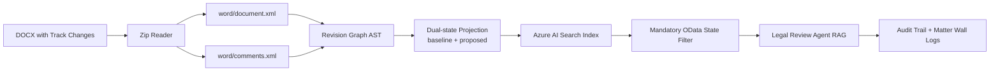
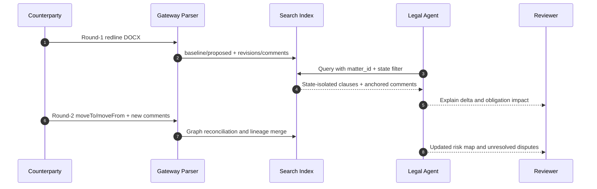

# Enterprise Legal Contract Redline and OOXML Revision-Graph RAG Selection FAQ

## 1. Executive summary

For legal-agent systems, the primary production risk is rarely the model itself; it is the loss of revision semantics in the ingestion layer. When Track Changes documents are flattened into plain text, the pipeline collapses deletion state, insertion state, move lineage, and comment-thread anchoring into one ambiguous stream, which causes structurally misleading answers rather than obvious syntax errors.

This guide compares four production patterns and quantifies trade-offs across twelve dimensions. Pattern A is the primary recommendation for regulated legal workflows because it preserves native OOXML revision semantics and enforces dual-state retrieval (`baseline_pre_redline` and `proposed_post_redline`). Pattern B is a conditional fallback for flattened scans, Pattern C is a conditional path for clean draft sequences, and Pattern D (naive text flattening) is explicitly prohibited.

## 2. Production failure modes and root causes

Failure mode one is the mutant-clause merge. If an extractor concatenates `<w:delText>` and `<w:t>` without state separation, old and new values can fuse into strings such as `"$1,000,000$5,000,000 indemnity cap"`, making the system misreport active obligations and escalation thresholds.

Failure mode two is move-lineage loss. `w:moveFrom` and `w:moveTo` represent a relocation pair, but many pipelines interpret them as an unrelated delete plus insert event, which breaks negotiation continuity and makes legal reviewers believe a clause disappeared and reappeared as a new independent term.

Failure mode three is comment-anchor drift. If `word/comments.xml` is parsed without preserving `w:commentRangeStart` and `w:commentRangeEnd` character spans, the system retains thread text but loses exact disputed-subclause targeting, so downstream reviewers cannot map commentary to legally operative language.

## 3. Four patterns and recommendation

Pattern A (primary) performs native OOXML revision-graph parsing and produces dual-state projections with structured `revisions[]` and `comments[]`. It then indexes state-aware legal units in Azure AI Search and enforces mandatory OData filters for matter isolation and state scoping.

Pattern B (conditional) is designed for flattened PDFs and third-party scan workflows, combining Azure AI Document Intelligence layout extraction, visual redline cue classification (strikethrough, underline, color), and multimodal verification to recover change semantics when native OOXML is unavailable.

Pattern C (conditional) targets clean draft sequences without Track Changes by aligning canonical clause trees, running deterministic Myers/token diff across `v1..vN`, and using long-context synthesis for review narratives. It is often easier to implement than Pattern A but weaker for threaded comment lineage.

Pattern D (prohibited) ingests contracts through plain-text flattening (`docx2txt`-style pipelines) without revision-state separation, which may look acceptable in toy samples but systematically fails in multi-round negotiation artifacts with high semantic density.

## 4. 12-dimension head-to-head matrix

| Dimension | Pattern A (OOXML revision graph) | Pattern B (DI + visual cues) | Pattern C (clean-draft diff) | Pattern D (flattened text) |
|---|---|---|---|---|
| Insert/delete semantic fidelity | High | Medium | Medium | Low |
| `moveFrom/moveTo` reconciliation | High | Low-medium | Low | Low |
| Comment anchor precision | High | Medium | Low-medium | Low |
| Author/time attribution completeness | High | Medium-low | Medium | Low |
| Matter-wall retrieval isolation | High | Medium | Medium | Low |
| Explainability of parse output | High | Medium | High | Low |
| Scan/PDF adaptation coverage | Medium | High | Medium | Medium |
| Implementation complexity | Medium-high | High | Medium | Low |
| Single-document latency | Medium | Medium-high | Medium | Low |
| Audit replay quality | High | Medium | Medium | Low |
| 3-year risk-adjusted TCO | Low | Medium | Medium | High |
| Recommendation level | Primary | Conditional | Conditional | Prohibited |

## 5. Diagram A: end-to-end OOXML revision ingestion and guarded retrieval



## 6. Diagram B: multi-round counterparty redline sequence



## 7. Q1–Q6 worked formulas

### Q1 Mutant-clause hallucination rate

Define `H_mut = N_mutant / N_changed_clauses`. Pipelines without revision-state separation usually show rising `H_mut` as clause complexity increases, while Pattern A sharply reduces `H_mut` by preserving explicit delete/insert state boundaries.

### Q2 Move-pair reconciliation rate

Define `R_move = N_reconciled_move_pairs / N_total_move_events`, where reconciliation requires `moveFrom.id == moveTo.id` and compatible text hashes. If `R_move` drops below threshold, the pipeline should block automatic summary publishing and raise lineage-break alerts.

### Q3 Nested-revision collapse consistency

Define `C_nested = N_consistent_nested / N_nested_total`. If nested `ins/del` ordering cannot be resolved deterministically, `C_nested` decreases and clause-state conflicts propagate into retrieval and synthesis layers.

### Q4 Chunk-boundary versus revision-span cut rate

Define `B_cut = N_revision_span_cut / N_revision_spans`. If retrieval chunks split active revision spans, the model consumes partial legal semantics and produces unstable obligations summaries; revision-aware chunking should keep `B_cut` low.

### Q5 Matter-wall leakage probability

Define `P_leak = N_cross_matter_hits / N_total_queries`. Mandatory OData filters for `matter_id` plus state dimensions keep `P_leak` near zero; advisory-only filters produce leakage growth under concurrent mixed-matter workloads.

### Q6 3-year risk-adjusted cost function

Define `TCO_3y = C_parse + C_index + C_review + C_incident + C_audit`. Pattern A may increase parser engineering effort, but usually reduces incident-driven legal review loops and post-signature remediation cost at enterprise scale.

## 8. Q7–Q12 field Q&A and operational scoring

### Q7 How should active-state retrieval semantics be defined

Model retrieval must expose both `baseline_pre_redline` and `proposed_post_redline` as first-class fields, then bind each query to explicit state intent. “Current signing candidate” questions should default to proposed state, while historical-obligation questions should default to baseline state.

### Q8 What is the minimum comment-thread anchor schema

At minimum keep `comment_id`, `author`, `date`, `start_char`, `end_char`, `anchor_text`, and `thread_text`. Without character-span anchors, comments become topical hints rather than evidentiary references.

### Q9 When should OCR fallback be triggered

Define fallback ratio `F_parse = N_structured_parse_fail / N_total_docs` and set a hard threshold. Trigger Pattern B OCR fallback only when OOXML parse fails or structural files are missing, and always stamp fallback provenance in the output payload.

### Q10 How should attribution reliability be measured

Define `A_attr = N_revision_with_author_date / N_total_revisions`. If attribution coverage drops below threshold, automatic legal conclusions should be gated because reviewer accountability and negotiation lineage become unverifiable.

### Q11 How should reviewer throughput be balanced with quality

Track `TPS_review = N_resolved_clauses / reviewer_hour` together with `E_escape = N_post_sign_escaped_issues / N_signed_docs`. Throughput gains without escape-rate control create hidden legal debt and delayed escalation cycles.

### Q12 When is automated redline summarization acceptable

Use a dual gate: structural gate (parse completeness and state-filter integrity) and risk gate (high-risk clause recall and zero unresolved move-lineage breaks). Only when both gates pass should automated summaries enter reviewer queues.

## 9. OOXML revision-graph parser design constraints

A production parser should read `word/document.xml` and `word/comments.xml` directly from the `.docx` archive, build revision-aware nodes, and emit dual-state projections. Delete-state nodes contribute baseline text, insert-state nodes contribute proposed text, plain nodes contribute to both, and move nodes require explicit pair reconciliation.

Comment anchors must be represented as first-class character-span metadata, not post-hoc keyword matches. The parser should maintain start/end offsets during projection so each comment thread can be replayed against exact disputed substrings.

## 10. Executable stdlib Python: `OoxmlRedlineClauseExtractor`

```python
from __future__ import annotations

import io
import zipfile
import xml.etree.ElementTree as ET
from dataclasses import dataclass
from typing import Dict, List, Tuple

W_NS = "http://schemas.openxmlformats.org/wordprocessingml/2006/main"
R_NS = "http://schemas.openxmlformats.org/package/2006/relationships"
CT_NS = "http://schemas.openxmlformats.org/package/2006/content-types"
W = f"{{{W_NS}}}"


@dataclass
class ExtractedRedline:
    baseline_text: str
    proposed_text: str
    revisions: List[dict]
    comments: List[dict]


class OoxmlRedlineClauseExtractor:
    def __init__(self) -> None:
        self.comment_text_by_id: Dict[str, str] = {}

    def _local(self, tag: str) -> str:
        return tag.split("}", 1)[-1]

    def _collect_text(self, node: ET.Element) -> str:
        parts: List[str] = []
        for el in node.iter():
            local = self._local(el.tag)
            if local in {"t", "delText"} and el.text:
                parts.append(el.text)
        return "".join(parts)

    def _parse_comments(self, comments_xml: bytes) -> Dict[str, str]:
        root = ET.fromstring(comments_xml)
        out: Dict[str, str] = {}
        for c in root.findall(f".//{W}comment"):
            cid = c.attrib.get(f"{W}id", "")
            out[cid] = self._collect_text(c)
        return out

    def extract(self, docx_bytes: bytes) -> ExtractedRedline:
        with zipfile.ZipFile(io.BytesIO(docx_bytes), "r") as zf:
            doc_xml = zf.read("word/document.xml")
            comments_xml = zf.read("word/comments.xml")

        self.comment_text_by_id = self._parse_comments(comments_xml)
        root = ET.fromstring(doc_xml)

        baseline_parts: List[str] = []
        proposed_parts: List[str] = []
        revisions: List[dict] = []

        comment_start: Dict[str, int] = {}
        comment_ranges: Dict[str, Tuple[int, int]] = {}

        def append_text(text: str, to_baseline: bool, to_proposed: bool) -> None:
            if to_baseline:
                baseline_parts.append(text)
            if to_proposed:
                proposed_parts.append(text)

        def proposed_len() -> int:
            return len("".join(proposed_parts))

        def walk(node: ET.Element, in_del: bool = False, in_ins: bool = False) -> None:
            for child in list(node):
                local = self._local(child.tag)

                if local == "commentRangeStart":
                    cid = child.attrib.get(f"{W}id", "")
                    comment_start[cid] = proposed_len()
                    continue
                if local == "commentRangeEnd":
                    cid = child.attrib.get(f"{W}id", "")
                    if cid in comment_start:
                        comment_ranges[cid] = (comment_start[cid], proposed_len())
                    continue

                if local == "del":
                    text = self._collect_text(child)
                    append_text(text, to_baseline=True, to_proposed=False)
                    revisions.append(
                        {
                            "op": "del",
                            "author": child.attrib.get(f"{W}author", ""),
                            "date": child.attrib.get(f"{W}date", ""),
                            "text": text,
                        }
                    )
                    continue

                if local == "ins":
                    text = self._collect_text(child)
                    append_text(text, to_baseline=False, to_proposed=True)
                    revisions.append(
                        {
                            "op": "ins",
                            "author": child.attrib.get(f"{W}author", ""),
                            "date": child.attrib.get(f"{W}date", ""),
                            "text": text,
                        }
                    )
                    continue

                if local == "moveFrom":
                    text = self._collect_text(child)
                    append_text(text, to_baseline=True, to_proposed=False)
                    revisions.append(
                        {
                            "op": "moveFrom",
                            "author": child.attrib.get(f"{W}author", ""),
                            "date": child.attrib.get(f"{W}date", ""),
                            "text": text,
                            "id": child.attrib.get(f"{W}id", ""),
                        }
                    )
                    continue

                if local == "moveTo":
                    text = self._collect_text(child)
                    append_text(text, to_baseline=False, to_proposed=True)
                    revisions.append(
                        {
                            "op": "moveTo",
                            "author": child.attrib.get(f"{W}author", ""),
                            "date": child.attrib.get(f"{W}date", ""),
                            "text": text,
                            "id": child.attrib.get(f"{W}id", ""),
                        }
                    )
                    continue

                if local in {"t", "delText"}:
                    text = child.text or ""
                    if in_del:
                        append_text(text, to_baseline=True, to_proposed=False)
                    elif in_ins:
                        append_text(text, to_baseline=False, to_proposed=True)
                    else:
                        append_text(text, to_baseline=True, to_proposed=True)
                    continue

                walk(child, in_del=in_del, in_ins=in_ins)

        body = root.find(f".//{W}body")
        if body is None:
            raise ValueError("document body not found")
        walk(body)

        baseline_text = "".join(baseline_parts)
        proposed_text = "".join(proposed_parts)

        comments: List[dict] = []
        for cid, (start, end) in comment_ranges.items():
            comments.append(
                {
                    "comment_id": cid,
                    "start_char": start,
                    "end_char": end,
                    "anchor_text": proposed_text[start:end],
                    "text": self.comment_text_by_id.get(cid, ""),
                }
            )

        return ExtractedRedline(
            baseline_text=baseline_text,
            proposed_text=proposed_text,
            revisions=revisions,
            comments=comments,
        )


def build_minimal_redline_docx() -> bytes:
    content_types = f"""<?xml version="1.0" encoding="UTF-8" standalone="yes"?>
<Types xmlns="{CT_NS}">
  <Default Extension="rels" ContentType="application/vnd.openxmlformats-package.relationships+xml"/>
  <Default Extension="xml" ContentType="application/xml"/>
  <Override PartName="/word/document.xml" ContentType="application/vnd.openxmlformats-officedocument.wordprocessingml.document.main+xml"/>
  <Override PartName="/word/comments.xml" ContentType="application/vnd.openxmlformats-officedocument.wordprocessingml.comments+xml"/>
</Types>"""

    rels = f"""<?xml version="1.0" encoding="UTF-8" standalone="yes"?>
<Relationships xmlns="{R_NS}">
  <Relationship Id="rId1" Type="http://schemas.openxmlformats.org/officeDocument/2006/relationships/officeDocument" Target="word/document.xml"/>
</Relationships>"""

    document = f"""<?xml version="1.0" encoding="UTF-8" standalone="yes"?>
<w:document xmlns:w="{W_NS}">
  <w:body>
    <w:p>
      <w:r><w:t>The indemnity cap is </w:t></w:r>
      <w:del w:author="BuyerCounsel" w:date="2026-11-27T01:00:00Z"><w:r><w:delText>$1,000,000</w:delText></w:r></w:del>
      <w:commentRangeStart w:id="0"/>
      <w:ins w:author="SellerCounsel" w:date="2026-11-27T01:05:00Z"><w:r><w:t>$5,000,000</w:t></w:r></w:ins>
      <w:commentRangeEnd w:id="0"/>
      <w:r><w:t>.</w:t></w:r>
    </w:p>
  </w:body>
</w:document>"""

    comments = f"""<?xml version="1.0" encoding="UTF-8" standalone="yes"?>
<w:comments xmlns:w="{W_NS}">
  <w:comment w:id="0" w:author="LeadCounsel" w:date="2026-11-27T01:06:00Z">
    <w:p><w:r><w:t>Please justify the cap increase with precedent deals.</w:t></w:r></w:p>
  </w:comment>
</w:comments>"""

    buf = io.BytesIO()
    with zipfile.ZipFile(buf, "w", zipfile.ZIP_DEFLATED) as zf:
        zf.writestr("[Content_Types].xml", content_types)
        zf.writestr("_rels/.rels", rels)
        zf.writestr("word/document.xml", document)
        zf.writestr("word/comments.xml", comments)
    return buf.getvalue()


if __name__ == "__main__":
    payload = build_minimal_redline_docx()
    result = OoxmlRedlineClauseExtractor().extract(payload)
    assert result.baseline_text == "The indemnity cap is $1,000,000."
    assert result.proposed_text == "The indemnity cap is $5,000,000."
    assert any(r["op"] == "del" and "$1,000,000" in r["text"] for r in result.revisions)
    assert any(r["op"] == "ins" and "$5,000,000" in r["text"] for r in result.revisions)
    assert len(result.comments) == 1
    assert result.comments[0]["anchor_text"] == "$5,000,000"
```

## 11. Azure AI Search redline-aware index JSON (`json.loads` clean)

```json
{
  "name": "legal-redline-clauses-v1",
  "fields": [
    { "name": "id", "type": "Edm.String", "key": true, "filterable": true, "sortable": true },
    { "name": "matter_id", "type": "Edm.String", "filterable": true, "facetable": true },
    { "name": "document_id", "type": "Edm.String", "filterable": true, "facetable": true },
    { "name": "clause_id", "type": "Edm.String", "filterable": true, "sortable": true },
    { "name": "state", "type": "Edm.String", "filterable": true, "facetable": true },
    { "name": "baseline_pre_redline", "type": "Edm.String", "searchable": true },
    { "name": "proposed_post_redline", "type": "Edm.String", "searchable": true },
    { "name": "revisions", "type": "Collection(Edm.ComplexType)", "fields": [
      { "name": "op", "type": "Edm.String", "filterable": true, "facetable": true },
      { "name": "author", "type": "Edm.String", "filterable": true, "facetable": true },
      { "name": "date", "type": "Edm.DateTimeOffset", "filterable": true, "sortable": true },
      { "name": "text", "type": "Edm.String", "searchable": true }
    ]},
    { "name": "comments", "type": "Collection(Edm.ComplexType)", "fields": [
      { "name": "comment_id", "type": "Edm.String", "filterable": true },
      { "name": "start_char", "type": "Edm.Int32", "filterable": true, "sortable": true },
      { "name": "end_char", "type": "Edm.Int32", "filterable": true, "sortable": true },
      { "name": "anchor_text", "type": "Edm.String", "searchable": true },
      { "name": "text", "type": "Edm.String", "searchable": true }
    ]},
    {
      "name": "clause_vector",
      "type": "Collection(Edm.Single)",
      "searchable": true,
      "vectorSearchDimensions": 1536,
      "vectorSearchProfileName": "diskann-default"
    }
  ],
  "vectorSearch": {
    "profiles": [
      { "name": "diskann-default", "algorithm": "diskann-cosine" }
    ],
    "algorithms": [
      { "name": "diskann-cosine", "kind": "hnsw", "hnswParameters": { "metric": "cosine", "m": 8, "efConstruction": 400, "efSearch": 120 } }
    ]
  }
}
```

## 12. KQL: fallback, mutant-span block, and move reconciliation

```kql
let win = 5m;
let parseFallback = AppTraces
| where Message has "redline_parse_fallback"
| summarize fallback_count = count() by bin(TimeGenerated, win), matter=tostring(CustomDimensions.matter_id);
let mutantBlocked = AppTraces
| where Message has "mutant_span_blocked"
| extend span_len = todouble(extract(@"span_len=(\d+)", 1, Message))
| summarize blocked_count = count(), span_p95 = percentile(span_len, 95)
  by bin(TimeGenerated, win), matter=tostring(CustomDimensions.matter_id);
let moveReconcile = AppTraces
| where Message has "move_reconcile_rate"
| extend reconcile_rate = todouble(extract(@"move_reconcile_rate=(\d+(\.\d+)?)", 1, Message))
| summarize reconcile_p50 = percentile(reconcile_rate, 50), reconcile_p95 = percentile(reconcile_rate, 95)
  by bin(TimeGenerated, win), matter=tostring(CustomDimensions.matter_id);
parseFallback
| join kind=fullouter mutantBlocked on TimeGenerated, matter
| extend TimeGenerated = coalesce(TimeGenerated, TimeGenerated1), matter = coalesce(matter, matter1)
| project-away TimeGenerated1, matter1
| join kind=fullouter moveReconcile on TimeGenerated, matter
| extend TimeGenerated = coalesce(TimeGenerated, TimeGenerated1), matter = coalesce(matter, matter1)
| project TimeGenerated, matter, fallback_count, blocked_count, span_p95, reconcile_p50, reconcile_p95
| order by TimeGenerated desc
```

## 13. Retrieval isolation and matter-wall guardrails

Every retrieval call must include `matter_id`, `state`, and authorization context fields, and these filters must be enforced as mandatory OData constraints at query time rather than prompt-level suggestions. Treat cross-matter hit count as a first-class security metric and trigger immediate containment and audit workflows on any unauthorized hit.

For high-sensitivity M&A programs, shard indexes by matter or tightly controlled portfolio groups, and apply least-necessary cross-region replication policies. Reviewer agents should read only authorized shards, while aggregate agents consume de-identified metrics to prevent convenience-driven privilege expansion.

## 14. Decision tree: good fit versus not for

**Good fit (Pattern A):** high contract value, high dispute cost, strict auditability, and explicit responsibility lineage requirements.  
**Good fit (Pattern B):** upstream can provide only scans or flattened PDFs and can absorb multimodal verification overhead.  
**Good fit (Pattern C):** input is a bounded clean-draft sequence and the team prioritizes deterministic diff behavior.  
**Not for (Pattern D):** any production environment requiring legal traceability, negotiation accountability, or regulator-facing evidence quality.

## 15. Enterprise scenarios, 3-year TCO, and quantified outcomes

### 15.1 Scenario A: global M&A virtual data room review center (12,000 redlined drafts)

This workload reviews SPA and ancillary agreements under compressed transaction windows, with risk concentrated in indemnity caps, trigger conditions, reps and warranties, and termination clauses. Pattern A enables side-by-side baseline/proposed evidence retrieval with author/time lineage, which reduces escalation loops caused by semantic ambiguity.

### 15.2 Scenario B: Fortune 500 global procurement MSA negotiation desk

This desk handles cross-jurisdiction supplier redlines where comment-thread accumulation and clause relocation are common failure points. A hybrid Pattern A + Pattern C strategy assigns native revision-graph parsing to high-risk matters and deterministic clean-draft diff to lower-risk lanes, improving throughput without sacrificing audit-grade precision.

### 15.3 Three-tier 3-year risk-adjusted TCO (USD)

| Tier | Scale assumption | Pattern A | Pattern B | Pattern C | Pattern D |
|---|---|---:|---:|---:|---:|
| Tier-1 | `1,500` redlined docs per year | `2.6M` | `3.1M` | `2.9M` | `4.4M*` |
| Tier-2 | `6,000` redlined docs per year | `7.9M` | `9.4M` | `8.8M` | `13.7M*` |
| Tier-3 | `12,000` redlined docs per year | `15.8M` | `19.6M` | `18.1M` | `28.9M*` |

`*` Pattern D appears cheaper at onboarding time but amplifies false interpretation, re-review effort, and post-signature dispute remediation, which dominates total lifecycle cost in high-stakes legal programs.

## 16. D0 / D1 / D2 rollout runbook (18 items)

**D0 (same-day containment)**  
1. Disable plain `docx2txt` ingestion for production legal pipelines.  
2. Enforce dual-state output fields (`baseline` and `proposed`).  
3. Enable `mutant_span_blocked` control and alerting.  
4. Require human gate for high-risk matter summaries.  
5. Enable cross-matter hit audit logs.  
6. Enable move-lineage break fallback policy.  

**D1 (1–2 week hardening)**  
7. Publish standardized OOXML parser library with version governance.  
8. Add comments anchor-span integrity checks.  
9. Enforce mandatory matter-wall OData filters.  
10. Add OCR fallback provenance labels in output contracts.  
11. Add clause-level replay and evidence export APIs.  
12. Add reviewer throughput + escape-rate linked dashboards.  

**D2 (1–2 month optimization)**  
13. Build multi-round negotiation lineage heatmaps.  
14. Configure jurisdiction-aware retention and access templates.  
15. Run quarterly adversarial drills for unauthorized retrieval and evidence tampering.  
16. Automate audit sampling tasks with remediation tracking.  
17. Operationalize cost allocation by matter, team, and region.  
18. Deliver dual-track outputs for executives and engineering teams.  

## 17. Regulatory, privilege, and legal-hold mapping

Map controls to four objective classes: data minimization, access minimization, evidence integrity, and audit traceability, then define machine-verifiable evidence fields for each class. Attorney-client privileged content should use dedicated tagging and access policy lanes rather than sharing generic business-comment retrieval channels.

When legal hold is triggered, retention cleanup must be frozen for affected matters and every state transition must be recorded in an immutable audit chain. For cross-border collaboration, apply region-scoped index and policy templates so one jurisdiction’s assumptions are not accidentally propagated to all regions.

## 18. Sources (retrieved on 2026-11-27)

WordprocessingML reference (`w:ins`, `w:del`, `w:moveFrom`, `w:moveTo`)  
https://learn.microsoft.com/office/open-xml/word/structure-of-a-wordprocessingml-document

Open XML SDK conceptual documentation  
https://learn.microsoft.com/office/open-xml/open-xml-sdk

Azure AI Search filters and OData syntax  
https://learn.microsoft.com/azure/search/search-query-odata-filter

Azure AI Search vector search overview  
https://learn.microsoft.com/azure/search/vector-search-overview

Azure AI Document Intelligence overview  
https://learn.microsoft.com/azure/ai-services/document-intelligence/overview

Legal hold and eDiscovery concepts (Microsoft Purview)  
https://learn.microsoft.com/purview/ediscovery
