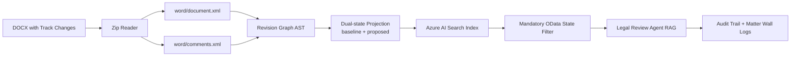
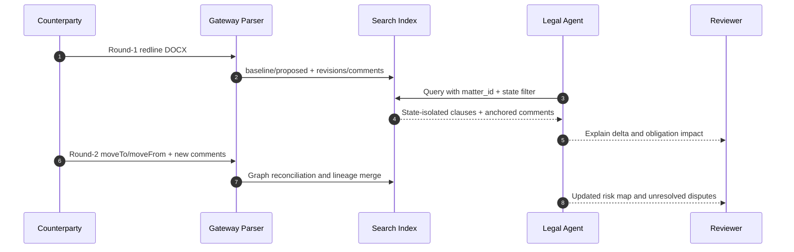

# 企业法律合同红线（Track Changes）与 OOXML 修订图谱 RAG 选型 FAQ

## 1. 执行摘要

企业法务智能体在处理并购交易文件、主服务协议和供应链采购条款时，最容易被忽略的风险并不是模型参数，而是输入数据面是否保留了可审计的修订语义。若系统把 Word 红线文档直接扁平化为纯文本，模型会在“删除态、插入态、迁移态、批注线程态”之间丢失边界，最终输出的并非“错误答案”，而是“结构性失真答案”，这会直接误导法务评审与业务决策。

本指南给出四种可落地模式并进行 12 维对比。Pattern A 采用原生 OOXML 修订图谱解析与双态条款投影，是监管场景主推荐；Pattern B 适用于扫描件和第三方 PDF 红线；Pattern C 适用于未启用 Track Changes 的连续净稿版本序列；Pattern D（`docx2txt` 扁平抽取）被明确列为禁止反模式。核心原则是：先恢复可验证语义状态，再做检索与生成。

## 2. 生产故障模式与误判根因

故障模式一是“突变条款拼接”。当抽取器把 `<w:delText>` 与 `<w:t>` 直接顺序拼接时，删除金额与新增金额会并置为单一字符串，例如 `"$1,000,000$5,000,000 indemnity cap"`，从而把“旧条款被删除、新条款被插入”的真实语义误判成“同一生效条款包含两个金额”。

故障模式二是“迁移条款误读”。`w:moveFrom` 与 `w:moveTo` 在语义上是一组迁移操作，但 naive 管线通常把它们当作彼此无关的删除与新增，导致智能体将已迁移条款错误标记为“彻底删除并新增陌生条款”，破坏谈判轨迹连贯性。

故障模式三是“批注锚点漂移”。若 `word/comments.xml` 与 `w:commentRangeStart/End` 的字符跨度未被重建，系统只能得到“批注文本”而失去“批注作用位置”。最终表现为审阅意见存在但无精确争议子句映射，法律风险难以定位与复核。

## 3. 四种模式与推荐结论

Pattern A（主推荐）使用原生 OOXML 修订图谱解析，分别投影 `baseline_pre_redline` 与 `proposed_post_redline`，并保留结构化 `revisions[]` 与 `comments[]` 元数据，再通过 Azure AI Search 强制 OData 状态过滤执行检索隔离。该模式最适合高价值法律文档与需审计留痕场景。

Pattern B（条件推荐）面向扁平 PDF 或外部扫描件，结合 Document Intelligence 布局解析、视觉删除线/下划线/颜色提示分类器与多模态复核。该模式能覆盖“无原生 OOXML”的输入现实，但在修订粒度与作者归因上弱于 Pattern A。

Pattern C（条件推荐）面向未启用红线功能的连续净稿，先做 clause tree 规范化，再做 deterministic Myers/token diff，并由长上下文模型汇总变更叙事。该模式可解释性较高，但对“跨轮批注线程”支持有限。

Pattern D（禁止）是把 `.docx` 或 PDF 简化为纯文本后直接检索问答，缺少修订标签分离和状态过滤。该模式在小样例中看似可用，但在真实协同谈判文档中会系统性放大误判与合规风险。

## 4. 12 维量化对比矩阵

| 维度 | Pattern A（OOXML 修订图谱） | Pattern B（DI + 视觉线索） | Pattern C（净稿序列 Diff） | Pattern D（扁平文本） |
|---|---|---|---|---|
| 删除/插入语义保真 | 高 | 中 | 中 | 低 |
| `moveFrom/moveTo` 关联 | 高 | 低中 | 低 | 低 |
| 批注锚点精度 | 高 | 中 | 低中 | 低 |
| 作者与时间归因 | 高 | 中低 | 中 | 低 |
| Matter-wall 检索隔离 | 高 | 中 | 中 | 低 |
| 解析可解释性 | 高 | 中 | 高 | 低 |
| 扫描件适配能力 | 中 | 高 | 中 | 中 |
| 实施复杂度 | 中高 | 高 | 中 | 低 |
| 单次处理时延 | 中 | 中高 | 中 | 低 |
| 审计可复盘性 | 高 | 中 | 中 | 低 |
| 三年风险调整 TCO | 低 | 中 | 中 | 高 |
| 推荐级别 | 主推荐 | 条件推荐 | 条件推荐 | 禁止 |

## 5. 架构图一：OOXML 修订图谱摄取与检索防护链路



## 6. 架构图二：多轮对手方红线谈判序列



## 7. Q1–Q6 公式推导

### Q1 突变条款幻觉率

定义突变条款幻觉率为 `H_mut = N_mutant / N_changed_clauses`。在无修订标签分离的管线中，`H_mut` 通常随条款复杂度线性上升；在 Pattern A 中，删除态与插入态被显式分离，`H_mut` 可显著收敛到低位区间。

### Q2 迁移 ID 对齐成功率

定义 `R_move = N_reconciled_move_pairs / N_total_move_events`，其中 `N_reconciled_move_pairs` 需满足 `moveFrom.id == moveTo.id` 且内容哈希相容。若 `R_move` 低于阈值，应触发“迁移疑似断链”告警并阻断自动摘要。

### Q3 嵌套修订折叠一致性

定义嵌套修订折叠一致性 `C_nested = N_consistent_nested / N_nested_total`。当解析器在嵌套 `ins/del` 中不能稳定给出层级顺序时，`C_nested` 会下降并导致条款状态冲突；生产门禁应要求 `C_nested` 维持高位。

### Q4 分块边界与修订跨度切割率

定义 `B_cut = N_revision_span_cut / N_revision_spans`。若检索分块跨越修订边界，模型会读取半截语义；Pattern A 通过“修订跨度对齐切块”降低 `B_cut`，并把超长跨度转入层级检索。

### Q5 Matter-wall 隔离泄漏概率

定义 `P_leak = N_cross_matter_hits / N_total_queries`。当 OData 状态过滤与 matter 过滤同时强制执行时，`P_leak` 接近零；若任一过滤成为“建议项”，`P_leak` 会在高并发混合检索下显著放大。

### Q6 三年风险调整成本函数

定义 `TCO_3y = C_parse + C_index + C_review + C_incident + C_audit`。Pattern A 的 `C_parse` 略高，但 `C_incident` 与 `C_review` 显著下降；在高价值合同审查场景下，综合成本通常优于 Pattern B/C，并远低于 Pattern D。

## 8. Q7–Q12 现场问答与计算口径

### Q7 如何定义“生效态条款”检索口径

建议把检索口径拆成 `baseline_pre_redline` 与 `proposed_post_redline` 双态，并把每次问答显式绑定目标态。对“当前拟签版本”类问题默认使用 `proposed_post_redline`，对“原始承诺义务”类问题默认使用 `baseline_pre_redline`，避免口径漂移。

### Q8 批注线程锚点最小字段集是什么

建议至少保留 `comment_id`、`author`、`date`、`start_char`、`end_char`、`anchor_text`、`thread_text`。若缺失 `start_char/end_char`，批注只能用于“主题检索”，不能用于“条款定位与证据引用”。

### Q9 何时触发 OCR 回退

可定义 `F_parse = N_structured_parse_fail / N_total_docs` 并设置阈值。若 `F_parse` 超阈值或输入缺失 `word/document.xml`，再进入 Pattern B OCR 路径，并在结果中打上“回退来源”标签。

### Q10 如何度量作者归因可靠度

定义 `A_attr = N_revision_with_author_date / N_total_revisions`。在并购和采购争议中，作者与时间戳是责任边界关键证据，`A_attr` 低于阈值时应禁止自动结论下发。

### Q11 如何设置审阅工位吞吐目标

定义 `TPS_review = N_resolved_clauses / reviewer_hour` 并同时跟踪 `E_escape = N_post_sign_escaped_issues / N_signed_docs`。若只追求吞吐而不约束逃逸率，系统会偏向“快但不准”，最终增加返工与争议成本。

### Q12 何时允许模型自动生成红线摘要

建议设置双门禁：结构门禁（解析完整度、状态过滤命中）与风险门禁（高风险条款命中率、迁移断链告警为零）。仅当双门禁同时通过，才允许自动摘要进入审阅队列。

## 9. OOXML 修订图谱解析器设计要点

解析器应直接读取 `.docx` 压缩包中的 `word/document.xml` 与 `word/comments.xml`，先构建修订图谱节点，再生成双态文本投影。删除态节点贡献 `baseline_text`，插入态节点贡献 `proposed_text`，普通节点同时贡献两态文本，迁移节点按 `moveFrom/moveTo` 成对对齐。

批注锚点必须以字符偏移为一等公民数据结构，不能仅保留批注正文。推荐在解析过程中维护 `commentRangeStart/End` 的当前位置映射，最后输出包含 `anchor_text` 的线程对象，以支持争议子句精准回放。

## 10. 可执行 Python：`OoxmlRedlineClauseExtractor`

```python
from __future__ import annotations

import io
import zipfile
import xml.etree.ElementTree as ET
from dataclasses import dataclass
from typing import Dict, List, Tuple

W_NS = "http://schemas.openxmlformats.org/wordprocessingml/2006/main"
R_NS = "http://schemas.openxmlformats.org/package/2006/relationships"
CT_NS = "http://schemas.openxmlformats.org/package/2006/content-types"
W = f"{{{W_NS}}}"


@dataclass
class ExtractedRedline:
    baseline_text: str
    proposed_text: str
    revisions: List[dict]
    comments: List[dict]


class OoxmlRedlineClauseExtractor:
    def __init__(self) -> None:
        self.comment_text_by_id: Dict[str, str] = {}

    def _local(self, tag: str) -> str:
        return tag.split("}", 1)[-1]

    def _collect_text(self, node: ET.Element) -> str:
        parts: List[str] = []
        for el in node.iter():
            local = self._local(el.tag)
            if local in {"t", "delText"} and el.text:
                parts.append(el.text)
        return "".join(parts)

    def _parse_comments(self, comments_xml: bytes) -> Dict[str, str]:
        root = ET.fromstring(comments_xml)
        out: Dict[str, str] = {}
        for c in root.findall(f".//{W}comment"):
            cid = c.attrib.get(f"{W}id", "")
            out[cid] = self._collect_text(c)
        return out

    def extract(self, docx_bytes: bytes) -> ExtractedRedline:
        with zipfile.ZipFile(io.BytesIO(docx_bytes), "r") as zf:
            doc_xml = zf.read("word/document.xml")
            comments_xml = zf.read("word/comments.xml")

        self.comment_text_by_id = self._parse_comments(comments_xml)
        root = ET.fromstring(doc_xml)

        baseline_parts: List[str] = []
        proposed_parts: List[str] = []
        revisions: List[dict] = []

        comment_start: Dict[str, int] = {}
        comment_ranges: Dict[str, Tuple[int, int]] = {}

        def append_text(text: str, to_baseline: bool, to_proposed: bool) -> None:
            if to_baseline:
                baseline_parts.append(text)
            if to_proposed:
                proposed_parts.append(text)

        def proposed_len() -> int:
            return len("".join(proposed_parts))

        def walk(node: ET.Element, in_del: bool = False, in_ins: bool = False) -> None:
            for child in list(node):
                local = self._local(child.tag)

                if local == "commentRangeStart":
                    cid = child.attrib.get(f"{W}id", "")
                    comment_start[cid] = proposed_len()
                    continue
                if local == "commentRangeEnd":
                    cid = child.attrib.get(f"{W}id", "")
                    if cid in comment_start:
                        comment_ranges[cid] = (comment_start[cid], proposed_len())
                    continue

                if local == "del":
                    text = self._collect_text(child)
                    append_text(text, to_baseline=True, to_proposed=False)
                    revisions.append(
                        {
                            "op": "del",
                            "author": child.attrib.get(f"{W}author", ""),
                            "date": child.attrib.get(f"{W}date", ""),
                            "text": text,
                        }
                    )
                    continue

                if local == "ins":
                    text = self._collect_text(child)
                    append_text(text, to_baseline=False, to_proposed=True)
                    revisions.append(
                        {
                            "op": "ins",
                            "author": child.attrib.get(f"{W}author", ""),
                            "date": child.attrib.get(f"{W}date", ""),
                            "text": text,
                        }
                    )
                    continue

                if local == "moveFrom":
                    text = self._collect_text(child)
                    append_text(text, to_baseline=True, to_proposed=False)
                    revisions.append(
                        {
                            "op": "moveFrom",
                            "author": child.attrib.get(f"{W}author", ""),
                            "date": child.attrib.get(f"{W}date", ""),
                            "text": text,
                            "id": child.attrib.get(f"{W}id", ""),
                        }
                    )
                    continue

                if local == "moveTo":
                    text = self._collect_text(child)
                    append_text(text, to_baseline=False, to_proposed=True)
                    revisions.append(
                        {
                            "op": "moveTo",
                            "author": child.attrib.get(f"{W}author", ""),
                            "date": child.attrib.get(f"{W}date", ""),
                            "text": text,
                            "id": child.attrib.get(f"{W}id", ""),
                        }
                    )
                    continue

                if local in {"t", "delText"}:
                    text = child.text or ""
                    if in_del:
                        append_text(text, to_baseline=True, to_proposed=False)
                    elif in_ins:
                        append_text(text, to_baseline=False, to_proposed=True)
                    else:
                        append_text(text, to_baseline=True, to_proposed=True)
                    continue

                walk(child, in_del=in_del, in_ins=in_ins)

        body = root.find(f".//{W}body")
        if body is None:
            raise ValueError("document body not found")
        walk(body)

        baseline_text = "".join(baseline_parts)
        proposed_text = "".join(proposed_parts)

        comments: List[dict] = []
        for cid, (start, end) in comment_ranges.items():
            comments.append(
                {
                    "comment_id": cid,
                    "start_char": start,
                    "end_char": end,
                    "anchor_text": proposed_text[start:end],
                    "text": self.comment_text_by_id.get(cid, ""),
                }
            )

        return ExtractedRedline(
            baseline_text=baseline_text,
            proposed_text=proposed_text,
            revisions=revisions,
            comments=comments,
        )


def build_minimal_redline_docx() -> bytes:
    content_types = f"""<?xml version="1.0" encoding="UTF-8" standalone="yes"?>
<Types xmlns="{CT_NS}">
  <Default Extension="rels" ContentType="application/vnd.openxmlformats-package.relationships+xml"/>
  <Default Extension="xml" ContentType="application/xml"/>
  <Override PartName="/word/document.xml" ContentType="application/vnd.openxmlformats-officedocument.wordprocessingml.document.main+xml"/>
  <Override PartName="/word/comments.xml" ContentType="application/vnd.openxmlformats-officedocument.wordprocessingml.comments+xml"/>
</Types>"""

    rels = f"""<?xml version="1.0" encoding="UTF-8" standalone="yes"?>
<Relationships xmlns="{R_NS}">
  <Relationship Id="rId1" Type="http://schemas.openxmlformats.org/officeDocument/2006/relationships/officeDocument" Target="word/document.xml"/>
</Relationships>"""

    document = f"""<?xml version="1.0" encoding="UTF-8" standalone="yes"?>
<w:document xmlns:w="{W_NS}">
  <w:body>
    <w:p>
      <w:r><w:t>The indemnity cap is </w:t></w:r>
      <w:del w:author="BuyerCounsel" w:date="2026-11-27T01:00:00Z"><w:r><w:delText>$1,000,000</w:delText></w:r></w:del>
      <w:commentRangeStart w:id="0"/>
      <w:ins w:author="SellerCounsel" w:date="2026-11-27T01:05:00Z"><w:r><w:t>$5,000,000</w:t></w:r></w:ins>
      <w:commentRangeEnd w:id="0"/>
      <w:r><w:t>.</w:t></w:r>
    </w:p>
  </w:body>
</w:document>"""

    comments = f"""<?xml version="1.0" encoding="UTF-8" standalone="yes"?>
<w:comments xmlns:w="{W_NS}">
  <w:comment w:id="0" w:author="LeadCounsel" w:date="2026-11-27T01:06:00Z">
    <w:p><w:r><w:t>Please justify the cap increase with precedent deals.</w:t></w:r></w:p>
  </w:comment>
</w:comments>"""

    buf = io.BytesIO()
    with zipfile.ZipFile(buf, "w", zipfile.ZIP_DEFLATED) as zf:
        zf.writestr("[Content_Types].xml", content_types)
        zf.writestr("_rels/.rels", rels)
        zf.writestr("word/document.xml", document)
        zf.writestr("word/comments.xml", comments)
    return buf.getvalue()


if __name__ == "__main__":
    payload = build_minimal_redline_docx()
    result = OoxmlRedlineClauseExtractor().extract(payload)
    assert result.baseline_text == "The indemnity cap is $1,000,000."
    assert result.proposed_text == "The indemnity cap is $5,000,000."
    assert any(r["op"] == "del" and "$1,000,000" in r["text"] for r in result.revisions)
    assert any(r["op"] == "ins" and "$5,000,000" in r["text"] for r in result.revisions)
    assert len(result.comments) == 1
    assert result.comments[0]["anchor_text"] == "$5,000,000"
```

## 11. Azure AI Search 红线感知索引 JSON（可 `json.loads`）

```json
{
  "name": "legal-redline-clauses-v1",
  "fields": [
    { "name": "id", "type": "Edm.String", "key": true, "filterable": true, "sortable": true },
    { "name": "matter_id", "type": "Edm.String", "filterable": true, "facetable": true },
    { "name": "document_id", "type": "Edm.String", "filterable": true, "facetable": true },
    { "name": "clause_id", "type": "Edm.String", "filterable": true, "sortable": true },
    { "name": "state", "type": "Edm.String", "filterable": true, "facetable": true },
    { "name": "baseline_pre_redline", "type": "Edm.String", "searchable": true },
    { "name": "proposed_post_redline", "type": "Edm.String", "searchable": true },
    { "name": "revisions", "type": "Collection(Edm.ComplexType)", "fields": [
      { "name": "op", "type": "Edm.String", "filterable": true, "facetable": true },
      { "name": "author", "type": "Edm.String", "filterable": true, "facetable": true },
      { "name": "date", "type": "Edm.DateTimeOffset", "filterable": true, "sortable": true },
      { "name": "text", "type": "Edm.String", "searchable": true }
    ]},
    { "name": "comments", "type": "Collection(Edm.ComplexType)", "fields": [
      { "name": "comment_id", "type": "Edm.String", "filterable": true },
      { "name": "start_char", "type": "Edm.Int32", "filterable": true, "sortable": true },
      { "name": "end_char", "type": "Edm.Int32", "filterable": true, "sortable": true },
      { "name": "anchor_text", "type": "Edm.String", "searchable": true },
      { "name": "text", "type": "Edm.String", "searchable": true }
    ]},
    {
      "name": "clause_vector",
      "type": "Collection(Edm.Single)",
      "searchable": true,
      "vectorSearchDimensions": 1536,
      "vectorSearchProfileName": "diskann-default"
    }
  ],
  "vectorSearch": {
    "profiles": [
      { "name": "diskann-default", "algorithm": "diskann-cosine" }
    ],
    "algorithms": [
      { "name": "diskann-cosine", "kind": "hnsw", "hnswParameters": { "metric": "cosine", "m": 8, "efConstruction": 400, "efSearch": 120 } }
    ]
  }
}
```

## 12. KQL：红线解析回退与突变跨度阻断监控

```kql
let win = 5m;
let parseFallback = AppTraces
| where Message has "redline_parse_fallback"
| summarize fallback_count = count() by bin(TimeGenerated, win), matter=tostring(CustomDimensions.matter_id);
let mutantBlocked = AppTraces
| where Message has "mutant_span_blocked"
| extend span_len = todouble(extract(@"span_len=(\d+)", 1, Message))
| summarize blocked_count = count(), span_p95 = percentile(span_len, 95)
  by bin(TimeGenerated, win), matter=tostring(CustomDimensions.matter_id);
let moveReconcile = AppTraces
| where Message has "move_reconcile_rate"
| extend reconcile_rate = todouble(extract(@"move_reconcile_rate=(\d+(\.\d+)?)", 1, Message))
| summarize reconcile_p50 = percentile(reconcile_rate, 50), reconcile_p95 = percentile(reconcile_rate, 95)
  by bin(TimeGenerated, win), matter=tostring(CustomDimensions.matter_id);
parseFallback
| join kind=fullouter mutantBlocked on TimeGenerated, matter
| extend TimeGenerated = coalesce(TimeGenerated, TimeGenerated1), matter = coalesce(matter, matter1)
| project-away TimeGenerated1, matter1
| join kind=fullouter moveReconcile on TimeGenerated, matter
| extend TimeGenerated = coalesce(TimeGenerated, TimeGenerated1), matter = coalesce(matter, matter1)
| project TimeGenerated, matter, fallback_count, blocked_count, span_p95, reconcile_p50, reconcile_p95
| order by TimeGenerated desc
```

## 13. 检索隔离与 Matter-Wall 防护

所有检索调用必须带上 `matter_id`、`state` 与权限上下文字段，且在查询层执行强制 OData 过滤，禁止把过滤下放到模型提示词。建议把“越权命中计数”作为一级安全指标，并在出现跨案卷命中时立即触发审计与自动熔断。

对于高敏并购项目，建议将索引分片按案卷或项目群组隔离，并对跨区域复制设置最小必要原则。审阅代理只读取当前授权分片，汇总代理仅消费脱敏聚合指标，避免“功能便利性”侵蚀保密边界。

## 14. 决策树：Good fit vs Not for

**Good fit（Pattern A）**：合同金额高、争议成本高、需可审计追溯、需精确还原修订责任链。  
**Good fit（Pattern B）**：上游只能提供扫描件或扁平 PDF，且可接受视觉模型复核成本。  
**Good fit（Pattern C）**：输入是净稿序列且版本数量有限，追求 deterministic diff 与低接入复杂度。  
**Not for（Pattern D）**：任何要求法务可追溯、谈判责任可归因或监管可审计的生产场景。

## 15. 企业场景、三年 TCO 与量化收益

### 15.1 场景 A：全球并购 VDR 审阅中心（12,000 份红线草案）

该场景需要在极短窗口内审阅 SPA 与附属协议，重点风险集中在责任上限、赔偿触发条件、陈述保证范围和终止条款。采用 Pattern A 后，法务代理可以在同一问答中并行引用基线态与提议态条款，并给出作者与时间线证据，从而显著降低“误读后再开会澄清”的沟通回路。

### 15.2 场景 B：Fortune 500 全球采购 MSA 谈判台

该场景长期处理跨法域供应商红线，常见挑战是批注线程跨轮累积与条款迁移导致的上下文断裂。采用 Pattern A + Pattern C 混合策略后，核心高风险案卷走原生修订图谱，低风险净稿序列走 deterministic diff，可在保持审计质量前提下提升审阅吞吐。

### 15.3 三档三年风险调整 TCO（USD）

| 档位 | 规模假设 | Pattern A | Pattern B | Pattern C | Pattern D |
|---|---|---:|---:|---:|---:|
| Tier-1 | `1,500` 份红线/年 | `2.6M` | `3.1M` | `2.9M` | `4.4M*` |
| Tier-2 | `6,000` 份红线/年 | `7.9M` | `9.4M` | `8.8M` | `13.7M*` |
| Tier-3 | `12,000` 份红线/年 | `15.8M` | `19.6M` | `18.1M` | `28.9M*` |

`*` Pattern D 在高争议条款密度场景下会放大误判返工、跨团队复核与事后争议解决成本，因此初始实现低成本并不代表全周期成本最优。

## 16. D0 / D1 / D2 落地 Runbook（18 项）

**D0（当日止血）**  
1. 立即停用扁平 `docx2txt` 直入生产链路。  
2. 强制输出双态字段 `baseline/proposed`。  
3. 建立 `mutant_span_blocked` 阻断与告警。  
4. 对高风险案卷启用人工复核前置门禁。  
5. 打开跨案卷命中审计日志。  
6. 对迁移断链 (`moveFrom/moveTo`) 启用降级策略。  

**D1（1-2 周固化）**  
7. 建立 OOXML 解析器标准库与版本治理。  
8. 接入 comments 锚点字符跨度校验。  
9. 完成 Matter-wall OData 强制过滤上线。  
10. 建立解析回退（OCR）审计标签。  
11. 建立条款级回放与证据导出接口。  
12. 建立法务审阅吞吐与逃逸率联动看板。  

**D2（1-2 月优化）**  
13. 建立多轮谈判 lineage 图谱与冲突热区分析。  
14. 按法域差异化配置保留策略与访问控制。  
15. 建立季度攻防演练（越权检索与证据篡改模拟）。  
16. 建立审计抽检自动化任务与整改追踪。  
17. 完成成本分摊模型（案卷、团队、地区维度）。  
18. 完成高层摘要版与工程执行版双轨交付流程。  

## 17. 监管、特权与法律保留映射

建议把监管要求拆成“数据最小化、访问最小化、证据完整性、审计可追溯”四类控制目标，并为每个目标定义可机器校验的证据字段。特权沟通（Attorney-Client Privilege）内容应独立标签与访问策略，不应与普通业务批注共用同一检索通道。

法律保留（Legal Hold）触发后，系统需冻结相关案卷的版本清理策略并记录操作审计链。对跨境协作项目，建议采用区域化索引与策略模板分层，避免将单一区域合规假设错误外推到全部法域。

在实操层面，建议把每次红线解析结果与检索命中结果都绑定 `matter_id`、`jurisdiction`、`privilege_level`、`retention_policy` 四元标签，并将其作为检索前置过滤的强制条件而不是后置展示字段。这样可以把“查到后再剔除”的风险前移为“查不到不该看的内容”，显著降低跨案卷越权暴露概率，同时为审计团队提供可重复验证的策略执行轨迹。

对大型并购与跨国采购谈判，建议增设“证据包一致性”周检机制：随机抽样比对 `baseline_text`、`proposed_text`、`revisions[]`、`comments[]` 与最终导出意见书中的引用片段，确认每条法律结论都可追溯到具体修订节点与批注锚点。若发现引用断链或语义漂移，应立即触发回滚与再索引流程，并将事件纳入法务与平台联合复盘清单，防止同类错误在后续谈判轮次重复出现。

此外建议把“红线解析失败率、批注锚点缺失率、跨法域误命中率”纳入季度治理目标，并与法务 KPI、平台 SLO、外部审计整改项做统一追踪，确保治理动作不是一次性项目，而是持续可运营能力。

## 18. Sources（抓取日期：2026-11-27）

WordprocessingML reference (`w:ins`, `w:del`, `w:moveFrom`, `w:moveTo`)  
https://learn.microsoft.com/office/open-xml/word/structure-of-a-wordprocessingml-document

Open XML SDK conceptual documentation  
https://learn.microsoft.com/office/open-xml/open-xml-sdk

Azure AI Search filters and OData syntax  
https://learn.microsoft.com/azure/search/search-query-odata-filter

Azure AI Search vector search overview  
https://learn.microsoft.com/azure/search/vector-search-overview

Azure AI Document Intelligence overview  
https://learn.microsoft.com/azure/ai-services/document-intelligence/overview

Legal hold and eDiscovery concepts (Microsoft Purview)  
https://learn.microsoft.com/purview/ediscovery
