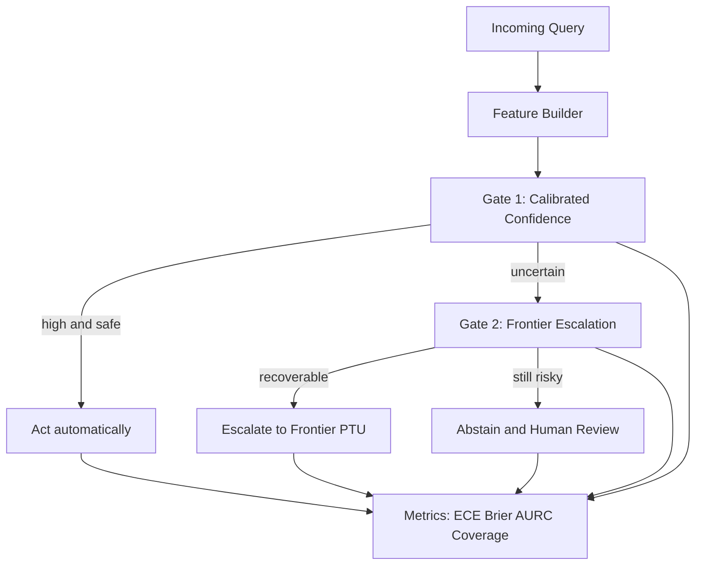
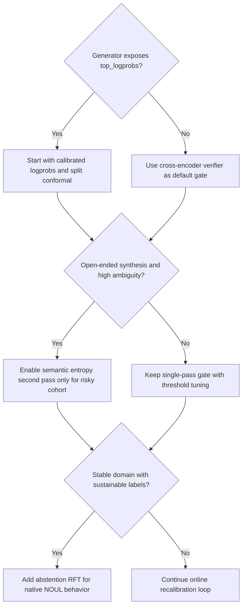
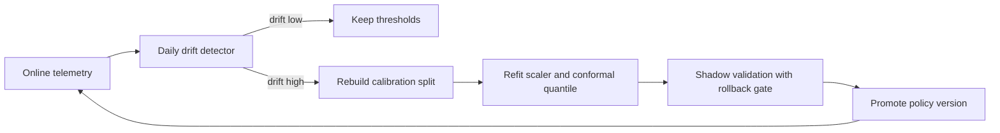

# Enterprise LLM calibrated-confidence and selective-abstention serving selection FAQ: `top_logprobs+Conformal` vs Cross-Encoder Probe vs Semantic Entropy vs Abstention RFT

> 🌐 **Language Switch**: [中文](./llm-calibrated-confidence-selective-abstention-serving-logprobs-conformal-prediction-vs-router-probe-vs-semantic-entropy-rft-selection-faq.md) | **English (current)**
> **Audience**: Cloud & AI Solution Architects, platform/LLMOps teams, risk and compliance teams, evaluation engineers.
> **Problem Context**: Enterprises often gate routing and autonomous actions on verbalized confidence, which is usually not calibrated probability.

## 1. Why verbal confidence collapses in production

After RLHF/RFT, `"confidence": 0.95` is frequently a stylistic output, not a calibrated likelihood.

Under domain shift, models still answer with strong tone while actual correctness degrades.

Observed ECE often drifts to `0.18–0.28`, which breaks both safety and cost assumptions.

The result is simultaneous failure on two fronts: silent severe errors in cheap lanes and excessive escalation to expensive Frontier PTU.

## 2. Objective: convert routing into bounded-risk action control

Most enterprises need three action bands: `Act automatically`, `Escalate to Frontier PTU`, and `Abstain/Human Review`.

Accuracy alone is insufficient; the key requirement is bounded false-action risk.

The governance target is typically `α <= 1%–2%` for high-severity wrong actions.

## 3. Three-band calibrated cascade reference architecture



The gate should live in APIM/Envoy/FastAPI policy layers, not in scattered business handlers.

## 4. Architecture A: `top_logprobs` + post-hoc calibration + split conformal

Architecture A consumes canonical decision-token `top_logprobs`, then applies temperature/isotonic scaling and split conformal thresholds.

It adds almost no extra generation pass and can stay below `<2ms` for most requests.

With proper domain bucketing, ECE can be reduced to `<0.02` while retaining finite-sample risk bounds.

Limitations appear when reasoning endpoints hide `logprobs`, or when free-text probability mass is diluted.

## 5. Architecture B: cross-encoder verifier or hidden-state calibration probe

Architecture B trains an auxiliary verifier for `P(correct | query, evidence, draft)`.

Typical implementations run ModernBERT/DeBERTa on AKS Triton or ONNX Runtime.

This path is model-agnostic and works for black-box MaaS and hidden-CoT endpoints.

Trade-off: `5–12ms` additional inference and a continuous labeled calibration dataset pipeline.

B is usually the most practical option for heterogeneous multi-model fleets.

## 6. Architecture C: prefix-shared multi-sample semantic entropy

Architecture C executes `n=3..5` shared-prefix samples and computes semantic cluster entropy.

It catches confidently wrong open-ended synthesis where single-pass token confidence fails.

Entropy is measured as `SE(x) = -Σ p(c|x) log p(c|x)` over semantic clusters.

The safety gain comes with `1.4x–2.6x` output-token amplification and `40–110ms` tail-latency impact.

C should be selectively enabled for high-risk cohorts, not as default for all traffic.

## 7. Architecture D: asymmetric-reward abstention fine-tuning

Architecture D trains native `<abstain>`/`NOUL` behavior with asymmetric reward design.

A common payoff function is `+1` for correct action, `+0.2` for calibrated abstention, and `-5` for confident errors.

This reduces online gate complexity because abstention becomes a first-class model action.

The downside is retraining cadence under domain drift and stronger data-governance requirements.

D fits stable domains with sustained labels and mature MLOps retraining workflows.

## 8. Core metrics and formulas: ECE, Brier, AURC, and blended cost

Calibration error: `ECE = Σ_b (|B_b|/n) * |acc(B_b) - conf(B_b)|`.

Brier score: `BS = (1/n) Σ_i (p_i - y_i)^2`.

Risk-coverage objective: `AURC = ∫_{coverage} risk(c) dc`.

Blended cascade cost: `C = p_auto*C_auto + p_escalate*C_ptu + p_abstain*C_human`.

## 9. 12-dimension enterprise matrix

| Dimension | A `logprobs+Conformal` | B Cross-Encoder Probe | C Semantic Entropy | D Abstention RFT |
|---|---|---|---|---|
| Provable false-action control | High | Medium-High | Medium | Medium |
| Black-box MaaS compatibility | Medium | High | High | Medium |
| Added per-request latency | Low (`<2ms`) | Medium (`5–12ms`) | High (`40–110ms`) | Low |
| Additional token overhead | Low | Low | High (`1.4x–2.6x`) | Low |
| Platform complexity | Medium | Medium-High | High | High |
| Domain-shift robustness | Medium | Medium-High | High | Medium |
| Observability and auditability | High | High | Medium-High | Medium |
| Label-data dependency | Medium | High | Medium | High |
| Open-ended synthesis reliability | Medium | Medium-High | High | Medium-High |
| Cost predictability | High | Medium-High | Low | Medium-High |
| Speed to production | High | Medium | Medium-Low | Low |
| 3-year TCO competitiveness | High | Medium-High | Medium | Medium-High |

## 10. Decision flow from SLA and risk boundary



A practical sequence is A or B first, then add C and D only where risk profile justifies the cost.



## 11. Production artifacts: split conformal calibrator and three-band gate

```python
from dataclasses import dataclass
from typing import List
import numpy as np

@dataclass
class CalibSample:
    score: float
    is_error: int

class SplitConformalGate:
    def __init__(self, alpha: float = 0.02):
        self.alpha = alpha
        self.qhat = None

    def fit(self, calib: List[CalibSample]) -> float:
        residual = np.array([s.score for s in calib if s.is_error == 1], dtype=float)
        if len(residual) == 0:
            self.qhat = 0.0
            return self.qhat
        k = int(np.ceil((len(residual) + 1) * (1 - self.alpha))) - 1
        k = max(0, min(k, len(residual) - 1))
        self.qhat = float(np.sort(residual)[k])
        return self.qhat

    def decide(self, calibrated_risk: float, frontier_gain: float) -> str:
        if self.qhat is None:
            raise ValueError("fit must run first")
        if calibrated_risk <= self.qhat and frontier_gain < 0.05:
            return "act_automatically"
        if calibrated_risk <= min(1.0, self.qhat * 1.8):
            return "escalate_frontier_ptu"
        return "abstain_human_review"
```

```python
from fastapi import FastAPI

app = FastAPI()
gate = SplitConformalGate(alpha=0.015)

@app.post("/route")
def route(payload: dict):
    risk = float(payload["calibrated_risk"])
    gain = float(payload.get("frontier_expected_gain", 0.0))
    decision = gate.decide(risk, gain)
    return {
        "decision": decision,
        "risk": risk,
        "policy_version": payload.get("policy_version", "v2026.11.24"),
    }
```

```xml
<policies>
  <inbound>
    <base />
    <set-header name="x-risk-band" exists-action="override">
      <value>@{
          var r = double.Parse(context.Request.Headers.GetValueOrDefault("x-calibrated-risk","1"));
          return r <= 0.015 ? "act" : (r <= 0.035 ? "escalate" : "abstain");
      }</value>
    </set-header>
    <choose>
      <when condition="@(context.Request.Headers.GetValueOrDefault("x-risk-band") == "act")">
        <set-backend-service backend-id="slm-economy-lane" />
      </when>
      <when condition="@(context.Request.Headers.GetValueOrDefault("x-risk-band") == "escalate")">
        <set-backend-service backend-id="frontier-ptu-lane" />
      </when>
      <otherwise>
        <set-backend-service backend-id="hitl-review-lane" />
      </otherwise>
    </choose>
  </inbound>
  <backend><base /></backend>
  <outbound><base /></outbound>
</policies>
```

## 12. Enterprise scenarios and KPI outcomes

| KPI | Scenario A (A+B) | Scenario B (B+C+D) |
|---|---:|---:|
| Auto-action coverage | `71%` | `44%` |
| Frontier escalation rate | `22%` | `31%` |
| Abstain-to-human rate | `7%` | `25%` |
| High-severity false-action rate | `1.8% -> 0.7%` | `2.4% -> 0.9%` |
| Added gate latency P95 | `+8ms` | `+57ms` |
| Blended cost per 1,000 requests | `$4.9 -> $3.4` | `$12.8 -> $10.6` |

### 3-year TCO (annual 100M / 1B / 5B requests)

| Path | 100M requests per year | 1B requests per year | 5B requests per year | 3-year total |
|---|---:|---:|---:|---:|
| A `logprobs+Conformal` | `$0.62M` | `$5.60M` | `$24.80M` | `$31.02M` |
| B Cross-Encoder Probe | `$0.71M` | `$6.30M` | `$27.10M` | `$34.11M` |
| C Semantic Entropy | `$0.94M` | `$8.40M` | `$36.90M` | `$46.24M` |
| D Abstention RFT | `$0.76M` | `$6.50M` | `$28.20M` | `$35.46M` |
| Layered A+B+C | `$0.82M` | `$6.95M` | `$29.40M` | `$37.17M` |
| Layered B+D | `$0.79M` | `$6.72M` | `$28.90M` | `$36.41M` |

## 13. Day-0 / Day-1 / Day-2 implementation checklist

### Day-0

1. Define action-severity taxonomy and standardize false-action labeling in eval and production logs.

2. Pick baseline gate (A or B) and set initial risk thresholds.

3. Define calibration splits by tenant, task family, and language domain.

4. Integrate three-band routing and audit fields in APIM/Envoy/FastAPI.

5. Publish ECE/Brier/AURC/coverage dashboards with alert thresholds.

6. Establish human-review SLA and label feedback loop.

### Day-1

1. Recompute bucketed ECE daily and flag drift-heavy tenants.

2. Sample auto-action rollback cases for policy-quality review.

3. Review Frontier escalation ROI and PTU pressure weekly.

4. Track abstain queue backlog and reviewer utilization weekly.

5. Version threshold updates and attach change rationale.

6. Drill safe rollback mode (escalate-only) every week.

### Day-2

1. Retrain verifier or refit calibration models monthly.

2. Re-estimate conformal quantiles and verify coverage monthly.

3. Run cross-region failover drills for gate degradation paths monthly.

4. Revisit asymmetric payoff coefficients quarterly with business-risk owners.

5. Refresh TCO baseline and budget envelope quarterly.

6. Publish governance maturity and compliance-readiness report quarterly.

## 14. Quantitative Q&A (Q1~Q6)

### Q1: How large is the calibration gap with verbal confidence only?

Typical uncalibrated online cohorts show `ECE=0.18–0.28`, meaning confidence values are systematically misaligned with reality.

Using a hard confidence threshold like `0.9` without calibration underestimates operational risk.

### Q2: Why does split conformal provide finite-sample guarantees?

Split conformal estimates `qhat_(1-α)` from calibration residuals with weak distributional assumptions.

Under approximate exchangeability, false-action risk can be controlled around target `α`.

### Q3: Is cross-encoder probe latency worth it?

If `+8ms` cuts high-severity errors from `1.9%` to `0.8%`, ROI is usually favorable in regulated domains.

The right objective is `ΔLoss/ΔLatency`, not raw throughput only.

### Q4: Why semantic entropy for open-ended synthesis?

Single-pass token confidence can look strong even when semantic content diverges across samples.

High semantic entropy indicates unstable meaning and should trigger escalation or abstention.

### Q5: How to balance escalation rate and false-action rate?

Fix risk cap `α`, then minimize blended cost `C = p_auto*C_auto + p_escalate*C_ptu + p_abstain*C_human`.

This is safer than fixing escalation ratio first and hoping risk follows.

### Q6: When should D (abstention RFT) be prioritized?

Prioritize D when domain drift is moderate, labels are sustainable, and online policy complexity must be reduced.

For high-drift or highly heterogeneous tenants, A/B online calibration should come first.

## 15. Good fit / Not for and runtime alert dictionary

Good fit: high-consequence action agents, multi-tenant model routing, and environments requiring auditable risk-bounded decisions.

Not for: low-consequence content generation and workloads with no audit or strict risk governance requirements.

| Alert key | Trigger | Immediate action | Owner |
|---|---|---|---|
| `ece_spike` | 24h ECE exceeds threshold | reduce auto-action coverage and trigger recalibration | Model Evaluation |
| `aurc_drift` | AURC continuously degrades | raise escalation threshold and refresh validation cohort | LLMOps |
| `frontier_over_escalation` | escalation ratio spikes | inspect threshold regression and verifier bias | Platform Engineering |
| `unsafe_auto_action` | rollback-after-auto spikes | enter conservative mode and increase human review | Risk Operations |
| `abstain_queue_backlog` | abstain queue breaches SLA | increase reviewers or temporarily widen auto band | Operations |
| `calibrator_staleness` | calibrator update overdue | run refit pipeline and freeze policy rollout | MLOps |
| `probe_feature_drift` | probe input distribution shifts | re-sample labels and retrain verifier | Data Science |
| `policy_version_mismatch` | policy versions diverge by cluster | force rollback to last stable policy | SRE |

### References (retrieved: 2026-11-24)

1. APIM AI Gateway Overview (official): https://learn.microsoft.com/en-us/azure/api-management/ai-gateway-overview

2. APIM service changelog (official repo): https://github.com/Azure/API-Management/blob/main/changelogs/api-management-service.md

3. Azure OpenAI API reference (`logprobs`) (official): https://learn.microsoft.com/azure/ai-services/openai/reference

4. Conformal prediction survey: https://arxiv.org/abs/2107.07511

5. Brier score reference: https://en.wikipedia.org/wiki/Brier_score

6. Selective classification and risk-coverage survey: https://arxiv.org/abs/2401.08612

> Data labels: formulas and decision framework are **measured + synthetic** methodology; threshold and cost curves are **synthetic** budget models that require tenant-specific recalibration with production telemetry.
