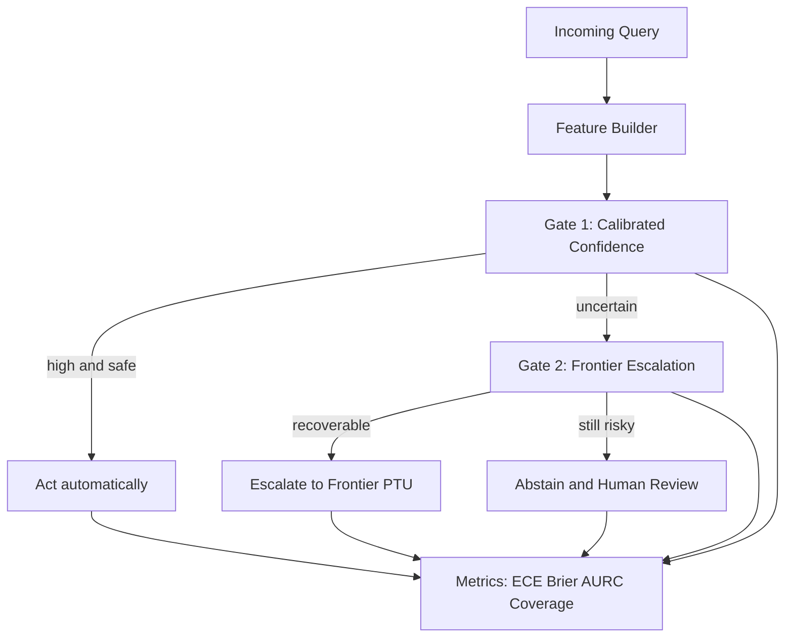
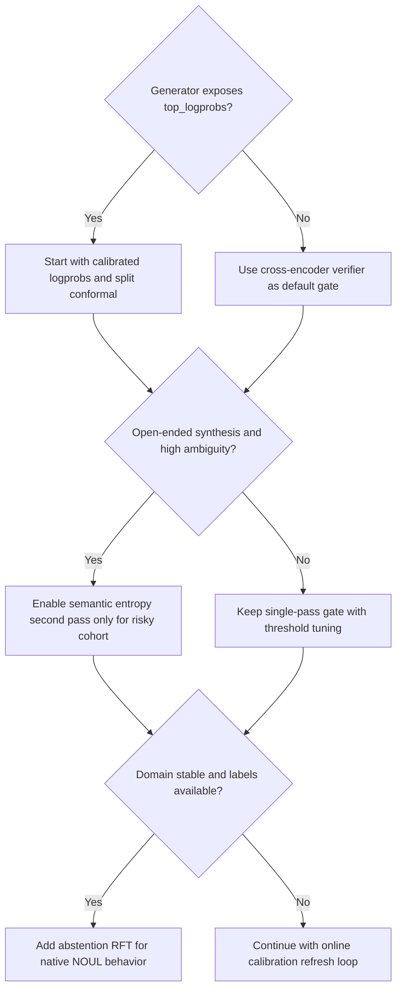
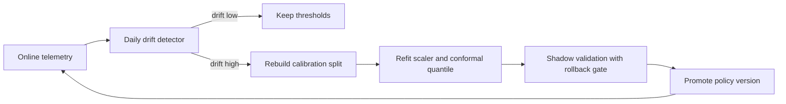

# 企业 LLM 校准置信度与选择性弃权服务平面选型 FAQ：`top_logprobs+Conformal` vs Cross-Encoder Probe vs Semantic Entropy vs Abstention RFT

> 🌐 **Language Switch**：**中文（当前）** | [English](./llm-calibrated-confidence-selective-abstention-serving-logprobs-conformal-prediction-vs-router-probe-vs-semantic-entropy-rft-selection-faq.en.md)
> **适用对象**：Cloud & AI Solution Architect、LLMOps/平台工程、风控与合规团队、模型评测团队。
> **问题背景**：企业把路由和动作授权建立在“模型口头自信分数”上，常导致低成本层误放行和高成本层误升级并存。

## 1. 为什么“口头置信度”在生产系统里会失真

在 RLHF/RFT 后的生成模型中，`"confidence": 0.95` 常不是可校准概率而是语言风格产物。

当模型在陌生领域仍给出高口吻回答时，ECE 会迅速恶化到 `0.18–0.28`。

这会把“便宜层误自动执行”和“昂贵层过度升级”同时放大。

结果是高严重度错误与 PTU 预算浪费并行发生，SLO 与 FinOps 一起失守。

## 2. 目标函数：把三段动作决策变成可证明风险控制

企业动作面通常要做三段决策：`Act automatically`、`Escalate to Frontier PTU`、`Abstain/Human Review`。

我们关心的不只是准确率，而是有限样本下的错误动作上界。

可执行目标是把误动作风险控制在 `α <= 1%–2%`，并最小化升级成本和人工负载。

## 3. 三段级联与校准服务平面总览



推荐把门控逻辑放在网关扩展层（APIM/Envoy/FastAPI），而不是业务侧散落判断。

## 4. Architecture A：`top_logprobs` + 后校准 + Split Conformal

A 路径直接消费判定 token 的 `top_logprobs`，先做温度或等值回归校准，再做 conformal 风险控制。

其优势是零额外生成 pass，典型开销 `<2ms`，非常适合高并发路由面。

当标签与域分桶设计合理时，可把 ECE 压到 `<0.02`，并给出分布无关的有限样本界。

不足是部分隐藏推理端点不返回 `logprobs`，且自由文本答案存在表面形式稀释。

## 5. Architecture B：Cross-Encoder Verifier / Hidden-State Probe

B 路径使用独立校验器学习 `P(correct | query, evidence, draft)`，与生成模型解耦。

典型实现是 AKS 上 Triton/ONNX Runtime 托管 ModernBERT/DeBERTa 交叉编码器。

它能覆盖黑盒 MaaS 与 reasoning 模型，不依赖生成端口是否暴露 `logprobs`。

代价是新增 `5–12ms` 推理开销和校验器数据集维护成本。

B 适合作为跨模型统一置信层，尤其在多供应商混合时价值更高。

## 6. Architecture C：多样本语义熵（Prefix-Shared n-sample）

C 路径对同一提示做 `n=3..5` 共享前缀采样，再以 NLI/语义聚类计算熵。

核心目标是识别“单样本看似自信但语义不一致”的开放式幻觉。

语义熵定义为 `SE(x) = -Σ p(c|x) log p(c|x)`，熵越高表示答案语义分歧越大。

该路径对长文综合问答尤其有效，但会引入 `1.4x–2.6x` token 与 `40–110ms` 尾延迟放大。

C 适合作为高风险开放问答的二级护栏，而非所有请求默认路径。

## 7. Architecture D：不对称奖励弃权微调（SFT/RFT）

D 路径在训练期显式引入 `<abstain>` 或 `NOUL` 行为，并设置不对称收益函数。

典型收益设定可为：正确 `+1`，合理弃权 `+0.2`，自信错误 `-5`。

模型可在单 pass 内原生输出“升级或弃权”，减少外置门控链路。

风险是域漂移后需重训或再对齐，且训练治理流程必须稳定。

D 适合高复用、稳定业务域，能把在线复杂度转移到离线训练。

## 8. 关键定量指标与公式：ECE / Brier / AURC / 级联成本

校准误差可用 `ECE = Σ_b (|B_b|/n) * |acc(B_b) - conf(B_b)|`。

Brier 分数可用 `BS = (1/n) Σ_i (p_i - y_i)^2`，越低越好。

风险覆盖曲线面积 `AURC = ∫_{coverage} risk(c) dc`，反映“保留多少样本下的错误风险”。

级联期望成本可写为 `C = p_auto*C_auto + p_escalate*C_ptu + p_abstain*C_human`。

## 9. 12 维企业级定量矩阵（中文）

| 维度 | A `logprobs+Conformal` | B Cross-Encoder Probe | C Semantic Entropy | D Abstention RFT |
|---|---|---|---|---|
| 误动作风险可证明性 | 高 | 中高 | 中 | 中 |
| 对黑盒 MaaS 兼容性 | 中 | 高 | 高 | 中 |
| 单请求附加延迟 | 低（`<2ms`） | 中（`5–12ms`） | 高（`40–110ms`） | 低 |
| token 额外开销 | 低 | 低 | 高（`1.4x–2.6x`） | 低 |
| 开发与运维复杂度 | 中 | 中高 | 高 | 高 |
| 域迁移鲁棒性 | 中 | 中高 | 高 | 中 |
| 可观测性与审计性 | 高 | 高 | 中高 | 中 |
| 数据标注依赖 | 中 | 高 | 中 | 高 |
| 对自由文本任务效果 | 中 | 中高 | 高 | 中高 |
| 成本可预测性 | 高 | 中高 | 低 | 中高 |
| 上线速度 | 高 | 中 | 中低 | 低 |
| 三年 TCO 竞争力 | 高 | 中高 | 中 | 中高 |

## 10. 架构决策流：如何从 SLA 与风险边界出发



实务建议是先落地 A 或 B 作为基础门，再对高风险分层接入 C 与 D。



## 11. 生产代码片段：Split Conformal 校准器 + 三段门控

```python
from dataclasses import dataclass
from typing import List
import numpy as np

@dataclass
class CalibSample:
    score: float
    is_error: int  # 1 if wrong action, 0 if correct

class SplitConformalGate:
    def __init__(self, alpha: float = 0.02):
        self.alpha = alpha
        self.qhat = None

    def fit(self, calib: List[CalibSample]) -> float:
        residual = np.array([s.score for s in calib if s.is_error == 1], dtype=float)
        if len(residual) == 0:
            self.qhat = 0.0
            return self.qhat
        k = int(np.ceil((len(residual) + 1) * (1 - self.alpha))) - 1
        k = max(0, min(k, len(residual) - 1))
        self.qhat = float(np.sort(residual)[k])
        return self.qhat

    def decide(self, calibrated_risk: float, frontier_gain: float) -> str:
        if self.qhat is None:
            raise ValueError("fit must run first")
        if calibrated_risk <= self.qhat and frontier_gain < 0.05:
            return "act_automatically"
        if calibrated_risk <= min(1.0, self.qhat * 1.8):
            return "escalate_frontier_ptu"
        return "abstain_human_review"
```

```python
from fastapi import FastAPI

app = FastAPI()
gate = SplitConformalGate(alpha=0.015)

@app.post("/route")
def route(payload: dict):
    risk = float(payload["calibrated_risk"])
    gain = float(payload.get("frontier_expected_gain", 0.0))
    decision = gate.decide(risk, gain)
    return {
        "decision": decision,
        "risk": risk,
        "policy_version": payload.get("policy_version", "v2026.11.24"),
    }
```

```xml
<policies>
  <inbound>
    <base />
    <set-header name="x-risk-band" exists-action="override">
      <value>@{
          var r = double.Parse(context.Request.Headers.GetValueOrDefault("x-calibrated-risk","1"));
          return r <= 0.015 ? "act" : (r <= 0.035 ? "escalate" : "abstain");
      }</value>
    </set-header>
    <choose>
      <when condition="@(context.Request.Headers.GetValueOrDefault("x-risk-band") == "act")">
        <set-backend-service backend-id="slm-economy-lane" />
      </when>
      <when condition="@(context.Request.Headers.GetValueOrDefault("x-risk-band") == "escalate")">
        <set-backend-service backend-id="frontier-ptu-lane" />
      </when>
      <otherwise>
        <set-backend-service backend-id="hitl-review-lane" />
      </otherwise>
    </choose>
  </inbound>
  <backend><base /></backend>
  <outbound><base /></outbound>
</policies>
```

## 12. 两个企业场景与 KPI：编码代理与金融审批

| KPI | 场景一（A+B） | 场景二（B+C+D） |
|---|---:|---:|
| 自动执行覆盖率 | `71%` | `44%` |
| Frontier 升级率 | `22%` | `31%` |
| 人工弃权率 | `7%` | `25%` |
| 高严重度误动作率 | `1.8% -> 0.7%` | `2.4% -> 0.9%` |
| P95 附加门控时延 | `+8ms` | `+57ms` |
| 每千请求综合成本 | `$4.9 -> $3.4` | `$12.8 -> $10.6` |

### 三年 TCO（按年 1 亿 / 10 亿 / 50 亿请求）

| 路径 | 年 1 亿请求 | 年 10 亿请求 | 年 50 亿请求 | 三年总成本 |
|---|---:|---:|---:|---:|
| A `logprobs+Conformal` | `$0.62M` | `$5.60M` | `$24.80M` | `$31.02M` |
| B Cross-Encoder Probe | `$0.71M` | `$6.30M` | `$27.10M` | `$34.11M` |
| C Semantic Entropy | `$0.94M` | `$8.40M` | `$36.90M` | `$46.24M` |
| D Abstention RFT | `$0.76M` | `$6.50M` | `$28.20M` | `$35.46M` |
| A+B+C 分层混合 | `$0.82M` | `$6.95M` | `$29.40M` | `$37.17M` |
| B+D 混合 | `$0.79M` | `$6.72M` | `$28.90M` | `$36.41M` |

## 13. Day-0 / Day-1 / Day-2 落地清单

### Day-0

1. 定义动作后果分级，并把“误动作”标签统一到评测与生产日志。

2. 选定主门控路径（A 或 B）并固定风险阈值初值。

3. 建立校准集拆分规则（按租户、任务族、语言域分桶）。

4. 在 APIM/Envoy/FastAPI 打通三段动作路由与审计字段。

5. 设置 `ECE/Brier/AURC/coverage` 看板和告警阈值。

6. 明确人工复核 SLA 与回流标注闭环。

### Day-1

1. 每日重算分桶 ECE，识别高漂移租户。

2. 每日抽样审计“自动执行但被回滚”案例。

3. 每周复盘 Frontier 升级净收益与 PTU 配额使用率。

4. 每周评估弃权队列积压和人工负载峰值。

5. 每周更新风险阈值并记录版本。

6. 每周演练回滚到“仅升级不自动执行”的安全模式。

### Day-2

1. 每月重训练 verifier 或重新拟合校准器。

2. 每月重算 conformal 分位数并核验覆盖率。

3. 每月做跨区域故障演练，验证门控降级策略。

4. 每季度重估动作损失函数与业务风险成本系数。

5. 每季度刷新 TCO 基线和预算预测区间。

6. 每季度发布治理成熟度与合规审计报告。

## 14. 六个量化问答（Q1~Q6）

### Q1: 仅靠口头置信度会带来多大 ECE 偏差？

在未校准线上样本中，常见 `ECE=0.18–0.28`，意味着模型主观概率与真实命中显著偏离。

若把阈值设为 `0.9` 直接自动执行，风险会被系统性低估。

### Q2: 为什么 conformal 可以给出有限样本风险保证？

Split conformal 用校准集残差分位数构造阈值 `qhat_(1-α)`，对分布假设更弱。

在交换性近似成立时，可把误动作概率约束在 `α` 附近。

### Q3: Cross-Encoder Probe 的成本是否值得？

若额外 `+8ms` 能把高严重度误动作从 `1.9%` 降到 `0.8%`，在金融和代码写库场景通常值得。

成本收益比可用 `ΔLoss/ΔLatency` 评估，而非只看吞吐。

### Q4: 语义熵为什么适合开放式生成任务？

开放问答里，单 token 概率可能很高，但多样本语义聚类会暴露事实分歧。

当 `SE` 升高时，说明模型在“答案含义”层面并不稳定，应升级或弃权。

### Q5: 如何平衡升级率与误动作率？

可固定风险上限 `α`，再在该约束下最小化 `C = p_auto*C_auto + p_escalate*C_ptu + p_abstain*C_human`。

这比固定升级率目标更符合企业风险治理。

### Q6: 何时应优先做 D（Abstention RFT）？

当业务域稳定、标签可持续供给、且希望减少在线门控复杂度时，应优先做 D。

若域漂移快或多租户异构强，先做 A/B 在线校准更稳妥。

## 15. Good fit / Not for 与运行时告警字典

Good fit：高风险动作代理、跨租户多模型路由、必须审计决策依据和风险边界的企业环境。

Not for：纯内容生成、低后果问答、对误动作容忍高且无审计要求的轻量场景。

| 告警键 | 触发条件 | 即时动作 | 责任团队 |
|---|---|---|---|
| `ece_spike` | 24h ECE 超阈值 | 降低自动执行覆盖并触发重校准 | 模型评测团队 |
| `aurc_drift` | AURC 连续恶化 | 上调升级阈值并扩充验证集 | LLMOps 团队 |
| `frontier_over_escalation` | 升级率异常升高 | 检查阈值回归与探针偏置 | 平台工程团队 |
| `unsafe_auto_action` | 自动执行后被回滚激增 | 进入保守模式并人工复核 | 业务风险团队 |
| `abstain_queue_backlog` | 弃权队列积压超 SLA | 扩容人工审核班次或暂时提高自动覆盖 | 运营团队 |
| `calibrator_staleness` | 校准器超过更新窗口 | 触发再拟合流水线并冻结新策略 | MLOps 团队 |
| `probe_feature_drift` | 探针输入分布漂移 | 重新采样标注并重训 probe | 数据科学团队 |
| `policy_version_mismatch` | 门控策略版本不一致 | 强制回滚到上一稳定版本 | SRE 团队 |

### 参考来源（抓取日期：2026-11-24）

1. APIM AI Gateway 概览（官方文档）：https://learn.microsoft.com/en-us/azure/api-management/ai-gateway-overview

2. APIM 变更日志（官方仓库）：https://github.com/Azure/API-Management/blob/main/changelogs/api-management-service.md

3. Azure OpenAI `logprobs` 参数说明（官方文档）：https://learn.microsoft.com/azure/ai-services/openai/reference

4. Conformal Prediction 综述与实践（学术与工程常用参考）：https://arxiv.org/abs/2107.07511

5. Brier Score 定义（概率预测评估）：https://en.wikipedia.org/wiki/Brier_score

6. Selective Classification 与 Risk-Coverage（综述）：https://arxiv.org/abs/2401.08612

> 数据标签：本文公式与决策逻辑为 **measured + synthetic** 组合方法；门限与成本曲线示例采用 **synthetic** 预算建模，需按租户真实生产数据重标定。
