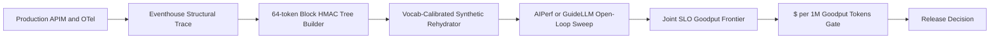
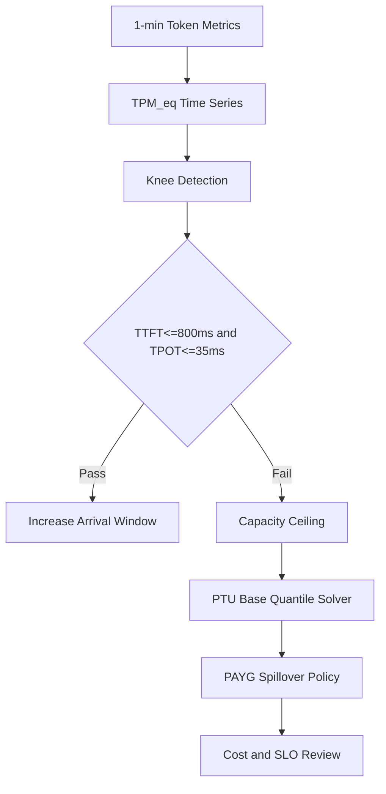

# Enterprise LLM Serving Goodput Benchmarking and PTU Right-Sizing Selection FAQ (AIPerf/GuideLLM vs PTU Sizer vs Synthetic Grid)
> Topic ID: #464
> Section: 3.7 Observability, Performance Engineering, Cost Governance, and Capacity Planning
> Audience: platform architects, LLM performance engineering teams, and FinOps capacity owners
> Goal: find reproducible Goodput capacity and cost-optimal operating points under joint SLO constraints

## 1) Production problem: why capacity forecasts are often wrong by 3x–6x
Many teams benchmark AKS `vLLM/SGLang` capacity with one static prompt loop.
That creates an artificial prefix-cache hit illusion.
Prefill bottlenecks are then hidden and sustainable QPS is overstated.
Other teams use purely random-token tests and erase realistic prefix sharing.
That understates real workloads where multi-turn agents reuse shared schema/tool prefixes.
In Foundry PTU sizing, some teams ignore output-weighted token equivalence.
They size only by input tokens and hit `429` during burst windows.
Many reports still use average latency and ignore P95/P99 tails.
Tail collapse is exactly where user-visible quality fails.
Production needs joint SLO Goodput, not raw `tok/s`.

## 2) Four architecture paths
Pattern A: zero-PII structural replay with open-loop Poisson sweeps and joint Goodput frontier.
Pattern B: APIM token-shape telemetry with Foundry PTU weighted right-sizing and PAYG spillover.
Pattern C: controlled `ISL × OSL × CacheHit` synthetic grid for CI gating.
Pattern D: anti-pattern (single prompt loops, closed-loop concurrency, mean-only reporting, raw prompt replay).

## 3) Twelve-dimension comparison matrix
| Dimension | Pattern A (hash-tree replay) | Pattern B (PTU right-size) | Pattern C (synthetic grid) | Pattern D (anti-pattern) |
|---|---|---|---|---|
| Prefix-hit fidelity | High | Medium | Controlled but approximate | Low |
| Multi-turn realism | High | Medium | Medium | Low |
| Zero-PII safety | High | High | High | Low |
| Open-loop arrival accuracy | High | Medium | Medium | Low |
| Coordinated-omission resistance | High | Medium | Medium | Low |
| Joint SLO evaluability | High | High | Medium | Low |
| PTU input/output weighting | Medium | High | Low | Low |
| CI automation speed | Medium | High | High | Medium |
| `$/1M_goodput_tokens` accuracy | High | High | Medium | Low |
| Upgrade comparability | High | Medium | High | Low |
| Operational complexity | Medium-high | Medium | Medium | Low but risky |
| Enterprise recommendation | Primary | Primary for managed PTU | Secondary gate | Avoid |

## 4) Pattern A: zero-PII prefix-tree replay (primary)
Extract structural traces from production telemetry without customer text.
Store only `timestamp_ms`, `session_id`, `block_hash_ids[]`, `input_tokens`, `output_tokens`, and `tool_pause_ms`.
Use stable HMAC mapping over `16/64-token` KV blocks.
Rehydrate synthetic token streams that preserve sharing topology.
Run open-loop Poisson load sweeps and compute joint SLO Goodput frontiers.
This path best matches real multi-turn workloads with tool pauses and cache reuse.

## 5) Pattern B: APIM token-shape telemetry plus PTU right-sizing (primary for managed Foundry)
Ingest per-minute `promptTokens/completionTokens/cachedTokens` from APIM telemetry.
Compute weighted PTU-equivalent demand with output-token multipliers.
Fit 30-day burst distributions and choose PTU base quantiles.
Serve extreme spikes using PAYG spillover policy.
The target is cost-optimal reliability, not zero spillover at any price.

## 6) Pattern C: parametric synthetic matrix sweep (CI gate)
Define `ISL in {2K,16K,64K}`.
Define `OSL in {256,1024}`.
Define `r_prefix in {0,0.5,0.8}`.
Run nightly on engine, quantization, and driver updates.
Fail builds on joint SLO regression or unit-cost regression.
Use this as a rapid signal, not as the only capacity source of truth.

## 7) Pattern D: anti-pattern definition
Single prompt loops inflate cache hits and overestimate capacity.
Closed-loop fixed concurrency hides queueing blowups.
Mean-only reporting masks user-visible tail collapse.
Raw prompt replay introduces compliance and data leakage risk.
All four anti-patterns produce fragile launch decisions.

## 8) Mermaid: zero-PII pipeline to Goodput frontier


## 9) Mermaid: TTFT-TPOT knee and PTU/PAYG right-sizing loop


## 10) Quantitative Q1-Q6 formulas and thresholds
Q1: joint Goodput definition.
`Goodput(λ)=λ*P(TTFT<=τ1 AND TPOT<=τ2 AND status==200)`.
Q2: knee-point detection.
When `d(TTFT_p95)/dλ` accelerates sharply in a narrow window, congestion knee is reached.
Q3: PTU weighted equivalence.
`TPM_eq = I_uncached + α_cache*I_cached + w_out*O`.
Q4: optimal PTU reservation quantile.
`q* = 1 - (C_ptu_hour / C_payg_equiv_hour)`.
Q5: open-loop vs closed-loop bias.
With bursty arrivals `CV>1.5`, closed-loop concurrency commonly underestimates tail latency.
Q6: multi-turn think-time effect.
Inter-turn pauses alter KV residency TTL and therefore cache-hit dynamics.

## 11) Production code block 1: zero-PII `64-token` HMAC prefix-tree synthesizer
```python
import hmac
import hashlib
from dataclasses import dataclass

BLOCK_SIZE = 64

@dataclass
class TraceRow:
    session_id: str
    block_hash_ids: list[str]
    output_tokens: int
    tool_pause_ms: int

def hmac_block(secret: bytes, value: str) -> int:
    digest = hmac.new(secret, value.encode("utf-8"), hashlib.sha256).digest()
    return int.from_bytes(digest[:4], "big")

def synthesize_prompt_token_ids(secret: bytes, row: TraceRow) -> list[int]:
    token_ids = []
    for block_id in row.block_hash_ids:
        seed = hmac_block(secret, block_id)
        for i in range(BLOCK_SIZE):
            token_ids.append((seed + i * 131) % 32000)
    return token_ids
```

## 12) Production code block 2: GuideLLM/AIPerf joint Goodput CI gate
```python
def passes_joint_slo(result: dict) -> bool:
    return (
        result["ttft_p95_ms"] <= 800
        and result["tpot_p95_ms"] <= 35
        and result["status_2xx_rate"] >= 0.999
    )

def fail_on_cost_regression(current: float, baseline: float) -> None:
    if current > baseline * 1.08:
        raise RuntimeError(
            f"cost regression >8%: current={current:.2f}, baseline={baseline:.2f}"
        )

def evaluate_release(candidate: dict, baseline: dict) -> None:
    if not passes_joint_slo(candidate):
        raise RuntimeError("joint SLO failed")
    fail_on_cost_regression(
        candidate["usd_per_1m_goodput_tokens"],
        baseline["usd_per_1m_goodput_tokens"],
    )
```

## 13) Production code block 3: KQL/Python PTU-PAYG right-sizer
```python
def tpm_equiv(i_uncached: float, i_cached: float, o_tokens: float, alpha_cache: float, w_out: float) -> float:
    return i_uncached + alpha_cache * i_cached + w_out * o_tokens

def choose_ptu_quantile(ptu_hour_cost: float, payg_equiv_hour_cost: float) -> float:
    q = 1 - (ptu_hour_cost / payg_equiv_hour_cost)
    return max(0.0, min(0.995, q))

def ptu_floor_from_histogram(samples: list[float], quantile: float) -> float:
    xs = sorted(samples)
    idx = int((len(xs) - 1) * quantile)
    return xs[idx]
```

## 14) Enterprise scenarios and three-tier three-year TCO
### 14.1 Scenario A: Tier-1 coding and SRE agent platform
Workload migrated from `ND H100 v5` to `ND H200 v5` with `SGLang FP8`.
Pattern A replay exposed a multi-turn KV eviction cliff.
The cliff was missed by synthetic-only sweeps.
Corrected sizing avoided substantial over-provisioning.
Result held `TTFT P95 = 610ms` while reducing annual mis-sizing waste by about `$1.14M`.
### 14.2 Scenario B: global omni-channel banking assistant
Daily scale is about `2.8B` tokens on Foundry.
Pattern B used 30-day minute-level token-shape histograms.
Idle PTU over-reservation was reduced by `31%`.
Spillover failure stayed below `<0.05%`.
### 14.3 Three-tier TCO
| Tier | Daily token scale | Recommended mode | Three-year blended TCO |
|---|---:|---|---:|
| Tier-1 | 0.2B | B + C | `$2.6M` |
| Tier-2 | 0.9B | A + B + C | `$8.9M` |
| Tier-3 | 2.8B | A primary + B right-size + C gate | `$21.7M` |

## 15) Day-0 / Day-1 / Day-2 execution actions (15 items)
Day-0: define zero-PII structural trace schema and audit boundaries.
Day-0: standardize `16/64-token` block mapping contracts.
Day-0: define joint SLO thresholds and failure policy.
Day-0: define open-loop Poisson baseline and deterministic seeds.
Day-0: define PTU/PAYG cost model versioning.
Day-1: onboard APIM minute-level token-shape telemetry.
Day-1: deploy Pattern A replay pipeline and first frontier run.
Day-1: deploy Pattern C CI gate for engine and quantization upgrades.
Day-1: publish `$/1M_goodput_tokens` dashboards and alerts.
Day-1: add approval and rollback controls for capacity policy changes.
Day-2: refresh structural replay frontiers weekly.
Day-2: review PTU quantile and spillover drift monthly.
Day-2: run quarterly burst-and-degradation drills.
Day-2: maintain domain-specific token-shape profiles.
Day-2: codify benchmark outcomes into reusable capacity playbooks.
### 15.1 Pre-production governance checklist
Check that no reversible customer text or sensitive payload is stored.
Check that mean-only metrics are not used for launch decisions.
Check that output-token weighting is included.
Check that capacity conclusions are not drawn from closed-loop only tests.
Check that TTFT and TPOT are enforced jointly.
Check that synthetic sweeps do not replace structural replay evidence.
Check that cost-regression gates and blockers are defined.
Check that cross-region peak-window samples are represented.
Check that benchmark fingerprints are complete and reproducible.
Check that post-release feedback loops and drift analysis are in place.
### 15.2 Observability and alerting recommendations
Track `TTFT_p95`, `TPOT_p95`, `error_rate`, and `queue_delay` together.
Split cache-hit and cache-miss latency distributions.
Bucket `429`, `5xx`, and timeout by arrival-rate bands.
Promote “capacity up, goodput down” as a Sev-1 condition.
Use dual thresholds for PTU spillover: operating and breaker limits.
Auto-generate before/after release deltas for approval boards.
Record full benchmark fingerprint per run.
Export a minimum reproducible failure package for cross-team review.
### 15.3 Anti-pattern guardrails
Do not treat high-throughput low-quality runs as capacity success.
Do not reduce unit cost by silently degrading SLO quality.
Do not share benchmark artifacts without audit metadata.
Do not reuse old distributions blindly for new model versions.
Do not commit long-term PTU contracts without arrival-shape evidence.
Do not ignore the coupling between tool think-time and KV residency.
Do not release capacity policy shifts without rollback paths.
Do not confuse temporary stability with structural stability.
### 15.4 Cross-functional operating model recommendations
Maintain one shared Goodput glossary so platform, product, and finance teams use identical definitions.
Require benchmark reports to include workload-shape evidence and reproducibility fingerprints.
Treat zero-PII enforcement as a hard gate, not a best-effort checklist.
Version pricing assumptions explicitly so PTU and PAYG decisions remain auditable.
Ensure business-critical user journeys are represented in trace replay samples.
Require release boards to review both SLO frontiers and cost frontiers together.
Include cross-region and peak-window samples in recurring capacity reviews.
Maintain engine-family specific cache-behavior profiles instead of one global assumption.
Show business impact metrics alongside latency and throughput metrics.
Classify incidents by recoverability and enforce matched response playbooks.
Version benchmark assets end to end, including scripts, containers, and dependency locks.
Ship capacity policy changes only with replay evidence, rollback plans, and audit records.
Run quarterly resilience drills for burst events, cache-loss events, and region failover stress.
Standardize postmortems with required root-cause, blast-radius, and prevention sections.
Onboard new engineers with a formal benchmark methods starter kit.
### 15.5 Cost-risk balancing implementation details
Derive budget from required SLO Goodput, not the other way around.
Treat cost-down with degraded P95 quality as a failed optimization.
Track both raw-token and goodput-token unit economics.
Use layered PTU commitments plus elastic spillover for burst handling.
Protect high-value workflows with stricter SLO gates and queue priority.
Include `429`, timeout, and breaker-rate KPIs in capacity governance.
Evaluate dependency changes with impact matrices before promotion.
Review utilization, idle reserve, and spillover cost monthly with finance.
Prefer protective throttling before blind expansion under regional anomalies.
Version all planning assumptions to preserve decision context.
Set expiry windows on capacity assumptions and force periodic revalidation.
Bind capacity policy to incident runbooks so degradations can fail safely.
Run pre-holiday focused replay and stress checks against known weak points.
Attach risk cards to every cost optimization proposal.

Sources (fetched 2026-11-27):
- NVIDIA GenAI-Perf / AIPerf: https://github.com/NVIDIA/genai-perf
- GuideLLM: https://github.com/vllm-project/guidellm
- Azure API Management AI Gateway token metrics: https://learn.microsoft.com/azure/api-management/ai-gateway-overview
- Azure AI Foundry PTU guidance: https://learn.microsoft.com/azure/ai-foundry/
