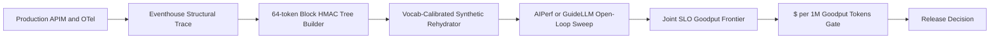
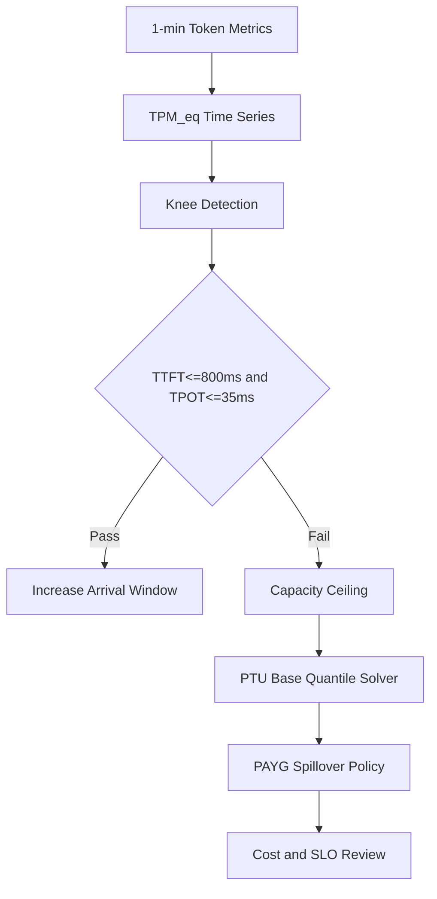

# 企业级 LLM Serving Goodput 基准、前缀缓存回放与 PTU 右定价选型 FAQ（AIPerf/GuideLLM vs PTU Sizer vs Synthetic Grid）
> Topic ID: #464
> Section: 3.7 可观测性、性能工程、成本治理与容量规划
> Audience: 平台架构师、LLMOps 性能工程团队、FinOps 与容量管理团队
> Goal: 在满足联合 SLO（TTFT + TPOT）的前提下，得到真实可复现的 Goodput 容量与成本最优点

## 1）生产问题：为什么容量评估经常错到 3x–6x
企业在做 AKS `vLLM/SGLang` GPU 集群容量评估时，经常用一条固定 prompt 重放。
固定 prompt 会造成前缀缓存命中“幻觉”，导致 prefill 压力被低估。
另一方面，纯随机 token 基准又会把真实业务中的前缀共享完全抹平。
两种极端都会让容量评估偏离生产，最终表现为过配或欠配。
欠配会导致排队爆炸，过配会形成长期 GPU 闲置浪费。
在 Foundry PTU 场景，很多团队只看输入 token，不看输出加权。
这会导致 `TPM` 估算偏低，进而在峰值窗口触发 `429`。
还有团队只看均值吞吐，不看 P95/P99 时延。
这会把“不可用但看似高吞吐”的容量点误判为可用容量点。
企业真正关心的是联合 SLO 下的有效吞吐，而不是裸 `tok/s`。

## 2）四种架构路径总览
Pattern A：零 PII 结构化回放 + 开环泊松到达 + 联合 Goodput 前沿。
Pattern B：APIM token 形态遥测 + Foundry PTU 加权等效 + PAYG 溢出优化。
Pattern C：ISL×OSL×CacheHit 合成网格扫描 + CI 回归门禁。
Pattern D：反模式（单 prompt 压测、闭环并发、均值指标、原始敏感文本回放）。

## 3）十二维对比矩阵
| 维度 | Pattern A（哈希回放） | Pattern B（PTU 右定价） | Pattern C（合成网格） | Pattern D（反模式） |
|---|---|---|---|---|
| 前缀命中保真 | 高 | 中 | 可控但近似 | 低 |
| 多轮轨迹真实性 | 高 | 中 | 中 | 低 |
| 零 PII 合规 | 高 | 高 | 高 | 低 |
| 开环到达准确性 | 高 | 中 | 中 | 低 |
| 协调遗漏规避 | 高 | 中 | 中 | 低 |
| 联合 SLO 评估 | 高 | 高 | 中 | 低 |
| PTU 输入输出加权 | 中 | 高 | 低 | 低 |
| CI 自动回归速度 | 中 | 高 | 高 | 中 |
| `$/1M_goodput_tokens` 准确性 | 高 | 高 | 中 | 低 |
| 引擎升级可比性 | 高 | 中 | 高 | 低 |
| 运营复杂度 | 中高 | 中 | 中 | 低（但危险） |
| 企业推荐 | 主路径 | 托管主路径 | 辅助门禁 | 禁用 |

## 4）Pattern A：零 PII 前缀树回放（主路径）
从生产遥测抽取结构化轨迹，不落原文，不落用户敏感数据。
轨迹只保留 `timestamp_ms`、`session_id`、`block_hash_ids[]`、`input_tokens`、`output_tokens`、`tool_pause_ms`。
利用 `HMAC` 对 `16/64 token` block 做稳定映射，保留前缀共享拓扑。
再用词表校准的合成 token 重建可执行请求序列。
通过开环泊松到达压测，得到联合 SLO 下的 Goodput 前沿。
这条路径最接近真实业务“多轮 + 停顿 + 前缀共享”的统计特征。

## 5）Pattern B：APIM 形态遥测 + PTU 右定价（托管主路径）
从 APIM 收集每分钟 `promptTokens/completionTokens/cachedTokens`。
结合模型输出权重，计算 `TPM_equiv`，得到 PTU 等效负载曲线。
按 30 天分位分布求最优 PTU 底座，峰值走 PAYG 溢出。
目标不是零溢出，而是在成本与可用性之间找到最优折中点。
这条路径特别适合 Foundry PTU + Global Standard 混合策略。

## 6）Pattern C：参数网格扫描（CI 门禁）
定义 `ISL in {2K,16K,64K}`。
定义 `OSL in {256,1024}`。
定义 `r_prefix in {0,0.5,0.8}`。
对每次驱动、量化、引擎升级执行网格扫描。
把 `TTFT_p95/TPOT_p95/Goodput/$` 作为发布门禁指标。
该路径适合快速识别回归，但不应替代真实结构回放。

## 7）Pattern D：反模式说明
单 prompt 回放会人为放大缓存命中，严重高估容量。
闭环固定并发会掩盖排队放大，形成 coordinated omission。
只看均值会掩盖尾延迟失控。
复制原始业务文本做基准会带来合规与泄露风险。
这些做法在 PoC 看似高效，在生产会直接误导容量决策。

## 8）Mermaid：零 PII 轨迹到 Goodput 前沿流水线


## 9）Mermaid：TTFT-TPOT 拐点与 PTU/PAYG 右定价闭环


## 10）Q1-Q6 量化公式与阈值
Q1：联合 Goodput 定义。
`Goodput(λ)=λ*P(TTFT<=τ1 AND TPOT<=τ2 AND status==200)`。
Q2：拐点识别。
当 `d(TTFT_p95)/dλ` 在窄窗口内急剧上升，判定进入拥塞拐点区。
Q3：PTU 等效输入输出加权。
`TPM_eq = I_uncached + α_cache*I_cached + w_out*O`。
Q4：最优 PTU 保留分位。
`q* = 1 - (C_ptu_hour / C_payg_equiv_hour)`。
Q5：开环与闭环偏差。
当到达变异系数 `CV>1.5` 时，闭环并发法会系统性低估尾延迟。
Q6：多轮停顿影响。
会话思考停顿会改变 KV 驻留时间，直接影响命中率与 prefill 压力。

## 11）生产代码块 1：零 PII `64-token` HMAC 前缀树合成器
```python
import hmac
import hashlib
from dataclasses import dataclass

BLOCK_SIZE = 64

@dataclass
class TraceRow:
    session_id: str
    block_hash_ids: list[str]
    output_tokens: int
    tool_pause_ms: int

def hmac_block(secret: bytes, value: str) -> int:
    digest = hmac.new(secret, value.encode("utf-8"), hashlib.sha256).digest()
    return int.from_bytes(digest[:4], "big")

def synthesize_prompt_token_ids(secret: bytes, row: TraceRow) -> list[int]:
    token_ids = []
    for block_id in row.block_hash_ids:
        seed = hmac_block(secret, block_id)
        for i in range(BLOCK_SIZE):
            token_ids.append((seed + i * 131) % 32000)
    return token_ids
```

## 12）生产代码块 2：GuideLLM/AIPerf 联合 Goodput CI 门禁
```python
def passes_joint_slo(result: dict) -> bool:
    return (
        result["ttft_p95_ms"] <= 800
        and result["tpot_p95_ms"] <= 35
        and result["status_2xx_rate"] >= 0.999
    )

def fail_on_cost_regression(current: float, baseline: float) -> None:
    if current > baseline * 1.08:
        raise RuntimeError(
            f"cost regression >8%: current={current:.2f}, baseline={baseline:.2f}"
        )

def evaluate_release(candidate: dict, baseline: dict) -> None:
    if not passes_joint_slo(candidate):
        raise RuntimeError("joint SLO failed")
    fail_on_cost_regression(
        candidate["usd_per_1m_goodput_tokens"],
        baseline["usd_per_1m_goodput_tokens"],
    )
```

## 13）生产代码块 3：KQL + Python PTU/PAYG 右定价
```python
def tpm_equiv(i_uncached: float, i_cached: float, o_tokens: float, alpha_cache: float, w_out: float) -> float:
    return i_uncached + alpha_cache * i_cached + w_out * o_tokens

def choose_ptu_quantile(ptu_hour_cost: float, payg_equiv_hour_cost: float) -> float:
    q = 1 - (ptu_hour_cost / payg_equiv_hour_cost)
    return max(0.0, min(0.995, q))

def ptu_floor_from_histogram(samples: list[float], quantile: float) -> float:
    xs = sorted(samples)
    idx = int((len(xs) - 1) * quantile)
    return xs[idx]
```

## 14）企业案例与三档三年 TCO
### 14.1 案例 A：Tier-1 Coding/SRE Agent 平台
场景从 `ND H100 v5` 迁移到 `ND H200 v5`，采用 `SGLang FP8`。
Pattern A 回放发现多轮轨迹下 KV 驱逐拐点。
该拐点在纯合成网格中未被捕获。
修正后避免了误配节点，年化节省约 `$1.14M`。
同时维持 `TTFT P95 = 610ms`，满足生产门槛。
### 14.2 案例 B：全球银行全渠道助手
日处理规模约 `2.8B` tokens，主运行面是 Foundry。
Pattern B 用 30 天分钟级形态分布做 PTU 右定价。
结果将空闲 PTU 过保留降低 `31%`。
溢出失败率控制在 `<0.05%`。
### 14.3 三档三年 TCO
| 档位 | 日 token 量级 | 推荐模式 | 三年综合 TCO |
|---|---:|---|---:|
| Tier-1 | 0.2B | B + C | `$2.6M` |
| Tier-2 | 0.9B | A + B + C | `$8.9M` |
| Tier-3 | 2.8B | A 主路径 + B 右定价 + C 门禁 | `$21.7M` |

## 15）Day-0 / Day-1 / Day-2（15 项执行动作）
Day-0：定义零 PII 轨迹字段与审计边界。
Day-0：固化 `16/64-token` block 映射规范。
Day-0：建立联合 SLO 阈值与失败准则。
Day-0：建立开环泊松压测基线与随机种子策略。
Day-0：定义 PTU/PAYG 成本模型和价格源版本。
Day-1：接入 APIM token 形态分钟级遥测。
Day-1：部署 Pattern A 回放流水线并跑首轮容量曲线。
Day-1：部署 Pattern C 网格 CI 门禁覆盖引擎升级。
Day-1：建立 `$/1M_goodput_tokens` 看板与报警。
Day-1：建立容量变更审批与灰度回滚策略。
Day-2：每周回放真实结构轨迹更新前沿曲线。
Day-2：每月复盘 PTU 分位与溢出策略偏差。
Day-2：每季度演练高峰流量突发与降级路径。
Day-2：按业务域分层维护 token 形态画像。
Day-2：将压测结论沉淀为容量决策手册与变更模板。
### 15.1 上线前治理核对清单
检查是否误存储任何可逆原文或敏感参数。
检查是否将均值指标误当容量依据。
检查是否忽略输出 token 权重。
检查是否在闭环并发模式下宣布容量结论。
检查是否遗漏 TTFT 与 TPOT 的联合门禁。
检查是否把合成网格结果直接替代真实结构回放。
检查是否缺失成本回归阈值和阻断策略。
检查是否缺失跨区域高峰窗口样本。
检查是否缺失版本对照与可重复种子信息。
检查是否缺失发布后回采闭环与偏差分析。
### 15.2 可观测与告警建议
建议将 `TTFT_p95`、`TPOT_p95`、`error_rate`、`queue_delay` 作为同层看板主指标。
建议区分 cache-hit 与 cache-miss 两条时延分布，避免混合平均掩盖问题。
建议对 `429`、`5xx`、`timeout` 进行分桶并标注到达率区间。
建议把“容量上升但 goodput 下降”定义为一级异常。
建议对 PTU 溢出比例设置双阈值：运营阈值与熔断阈值。
建议把引擎升级前后差异自动生成对照报告，纳入变更审批。
建议记录每次压测的配置指纹（模型版本、量化、驱动、词表版本）。
建议将压测失败样本自动输出最小复现实验包，便于跨团队复核。
### 15.3 反模式防线
不要把一次“高吞吐低质量”结果当成容量成功。
不要把 token 成本下降建立在 SLO 退化之上。
不要在无审计标识的情况下共享压测产物。
不要把同一业务域的旧分布直接套用到新版本模型。
不要在未知到达分布下给出长期 PTU 承诺。
不要忽视工具调用停顿对缓存驻留与排队的联动影响。
不要在没有回滚路径时上线容量策略变更。
不要把“暂时稳定”误解为“结构稳定”。
### 15.4 多团队协同与组织能力建设建议
建议由平台架构团队牵头建立统一的 Goodput 指标词典，避免“吞吐、可用吞吐、用户可感吞吐”口径不一致。
建议由性能工程团队维护标准化压测模板，确保每条容量结论都可追溯到明确的输入分布、模型版本和执行参数。
建议由安全合规团队定义零 PII 结构轨迹的红线字段，并通过自动扫描阻断任何可逆文本泄露。
建议由 FinOps 团队维护 PTU 与 PAYG 的价格版本时间轴，避免历史价格与当前价格混用导致预算偏差。
建议由业务团队确认关键用户旅程的多轮轨迹样本覆盖率，防止仅用技术样本代表业务真实峰值。
建议建立“容量结论变更审批板”，要求每次结论更新必须附带 SLO 前沿图、成本曲线和风险说明。
建议把“跨区域跨时段”样本纳入常态回放，避免只在低峰时段得出看似漂亮但不可迁移的结果。
建议为每个模型家族分别维护缓存命中行为画像，避免把一种引擎的命中模式误套到另一种引擎。
建议在容量评审会上同时展示性能指标和业务影响指标，例如转化、超时率、人工接管率。
建议定义统一的失败分级标准，将“短暂抖动、可恢复退化、不可恢复退化”分层处置。
建议将压测资产纳入版本治理，包括脚本、配置、词表、容器镜像和依赖版本锁定清单。
建议要求所有容量策略变更具备“可回放证明 + 可回滚方案 + 可审计记录”三要素后才允许发布。
建议设定季度能力演练目标，覆盖突发流量、模型降级、缓存失效、区域切换、计费异常等高风险场景。
建议将跨团队复盘文档模板化，强制记录问题根因、影响范围、补救动作和防复发措施。
建议建立新成员入门训练包，包含基准方法论、反模式案例和标准作业流程，降低经验依赖。
### 15.5 经济性与风险平衡的执行细则
在预算编制阶段应先按联合 SLO 反推可用容量，再做成本优化，而不是先锁定预算再倒推性能目标。
当出现“成本下降但 P95 恶化”的结果时，应默认判定为失败实验，不得进入生产路径。
建议将 `$/1M_goodput_tokens` 与 `$/1M_raw_tokens` 同时展示，防止被表面吞吐成本误导。
在 PTU 采购上应优先采用分层承诺策略，核心底座稳定承诺，边缘波动通过 PAYG 或弹性资源承接。
应为高价值业务路径配置更严格的 SLO 闸门和更高优先级队列，避免与低价值流量相互抢占。
建议把“429 率、超时率、熔断触发率”纳入容量策略 KPI，避免单看吞吐造成风险积累。
对外部依赖变化（模型版本、SDK、驱动、网络策略）应建立影响评估矩阵，做到变更前可预判、变更后可验证。
建议在月度经营例会上固定回顾容量利用率、闲置率和溢出成本，推动技术指标与财务指标同频。
当出现区域性异常时，应优先触发容量保护策略而非盲目扩容，防止错误放大和成本失控。
建议将“容量规划假设”显式写入文档并版本化，确保后续审计能准确还原当时决策上下文。
建议为关键策略设置自动失效期，到期必须重新验证，防止历史结论长期失真。
建议将容量策略与事故应急预案联动，确保性能退化时能快速切换到降级服务模式。
建议在重大节日前执行专项压测与回放复核，提前识别可能触发排队雪崩的薄弱环节。
建议将所有成本优化动作配套风险评估卡片，明确收益、代价、回退条件和观察窗口。
建议在容量规划文档中显式标注“本结论适用的业务边界、请求形态、缓存策略和到达分布”，防止跨场景误用。
建议把模型侧优化（量化、并行策略、调度参数）与平台侧优化（队列、路由、限流、熔断）拆分评估，避免混合归因。
建议在季度级评审中保留一轮“反事实回放”，验证若不执行该策略时的性能与成本差异，确保优化价值真实存在。
建议把容量与成本决策结果沉淀为可教学案例库，帮助新团队在相似场景中快速复用成熟方案并规避历史错误。

来源（抓取日期 2026-11-27）：
- NVIDIA GenAI-Perf / AIPerf: https://github.com/NVIDIA/genai-perf
- GuideLLM: https://github.com/vllm-project/guidellm
- Azure API Management AI Gateway token metrics: https://learn.microsoft.com/azure/api-management/ai-gateway-overview
- Azure AI Foundry PTU guidance: https://learn.microsoft.com/azure/ai-foundry/
