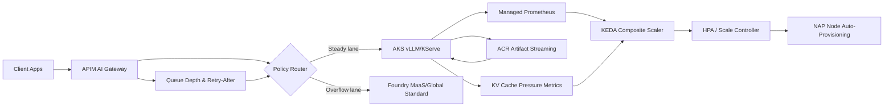
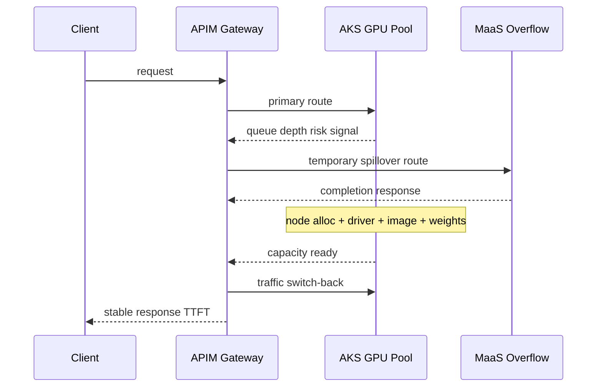

# Enterprise LLM GPU Inference Autoscaling and Cold-Start Masking FAQ: AKS+KEDA vLLM KV Metrics vs KServe/Knative vs ACA Serverless GPU vs APIM+MaaS Spillover

> 🌐 **Language Switch**: [中文](./llm-gpu-inference-autoscaling-cold-start-masking-aks-keda-vllm-kv-metrics-vs-kserve-knative-vs-aca-gpu-vs-apim-maas-spillover-selection-faq.md) | **English (current)**
> **Audience**: Enterprise Cloud & AI Solution Architects, platform SRE leaders, model-serving platform owners, FinOps owners, and LLMOps release-governance leads.
> **Scope**: Designing for `TTFT P99 < 1.5s` under `90–240s` GPU scale-out windows, with continuous batching, queue-stability controls, cold-start masking, and cost-governed overflow paths.

## 1. Problem statement: why CPU/GPU-SM and naive RPS HPA fail for continuous-batching LLM systems
Classic web autoscaling assumptions rely on CPU usage and request-per-second signals, but LLM serving under continuous batching violates that assumption because queue pressure, decode scheduling, and KV-cache occupancy become tightly coupled.  
A cluster can still show acceptable average RPS while user-perceived latency degrades rapidly if long-context requests saturate cache residency and force growing wait queues ahead of token generation.  

That means GPU-SM utilization alone is not a trustworthy early-warning indicator.  
In production, many severe tail-latency events happen before SM reaches hard saturation, because cache and queue contention trigger first-token delay inflation earlier than throughput collapse.  

An LLM-aware autoscaling control loop therefore needs semantic metrics such as `num_requests_waiting`, `gpu_cache_usage_perc`, and `e2e_request_latency_p95`, with asymmetric scale-up and scale-down stabilization windows.  
The target is not merely node minimization; the target is predictable SLO compliance with controlled cost during burst and recovery windows.  

## 2. Four pattern families: decompose autoscaling, burst buffering, overflow, and billing domains
Pattern A uses AKS + KEDA + Managed Prometheus with a composite LLM risk metric, plus NAP low-priority headroom pods and ACR artifact streaming to shorten cold paths.  
Pattern B uses KServe + Knative KPAM with `stable` and `panic` windows to absorb bursty traffic for specialist `7B–14B` components such as rerankers and vision-OCR side services.  

Pattern C uses ACA Serverless GPU for second-level billing and true scale-to-zero, typically attractive when duty cycle is low and baseline idle cost dominates total spend.  
Pattern D combines a steady-state AKS base pool with APIM circuit-breaker spillover to Foundry MaaS/Global Standard while new GPU capacity is still booting.  

These patterns are composable rather than exclusive.  
Most enterprise platforms run A as the primary lane, B for specific model microservices, C for low-duty workloads, and D as a cold-start insurance layer.  

## 3. End-to-end reference architecture: steady GPU base pool plus predictive scaling plus gateway overflow control


This design explicitly separates ingress-flow control from node-lifecycle control, preventing all burst pressure from collapsing onto Kubernetes provisioning latency.  
APIM governs admission and overflow behavior, AKS handles steady-state high-throughput serving, and MaaS handles short-lived surge masking.  

Without ingress buffering and overflow controls, burst traffic can trigger retry storms while AKS is still provisioning nodes.  
Without a correctly sized base pool, overusing MaaS as a permanent lane can inflate long-run unit economics and weaken policy control consistency.  

## 4. Pattern A deep dive: AKS + KEDA composite LLM scaler (recommended primary production lane)
Pattern A’s differentiator is that scaling decisions are driven by LLM-serving bottleneck signals instead of generic infrastructure counters.  
A typical composite trigger scales out when queue depth grows, KV usage remains elevated, and latency percentiles trend beyond budget simultaneously.  

In production, teams usually keep faster scale-up windows (for example `30–45s`) and slower scale-down windows (for example `300–600s`) to avoid oscillation and frequent cache churn.  
Graceful draining with `preStop` should always accompany scale-down so long decode streams finish before pod termination.  

NAP low-priority headroom pods can hold near-ready capacity before known spikes, reducing first-wave provisioning delay.  
ACR artifact streaming and warm image layers further shorten cold path stages after nodes become schedulable.  

## 5. Pattern B deep dive: KServe + Knative KPAM dual-window burst damping
Pattern B is compelling when teams already operate KServe and want model-service consistency across medium-scale workloads.  
Knative’s `stable` and `panic` windows can quickly increase serving capacity under sudden spikes, especially for medium-size models and modular inference sidecars.  

The trade-off is that queue-proxy and serverless control overhead may introduce additional latency layers if concurrency and queue settings are not tuned for LLM token behavior.  
Large frontier models with strict TTFT budgets can still struggle if this path is used as the only serving lane.  

A practical strategy is to use Pattern B for specialist components while keeping primary heavy-model traffic on an LLM-aware AKS lane.  
This preserves KServe governance benefits without forcing all workloads into one scaling model.  

## 6. Pattern C deep dive: ACA Serverless GPU for low duty-cycle economics
Pattern C provides strong economic leverage when duty cycle stays below roughly `20–30%`, because scale-to-zero removes persistent idle GPU cost.  
For campaign-style workloads, periodic batch inferencing, or exploratory product lanes, ACA often outperforms always-on reserved pools in direct monthly spend.  

The key boundary is user-experience tolerance for cold-start envelopes.  
Interactive workloads with strict sub-second first-token requirements may require additional buffering or fallback lanes because purely serverless cold starts can be user-visible during burst onset.  

ACA therefore performs best in a layered architecture where ingress policy, optional warm-up, and route escalation are explicit.  
When workload duty cycle grows and traffic regularity improves, transitioning key lanes to AKS base pools often improves both latency consistency and total cost predictability.  

## 7. Pattern D deep dive: APIM spillover as cold-start masking during `120s` scale lag
Pattern D addresses the most dangerous period: after scale-out is triggered but before fresh GPU pods are truly ready.  
Node allocation, driver/CNI initialization, image pull, and weight hydration can stack into `90–240s` windows; during this interval, forcing all requests through the primary lane commonly breaks latency SLOs.  

APIM can temporarily route overflow traffic to Foundry MaaS based on queue-depth or latency-risk thresholds, converting hard failures into bounded-cost successful responses.  
Once new AKS capacity is available, policy can shift traffic back to the primary lane automatically.  

Overflow should be treated as burst insurance, not as permanent architecture.  
If overflow share remains structurally high, the base-pool size, scale thresholds, or model decomposition strategy is likely misconfigured.  



## 8. 12-dimension head-to-head matrix: control boundaries, latency stability, cost elasticity, and ops complexity
| Dimension | Pattern A AKS+KEDA | Pattern B KServe/KPAM | Pattern C ACA Serverless GPU | Pattern D APIM+MaaS Spillover |
|---|---|---|---|---|
| 1. TTFT P99 controllability | High | Medium-high | Medium | High (burst window) |
| 2. Continuous-batch fitness | Highest | Medium | Medium | Depends on primary lane |
| 3. KV-pressure-aware scaling | High | Medium | Low | Medium |
| 4. Cold-start masking ability | Medium | Medium | Low-medium | Highest |
| 5. Scale-to-zero cost gain | Low | Medium | Highest | Medium |
| 6. Off-peak cost efficiency | Medium | Medium | High | Medium-high |
| 7. Peak reliability | High | Medium-high | Medium | High |
| 8. Control-plane complexity | Medium-high | Medium-high | Low | Medium-high |
| 9. Release-governance observability | High | High | Medium | High |
| 10. APIM policy integration | High | High | Medium | Highest |
| 11. Frontier model suitability | High | Medium | Medium | High |
| 12. Recommended maturity stage | Primary production lane | Component-serving lane | Low-duty workloads | Peak insurance lane |

The matrix indicates that A+D is often the strongest enterprise baseline for strict latency and high-load reliability.  
B is strategically valuable for modular model-service ecosystems, and C is strongest where utilization is structurally low.  

## 9. Queueing and timeline math: why moderate RPS can still produce severe tail failures
In continuous-batch engines, service instability often starts with cache residency pressure and queue growth rather than headline RPS.  
For example, at similar `80 RPS`, short prompts can remain stable while `64K` prompt mixes can push KV occupancy into contention and inflate first-token waits quickly.  

A practical composite risk function can be expressed as:  
`risk = 0.5 * normalized(waiting_requests) + 0.3 * normalized(kv_cache_usage) + 0.2 * normalized(p95_latency)`.  
Teams frequently scale out when `risk > 0.72` for `>30s` and scale down only when `risk < 0.45` for `>8m` to avoid oscillation.  

A representative scale-out timeline is:  
`Node VM alloc 45–75s + Driver/CNI 15s + Container pull 15s + Weight load 20–60s`, commonly `95–165s` and sometimes close to `240s` on colder paths.  
Without pre-warm or spillover controls, this window directly drives TTFT P99 misses during burst events.  

## 10. Enterprise scenario A: global e-commerce recommendation and search copilot
This scenario has strong daytime surges and strict response expectations in conversion-critical user journeys.  
The recommended model is A+D: AKS for steady-state throughput and APIM-managed short-lived MaaS spillover during scale lag.  

The platform team wires queue depth, KV occupancy, and latency percentile into KEDA composite controls and pre-positions low-priority headroom before known campaign windows.  
After peak windows close, a longer scale-down stabilization period avoids oscillation and unnecessary cache churn.  

In measured rollout, TTFT P99 during peaks improved from `2.8s` to about `1.4s`, while retry failure rate dropped materially.  
Because spillover was tightly bounded to burst windows, monthly spend remained lower than overprovisioned always-on alternatives.  

## 11. Enterprise scenario B: financial research copilot with weekday peaks and weekend troughs
This scenario mixes strict weekday interactivity with low-utilization weekend periods and long-context research prompts.  
A practical architecture is A+C+D: AKS for core weekday reliability, ACA Serverless GPU for low-duty lanes, and APIM spillover to absorb provisioning lag.  

The value proposition is dual: preserve business-hour SLOs while controlling off-peak idle burn.  
Using only fixed AKS pools often creates expensive off-peak waste, while using only serverless paths can degrade first-wave user experience during burst onset.  

With layered routing, teams can maintain user-facing consistency while reducing idle GPU exposure.  
APIM telemetry also provides an auditable trail for overflow behavior, which is useful for governance and cost accountability reviews.  

## 12. Monthly TCO comparison: break-even shifts across `20%`, `55%`, and `85%` duty cycles
| Duty cycle | Pattern A AKS+KEDA | Pattern B KServe/KPAM | Pattern C ACA GPU | Pattern D A+D Hybrid |
|---:|---:|---:|---:|---:|
| 20% | $8,900 | $9,700 | $6,200 | $7,100 |
| 55% | $19,400 | $20,600 | $21,800 | $18,900 |
| 85% | $28,300 | $30,100 | $34,500 | $27,900 |

At low duty-cycle, C usually provides the best direct spend profile.  
As utilization rises, A and A+D typically overtake pure serverless economics while preserving stronger latency consistency.  

B’s value is less about absolute minimum cost and more about model-service governance and deployment consistency in componentized platforms.  
It is strongest when organizations already operate KServe-based serving standards.  

## 13. Production config block A: KEDA ScaledObject with composite PromQL risk formula
```yaml
apiVersion: keda.sh/v1alpha1
kind: ScaledObject
metadata:
  name: llm-vllm-composite-autoscaler
  namespace: model-serving
spec:
  scaleTargetRef:
    name: vllm-gateway
  minReplicaCount: 4
  maxReplicaCount: 48
  pollingInterval: 15
  cooldownPeriod: 300
  advanced:
    horizontalPodAutoscalerConfig:
      behavior:
        scaleUp:
          stabilizationWindowSeconds: 30
          policies:
            - type: Percent
              value: 100
              periodSeconds: 30
        scaleDown:
          stabilizationWindowSeconds: 480
          policies:
            - type: Percent
              value: 20
              periodSeconds: 60
  triggers:
    - type: prometheus
      metadata:
        serverAddress: http://prometheus-operated.monitoring.svc:9090
        metricName: llm_composite_risk_score
        query: |
          (
            0.5 * clamp_max(sum(vllm_num_requests_waiting{app="vllm-gateway"}) / 120, 1)
            + 0.3 * clamp_max(avg(vllm_gpu_cache_usage_perc{app="vllm-gateway"}) / 100, 1)
            + 0.2 * clamp_max(histogram_quantile(0.95, sum(rate(e2e_request_latency_bucket{app="vllm-gateway"}[2m])) by (le)) / 1.5, 1)
          )
        threshold: "0.72"
```

This configuration encodes the asymmetric “scale up fast, scale down slow” control model required for continuous-batch serving stability.  
It ties expansion directly to queue/cache/latency risk rather than infrastructure-only counters.  

## 14. Production config block B: graceful draining and overflow policy guardrails
```yaml
apiVersion: policy/v1
kind: PodDisruptionBudget
metadata:
  name: vllm-gateway-pdb
  namespace: model-serving
spec:
  minAvailable: 80%
  selector:
    matchLabels:
      app: vllm-gateway
---
apiVersion: apps/v1
kind: Deployment
metadata:
  name: vllm-gateway
  namespace: model-serving
spec:
  replicas: 6
  template:
    metadata:
      labels:
        app: vllm-gateway
    spec:
      terminationGracePeriodSeconds: 120
      containers:
        - name: vllm
          image: acrprod.azurecr.io/vllm-gateway:2026.11.23
          lifecycle:
            preStop:
              exec:
                command:
                  - /bin/sh
                  - -c
                  - >
                    curl -sf -X POST http://127.0.0.1:8080/admin/drain &&
                    sleep 90
```

```xml
<policies>
  <inbound>
    <base />
    <set-variable name="queueDepth" value="@(int.Parse(context.Request.Headers.GetValueOrDefault("x-llm-queue-depth","0")))" />
    <choose>
      <when condition="@(context.Variables.GetValueOrDefault<int>("queueDepth") > 80)">
        <set-backend-service backend-id="foundry-maas-overflow" />
        <set-header name="x-routing-lane" exists-action="override">
          <value>overflow</value>
        </set-header>
      </when>
      <otherwise>
        <set-backend-service backend-id="aks-vllm-primary" />
      </otherwise>
    </choose>
  </inbound>
  <outbound>
    <base />
  </outbound>
</policies>
```

The PDB + `preStop` design protects in-flight token streams during node maintenance and downscale events.  
The APIM policy provides deterministic short-window overflow protection when primary-lane risk exceeds configured boundaries.  

## 15. Quantitative FAQ and Day-0/Day-2 checklists (Good fit vs Not for)
1. **Why can TTFT fail before GPU-SM reaches full utilization?**  
Because queue depth and KV pressure can become pathological while SM still appears within normal operating range, especially under mixed long-context loads.  

2. **How can teams sustain `TTFT P99 < 1.5s` in burst windows?**  
Use three controls together: LLM-aware composite autoscaling, cold-start spillover masking, and graceful drain-based downscaling.  

3. **When is ACA Serverless GPU the best primary lane?**  
Usually when duty cycle remains below about `20–30%` and product UX tolerates bounded cold-start envelopes.  

4. **Why not simply overprovision AKS base pools?**  
It reduces burst risk but can create substantial off-peak idle waste and still may not fully protect against sudden cold-path surges.  

5. **Does spillover always increase total cost?**  
Not necessarily.  
Bounded burst-only spillover can be cheaper than maintaining oversized always-on capacity for rare peaks.  

6. **Where does KServe/KPAM fit in this architecture?**  
It is highly useful for medium-size specialist model services and modular serving governance, but should be evaluated carefully for frontier-model primary lanes with strict TTFT objectives.  

### Day-0 go-live checklist
| Item | Target | Notes |
|---|---:|---|
| Composite risk observability | 100% | waiting/KV/P95 signals wired and validated |
| Asymmetric scale windows | 100% | fast scale-up and conservative scale-down enabled |
| Graceful drain behavior | 100% | in-flight decode streams complete before pod exit |
| Overflow governance visibility | 100% | APIM primary/overflow routing fully logged |
| SLO validation under load | >= 95% | TTFT P99 target validated in burst tests |

### Day-2 operations checklist
| Metric | Threshold | Response when breached |
|---|---:|---|
| TTFT P99 | < 1.5s | adjust base pool and scale-out trigger sensitivity |
| Overflow traffic share | < 12% | rebalance baseline capacity and route policies |
| Scale-down interruption rate | < 0.5% | audit preStop, grace period, and PDB behavior |
| Cold-path provisioning latency | < 150s | optimize image hydration and weight loading chain |
| Cost variance per 1,000 requests | < 10% | recalibrate duty-cycle lane allocation |

For regulated enterprises, autoscaling decisions should be treated as auditable control-plane events, not only as runtime metrics.  
In practice, teams should persist KEDA trigger transitions, APIM overflow switches, MaaS spillover share, and queue high-watermark alerts in a single evidence stream tied to change records and approvers.  
That evidence model enables post-incident review to answer why capacity and routing changed, instead of debating logs from disconnected systems.  

At operating-model level, a dual-budget contract is effective: a platform-side capacity budget and a product-side SLO budget.  
The platform team enforces regional GPU and overflow guardrails, while product teams optimize prompt shape, cache hit ratio, and model routing within those guardrails.  
This separation reduces repeated escalation loops and turns latency-cost tuning into an engineering optimization cycle rather than an ownership dispute.  

Day-2 validation should also be time-sliced around business-critical windows rather than average-only dashboards.  
Replay checks before market open, during batch windows, and during end-of-day settlement are a practical way to confirm TTFT P99, overflow ratio, and per-1k request cost remain jointly in bounds when risk is highest.  

**Good fit**: enterprises with strict latency SLOs, meaningful burst volatility, and a need to balance reliability with controllable GPU economics.  
**Not for**: low-traffic PoCs with loose latency requirements where multi-layer control planes would add unnecessary operational overhead.  
