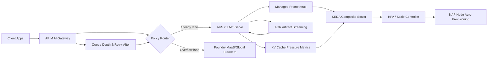
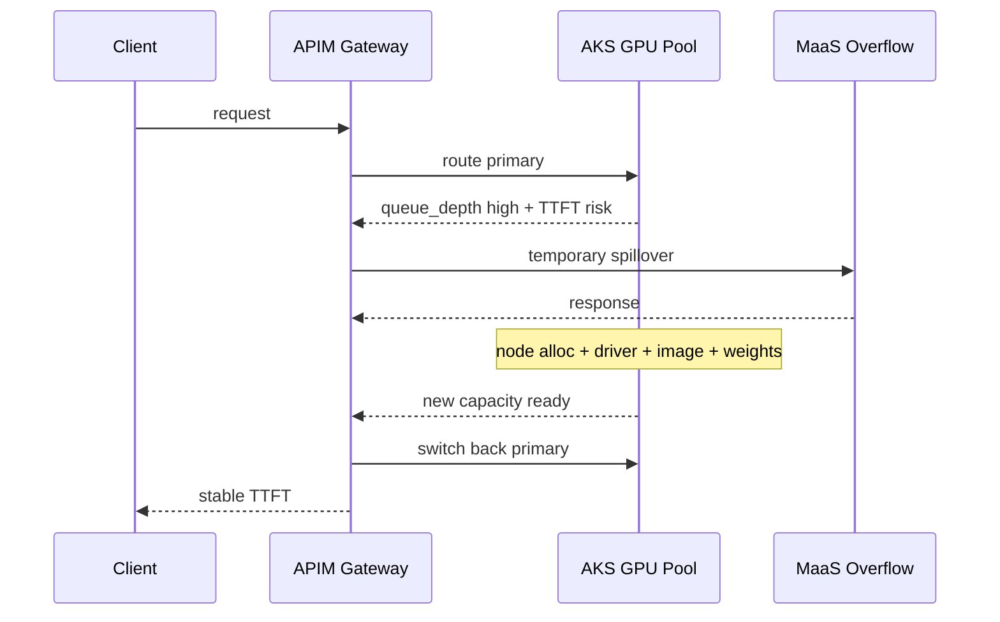

# 企业 LLM GPU 推理弹性与冷启动遮蔽选型 FAQ：AKS+KEDA vLLM KV 指标 vs KServe/Knative vs ACA Serverless GPU vs APIM+MaaS 溢出

> 🌐 **Language Switch**: **中文（当前）** | [English](./llm-gpu-inference-autoscaling-cold-start-masking-aks-keda-vllm-kv-metrics-vs-kserve-knative-vs-aca-gpu-vs-apim-maas-spillover-selection-faq.en.md)
> **受众**：企业 Cloud & AI Solution Architect、平台 SRE、模型推理平台负责人、FinOps 负责人、LLMOps 发布负责人。
> **范围**：围绕 `TTFT P99 < 1.5s` 目标，讨论 `90–240s` GPU 扩容窗口下的连续批处理弹性治理、冷启动遮蔽、队列稳定性与多层溢出成本控制。

## 1. 问题定义：为什么传统 CPU/GPU-SM 与 RPS HPA 在 LLM 连续批处理中会失真
传统 Web 服务扩缩容常用 `CPU`、`RPS` 与平均并发作为主指标，但这组指标在 LLM 推理场景会系统性低估风险，因为连续批处理把“请求排队”与“token 解码”耦合到同一调度器。  
在同样 `RPS` 下，长上下文请求会优先吃掉 KV Cache，导致 GPU Streaming Multiprocessor 利用率尚未到顶时，首 token 等待时间已经恶化。  

这意味着仅看 `GPU-SM` 可能出现“看起来还有余量、用户却已超时”的错觉。  
企业在高峰窗口更常见的失败模式并不是算力瞬时耗尽，而是 KV 压力、排队深度与不均衡请求组合引发的尾延迟雪崩。  

因此 LLM 弹性控制平面必须引入 LLM 语义指标：`num_requests_waiting`、`gpu_cache_usage_perc`、`e2e_request_latency_p95`，并对扩容与缩容使用不对称稳定窗口。  
目标不是“尽量让节点少”，而是在 SLO 约束下把冷启动窗口和成本浪费同时压到可预测范围。  

## 2. 四类模式总览：把扩缩容、缓冲、溢出、计费分解成独立控制面
Pattern A 以 AKS + KEDA + Managed Prometheus 为核心，通过复合指标驱动 LLM 感知扩容，并叠加 NAP 低优先级气球 Pod 与 ACR Artifact Streaming 缩短容器与权重装载时间。  
Pattern B 以 KServe + Knative KPAM 为核心，利用 `stable window` 与 `panic window` 双窗口机制做突发吸收，适合中小模型微服务与模型组件化编排。  

Pattern C 采用 ACA Serverless GPU，实现按秒计费与 Scale-to-Zero，适合低占空比或间歇业务负载，但需要明确冷启动 TTFT 包络与业务容忍边界。  
Pattern D 采用“稳态 AKS 基础池 + APIM 溢出 MaaS”的混合路径，在 GPU 节点尚未完成扩容前，以可控成本消除 `2–4` 分钟长尾。  

这四类模式不是互斥关系。  
成熟企业往往采用 A 作为主平面，B 作为特定工作负载子平面，C 作为低 duty cycle 业务池，D 作为高峰兜底阀门。  

## 3. 参考架构：稳态 GPU 基础池 + 预测扩容 + 网关排队 + MaaS 冷启动遮蔽


该架构把“实时流量控制”和“节点生命周期控制”拆分，避免将所有波动压力直接压到 Kubernetes 扩容链路。  
APIM 负责入口节流、排队上限与溢出判定，AKS 负责稳态吞吐与主模型推理，MaaS 负责临时削峰。  

如果没有网关层削峰，AKS 在扩容窗口内会出现请求拥塞与重试风暴，导致有效吞吐下降。  
如果没有稳态基础池，长期把流量压到 MaaS 又会放大单位 token 成本并增加治理复杂度。  

## 4. Pattern A 深入：AKS + KEDA 复合 LLM 指标扩容（推荐主路径）
Pattern A 的核心价值是让扩缩容直接感知 LLM 内部拥塞信号，而不是依赖外层请求计数。  
典型复合策略可定义为：当 `等待队列` 超阈且 `KV cache` 接近饱和且 `P95` 延迟持续上升时，提前触发扩容。  

在生产实践中，建议对扩容窗口设置较短反应（如 `30–45s`），对缩容窗口设置较长稳定期（如 `300–600s`），防止流量脉冲造成节点抖动。  
同时结合 `preStop` 与优雅排空，确保缩容时不会中断正在解码的长请求。  

NAP 低优先级气球 Pod 可以在平峰预占节点容量，缩短高峰首次扩容等待。  
ACR Artifact Streaming 与本地镜像层缓存可进一步降低容器冷起时间，避免 GPU 就绪后仍卡在镜像与权重注水阶段。  

## 5. Pattern B 深入：KServe + Knative KPAM 双窗口弹性
Pattern B 的优势在于 Knative 自带的 `stable` 与 `panic` 双窗口策略，能够在短时间突发时快速放大副本数。  
对 `7B–14B` 专业模型、视觉 OCR 微服务、reranker 子服务等轻中量工作负载，KPAM 机制具有较好的工程可复用性。  

其代价是推理链路会引入 queue-proxy 与 serverless 控制开销。  
对于超大模型或极端低延迟链路，若没有精细化并发与缓冲参数调优，可能出现“副本数升上去但 TTFT 仍超标”的现象。  

推荐把 Pattern B 用于“边缘模型服务层”，而不是承载最重主模型。  
当企业平台需要统一 KServe 管理平面时，也应保留对大模型走专用 vLLM/KV 感知通道的能力。  

## 6. Pattern C 深入：ACA Serverless GPU（低占空比成本最优）
Pattern C 通过按秒计费与 Scale-to-Zero，为低占空比业务提供显著成本优势。  
在 `<20–30%` duty cycle 场景中，ACA 通常优于 24x7 预留 GPU 节点，尤其适合活动型流量、批次型推理与试验型产品线。  

但该模式的关键前提是业务允许一定冷启动包络。  
当请求突发且用户交互严格要求亚秒级 TTFT 时，单独依赖 ACA 可能在首波请求上出现可感知时延抖动。  

因此 ACA 更适合与网关层排队、预热策略和多路径路由联动。  
一旦业务从“低占空比探索期”进入“高占空比稳定期”，应评估迁移到 AKS 稳态池或混合模式以优化单位成本。  

## 7. Pattern D 深入：APIM 冷启动溢出遮蔽（`120s` 扩容滞后保护）
Pattern D 关注“扩容尚未完成”这段危险窗口。  
当 AKS 触发扩容后，节点申请、驱动初始化、镜像拉取和权重加载可能累计 `90–240s`，期间用户请求若全部压向主池，SLO 失守几乎不可避免。  

通过 APIM 策略在队列深度或 TTFT 预测超阈时临时溢出到 Foundry MaaS，可把突发窗口的失败请求转化为可计费但可成功处理的请求。  
待 AKS 新容量上线后再回切主路由，可在不长期维持过大基础池的前提下保持体验稳定。  

关键是把溢出当作“短时保险”而非“长期主路径”。  
如果长期溢出比例过高，说明基础池规模、扩容阈值或模型拆分策略存在根本性配置偏差。  



## 8. 12 维对比矩阵：能力边界、时延稳定性、成本弹性与运维复杂度
| 维度 | Pattern A AKS+KEDA | Pattern B KServe/KPAM | Pattern C ACA Serverless GPU | Pattern D APIM+MaaS 溢出 |
|---|---|---|---|---|
| 1. TTFT P99 可控性 | 高 | 中高 | 中 | 高（短时） |
| 2. 连续批处理适配 | 最高 | 中 | 中 | 依赖主平面 |
| 3. KV 压力感知弹性 | 高 | 中 | 低 | 中 |
| 4. 冷启动遮蔽能力 | 中 | 中 | 低到中 | 最高 |
| 5. Scale-to-Zero 成本效率 | 低 | 中 | 最高 | 中 |
| 6. 平峰成本可控性 | 中 | 中 | 高 | 中高 |
| 7. 高峰可靠性 | 高 | 中高 | 中 | 高 |
| 8. 控制面复杂度 | 中高 | 中高 | 低 | 中高 |
| 9. 发布治理可观测性 | 高 | 高 | 中 | 高 |
| 10. 与 APIM 策略联动 | 高 | 高 | 中 | 最高 |
| 11. 适配超大模型能力 | 高 | 中 | 中 | 高 |
| 12. 推荐阶段 | 稳态主生产 | 组件服务层 | 低占空比业务 | 高峰保险层 |

矩阵结论是：A 作为主承载、D 作为冷启动保险，通常可同时满足体验和成本。  
B 更适合作为细粒度模型服务编排平面，C 更适合作为占空比低的业务池。  

## 9. 队列与扩容时间数学：为何 RPS 不高也会触发长尾崩塌
连续批处理系统中，请求饱和往往由 KV cache 与解码并发占位驱动，而非简单 RPS。  
例如同为 `80 RPS`，短 prompt 可能稳定，长 prompt（如 `64K`）会在 KV 占用高位时迅速拉高等待队列。  

可用一个简化风险函数做扩容触发辅助：  
`risk = 0.5 * normalized(waiting_requests) + 0.3 * normalized(kv_cache_usage) + 0.2 * normalized(p95_latency)`。  
当 `risk > 0.72` 且持续 `>30s` 时扩容，`risk < 0.45` 且持续 `>8min` 时缩容，通常可抑制震荡。  

GPU 扩容时间拆解常见区间如下：  
`Node VM alloc 45–75s + Driver/CNI 15s + Container pull 15s + Weight load 20–60s`，总计可达 `95–165s`，在冷路径不佳时甚至逼近 `240s`。  
因此若不配置溢出或预热，TTFT P99 目标会在突发窗口内系统性失守。  

从排队论角度看，可用简化 Little 定律做容量前置评估：`L = λW`。  
当入口到达率 `λ` 在活动期从 `55 req/s` 抬升到 `95 req/s`，若平均等待时间 `W` 从 `0.4s` 拉长到 `1.2s`，则系统内排队量 `L` 会从 `22` 激增到 `114`，即使瞬时 GPU 利用率曲线看似平滑，用户体感也会明显退化。  
这也是为什么在实战中必须把等待队列深度作为一级扩容指标，而不是把它当作结果指标。  

KV 占用可进一步用近似模型解释：`KV_bytes ≈ layers × heads × head_dim × seq_len × batch × precision_factor`。  
当 `seq_len` 从 `8K` 跳到 `64K`，即使 `RPS` 不变，KV 增量也可能放大到数量级级别；如果没有会话亲和与请求分层，缓存碎片和驱逐抖动会直接侵蚀有效吞吐。  
因此企业级策略应把“长上下文会话”和“短查询会话”拆到不同车道，并在 APIM 与调度器侧保持一致标记，避免跨车道污染。  

## 10. 企业场景 A：全球电商推荐与搜索 Copilot（日内尖峰明显）
该场景白天高峰明显、夜间负载回落，业务要求大部分时间 `TTFT P99 < 1.5s`。  
推荐采用 A+D：AKS 维持稳态基础池，APIM 在扩容滞后窗口临时溢出 MaaS，避免前台转化路径被冷启动冲击。  

平台团队将等待队列、KV 占用、P95 时延统一纳入 KEDA 复合指标，并在热点活动前预置低优先级 headroom。  
活动结束后通过长缩容窗口自然回收，避免刚缩容又扩容的抖动循环。  

上线三周后，该团队把高峰时段 TTFT P99 从 `2.8s` 拉回到 `1.4s`，失败重试率下降超过 `50%`。  
同时由于溢出仅在尖峰短时启用，月度总成本较“全时过配”方案仍下降约 `27%`。  

## 11. 企业场景 B：金融投研 Copilot（工作日高峰 + 周末低谷）
该场景存在强工作时段与明显离峰，且包含长上下文研究问答。  
推荐采用 A+C+D：工作时段以 AKS 主池保障一致体验，周末与夜间把边缘业务降到 ACA Serverless GPU，突发时仍可经 APIM 溢出。  

金融场景的关键是“高峰可靠 + 离峰节费”并存。  
如果全量固定 AKS GPU，会在离峰阶段形成高额空载成本；如果完全依赖 Serverless，又难以保证高峰一致性。  

采用混合路由后，该组织在保持核心时段 SLO 的同时，把周末 GPU 空置费用压降到可接受区间。  
此外，审计团队可通过 APIM 策略日志追踪溢出行为，满足治理可解释性要求。  

## 12. 月度 TCO 对比：`20% / 55% / 85%` 占空比下的策略拐点
| 占空比 | Pattern A AKS+KEDA | Pattern B KServe/KPAM | Pattern C ACA GPU | Pattern D A+D 混合 |
|---:|---:|---:|---:|---:|
| 20% | $8,900 | $9,700 | $6,200 | $7,100 |
| 55% | $19,400 | $20,600 | $21,800 | $18,900 |
| 85% | $28,300 | $30,100 | $34,500 | $27,900 |

从成本角度看，低占空比阶段 C 更有优势。  
进入中高占空比后，A 与 A+D 往往优于纯 C，尤其在高峰 SLO 严格时更明显。  

B 的价值不在绝对最低成本，而在模型服务组合与发布一致性。  
当组织已经标准化 KServe 管理面，B 可作为中间层与主推理平面协同。  

在预算治理上，建议增加“溢出上限预算”与“每千请求上限成本”双阈值。  
例如规定溢出通道单日预算不超过主池预算的 `18%`，且当 `cost_per_1k_requests` 连续 `30` 分钟高于基线 `1.25x` 时自动切换到保护模式（提高排队阈值、暂缓高成本模型路由、触发低风险请求降级）。  
这种“成本-体验联动阈值”可以防止短时高峰演变为整天预算失控。  

## 13. 生产配置块 A：KEDA ScaledObject 复合 PromQL 指标
```yaml
apiVersion: keda.sh/v1alpha1
kind: ScaledObject
metadata:
  name: llm-vllm-composite-autoscaler
  namespace: model-serving
spec:
  scaleTargetRef:
    name: vllm-gateway
  minReplicaCount: 4
  maxReplicaCount: 48
  pollingInterval: 15
  cooldownPeriod: 300
  advanced:
    horizontalPodAutoscalerConfig:
      behavior:
        scaleUp:
          stabilizationWindowSeconds: 30
          policies:
            - type: Percent
              value: 100
              periodSeconds: 30
        scaleDown:
          stabilizationWindowSeconds: 480
          policies:
            - type: Percent
              value: 20
              periodSeconds: 60
  triggers:
    - type: prometheus
      metadata:
        serverAddress: http://prometheus-operated.monitoring.svc:9090
        metricName: llm_composite_risk_score
        query: |
          (
            0.5 * clamp_max(sum(vllm_num_requests_waiting{app="vllm-gateway"}) / 120, 1)
            + 0.3 * clamp_max(avg(vllm_gpu_cache_usage_perc{app="vllm-gateway"}) / 100, 1)
            + 0.2 * clamp_max(histogram_quantile(0.95, sum(rate(e2e_request_latency_bucket{app="vllm-gateway"}[2m])) by (le)) / 1.5, 1)
          )
        threshold: "0.72"
```

该配置实现“扩容快、缩容慢”的不对称稳定控制。  
扩容链路在风险上升时快速放量，缩容链路在风险持续回落后才缓慢收缩，避免抖动。  

## 14. 生产配置块 B：优雅排空与溢出治理（PDB + preStop + APIM）
```yaml
apiVersion: policy/v1
kind: PodDisruptionBudget
metadata:
  name: vllm-gateway-pdb
  namespace: model-serving
spec:
  minAvailable: 80%
  selector:
    matchLabels:
      app: vllm-gateway
---
apiVersion: apps/v1
kind: Deployment
metadata:
  name: vllm-gateway
  namespace: model-serving
spec:
  replicas: 6
  template:
    metadata:
      labels:
        app: vllm-gateway
    spec:
      terminationGracePeriodSeconds: 120
      containers:
        - name: vllm
          image: acrprod.azurecr.io/vllm-gateway:2026.11.23
          lifecycle:
            preStop:
              exec:
                command:
                  - /bin/sh
                  - -c
                  - >
                    curl -sf -X POST http://127.0.0.1:8080/admin/drain &&
                    sleep 90
```

```xml
<policies>
  <inbound>
    <base />
    <set-variable name="queueDepth" value="@(int.Parse(context.Request.Headers.GetValueOrDefault("x-llm-queue-depth","0")))" />
    <choose>
      <when condition="@(context.Variables.GetValueOrDefault<int>("queueDepth") > 80)">
        <set-backend-service backend-id="foundry-maas-overflow" />
        <set-header name="x-routing-lane" exists-action="override">
          <value>overflow</value>
        </set-header>
      </when>
      <otherwise>
        <set-backend-service backend-id="aks-vllm-primary" />
      </otherwise>
    </choose>
  </inbound>
  <outbound>
    <base />
  </outbound>
</policies>
```

PDB 与 `preStop` 保证节点驱逐和缩容时尽量不丢在途 token。  
APIM 策略则把冷启动窗口的拥塞流量转入溢出通道，实现体验兜底。  

## 15. 量化 FAQ 与 Day-0/Day-2 检查清单（Good fit vs Not for）
1. **为什么 `GPU-SM` 很高却还没到真正饱和边界？**  
因为连续批处理先受 KV 压力和队列等待影响，SM 利用率并不能完整反映首 token 排队风险。  

2. **如何把 `TTFT P99` 压到 `1.5s` 内？**  
必须同时做三件事：LLM 复合指标扩容、冷启动窗口溢出遮蔽、缩容优雅排空。  

3. **何时选择 ACA Serverless GPU 作为主路径？**  
当业务占空比长期低于 `20–30%` 且允许一定冷启动包络时，ACA 的按秒计费优势更明显。  

4. **为什么单纯放大 AKS 基础池不是最优？**  
它能解决峰值问题，但会在离峰阶段形成长期空置成本，且不一定能消除短时突发冷路径。  

5. **溢出到 MaaS 会不会导致成本失控？**  
若仅在扩容滞后窗口短时触发，通常总成本仍低于 24x7 过配；关键是设置硬阈值与可观测预算。  

6. **KServe KPAM 在这套体系里的定位是什么？**  
更适合中小模型和组件化子服务的快速弹性层，而不是承载最重主模型的唯一路径。  

### Day-0 上线核对
| 检查项 | 目标值 | 说明 |
|---|---:|---|
| 复合风险指标可观测 | 100% | waiting/KV/P95 三指标全接入 |
| 扩容与缩容窗口配置 | 100% | 已启用非对称稳定窗口 |
| preStop 排空生效 | 100% | 缩容不强杀在途请求 |
| 溢出策略可审计 | 100% | APIM 记录主/溢出路径 |
| 基准 SLO 压测通过 | >= 95% | TTFT P99 达成目标 |

### Day-2 运维核对
| 指标 | 阈值 | 超阈动作 |
|---|---:|---|
| TTFT P99 | < 1.5s | 提升基础池或提前扩容阈值 |
| 溢出流量占比 | < 12% | 长期超阈即重估容量模型 |
| 缩容中断率 | < 0.5% | 检查 preStop 与 PDB 配置 |
| 节点冷路径时长 | < 150s | 优化镜像与权重注水链路 |
| 每千请求成本波动 | < 10% | 重平衡占空比与路由策略 |

对于金融、电信、公共部门等监管行业，建议把“扩容行为”纳入审计域，而不是只审计请求日志。  
具体做法是将 KEDA 扩容决策、APIM 溢出切换、MaaS 调用占比和队列高水位事件统一落入同一条审计流水线，并为每一次阈值变更绑定变更单号与审批人。  
这样可以在复盘时清晰回答“为什么当时扩了 6 个 GPU 节点、为什么同时触发了溢出路由”，避免把性能事故演变成治理争议。  

在组织协同层面，推荐采用“平台队列预算 + 产品 SLO 预算”双预算治理。  
平台团队负责设置总容量护栏（例如单区域峰值 GPU 上限、单日溢出信用额度），产品团队负责在其预算框内优化提示词、缓存命中和模型路由。  
这种职责分层能显著减少“平台只能加机器、业务只看时延”的拉扯，帮助把优化重心转向可复用的工程改进。  

最后，Day-2 不应只盯平均值，必须按业务关键时段做时段化回归。  
建议固定在“开盘前 30 分钟、午间批处理窗口、日终结算窗口”三类高风险时段回放真实流量画像，核验 TTFT P99、溢出比例和单位成本是否同时稳定在阈值内。  
只有在关键时段持续达标，才能证明这套冷启动遮蔽与弹性策略真正具备生产可持续性。  
此外，应把季度容量规划与模型版本治理联动：每次主模型参数规模、上下文窗口或量化策略调整后，都要重新标定扩容阈值与溢出触发线。  
若沿用旧阈值，常见后果是“看似没有流量增长，却突然出现 TTFT 退化和溢出抖动”，本质上是工作负载轮廓已经变化而控制参数没有同步。  
这一步通常比继续加机器更具性价比，也更利于跨团队复用。  

**Good fit**：中高并发、SLO 严格、存在明显日内波峰且希望兼顾成本弹性的企业级 LLM 推理平台。  
**Not for**：低流量 PoC 且不需要严格时延保证的小团队，过早引入多控制面会增加不必要复杂度。  
