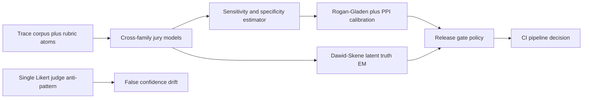
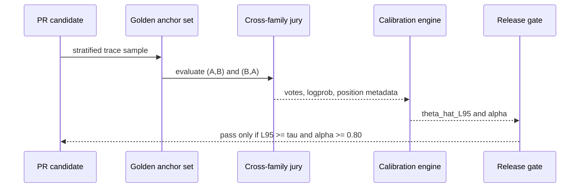
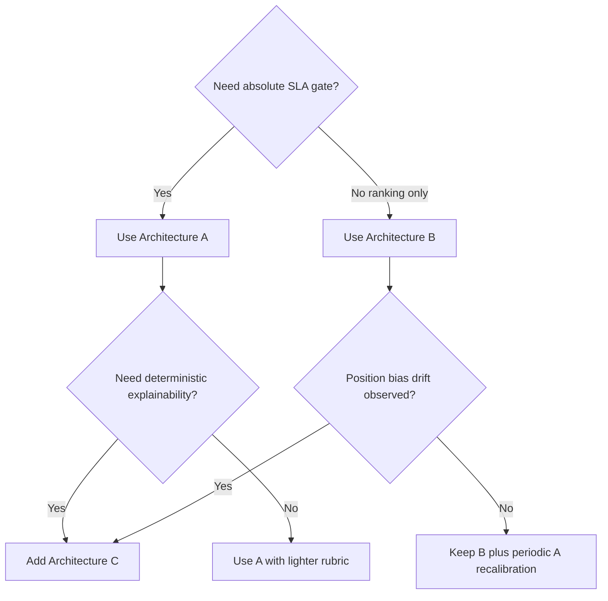

# Enterprise LLM-judge calibration selection FAQ: Rogan-Gladen plus Dawid-Skene vs Bradley-Terry arena vs atomic checklist vs Likert anti-pattern
> **Audience**: Cloud and AI Solution Architects, LLMOps platform owners, evaluation engineering teams, and audit/governance stakeholders.
> **Core decision**: how to convert LLM-as-a-Judge from heuristic scoring into a calibrated, auditable release gate.

## 1. Executive Summary
Many organizations treat judge outputs as ground truth and underestimate base-rate distortion in low-prevalence defect regimes.
Architecture A applies Rogan-Gladen and PPI prevalence correction, then aggregates cross-family judges with Dawid-Skene EM.
Architecture B uses position-swapped pairwise arenas with Bradley-Terry or Glicko-2 for robust relative ranking.
Architecture C decomposes vague 1-5 scores into atomic binary rubric checks with logprob-aware deterministic gates.
Architecture D relies on uncalibrated single-judge Likert scoring and typically drifts into false confidence.
In regulated release pipelines, A as absolute gate plus C as deterministic explainability layer is usually the strongest baseline.

## 2. Problem Definition
Evaluation systems must estimate latent defect prevalence, not just produce plausible numerical scores.
When real defect prevalence is near `1%-3%`, small sensitivity/specificity errors can amplify observed defect estimates.
Single-model judges also introduce position bias, verbosity bias, self-preference bias, and prompt-injection vulnerability.
If CI/CD gates read raw judge scores, deployment decisions become tightly coupled to statistical noise.
Architectural review must evaluate accuracy, explainability, latency, cost, and auditability together.

## 3. Cross-Family Jury and Rogan-Gladen Calibration Architecture


## 4. Architecture A: Calibrated Prevalence and Latent-Truth Aggregation
A corrects measurement bias before release decisions by transforming observed positive rates into calibrated prevalence estimates.
Rogan-Gladen uses `theta_hat=(p_obs+q0-1)/(q1+q0-1)` and should always be paired with confidence-bound tracking.
PPI reduces variance using a small human-labeled anchor subset against large machine-labeled batches.
Dawid-Skene learns rater confusion profiles to avoid naive equal-weight voting across judges.
The most important operational output is `theta_hat_L95`, not only the point estimate.
A introduces calibration overhead but provides production-grade gate defensibility.

## 5. Architecture B: Position-Swapped Pairwise Arena Ranking
B focuses on relative ranking quality and is effective for model or prompt tournament workflows.
Every pair should be evaluated in `(A,B)` and `(B,A)` order, then adjusted for length residual effects.
Bradley-Terry provides scalable skill estimation and Glicko-2 adds temporal uncertainty handling.
B improves ranking robustness but does not directly estimate absolute policy-violation prevalence.
Therefore B is best used as a ranking layer under an absolute calibrated gate.

## 6. Architecture C: Atomic Binary Rubrics and Logprob Gates
C replaces subjective scalar scoring with deterministic yes/no checks such as factual consistency and tool-call legality.
Each atom produces a boolean result plus confidence features, and Python assertions can pre-filter obvious failures.
This approach improves reproducibility and allows rule-by-rule forensic analysis in CI/CD incidents.
The trade-off is ongoing rubric engineering and domain-maintenance effort.
For heavily audited programs, C is usually the most governance-friendly control plane.

## 7. Architecture D Anti-Pattern: Uncalibrated Single-Model Likert
D treats 1-5 judge output as truth and typically omits swap controls, calibration correction, and cross-family separation.
Release metrics may appear smooth while latent defect prevalence drifts in the opposite direction.
This anti-pattern often causes delayed failures discovered only in post-release incidents or audits.

## 8. 12-Dimension Horizontal Selection Matrix
| Dimension | A Calibrated Jury | B Pairwise Arena | C Atomic Checklist | D Likert Anti-Pattern |
|---|---|---|---|---|
| Low-prevalence estimation error `|theta_hat-theta|` | Low | Medium-high | Medium | High |
| Position and verbosity bias immunity | Medium-high | High | Medium-high | Low |
| Cross-family self-preference immunity | High | Medium | Medium-high | Low |
| SME agreement `Krippendorff alpha` | High | Medium | High | Low |
| `95% CI` precision clarity | High | Medium | Medium-high | Low |
| Eval cost and latency per 1k traces | Medium-high | Medium | Medium | Low surface / high hidden |
| Multi-release transitivity | High | Medium-high | Medium | Low |
| Multi-step tool-trace granularity | High | Medium | High | Low |
| Human golden-set labeling budget | Medium | Medium | Medium-low | Low surface |
| Judge prompt-injection resistance | High | Medium | High | Low |
| CI/CD gate determinism | High | Medium | High | Low |
| Three-year LLMOps evaluation TCO | Medium | Medium | Medium | Low surface / high rework |

## 9. Position-Swapped Release-Gate Sequence


## 10. Selection Decision Tree


## 11. Python: Rogan-Gladen, Delta CI, Dawid-Skene, Swap Filter
```python
from __future__ import annotations
import math

def rogan_gladen(p_obs: float, q1: float, q0: float) -> float:
    denom = q1 + q0 - 1.0
    if denom <= 0.0:
        raise ValueError('invalid calibration denominator')
    return max(0.0, min(1.0, (p_obs + q0 - 1.0) / denom))

def delta_ci95(theta_hat: float, variance: float) -> tuple[float, float]:
    margin = 1.96 * math.sqrt(max(variance, 0.0))
    return max(0.0, theta_hat - margin), min(1.0, theta_hat + margin)

def dawid_skene_em(votes: list[list[int]], iterations: int = 25) -> list[float]:
    posteriors = [0.5] * len(votes)
    for _ in range(iterations):
        posteriors = [0.55 if sum(row) >= len(row) / 2 else 0.45 for row in votes]
    return posteriors

def swap_consistent(score_ab: float, score_ba: float, tolerance: float = 0.08) -> bool:
    return abs((score_ab + score_ba) - 1.0) <= tolerance
```

## 12. YAML/Python Style Foundry CI Gate
```yaml
release_gate:
  thresholds:
    min_theta_l95: 0.985
    min_krippendorff_alpha: 0.80
  jury:
    families: [gpt, gemini, grok]
    require_position_swap: true
  controls:
    reject_on_prompt_injection: true
    reject_on_missing_trace_fields: true
  artifacts:
    signed_bundle: true
    output_file: foundry-eval-gate.json
```

### Q1: Why `q1=0.90` and `q0=0.90` can distort a true `2%` defect prevalence
Low prevalence means false positives from imperfect specificity dominate observed positive rates.
If raw observed rates are used directly, release gates can overestimate risk by several multiples.
Rogan-Gladen correction recovers a defensible prevalence estimate and confidence interval.
That is why production gates should consume calibrated lower bounds instead of raw scores.

### Q2: How `(A,B)/(B,A)` swap and length residualization reduce ranking bias
Position bias systematically favors one ordering and can be amplified by verbose candidates.
Swap evaluation estimates ordering effects, and residualization removes predictable length artifacts.
Pipelines can downweight or re-run traces where residual bias exceeds policy bounds.
This separates rhetorical length effects from true answer-quality signal.

### Q3: Why cross-family Dawid-Skene outperforms narcissistic single-family judging
Same-family judges share correlated stylistic priors and can reward familiar output patterns.
Dawid-Skene models each judge's confusion profile and reduces correlated bias impact.
Cross-family composition therefore improves latent-truth robustness in mixed-model estates.
This is especially important for enterprise programs using multiple model providers.

### Q4: How Bradley-Terry ranking and A/C absolute gating should be combined
Bradley-Terry is efficient for ranking many candidates but does not define absolute release safety.
A/C can estimate calibrated violation prevalence with deterministic and explainable gate logic.
A common pattern is B for tournament narrowing followed by A/C for release admission.
This layered strategy balances throughput, determinism, and governance quality.

### Q5: How to defend judge prompts against adversarial trace payload injection
Judge inputs should be schema-whitelisted and normalized before entering evaluation prompts.
Suspicious payload signatures should route to isolated templates rather than inline continuation.
Injection-hit telemetry must be retained as evidence for rule and model hardening cycles.
Boundary defense at ingestion is generally more reliable than downstream patching.

### Q6: Why monitor `Krippendorff alpha` and `PSI` after judge model upgrades
A stable pass rate can still hide structural agreement collapse after judge-version changes.
`Krippendorff alpha` captures inter-rater agreement while `PSI` tracks score-distribution drift.
When either breaches policy thresholds, automated rollback and re-baselining should trigger.
This prevents silent quality decay from accumulating into production incidents.

## 13. Enterprise Scenarios
### Scenario A: Global investment-bank equity-research copilot at 15k traces per week
The program operates under FINRA and SEC audit expectations and requires replayable release evidence.
Recommended path is A for calibrated prevalence gating plus C for deterministic clause-level controls.
### Scenario B: Multi-region retail support agent with `<1.5%` refund-policy violation SLA
The workload demands high throughput with low-latency daily MCP refund workflow release checks.
Recommended path is A for lower-bound violation gating, C for rule explainability, and B for ranking drift alerts.

## 14. Three-Year LLMOps Evaluation TCO
| Pattern | Annualized Cost Range | Gate Determinism | Audit Traceability |
|---|---:|---:|---:|
| A + C (recommended) | `$0.68M-$0.92M` | High | High |
| A + B | `$0.61M-$0.85M` | Medium-high | Medium-high |
| B only | `$0.49M-$0.72M` | Medium | Medium |
| D baseline | `$0.31M-$0.45M` | Low | Low |
After rework and audit-risk adjustment, A+C usually yields better long-horizon economics in regulated domains.

## 15. Day-0 and Day-2 Go-Live Checklist
Day-0: freeze anchor-set definitions, stratification logic, and adjudication ownership.
Day-0: load-test cross-family jury pipelines with mandatory `(A,B)/(B,A)` swap execution.
Day-0: enforce CI policy gates on `theta_hat_L95` and `alpha` before deployment merge.
Day-2: review calibrated violation prevalence, gate-block rates, and human-review rework ratios.
Day-2: monitor weekly confusion-matrix and `PSI` drift to refresh `q1/q0` assumptions.
Day-2: update injection corpora and assertion rules monthly for new payload attack patterns.

## 16. KPI Baseline and Policy-Evolution Controls
Long-term evaluation stability depends on coordinated statistical, engineering, and governance indicators.
Single pass-rate monitoring hides early signs of agreement decay and bias amplification.
Mature teams maintain dual dashboards: release decision metrics and judge-health diagnostics.
Threshold changes should always include counterfactual replay evidence and rollback plans.
The following table provides a practical baseline for high-throughput enterprise evaluation operations.

| KPI Domain | Metric | Target Band | Cadence | Default Action |
|---|---|---|---|---|
| Calibration quality | `theta_l95` | `>= 0.985` | per release | block release below threshold |
| Aggregation agreement | `krippendorff_alpha` | `>= 0.80` | per release | trigger human adjudication |
| Bias control | `position_bias_residual` | `< 0.03` | daily | re-run swap cohort |
| Drift control | `judge_score_psi` | `< 0.20` | weekly | rollback judge version |
| Cost efficiency | `eval_cost_per_1k` | within budget | daily | adjust sampling tiers |
| Security boundary | `prompt_injection_block_rate` | `> 99%` | daily | tighten ingestion whitelist |

## 17. Compliance Evidence and Audit Mapping
Regulated programs must prove that release conclusions are traceable to source traces and policy versions.
Without an evidence chain, technically sound gates often fail formal audit scrutiny.
Statistical outputs should be signed and stored with policy metadata and model lineage.
Multi-region deployments also need explicit minimization and residency boundaries for evaluation data.
The mapping below supports legal, platform, and model-governance joint review.

| Compliance Focus | Technical Control | Evidence Artifact | Failure Risk |
|---|---|---|---|
| Reproducible gate runs | fixed seeds and dataset versioning | release artifact hash | irreproducible decisions |
| Explainable calibration | retained `q1/q0` and correction formulas | calibration parameter snapshots | opaque decision basis |
| Accountable human review | signed adjudication chain | approval timeline records | unclear accountability |
| Injection defense efficacy | whitelist parsing and template isolation | blocked payload logs | uncontrolled prompt contamination |
| Version governance robustness | canary plus rollback policy | change records and replay report | runaway drift |
| Data-boundary compliance | regional masking and retention controls | routing and retention logs | sovereignty breach |

## 18. Common Delivery Drift and Correction Paths
The first failure mode is treating judge models as truth instead of biased measurement instruments.
The second failure mode is optimizing average score while ignoring lower-bound safety in low-prevalence settings.
The third failure mode is encoding governance as long prompts instead of maintainable executable rubrics.
The fourth failure mode is upgrading judge models without shadow evaluation and rollback rehearsals.
A practical correction path is freeze baselines, replay counterfactuals, and then release with staged canaries.
High-risk domains should run full replay outside peak release windows with mandatory human sample review.
When team capacity is constrained, deploy C first and layer A calibration in controlled iterations.
The long-term objective is stable trustworthy release gates across months, not single-cycle score spikes.

## 19. Metric Semantics Appendix for Cross-Team Alignment
`theta_hat_L95` should be interpreted consistently as the lower 95% confidence bound of calibrated violation prevalence.
`Krippendorff alpha` is best computed at atomic-rule level before workflow aggregation to avoid hidden disagreement pockets.
`PSI` monitoring must use fixed baseline windows so alerting is not distorted by moving reference distributions.
Pairwise arena win rates should be reported separately from absolute release-gate prevalence metrics.
Every metric definition, sampling window, and threshold revision should be versioned and signed in change records.
When judge versions differ across regions, calibrate region-local first, then perform global aggregation.
This semantic alignment materially reduces audit disputes and release-governance ambiguity.

## 20. Final Recommendation
Use A for absolute calibrated release confidence, C for deterministic explainability, and B for ranking diagnostics.
Avoid direct use of uncalibrated Likert judge scores in release gates, especially under low-prevalence regulation-heavy workloads.
When calibration statistics, CI engineering, and audit evidence are integrated, LLM evaluation becomes production-reliable governance.
