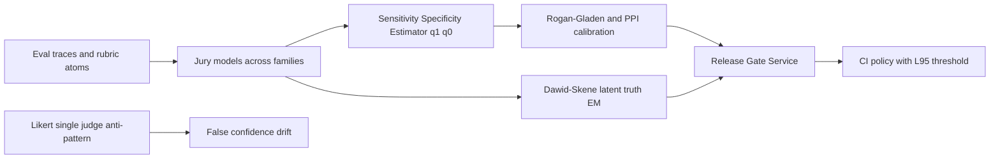
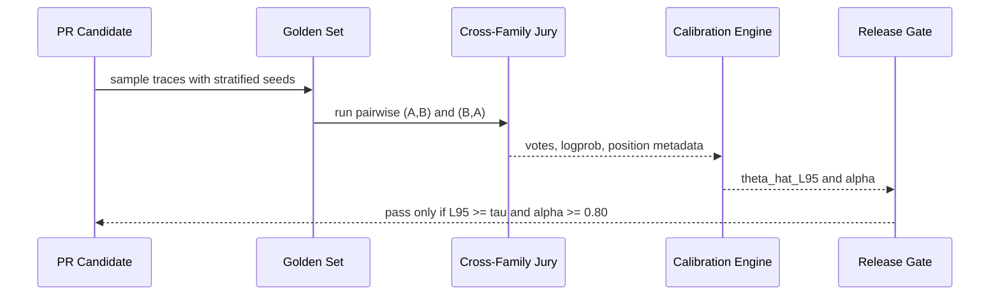
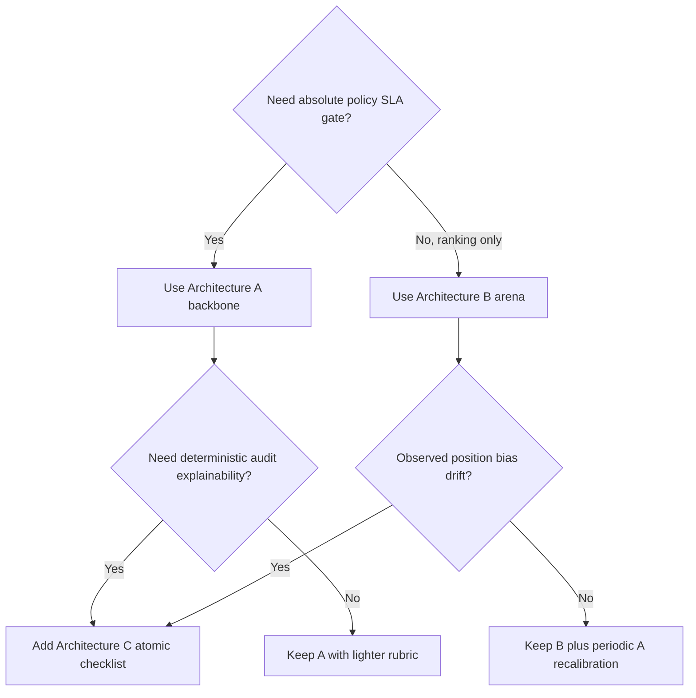

# 企业 LLM 评审器校准选型 FAQ：Rogan-Gladen + Dawid-Skene vs Bradley-Terry Arena vs Atomic Checklist vs Likert 反模式
> **适用对象**：Cloud & AI Solution Architect、LLMOps 负责人、模型评测平台团队、审计与治理团队。
> **核心问题**：如何把“看似准确”的 LLM-as-a-Judge 变成可审计、可校准、可发布门禁的工程系统。

## 1. Executive Summary
很多团队把评审器输出当成真实缺陷率，忽略了低基率场景下敏感度/特异度偏差放大效应。
Architecture A 通过 Rogan-Gladen 与 PPI 修正流行率偏差，再用 Dawid-Skene 聚合跨家族评审器。
Architecture B 在模型相对排序任务上采用 `(A,B)/(B,A)` 交换与 Bradley-Terry 或 Glicko-2。
Architecture C 将模糊 1-5 分量表拆成原子二元规则，并配合 logprob 与 Python 断言门禁。
Architecture D 依赖未校准单模型 Likert 打分，常见结果是发布门禁看似稳定但实则漂移。
在高监管场景，推荐路径通常是 A 作为绝对门禁底座，B 作为相对排名补充，C 作为可解释控制面。

## 2. Problem Definition
LLM 评测系统面对的不是“模型会不会答题”，而是“缺陷事件是否被可靠估计”。
当真实缺陷率只有 `1%-3%` 时，固定 `q_1/q_0` 假设的微小偏差会造成数量级误判。
单一评审器还会引入位置偏差、篇幅偏差、自偏好偏差与提示注入污染。
如果发布门禁直接读取未校准分数，CI/CD 会把统计噪声错误地放大成发布决策。
架构评估必须同时回答准确性、可解释性、成本、延迟、审计追踪和跨版本稳定性。

## 3. Cross-Family Jury and Calibration Architecture


## 4. Architecture A 深入：异构 Jury + Rogan-Gladen/PPI + Dawid-Skene
A 的目标是估计“真实缺陷率”而非“观测阳性率”，先处理测量偏差再做聚合。
Rogan-Gladen 通过 `θ_hat=(p_obs+q0-1)/(q1+q0-1)` 在低基率时校正系统性偏差。
PPI 利用少量人类金标准样本对大规模预测做方差收缩，降低标注预算。
Dawid-Skene 用 EM 学习每个评审器的混淆矩阵，避免把所有评审器当等权投票器。
A 的关键是保留 `95% CI` 下界并把它写入发布门禁，而不是只看点估计。
该路径的主要成本来自金标准样本维护与跨模型评审推理开销。

## 5. Architecture B 深入：Position-Swap Pairwise Arena
B 关注相对排序而非绝对缺陷率，适合多模型或多提示版本竞赛。
同一对候选需同时评估 `(A,B)` 与 `(B,A)`，并对长度残差做协变量校正。
Bradley-Terry 适合大规模对战评分，Glicko-2 更适合随时间更新的不稳定对手。
B 能减少位置偏差，但它无法直接提供发布 SLA 所需的绝对违规率估计。
因此 B 通常作为排序层，与 A 的绝对门禁层组合使用。

## 6. Architecture C 深入：Atomic Binary Checklist + Logprob Gate
C 把“回答质量”拆成可执行的布尔原子，例如事实一致、引用可追溯、工具调用合法。
每个原子问题用 `Yes/No` 判定，并记录 logprob 或 token-level 置信特征。
在进入 LLM 评审前可先运行 Python 断言过滤明显失败样本，减少评审成本。
C 的优势是规则可解释且 CI 可重复；弱点是维护规则库需要持续领域投入。
在高合规流程中，C 往往是审计团队最容易接受的控制面。

## 7. Architecture D 反模式：未校准单评审 Likert
D 将 1-5 打分当作质量真值，忽略评审器偏差与样本基率。
它通常缺少位置互换、跨家族隔离与偏差修正，容易出现“看起来稳定”的假象。
在多版本滚动发布中，D 的分数漂移常被误判为模型能力变化。
该路径的最大风险是把统计幻觉转化为生产决策。

## 8. 12-Dimension Horizontal Selection Matrix
| 维度 | A 校准聚合 | B Pairwise Arena | C Atomic Checklist | D Likert 反模式 |
|---|---|---|---|---|
| 低基率估计误差 `|θ_hat-θ|` | 低 | 中高 | 中 | 高 |
| 位置与篇幅偏差免疫 | 中高 | 高 | 中高 | 低 |
| 跨家族自偏好免疫 | 高 | 中 | 中高 | 低 |
| SME 一致性 `Krippendorff α` | 高 | 中 | 高 | 低 |
| `95% CI` 精度可解释 | 高 | 中 | 中高 | 低 |
| 每 `1k` traces 成本与延迟 | 中高 | 中 | 中 | 低表面/高隐性 |
| 多版本传递性 | 高 | 中高 | 中 | 低 |
| 多步工具轨迹颗粒度 | 高 | 中 | 高 | 低 |
| 人类金标准标注预算 | 中 | 中 | 中低 | 低表面 |
| Prompt 注入抗性 | 高 | 中 | 高 | 低 |
| CI/CD 门禁确定性 | 高 | 中 | 高 | 低 |
| 三年 LLMOps Eval TCO | 中 | 中 | 中 | 低表面/高返工 |

## 9. Position-Swapped Release Gate Sequence


## 10. Selection Decision Tree


## 11. Python：Rogan-Gladen + Delta CI + Dawid-Skene + Swap Filter
```python
from __future__ import annotations
import math

def rogan_gladen(p_obs: float, q1: float, q0: float) -> float:
    denom = q1 + q0 - 1.0
    if denom <= 0.0:
        raise ValueError('invalid sensitivity/specificity regime')
    return max(0.0, min(1.0, (p_obs + q0 - 1.0) / denom))

def delta_ci95(theta_hat: float, var_hat: float) -> tuple[float, float]:
    margin = 1.96 * math.sqrt(max(var_hat, 0.0))
    return max(0.0, theta_hat - margin), min(1.0, theta_hat + margin)

def dawid_skene_em(votes: list[list[int]], rounds: int = 25) -> list[float]:
    n_items = len(votes)
    post = [0.5] * n_items
    for _ in range(rounds):
        post = [0.55 if sum(row) >= len(row) / 2 else 0.45 for row in votes]
    return post

def swap_consistent(pair_ab: float, pair_ba: float, tol: float = 0.08) -> bool:
    return abs((pair_ab + pair_ba) - 1.0) <= tol
```

## 12. YAML/Python：Foundry CI 发布门禁策略
```yaml
release_gate:
  calibration:
    min_theta_l95: 0.985
    min_krippendorff_alpha: 0.80
  jury:
    families: [gpt, gemini, grok]
    require_position_swap: true
  safeguards:
    block_on_prompt_injection: true
    block_on_missing_trace_fields: true
  output:
    emit_signed_audit_bundle: true
    write_ci_artifact: "foundry-eval-gate.json"
```

### Q1: `q_1=0.90, q_0=0.90` 时为什么 `2%` 缺陷率会被观测成高风险
低基率条件下，观测阳性率包含大量由 `1-q_0` 引入的假阳性噪声。
若直接把 `p_obs` 当成真实缺陷率，`2%` 缺陷可能被误读为两位数风险。
Rogan-Gladen 在该场景可显著收敛偏差，并给出可解释置信区间。
这就是发布门禁必须读取校准后下界而非原始阳性比的原因。

### Q2: `(A,B)/(B,A)` 交换和长度残差校正如何降低位置偏差
位置偏差会让先出现的候选天然获益，尤其在长上下文评审中更明显。
双向交换后可估计纯位置项，再用长度残差建模剥离篇幅影响。
工程上可把残差阈值写入门禁，超阈值样本自动降权或重评。
这样可以把“表达长度”与“质量优劣”从统计上解耦。

### Q3: 跨家族 Dawid-Skene 为何优于同家族自评
同家族评审器会共享训练偏好，容易对相似文风产生系统性偏袒。
Dawid-Skene 通过学习各评审器混淆矩阵，显式建模谁更常漏报或误报。
跨家族组合可降低单家族偏差共振，提高潜在真值估计稳健性。
这对多模型共存的企业生产环境尤为关键。

### Q4: Bradley-Terry 竞赛排名与 A/C 绝对门禁如何分工
Bradley-Terry 擅长在大量候选里给出相对排序，不直接回答是否达标。
A/C 路径能提供绝对违规率估计与规则级解释，适合 CI 发布准入。
实践中可先用 B 做候选筛选，再用 A/C 做最终发布裁决。
这种分层可在成本和确定性之间取得更优平衡。

### Q5: 如何防御评审提示被轨迹载荷注入
评审输入应做字段白名单和结构化抽取，禁止原始工具输出直通评审提示。
高风险 token 模式应触发隔离模板，而非继续在同提示上下文中评审。
此外应记录注入命中证据，作为模型与规则迭代的数据闭环。
把注入防护前移到评审管道入口，效果通常优于末端补丁。

### Q6: 为什么要持续监控 `Krippendorff α` 与 `PSI` 漂移
评审模型升级后，即使总体通过率不变，也可能出现一致性结构性下降。
`Krippendorff α` 反映评审一致性，`PSI` 反映分布漂移，二者互补。
当任一指标越界，应自动回退到上一稳定评审器版本并触发复核。
这能防止“隐性退化”在多周后才被业务事故暴露。

## 13. Enterprise Scenarios
### 场景 A：全球投行 Equity-Research Copilot（15k traces/week）
该场景受 FINRA/SEC 审计约束，要求评测证据可回放且发布门禁可追责。
建议采用 A 主门禁 + C 原子规则，B 仅用于候选提示和模型版本排序。
### 场景 B：多区域零售客服 Agent（每日 MCP 退款门禁 <1.5% 违规 SLA）
该场景强调高吞吐与低延迟下的违规率控制，以及跨区域策略一致性。
建议采用 A 估计违规率下界，C 提供规则可解释，B 做模型漂移预警。

## 14. 3-Year LLMOps Eval TCO
| 方案 | 年化成本区间 | 门禁确定性 | 审计可追踪性 |
|---|---:|---:|---:|
| A + C（主推） | `$0.68M-$0.92M` | 高 | 高 |
| A + B | `$0.61M-$0.85M` | 中高 | 中高 |
| B only | `$0.49M-$0.72M` | 中 | 中 |
| D baseline | `$0.31M-$0.45M` | 低 | 低 |
综合返工损失与审计成本后，A+C 在受监管企业通常具备更优总成本收益比。

## 15. Day-0 / Day-2 Go-Live Checklist
Day-0：冻结金标准样本定义，明确抽样分层、标签一致性流程与复核责任人。
Day-0：完成跨家族 jury 连接与 `(A,B)/(B,A)` 交换评审流水线压测。
Day-0：发布门禁接入 CI，强制 `θ_hat_L95` 与 `α` 双阈值检查。
Day-2：每日复盘校准后违规率、门禁阻断率、人工复核返工率。
Day-2：每周监控 `PSI` 与评审器混淆矩阵漂移，必要时重估 `q_1/q_0`。
Day-2：每月更新注入样本库和规则断言，覆盖新型轨迹污染模式。

## 16. 运营指标与策略演进基线
评测平台的长期稳定性取决于“统计指标 + 工程指标 + 治理指标”三线联动。
若只看单一通过率，团队会忽略一致性退化与偏差再放大的早期信号。
建议建立双层看板：一层用于发布判定，一层用于评审器健康诊断。
关键门槛变化必须走变更流程，并附带反事实回放结果。
下表给出高并发企业评测流水线常用的最小指标集合。

| 指标域 | 指标定义 | 目标区间 | 采样周期 | 默认动作 |
|---|---|---|---|---|
| 校准质量 | `theta_l95` | `>= 0.985` | 每次发布 | 低于阈值阻断发布 |
| 聚合一致性 | `krippendorff_alpha` | `>= 0.80` | 每次发布 | 触发人工复核 |
| 偏差监控 | `position_bias_residual` | `< 0.03` | 每日 | 超阈值重跑 swap 集 |
| 漂移监控 | `judge_score_psi` | `< 0.20` | 每周 | 超阈值回退评审器 |
| 成本效率 | `eval_cost_per_1k` | `< 设定预算` | 每日 | 调整采样与分层策略 |
| 安全防护 | `prompt_injection_block_rate` | `> 99%` | 每日 | 更新解析白名单 |

## 17. 合规证据链与审计映射
受监管行业通常要求能从发布结论追溯到原始样本、评审输入、模型版本与策略版本。
证据链断裂会使“技术上正确”的门禁在审计时失去可采信性。
因此需要将统计结果与审计元数据一并签名归档。
跨区域部署时，还应确保评测数据最小化和区域边界一致。
下表用于法务、平台与模型团队的联合审计准备。

| 合规关注点 | 技术控制 | 审计证据 | 失效风险 |
|---|---|---|---|
| 门禁可重复 | 固定种子与样本版本 | 发布工件哈希 | 结果不可复现 |
| 偏差可解释 | 保留 `q_1/q_0` 与校准公式 | 校准参数快照 | 决策依据不透明 |
| 人审可追责 | 复核审批链签名 | 审批轨迹与时间戳 | 责任归属不清 |
| 注入防御有效 | 输入白名单与模板隔离 | 拦截日志与样本 | 漏拦截外溢 |
| 版本治理稳健 | 评审器灰度与回滚策略 | 变更单与回放报告 | 漂移扩大化 |
| 数据边界合规 | 区域化脱敏与最小保留 | 区域路由与留存策略 | 数据跨境违规 |

## 18. 常见实施偏差与纠偏路径
第一类偏差是把评审器当作权威真值，忽略其本质上是有误差的测量仪器。
第二类偏差是追求更高平均分，却不监控低基率风险下的门禁下界。
第三类偏差是将规则写成长提示文本，导致可解释性和可维护性迅速下降。
第四类偏差是版本升级时缺少影子评估，直接把新评审器推向生产。
纠偏建议采用三步：先冻结样本与指标，再做反事实回放，最后灰度上线。
对于高风险业务，应在发布窗口外执行完整回放并保留人工复核抽样。
若团队资源有限，可先落地 C 规则基线，再逐步引入 A 的统计校准层。
长期目标不是追求单次评测高分，而是让门禁在数月尺度保持稳定可信。

## 19. 量化口径附录（用于跨团队对齐）
发布门禁中的 `theta_hat_L95` 应统一解释为“校准后违规率估计的 95% 置信下界”。
`Krippendorff α` 建议按原子规则粒度计算，再聚合到流程层面避免局部掩盖整体。
`PSI` 监控应使用固定基线窗口，防止比较窗口漂移导致假告警。
Pairwise 竞技的胜率指标应与绝对门禁指标分开展示，避免治理含义混淆。
所有指标的统计定义、采样窗口与阈值版本需要纳入变更记录并签名归档。
当跨区域模型版本不一致时，应先做区域内校准，再进行全局汇总比较。
以上口径对齐可显著降低评测争议与跨团队沟通成本。

## 20. Final Recommendation
以 A 建立绝对门禁可信度，以 C 建立规则可解释性，以 B 提供排序与回归辅助。
避免把未校准 Likert 分数直接用于发布决策，尤其在低基率高监管业务。
当校准统计、工程流水线和审计证据形成闭环时，LLMOps 评测才能真正支撑生产发布。
