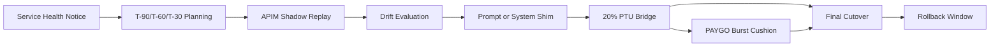
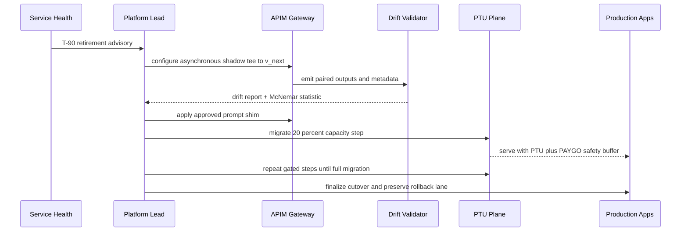
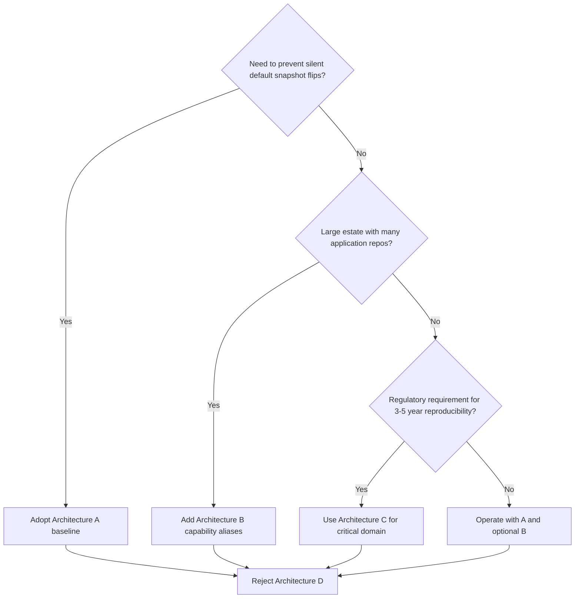

# Enterprise LLM Retirement Cutover Selection FAQ: Pinned Snapshot + Shadow PTU Bridge vs Capability-Alias Router vs AKS Weight Escrow vs Auto-Upgrade Anti-Pattern
> **Audience**: Cloud & AI Solution Architects, LLM platform owners, compliance teams, and model-serving SREs.
> **Problem statement**: cloud model snapshots evolve faster than enterprise validation cycles, so retirement events must be handled as governed lifecycle operations rather than emergency migrations.
> **Primary recommendation**: use Architecture A as default production posture, layer Architecture B for estate-wide control, apply Architecture C to regulated freeze-required workloads, and explicitly ban Architecture D for production tenants.

## 1. Executive summary
Model retirement is no longer an occasional event.
For enterprise AI platforms, it is an expected operational cycle.
What fails in practice is rarely pure API connectivity.
What fails is behavioral continuity and capacity choreography under deadline pressure.
When default snapshots change silently, differences show up in verbosity shape, refusal behavior, and tool-call argument strictness.
When PTU must be swapped under constrained regional quota, teams can hit capacity deadlocks exactly during migration windows.
When model names are hard-coded across many repositories, each retirement creates a broad and error-prone code churn wave.
Architecture A addresses this with pinned deployments, asynchronous shadow replay, prompt/system shim generation, and fractional PTU bridge steps.
Architecture B introduces logical capability aliases so applications bind to stable intents instead of fragile model IDs.
Architecture C provides multi-year bit-exact weight permanence using self-hosted open-weight stacks for regulated revalidation constraints.
Architecture D combines auto-upgrade with retirement-week big-bang cutover and repeatedly causes avoidable regressions.
This guide provides formulas, control gates, implementation snippets, and three-tier TCO framing for concrete architecture decisions.

## 2. Why retirement governance is now a first-class platform capability
Cloud model velocity and enterprise release velocity are asymmetric by design.
Provider snapshots can move in months; regulated product validation can span quarters or years.
Without retirement governance, teams default to reactive migration behavior.
Reactive behavior compresses discovery, validation, and rollback planning into the final weeks.
That is exactly when uncertainty and stakeholder pressure are highest.
A robust lifecycle therefore needs staged control points.
At `T-90`, teams need inventory and dependency mapping.
At `T-60`, teams need shadow evidence and drift diagnosis.
At `T-30`, teams need stepwise cutover and rollback confidence.
Cutover week should execute approved plans, not discover architecture gaps.

## 3. Four candidate architectures
Architecture A: pinned snapshot deployments (`NoAutoUpgrade`) plus APIM non-blocking shadow replay, prompt shim adaptation, and `20%` PTU step bridge with PAYGO burst buffer.
Architecture B: governed capability-alias routing via APIM + Foundry Router + canonical output adapter, removing direct snapshot references from application code.
Architecture C: multi-year bit-exact open-weight escrow on AKS vLLM/KAITO with digest-pinned weights and frozen inference engine artifacts.
Architecture D: `OnceNewDefaultVersionAvailable` auto-upgrade and mandatory retirement-week one-shot cutover.
A focuses on controlled execution under provider retirement deadlines.
B focuses on reducing migration blast radius across large application estates.
C focuses on long-term reproducibility where regulatory frameworks demand frozen baselines.
D optimizes immediate convenience while externalizing systemic risk.

## 4. Architecture A deep dive: pinned snapshots and fractional PTU bridge
Architecture A starts by freezing production deployment upgrades.
`versionUpgradeOption: NoAutoUpgrade` prevents unreviewed overnight behavior drift.
Retirement notices are ingested from Service Health and translated into lifecycle tasks with named owners.
APIM then mirrors a bounded asynchronous slice of live traffic to `v_next` for shadow evaluation.
Shadow replay must be non-blocking to protect foreground latency and user experience.
Evaluation captures not only text quality metrics but also tool invocation conformance and structured-output validity.
When drift exceeds tolerance, prompt or instruction shims are generated and reviewed.
PTU capacity is migrated in fractional increments, typically `20%` per step.
PAYGO spillover absorbs burst load while PTU units are reallocated under quota constraints.
Each step advances only if SLO and behavior gates pass.
This creates a deterministic control loop instead of a one-time migration gamble.

## 5. Architecture B deep dive: capability aliases and parameter normalization
Architecture B decouples application intent from provider snapshot identity.
Instead of embedding strings such as `gpt-4o-2024-08-06` in many repositories, apps call capability profiles like `tier-reasoning` or `tier-structured-fast`.
The routing layer then resolves each capability to approved backends and deployment targets.
It also normalizes parameter semantics.
Examples include translating `max_tokens` to `max_completion_tokens`, dropping unsupported temperature settings for reasoning-specific models, and enforcing strict JSON schema outputs where required.
The organizational effect is significant.
Retirement migration scope shifts from many application repositories to a governed router configuration domain.
The trade-off is that router governance itself becomes mission critical and must be observable, testable, and auditable.

## 6. Architecture C deep dive: long-term weight permanence for regulated domains
Architecture C is designed for scenarios where model behavior must remain reproducible over multi-year horizons.
Weights, runtime engines, tokenizer artifacts, and dependency manifests are pinned by immutable digests.
Inference execution is hosted on enterprise-controlled AKS fleets using vLLM/KAITO or equivalent stacks.
This avoids forced SaaS retirement timelines when those timelines conflict with regulated validation cycles.
Typical examples include FDA SaMD workflows, SR 11-7 model-risk programs, and GxP-controlled systems.
C does not eliminate operational cost.
It moves lifecycle control to the enterprise at the cost of GPU operations, patch governance, and platform stewardship.
For that reason, C is usually applied to high-criticality subsets, not entire portfolios.

## 7. Architecture D anti-pattern: auto-upgrade and big-bang retirement cutover
Architecture D appears attractive because it minimizes upfront planning.
In practice it maximizes uncertainty concentration.
Auto-upgrade allows behavior to shift without explicit approval and without synchronized validation evidence.
Big-bang retirement-week cutovers combine behavior change, capacity migration, and release pressure in one window.
When PTU quota is tight, this approach frequently triggers deadlocks or emergency downgrade decisions.
When behavior shifts are discovered late, teams are forced into risky mitigations with limited rollback confidence.
D is acceptable only for disposable prototypes, never for enterprise production surfaces with contractual SLOs.

## 8. Quantitative models for cutover planning
Fractional PTU bridge headroom:
`U_bridge = ceil(Δ_step * U_total)`
Where `Δ_step` is the migration increment ratio and `U_total` is target PTU units.
If `U_total=50` and `Δ_step=0.2`, each bridge step requires at least `10` units.
PAYGO burst buffer demand:
`Q_burst = max(0, R_peak - R_ptu_active)`
Behavioral drift significance using McNemar discordance:
`χ²_McNemar = (|b-c|-1)^2 / (b+c)`
Where `b` and `c` are discordant outcome counts between `v_curr` and `v_next`.
Regulatory revalidation versus self-hosted break-even:
`T_break_even = C_revalidate / (C_hosted - C_self)`
If break-even is shorter than mandated freeze duration, self-hosted permanence can be economically justified.

## 9. Twelve-dimension comparison matrix
| Dimension | Architecture A | Architecture B | Architecture C | Architecture D |
|---|---|---|---|---|
| Snapshot stability | High | High | Highest | Low |
| Behavioral explainability | High | High | High | Low |
| Multi-repo migration blast radius | Medium | Lowest | Medium | Highest |
| Capacity migration control | High | Medium | Medium | Low |
| Regulatory freeze support | Medium | Medium | Highest | Low |
| Operational complexity | Medium | Medium-High | High | Low (surface only) |
| Rollback confidence | High | High | Medium | Low |
| Cost predictability | High | High | Medium | Low |
| Audit evidence quality | High | High | High | Low |
| Vendor lock-in pressure | Medium | Medium | Low | High |
| Recommended role | Default production path | Estate-scale control amplifier | Regulated critical workloads | Prohibited in production |
| Net recommendation | Primary | Companion | Targeted | Reject |

## 10. Lifecycle and PTU swap topology


## 11. Retirement sequence with shadow validation and incremental bridge


## 12. Selection decision tree


### Q1. Why should pinned snapshots be the default enterprise baseline
Unpinned production deployments turn behavior change into an implicit event.
Implicit events are difficult to validate, communicate, and audit.
Pinned snapshots convert behavior changes into explicit, reviewable releases.
This enables controlled experimentation and measurable rollback readiness.
For customer-facing systems, that governance shift is usually more important than minor short-term convenience.
Pinned defaults create deterministic lifecycle posture.

### Q2. What usually goes wrong in shadow replay programs
A common mistake is running shadow calls synchronously and harming foreground latency.
Another mistake is sampling only average requests while missing high-risk edge classes.
A third mistake is evaluating only semantic scores while ignoring tool-call contract differences.
A fourth mistake is skipping statistical significance and overreacting to random variance.
A robust shadow program must include workload stratification, schema checks, and significance thresholds.
Otherwise confidence is misplaced and cutover risk remains hidden.

### Q3. When does Architecture B deliver outsized value
B is most valuable when model IDs are spread across many repositories and teams.
It centralizes migration levers and reduces coordinated release burden.
It also standardizes parameter semantics across heterogeneous model families.
This is critical when providers evolve request schema expectations over time.
The net result is lower retirement friction and better policy consistency.
However, this benefit depends on strong router observability and change governance.

### Q4. How to decide if Architecture C is worth the operational cost
C is justified when reproducibility obligations outlast managed-model retirement windows.
Examples include regulated clinical, financial, and quality-managed industrial workflows.
Cost analysis should include avoided revalidation cycles, not just GPU hosting spend.
If revalidation cost dominates and freeze duration is long, C can be cost-rational.
If obligations are light and model churn tolerance is high, A/B is usually preferable.
The decision should be framed as compliance economics, not infrastructure preference.

### Q5. Which gates should block each PTU bridge step
Each bridge step should have hard pass/fail criteria.
Typical gates include p95 latency delta, error-rate delta, refusal-rate drift, tool-call parity, and structured-output validity.
When any gate fails, progression pauses and rollback is considered immediately.
PAYGO buffer should absorb transient capacity pressure, not hide quality regressions.
Documented gate outcomes are essential for audit and postmortem learning.
Stepwise discipline converts migration from a release gamble to a controlled experiment.

### Q6. Five-step rollout and Good fit vs Not for
Step one: build retirement inventory and subscribe to provider retirement advisories with ownership mapping.
Step two: deploy shadow replay plus drift-evaluation pipeline with statistically meaningful segmentation.
Step three: add prompt/system shim workflow with approval gates and rollback links.
Step four: execute `20%` PTU bridge steps with PAYGO cushion under explicit SLO gates.
Step five: preserve rollback lane, archive evidence package, and run post-cutover review cadence.
Good fit: enterprises with strict SLOs, multi-team release surfaces, and auditable lifecycle controls.
Not for: ephemeral prototypes with no continuity or compliance obligations.

## 13. Implementation snippets
```bicep
param accountName string

resource account 'Microsoft.CognitiveServices/accounts@2023-05-01' existing = {
  name: accountName
}

resource depCurrent 'Microsoft.CognitiveServices/accounts/deployments@2023-05-01' = {
  name: '${account.name}/chat-current'
  properties: {
    model: {
      format: 'OpenAI'
      name: 'gpt-4.1'
      version: '2025-02-15'
    }
    sku: {
      name: 'ProvisionedManaged'
      capacity: 24
    }
    versionUpgradeOption: 'NoAutoUpgrade'
  }
}

resource depNext 'Microsoft.CognitiveServices/accounts/deployments@2023-05-01' = {
  name: '${account.name}/chat-next'
  properties: {
    model: {
      format: 'OpenAI'
      name: 'gpt-4.1'
      version: '2025-05-20'
    }
    sku: {
      name: 'ProvisionedManaged'
      capacity: 8
    }
    versionUpgradeOption: 'NoAutoUpgrade'
  }
}
```

```xml
<policies>
  <inbound>
    <base />
    <set-variable name="shadowSample" value="@(new System.Random().Next(100) < 5)" />
    <set-variable name="capabilityTier" value="@(context.Request.Headers.GetValueOrDefault(&quot;x-capability-tier&quot;, &quot;tier-structured-fast&quot;))" />
    <choose>
      <when condition="@(context.Variables[&quot;capabilityTier&quot;].ToString() == &quot;tier-reasoning&quot;)">
        <set-header name="x-route-profile" exists-action="override">
          <value>reasoning</value>
        </set-header>
      </when>
      <otherwise>
        <set-header name="x-route-profile" exists-action="override">
          <value>structured-fast</value>
        </set-header>
      </otherwise>
    </choose>
  </inbound>
  <outbound>
    <base />
    <choose>
      <when condition="@(bool)context.Variables[&quot;shadowSample&quot;]">
        <set-header name="x-shadow-target" exists-action="override">
          <value>v_next</value>
        </set-header>
      </when>
    </choose>
  </outbound>
</policies>
```

```python
from dataclasses import dataclass
from math import ceil
from statsmodels.stats.contingency_tables import mcnemar

@dataclass
class Pair:
    curr_ok: bool
    next_ok: bool

def bridge_units(total_units: int, step_ratio: float = 0.2) -> int:
    return ceil(total_units * step_ratio)

def mcnemar_stat(pairs: list[Pair]) -> float:
    b = sum(1 for p in pairs if p.curr_ok and not p.next_ok)
    c = sum(1 for p in pairs if not p.curr_ok and p.next_ok)
    result = mcnemar([[0, b], [c, 0]], exact=False, correction=True)
    return float(result.statistic)

def should_pause(latency_delta_ms: float, refusal_delta: float, chi2: float) -> bool:
    return latency_delta_ms > 120 or refusal_delta > 0.03 or chi2 > 3.84
```

## 14. Three-tier enterprise TCO framing
| Tier | Typical estate | Recommended architecture | Primary cost drivers | Primary risk reduction |
|---|---|---|---|---|
| Tier-1 | Broad enterprise product workloads | A + B | Shadow evaluation and router governance | Avoid silent behavior regressions |
| Tier-2 | Large multi-repo platform estates | A + B at scale | Policy operations and lifecycle evidence | Lower migration blast radius |
| Tier-3 | Regulated critical decision flows | A + selective C | Self-hosted permanence and validation evidence | Long-horizon reproducibility |

## 15. Operational checklist
Verify all production managed deployments are pinned with `NoAutoUpgrade`.
Verify retirement notices are mapped to named owners and time-bound tasks.
Verify shadow replay remains asynchronous and non-blocking for foreground paths.
Verify drift evaluation includes text quality, refusal profile, tool-call parity, and structured schema conformance.
Verify shim updates are approved, versioned, and rollback-capable.
Verify each `20%` PTU bridge step has explicit gate thresholds.
Verify PAYGO burst buffering has budget alerts and kill switches.
Verify capability alias changes are logged with change intent and blast radius.
Verify C-path artifacts remain digest-pinned and reproducible in periodic drills.
Verify rollback rehearsal is completed in staging and production-like environments.
Verify evidence bundles retain statistical outputs, cutover timelines, and approval records.
Verify seven-day post-cutover observation and remediation cadence is documented and executed.

## 16. Conclusion
Model retirement cutover is an architectural discipline, not a release-night script.
Architecture A provides the strongest default control loop for most enterprises.
Architecture B scales lifecycle governance across large application portfolios.
Architecture C anchors long-horizon reproducibility where regulation requires frozen baselines.
Architecture D should be rejected for production due to compounded behavior and capacity risk.
When retirement notices, shadow evidence, shim governance, fractional PTU bridge, and audit trails are integrated into one lifecycle program, enterprises can transition from reactive migration to predictable, verifiable, and sustainable model operations.
