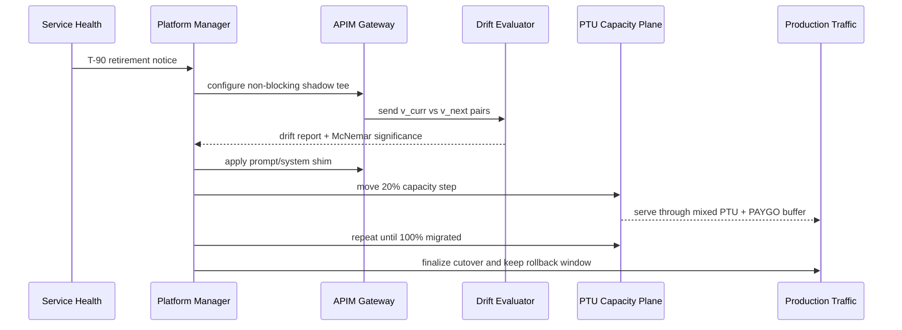
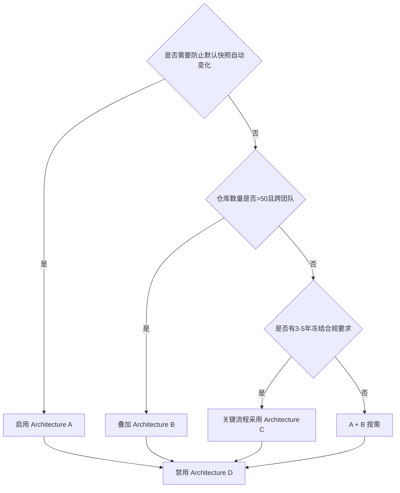

# 企业 LLM 退役切换与快照治理选型 FAQ：Pinned PTU Shadow Bridge vs 能力别名路由层 vs AKS 权重托管留存 vs 自动升级反模式
> **目标受众**：Cloud & AI Solution Architect、LLMOps 平台负责人、合规治理团队、模型服务 SRE。
> **核心问题**：云托管模型快照频繁迭代时，如何在不牺牲稳定性与合规性的前提下完成退休切换与容量迁移。
> **结论先行**：线上默认 A，跨应用统一治理叠加 B，强监管冻结需求补 C，D 列为禁止策略。

## 1. 执行摘要
企业模型生命周期管理已经从“选模型”转向“管模型退出”。
很多事故并非来自调用失败，而来自版本漂移。
当默认快照变化时，行为差异会在拒答、冗长度、工具参数严格性上同时体现。
如果组织没有提前搭建 shadow replay 与差异评估机制，切换周会变成事故周。
PTU 场景还存在另一类风险。
当新旧部署需要并存时，区域配额不足会导致交换死锁。
不少团队在退役通知到来后才临时申请配额，时间窗口往往不够。
Architecture A 通过 pinned 快照、分阶段 PTU 迁移与 PAYGO 缓冲控制风险。
Architecture B 通过能力别名消除仓库内硬编码模型名，降低大规模改造摩擦。
Architecture C 通过自托管开源权重留存满足 3–5 年冻结义务。
Architecture D 的自动升级与大爆炸切换会把行为漂移与容量风险叠加。
本文提供公式、门禁、代码与三档 TCO，便于直接执行变更评审。

## 2. 背景：退役不是一次发布，而是一条连续治理链
模型退役通知通常以 `T-90/T-60/T-30` 形式出现。
每一个节点都要求不同动作。
`T-90` 要完成资产盘点、调用拓扑识别与风险分层。
`T-60` 要完成 shadow 比对、提示词补偿与容量预算。
`T-30` 要完成分批切流、回退演练与审计证据封存。
若把这些动作压缩到最后一周，组织会同时承担行为与容量双重不确定性。
因此最佳实践是把退役当作季度能力，而不是临时项目。
平台层要提供可复用切换流水线，而不是每个产品团队重复造轮子。

## 3. 四种候选架构
Architecture A：Pinned 快照 + APIM 异步 shadow replay + 自动 prompt shim + 分步 PTU 交换。
Architecture B：能力别名路由层，统一参数翻译与结构化输出适配。
Architecture C：AKS vLLM/KAITO 权重托管留存，保证多年度 bit-exact 可复现。
Architecture D：自动升级 + 退役周一次性切换。
A 适合绝大多数生产 SaaS。
B 适合仓库数量大、应用团队分散的组织。
C 适合法规要求冻结推理基线的行业。
D 只适合演示环境，不适合企业生产面。

## 4. Architecture A：Pinned Snapshot + Shadow + Fractional PTU Bridge
A 的第一个关键点是 `NoAutoUpgrade`。
它防止未审查快照在夜间自动替换。
第二个关键点是异步 shadow replay。
生产请求保持主路径响应，shadow 结果写入观测系统用于离线判分。
第三个关键点是自动补偿。
当 `v_next` 在 verbosity 或 tool_call 参数规范上偏移时，系统自动生成 shim。
第四个关键点是 `20%` 阶梯 PTU 交换。
每一步都通过 SLO 与行为判定后再进入下一步。
第五个关键点是 PAYGO 缓冲池。
在 PTU 交换短时容量不足时，burst 由 PAYGO 接住，避免硬降级。

## 5. Architecture B：能力别名与参数语义中台
B 把模型名从业务仓库抽离为能力别名。
例如 `tier-reasoning`、`tier-structured-fast`。
应用只声明能力目标，不直接绑定具体快照标识。
路由层统一处理参数语义差异。
比如 `max_tokens` 到 `max_completion_tokens` 的映射。
比如 reasoning 模型不支持温度时的自动剔除。
比如结构化输出 schema 的严格模式兼容。
B 的收益是“单点治理、全域生效”。
缺点是中台治理逻辑需要高可靠与高透明。
如果中台不可观测，会形成新的黑盒风险。

## 6. Architecture C：多年度权重留存与自托管冻结
C 的目标是让模型生命周期由企业自主掌控。
权重、引擎镜像、依赖摘要都做 digest 固定。
这样在三年后仍可复现同一推理基线。
在 `FDA SaMD`、`SR 11-7`、`GxP` 等场景，这是一项关键能力。
代价是企业需承担 GPU 运维与补丁治理责任。
因此 C 常被用于“少量关键流程”的合规冻结，而非全量工作负载。
实践中可采用“关键域 C + 普通域 A/B”的混合架构。

## 7. Architecture D：自动升级与退役周大切换反模式
D 的第一问题是行为变化不可控。
团队往往在真实用户流量下才发现差异。
D 的第二问题是容量交换无缓冲。
一旦 PTU 新旧并存受阻，服务会在高峰时直接拥塞。
D 的第三问题是责任链断裂。
事后很难回答“谁批准、何时验证、何证据支持切换”。
这类场景在审计中通常无法通过。

## 8. 关键数学：PTU 交换、行为差异与收益边界
分步 PTU 交换头寸可表示为：
`U_bridge = ceil(Δ_step * U_total)`
其中 `Δ_step` 通常取 `0.2`。
若 `U_total=40`，每步至少需要 `8` 单位可交换容量。
PAYGO 缓冲可写为：
`Q_burst = max(0, R_peak - R_ptu_active)`。
行为漂移统计可使用 McNemar：
`χ² = (|b-c|-1)^2 / (b+c)`。
当 `χ²` 超阈且业务维度显著，需暂停切换并补偿。
监管重验证与自托管折中可表示为：
`T_break_even = C_revalidate / (C_hosted - C_self)`。
若 `T_break_even` 小于冻结要求周期，自托管更可行。

## 9. 12 维横向对比矩阵
| 维度 | Architecture A | Architecture B | Architecture C | Architecture D |
|---|---|---|---|---|
| 版本稳定性 | 高 | 中高 | 最高 | 低 |
| 行为可解释性 | 高 | 高 | 高 | 低 |
| 跨仓治理效率 | 中 | 最高 | 低 | 低 |
| 容量交换可控性 | 高 | 中 | 中 | 低 |
| 合规冻结能力 | 中 | 中 | 最高 | 低 |
| 运维复杂度 | 中 | 中高 | 高 | 低（表象） |
| 回退速度 | 高 | 中高 | 中 | 低 |
| 成本可预测性 | 高 | 高 | 中 | 低 |
| 审计证据完备度 | 高 | 高 | 高 | 低 |
| 供应商锁定程度 | 中 | 中 | 低 | 高 |
| 推荐级别 | 默认 | 叠加 | 特定关键域 | 禁用 |
| 结论 | 主路径 | 组织放大器 | 合规锚点 | 反模式 |

## 10. 生命周期与 PTU 交换拓扑


## 11. 退役时序：通知、影子、补偿、分步切换


## 12. 选型决策树


### Q1. 为什么 pinned snapshot 必须作为企业默认
默认自动升级会把风险从“可控变更”变成“隐式变更”。
在多租户 SaaS 中，隐式变更很难与投诉及时关联。
Pinned 策略让变化只在审查通过后发生。
这为 A/B 对比、容量验证、业务沟通预留窗口。
它不是保守，而是工程化控制。
在高业务连续性场景，pinned 是必要前提。

### Q2. Shadow replay 要注意哪些陷阱
第一，shadow 不能阻塞主请求。
第二，采样要覆盖高风险任务类型而非只看平均请求。
第三，比较指标要包括工具参数严格性而不止文本评分。
第四，差异统计要做显著性判断，避免噪声误报。
第五，结果要可追溯到请求上下文标签。
只做“粗粒度成功率”会遗漏关键行为偏移。

### Q3. 何时优先引入能力别名层
当组织存在大量硬编码模型名时，应优先引入 B。
当同一能力由多模型承载时，也应优先 B。
B 可把变更面从百个仓库收敛为一个路由层。
它还可统一参数翻译与结构化输出规范。
但必须提供透明可观测的变更记录。
否则中台将成为新的风险聚集点。

### Q4. C 架构适用于哪些监管场景
凡要求长期可复现推理基线的流程都适用 C。
例如药械算法版本冻结、金融模型风险复核、质量体系留痕。
C 的成本在于运维责任上移。
因此建议只对关键少量流程启用。
普通流程仍可走 A/B，形成分层策略。
这样可在合规与成本之间取得平衡。

### Q5. 如何判断 PTU 交换是否可继续
每一步交换都应绑定硬门禁。
至少包括错误率、P95 延迟、工具调用成功率、拒答偏移。
若任一指标超阈，停止下一步并回滚。
PAYGO 缓冲用于吸收峰值，而不是掩盖系统性退化。
评审记录要包含容量头寸与证据链接。
这样后续审计可复盘每一步合理性。

### Q6. 五步落地与 Good fit / Not for
第一步：建立退役资产台账与通知自动订阅。
第二步：部署 shadow replay 与差异判定流水线。
第三步：引入 prompt shim 自动编译与人工审批门。
第四步：执行 `20%` 阶梯 PTU 交换并保留 PAYGO 缓冲。
第五步：完成切换后保留回退窗口并归档证据。
Good fit：多产品线、强 SLA、需要可解释变更链路的组织。
Not for：短期实验环境且无生命周期治理要求的团队。

## 13. 生产实现片段
```bicep
param accountName string
param location string = resourceGroup().location

resource account 'Microsoft.CognitiveServices/accounts@2023-05-01' existing = {
  name: accountName
}

resource ptuCurrent 'Microsoft.CognitiveServices/accounts/deployments@2023-05-01' = {
  name: '${account.name}/chat-prod-current'
  properties: {
    model: {
      format: 'OpenAI'
      name: 'gpt-4.1'
      version: '2025-02-15'
    }
    sku: {
      name: 'ProvisionedManaged'
      capacity: 24
    }
    versionUpgradeOption: 'NoAutoUpgrade'
  }
}

resource ptuNext 'Microsoft.CognitiveServices/accounts/deployments@2023-05-01' = {
  name: '${account.name}/chat-prod-next'
  properties: {
    model: {
      format: 'OpenAI'
      name: 'gpt-4.1'
      version: '2025-05-20'
    }
    sku: {
      name: 'ProvisionedManaged'
      capacity: 8
    }
    versionUpgradeOption: 'NoAutoUpgrade'
  }
}
```

```xml
<policies>
  <inbound>
    <base />
    <set-variable name="shadowSample" value="@(new System.Random().Next(100) < 5)" />
    <set-variable name="reasoningTier" value="@(context.Request.Headers.GetValueOrDefault(&quot;x-capability-tier&quot;, &quot;tier-structured-fast&quot;))" />
    <choose>
      <when condition="@(context.Variables[&quot;reasoningTier&quot;].ToString() == &quot;tier-reasoning&quot;)">
        <set-header name="x-target-profile" exists-action="override">
          <value>reasoning</value>
        </set-header>
      </when>
      <otherwise>
        <set-header name="x-target-profile" exists-action="override">
          <value>structured-fast</value>
        </set-header>
      </otherwise>
    </choose>
  </inbound>
  <outbound>
    <base />
    <choose>
      <when condition="@(bool)context.Variables[&quot;shadowSample&quot;]">
        <set-header name="x-shadow-tee" exists-action="override">
          <value>v_next</value>
        </set-header>
      </when>
    </choose>
  </outbound>
</policies>
```

```python
from dataclasses import dataclass
from math import ceil
from statsmodels.stats.contingency_tables import mcnemar

@dataclass
class DriftSample:
    curr_ok: bool
    next_ok: bool

def ptu_bridge_units(total_units: int, step_ratio: float = 0.2) -> int:
    return ceil(total_units * step_ratio)

def mcnemar_drift(samples: list[DriftSample]) -> float:
    b = sum(1 for s in samples if s.curr_ok and not s.next_ok)
    c = sum(1 for s in samples if not s.curr_ok and s.next_ok)
    table = [[0, b], [c, 0]]
    result = mcnemar(table, exact=False, correction=True)
    return float(result.statistic)

def should_pause_cutover(p95_delta_ms: float, refusal_delta: float, chi2: float) -> bool:
    return p95_delta_ms > 120 or refusal_delta > 0.03 or chi2 > 3.84
```

## 14. 三档企业 TCO（退役治理视角）
| 档位 | 典型场景 | 推荐架构组合 | 成本主驱动 | 风险收益 |
|---|---|---|---|---|
| Tier-1 | 通用企业应用 | A + B | 影子评估与路由治理 | 降低突发行为回归 |
| Tier-2 | 多产品多仓组织 | A + B 深化 | 中台策略与审计运营 | 大幅压缩切换执行面 |
| Tier-3 | 强监管关键流程 | A + C 分层 | 自托管冻结与验证证据 | 满足长期复现与合规检查 |

## 15. 上线检查清单
应验证所有生产部署设置 `NoAutoUpgrade`。
应验证退役通知已接入告警与责任人值守。
应验证 shadow replay 为异步非阻塞路径。
应验证差异评估覆盖文本、工具参数、拒答与结构化输出。
应验证 prompt shim 变更需要审批并可回退。
应验证 `20%` 阶梯交换每一步的门禁阈值。
应验证 PAYGO 缓冲上限与预算告警联动。
应验证能力别名映射变更可审计。
应验证 C 架构权重与引擎摘要可复现。
应验证回退演练在预生产和生产都完成。
应验证证据包包含决策记录、统计结果与容量轨迹。
应验证切换后 7 天持续观测与复盘机制。

## 16. 补充治理洞察
在多区域部署中，建议将 PTU 交换计划按区域拆分，而不是全局同时推进。
这样可以先在低风险区域验证 shim 质量，再逐步复制到高流量区域。
对于跨语言业务，应把中文、英文、低资源语言分别建集，避免均值掩盖局部退化。
影子评估样本建议按业务价值加权，而非按请求数量均匀抽样。
高价值流程中的微小漂移，商业影响往往超过普通请求的大幅漂移。
建议在 APIM 层记录 capability alias 命中分布，识别是否存在异常升级偏好。
若 `tier-reasoning` 命中异常上升，应联动审查提示词或路由策略是否发生偏移。
对于工具调用链，评估项应纳入参数字段完整率与类型合法率，而非只看成功码。
很多迁移事故来自“调用成功但参数语义变了”，这类问题必须前置检测。
在组织层面，退役切换需要产品、平台、安全、财务四方共识看板。
没有共享看板时，平台会看到容量，产品会看到体验，但两者无法及时对齐。
建议每次退役都输出“变更账本”，记录决策、门禁、证据、回退路径与责任归属。
该账本可直接复用于后续季度演练，显著降低下次切换准备成本。
对 C 架构而言，权重留存不只保留模型文件，还应保留 tokenizer 与推理引擎指纹。
若只留权重不留运行时摘要，三年后依然可能无法复现历史输出分布。
在财务模型里，建议将“避免重验证”作为显性收益项与 GPU 运维成本并列。
当合规复验费用高于自托管增量运维费时，C 的经济性通常明显上升。
最终成熟态不是“某次切换零事故”，而是“每次切换都可预测、可解释、可复盘”。
当退役治理从专项行动变成平台能力，企业模型生命周期风险才会持续下降。
建议在每次切换后保留一份“行为漂移签名档案”，包含拒答样式、工具参数约束差异、结构化字段缺失模式与关键示例，供后续版本快速比对并减少重复调试时间。
对于跨法域部署，需把数据驻留约束与模型退役计划联动审查，避免在切换过程中把原本合规的数据流意外引导到不满足主权要求的推理区域，并应在切换前完成跨区域链路清单核验、出口策略复核与审计抽样演练，提前识别潜在主权合规断点。
在容量工程中，可引入“迁移期保守系数”校正峰值估算，针对节假日、营销活动、财报窗口等业务波峰提前放大缓冲池，防止桥接步骤在关键业务时段被迫回滚，并通过压测回放验证缓冲系数与真实流量弹性之间的匹配度。
对业务方沟通应采用双层报告：面向管理层展示风险热图与里程碑达成率，面向工程层展示统计检验结果、失败样本聚类与可执行修复清单，确保决策与执行一致。
建议把 alias 中台与提示词补偿仓库做版本联动，任何路由映射变更必须绑定对应 shim 版本与回归报告编号，避免“路由先变更、补偿后补齐”造成短时行为漂移窗口。
对于关键工具链，除文本质量外还应监控“参数保真 SLO”，例如必填字段完整率、枚举合法率、数值范围合法率与幂等键一致性，以捕捉隐性协议回归，并将异常样本自动归档到可重放数据集以支持快速定位。
最终平台目标应是将退役切换平均准备周期逐季缩短、人工干预比例逐季下降、回退触发率逐季降低，并以这些运营指标验证生命周期治理体系的真实成熟度，同时把每次改进沉淀为标准作业模板、自动化检查项与跨团队培训材料，确保能力不会随着人员流动而衰减。

## 17. 结论
模型退役治理的核心不是“换到新版本”，而是“在可控边界内换到新版本”。
A 提供最稳健的默认路径，并通过通知接入、影子比对、分步桥接与回退演练把每个阶段的不确定性压缩为可量化、可观测、可决策的工程信号与管理可读指标。
B 让大规模组织的升级动作可被中台收敛，避免百仓同步改造导致的发布拥堵与口径分裂，同时把参数语义演进与结构化输出约束沉淀为统一治理能力并可持续复用于后续版本。
C 为监管冻结提供长期可复现底座，确保关键业务可在多年后复刻相同推理行为与证据链条，从而降低重复验证、审计争议与跨代迁移的不确定成本，并提升审查通过确定性。
D 在企业生产环境中应被明确禁止，并在架构评审模板中设为硬性否决项。
当退役通知、影子评估、补偿策略、容量交换与审计证据形成闭环后，模型生命周期就能从被动应急转变为可计划、可验证、可持续的工程能力，并进一步演进为组织级资产治理体系的一部分，持续提升跨团队协作效率与长期运营韧性，同时稳定客户体验与外部审计可信度。
