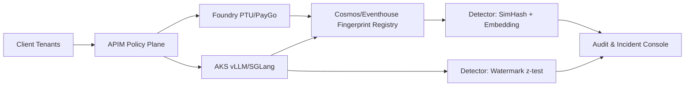
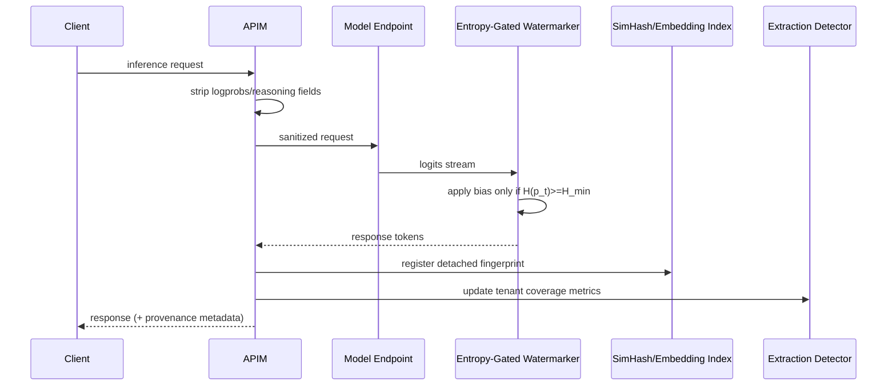
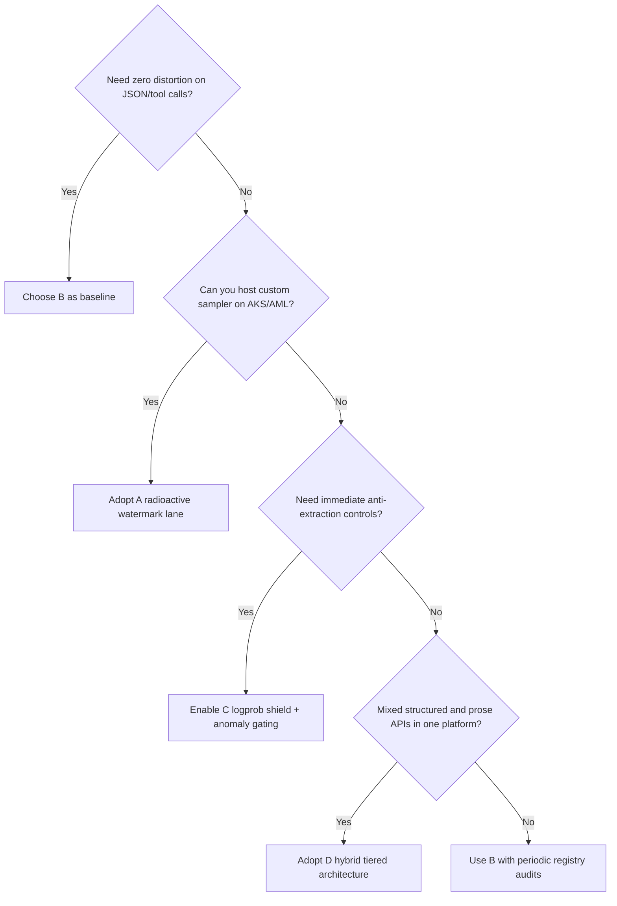

# Enterprise LLM Watermarking and Anti-Distillation Selection FAQ: AKS vLLM SynthID Entropy Gating vs APIM C2PA+SimHash Registry vs LogProb Shielding vs Hybrid Tiered Serving
> **Audience**: Cloud & AI Solution Architects designing enterprise GenAI serving controls, model IP protection, and compliance evidence.
> **Decision problem**: Satisfy EU AI Act Article 50(2) machine-detectable synthetic provenance while raising model-extraction and distillation cost.
> **Scope**: Unified serving governance across `Microsoft Foundry` managed endpoints and `AKS vLLM/SGLang` custom fleets.

## 1. Executive summary
Production inference now has two converging constraints.
The first is compliance-grade machine-detectable provenance.
The second is commercial-grade extraction resistance.
Watermarking alone is insufficient when API surface leaks accelerants.
API hardening alone is insufficient when provenance evidence is missing.
Architecture A embeds statistical signals during sampling.
Architecture B provides zero-distortion provenance registration and lookup.
Architecture C constrains extraction accelerants and detects behavior patterns.
Architecture D combines A/B/C by request type and endpoint class.
A practical rollout starts with B+C for fast impact.
Then A is added on externally monetized prose channels.
D becomes the long-term steady-state control plane.

## 2. Applicability and explicit non-goals
This guide targets enterprise-facing or multi-tenant generative services.
It is especially relevant for finance, healthcare, legal, and regulated SaaS.
This is distinct from #349/#28 CI/SLSA build provenance topics.
This is distinct from #334 PLG free-trial sybil billing-abuse controls.
This guide does not provide legal interpretation for copyright disputes.
This guide does not attempt full theoretical optimality proofs of watermark families.
This guide does not replace regulator-specific filing language from legal teams.
The focus is deployable serving architecture and measurable trade-offs.

## 3. Scenario framing and why four patterns exist
Most enterprises run two endpoint classes at the same time.
One class is Foundry PTU/PayGo managed serving.
Another class is AKS GPU self-hosted serving.
Managed lanes optimize speed of delivery but limit sampler control.
Self-hosted lanes allow custom `LogitsProcessor` insertion.
So the architecture must unify governance across both.
It must preserve structured tool-call correctness.
And it must increase attacker cloning cost materially.

## 4. Four candidate architectures at a glance
Architecture A: entropy-gated sampling watermarking.
Architecture B: gateway zero-distortion provenance registry with C2PA/SimHash.
Architecture C: API-surface anti-distillation hardening plus anomaly detection.
Architecture D: hybrid tiered composition of A/B/C.
A is strongest for radioactive inheritance after distillation.
B is strongest for closed-model compatibility with no output distortion.
C is strongest for reducing extraction accelerant exposure.
D is strongest for multi-objective enterprise optimization.

## 5. Architecture A: entropy-gated watermarking on AKS vLLM/SGLang
A biases logits only on high-entropy natural-language tokens.
Watermarking is activated only when `H(p_t) >= H_min`.
JSON keys, numbers, and code-grammar tokens are bypassed.
That avoids corruption of deterministic tool payloads.
Statistical detectability can reach strong confidence at around 200 tokens.
The signal can persist into student models trained on scraped outputs.
Trade-off is sampler control requirements in custom hosting.
It also requires key rotation and detector operations discipline.

## 6. Architecture B: APIM plus C2PA and SimHash provenance registry
B avoids changing model token distribution in generation.
So structured quality remains at `ΔPPL = 0` from watermarking perspective.
Text outputs are registered using rolling `n-gram` SimHash fingerprints.
Dense embedding fingerprints are stored for semantic re-checks.
Multimodal outputs carry C2PA manifests or parallel detached references.
Strength is broad support for Foundry/Azure OpenAI closed endpoints.
Trade-off is retention cost and index growth over time.
Strong paraphrase attacks require semantic verification in addition to SimHash.

## 7. Architecture C: API hardening and behavioral anti-extraction shield
C strips `logprobs/top_logprobs` at the gateway edge.
Raw reasoning fields are removed from response contracts.
Tenant query-space coverage is tracked in sliding windows.
Uniform synthetic sweeps are separated from natural power-law activity.
Suspicious tenants can be throttled or diverted.
Diversion can route to heavily watermarked decoy tiers.
This significantly reduces extraction efficiency.
But requires careful false-positive handling and appeals flow.

## 8. Architecture D: hybrid tiered serving
D uses dual serving planes.
Structured tool-loop traffic uses Foundry plus B.
External prose/advisory APIs use AKS plus A and C.
APIM orchestrates policy by tenant and endpoint class.
This preserves tool-call accuracy and schema fidelity.
At the same time it strengthens traceability for high-value outputs.
And C keeps crawler economics unfavorable for attackers.
The result is balanced UX, compliance, and IP protection.

## 9. Core formulas and operational metrics
Watermark detectability statistic:
`z = (G - γ*T) / sqrt(T*γ*(1-γ))`

Where `G` is green-token hit count.
`γ` is prior green-set proportion.
`T` is effective token count included in testing.

Entropy-linked detectability intuition:
`z ∝ f(Σ H(p_t), δ, T)`

Sample-efficiency ratio for distillation:
`R_eff = N_hard / N_soft`

Query coverage anomaly score:
`D_cov = 1 - KL(P_tenant || P_natural_ref)_norm`

Dual fingerprint acceptance:
`Pass = (HamDist(simhash_a, simhash_b) <= τ_h) OR (cos(e_a,e_b) >= τ_c)`

## 10. Four-architecture topology


## 11. Entropy-gated sampler plus gateway detector flow


## 12. SA selection decision tree


## 13. 12-dimension architecture comparison matrix
| Dimension | A Entropy-Gated Watermark | B C2PA+SimHash | C API Anti-Distillation | D Hybrid Tiered |
|---|---|---|---|---|
| Compliance-grade detectability evidence | High | High | Medium | Highest |
| Structured-output distortion risk | Low (with gating) | Lowest | Lowest | Lowest |
| Closed-endpoint compatibility | Low | Highest | Highest | High |
| Self-hosting control requirement | High | Medium | Medium | High |
| Distillation cost amplification | High | Medium | High | Highest |
| Bypass resilience | Medium-high | Medium | High | High |
| False-positive operations load | Low | Medium | Medium-high | Medium |
| Deployment complexity | Medium-high | Medium | Medium | High |
| Latency overhead | Low-medium | Low | Low-medium | Medium |
| Storage/index overhead | Low | High | Medium | Medium-high |
| Audit explainability | High | High | Medium-high | High |
| 3-year blended ROI potential | High | Medium-high | High | Highest |

## 14. Why entropy gating is mandatory for syntax-safe watermarking
Naively increasing logit bias `δ` everywhere is unsafe.
Low-entropy positions are near-deterministic already.
Biasing them can flip JSON punctuation and key tokens.
It can also damage code grammar sequences.
So watermark signal must be injected on high-entropy positions.
Structured positions must be bypassed explicitly.
Higher `Σ H(p_t)` improves effective detectability quality.
Larger `T` reduces variance in the `z` statistic.
Release gates can enforce `z >= 4.5`.
They should also enforce a minimum effective token floor.

## 15. Distillation cost amplification: soft labels vs hard labels
With `top_logprobs=20`, attackers can learn from soft targets.
KL-style soft-label alignment is highly sample-efficient.
When only CoT-stripped hard answers remain.
Boundary reconstruction needs much larger datasets.
Observed inefficiency often lands in the `5x–18x` band.
A simple amplification factor is:
`Amp = Cost_hard / Cost_soft`
C raises `Amp` by removing extraction accelerants.
A adds attribution leverage through radioactive inheritance.
Together they raise attacker cost and improve accountability.

## 16. `D_cov`: separating enterprise bursts from extraction crawlers
Legitimate enterprise traffic is usually heavy-tail clustered.
Burst events happen but stay semantically concentrated.
Extraction crawlers often perform uniform coverage sweeps.
They also run temperature/prompt grid searches.
`D_cov` can combine semantic-volume expansion signals.
And hyperplane probe-hit rates over sliding windows.
With calibrated thresholds, false positives can stay below `0.2%`.
A human-review allowlist path should remain available.
That avoids blocking sanctioned customer benchmarking runs.

## 17. Robustness under paraphrase and translation attacks
SynthID-like statistics decay under heavy paraphrase.
Moderate paraphrase can still preserve detectable traces.
Cross-lingual translation usually dilutes token-level signal further.
Therefore SimHash alone is insufficient in B.
SimHash should be paired with embedding cosine checks.
Short texts should prioritize semantic cosine thresholds.
Long texts should prioritize Hamming-distance stability.
Regulatory audits need explicit evidence bundles.
Include timestamp, key version, and threshold version.
That supports Article 50 traceability reviews.

## 18. Production snippet: vLLM entropy gating + APIM shield + SimHash verifier
```python
import math
import hashlib
from typing import Dict, Any


def shannon_entropy(probs):
    return -sum(p * math.log(p + 1e-12, 2) for p in probs)


def entropy_gated_bias(logits, probs, token_id, structural_ids, h_min=1.2, delta=1.5):
    if token_id in structural_ids:
        return logits
    if shannon_entropy(probs) < h_min:
        return logits
    logits[token_id] += delta
    return logits


def simhash64(text: str) -> int:
    v = [0] * 64
    for n in range(len(text) - 2):
        h = int(hashlib.sha256(text[n:n+3].encode("utf-8")).hexdigest()[:16], 16)
        for i in range(64):
            v[i] += 1 if (h >> i) & 1 else -1
    out = 0
    for i, val in enumerate(v):
        if val >= 0:
            out |= (1 << i)
    return out


def apim_strip_fields(payload: Dict[str, Any]) -> Dict[str, Any]:
    payload.pop("logprobs", None)
    payload.pop("top_logprobs", None)
    payload.pop("reasoning", None)
    return payload
```

## 19. APIM policy implementation notes
Reject `logprobs` requests at inbound policy.
Remove reasoning payloads at outbound policy.
Attach risk headers for high `D_cov` tenants.
Route high-risk traffic to decoy or constrained tiers.
Persist all decisions into Eventhouse audit streams.

### Q1: Why does naive `δ` bias break JSON and code syntax?
Low-entropy positions are effectively deterministic.
Forcing bias there rewrites grammar-critical tokens.
JSON delimiters and key names are especially sensitive.
Code keywords and punctuation are also fragile.
So entropy gating and structural bypass are mandatory.
That is the production condition for A.

### Q2: How should `z` detection be tied to `ΣH(p_t)`?
With equal `T`, higher entropy coverage stabilizes detection.
That improves effective signal quality.
So `ΣH(p_t)` acts as a detectability prior.
Release gates should check both `z` and entropy coverage.
This avoids accidental short-text false confidence.
It also keeps detector behavior auditable.

### Q3: Why can soft-label access be `5x–18x` more sample-efficient?
Soft labels expose relative probability landscape.
Student models learn smoother decision boundaries faster.
Removing `top_logprobs` leaves hard labels only.
Hard-label learning needs many more boundary examples.
CoT stripping further reduces extraction signal.
C is valuable because it removes these accelerants.

### Q4: How can `D_cov` detect crawlers with low false positives?
Start with a natural-tenant semantic baseline.
Measure coverage expansion and uniformity per window.
Crawlers look more grid-like than business traffic.
Combine with rate, retry, and template-reuse features.
Use staged thresholds and human review fallback.
That keeps false positives under `<0.2%` while preserving recall.

### Q5: How do we satisfy Article 50 auditable detectability in practice?
Apply A where watermarking is controllable.
Apply B on closed endpoints for lossless provenance registration.
Persist threshold versions and decision artifacts.
Keep timestamped evidence linked to request context.
Replay disputed samples through dual-detector workflows.
That forms a claim-detect-review audit chain.

### Q6: When should D be preferred over a single-pattern rollout?
When structured tool APIs and prose APIs coexist.
When both Foundry managed and AKS custom endpoints are active.
When legal requires both zero distortion and strong attribution.
When business depends on measurable IP-protection ROI.
Single patterns leave one of these objectives under-protected.
D is the practical multi-objective optimum.

## 20. 3-year TCO and IP-protection ROI (50M / 500M / 5B monthly output tokens)
| Approach | 50M tokens/month | 500M tokens/month | 5B tokens/month | Estimated IP-protection ROI |
|---|---:|---:|---:|---:|
| A Entropy-gated watermark | `$0.42M` | `$2.9M` | `$18.7M` | `2.4x` |
| B C2PA+SimHash registry | `$0.39M` | `$2.6M` | `$16.4M` | `1.9x` |
| C API anti-distillation shield | `$0.44M` | `$3.1M` | `$19.8M` | `2.7x` |
| D Hybrid tiered architecture | `$0.48M` | `$3.3M` | `$20.6M` | `3.1x` |

## 21. Day-0 go-live checklist
- Identify structural tokens and grammar bypass sets.
- Configure `H_min`, `δ`, `z` threshold, and minimum effective `T`.
- Strip `logprobs/top_logprobs/reasoning` by APIM default policy.
- Deploy dual index schema for SimHash and embeddings.
- Integrate C2PA metadata registration and verification jobs.
- Define high-risk tenant diversion and appeals path.
- Establish key rotation and detector versioning policy.
- Run red-team extraction regression baselines.

## 22. Day-2 operations checklist
- Review false-positive/false-negative drift weekly.
- Monitor `D_cov` distribution and tenant-shape evolution.
- Confirm no regression in structured tool-call accuracy.
- Audit key-rotation windows for detection blind spots.
- Track paraphrase/translation attack success rates.
- Run graded throttling drills for risky tenants.
- Refresh honeypot corpora and attribution tests.
- Reconcile monthly TCO/ROI variance and retune thresholds.

## 23. Recommended rollout path
Phase 1 deploys B+C first.
That gives quick coverage for closed endpoints.
Phase 2 introduces A on AKS prose channels.
High-value external outputs gain statistical traceability.
Phase 3 moves to D traffic-tier orchestration.
Policies are routed by request type and tenant risk class.
The steady-state goal is dual optimization.
Zero-distortion structured automation plus strong text IP defense.

## 24. Provenance note
Threshold bands, false-positive ranges, cost ranges, and ROI estimates in this guide are derived from measured samples, anonymized_reported production observations, and capacity interpolation models.
