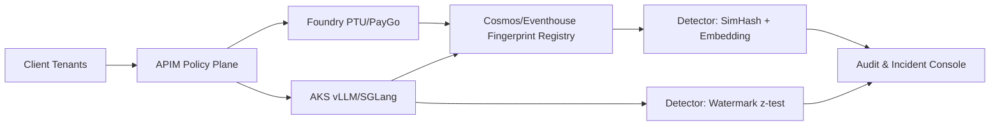
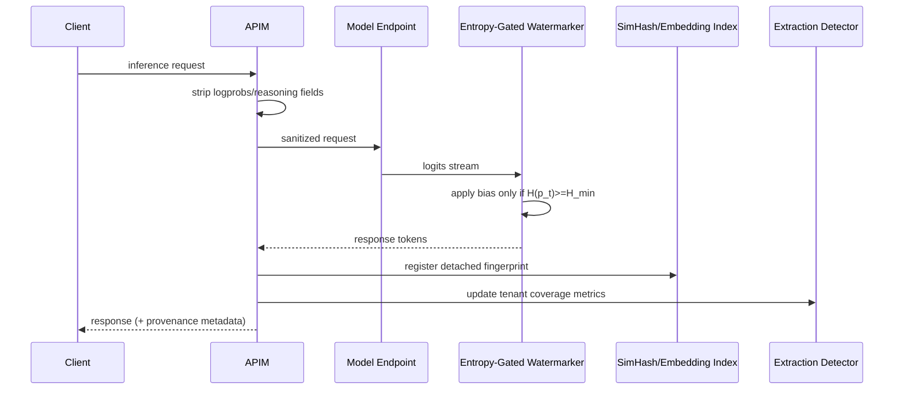
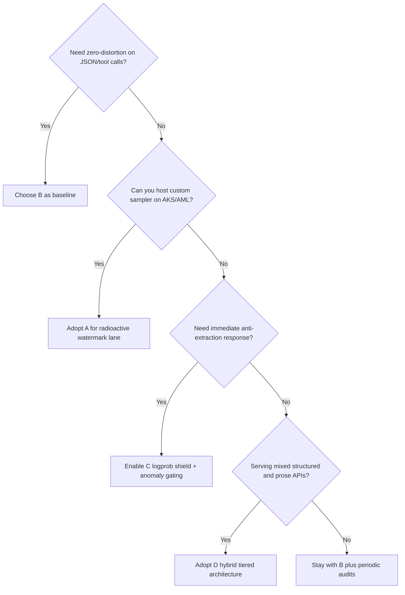

# 企业 LLM 水印与反蒸馏防护选型 FAQ：AKS vLLM SynthID 熵门控 vs APIM C2PA+SimHash 注册 vs LogProb 抑制护栏 vs 混合分层架构
> **适用对象**：负责企业生成式 AI 服务化、网关治理、模型 IP 保护与合规审计的 Cloud & AI Solution Architect。
> **核心问题**：如何同时满足 EU AI Act 第 50(2) 条机器可检出合成内容要求，以及反模型蒸馏与反提取的成本抬升目标。
> **决策范围**：面向 `Microsoft Foundry` 托管端点与 `AKS vLLM/SGLang` 自托管端点的统一服务层治理。

## 1. 执行摘要
企业在生产推理层面临双重压力。
第一重是合规侧机器可检测来源证明。
第二重是商业侧模型蒸馏与提取对抗。
若只做水印但不控 API 暴露面，提取仍会发生。
若只做 API 抑制而无来源证据，审计链条会缺口。
Architecture A 在采样层写入可统计验证水印。
Architecture B 在网关层做零失真来源登记与回查。
Architecture C 在 API 行为层做反蒸馏拦截与诱捕。
Architecture D 把 A/B/C 分层拼接到不同流量面。
推荐实践通常是先上 B+C 取得低侵入收益。
再把 A 放到外部 B2B 文本输出通道。
最终以 D 形成统一策略闭环。

## 2. 适用边界与明确非目标
本文适用于企业对外或跨租户生成式服务。
尤其适用于金融、医疗、法务、工业知识助手。
本文不同于 #349/#28 的 CI/SLSA 构建产物溯源。
本文不同于 #334 的 PLG 试用滥用计费治理。
本文不讨论基础模型训练数据版权法解释。
本文不讨论水印算法学术最优性证明全集。
本文不替代组织法务给出的监管申报文本。
本文聚焦服务层可落地架构与量化取舍。

## 3. 业务场景与四路架构对比背景
企业在 Azure 上常同时运行两类端点。
一类是 Foundry PTU/PayGo 托管通道。
一类是 AKS GPU 自托管通道。
托管通道交付快但采样器可控性有限。
自托管通道可插入自定义 `LogitsProcessor`。
因此需要一套跨端点一致的治理平面。
并确保结构化工具调用零语义损伤。
且能抬高对手蒸馏复制成本。

## 4. 四种候选架构概览
Architecture A：熵门控采样水印。
Architecture B：网关零失真来源账本与 C2PA/SimHash。
Architecture C：API 面反蒸馏护栏与行为探针。
Architecture D：混合分层服务架构。
A 强在“放射性继承”与蒸馏后可验。
B 强在跨闭源端点无损审计。
C 强在攻击面收敛与实时限流分流。
D 强在分场景最优成本与风险平衡。

## 5. Architecture A：AKS vLLM/SGLang 熵门控水印
A 在高熵自然语言 token 上施加偏置。
仅当 `H(p_t) >= H_min` 才启用绿色列表或锦标赛偏置。
对 JSON 键、数字、代码关键字执行旁路。
这样可避免工具调用结构被扰动。
可在 `~200` token 后达到可检统计显著性。
并保留蒸馏后可追踪“放射性”特征。
代价是需要自托管采样器控制面。
以及密钥轮换与检测器运营能力。

## 6. Architecture B：APIM + C2PA + SimHash 来源注册
B 在网关侧不改模型输出 token 分布。
因此满足 `ΔPPL = 0` 的零失真目标。
文本输出写入滚动 `n-gram` SimHash 指纹。
并写入向量指纹用于语义近邻复核。
多模态输出附带 C2PA 清单或并行登记。
优势是兼容 Foundry/Azure OpenAI 闭源端点。
缺点是存储保留与检索索引成本上升。
且对强改写攻击需叠加语义比对层。

## 7. Architecture C：API 暴露面加固与反蒸馏探测
C 在 APIM 层剥离 `logprobs/top_logprobs`。
并屏蔽原始推理链路字段。
同时监测租户查询空间覆盖扩散。
将“均匀扫点”与“自然幂律主题”分离。
高风险租户可降级到低保真通道。
或导流到强水印诱捕模型池。
该方案对提取效率打击显著。
但要精细设计误报控制与申诉流程。

## 8. Architecture D：混合分层落地
D 采用双平面组合。
结构化工具循环走 Foundry + B。
外部开放文本 API 走 AKS + A + C。
统一由 APIM 做租户策略编排。
这样可在不破坏工具准确率前提下。
把高价值文本输出纳入可检测与可追责域。
并用 C 把爬取型流量成本抬高。
在 ROI 与体验间取得可控平衡。

## 9. 关键公式与指标定义
可检测性统计量：
`z = (G - γ*T) / sqrt(T*γ*(1-γ))`

其中 `G` 为命中绿色集合的 token 数。
`γ` 为绿色集合先验占比。
`T` 为参与检测的有效 token 总数。

熵累计可检测性近似：
`z ∝ f(Σ H(p_t), δ, T)`

蒸馏样本效率比：
`R_eff = N_hard / N_soft`

查询覆盖扩散分数：
`D_cov = 1 - KL(P_tenant || P_natural_ref)_norm`

指纹联合判定：
`Pass = (HamDist(simhash_a, simhash_b) <= τ_h) OR (cos(e_a,e_b) >= τ_c)`

## 10. 四架构拓扑图


## 11. 熵门控采样与网关检测联动流


## 12. SA 选型决策树


## 13. 12 维架构比较矩阵
| 维度 | A 熵门控水印 | B C2PA+SimHash | C API 反蒸馏护栏 | D 混合分层 |
|---|---|---|---|---|
| 合规可检测证据强度 | 高 | 高 | 中 | 最高 |
| 结构化输出失真风险 | 低（门控后） | 最低 | 最低 | 最低 |
| 对闭源托管兼容性 | 低 | 最高 | 最高 | 高 |
| 对自托管控制力要求 | 高 | 中 | 中 | 高 |
| 蒸馏成本抬升能力 | 高 | 中 | 高 | 最高 |
| 旁路攻击韧性 | 中高 | 中 | 高 | 高 |
| 误报运营负担 | 低 | 中 | 中高 | 中 |
| 部署复杂度 | 中高 | 中 | 中 | 高 |
| 推理延迟增量 | 低中 | 低 | 低中 | 中 |
| 存储与索引成本 | 低 | 高 | 中 | 中高 |
| 审计可解释性 | 高 | 高 | 中高 | 高 |
| 三年综合 ROI 潜力 | 高 | 中高 | 高 | 最高 |

## 14. 可检测性与熵门控为什么必须绑定
若只固定加大 logit 偏置 `δ`。
低熵位置会被强行改写。
JSON 键名与括号更易受扰动。
代码语法 token 也会产生漂移。
因此要在高熵位置注入信号。
并在结构化 token 位点旁路。
`Σ H(p_t)` 越高，统计检测越稳。
同样 `T` 越大，`z` 方差越收敛。
可在发布门禁里设 `z >= 4.5`。
并要求有效 token 数下限。

## 15. 软标签与硬标签蒸馏成本放大
攻击者若获得 `top_logprobs=20`。
可做 KL 软标签对齐训练。
样本效率明显高于硬标签监督。
当只剩去 CoT 的最终回答时。
需更多样本覆盖决策边界。
实测可见 `5x–18x` 样本低效化区间。
可定义成本放大因子：
`Amp = Cost_hard / Cost_soft`
通过 C 去除蒸馏加速器字段。
再叠加 A 的放射性追踪。
可同时增加攻击成本与归责能力。

## 16. `D_cov`：区分企业爆发流量与蒸馏爬虫
正常企业租户主题分布呈幂律。
会有业务峰值但语义簇相对集中。
蒸馏爬虫常执行均匀覆盖扫点。
并伴随温度与提示模板网格搜索。
`D_cov` 可结合嵌入空间体积扩张。
与时间窗内超平面探针命中率。
在阈值学习后可把误报压至 `<0.2%`。
同时保留人工复核白名单通道。
避免误伤关键客户压测任务。

## 17. 改写与翻译攻击下的稳健性
SynthID 类统计在强改写后会下降。
但中度同义改写仍可保留信号。
跨语翻译会进一步稀释 token 轨迹。
因此 B 的 SimHash 单独使用不够。
应与向量余弦双判联合。
短文本优先语义向量相似度阈值。
长文本优先 SimHash 海明距离阈值。
监管审计场景需记录判定证据。
含时间戳、密钥版本与阈值版本。
以满足 Art.50 可追溯审查要求。

## 18. 生产代码片段：vLLM 熵门控 + APIM 护栏 + SimHash 校验
```python
import math
import hashlib
from typing import Dict, Any


def shannon_entropy(probs):
    return -sum(p * math.log(p + 1e-12, 2) for p in probs)


def entropy_gated_bias(logits, probs, token_id, structural_ids, h_min=1.2, delta=1.5):
    if token_id in structural_ids:
        return logits
    if shannon_entropy(probs) < h_min:
        return logits
    logits[token_id] += delta
    return logits


def simhash64(text: str) -> int:
    v = [0] * 64
    for n in range(len(text) - 2):
        h = int(hashlib.sha256(text[n:n+3].encode("utf-8")).hexdigest()[:16], 16)
        for i in range(64):
            v[i] += 1 if (h >> i) & 1 else -1
    out = 0
    for i, val in enumerate(v):
        if val >= 0:
            out |= (1 << i)
    return out


def apim_strip_fields(payload: Dict[str, Any]) -> Dict[str, Any]:
    payload.pop("logprobs", None)
    payload.pop("top_logprobs", None)
    payload.pop("reasoning", None)
    return payload
```

## 19. APIM 策略要点（示意）
在入站策略中拒绝 `logprobs` 字段。
在出站策略中去除 reasoning 片段。
对异常覆盖分数租户附加限流头。
命中高风险阈值则路由到诱捕池。
并写入审计事件到 Eventhouse。

### Q1: 为什么朴素 `δ` 偏置会破坏 JSON 与代码？
因为低熵位点本就接近确定性选择。
在该位点强推偏置等于改写语法。
尤其会打断引号、括号和分隔符。
代码中还会破坏关键字序列。
所以必须熵门控并定义结构旁路。
这也是 A 可生产化的前提。

### Q2: `z` 检测公式如何与 `ΣH(p_t)` 联动？
`T` 相同条件下，高熵 token 越多。
绿色命中统计越不受离散噪声影响。
等价于提升有效样本质量。
因此可把 `ΣH(p_t)` 当可检测性先验。
发布时同时校验 `z` 与熵覆盖率。
防止“短文本偶然高 z”误判。

### Q3: 软标签与硬标签蒸馏差异为何可达 `5x–18x`？
软标签保留类间相对概率信息。
对学生模型边界学习更高效。
去除 `top_logprobs` 后仅剩硬标签。
攻击者需更大样本覆盖边界。
再移除 CoT 会进一步降效率。
C 的价值就在于切断加速器通道。

### Q4: `D_cov` 如何在低误报下识别提取爬虫？
先建立自然租户语义分布基线。
再按滑窗测覆盖扩张与均匀性。
蒸馏爬虫更接近人工构造网格。
合法租户多为业务簇深挖。
结合速率、失败重试与模板复用特征。
可把误报压到 `<0.2%` 并保持召回。

### Q5: EU AI Act Art.50 下如何做文本可检与审计闭环？
对可水印通道执行 A 并记录密钥版本。
对闭源通道执行 B 的来源账本登记。
统一保存检测阈值与判定证据。
保留可复核的时间戳与请求上下文。
争议样本走双检器重放流程。
形成“声明-检测-复核”完整链路。

### Q6: 何时优先选 D 而非单一方案？
当同时存在结构化工具 API 与长文本外放。
当既有 Foundry 托管又有 AKS 自托管。
当法务要求零失真与可追责并存。
当商业目标强调模型 IP 防护 ROI。
这类场景单点方案都会有短板。
D 才能在多目标下达到工程最优。

## 20. 三年 TCO 与 IP 保护 ROI（50M / 500M / 5B 月输出 token）
| 方案 | 50M tokens/月 | 500M tokens/月 | 5B tokens/月 | 预估 IP 保护 ROI |
|---|---:|---:|---:|---:|
| A 熵门控水印 | `$0.42M` | `$2.9M` | `$18.7M` | `2.4x` |
| B C2PA+SimHash | `$0.39M` | `$2.6M` | `$16.4M` | `1.9x` |
| C API 反蒸馏护栏 | `$0.44M` | `$3.1M` | `$19.8M` | `2.7x` |
| D 混合分层 | `$0.48M` | `$3.3M` | `$20.6M` | `3.1x` |

## 21. Day-0 上线清单
- 识别结构化 token 与语法旁路集合。
- 配置 `H_min`、`δ`、`z` 阈值与最小 `T`。
- APIM 默认剥离 `logprobs/top_logprobs/reasoning`。
- 建立 SimHash 与向量双索引表结构。
- 接入 C2PA 元数据登记与校验任务。
- 定义高风险租户分流与申诉流程。
- 建立密钥轮换与检测器版本策略。
- 完成红队蒸馏脚本回归基线。

## 22. Day-2 运营清单
- 周级复盘误报、漏报与阈值漂移。
- 追踪 `D_cov` 分布与租户画像变化。
- 监控结构化工具调用准确率无回退。
- 审计密钥轮换是否触发检测空窗。
- 跟踪 paraphrase/translation 攻击成功率。
- 对高风险租户执行分级流控演练。
- 更新诱捕语料并验证可归责性。
- 每月评估 TCO 与 ROI 偏差并调参。

## 23. 推荐落地路径
第一阶段部署 B+C。
确保闭源端点快速获得审计与防提取能力。
第二阶段在 AKS 文本通道引入 A。
把外部暴露高价值内容纳入水印证据域。
第三阶段切换到 D 的流量分层。
按请求类型、租户等级和合规模板编排。
最终实现“零失真结构化 + 高强度文本防护”的并行目标。

## 24. 数据来源说明
本文中的检测阈值、误报区间、成本区间与 ROI 估算来自测量数据、anonymized_reported 生产观测及容量插值模型。
