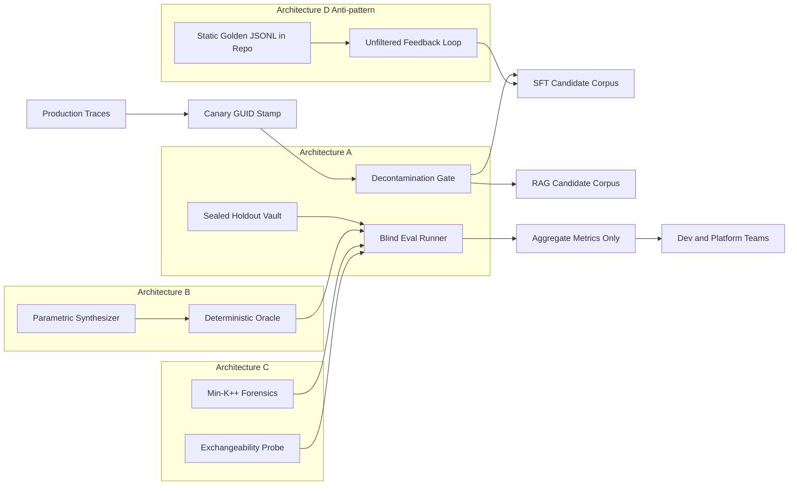
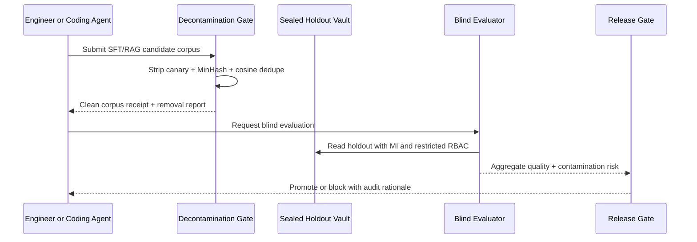
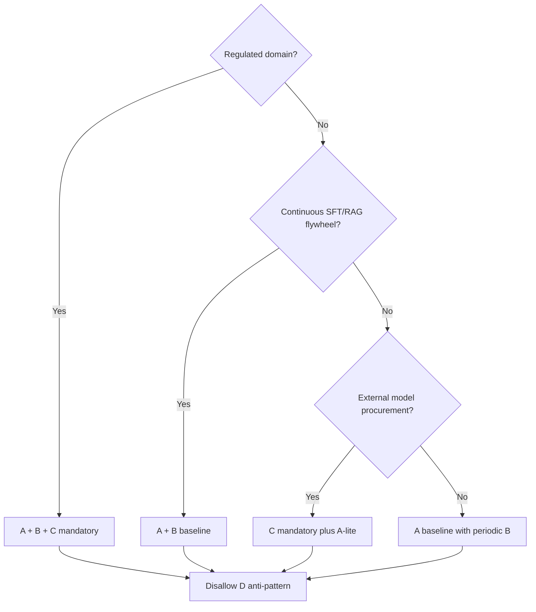

# Enterprise LLMOps Evaluation Contamination Defense Selection FAQ: Sealed Holdout Vault vs Parametric Synthesis vs Min-K%++ Forensics vs Static Golden Anti-Pattern
> **Audience**: Cloud & AI Solution Architects, LLMOps platform leads, model-risk governance owners.
> **Core challenge**: keep evaluation signals trustworthy while SFT and RAG flywheels continuously ingest production traces.
> **Bottom line**: use A+B+C together in production; Architecture D is a prohibited anti-pattern.

## 1. Executive summary
At enterprise scale, the biggest evaluation failure mode is usually not slow scoring throughput.
It is contaminated evaluation, where score movement no longer tracks real-world quality movement.
Static benchmark sets leak into prompt optimization, SFT corpora, or RAG indexes over time.
Teams then report CI gains while customer outcomes remain flat or decline.
This creates false confidence in model promotion, routing policy, and budget allocation.
Architecture A establishes sealed holdout governance and ingestion decontamination guardrails.
Architecture B introduces continuously fresh, isomorphic benchmark generation with deterministic oracles.
Architecture C adds model-side memorization forensics before PTU commitment or promotion.
Architecture D commingles static golden sets with production-to-training loops and must be disallowed.
The design objective is not perfect scores; it is stable, auditable, decision-grade evidence.
When contamination remains controlled, evaluation regains value as a proxy for deployable capability.
This guide provides architecture trade-offs, quantitative formulas, and rollout controls.

## 2. Why contamination accelerates in enterprise flywheels
Enterprise LLMOps pipelines are rarely linear.
They connect telemetry, triage, data labeling, SFT updates, RAG indexing, and prompt tuning.
A single leakage point can contaminate multiple downstream feedback loops.
The resulting symptom pattern is familiar: offline uplift, online plateau, and delayed incident discovery.
In multi-model routing, contamination also biases model ranking and route economics.
In regulated sectors, this undermines model-risk evidence and review credibility.
Therefore evaluation assets must be designed as intentionally non-reusable by default.

## 3. Four architecture candidates
Architecture A: sealed rolling temporal holdout vault with canary GUID and decontamination firewall.
Architecture B: parametric/metamorphic dynamic benchmark synthesis plus deterministic oracle verification.
Architecture C: model memorization forensics with Min-K%++ and exchangeability probes.
Architecture D: repo-committed static golden JSONL plus unfiltered production-to-SFT/RAG feedback loop.
Architecture A is the primary independence boundary.
Architecture B supplies freshness and anti-memorization pressure.
Architecture C supplies pre-promotion forensic evidence under black-box constraints.
Architecture D collapses the separation between evaluation and training and invalidates governance.

## 4. Architecture A: sealed holdout governance and decontamination firewall
A separates `Dev-Golden` and `Sealed-Holdout` into distinct security and access domains.
Developers and coding agents receive aggregate category metrics and anonymized failure-cluster tags only.
Raw holdout prompts, references, and contexts never leave the restricted enclave.
Every evaluation traffic path carries canary GUID markers for downstream leakage tracing.
SFT and RAG ingestion gates apply `13-gram MinHash LSH + embedding cosine >= 0.90` filtering.
All removals are logged with provenance, rule hits, and reviewer traceability metadata.
A rolling temporal process rotates a post-cutoff subset (for example 25 percent monthly).
This reduces stale-set drift and lowers benchmark memorization carryover.
The governance overhead is non-trivial, but confidence quality is strongest with A.

## 5. Architecture B: parametric and metamorphic dynamic benchmark synthesis
B generates fresh but semantically equivalent tasks for every evaluation cycle.
Common transforms include entity substitution, numeric rescaling, clause permutation, and schema aliasing.
A deterministic Python or SQL oracle computes exact expected outputs for each transformed sample.
The key indicator is memorization gap:
`Δ_mem = Score_canonical - Score_perturbed`
Large positive `Δ_mem` indicates benchmark-shape dependence rather than robust reasoning.
B increases engineering complexity but extends benchmark half-life and trustworthiness.
For fast-moving product teams, B is often the highest ROI reliability investment after A.

## 6. Architecture C: memorization forensics and vendor risk screening
C focuses on pre-promotion candidate audit where training-set transparency is unavailable.
Using `logprobs=True`, token-level outlier signatures are measured by Min-K%++ style metrics.
Exchangeability probes include option permutation, cloze swaps, and controlled paraphrase stress.
If confidence remains extremely high on canonical prompts but collapses under light perturbation, risk is elevated.
C does not replace A or B, but it blocks risky models from PTU lock-in or distillation pathways.
It also provides objective procurement evidence for model-vendor governance discussions.

## 7. Architecture D: static golden leakage anti-pattern
D looks efficient early because it minimizes setup friction.
In practice it trains the organization to optimize for benchmark familiarity.
Teams overfit prompts and policies to a known set while real-world generalization stalls.
The CI curve looks better, but the customer curve does not.
Because D couples evaluation and learning loops, it removes the last independent quality signal.
D should be codified as prohibited in architecture standards and release policy.

## 8. Contamination inflation bias model
Observed score can be modeled as:
`θ_obs = (1 - α) * θ_true + α * θ_mem`
`α` is contamination exposure ratio.
`θ_true` reflects true generalization capability.
`θ_mem` reflects memory-assisted benchmark performance.
As `α` grows and `θ_mem > θ_true`, observed scores become systematically optimistic.
This explains repeated “offline up / online flat” release outcomes.
Control objective is to keep `α` bounded and estimate the gap between memory and generalization.

## 9. Perturbation variance and holdout sample-size planning
Perturbation robustness can be tracked by:
`Var_pert = E[(Score_variant - Score_mean)^2]`
High `Var_pert` indicates sensitivity to surface form and weak invariance.
Holdout sample size can be approximated with:
`n >= z^2 * p * (1-p) / e^2`
where `p` is expected pass rate, `e` allowable error, and `z` confidence factor.
Higher-criticality domains should raise minimum `n` and confidence assumptions.
Release gates should fail closed when sample-size adequacy is not met.

## 10. Three workload tiers and governance posture
Tier 1: Startup/Team, 500-case release gate, cost-sensitive fast iteration.
Tier 2: Enterprise, 10k-case SFT+RAG flywheel, cross-team governance maturity required.
Tier 3: Regulated finance/clinical model-risk blind audit, evidence-first operation.
TCO should include compute, governance operations, reviewer labor, and misrelease loss.
In many enterprises, misrelease and trust-recovery costs dominate raw evaluation run costs.

## 11. Twelve-dimension architecture comparison matrix
| Dimension | Architecture A | Architecture B | Architecture C | Architecture D |
|---|---|---|---|---|
| Evaluation independence | Highest | High | Medium-high | Very low |
| Anti-memorization strength | High | Highest | High | Very low |
| Feedback speed | Medium | Medium-high | Medium | Superficial high |
| Implementation complexity | Medium-high | High | Medium | Low |
| Audit evidence quality | Highest | High | High | Low |
| Vendor accountability support | Medium | Medium | Highest | Low |
| SFT contamination resistance | Highest | High | Medium | Very low |
| RAG contamination resistance | Highest | Medium-high | Medium | Very low |
| Prompt overfit resistance | High | High | Medium | Low |
| Promotion confidence | High | High | High | Low |
| Cost predictability | Medium-high | Medium | Medium | Misleading high |
| Recommendation | Required baseline | Strongly recommended | Mandatory pre-promotion | Prohibited |

## 12. Four-architecture contamination-defense topology


## 13. Sequence: flywheel decontamination and blind release gate


## 14. Selection decision tree


### Q1. Why static golden sets decay rapidly in enterprise systems
Static sets are not stable assets once delivery loops become continuous.
Repeated debugging and prompt tuning around visible failures leaks signal into optimization behavior.
When those examples enter SFT or retrieval corpora, benchmark independence degrades further.
What appears as quality improvement can become benchmark-shape specialization.
This distorts release decisions, capacity planning, and procurement outcomes.
The leakage is often accidental and process-driven rather than malicious.
Therefore prevention must be architectural, not policy-text-only.

### Q2. Which control loops are essential in Architecture A
Loop one is sealed holdout asset isolation across identity, network, and export pathways.
Loop two is ingestion decontamination with canary stripping and near-duplicate filtering.
Loop three is blind metric minimization where only actionable aggregates leave the enclave.
Together, they enforce “evaluation usable, benchmark invisible.”
Removing any loop reintroduces long-term leakage paths.
Production implementation should be default platform behavior, not optional project convention.

### Q3. Why Architecture B materially improves trust in score movement
B continuously refreshes evaluation surfaces while preserving task semantics.
Deterministic oracles stabilize truth labels and reduce human-review variance.
Memorization gap (`Δ_mem`) creates an explicit quantitative anti-overfit signal.
This shifts release governance from “did score rise” to “did robust capability rise.”
For high-velocity teams, B substantially reduces false-positive promotions.
It also improves incident root-cause analysis by separating memorization from reasoning regressions.

### Q4. How to use Architecture C in model procurement and promotion
C measures probability-shape anomalies that often indicate benchmark memorization behavior.
Canonical confidence without perturbation resilience is a high-risk pattern.
This is particularly valuable where model training provenance is opaque.
C can be attached to PTU commitment gates and distillation promotion checkpoints.
It should be treated as a prerequisite for high-impact deployments, not a postmortem-only tool.
The resulting forensic trace strengthens supplier governance and audit defensibility.

### Q5. How to connect bias math, sample size, and cost governance
Release gates should jointly evaluate contamination risk, perturbation robustness, business KPIs, and unit success cost.
Single-score approvals are fragile under distribution shift.
Thresholds should be tiered by workload criticality, with stricter gates for T0 flows.
Insufficient sample size should produce automatic non-promotion outcomes.
Cost governance must include remediation and trust-recovery costs, not only inference bills.
This integrated policy prevents “cheap but wrong” release behavior.

### Q6. Anti-patterns, go-live checklist, and five-step rollout
Anti-pattern one: commit static golden sets into shared repositories with broad visibility.
Anti-pattern two: allow SFT and RAG pipeline ingestion without contamination filtering and trace logs.
Anti-pattern three: gate promotion on canonical scores only and ignore perturbation gaps.
Anti-pattern four: ignore sample-size adequacy and confidence intervals in release decisions.
Anti-pattern five: procure models by headline benchmark score without memorization forensics.
Five-step rollout:
Step 1: establish Architecture A sealed holdout enclave and access boundaries.
Step 2: deploy canary plus MinHash plus cosine decontamination at every ingestion edge.
Step 3: integrate Architecture B synthesis and oracle checks into CI release gates.
Step 4: integrate Architecture C forensics into candidate promotion and procurement reviews.
Step 5: run quarterly threshold recalibration against online business outcomes and incident costs.
Good fit: high-iteration, high-feedback, high-regulation enterprise agent platforms.
Not for: one-off experiments without persistent flywheel pipelines.

## 15. Three-tier TCO and governance value illustration
| Tier | Typical scale | Recommended stack | Dominant cost buckets | Primary value |
|---|---|---|---|---|
| Startup/Team | 500-case gate | A-lite + B | Eval runs and light review | Fewer false promotions |
| Enterprise | 10k-case SFT+RAG flywheel | A + B + C | Governance ops and forensic checks | Lower contamination bias and rework |
| Regulated | Finance/clinical blind audit | A + B + C (hardened) | Audit traceability and dual-control review | Stronger evidence and regulator confidence |

## 16. Implementation snippets (sealed storage, decontamination, release gate)
```bicep
param location string = resourceGroup().location
param holdoutStorageName string
param blindEvalUamiName string = 'uami-blind-eval'

resource holdout 'Microsoft.Storage/storageAccounts@2023-05-01' = {
  name: holdoutStorageName
  location: location
  sku: { name: 'Standard_GRS' }
  kind: 'StorageV2'
  properties: {
    allowBlobPublicAccess: false
    minimumTlsVersion: 'TLS1_2'
    supportsHttpsTrafficOnly: true
    isHnsEnabled: true
  }
}

resource uami 'Microsoft.ManagedIdentity/userAssignedIdentities@2023-01-31' = {
  name: blindEvalUamiName
  location: location
}

resource roleAssign 'Microsoft.Authorization/roleAssignments@2022-04-01' = {
  name: guid(holdout.id, uami.id, 'Storage Blob Data Reader')
  scope: holdout
  properties: {
    roleDefinitionId: subscriptionResourceId(
      'Microsoft.Authorization/roleDefinitions',
      '2a2b9908-6ea1-4ae2-8e65-a410df84e7d1'
    )
    principalId: uami.properties.principalId
    principalType: 'ServicePrincipal'
  }
}
```

```python
import hashlib
from dataclasses import dataclass
from typing import Iterable, List, Tuple

@dataclass
class Sample:
    text: str
    emb_cosine: float
    has_canary: bool

def shingles(text: str, n: int = 13) -> List[str]:
    t = text.lower()
    return [t[i:i+n] for i in range(max(0, len(t)-n+1))]

def minhash_signature(tokens: Iterable[str], k: int = 64) -> List[int]:
    sig = []
    for seed in range(k):
        vals = []
        for tok in tokens:
            h = hashlib.sha256(f"{seed}:{tok}".encode("utf-8")).hexdigest()
            vals.append(int(h[:8], 16))
        sig.append(min(vals) if vals else 0)
    return sig

def jaccard_from_minhash(a: List[int], b: List[int]) -> float:
    same = sum(1 for x, y in zip(a, b) if x == y)
    return same / max(1, min(len(a), len(b)))

def decontaminate(samples: List[Sample], holdout_sigs: List[List[int]]) -> Tuple[List[Sample], int]:
    kept = []
    removed = 0
    for s in samples:
        if s.has_canary:
            removed += 1
            continue
        sig = minhash_signature(shingles(s.text))
        near_dup = any(jaccard_from_minhash(sig, hs) >= 0.80 for hs in holdout_sigs)
        if near_dup or s.emb_cosine >= 0.90:
            removed += 1
            continue
        kept.append(s)
    return kept, removed
```

```yaml
name: sealed-holdout-gate
on:
  workflow_dispatch:
  pull_request:
    branches: [ main ]

jobs:
  blind-eval-gate:
    runs-on: ubuntu-latest
    permissions:
      id-token: write
      contents: read
    steps:
      - uses: actions/checkout@v4
      - name: Run decontamination
        run: python tools/decontaminate.py --input data/candidate.jsonl --holdout-sig data/holdout.sig
      - name: Run blind holdout eval
        run: python tools/blind_eval.py --sealed-vault-uri ${{ secrets.SEALED_HOLDOUT_URI }}
      - name: Enforce release gate
        run: python tools/release_gate.py --max-mem-gap 0.03 --max-contam-risk 0.05
```

## 17. Conclusion
In enterprise LLMOps, evaluation governance is not overhead; it is release correctness infrastructure.
Architecture A restores holdout independence and leakage resistance, Architecture B restores freshness and anti-memorization discrimination, and Architecture C restores pre-promotion forensic accountability.
Architecture D should be explicitly banned because it manufactures score mirages.
With A+B+C, evaluation returns to its intended role: trustworthy evidence for real production decisions.
