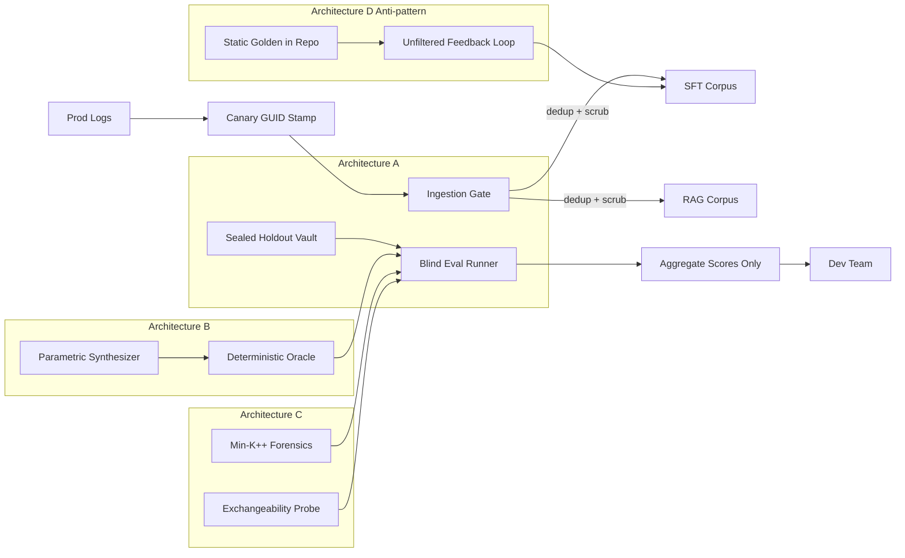
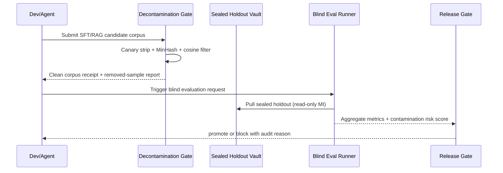
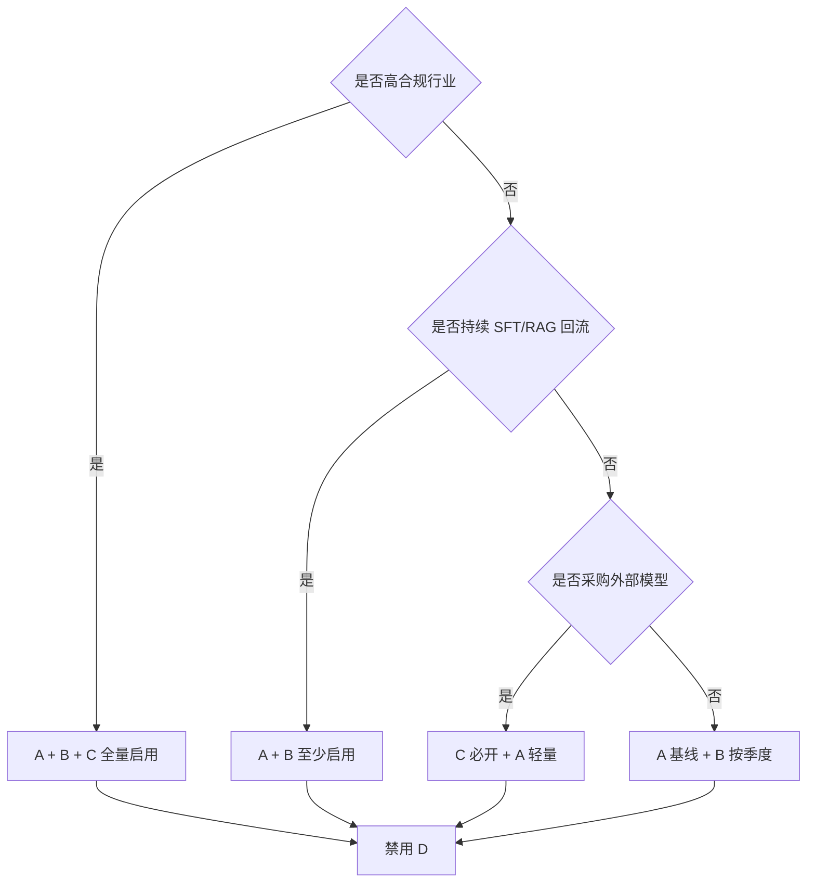

# 企业 LLMOps 评测污染防御与密封留出治理选型 FAQ：Sealed Holdout Vault vs Parametric Synthesis vs Min-K%++ Forensics vs 静态金集反模式
> **适用对象**：Cloud & AI Solution Architect、LLMOps 平台团队、模型风险治理与合规团队。
> **关键问题**：如何在持续 SFT/RAG 数据飞轮中阻断评测泄漏，避免“看起来提分、线上不增益”的 Goodhart 偏差。
> **结论先行**：生产推荐 A+B+C 组合，D 反模式应在组织层面明令禁用。

## 1. 执行摘要
企业智能体平台进入规模化后，评测体系最大的风险通常不在“算得慢”，而在“测得假”。
静态题库一旦进入 Prompt 优化、SFT 语料或 RAG 索引，会快速失去判别力。
工程团队看到 CI 分数上升，业务团队却观察不到真实客户成功率同步提升。
这种错配会误导模型升级、路由策略和预算配置，形成持续性的架构债务。
Architecture A 通过“密封留出 + 去标识反馈 + 入口去污染”建立主防线。
Architecture B 通过参数化/变形生成任务与确定性 Oracle 建立抗记忆验证线。
Architecture C 通过 Min-K%++ 与交换性探针建立上线前取证审计线。
Architecture D 把静态金集提交仓库并回流到训练/索引，是必须禁止的反模式。
治理目标不是把所有误差消灭，而是让评测结果保持可解释、可重复、可审计。
当污染率被控制在阈值内，评测分数才能成为真实上线质量的可依赖代理变量。
本指南给出四架构对比、偏差与样本量公式、三档 TCO 与五步落地清单。

## 2. 为什么“评测污染”会在企业数据飞轮中加速放大
企业飞轮链路通常包括：生产交互日志、人工标注、SFT 微调、RAG 增量索引与提示词再优化。
任何一个环节如果未隔离评测资产，污染都会沿链路扩散到多个子系统。
污染后的评测表现为“短期高分 + 长期真实场景停滞或回退”。
在多模型路由场景，污染还会放大路由偏置，使调度器偏爱“会背题”的模型。
在高监管行业，这会直接冲击模型风险管理与审计可证明性。
因此，评测体系必须被设计成“对训练/索引回路默认不透明”。

## 3. 四种架构候选总览
Architecture A：密封滚动留出库 + Canary GUID + MinHash/向量近重复去污染网关。
Architecture B：参数化与变形合成基准 + 程序化 Oracle 真值校验。
Architecture C：模型记忆取证（Min-K%++ + Cloze/选项交换探针）上线门禁。
Architecture D：仓库静态金集 + 生产数据无过滤回流到 SFT/RAG。
A 提供制度化隔离主线。
B 提供持续新题供给与抗记忆压测。
C 提供供应商与模型版本层面的取证证据。
D 形成最危险的“伪进步闭环”。

## 4. Architecture A：密封留出金库与去污染防火墙
A 的核心是把 `Dev-Golden` 与 `Sealed-Holdout` 分层，并且权限、网络、日志都隔离。
工程与编码智能体只能看到聚合得分、失败簇标签与匿名错误类别。
任何原始 holdout prompt、完整答案与上下文都不允许离开受限边界。
每次评测请求必须附带 canary GUID 水印并在回流入口执行剥离与阻断。
训练与检索语料构建前执行 `13-gram MinHash LSH + cosine >= 0.90` 去重。
对命中样本记录去污染审计轨迹，包括来源、命中规则、处置动作与复核人。
滚动窗口每月替换 25% 后切断样本，降低时间泄漏与“题库陈旧”风险。
该架构对组织流程要求较高，但提供最强的治理可解释性。

## 5. Architecture B：参数化/变形动态评测
B 的重点是让每次 CI 评测都拥有“新鲜但同构”的任务集。
通过模板、AST、实体替换、数值缩放、子句重排与 schema 别名实现等价变换。
每条变形任务都由确定性 Oracle（Python/SQL）生成真值，避免人工主观评分漂移。
关键指标是记忆差距 `Δ_mem = Score_canonical - Score_perturbed`。
当 canonical 分数高但 perturbed 分数显著下降，通常意味着记忆型过拟合。
B 对工程化资产要求高，但可持续供给高信噪比回归样本。
对于高迭代团队，B 能显著降低静态题库折旧速度。

## 6. Architecture C：模型记忆取证与供应商审计
C 用于“上线前模型候选审计”，重点解决黑盒供应商不可见训练集的问题。
通过 `logprobs=True` 收集 token 概率分布，计算 Min-K%++ 异常分位。
再结合选项交换、Cloze 置换、同义改写稳定性探针识别可疑记忆痕迹。
当模型在 canonical 样本上极高置信，但在轻扰动后置信剧烈塌陷，应判定高风险。
C 不能单独替代 A/B，但可避免高风险模型进入 PTU 或蒸馏晋级链路。
在采购治理中，C 还能形成对供应商的量化问责证据。

## 7. Architecture D：静态金集回流反模式
D 常见于“追求研发效率”的早期团队：把评测集放进仓库并复用到 SFT/RAG。
短期看会得到明显 CI 提分，长期会让真实线上收益停滞。
更糟糕的是，团队会据此做错误预算与容量决策。
当系统面临新域任务时，污染体系无法提供任何可靠预警。
D 的本质是把评测系统变成训练系统的一部分，破坏了验证独立性。

## 8. 偏差模型与污染通胀公式
观测分数可写作：
`θ_obs = (1 - α) * θ_true + α * θ_mem`
其中 `α` 为污染占比，`θ_true` 为真实泛化能力，`θ_mem` 为记忆驱动得分。
当 `α` 上升且 `θ_mem > θ_true` 时，`θ_obs` 会系统性高估真实能力。
这解释了“离线分数上升但线上业务指标不变”的典型现象。
治理目标是让 `α` 保持在可控上限，并持续估计 `θ_mem - θ_true` 的区间。

## 9. 扰动方差与样本量估计
对扰动评测可定义：
`Var_pert = E[(Score_variant - Score_mean)^2]`
若 `Var_pert` 高，说明模型对表面形式敏感，鲁棒性不足。
留出评测样本量可按近似二项区间估计：
`n >= z^2 * p * (1-p) / e^2`
其中 `p` 为预期通过率，`e` 为可接受误差，`z` 为置信系数。
在高风险领域应上调 `z` 与最小样本下限，避免发布门禁被偶然波动误导。

## 10. 三档企业场景与成本视图
Tier 1：Startup/Team，500-case 发布门禁，强调成本敏感与快速迭代。
Tier 2：Enterprise，10k-case SFT+RAG 飞轮，强调持续治理与跨团队协同。
Tier 3：Regulated，金融/医疗高合规盲审，强调审计证据链与风险可追溯。
TCO 需同时计算计算成本、数据治理成本、审核人力成本与误发布损失成本。
在多数企业中，误发布损失与返工成本往往高于评测运行本身成本。

## 11. 12 维横向对比矩阵
| 维度 | Architecture A | Architecture B | Architecture C | Architecture D |
|---|---|---|---|---|
| 评测独立性 | 最高 | 高 | 中高 | 极低 |
| 抗记忆能力 | 高 | 最高 | 高 | 极低 |
| 研发反馈速度 | 中 | 中高 | 中 | 表面高 |
| 实施复杂度 | 中高 | 高 | 中 | 低 |
| 审计可证明性 | 最高 | 高 | 高 | 低 |
| 供应商可问责性 | 中 | 中 | 最高 | 低 |
| 数据回流安全性 | 最高 | 高 | 中 | 极低 |
| 对 Prompt 过拟合抑制 | 高 | 高 | 中 | 低 |
| 对 SFT 污染抑制 | 最高 | 高 | 中 | 极低 |
| 对 RAG 污染抑制 | 最高 | 中高 | 中 | 极低 |
| 成本可预测性 | 中高 | 中 | 中 | 表面高 |
| 推荐结论 | 必选主线 | 强烈建议 | 上线前必配 | 禁用 |

## 12. 四架构去污染与盲评拓扑图


## 13. SFT/RAG 回流去污染与盲评发布门禁时序


## 14. 方案选型决策树


### Q1. 为什么静态金集在企业飞轮里很快失效
静态金集并不是“永恒真值”，它在持续迭代系统中会不断被间接暴露。
当工程师反复观察失败样本并调 Prompt 时，知识已开始向系统泄漏。
当这些样本再进入 SFT 与检索索引，评测独立性进一步下降。
最终离线分数反映的是“记忆命中率”而非“泛化能力”。
这会导致错误的模型路由、错误的资源预算与错误的发布判断。
尤其在多团队协作下，污染源头经常是“无意行为”而非故意作弊。
因此必须把“阻断无意泄漏”作为架构设计的一等公民。

### Q2. Architecture A 的关键控制环路是什么
A 的第一环是密封留出资产管理：权限、网络、日志与导出全封闭。
A 的第二环是回流入口去污染：Canary 去标识、近重复过滤、审计轨迹。
A 的第三环是盲评输出最小化：只返回可行动的聚合指标与匿名失败簇。
这三环共同保证“评测可用但题目不可见”。
如果缺失任一环，长期都会出现信息渗漏与门禁失真。
落地时建议把所有策略写入平台默认模板，而不是依赖人工约束。

### Q3. 为什么 B 的参数化评测能显著抑制记忆偏差
B 通过等价变换持续生成新题，降低模型对固定表述的记忆收益。
程序化 Oracle 提供稳定真值，避免人工评审漂移。
`Δ_mem` 提供了可量化的“记忆收益”估计，便于发布门禁硬阈值化。
在高频迭代流水线中，B 能把评测信号从“题库拟合”拉回“能力验证”。
它对平台工程要求更高，但回报是显著降低错误晋级概率。

### Q4. C 的 Min-K%++ 取证在采购与上线中如何使用
C 不关心业务答案本身，更关心概率分布是否出现异常“背诵型形态”。
如果 canonical 的低熵高置信与扰动后的置信崩塌同时出现，应判高风险。
该证据可用于供应商尽调、模型晋级评审与合规审计备案。
在无法访问训练语料的黑盒环境下，C 是少数可操作的风险探针之一。
最佳实践是把 C 作为上线前必经闸门，而不是事后排查工具。

### Q5. 如何把偏差、样本量与成本联动到发布决策
发布门禁应同时看四组指标：污染风险、扰动鲁棒、业务指标、单位成功成本。
仅看单一分数会放大误判概率，尤其在任务分布漂移阶段。
建议按业务关键度设置分层阈值，例如 T0 场景比 T2 场景更严格。
样本量不够时应自动阻止“绿灯发布”，避免小样本侥幸通过。
成本评估应包含误发布带来的返工与信任损失，而不仅是算力账单。

### Q6. 反模式、上线清单与五步落地法
反模式一：把静态金集放在代码仓并共享给全部开发/智能体流程。
反模式二：SFT 与 RAG 数据构建不做去污染过滤与审计留痕。
反模式三：只看 canonical 得分，不看扰动差距与取证信号。
反模式四：上线门禁只看“是否过线”，不看样本量与区间不确定性。
反模式五：模型采购只看价格与基准榜单，不做记忆风险审计。
五步落地法如下。
第一步：建立 A 的密封留出资产域与访问策略。
第二步：在数据入口部署 Canary + MinHash + cosine 去污染网关。
第三步：把 B 的参数化评测与 Oracle 接入 CI 门禁。
第四步：把 C 的取证探针接入模型晋级与供应商评审。
第五步：按季度复盘阈值、偏差与成本，更新治理基线。
Good fit：持续迭代、强回流、强合规、强审计场景。
Not for：一次性交付且无长期数据飞轮的小型实验项目。

## 15. 三档 TCO 与治理收益示例
| 档位 | 典型规模 | 推荐组合 | 主要成本项 | 主要收益 |
|---|---|---|---|---|
| Startup/Team | 500-case 发布门禁 | A-lite + B | 评测执行与少量审计 | 避免错误晋级与频繁回滚 |
| Enterprise | 10k-case SFT+RAG 飞轮 | A + B + C | 评测平台、数据治理、模型审计 | 降低污染偏差与线上返工 |
| Regulated | 金融/医疗盲审 | A + B + C(强化) | 审计留痕、合规复核、双人审批 | 提升可证明性与监管通过率 |

在实践中，TCO 建议按“固定治理成本 + 变动评测成本 + 误发布损失”三段拆账。
固定治理成本包括密封域建设、权限最小化、审计留痕与流程自动化维护。
变动评测成本与样本量、模型候选数、扰动轮次和取证深度正相关。
误发布损失应包含回滚窗口停机、客服与运营补偿、模型团队返工与品牌信任折价。
若企业只看前两段成本，常会错误低估污染治理价值，导致后续成本转移到业务侧。
建议将“污染风险降低带来的事故减少率”转化为季度经营指标，用于与财务团队对齐。
在高监管组织中，还应把审计可证明性收益折算为合规审查通过率与审查工时下降。
当这些收益纳入同一账本后，A+B+C 组合通常在 2~3 个发布周期内就能体现净收益。
这也是为何成熟团队把评测治理预算视作“风险对冲投入”而非“可选研发开销”。
如果组织已经具备统一数据目录与成本中心，建议把每次评测批次与对应发布版本、投诉率、回滚次数做主键关联，这样可以在季度复盘时直接量化“污染治理投入带来的业务损失下降”。
反之若仍采用分散台账，团队往往只能凭经验判断治理价值，最终在预算评审中被误判为“可延后事项”，导致下一轮上线再为同类问题支付更高代价。

## 16. 生产实现片段（密封域、去污染、门禁）
```bicep
param location string = resourceGroup().location
param holdoutStorageName string
param blindEvalUamiName string = 'uami-blind-eval'

resource holdout 'Microsoft.Storage/storageAccounts@2023-05-01' = {
  name: holdoutStorageName
  location: location
  sku: { name: 'Standard_GRS' }
  kind: 'StorageV2'
  properties: {
    allowBlobPublicAccess: false
    minimumTlsVersion: 'TLS1_2'
    supportsHttpsTrafficOnly: true
    isHnsEnabled: true
  }
}

resource uami 'Microsoft.ManagedIdentity/userAssignedIdentities@2023-01-31' = {
  name: blindEvalUamiName
  location: location
}

resource roleAssign 'Microsoft.Authorization/roleAssignments@2022-04-01' = {
  name: guid(holdout.id, uami.id, 'Storage Blob Data Reader')
  scope: holdout
  properties: {
    roleDefinitionId: subscriptionResourceId(
      'Microsoft.Authorization/roleDefinitions',
      '2a2b9908-6ea1-4ae2-8e65-a410df84e7d1'
    )
    principalId: uami.properties.principalId
    principalType: 'ServicePrincipal'
  }
}
```

```python
import hashlib
from dataclasses import dataclass
from typing import Iterable, List, Tuple

@dataclass
class Sample:
    text: str
    emb_cosine: float
    has_canary: bool

def shingles(text: str, n: int = 13) -> List[str]:
    t = text.lower()
    return [t[i:i+n] for i in range(max(0, len(t)-n+1))]

def minhash_signature(tokens: Iterable[str], k: int = 64) -> List[int]:
    sig = []
    for seed in range(k):
        vals = []
        for tok in tokens:
            h = hashlib.sha256(f"{seed}:{tok}".encode("utf-8")).hexdigest()
            vals.append(int(h[:8], 16))
        sig.append(min(vals) if vals else 0)
    return sig

def jaccard_from_minhash(a: List[int], b: List[int]) -> float:
    same = sum(1 for x, y in zip(a, b) if x == y)
    return same / max(1, min(len(a), len(b)))

def decontaminate(samples: List[Sample], holdout_sigs: List[List[int]]) -> Tuple[List[Sample], int]:
    kept = []
    removed = 0
    for s in samples:
        if s.has_canary:
            removed += 1
            continue
        sig = minhash_signature(shingles(s.text))
        near_dup = any(jaccard_from_minhash(sig, hs) >= 0.80 for hs in holdout_sigs)
        if near_dup or s.emb_cosine >= 0.90:
            removed += 1
            continue
        kept.append(s)
    return kept, removed
```

```yaml
name: sealed-holdout-gate
on:
  workflow_dispatch:
  pull_request:
    branches: [ main ]

jobs:
  blind-eval-gate:
    runs-on: ubuntu-latest
    permissions:
      id-token: write
      contents: read
    steps:
      - uses: actions/checkout@v4
      - name: Run decontamination
        run: python tools/decontaminate.py --input data/candidate.jsonl --holdout-sig data/holdout.sig
      - name: Run blind holdout eval
        run: python tools/blind_eval.py --sealed-vault-uri ${{ secrets.SEALED_HOLDOUT_URI }}
      - name: Enforce release gate
        run: python tools/release_gate.py --max-mem-gap 0.03 --max-contam-risk 0.05
```

## 17. 结论
在企业 LLMOps 中，评测治理不是“附加流程”，而是发布正确性的核心基础设施。
A 解决留出独立性与回流隔离，B 解决持续新鲜度与抗记忆验证，C 解决候选模型取证与问责。
D 虽然短期省事，但会系统性放大假进步并透支业务信任，进一步引发错误路由、错误预算与错误晋级的连锁反应，最终把原本可控的评测偏差演变为跨季度的组织性治理风险。
采用 A+B+C 组合后，评测分数才能回归“真实可迁移能力”的信号角色，并为跨团队协作提供统一、可复核、可解释的事实基线并支撑季度审计复盘能力建设等。
