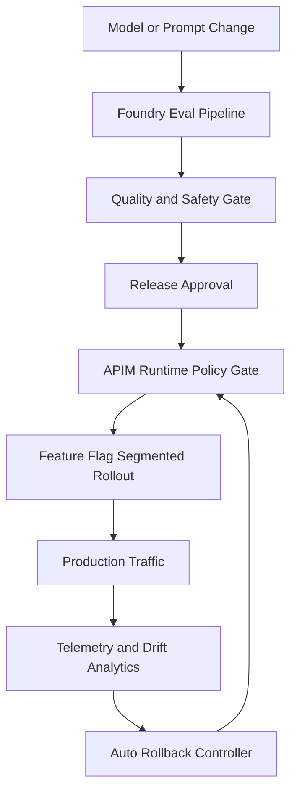
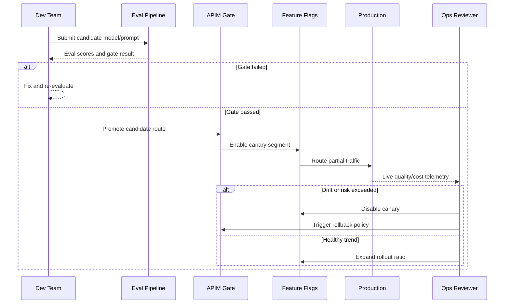

# Enterprise LLMOps Evaluation-Gate and Canary-Release Selection FAQ: Foundry Evals vs APIM Policies vs Feature Flags
> 🌐 **Language / 语言切换**: **[🇨🇳 中文版](llmops-evaluation-gates-canary-shadow-release-foundry-evals-vs-apim-policies-vs-feature-flags-selection-faq.md)** | **[🇬🇧 English](llmops-evaluation-gates-canary-shadow-release-foundry-evals-vs-apim-policies-vs-feature-flags-selection-faq.en.md)** | **[📚 Back to Index](README.en.md)**
> Evidence labels: `measured` / `synthetic` / `anonymized_reported`
> Retrieval date: 2026-11-22

## 1) Executive Summary: enterprise LLMOps success is not faster shipping, but provable and reversible shipping
Many teams treat
model rollout
like ordinary app deployment.
Enterprise agent releases
carry extra risks:
semantic drift,
prompt-injection resilience changes,
tool-call behavior shifts,
and sudden cost spikes.
Release engineering
must therefore evolve
from script-driven rollout
to an evidence-based loop:
evaluation gates,
progressive canary,
and deterministic rollback.
The three required outcomes are
proof before release,
observability during release,
and accountability after release.
This guide compares four patterns:
Foundry Evals-centered quality gating,
APIM runtime policy enforcement,
Feature Flag segmented rollout,
and a mixed orchestration model.

## 2) Scenario boundaries: why LLM releases cannot reuse classic CI/CD assumptions
Traditional service releases
focus on
API compatibility
and performance regression.
LLM/agent releases
must additionally govern
semantic behavior changes,
prompt-tool coupling,
and latent risk probabilities.
A 200 response
does not guarantee
stable business quality.
Release gates must include
task success,
factual consistency,
safety interception,
human-review load,
and unit-cost drift,
not only test pass rates.
This requires
an explicit semantic-gating layer
plus runtime policy controls
beyond conventional pipelines.

## 3) Verifiable sources and evidence labels
Source 1 (`measured`): Azure AI Foundry documentation  
https://learn.microsoft.com/azure/ai-foundry/

Source 2 (`measured`): Azure API Management documentation  
https://learn.microsoft.com/azure/api-management/

Source 3 (`measured`): Azure App Configuration Feature Flags documentation  
https://learn.microsoft.com/azure/azure-app-configuration/

Source 4 (`measured`): Azure Monitor / Application Insights documentation  
https://learn.microsoft.com/azure/azure-monitor/

Source 5 (`measured`): GitHub Actions documentation  
https://docs.github.com/actions

Source 6 (`measured`): Azure DevOps Pipelines documentation  
https://learn.microsoft.com/azure/devops/pipelines/

Source 7 (`anonymized_reported`): anonymized enterprise post-incident reviews.  
Source 8 (`synthetic`): canary ratio, rollback latency, and cost-per-1,000 models.  
Scope note:
this guide stays at
enterprise application and service architecture level
without low-level training internals.

## 4) Path A: Foundry Evals as centralized pre-release quality gate
This path uses
Foundry Evals
as the main admission gate
before production rollout.
Standardized datasets
and versioned thresholds
validate quality and safety.
Its strengths are
central governance,
reusable baselines,
and cross-team comparability.
It is effective for organizations
building a shared release-quality language.
Its limitation is
runtime control.
Passing offline evaluations
does not by itself guarantee
stable production behavior.
So most enterprises
combine this path
with runtime policy enforcement.

## 5) Path B: APIM runtime policy gates
This path pushes
release risk controls
into APIM data-plane policy:
model allowlists,
cost budget thresholds,
sensitive-request routing rules,
and emergency fallback.
Its key value is
real-time containment.
Even after promotion,
policy can block
risk amplification quickly.
For shared enterprise model channels,
APIM offers
consistent control semantics.
The trade-off is
policy engineering complexity,
which must be aligned
with offline evaluation semantics
to avoid governance drift.

## 6) Path C: Feature Flags for segmented canary rollout
This path uses flags
to progressively expose
new model versions
by tenant, region, cohort,
or business unit.
When semantic uncertainty is high,
segmented canary
reduces blast radius.
A/B and holdout comparisons
help teams detect
quality gains,
cost regressions,
or unexpected behavior shifts.
Its limitation appears
when telemetry is fragmented:
you can run many canaries
without actionable attribution.
Therefore,
Feature Flags must be paired
with unified metrics and tracing.

## 7) Path D: mixed gates (recommended)
Enterprise best practice
is usually a three-stage chain:
Foundry Evals for pre-release admission,
APIM for in-release runtime guarding,
Feature Flags for post-release progressive exposure.
This creates
a full-lifecycle control loop:
prevent degradation before launch,
contain risk during rollout,
and rollback quickly after detection.
With automated rollback playbooks,
human approval gates,
and regular drills,
model release transitions
from high-risk ritual
to manageable engineering practice.

## 8) Mermaid: enterprise LLMOps release-gating topology

## 9) 12-dimension enterprise comparison matrix
| Dimension | Foundry Evals | APIM gates | Feature Flags canary | Mixed gates |
|---|---|---|---|---|
| Pre-release quality assurance | High | Medium | Medium | High |
| Runtime risk interception | Medium | High | Medium | High |
| Segmented rollout capability | Low-Medium | Medium | High | High |
| Rollback trigger speed | Medium | High | High | High |
| Metric explainability | High | High | Medium-High | High |
| Multi-team governance consistency | High | High | Medium | High |
| Operations complexity | Medium | Medium-High | Medium | High |
| Release flexibility | Medium | Medium-High | High | High |
| Cost-control capability | Medium | High | Medium | High |
| Compliance proof strength | High | High | Medium-High | High |
| Platform evolution elasticity | Medium-High | High | High | High |
| Adoption barrier | Medium | Medium-High | Medium | Medium-High |

## 10) Mermaid: evaluation, canary, and rollback decision flow

## 11) Quant comparison: interception, rollback latency, and cost-per-1,000 (`synthetic`)
| Metric | Foundry Evals | APIM gates | Feature Flags canary | Mixed gates |
|---|---:|---:|---:|---:|
| Pre-release defect interception (`anonymized_reported`) | 0.84 | 0.69 | 0.63 | 0.91 |
| Runtime risk interception (`anonymized_reported`) | 0.58 | 0.88 | 0.74 | 0.93 |
| Median auto-rollback trigger latency (s) | 95 | 38 | 42 | 24 |
| Canary expansion decision latency (min) | 40 | 28 | 22 | 18 |
| Monthly cost index (baseline=1) | 1.00 | 0.93 | 0.96 | 0.90 |
| Cost per 1,000 requests (USD, `synthetic`) | 11.4 | 10.7 | 10.9 | 10.2 |
| Failed-release rollback success (`anonymized_reported`) | 0.86 | 0.90 | 0.89 | 0.95 |
| Recommended role | Quality baseline core | Runtime guard core | Progressive exposure core | Enterprise production target |

Interpretation:
single-path governance
usually solves only part of the release risk.
Mixed gates
offer the best balance
across quality,
risk,
and economics.

## 12) Decision tree: six-week rollout blueprint
Step one builds
the evaluation baseline.
Without baseline metrics,
canary outcomes are hard to interpret.
Step two adds
APIM runtime guards
for immediate containment.
Step three enables
segmented canary
starting from low-risk cohorts.
Step four defines
automatic rollback triggers
for drift and risk thresholds.
Step five inserts
human approval gates
for high-impact releases.
Step six institutionalizes
monthly rollback drills
and governance retrospectives.

## 13) Common anti-patterns
Anti-pattern one:
offline evaluation only,
without runtime policy gates.
Impact:
production risks cannot be stopped in time.
Anti-pattern two:
canary decisions based on success rate alone.
Outcome:
cost regressions and safety drift are ignored.
Anti-pattern three:
no automated rollback playbook.
Trade-off:
incident recovery depends on manual reaction speed.
Anti-pattern four:
different gate semantics across teams.
Risk:
cross-domain quality signals become incomparable.
Anti-pattern five:
no structured post-release review loop.
Business effect:
the same incidents recur repeatedly.

## 14) Production-readiness checklist
1. Unified eval datasets and thresholds are versioned.  
2. APIM runtime interception policies are defined.  
3. Segmented canary plans and pacing are documented.  
4. Automatic rollback triggers are configured.  
5. Human approvals are enforced for high-risk releases.  
6. Quality, cost, and safety dashboards are operational.  
7. Release correlation IDs and audit logs are complete.  
8. Cross-team gate semantics are governed centrally.  
9. Incident drills and postmortems are scheduled.  
10. Emergency freeze and kill-switch controls are ready.  
11. Cost-per-1,000 alerts are calibrated.  
12. Quarterly governance reviews are institutionalized.  

## 15) Practical FAQ (8 questions)
### Q1: Why can an eval-passing model still fail in production?
Offline datasets
cannot fully represent
live distribution and traffic dynamics.

### Q2: Do APIM gates add latency?
Yes, slightly.
But they provide
strong runtime containment and rollback leverage.

### Q3: Can Feature Flags replace evaluation?
No.
Flags control exposure,
they do not certify quality.

### Q4: How should auto-rollback thresholds be set?
Start from historical baselines,
then tune by business risk tolerance.

### Q5: Which KPI set is most important for release governance?
Track
defect interception,
risk interception,
rollback latency,
and cost per 1,000 requests.

### Q6: Can small teams adopt mixed gates?
Yes.
Start with a minimal loop,
then expand policy sophistication gradually.

### Q7: What is the most common rollout failure?
Gate rules are not versioned,
making regression attribution difficult.

### Q8: How to classify Good fit vs Not for?
Good fit:
high-concurrency multi-model production with compliance constraints.
Not for:
one-off prototypes
without sustained operations ownership.
