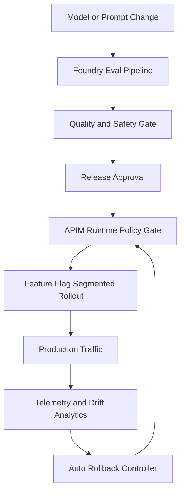
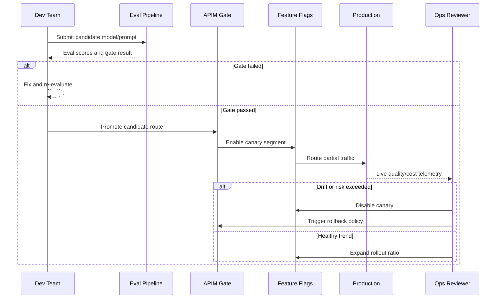

# 企业 LLMOps 评测门禁与灰度发布选型 FAQ：Foundry Evals vs APIM 策略 vs Feature Flags
> 🌐 **Language / 语言切换**: **[🇨🇳 中文版](llmops-evaluation-gates-canary-shadow-release-foundry-evals-vs-apim-policies-vs-feature-flags-selection-faq.md)** | **[🇬🇧 English](llmops-evaluation-gates-canary-shadow-release-foundry-evals-vs-apim-policies-vs-feature-flags-selection-faq.en.md)** | **[📚 返回目录](README.md)**
> 证据标签：`measured` / `synthetic` / `anonymized_reported`
> 抓取日期：2026-11-22

## 1) 执行摘要：企业 LLMOps 的关键不是“上线快”，而是“上线可回退且可证明”
很多团队把模型发布
等同于普通应用发版。
但企业智能体发布
存在额外风险：
语义漂移、
提示注入脆弱性变化、
工具调用行为突变、
以及成本突增。
因此发布流程
必须从“脚本式上线”
升级到“评测门禁 + 灰度 + 回退”闭环。
核心目标是三件事：
上线前有证据、
上线中可观测、
上线后可追责。
本指南比较四类路径：
Foundry Evals 中心化评测、
APIM 策略门禁外置、
Feature Flag 分群灰度、
以及三者混合编排。

## 2) 场景边界：为什么 LLM 发布不能照搬传统 CI/CD
传统服务发布
主要关心
接口兼容与性能回归。
而 LLM/Agent 发布
还要关心
语义行为变化、
提示与工具耦合、
以及隐性风险触发概率。
同一接口响应 200
并不代表质量稳定。
因此门禁指标
不能只看单测通过率，
还要覆盖
任务成功率、
事实一致性、
安全拦截率、
人工复核负载、
和单位成本漂移。
这决定了
LLMOps 发布架构
必须比传统链路
增加语义评测与策略守门层。

## 3) 可验证来源与证据标签
来源 1（`measured`）：Azure AI Foundry 文档  
https://learn.microsoft.com/azure/ai-foundry/

来源 2（`measured`）：Azure API Management 文档  
https://learn.microsoft.com/azure/api-management/

来源 3（`measured`）：Azure App Configuration Feature Flags 文档  
https://learn.microsoft.com/azure/azure-app-configuration/

来源 4（`measured`）：Azure Monitor / Application Insights 文档  
https://learn.microsoft.com/azure/azure-monitor/

来源 5（`measured`）：GitHub Actions 文档  
https://docs.github.com/actions

来源 6（`measured`）：Azure DevOps Pipelines 文档  
https://learn.microsoft.com/azure/devops/pipelines/

来源 7（`anonymized_reported`）：匿名化企业 LLM 发布事故复盘。  
来源 8（`synthetic`）：灰度比例、回退时延与每千请求成本模型。  
说明：
本文聚焦企业应用与服务架构，
不展开底层训练实现细节。

## 4) 路径 A：Foundry Evals 中心化评测门禁
该路径以 Foundry Evals
作为发布前主门禁，
通过标准化数据集
验证任务效果与安全指标。
其优势是
评测流程集中统一，
指标基线可版本化，
便于跨团队复用。
对“先建统一质量基线”
的组织非常友好。
其边界在于
运行时策略执行
仍需网关或应用层配合，
否则评测通过
不等于发布后稳定。
因此通常建议
将评测结果
与运行时策略联动。

## 5) 路径 B：APIM 运行时策略门禁
该路径把发布安全阈值
放在 APIM 数据面：
按流量标签
实施模型白名单、
成本阈值、
敏感请求拦截、
以及应急回退。
它的价值是
即使模型已发布，
仍可在运行时
快速阻断风险扩散。
在多应用共享模型时，
APIM 可提供
一致治理平面。
挑战在于
策略设计复杂度较高，
并且需要
与离线评测指标
保持一致语义映射。

## 6) 路径 C：Feature Flags 分群灰度发布
该路径利用特性开关
按用户群、租户、
地域、业务线
逐步放量。
在语义不确定性较高时，
分群灰度能降低爆炸半径。
通过 A/B 对照，
团队可快速判断
新版本是否带来
质量收益或成本劣化。
其边界是
如果没有统一指标汇聚，
灰度实验容易
陷入“看起来可用，
但无法归因”的状态。
因此必须配套
可观测与评测看板。

## 7) 路径 D：混合门禁（推荐）
企业最佳实践通常是
三段式混合：
Foundry Evals 做发布前准入，
APIM 做发布中守门，
Feature Flags 做发布后分群放量。
这种模式能形成
全生命周期控制链：
上线前防劣化，
上线中控风险，
上线后可回退。
再结合
自动化回滚剧本、
人工审批闸门、
与故障演练，
可以把模型发布
从“高风险动作”
转化为“可管理工程流程”。

## 8) Mermaid：企业 LLMOps 发布门禁拓扑

## 9) 12 维企业选型对比矩阵
| 维度 | Foundry Evals | APIM 门禁 | Feature Flags 灰度 | 混合门禁 |
|---|---|---|---|---|
| 发布前质量保障 | 高 | 中 | 中 | 高 |
| 运行时风险拦截 | 中 | 高 | 中 | 高 |
| 分群放量能力 | 低中 | 中 | 高 | 高 |
| 回退触发速度 | 中 | 高 | 高 | 高 |
| 指标可解释性 | 高 | 高 | 中高 | 高 |
| 多团队治理一致性 | 高 | 高 | 中 | 高 |
| 运维复杂度 | 中 | 中高 | 中 | 高 |
| 发布灵活性 | 中 | 中高 | 高 | 高 |
| 成本控制能力 | 中 | 高 | 中 | 高 |
| 安全合规可证明性 | 高 | 高 | 中高 | 高 |
| 平台演进弹性 | 中高 | 高 | 高 | 高 |
| 组织采用门槛 | 中 | 中高 | 中 | 中高 |

## 10) Mermaid：评测、灰度、回退决策流

## 11) 量化对比：门禁命中、回退时延与每千请求成本（`synthetic`）
| 指标 | Foundry Evals | APIM 门禁 | Feature Flags 灰度 | 混合门禁 |
|---|---:|---:|---:|---:|
| 发布前缺陷拦截率（`anonymized_reported`） | 0.84 | 0.69 | 0.63 | 0.91 |
| 运行时风险拦截率（`anonymized_reported`） | 0.58 | 0.88 | 0.74 | 0.93 |
| 自动回退触发中位时延（秒） | 95 | 38 | 42 | 24 |
| 灰度扩容决策时延（分钟） | 40 | 28 | 22 | 18 |
| 月度成本指数（基线=1） | 1.00 | 0.93 | 0.96 | 0.90 |
| 每千请求成本（美元，`synthetic`） | 11.4 | 10.7 | 10.9 | 10.2 |
| 发布失败回滚成功率（`anonymized_reported`） | 0.86 | 0.90 | 0.89 | 0.95 |
| 推荐定位 | 质量基线核心 | 运行时守门核心 | 渐进放量核心 | 企业生产目标 |

解读：
单一路径
通常只能解决部分问题。
混合门禁在
质量、风险、成本
三方面表现最均衡。

## 12) 决策树：如何在 6 周构建发布门禁体系
第一步先建评测基线。
没有基线，
灰度结果无法解释。
第二步接入 APIM 守门。
确保运行时风险
可被即时阻断。
第三步启用分群灰度。
从低风险用户群开始放量。
第四步建立自动回退条件。
漂移指标触发后
应自动降级。
第五步建立人工审批节点。
高风险发布
必须双人复核。
第六步建立演练节奏。
按月执行
回滚演练与门禁复盘。
第七步建立发布档案。
每次发布应沉淀
门禁指标快照、
放量轨迹、
和回退决策记录。
第八步建立基线更新机制。
当业务形态变化时，
应同步修订
评测数据集与阈值定义。
并定期复核策略有效性。

## 13) 常见反模式
反模式一：
只做离线评测，
不做线上守门。
影响：
线上风险无法实时阻断。
反模式二：
灰度放量只看成功率。
结果：
成本劣化与安全风险被忽略。
反模式三：
无自动回退剧本。
代价：
事故恢复依赖人工反应速度。
反模式四：
多团队使用不同门禁口径。
风险：
跨业务线质量不可比且难治理。
反模式五：
发布后缺少复盘闭环。
业务影响：
同类事故重复出现。

## 14) 生产就绪检查清单
1. 已定义统一评测数据集与基线阈值。  
2. 已定义 APIM 运行时拦截策略。  
3. 已定义分群灰度计划与放量节奏。  
4. 已定义自动回退触发规则。  
5. 已定义高风险发布人工审批机制。  
6. 已建立质量/成本/安全三维看板。  
7. 已建立发布追踪主键与审计日志。  
8. 已建立跨团队门禁口径治理流程。  
9. 已建立故障演练与复盘计划。  
10. 已建立版本冻结与紧急刹车机制。  
11. 已建立每千请求成本预警阈值。  
12. 已建立季度治理评审与改进计划。  

## 15) 实战 FAQ（8 问）
### Q1：为什么评测通过还会线上翻车？
因为离线评测
无法覆盖全部线上分布与突发行为。

### Q2：APIM 门禁是否会增加时延？
会有少量开销，
但换来更强风险控制与回退能力。

### Q3：Feature Flags 能否替代评测？
不能。
它负责放量控制，
不是质量认证。

### Q4：如何确定自动回退阈值？
以历史基线为起点，
结合业务可承受风险设定多级阈值。

### Q5：最关键的发布 KPI 是什么？
建议同时看：
缺陷拦截率、
风险拦截率、
回退时延、
每千请求成本。

### Q6：中小团队能做混合门禁吗？
可以。
先从最小闭环做起，
逐步增加策略复杂度。

### Q7：最常见失败点是什么？
门禁规则没有版本化，
导致回溯困难。

### Q8：Good fit vs Not for 如何划分？
Good fit：
多模型并行、
高并发生产、
合规要求高的企业。
Not for：
一次性实验性原型、
且无持续运营需求的小团队。
