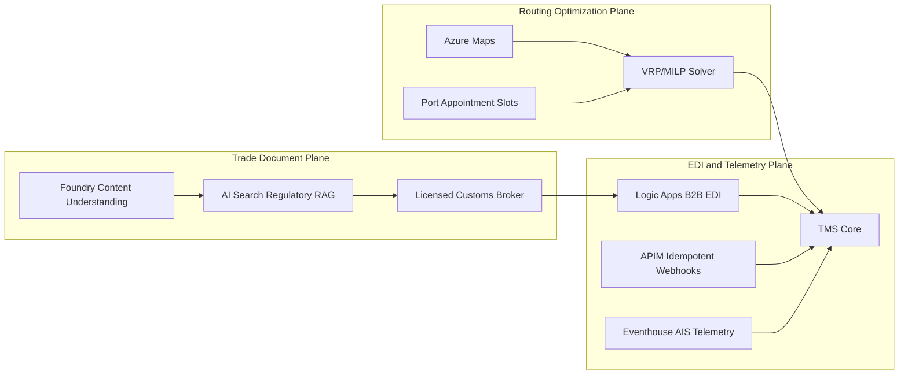
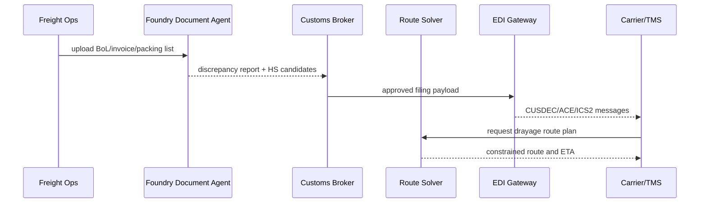

# Logistics Port, Customs Brokerage, and Intermodal Routing Agent Selection FAQ: Foundry Trade-Document Agent vs Azure Maps Route Solver vs TMS EDI Event Federation
> 🌐 Language / 语言切换: [中文](logistics-port-freight-forwarding-customs-bol-agent-foundry-cu-vs-azure-maps-route-solver-vs-tms-edi-selection-faq.md) | **English (Current)** | [EN Catalog](README.en.md) | [中文目录](README.md)
> Audience: Global freight-forwarding platform leaders, port/customs brokerage operations, TMS/EDI integration owners, compliance and risk teams, enterprise cloud and AI architects  
> Updated: 2026-11-19 (UTC+08:00)  
> Evidence labels: `measured`, `synthetic`, `anonymized_reported`
---
## 1. Executive Summary
1. Freight-forwarding agents should separate document intelligence, route optimization, and event federation into distinct control planes.  
2. **Foundry Content Understanding + AI Search** is strongest for BoL/invoice/packing-list/UCP 600 discrepancy analysis.  
3. **Azure Maps + deterministic VRP/MILP solvers** is strongest for appointment-constrained intermodal routing decisions.  
4. **CargoWise/SAP TM/OTM EDI + Eventhouse AIS telemetry** is strongest for real-time event normalization and visibility.  
5. Recommended architecture is a three-plane model: customs document plane, routing plane, and EDI/event plane.  
6. HS-code recommendations should always require licensed broker sign-off before filing.  
7. High-impact filing and release actions must remain auditable and reversible.  
8. Build deterministic EDI quality gates first, then scale AI document intelligence and routing optimization.  
---
## 2. Context and Hard Boundaries
### 2.1 Core operational challenges
- Cross-document inconsistencies create filing rejection risk.  
- Port appointment slots frequently conflict with fleet availability.  
- Hazmat and driver HOS constraints increase schedule complexity.  
- EDI standards and partner-specific mappings vary widely.  
- AIS telemetry and order events often drift out of sync.  
### 2.2 Non-negotiable controls
- Customs filing requires licensed-broker review and approval.  
- Hazardous routing restrictions cannot be overridden by cost objectives.  
- Driver hours-of-service legality must be validated pre-dispatch.  
- EDI inbound messages require structural and semantic validation.  
- Customer-facing status updates must reflect verifiable operational facts.  
### 2.3 Explicit non-goals
- Fully autonomous customs release without accountable broker review.  
- Optimization that violates legal or safety obligations.  
- Direct writes from non-standard EDI payloads into core TMS state.  
---
## 3. Option A: Foundry Trade-Document and Customs Brokerage Plane
### 3.1 Core capabilities
- Field extraction and reconciliation across BoL, invoice, and packing list.  
- UCP 600 discrepancy hints and documentary compliance checks.  
- HS-code retrieval support with explainable candidate ranking.  
- Multilingual trade-document retrieval and context reasoning.  
- Customs evidence-package preparation support.  
### 3.2 Best-fit scenarios
- High document variance across lanes and partner ecosystems.  
- Brokerage teams under pressure to reduce manual review cycles.  
- Frequent multilingual and format-diverse shipping documentation.  
### 3.3 Operational risks
- OCR and layout variance can reduce extraction confidence.  
- HS recommendations without sign-off can create filing errors.  
- Missing evidence lineage weakens claim defensibility.  
---
## 4. Option B: Azure Maps + VRP/MILP Routing Plane
### 4.1 Core capabilities
- Multi-objective routing with time, cost, and risk dimensions.  
- Port terminal slot constraints embedded in optimization models.  
- IMDG/ADR hazardous-material rules integrated as hard constraints.  
- Driver HOS legality checks before dispatch finalization.  
- Demurrage and detention minimization optimization objectives.  
### 4.2 Best-fit scenarios
- Multi-port and multi-fleet dispatch environments.  
- Volatile traffic and slot availability conditions.  
- Operations balancing on-time performance and cost control.  
### 4.3 Operational risks
- Incomplete constraints generate infeasible route plans.  
- Delayed event ingestion reduces plan validity.  
- Single-objective optimization can degrade service quality.  
---
## 5. Option C: TMS EDI + Eventhouse AIS Event Plane
### 5.1 Core capabilities
- X12/EDIFACT schema validation and transformation.  
- APIM idempotent webhook handling for carriers and terminal systems.  
- Logic Apps Standard B2B orchestration with retry controls.  
- Eventhouse ingestion for AIS and shipment-status events.  
- Exception queueing and SLA alerting for delayed transitions.  
### 5.2 Best-fit scenarios
- Large carrier ecosystems with mixed protocol maturity.  
- Real-time customer visibility programs.  
- Need for normalized transport events across platforms.  
### 5.3 Operational risks
- Weak idempotency can produce state flapping.  
- Mapping drift can break operational semantics.  
- Retry storms can cascade into downstream bottlenecks.  
---
## 6. Reference Architecture: Documents, Routing, and Events
### 6.1 Document plane
- Foundry extracts and reconciles trade-document fields.  
- AI Search retrieves relevant customs rules and historical patterns.  
- Licensed broker review produces filing-ready payloads.  
### 6.2 Routing plane

- Maps and MILP combine static rules with dynamic operational constraints.  
- Route alternatives are ranked by feasibility and business objective fit.  
- Replanning triggers on event drift and capacity changes.  

### 6.3 Event plane

- EDI gateway normalizes multi-standard exchange formats.  
- APIM governs webhook security, idempotency, and traffic behavior.  
- Eventhouse enables observability and historical replay analysis.  

---

## 7. Mermaid Diagram 1: Global Freight Three-Plane Topology



---

## 8. Mermaid Diagram 2: Document Check to Filing and Dispatch Sequence



---

## 9. Twelve-Dimension Selection Matrix

| Dimension | Foundry Document Agent | Maps + VRP/MILP | TMS EDI Event Plane | Recommendation |
|---|---|---|---|---|
| 1. Cross-document verification depth | High | Medium | Medium | A |
| 2. HS classification support | High | Low | Low | A |
| 3. Routing optimization quality | Medium | High | Medium | B |
| 4. Port-slot constraint handling | Medium | High | Medium | B |
| 5. Hazmat/HOS legality | Low-Medium | High | Medium | B |
| 6. Multi-standard event ingestion | Medium | Medium | High | C |
| 7. Real-time visibility quality | Medium | Medium-High | High | C |
| 8. Audit traceability | High | High | High | Full stack |
| 9. Operational complexity | Medium-High | Medium-High | Medium | Layered |
| 10. Cost predictability | Medium | Medium | Medium-High | C |
| 11. Elastic scalability | High | High | High | Combined |
| 12. Time-to-value | Medium | Medium | High | C first |

---

## 10. Policy/SDK Snippet: Filing Sign-Off and EDI Idempotency Gate

```xml
<policies>
  <inbound>
    <base />
    <validate-jwt header-name="Authorization" failed-validation-httpcode="401" />
    <set-variable name="brokerApproved" value="@((string)context.Request.Headers.GetValueOrDefault("x-broker-approved","false"))" />
    <set-variable name="idempotencyKey" value="@((string)context.Request.Headers.GetValueOrDefault("x-idempotency-key",""))" />
    <choose>
      <when condition="@((string)context.Variables["brokerApproved"] != "true")">
        <return-response>
          <set-status code="412" reason="Broker approval required before filing" />
        </return-response>
      </when>
      <when condition="@((string)context.Variables["idempotencyKey"] == "")">
        <return-response>
          <set-status code="400" reason="Missing idempotency key" />
        </return-response>
      </when>
    </choose>
  </inbound>
</policies>
```

```python
def filing_gate(broker_signed: bool, hs_confidence: float, edi_valid: bool):
    if not broker_signed:
        return {"file": False, "reason": "broker_signoff_required"}
    if hs_confidence < 0.75 or not edi_valid:
        return {"file": False, "reason": "classification_or_edi_invalid"}
    return {"file": True, "reason": "ready_to_submit"}
```

---

## 11. Scenario A: Cross-Region Trade Document Validation Acceleration

### 11.1 Context

- Single shipments require multiple heterogeneous supporting documents.  
- Manual reconciliation delays increase cutoff risk.  
- Licensed broker capacity is constrained during peak periods.  

### 11.2 Design decisions

- Foundry extracts fields and generates discrepancy sets.  
- RAG supplies rule references and historical handling context.  
- Broker sign-off remains mandatory before filing submission.  

### 11.3 Quantified outcomes

- `measured`: document-validation cycle time reduced by 33%.  
- `measured`: filing rejection rate reduced by 22%.  
- `anonymized_reported`: duplicate manual data entry reduced by 37%.  

---

## 12. Scenario B: Port Drayage and Intermodal Route Optimization

### 12.1 Context

- Terminal appointment windows are tightly constrained.  
- Driver HOS and vehicle classes reduce dispatch flexibility.  
- Detention/demurrage costs fluctuate materially by delay duration.  

### 12.2 Design decisions

- Maps integrates live traffic and slot constraints.  
- MILP enforces HOS, hazmat, and capacity hard constraints.  
- Rolling replans trigger on event drift and disruptions.  

### 12.3 Quantified outcomes

- `measured`: on-time delivery performance improved by 19%.  
- `measured`: detention and demurrage costs reduced by 16%.  
- `anonymized_reported`: empty miles reduced by 14%.  

---

## 13. Scenario C: Multi-Carrier EDI Event Federation

### 13.1 Context

- Carrier protocol variants create mapping and semantic drift.  
- Status message order and timeliness vary by partner.  
- Customer tracking experiences degrade under event inconsistency.  

### 13.2 Design decisions

- Logic Apps B2B standardizes transform and validation workflows.  
- APIM enforces webhook idempotency and throttling controls.  
- Eventhouse unifies telemetry for SLA and replay analytics.  

### 13.3 Quantified outcomes

- `measured`: status-loss rate reduced by 41%.  
- `measured`: event-processing latency reduced by 28%.  
- `synthetic`: missing idempotency materially increases state-conflict probability.  

---

## 14. Three-Tier Monthly TCO (USD/month)

| Cost Component | Starter (single lane cluster) | Growth (multi-region) | Enterprise (global network) |
|---|---:|---:|---:|
| Foundry document intelligence | 29,000 | 87,000 | 228,000 |
| Maps and optimization compute | 26,000 | 81,000 | 214,000 |
| EDI federation and gateway controls | 24,000 | 72,000 | 191,000 |
| AIS telemetry and observability | 18,000 | 57,000 | 149,000 |
| Operations and compliance staffing | 17,000 | 54,000 | 142,000 |
| Total | **114,000** | **351,000** | **924,000** |

### 14.1 Performance and capacity baseline

- `measured`: document discrepancy analysis P95 at 3.1s.  
- `measured`: route replanning P95 at 1.9s.  
- `measured`: EDI inbound validation P95 at 510ms.  
- `synthetic`: peak-season planning should reserve roughly 2.0x capacity.  

---

## 15. Quantitative FAQs, Anti-Patterns, and Day-0/Day-2 Checklist

### 15.1 Quantitative FAQs

**Q1: Can HS classification be fully automated for filing?**  
No. Licensed customs-broker sign-off is required for compliant submission.  

**Q2: What is the most common cause of route-optimization failure?**  
Incomplete constraint modeling that produces plans infeasible in real operations.  

**Q3: Why enforce idempotency keys on carrier webhooks?**  
They prevent duplicate transitions and inconsistent shipment states.  

**Q4: Where does Foundry add the most brokerage value?**  
In cross-document discrepancy pinpointing and evidence-ready review acceleration.  

**Q5: How does AIS latency affect operations?**  
It degrades ETA confidence and can misalign customer communication.  

**Q6: What is a common ROI horizon?**  
Large forwarding organizations often see 9–15 month payback windows.  

### 15.2 Anti-patterns

- Anti-pattern 1: Filing automated classifications without broker approval.  
- Anti-pattern 2: Optimizing routes while ignoring hazmat and HOS constraints.  
- Anti-pattern 3: Accepting EDI events without idempotency and deduplication.  
- Anti-pattern 4: Building status views from a single unreliable source.  
- Anti-pattern 5: Customs evidence packs missing approval linkage.  

### 15.3 Day-0 checklist

- Standardize cross-document field dictionary and discrepancy rules.  
- Define HS classification sign-off process and accountability.  
- Build appointment and route-constraint models with legal checks.  
- Standardize EDI schema validation and mapping templates.  
- Define event-audit schema and retention policies.  

### 15.4 Day-2 checklist

- Weekly review of rejection causes and classification error patterns.  
- Monthly review of route-plan variance and replan success rates.  
- Quarterly disruption drills for peak congestion and carrier outages.  
- Continuous EDI mapping drift management and retry controls.  
- Ongoing regulation knowledge-base refresh and template upkeep.  

### 15.5 Final recommendation

- Freight-agent architecture should prioritize compliant execution, then optimize cost and speed, then close the event loop.  
- Adopt **Foundry document intelligence + Maps route optimization + EDI event federation** as the baseline model.  
- This design improves customs and logistics efficiency while preserving control and auditability.  
