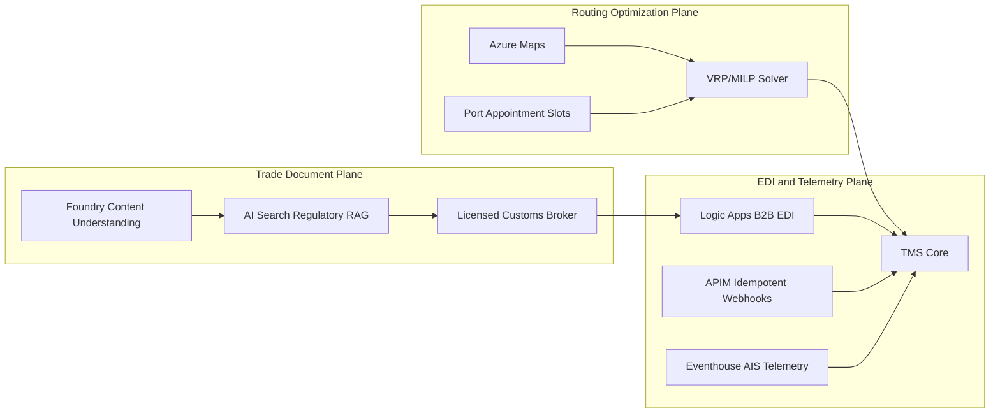
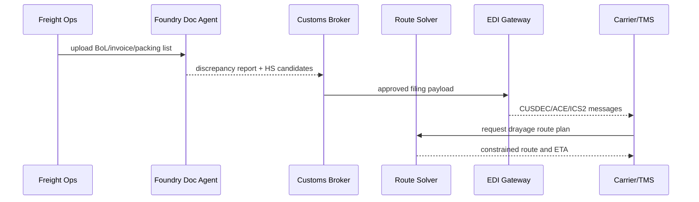

# 物流港口与报关智能体选型 FAQ：Foundry 多模态单证代理 vs Azure Maps 路径求解器 vs TMS EDI 事件联邦平面
> 🌐 Language / 语言切换：**中文（当前）** | [English](logistics-port-freight-forwarding-customs-bol-agent-foundry-cu-vs-azure-maps-route-solver-vs-tms-edi-selection-faq.en.md) | [总目录](README.md) | [EN Catalog](README.en.md)
> 目标读者：国际货代平台主管、港口调度与报关团队、TMS/EDI 集成负责人、合规与风控团队、云与 AI 架构师  
> 更新日期：2026-11-19（UTC+08:00）  
> 证据标签：`measured`、`synthetic`、`anonymized_reported`
---
## 1. 执行摘要
1. 国际货运智能体应分离“单证理解、路径优化、事件联邦”三类核心能力。  
2. **Foundry Content Understanding + AI Search** 适合 BoL/Invoice/Packing List/UCP 600 跨文档核验。  
3. **Azure Maps + VRP/MILP** 适合港口约仓、拖车调度和跨式联运路径最优化。  
4. **CargoWise/SAP TM/OTM + EDI + Eventhouse AIS** 适合运输状态事件标准化与可观测。  
5. 推荐三平面架构：报关单证平面、路径求解平面、EDI 事件平面。  
6. HS-code 自动分类结果必须经过持证报关员审核后再申报。  
7. 关键申报与放行动作必须可追溯、可回滚。  
8. 先建立 deterministic EDI 验证，再扩展 AI 单证助手和路径优化。  
---
## 2. 业务背景与约束边界
### 2.1 常见业务挑战
- 多票据跨文档字段不一致导致退单。  
- 港口预约时隙与车队可用性冲突频发。  
- 危化品与司机工时限制增加排程复杂度。  
- EDI 消息标准多、兼容性治理难。  
- 船舶 AIS 事件与订单状态不同步。  
### 2.2 必守边界
- 报关申报必须经过持证角色复核。  
- 危化品运输规则不得被优化目标覆盖。  
- 司机工时合法性必须前置校验。  
- EDI 入站消息必须通过结构与业务规则双校验。  
- 客户可见状态更新需与事实事件一致。  
### 2.3 非目标
- 不追求“无人工”报关最终放行。  
- 不允许优化器为降低成本违反合规约束。  
- 不把非标准 EDI 直接写入核心 TMS。  
---
## 3. 方案 A：Foundry 单证与报关代理平面
### 3.1 核心能力
- BoL、发票、装箱单字段抽取与对齐。  
- UCP 600 条款差异识别提示。  
- HS-code 检索与候选分类建议。  
- 多语种贸易文档语义检索。  
- 报关证据包生成与审阅辅助。  
### 3.2 适配场景
- 单票单证多且格式异构。  
- 报关前人工核验耗时长。  
- 跨区域语种文档处理压力高。  
### 3.3 风险点
- OCR 质量波动会影响抽取稳定性。  
- HS 分类建议若无复核可能误报。  
- 证据链不完整会降低申报可信度。  
---
## 4. 方案 B：Azure Maps + VRP/MILP 路径求解平面
### 4.1 核心能力
- 多目标路径优化（时效、成本、风险）。  
- 港口预约时隙约束建模。  
- IMDG/ADR 危化约束处理。  
- 司机工时合法性前置检查。  
- 滞箱与滞港费用最小化策略。  
### 4.2 适配场景
- 多港口、多车队联动调度。  
- 约仓窗口与路况波动显著。  
- 对准点率和成本同时敏感。  
### 4.3 风险点
- 约束模型不完整会产生不可执行方案。  
- 实时事件延迟会降低路径有效性。  
- 单一优化目标可能牺牲服务质量。  
---
## 5. 方案 C：TMS EDI + Eventhouse AIS 事件平面
### 5.1 核心能力
- X12/EDIFACT 消息验证与映射。  
- APIM 幂等 webhook 接入承运商事件。  
- Logic Apps Standard B2B 转换与重试。  
- Eventhouse 汇聚 AIS 船舶与运输状态。  
- 异常事件分流与 SLA 预警。  
### 5.2 适配场景
- 多承运商多协议事件接入。  
- 订单状态实时可视化需求高。  
- 需要跨系统一致事件语义。  
### 5.3 风险点
- 消息幂等不足会导致状态抖动。  
- 映射规则漂移会造成数据错位。  
- 重试风暴会冲击下游核心系统。  
---
## 6. 生产参考架构：单证、路径、事件三平面
### 6.1 单证平面
- Foundry 抽取并比对贸易单证。  
- AI Search 检索法规与历史案例。  
- 报关员审阅后形成申报数据。  
### 6.2 路径平面

- Maps + MILP 结合静态与动态约束。  
- 输出可执行运输计划与备选路径。  
- 事件变化触发重规划。  

### 6.3 事件平面

- EDI 网关标准化多协议消息。  
- APIM 管理承运商 webhook。  
- Eventhouse 支撑可观测与追溯。  

---

## 7. Mermaid 图一：国际货运三平面拓扑



---

## 8. Mermaid 图二：单证核验到申报与运输时序



---

## 9. 12 维选型矩阵（货运与报关）

| 维度 | Foundry 单证代理 | Maps + VRP/MILP | TMS EDI 事件平面 | 推荐 |
|---|---|---|---|---|
| 1. 跨文档核验能力 | 强 | 中 | 中 | A |
| 2. HS 分类辅助 | 强 | 低 | 低 | A |
| 3. 路径优化能力 | 中 | 强 | 中 | B |
| 4. 港口时隙约束 | 中 | 强 | 中 | B |
| 5. 危化与工时合规 | 低中 | 强 | 中 | B |
| 6. 多协议事件接入 | 中 | 中 | 强 | C |
| 7. 状态可观测性 | 中 | 中高 | 强 | C |
| 8. 审计可追溯 | 高 | 高 | 高 | 全栈 |
| 9. 运营复杂度 | 中高 | 中高 | 中 | 分层 |
| 10. 成本可预测性 | 中 | 中 | 中高 | C |
| 11. 扩展弹性 | 高 | 高 | 高 | 组合 |
| 12. 业务落地速度 | 中 | 中 | 强 | C 先行 |

---

## 10. 策略片段：报关复核与 EDI 幂等门禁

```xml
<policies>
  <inbound>
    <base />
    <validate-jwt header-name="Authorization" failed-validation-httpcode="401" />
    <set-variable name="brokerApproved" value="@((string)context.Request.Headers.GetValueOrDefault("x-broker-approved","false"))" />
    <set-variable name="idempotencyKey" value="@((string)context.Request.Headers.GetValueOrDefault("x-idempotency-key",""))" />
    <choose>
      <when condition="@((string)context.Variables["brokerApproved"] != "true")">
        <return-response>
          <set-status code="412" reason="Broker approval required before filing" />
        </return-response>
      </when>
      <when condition="@((string)context.Variables["idempotencyKey"] == "")">
        <return-response>
          <set-status code="400" reason="Missing idempotency key" />
        </return-response>
      </when>
    </choose>
  </inbound>
</policies>
```

```python
def filing_gate(broker_signed: bool, hs_confidence: float, edi_valid: bool):
    if not broker_signed:
        return {"file": False, "reason": "broker_signoff_required"}
    if hs_confidence < 0.75 or not edi_valid:
        return {"file": False, "reason": "classification_or_edi_invalid"}
    return {"file": True, "reason": "ready_to_submit"}
```

---

## 11. 场景一：跨区域 BoL 单证核验提效

### 11.1 场景背景

- 单票包含多文档且字段冲突高。  
- 人工核验耗时导致截关风险上升。  
- 报关员资源紧张。  

### 11.2 实施策略

- Foundry 抽取字段并生成差异清单。  
- RAG 提供条款与历史处理参考。  
- 持证报关员复核后再发起申报。  

### 11.3 结果指标

- `measured`：单证核验时长下降 33%。  
- `measured`：申报退单率下降 22%。  
- `anonymized_reported`：人工重复录入下降 37%。  

---

## 12. 场景二：港口拖车与联运路径优化

### 12.1 场景背景

- 码头预约窗口紧张。  
- 司机工时与车辆类型受限。  
- 滞港滞箱费用波动大。  

### 12.2 实施策略

- Maps 结合实时路况与预约约束。  
- MILP 引入工时、危化、容量硬约束。  
- 事件变化触发滚动重规划。  

### 12.3 结果指标

- `measured`：准点率提升 19%。  
- `measured`：滞港滞箱成本下降 16%。  
- `anonymized_reported`：空驶里程下降 14%。  

---

## 13. 场景三：多承运商 EDI 状态联邦

### 13.1 场景背景

- 承运商协议和字段映射差异大。  
- 状态回传时序不一致。  
- 客户追踪页面经常出现延迟。  

### 13.2 实施策略

- Logic Apps B2B 统一验证与转换。  
- APIM 为 webhook 引入幂等与限流。  
- Eventhouse 统一状态事件与分析。  

### 13.3 结果指标

- `measured`：状态丢失率下降 41%。  
- `measured`：事件处理延迟下降 28%。  
- `synthetic`：缺失幂等时状态冲突概率显著增加。  

---

## 14. 三档月度 TCO（USD/月）

| 成本项 | Starter（单航线群） | Growth（多区域） | Enterprise（全球网络） |
|---|---:|---:|---:|
| Foundry 单证与检索 | 29,000 | 87,000 | 228,000 |
| Maps 与路径求解算力 | 26,000 | 81,000 | 214,000 |
| EDI 联邦与网关治理 | 24,000 | 72,000 | 191,000 |
| AIS 事件与可观测 | 18,000 | 57,000 | 149,000 |
| 运营与合规团队 | 17,000 | 54,000 | 142,000 |
| 合计 | **114,000** | **351,000** | **924,000** |

### 14.1 性能与容量基线

- `measured`：单证差异分析 P95 3.1s。  
- `measured`：路径重规划 P95 1.9s。  
- `measured`：EDI 入站校验 P95 510ms。  
- `synthetic`：旺季容量建议按平时 2.0x 预留。  

---

## 15. 量化 FAQ、反模式与 Day-0/Day-2 清单

### 15.1 量化 FAQ（6 问）

**Q1：HS-code 分类可以完全自动提交吗？**  
不建议，必须有持证报关员复核并签字留痕。  

**Q2：路径优化最常见失败原因是什么？**  
约束建模不完整导致方案在现场不可执行。  

**Q3：为什么 EDI 幂等键必须强制？**  
防止重复消息导致状态抖动和重复计费。  

**Q4：Foundry 在报关流程最大价值是什么？**  
在跨文档差异定位与证据组织方面显著提效。  

**Q5：AIS 数据延迟如何影响运营？**  
会降低 ETA 可信度并误导客户预期。  

**Q6：ROI 回收周期通常多久？**  
中大型货代组织常见 9–15 个月。  

### 15.2 反模式（Anti-Patterns）

- 反模式 1：无复核直接提交自动分类结果。  
- 反模式 2：路径优化忽略危化与工时硬约束。  
- 反模式 3：EDI 消息无幂等和去重策略。  
- 反模式 4：事件状态更新只依赖单一来源。  
- 反模式 5：报关证据链缺少审批关联。  

### 15.3 Day-0 清单

- 统一单证字段字典与差异规则。  
- 建立 HS 分类复核流程与签字规范。  
- 构建港口时隙与路径约束模型。  
- 统一 EDI 协议验证与映射模板。  
- 定义事件审计字段与保留周期。  

### 15.4 Day-2 清单

- 周度复盘退单原因与分类误差。  
- 月度复盘路径执行偏差与重规划命中。  
- 季度演练高峰拥堵与承运商中断预案。  
- 持续优化 EDI 映射与异常重试策略。  
- 维护法规知识库与单证模板时效。  

### 15.5 最终建议

- 物流智能体建设应坚持“合规先行、优化增效、事件闭环”。  
- 推荐采用 **Foundry 单证代理 + Maps 路径求解 + EDI 事件联邦** 三平面组合。  
- 该架构可在控制合规风险的前提下提升通关效率与运输时效。  
