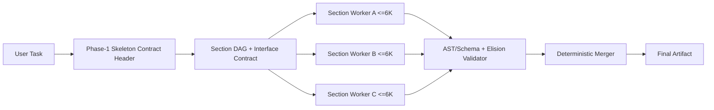
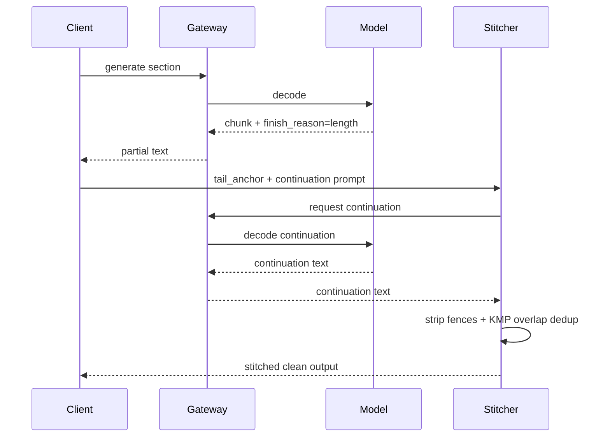

# Long-output truncation and continuation stitching selection FAQ

## 1. Executive summary

When enterprise agents must emit
`24K–96K` token artifacts,
single synchronous generation
fails in predictable ways.
Latency, quality, cost,
and reliability degrade together.

The root causes are usually:
gateway synchronous timeout ceilings,
`finish_reason="length"` truncation,
and naive `"Continue"` stitching.
Without deterministic continuation control,
teams pay for output that cannot be shipped.

This guide compares four patterns.
Pattern A uses
Skeleton-of-Thought contract DAG,
bounded section workers,
and deterministic validation/merge.
Pattern B uses anchor continuation
plus KMP overlap deduplication
for strict linear flows.
Pattern C uses async background single-pass.
Pattern D is prohibited.

## 2. Problem statement

Failure mode one is decode time
versus synchronous gateway timeout.
For `48K` output tokens at `60 tok/s`,
decode takes about `800s`,
far above a `240s` sync proxy budget.

Failure mode two is monolithic quality decay.
Beyond `12K–16K`,
placeholder elision and structure drift increase.
Outputs may remain readable,
yet become unusable by downstream automation.

Failure mode three is naive continuation seam corruption.
Blind `"continue"` prompts
duplicate `50–200` tokens,
drop lines near the boundary,
break indentation,
or wrap chunks in accidental markdown fences.

## 3. Four architecture patterns

### Pattern A (primary for `16K–96K` structured artifacts)

Phase one emits only a skeleton contract:
section DAG,
interface boundaries,
naming invariants,
and output constraints.
Phase two generates bounded sections
(`<=6K` tokens each)
in topological parallel order.

Each section passes validation gates:
AST/schema checks and elision rejection.
Failures retry locally,
not globally.
This converts full-artifact retries
into targeted section retries.

### Pattern B (strict sequential order required)

Keep linear generation only when needed,
but enforce anchored continuation.
When `finish_reason="length"` occurs,
replay tail anchor in the next prompt,
strip accidental wrapper fences,
and stitch with KMP overlap dedup.

This pattern is a controlled fallback,
not a default architecture.
Without deterministic seam logic,
linear continuation quality degrades rapidly.

### Pattern C (async single-pass under `16K`)

For tightly coupled reasoning
that cannot be split safely,
use async background generation.
This bypasses sync timeout limits
while preserving single-pass context.
Retry scope is still coarse in many cases.

### Pattern D (prohibited anti-pattern)

Run huge `max_completion_tokens`
behind sync `240s` proxy,
or concatenate plain `"continue"` strings
without anchor and seam validation.
This appears simple in demos
and fails expensively in production.

## 4. Quantified 12-dimension matrix

| Dimension | Pattern A SoT DAG | Pattern B Anchored continuation | Pattern C Async single-pass | Pattern D Anti-pattern |
|---|---|---|---|---|
| End-to-end latency (long artifact) | Low-medium | Medium | Medium-high | High |
| Sync timeout exposure | Low | Medium | Low | High |
| Truncation recovery success | High | Medium-high | Medium | Low |
| Duplication / gap risk | Low | Medium (reduced by KMP) | Medium | High |
| Local retry granularity | High | Medium | Low | Low |
| Token waste control | High | Medium | Medium | Low |
| Format consistency | High | Medium | Medium | Low |
| Engineering complexity | Medium-high | Medium | Medium | Low |
| Auditability | High | Medium-high | Medium | Low |
| Scalability | High | Medium | Medium | Low |
| 3-year risk-adjusted TCO | Low | Medium | Medium | High |
| Recommendation level | Primary | Conditional | Scenario-specific | Prohibited |

## 5. Pattern A design principles

Principle one:
contract first, content second.
Lock structure and interfaces
before section generation.
This reduces style and contract drift.

Principle two:
every section must be replaceable.
Section output must be independently validated
and independently retryable.
A failed section should not force
full artifact regeneration.

Principle three:
zero tolerance for lazy placeholders.
Reject markers such as
`... rest unchanged`,
`omitted`,
or hidden TODO placeholders.
Quality must be gated at generation time.

## 6. Mermaid: two-phase SoT architecture



## 7. Mermaid: Pattern B continuation sequence



## 8. Q1–Q6 formulas with worked numbers

### Q1. Monolithic decode time vs timeout

`T_decode = N_out / R_tok`

Example:
`N_out=48,000`,
`R_tok=60 tok/s`,
`T_decode=800s`.
Against `240s` sync timeout,
single-pass sync path is high risk.

### Q2. SoT critical-path latency

`T_critical ≈ T_header + max(T_section_i) + T_merge`

With header `20s`,
max section `85s`,
merge `10s`,
critical path is about `115s`,
much lower than `800s`.

### Q3. Full retry vs local retry amplification

Full retry amplification grows
with section count and failure probability.
Local retry amplification
is approximately `1 + p_sec`.
As section failure probability rises,
local retry advantage grows rapidly.

### Q4. KMP overlap collision bound

Given anchor window `W`
and minimum overlap `m`,
KMP finds maximal prefix/suffix overlap
in `O(W + |cont|)`.
This avoids quadratic backtracking
and off-by-one seam errors.

### Q5. PTU KV-cache token-seconds

A practical approximation is:
`TS ≈ 0.5 * N_out * T_decode`.
Long single-pass decode
holds cache and concurrency slots longer,
increasing shared contention risk.

### Q6. 3-year risk-adjusted TCO

`TCO_risk = C_token + C_retry + C_timeout + C_repair + C_ops`

Pattern A may cost more to implement,
but reduces retry and repair components.
In long-output-heavy workloads,
it is often cheapest over three years.

## 9. Pattern B suitability boundary

Pattern B is suitable when
strict narrative order is mandatory.
Regulatory narratives often need
fixed section progression.
Parallel split may be constrained.

Even then,
anchoring and KMP seam control are mandatory.
Without deterministic seam handling,
linear continuation becomes brittle.

## 10. Pattern C suitability boundary

Pattern C fits medium-length
tightly coupled reasoning artifacts.
Its primary value is bypassing sync timeout,
not quality improvement by itself.
As artifact length grows,
revisit Pattern A.

Also instrument async workflows deeply.
A binary success/failure status
hides truncation and retry pathology.
Persist section-level telemetry where possible.

## 11. Anti-pattern detection signals

Persistent symptoms of Pattern D include:

- rising `finish_reason="length"` rate;
- repeated overlap duplicates after continuation;
- increasing lazy-elision placeholder defects;
- timeout and token costs rising together;
- heavy manual post-fix loops.

## 12. Core code and config

### 12.1 Python KMP seam stitcher

```python
from __future__ import annotations

import re


_FENCE_WRAPPER = re.compile(r"^```[a-zA-Z0-9_-]*\n([\s\S]*?)\n```\s*$")


def _strip_wrapper_fence(text: str) -> str:
    m = _FENCE_WRAPPER.match(text.strip())
    return m.group(1) if m else text


def stitch_with_kmp_overlap(prev: str, cont: str, min_overlap: int = 24) -> str:
    cont_clean = _strip_wrapper_fence(cont)
    if not prev or not cont_clean:
        return prev + cont_clean

    max_window = min(len(prev), max(min_overlap * 8, 4096))
    tail = prev[-max_window:]
    probe = cont_clean + "\x00" + tail

    lps = [0] * len(probe)
    j = 0
    for i in range(1, len(probe)):
        while j > 0 and probe[i] != probe[j]:
            j = lps[j - 1]
        if probe[i] == probe[j]:
            j += 1
            lps[i] = j

    overlap = min(lps[-1], len(cont_clean))
    if overlap < min_overlap:
        overlap = 0
    return prev + cont_clean[overlap:]
```

### 12.2 Python `SkeletonSectionRunner`

```python
from __future__ import annotations

import ast
import asyncio
import re
from dataclasses import dataclass
from typing import Dict, Iterable, List


ELISION_RE = re.compile(r"(#\s*\.\.\.|omitted|rest\s+unchanged)", re.IGNORECASE)


@dataclass
class SectionTask:
    section_id: str
    prompt: str
    expects_python: bool = True


class SkeletonSectionRunner:
    def __init__(self, concurrency: int = 4, max_retry: int = 2) -> None:
        self.sem = asyncio.Semaphore(concurrency)
        self.max_retry = max_retry

    async def _invoke_model(self, prompt: str, interface_contract: str) -> str:
        await asyncio.sleep(0)
        return interface_contract + "\n" + prompt

    async def _run_one(self, task: SectionTask, interface_contract: str) -> str:
        for _ in range(self.max_retry + 1):
            async with self.sem:
                text = await self._invoke_model(task.prompt, interface_contract)
            if ELISION_RE.search(text):
                continue
            if task.expects_python:
                try:
                    ast.parse(text)
                except SyntaxError:
                    continue
            return text
        raise ValueError(f"section {task.section_id} failed validation")

    async def run(self, tasks: Iterable[SectionTask], interface_contract: str) -> Dict[str, str]:
        task_list = list(tasks)
        coros = [self._run_one(t, interface_contract) for t in task_list]
        outputs: List[str] = await asyncio.gather(*coros)
        return {t.section_id: out for t, out in zip(task_list, outputs)}
```

### 12.3 KQL truncation and retry-amplification monitor

```kql
let win = 5m;
let lengthCuts = AppTraces
| where Message has "\"finish_reason\":\"length\""
| summarize length_cut = count() by bin(TimeGenerated, win), service=tostring(Cloud_RoleName);
let elisionReject = AppTraces
| where Message has "elision_reject"
| summarize elision_reject = count() by bin(TimeGenerated, win), service=tostring(Cloud_RoleName);
let retryAmp = AppTraces
| where Message has "artifact_retry_count"
| extend retry = todouble(extract(@"artifact_retry_count=(\d+)", 1, Message))
| summarize retry_avg = avg(retry), retry_p95 = percentile(retry, 95) by bin(TimeGenerated, win), service=tostring(Cloud_RoleName);
lengthCuts
| join kind=fullouter elisionReject on TimeGenerated, service
| join kind=fullouter retryAmp on TimeGenerated, service
| project TimeGenerated, service, length_cut, elision_reject, retry_avg, retry_p95
| order by TimeGenerated desc
```

## 13. Operating baseline and SLOs

Track three layers:
generation success,
validation pass rate,
and human-repair ratio.
Counting API call success alone
hides critical quality regressions.

Suggested controls:
length-truncation ratio threshold,
elision-reject trend alert,
and retry-amplification guardrails.
Tie these metrics directly
to release gate decisions.

## 14. Decision tree: good fit vs not for

**Good fit (Pattern A)**

- outputs regularly exceed `16K`;
- artifacts can be sectioned and validated;
- low tail latency and auditability are required.

**Good fit (Pattern B)**

- strict linear order is mandatory;
- continuation corruption must be minimized;
- moderate stitching complexity is acceptable.

**Good fit (Pattern C)**

- medium-length tightly coupled reasoning;
- primary blocker is sync timeout;
- coarse-grained retry is acceptable.

**Not for**

- synchronous huge max-token behind fixed timeout;
- unanchored `"continue"` concatenation;
- no validator gate before downstream execution.

## 15. Enterprise scenarios, TCO, and rollout

### 15.1 Scenario A: core-banking modernization factory

A modernization pipeline emits
`36K` token multi-class modules
plus tests from COBOL and Java EE sources.
Single-pass sync runs frequently truncated,
causing expensive full-regeneration loops.

After Pattern A rollout,
local retries replaced full retries.
AST gates shifted syntax failures
to generation-time controls,
reducing manual repair pressure.

### 15.2 Scenario B: global pharma ICH E3 CSR drafting

This workflow generates up to `72K` token
clinical-study report drafts
with cross-table consistency constraints.
Naive continuation caused section duplication
and missing boundary lines.

A Pattern A + B blend improved outcomes:
SoT contracts stabilized structure,
and anchored KMP stitching handled
strict linear sections reliably.
Review cycles became more predictable.

### 15.3 Three-tier 3-year TCO (USD)

| Tier | Scale assumption | Pattern A | Pattern B | Pattern C | Pattern D |
|---|---|---:|---:|---:|---:|
| Tier-1 | `5K` long artifacts/month | `1.96M` | `2.24M` | `2.12M` | `2.48M` |
| Tier-2 | `20K` long artifacts/month | `6.88M` | `8.02M` | `7.46M` | `10.3M*` |
| Tier-3 | `60K` long artifacts/month | `18.5M` | `22.1M` | `20.8M` | `30.7M*` |

`*` Pattern D pays heavy retry and repair tax
at high load,
overwhelming its initial implementation simplicity.

Include review-rework labor explicitly.
This term is often underestimated
and can dominate total economics
for long structured artifacts.

### 15.4 Five-step rollout and D0/D1/D2 runbook (18 actions)

**Five-step rollout**

1. Baseline artifact length distribution and truncation rate.
2. Deploy SoT contracts and bounded section workers.
3. Enforce AST/schema and elision gates.
4. Enable anchored continuation with KMP where needed.
5. Govern retry amplification and cost budgets.

**D0 (same-day containment)**

1. Disable unanchored continuation paths.
2. Route long artifacts to async or sectioned mode.
3. Reject lazy-elision placeholder outputs.
4. Add real-time truncation alerting.
5. Log overlap length on every continuation seam.
6. Pause high-risk auto-release downstream flows.

**D1 (two-week hardening)**

7. Build reusable SoT contract templates.
8. Add adaptive section concurrency control.
9. Implement bounded local section retries.
10. Build KMP stitch unit-test suite.
11. Add artifact-level traceability fields.
12. Run quality regression game-days.

**D2 (quarterly evolution)**

13. Introduce cross-model section routing.
14. Add predictive cost and budget guards.
15. Build human-in-loop review orchestration.
16. Integrate compliance evidence archiving.
17. Implement multi-region resilient generation lanes.
18. Complete annual long-output governance review.

## Sources

OpenAI / Azure OpenAI completion and finish reasons  
https://learn.microsoft.com/azure/ai-services/openai/

vLLM serving and long generation behavior  
https://docs.vllm.ai/

Knuth-Morris-Pratt algorithm reference  
https://en.wikipedia.org/wiki/Knuth%E2%80%93Morris%E2%80%93Pratt_algorithm

Azure API Management timeout and gateway behavior  
https://learn.microsoft.com/azure/api-management/

Microsoft Foundry documentation  
https://learn.microsoft.com/azure/ai-foundry/
