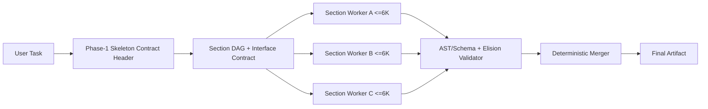
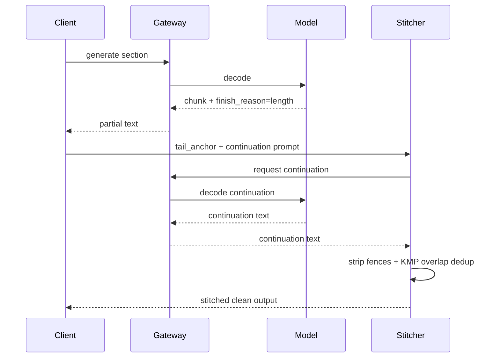

# 长输出截断与续写拼接选型 FAQ（SoT DAG / KMP Seam / Async Background）

## 1. 执行摘要

当企业智能体需要生成 `24K–96K` token 的工件时，
“一次性同步输出”常常在真实生产链路中失败。
失败表现不是单一报错，
而是时延、质量、成本和稳定性同时失衡。

最常见的根因是：
网关同步超时、
`finish_reason="length"` 中途截断、
以及朴素 `"Continue"` 续写造成语义断裂。
这些问题会把高价值长工件流程
拖入“高成本低成功率”的恶性循环。

本指南给出四种模式。
Pattern A 采用 SoT 合同骨架 + 分段并行 + 验证合并，
是 `16K–96K` 长工件主推荐。
Pattern B 用锚点续写 + KMP 去重，
适用于必须线性生成的场景。
Pattern C 用异步后台单通道，
适用于 `<16K` 且强耦合推理工件。
Pattern D 标记为禁止反模式。

## 2. 生产问题定义

问题一是同步链路时间上限与解码时间冲突。
例如 `48K` token 在 `60 tok/s` 下约 `800s`，
远超常见 `240s` 同步网关超时。
即使模型还能继续生成，
上游调用链也可能提前中断。

问题二是长段单次解码质量衰减。
在 `12K–16K` 之后，
占位符、省略语句、格式漂移概率上升。
当结果再被自动化流水线消费时，
这些“看似可读”的缺陷会转化为实质阻塞。

问题三是朴素续写拼接污染。
盲目提示“继续”后，
常见重复 `50–200` token、
跨段漏行、缩进损坏、包裹 fence 反复出现。
最终工件可读但不可执行，
恢复成本高。

## 3. 四种架构模式总览

### Pattern A（主推荐：SoT 合同 DAG + 分段并行）

第一阶段只生成骨架合同：
章节 DAG、接口契约、依赖边、
统一命名与格式规范。
第二阶段按拓扑并行生成分段，
单段限制在 `<= 6K` token。
每段独立做 AST/Schema 与省略词门禁。

该模式核心收益是“局部重试”。
某段失败仅重算该段，
避免 `48K` 全量返工。
在高失败率环境中，
这会显著降低 token 浪费和尾延迟。

### Pattern B（线性顺序强约束场景）

对严格线性文档，
可保留单通道生成，
但必须启用锚点续写机制。
在 `finish_reason="length"` 后，
把尾锚文本带回下一段，
并用 KMP 精确去除重叠。

同时应剥离误包裹的 markdown fence。
若不做这两步，
拼接污染几乎必然出现。
Pattern B 是“可控退路”，不是默认首选。

### Pattern C（异步后台单次生成）

对于 `<16K` 且不可拆分的推理链，
可采用后台异步任务接口。
它规避同步网关超时，
并保留单次推理上下文完整性。
但失败恢复通常仍偏全量重算。

### Pattern D（反模式，禁止）

在 `240s` 同步网关后
直接把 `max_completion_tokens` 拉到超大，
或对截断响应执行无锚点字符串拼接。
这类做法常在压测看似可行，
在线上会出现高成本、低成功率与低可审计性。

## 4. 12 维量化对比矩阵

| 维度 | Pattern A SoT DAG | Pattern B 锚点续写 | Pattern C 异步单通道 | Pattern D 反模式 |
|---|---|---|---|---|
| 端到端时延（长工件） | 低到中 | 中 | 中高 | 高 |
| 同步超时风险 | 低 | 中 | 低 | 高 |
| 截断恢复成功率 | 高 | 中高 | 中 | 低 |
| 重复/漏行风险 | 低 | 中（有 KMP 可降） | 中 | 高 |
| 局部重试能力 | 高 | 中 | 低 | 低 |
| token 浪费控制 | 高 | 中 | 中 | 低 |
| 格式一致性 | 高 | 中 | 中 | 低 |
| 工程复杂度 | 中高 | 中 | 中 | 低 |
| 可审计性 | 高 | 中高 | 中 | 低 |
| 规模弹性 | 高 | 中 | 中 | 低 |
| 三年风险调整 TCO | 低 | 中 | 中 | 高 |
| 推荐级别 | 主推荐 | 条件推荐 | 特定推荐 | 禁止 |

## 5. Pattern A 设计原则

原则一是“先合同，后正文”。
先把结构、接口、依赖固定，
再让分段生成沿合同执行。
这能显著压缩风格漂移与接口不一致问题。

原则二是“每段可验证且可替换”。
分段输出必须通过语法或 schema 校验，
并且能独立重试。
任何段失败不应导致整件返工。

原则三是“省略词零容忍”。
对 `... rest unchanged`、
`omitted`、
`TODO` 等占位语句设置硬门禁。
质量策略必须从“事后人工修复”
转为“产出即门禁”。

为了避免团队在高压交付中回退到“先产出再补救”，
建议将省略词门禁直接接入主干流水线，
并在违反时自动创建可追踪缺陷工单。
只有把违规成本即时显性化，
团队才会稳定遵循结构化输出约束。

## 6. Mermaid：SoT 两阶段架构



## 7. Mermaid：Pattern B 截断续写序列



## 8. Q1–Q6 公式与样例

### Q1. 单次解码时延与网关超时

`T_decode = N_out / R_tok`

示例：
`N_out=48,000`，
`R_tok=60 tok/s`，
`T_decode=800s`。
若网关上限 `240s`，
同步单次模式必然存在高失败风险。

### Q2. SoT 关键路径时延

`T_critical ≈ T_header + max(T_section_i) + T_merge`

若 header `20s`，
并行段最大 `85s`，
合并 `10s`，
总关键路径约 `115s`，
显著低于 `800s` 单通道时延。

### Q3. 全量重试 vs 局部重试放大

可用简化近似比较：
全量重试放大与段数、段失败率乘积相关，
局部重试放大约接近 `1 + p_sec`。
当段失败率上升时，
局部重试优势会快速扩大。

### Q4. KMP 重叠冲突边界

设尾锚窗口 `W`，
最小重叠阈值 `m`。
KMP 在 `O(W + |cont|)` 内找到最大前后缀重叠，
避免朴素回溯的二次复杂度与 off-by-one 风险。

### Q5. PTU KV-cache Token-Seconds

可用近似：
`TS ≈ 0.5 * N_out * T_decode`。
长尾单次解码不仅拖慢时延，
还持续占用缓存与并发槽位，
放大系统级资源紧张。

### Q6. 三年风险调整 TCO

`TCO_risk = C_token + C_retry + C_timeout + C_repair + C_ops`

Pattern A 的工程投入高于反模式，
但能显著压低 `C_retry` 与 `C_repair`。
在长工件主流负载下，
三年总成本通常最优。

## 9. Pattern B 边界

Pattern B 适用于必须严格顺序叙事的工件。
例如法规章节按固定顺序推进，
且章节间强依赖前文措辞。
此时并行拆分收益受限。

但即便采用 Pattern B，
也必须有结构化锚点与 KMP 去重。
没有这两步时，
续写质量会快速退化并放大人工修复成本。

## 10. Pattern C 边界

Pattern C 适合中等长度且不可拆分的推理链。
它的关键价值是越过同步网关超时，
而不是提升输出质量本身。
若工件长度持续增长，
仍应评估迁移到 Pattern A。

同时要注意后台任务的可观测性。
若只看最终成功/失败状态，
会丢失中间截断与重试证据。
建议把分段事件也结构化落盘。

在跨团队平台里，
还应统一“工件级追踪 ID”命名规则，
确保不同服务的日志可以自动拼接。
若缺少统一追踪键，
排查长链路截断问题时会出现证据断点，
导致问题定位时间显著拉长。

## 11. 反模式告警信号

当系统持续出现以下症状时，
通常说明仍处于 Pattern D：

- `finish_reason="length"` 比率持续升高；
- 续写后重复片段频繁出现；
- 输出中省略词占位符比例升高；
- 网关超时与 token 成本同时增长；
- 团队只能依赖人工二次修复。

## 12. 关键代码与配置

### 12.1 Python：KMP 锚点拼接函数

```python
from __future__ import annotations

import re


_FENCE_WRAPPER = re.compile(r"^```[a-zA-Z0-9_-]*\n([\s\S]*?)\n```\s*$")


def _strip_wrapper_fence(text: str) -> str:
    m = _FENCE_WRAPPER.match(text.strip())
    return m.group(1) if m else text


def stitch_with_kmp_overlap(prev: str, cont: str, min_overlap: int = 24) -> str:
    cont_clean = _strip_wrapper_fence(cont)
    if not prev or not cont_clean:
        return prev + cont_clean

    max_window = min(len(prev), max(min_overlap * 8, 4096))
    tail = prev[-max_window:]
    probe = cont_clean + "\x00" + tail

    lps = [0] * len(probe)
    j = 0
    for i in range(1, len(probe)):
        while j > 0 and probe[i] != probe[j]:
            j = lps[j - 1]
        if probe[i] == probe[j]:
            j += 1
            lps[i] = j

    overlap = min(lps[-1], len(cont_clean))
    if overlap < min_overlap:
        overlap = 0
    return prev + cont_clean[overlap:]
```

### 12.2 Python：`SkeletonSectionRunner` 并行分段门禁

```python
from __future__ import annotations

import ast
import asyncio
import re
from dataclasses import dataclass
from typing import Dict, Iterable, List


ELISION_RE = re.compile(r"(#\s*\.\.\.|omitted|rest\s+unchanged)", re.IGNORECASE)


@dataclass
class SectionTask:
    section_id: str
    prompt: str
    expects_python: bool = True


class SkeletonSectionRunner:
    def __init__(self, concurrency: int = 4, max_retry: int = 2) -> None:
        self.sem = asyncio.Semaphore(concurrency)
        self.max_retry = max_retry

    async def _invoke_model(self, prompt: str, interface_contract: str) -> str:
        await asyncio.sleep(0)
        return interface_contract + "\n" + prompt

    async def _run_one(self, task: SectionTask, interface_contract: str) -> str:
        for _ in range(self.max_retry + 1):
            async with self.sem:
                text = await self._invoke_model(task.prompt, interface_contract)
            if ELISION_RE.search(text):
                continue
            if task.expects_python:
                try:
                    ast.parse(text)
                except SyntaxError:
                    continue
            return text
        raise ValueError(f"section {task.section_id} failed validation")

    async def run(self, tasks: Iterable[SectionTask], interface_contract: str) -> Dict[str, str]:
        task_list = list(tasks)
        coros = [self._run_one(t, interface_contract) for t in task_list]
        outputs: List[str] = await asyncio.gather(*coros)
        return {t.section_id: out for t, out in zip(task_list, outputs)}
```

### 12.3 KQL：截断率与重试放大监控

```kql
let win = 5m;
let lengthCuts = AppTraces
| where Message has "\"finish_reason\":\"length\""
| summarize length_cut = count() by bin(TimeGenerated, win), service=tostring(Cloud_RoleName);
let elisionReject = AppTraces
| where Message has "elision_reject"
| summarize elision_reject = count() by bin(TimeGenerated, win), service=tostring(Cloud_RoleName);
let retryAmp = AppTraces
| where Message has "artifact_retry_count"
| extend retry = todouble(extract(@"artifact_retry_count=(\d+)", 1, Message))
| summarize retry_avg = avg(retry), retry_p95 = percentile(retry, 95) by bin(TimeGenerated, win), service=tostring(Cloud_RoleName);
lengthCuts
| join kind=fullouter elisionReject on TimeGenerated, service
| join kind=fullouter retryAmp on TimeGenerated, service
| project TimeGenerated, service, length_cut, elision_reject, retry_avg, retry_p95
| order by TimeGenerated desc
```

## 13. 运营与 SLO 基线

建议将长工件链路拆为三类指标：
生成成功率、
验证通过率、
人工修复率。
只看“接口调用成功”会严重低估质量风险。

关键阈值示例：
`finish_reason="length"` 比率超过阈值即触发降级，
elision 拒绝率上升触发 prompt 与分段策略回调。
同时追踪单工件重试放大系数，
防止成本在短时间内失控。

建议补充“拼接完整性抽检”指标，
定期对续写结果执行行号连续性与缩进一致性检查。
当抽检失败率上升时，
应优先回看锚点长度、KMP 最小重叠阈值和 fence 清理规则，
避免问题在大规模发布后集中暴露。

在多模型路由环境中，
还应跟踪“跨模型续写切换率”。
若续写由不同模型完成，
语气与格式漂移概率会提升，
需要额外合同约束和校验器补偿。

建议再增加“章节级重算占比”指标，
用于判断当前拆分策略是否合理。
如果持续出现某一章节高频重算，
通常意味着合同边界划分有误，
应优先调整 DAG 切分而不是盲目增大 token 上限。

对于合规要求高的企业，
还应按业务域设置不同质量阈值。
例如监管报告可采用更严格的截断容忍策略，
而内部草稿可允许更高并行度以换取速度。

## 14. 决策树：Good fit vs Not for

**Good fit（Pattern A）**

- 工件长度长期超过 `16K`；
- 可拆分为可验证章节；
- 需要低尾延迟与高可审计性。

**Good fit（Pattern B）**

- 严格线性顺序不可并行；
- 仍希望控制续写拼接污染；
- 接受中等复杂度 stitching 逻辑。

**Good fit（Pattern C）**

- 长度中等且推理耦合高；
- 核心问题是同步网关超时；
- 可接受单通道失败重算成本。

**Not for**

- 继续同步单次 `max token` 暴力拉长；
- 使用无锚点 `"continue"` 字符串拼接；
- 无验证门禁即直接交付下游流水线。

## 15. 企业案例、TCO 与五步落地

### 15.1 场景 A：核心银行 COBOL/Java 现代化工厂

该场景需要输出 `36K` token 级多类模块与测试代码。
在单次同步模式下，
长工件经常截断并触发整件返工。
团队在时延和 token 成本上都承受高压。

切换 Pattern A 后，
分段并行与局部重试显著降低返工范围。
AST 验证门禁把语法错误前移，
把人工修复从“主流程”降为“例外流程”。

### 15.2 场景 B：全球药企 ICH E3 CSR 草拟

该场景工件长度可达 `72K` token，
并要求跨表一致性与术语稳定性。
朴素续写模式常引发章节重复与跨段漏项，
审阅团队需要大量人工校对。

采用 Pattern A + B 组合后，
结构由 SoT 合同约束，
线性段落由锚点续写补齐。
最终在合规质量与交付周期间取得可控平衡。

### 15.3 三档三年 TCO（USD）

| 档位 | 规模假设 | Pattern A | Pattern B | Pattern C | Pattern D |
|---|---|---:|---:|---:|---:|
| Tier-1 | `5K` 长工件/月 | `1.96M` | `2.24M` | `2.12M` | `2.48M` |
| Tier-2 | `20K` 长工件/月 | `6.88M` | `8.02M` | `7.46M` | `10.3M*` |
| Tier-3 | `60K` 长工件/月 | `18.5M` | `22.1M` | `20.8M` | `30.7M*` |

`*` Pattern D 在高负载下的重试与修复成本
会远超其初始实现简单性，
三年风险调整后通常最差。

建议把“审阅返工工时”单独入账。
该项在长工件场景中经常被低估，
但对总成本影响显著。

另外建议把“重试窗口内的业务机会损失”独立建模。
例如报送截止、发布窗口和客户交付节点错失，
常常比 token 账单本身更昂贵。
把这部分成本显性化后，
管理层更容易支持 SoT 与验证器治理投入。
该做法还能提升跨部门沟通效率，避免技术风险被低估或延后处理。
平台、应用与合规团队可据此前置对齐责任边界，并提升审计可追溯性。

同时建议将 PTU KV-cache 持有时长下降带来的 PAYGO 溢出费下降单独建模。
该项可直接反映 SoT 分段缩短解码尾段后对溢出账单和混合路由预算的缓释效果。
该指标还可量化高峰时段回退次数下降对预算稳定性的正向影响。

### 15.4 五步落地与 D0/D1/D2（18 项）

**五步落地**

1. 统计长工件长度分布与截断率。
2. 上线 SoT 合同与分段生成框架。
3. 接入 AST/Schema 与省略词门禁。
4. 对线性场景启用锚点续写 + KMP。
5. 建立重试放大与成本联动治理。

**D0（当日止血）**

1. 识别并下线无锚点续写流程。
2. 对长工件启用异步或分段降级。
3. 临时拦截 `... rest unchanged` 输出。
4. 建立截断率实时告警。
5. 记录每次续写 overlap 长度。
6. 暂停高风险自动发布链路。

**D1（两周稳态）**

7. 建立 SoT 合同模板库。
8. 引入分段并发度动态控制。
9. 接入本地段级重试策略。
10. 完成 KMP stitching 单元测试集。
11. 建立工件级可追溯审计字段。
12. 组织质量回归演练。

**D2（季度演进）**

13. 建设跨模型分段路由策略。
14. 引入成本预测与预算闸门。
15. 建设人机协作审阅编排。
16. 与合规系统打通证据归档。
17. 形成多区域高可用生成流水线。
18. 完成长工件治理年度复盘。

为保障方案持续有效，
建议在季度复盘中同步审查提示词策略、
合同模板版本和验证器规则漂移。
当三者演进节奏不同步时，
会出现“模型变了、门禁没变、结果变差”的隐性退化。

## Sources

OpenAI / Azure OpenAI completion and finish reasons  
https://learn.microsoft.com/azure/ai-services/openai/

vLLM serving and long generation behavior  
https://docs.vllm.ai/

Knuth-Morris-Pratt algorithm reference  
https://en.wikipedia.org/wiki/Knuth%E2%80%93Morris%E2%80%93Pratt_algorithm

Azure API Management timeout and gateway behavior  
https://learn.microsoft.com/azure/api-management/

Microsoft Foundry documentation  
https://learn.microsoft.com/azure/ai-foundry/
