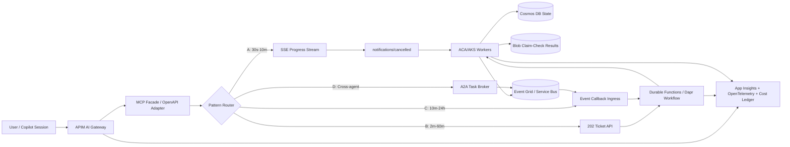
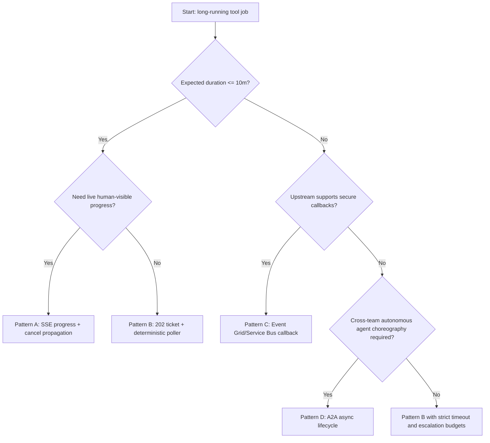

# Enterprise Long-Running Async MCP/OpenAPI Tool Execution Selection FAQ: SSE Progress vs `202` Ticket Poller vs Event Callback vs A2A Async Lifecycle

> 🌐 **Language Switch**: [中文](./long-running-async-mcp-tool-execution-202-ticket-durable-poller-vs-mcp-progress-sse-vs-eventgrid-callback-selection-faq.md) | **English (current)**
> **Audience**: Enterprise Cloud & AI Solution Architects, platform engineering leaders, API gateway/tool governance owners, and LLMOps/FinOps stakeholders.
> **Scope**: `30s–4hr` long-running tool jobs with explicit focus on AFD/APIM timeout boundaries, LLM polling token storms, async observability, and multi-tenant cost control.

## 1. Problem framing and architectural boundary: why synchronous waiting always breaks in production
A common anti-pattern in enterprise agent systems is keeping the model in a blocking loop while backend jobs run, repeatedly invoking status tools to preserve a pseudo-interactive experience; this may appear acceptable in a demo, but under real gateway limits and real tenant concurrency it fails both technically and economically.

Once job duration enters the `30s–4hr` range, three failure classes appear at the same time: ingress connections are dropped by AFD, Application Gateway, APIM, or load balancer idle boundaries; context windows are saturated by low-signal polling payloads; cancellation intent does not reliably propagate to expensive upstream workloads such as Snowflake SQL, Spark DAGs, or Terraform applies.

The architecture question is therefore not how to “wait longer in one request,” but how to externalize waiting into a deterministic control plane while preserving user-visible progress, deterministic cancellation semantics, auditable execution traces, and bounded cost per successful completion.

## 2. Azure timeout and connection boundaries: accept physical limits before protocol design
Long-running execution architecture must start with hard timeout and idle boundaries, because these constraints decide whether SSE heartbeat is sufficient, whether `202` ticketing is mandatory, or whether event-driven completion is required by design.

| Boundary layer | Typical idle/request boundary (reference) | Failure symptom | Architectural implication |
|---|---:|---|---|
| Azure Front Door (HTTP/2 SSE) | `~240s` idle sensitivity | Edge disconnect | Progress/heartbeat frames required for multi-minute streams |
| Application Gateway v2 | `30–240s` configurable | `504`/client drop | Long jobs should not block on a single request |
| APIM gateway/backend chain | Policy + backend timeout coupling | `Timeout`/backend failure | Prefer `202` ticket over prolonged synchronous forwarding |
| Azure Load Balancer SNAT idle | commonly `~240s` | Silent reset | Heartbeat or short-lived reconnect strategy required |
| ACA/AKS ingress path | ingress/envoy timeout dependent | Upstream still runs while client is gone | Execution lifecycle must be decoupled from stream lifecycle |
| Functions Flex/Consumption | execution ceiling by plan mode | Forced termination/retry storms | Move long orchestration to Durable/workflow runtime |
| Service Bus lock window | lock renewal constraints | duplicate processing | Idempotency key and dedup semantics are mandatory |
| Event Grid delivery retries | retry + signature validation coupling | repeated callbacks/dead lettering | callback handlers must be replay-safe by contract |

This boundary table is not documentation trivia; it directly defines the split between interaction plane, control plane, execution plane, and event plane, which is the only sustainable way to support long-running jobs at enterprise scale.

## 3. Four-pattern portfolio: choose by duration, interactivity, governance maturity, and cost profile
Pattern A targets `30s–10m` interactive operations and relies on Streamable HTTP MCP with `notifications/progress`, SSE heartbeat frames, and `notifications/cancelled` propagation so users receive live progress while upstream costs can still be terminated early.

Pattern B targets `2m–60m` operational jobs and returns `202 Accepted` with `operation_id` and `Retry-After` in `<150ms`, then shifts retry and backoff into Durable Functions or Dapr Workflow timers so the model is awakened once on terminal state instead of polling continuously.

Pattern C targets `10m–24h` batch and cross-system jobs through Event Grid or Service Bus callbacks with claim-check result hydration, using authenticated callback ingress plus deterministic deduplication to eliminate polling load entirely.

Pattern D targets cross-team autonomous agent choreography with A2A lifecycle states `submitted -> working -> completed/failed/cancelled`, decoupling foreground conversation SLA from background multi-step execution while preserving ownership, quota, and traceability boundaries.

## 4. End-to-end reference architecture: short ingress response, deterministic orchestration, event-driven completion, claim-check retrieval


The architecture remains resilient only when these responsibilities are explicit: ingress handles protocol and quota governance, control plane handles retries and timers, execution plane owns compute-heavy work, and event plane handles completion signaling and replay-safe terminal convergence.

## 5. Pattern A deep dive: Streamable HTTP MCP with progress frames, heartbeat keepalive, and cancellability
Pattern A is effective when users must observe progress in near real time, but its success depends on structured progress envelopes rather than informal text updates; each frame should include at least `operation_id`, `stage`, `percent`, `updated_at`, and a deterministic next-step hint.

Heartbeat cadence must be treated as an SLO guardrail, not a best-effort behavior, because idle-aware gateways do not distinguish between “quiet because no progress” and “dead connection”; a missing heartbeat is operationally equivalent to an unreliable system.

Cancellation propagation is the critical differentiator between cosmetic progress and cost-governed execution, since user abort, tab close, budget guard, or policy stop must all converge on a real upstream cancellation action rather than just marking the front-end stream closed.

Pattern A is ideal for interactive diagnostics, guided remediation, and operator-in-the-loop tasks, but should not be stretched to long batch windows where event-driven terminal signaling is inherently cheaper and more robust.

## 6. Pattern B deep dive: async `202` tickets with deterministic poll orchestration and zero LLM polling loops
Pattern B transforms the model from a polling engine into a terminal-state reasoner by returning an operation ticket immediately and moving status checks into a deterministic runtime with controlled exponential backoff, bounded retries, and explicit timeout budgets.

The design benefit is not only lower token spend but also cleaner observability, because every timer step, retry, error transition, and terminal state is captured by a formal state machine instead of being diffused across prompt turns and transient model responses.

Pattern B should define policy templates such as `interactive_long`, `batch_medium`, and `batch_heavy`, each with explicit max poll count, max elapsed duration, and escalation policy so teams avoid ad-hoc retry behavior that silently increases cost and failure variance.

In large enterprises, Pattern B is usually the fastest standardization path because it minimizes upstream integration changes while delivering immediate gains in reliability, auditability, and token efficiency.

## 7. Pattern C deep dive: Event Grid/Service Bus completion push with claim-check hydration
Pattern C replaces pull-heavy status loops with authenticated completion push events and claim-check references, so control plane logic is triggered on meaningful state transitions rather than periodic uncertainty checks.

Callback ingress must enforce first-hop trust controls, including HMAC or Entra token validation, replay-window checks, nonce tracking, and issuer scoping; otherwise polling risk is simply exchanged for callback spoofing risk.

Idempotency must be explicit through `(operation_id, event_id, sequence)` dedup keys and first-write-wins semantics so repeated deliveries are acknowledged without duplicate state transitions, duplicate billing, or duplicate downstream notifications.

Pattern C is the strongest fit for long-running settlement, reconciliation, security scanning, and overnight processing where polling cost dominates and terminal push semantics can be standardized across multiple execution systems.

## 8. Pattern D deep dive: delegated A2A async lifecycle and foreground/background SLA decoupling
Pattern D addresses the structural mismatch between short-lived user chat sessions and long-lived autonomous execution flows by introducing explicit A2A task lifecycle contracts and push notifications across agent domains.

Operationally, teams should project lightweight task summaries into Redis or Cosmos for quick foreground reads while keeping large artifacts in claim-check storage, preventing context bloat and preserving clear boundaries between conversational state and execution state.

Pattern D requires strict ownership and quota contracts at task instantiation time, including identity scope, allowed tool set, max concurrency, and budget limits, because autonomous background flows without these controls quickly become opaque cost and risk amplifiers.

When organizations already run multi-team agent ecosystems, Pattern D is usually mandatory rather than optional because it enables coordination scalability without coupling every long-running task to one foreground interaction thread.

## 9. Quantitative model: LLM polling waste vs control-plane deterministic polling efficiency
Use a simple baseline formula to estimate avoidable waste: `TokenWaste = PollCycles * (status_prompt_tokens + status_response_tokens)`, then compare this against deterministic control-plane orchestration where the model is invoked only for kickoff and terminal summarization.

| Poll cycles | LLM-in-loop polling (8k tokens/cycle) | Control-plane deterministic polling | Token reduction | Relative cost reduction |
|---:|---:|---:|---:|---:|
| 5 | 40,000 | 2,200 | 94.5% | ~18x |
| 15 | 120,000 | 2,600 | 97.8% | ~46x |
| 30 | 240,000 | 3,100 | 98.7% | ~77x |

In enterprise reality, status checks often carry logs, partial diagnostics, and nested metadata, so practical waste for `30` cycles frequently exceeds `400K` tokens per operation, while deterministic control-plane orchestration keeps model usage bounded to value-producing turns.

| Monthly cost component | Pattern A | Pattern B | Pattern C | Pattern D |
|---|---:|---:|---:|---:|
| Gateway and keepalive overhead (USD) | 6,800 | 4,200 | 3,600 | 4,900 |
| Polling scheduler/compute overhead (USD) | 5,200 | 2,100 | 900 | 1,700 |
| LLM polling token spend (USD) | 18,400 | 2,700 | 1,900 | 2,400 |
| Callback security and dedup overhead (USD) | 1,100 | 1,600 | 2,800 | 2,500 |
| Operations support labor allocation (USD) | 7,300 | 5,400 | 5,100 | 6,200 |
| Total monthly TCO (USD) | 38,800 | 16,000 | 14,300 | 17,700 |

The table does not imply a universal winner; Pattern C is often cheapest for long batch workloads, while Pattern B provides the strongest broad enterprise standardization profile due to lower integration friction and deterministic operational behavior.

## 10. Timeout boundary and policy-budget matrix: convert random failure into governed operating thresholds
| Governance metric | Recommended budget | Trigger threshold | Automated response |
|---|---:|---:|---|
| SSE heartbeat interval | 15s | >20s gap | downgrade stream and issue reconnect hint |
| `202` initial response time | `<150ms` | >300ms | enable fallback queue and circuit control |
| Max control-plane poll count | 30 | >30 | escalate to manual review workflow |
| Max interactive execution duration | 10m | >10m | force switch to Pattern B/C |
| Callback signature failure ratio | <0.1% | >=0.5% | quarantine queue and security alert |
| Idempotency conflict ratio | <0.3% | >=1.0% | activate dedup repair workflow |
| Claim-check retrieval failure ratio | <0.5% | >=1.5% | rebuild artifact and rehydrate pointer |
| Cancel-to-stop latency SLA | <60s | >=180s | hard kill upstream workload and open incident |
| State-write latency P95 | <2s | >=5s | scale state plane and suppress noisy retries |
| Per-tenant concurrent job cap | policy-based | threshold breach | reject with budget and retry guidance |

When these budgets are codified into APIM policies, workflow state machines, and alerting rules, long-running execution transitions from fragile best-effort behavior to deterministic enterprise operations.

## 11. Config block A: APIM async `202` policy for ticket issuance, Retry-After guidance, and status/cancel contract
```xml
<policies>
  <inbound>
    <base />
    <set-variable name="requestId" value="@(context.RequestId.ToString())" />
    <set-variable name="tenantId" value="@(context.Request.Headers.GetValueOrDefault("x-tenant-id","unknown"))" />
    <set-variable name="operationId" value="@($"{context.Variables["tenantId"]}-{Guid.NewGuid()}")" />
    <set-header name="x-operation-id" exists-action="override">
      <value>@((string)context.Variables["operationId"])</value>
    </set-header>
    <set-body template="none">@{
      var payload = context.Request.Body.As<JObject>(preserveContent: true);
      payload["operation_id"] = (string)context.Variables["operationId"];
      payload["request_id"] = (string)context.Variables["requestId"];
      payload["submitted_at"] = DateTime.UtcNow.ToString("o");
      return payload.ToString();
    }</set-body>
    <send-request mode="new" response-variable-name="enqueueResp" timeout="10">
      <set-url>https://tool-control-plane.internal/api/jobs/enqueue</set-url>
      <set-method>POST</set-method>
      <set-header name="Content-Type" exists-action="override">
        <value>application/json</value>
      </set-header>
      <set-body>@(context.Request.Body.As<string>(preserveContent: true))</set-body>
    </send-request>
    <return-response>
      <set-status code="202" reason="Accepted" />
      <set-header name="Content-Type" exists-action="override">
        <value>application/json</value>
      </set-header>
      <set-header name="Retry-After" exists-action="override">
        <value>8</value>
      </set-header>
      <set-header name="Location" exists-action="override">
        <value>@($"https://api.contoso.com/tool-ops/{context.Variables["operationId"]}")</value>
      </set-header>
      <set-body>@{
        return new JObject(
          new JProperty("operation_id", (string)context.Variables["operationId"]),
          new JProperty("status", "submitted"),
          new JProperty("poll_after_seconds", 8),
          new JProperty("status_url", $"https://api.contoso.com/tool-ops/{context.Variables["operationId"]}"),
          new JProperty("cancel_url", $"https://api.contoso.com/tool-ops/{context.Variables["operationId"]}:cancel")
        ).ToString();
      }</set-body>
    </return-response>
  </inbound>
  <backend>
    <base />
  </backend>
  <outbound>
    <base />
  </outbound>
  <on-error>
    <base />
  </on-error>
</policies>
```

This policy demonstrates a production-ready async contract where ingress remains fast and deterministic while queueing and long-running execution are delegated to a controllable backend orchestration layer.

## 12. Config block B: Durable deterministic poller plus Event Grid callback validation and idempotent convergence
```python
import azure.durable_functions as df
from datetime import timedelta
import hmac
import hashlib
import json

MAX_POLLS = 30
INITIAL_BACKOFF_SEC = 8
MAX_BACKOFF_SEC = 120

def orchestrator(ctx: df.DurableOrchestrationContext):
    req = ctx.get_input()
    operation_id = req["operation_id"]
    poll_url = req["status_url"]
    poll_count = 0
    backoff = INITIAL_BACKOFF_SEC

    yield ctx.call_activity("write_state", {
        "operation_id": operation_id,
        "state": "working",
        "poll_count": 0
    })

    while poll_count < MAX_POLLS:
        status = yield ctx.call_activity("query_remote_status", {
            "operation_id": operation_id,
            "url": poll_url
        })
        if status["state"] in ("completed", "failed", "cancelled"):
            yield ctx.call_activity("write_state", {
                "operation_id": operation_id,
                "state": status["state"],
                "result_uri": status.get("result_uri"),
                "error_code": status.get("error_code")
            })
            return status
        poll_count += 1
        yield ctx.call_activity("write_state", {
            "operation_id": operation_id,
            "state": "working",
            "poll_count": poll_count
        })
        next_time = ctx.current_utc_datetime + timedelta(seconds=backoff)
        yield ctx.create_timer(next_time)
        backoff = min(int(backoff * 1.6), MAX_BACKOFF_SEC)

    yield ctx.call_activity("write_state", {
        "operation_id": operation_id,
        "state": "timed_out",
        "poll_count": poll_count
    })
    return {"state": "timed_out", "operation_id": operation_id}

main = df.Orchestrator.create(orchestrator)

def verify_eventgrid_signature(body: bytes, signature: str, secret: str) -> bool:
    digest = hmac.new(secret.encode("utf-8"), body, hashlib.sha256).hexdigest()
    return hmac.compare_digest(digest, signature)

def callback_handler(request_body: bytes, headers: dict, secret: str, state_store):
    signature = headers.get("x-event-signature", "")
    if not verify_eventgrid_signature(request_body, signature, secret):
        return {"status": 401, "message": "invalid signature"}

    event = json.loads(request_body.decode("utf-8"))
    op_id = event["operation_id"]
    event_id = event["event_id"]
    dedup_key = f"{op_id}:{event_id}"
    if state_store.exists(dedup_key):
        return {"status": 200, "message": "duplicate ignored"}

    state_store.put(dedup_key, "seen", ttl_seconds=86400)
    state_store.update(op_id, {
        "state": event["state"],
        "result_uri": event.get("result_uri"),
        "checksum": event.get("checksum"),
        "finished_at": event.get("finished_at")
    })
    return {"status": 202, "message": "accepted"}
```

The implementation combines deterministic timer-based polling for resilience and callback-triggered fast convergence for efficiency, providing robust long-running execution control even when upstream systems have heterogeneous reliability behavior.

## 13. Twelve-dimension selection matrix and decision tree for practical architecture routing
| Dimension | A SSE Progress | B `202` + Deterministic Poller | C Event Callback | D A2A Async Lifecycle |
|---|---|---|---|---|
| 1. Typical duration fit | 30s–10m | 2m–60m | 10m–24h | 5m–24h |
| 2. Interactive immediacy | Very high | Medium | Low-medium | Medium-high |
| 3. LLM token efficiency | Medium | High | Very high | High |
| 4. Gateway-timeout resilience | Medium-high | Very high | Very high | High |
| 5. Cancellation fidelity | High | Medium-high | Medium | Medium-high |
| 6. Implementation complexity | Medium | Medium-high | High | High |
| 7. Auditability and traceability | Medium-high | Very high | Very high | Very high |
| 8. Idempotency/dedup requirement | Medium | Medium-high | Very high | High |
| 9. Multi-tenant quota governance | Medium | High | High | Very high |
| 10. Cross-org federation fitness | Low-medium | Medium | High | Very high |
| 11. Operations burden | Medium | Medium | Low-medium | Medium |
| 12. Monthly blended TCO | Medium | Low-medium | Low | Low-medium |



The practical rule is to standardize one primary pattern per workload family and define explicit fallback transitions, rather than oscillating between modes at runtime without governance criteria.

## 14. Enterprise scenario mapping: SRE provisioning/diagnostics and financial close reconciliation
**Scenario 1: cloud platform SRE agent running `8–25m` ARM, Terraform, and Kusto tasks**  
A primary Pattern B design with optional Pattern A progress overlay is usually optimal, because operators need deterministic retries, clear terminal state, and low token spend while still seeing actionable progress during incidents.

**Scenario 2: financial close agent running `45m` SAP S/4HANA and Snowflake reconciliation jobs**  
Pattern C with Pattern D coordination is typically preferred, because callback-driven terminal signaling and claim-check artifacts provide stronger compliance traceability than repeated status polling while reducing runtime overhead.

| Scenario metric | Before (synchronous/LLM polling) | After (B/C/D portfolio) | Improvement |
|---|---:|---:|---:|
| Avg tokens per long-running task | 168,000 | 3,800 | -97.7% |
| Timeout-related task failure rate | 8.9% | 0.9% | -89.9% |
| Manual intervention ratio | 22% | 7% | -68.2% |
| Monthly execution governance spend | \$41,200 | \$23,900 | -42.0% |
| Terminal-state audit coverage | 61% | 99% | +38pt |

These scenario outcomes consistently show that once workload duration exceeds ingress-timeout safety windows, polling responsibilities must be transferred from the model to deterministic control and event planes.

## 15. Day-0 and Day-2 checklist with quantitative FAQ for production operations
| Phase | Action | Acceptance gate |
|---|---|---|
| Day-0 | Define `operation_id`, `status_url`, `cancel_url` contracts | fields are stable and traceable across services |
| Day-0 | Select primary pattern with fallback pattern | transition triggers and rollback criteria documented |
| Day-0 | Implement APIM timeout/quota policies | tenant fairness and error semantics validated |
| Day-0 | Deploy workflow state-machine template | retry/backoff/terminal transitions deterministic |
| Day-0 | Enforce callback trust baseline | HMAC/Entra validation and replay guard pass |
| Day-0 | Standardize claim-check payload contract | URI, checksum, TTL, and schema version pinned |
| Day-2 | Monitor `poll_count`, `cancel_latency`, `callback_fail_ratio` | trend dashboards with causal labeling |
| Day-2 | Review token and cost drift weekly | alerting tied to budget guardrails |
| Day-2 | Rehearse cancel and recovery playbooks | evidence recorded for audit reviews |
| Day-2 | Validate dedup/idempotency behavior under retries | duplicate events do not duplicate business effects |

**Q1: Why is LLM-driven polling an anti-pattern for long-running jobs?**  
A1: Polling consumes context and tokens without adding meaningful business reasoning, so it degrades model quality while increasing cost and jitter under load.  

**Q2: Why is a 15-second heartbeat often selected for SSE progress streams?**  
A2: It is a practical compromise between keepalive reliability and overhead for common ingress idle boundaries, especially around 240-second sensitive paths.  

**Q3: Should `Retry-After` be static or dynamic in Pattern B?**  
A3: It should be dynamic and policy-driven, reflecting job class, queue pressure, and historical completion distribution to avoid synchronized polling spikes.  

**Q4: How does Pattern C avoid duplicate completion processing?**  
A4: Use deterministic idempotency keys with first-write-wins state transitions and acknowledge duplicate deliveries without reapplying side effects.  

**Q5: Does Pattern D reduce user control because execution is delegated?**  
A5: Not if foreground summaries expose state, ETA, and next-action hints consistently; users gain reliability without losing visibility.  

**Q6: When should teams migrate from Pattern B to Pattern C?**  
A6: Migrate when durations regularly exceed ten minutes and secure callback capability is available, because callback push scales more efficiently than polling.  

**Q7: Which KPI set best proves async modernization success?**  
A7: Track token waste, timeout failure rate, terminal audit coverage, and unit execution cost together; all four should improve concurrently.  

**Q8: Why must cancellation be propagated to executors instead of only closing client streams?**  
A8: Stream closure alone does not stop compute spend, so cancellation must terminate upstream work to preserve economic and operational correctness.  
