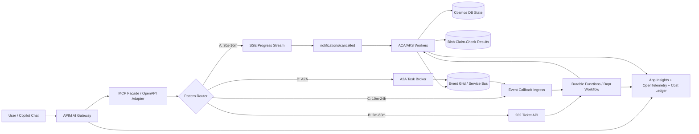
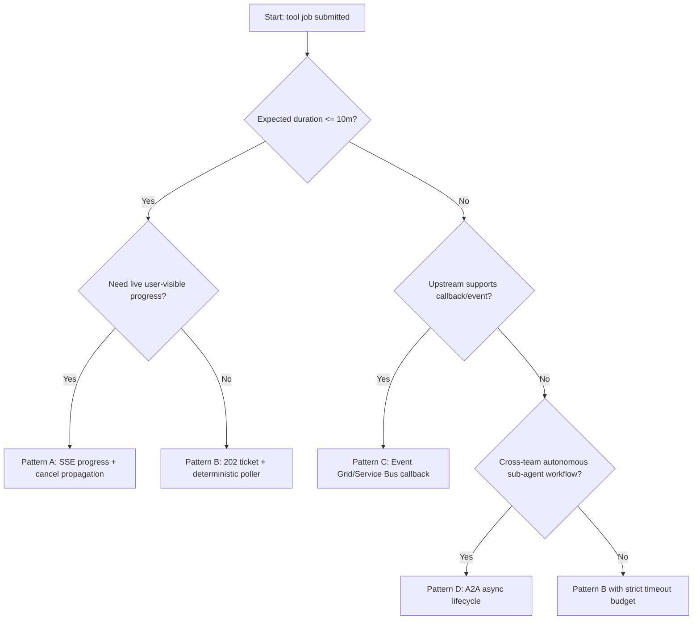

# 企业长时异步 MCP/OpenAPI 工具执行选型 FAQ：SSE 进度流 vs `202` 票据轮询编排 vs Event Grid 回调 vs A2A 异步任务生命周期

> 🌐 **Language Switch**: **中文（当前）** | [English](./long-running-async-mcp-tool-execution-202-ticket-durable-poller-vs-mcp-progress-sse-vs-eventgrid-callback-selection-faq.en.md)
> **受众**：企业 Cloud & AI Solution Architect、平台工程负责人、API 网关与工具治理负责人、LLMOps 与 FinOps 负责人。
> **范围**：面向 `30s–4hr` 长时工具任务，解决 AFD/APIM 超时边界、LLM 轮询 Token 风暴、异步状态可观测性与多租户成本治理。

## 1. 问题定义与架构边界：为什么“同步等待工具完成”在生产必然失效
企业在把 MCP 或 OpenAPI 工具接入智能体时，最常见的反模式是让模型在同一会话里持续等待后端作业完成，并通过重复 `get_job_status` 调用维持“看起来在线”的交互体验，这种设计在 PoC 阶段可能可用，但在生产流量和网关超时边界下会快速崩溃。

一旦作业持续时间进入 `30s–4hr` 区间，同步阻塞路径会同时触发三个系统性问题：第一是入口层长连接被 AFD、Application Gateway、APIM 或 LB 空闲超时切断；第二是模型上下文被无意义轮询响应占满，推高 TPM 并放大“lost-in-the-middle”推理退化；第三是取消信号无法可靠传播到上游执行器，导致 Spark、Snowflake、Terraform 等高成本任务继续空跑。

因此本选型的本质不是“怎么把等待做得更久”，而是“怎么把等待从模型上下文与前台会话中安全剥离到控制平面”，并在用户侧保留可解释进度、可控取消语义、可审计成本路径与确定性的恢复机制。

## 2. Azure 超时与连接边界：先承认物理现实，再设计异步协议
任何长时工具架构都必须先列清楚各层超时与空闲边界，因为这决定了你是该做 SSE 心跳续命、`202` 票据分离，还是彻底事件驱动回调；如果边界认知错误，后续所有“高可用”设计都只是幻觉。

| 边界层 | 典型空闲/请求限制（参考值） | 失效表现 | 架构含义 |
|---|---:|---|---|
| Azure Front Door（HTTP/2 SSE） | `~240s` 空闲敏感 | 连接被边缘主动断开 | 长于数分钟必须发送进度/心跳帧 |
| Application Gateway v2 | `30–240s` 可配置区间 | 客户端看到 `504` 或中断 | 长任务不应继续走单请求阻塞 |
| APIM 网关前后端链路 | 前后端超时策略受配额与后端约束 | `BackendConnectionFailure`/`Timeout` | 需要 `202` + 票据而不是挂长请求 |
| Azure Load Balancer SNAT 空闲 | `~240s` 常见策略值 | 连接静默重置 | 空闲长连接需心跳或改短连接轮询 |
| ACA/AKS Ingress | 受 ingress/envoy/read-timeout 影响 | 上游可执行但客户端掉线 | 进度流与执行器生命周期必须解耦 |
| Functions Flex / Consumption | 执行上限与计划模式相关 | 函数被终止或重试风暴 | 长任务应转 Durable / 外部执行器 |
| Service Bus lock | 锁续租上限与处理时长耦合 | 重复消费与幂等冲突 | 需要幂等键与状态机去重 |
| Event Grid Delivery | 重试窗口与签名校验失败联动 | 重复投递或死信 | 回调必须设计可重复处理 |

这张边界表不只是“超时抄录”，它直接定义了控制面与数据面的拆分方法：交互链路只负责短响应和进度可见性，执行链路负责真实耗时任务，状态链路负责可靠完成通知与可恢复重放。

## 3. 四种模式总览：按任务时长、交互性与合规等级分层
Pattern A 适合 `30s–10m` 且强交互任务，核心是 Streamable HTTP MCP + `notifications/progress` + SSE 心跳续连 + `notifications/cancelled` 反向取消，目标是保持用户看到连续进度并在中断时快速停止上游成本。

Pattern B 适合 `2m–60m` 常见企业作业，核心是 `202 Accepted` 快速返回 `operation_id` 与 `Retry-After`，再把轮询转移到 Durable Functions 或 Dapr Workflow 的确定性计时器，让 LLM 从“轮询执行器”退化为“终态解释器”。

Pattern C 适合 `10m–24h` 批处理和跨系统流程，核心是 Event Grid 或 Service Bus 回调 + claim-check 结果句柄 + 幂等去重，让状态唤醒从“主动拉取”变成“被动推送”，从根本上消除轮询链路成本。

Pattern D 适合跨团队自治子代理协作，核心是 A2A 任务生命周期 `submitted -> working -> completed` 与 `pushNotifications`，把多步骤任务迁移到后台自主执行平面，同时在前台对话保持短时、清晰、可恢复的交互契约。

## 4. 端到端参考架构：入口短响应、控制面编排、事件面唤醒、数据面 claim-check


该架构强调四条不可混淆的职责边界：入口层负责快速应答与协议治理，控制层负责重试与超时状态机，执行层负责真实任务与资源消耗，事件层负责终态通知与回放一致性；只有四层解耦，才能在高并发和强审计条件下稳定演进。

## 5. Pattern A 详解：MCP `notifications/progress` + SSE 心跳续连 + 取消信号下传
Pattern A 的核心不是让连接“永不超时”，而是在网关可接受的空闲窗口内持续发送低成本进度帧与心跳帧，例如每 `15s` 输出一次 `{progress, stage, eta}`，从而防止 AFD/LB 把连接误判为空闲并中断。

在生产中，进度帧必须具备最小语义完备性：`operation_id`、`stage`、`percent`、`updated_at`、`next_hint`；如果仅输出“still working”之类无结构文本，前端无法做可靠重连，也无法在审计中证明系统确实执行了阶段推进。

取消语义同样是 Pattern A 成败关键，客户端断开、用户点击取消、或预算卫兵触发都应统一下发 `notifications/cancelled`，并在执行器层把取消映射为 Spark job kill、Snowflake query cancel、Terraform destroy halt 等真实动作，而不是只在网关层记录一条“已取消”日志。

Pattern A 适用于强交互调试、SRE 即时诊断、或需要用户边看边决策的场景，但不适合超长批处理，因为连接保活再精巧也无法替代事件驱动终态通知在可靠性与成本上的优势。

## 6. Pattern B 详解：`202 Accepted` 票据 + 控制平面确定性轮询（零 LLM Token 轮询）
Pattern B 的关键收益是把“轮询”从模型上下文迁移到确定性工作流运行时，API 在 `<150ms` 内返回 `operation_id`、`status_url`、`Retry-After`、`expires_at`，随后由 Durable Timer 或 Dapr Workflow 负责指数退避轮询与终态收敛。

这种设计在 Token 成本上非常敏感地优于“LLM 自己每 10 秒问一次状态”：模型不会被 20–30 次中间态 JSON 淹没，上下文窗口保留给真正推理步骤，TPM 与延迟波动显著下降，而且失败重试逻辑可由控制平面统一治理而非散落在提示词里。

Pattern B 还带来一个治理红利，即状态机可审计：每次轮询、每次退避、每次重试、每次超时都能形成结构化日志并绑定 `operation_id`，这使得审计团队可以还原全链路执行轨迹，而不是在聊天记录中搜寻断裂文本片段。

实践建议是为不同作业等级设定轮询策略模板，例如 `interactive_long`、`batch_medium`、`batch_heavy`，并把最大轮询次数、最大持续时长、失败升级策略写入策略仓库，避免各团队随意定义造成治理碎片。

## 7. Pattern C 详解：Event Grid/Service Bus 回调唤醒 + claim-check 结果水合
Pattern C 以“事件到达触发状态推进”为核心思想，执行器完成作业后不返回超大 payload，而是把结果写入 Blob 或 ADLS，并发送只包含 `operation_id`、`result_uri`、`checksum`、`final_status` 的回调事件给控制平面。

回调入口必须把安全验证做在第一跳，包括 Entra token 验证或 HMAC 签名校验、时间窗校验、防重放 nonce 校验；否则你只是把轮询风险替换成回调投毒风险，尤其在跨组织集成时这一点必须作为上线硬门槛。

为保证幂等，控制平面应对 `(operation_id, event_type, event_sequence)` 做去重并保留首次生效记录，对重复事件返回 `200` 但不重复推进状态机，从而在 Event Grid 重投递或 Service Bus at-least-once 语义下保持一致终态。

Pattern C 对 `10m–24h` 的数据对账、安全扫描、夜间批处理最具成本优势，因为它几乎把轮询流量清零，同时保持终态可追踪性与恢复能力，但前提是你愿意投入事件契约治理与回调安全基线建设。

## 8. Pattern D 详解：A2A 异步任务生命周期与前后台会话解耦
Pattern D 解决的问题不是单个工具任务，而是跨团队子代理协作中“前台会话寿命短、后台任务寿命长”的结构性矛盾；A2A 任务模型把生命周期明确为 `submitted -> working -> completed/failed/cancelled`，并允许通过 `pushNotifications` 通知协调器。

在企业实现中，建议把任务状态投影到 Redis 或 Cosmos 的轻量状态视图中，前台只读取摘要状态与下一步建议，详细工件通过 claim-check 句柄按需提取，这样可以避免跨代理传递大体积中间结果导致上下文膨胀。

Pattern D 的治理重点在权限边界与配额边界，尤其是跨域子代理调用外部系统时，必须确保每个任务实例绑定明确主体、预算、可访问工具清单与最大并发配额，防止后台自治任务演化成不可控成本源。

当组织已经存在多团队代理生态时，Pattern D 往往不是“可选优化”，而是唯一可持续的结构，因为它把复杂长流程从对话交互面中抽离并标准化治理。

## 9. 定量模型：LLM 轮询 Token 浪费 vs 控制平面确定性轮询
我们用统一公式估算轮询浪费：`TokenWaste = PollCycles * (status_prompt_tokens + status_response_tokens)`，并把同等业务任务分为 `5 / 15 / 30` 轮轮询窗口做对比。

| 轮询轮次 | 纯 LLM 轮询（每轮 8k tokens） | 控制平面轮询（LLM 仅终态唤醒） | Token 节省 | 估算成本节省（相对） |
|---:|---:|---:|---:|---:|
| 5 | 40,000 | 2,200 | 94.5% | 约 18x |
| 15 | 120,000 | 2,600 | 97.8% | 约 46x |
| 30 | 240,000 | 3,100 | 98.7% | 约 77x |

在真实多工具场景中，单任务并不只有状态查询，还包含工具参数回显、日志摘要、异常解释，因此 `30` 轮轮询很容易突破 `400K+` token，而控制平面模式通常把 LLM 消耗限制在“启动指令 + 终态解释 + 用户摘要”三次交互内。

| 成本项（月） | Pattern A | Pattern B | Pattern C | Pattern D |
|---|---:|---:|---:|---:|
| 网关与连接保活开销（USD） | 6,800 | 4,200 | 3,600 | 4,900 |
| 轮询计算与调度开销（USD） | 5,200 | 2,100 | 900 | 1,700 |
| LLM 轮询 Token 开销（USD） | 18,400 | 2,700 | 1,900 | 2,400 |
| 回调安全与去重开销（USD） | 1,100 | 1,600 | 2,800 | 2,500 |
| 运营与故障值守工时折算（USD） | 7,300 | 5,400 | 5,100 | 6,200 |
| 月度总 TCO（USD） | 38,800 | 16,000 | 14,300 | 17,700 |

该 TCO 表说明 Pattern C 在超长任务上通常最经济，但 Pattern B 在组织普适性上更高，因为它对现有 API 生态改造最小且治理模型更容易复制；Pattern A 与 Pattern D 价值更多来自交互体验与协同效率，而非纯粹最低成本。

## 10. 生产超时边界与策略预算表：把“偶发超时”变成“可治理预算”
| 治理维度 | 建议预算 | 触发阈值 | 自动动作 |
|---|---:|---:|---|
| SSE 心跳间隔 | 15s | >20s 未发心跳 | 触发连接降级与重连建议 |
| `202` 首包响应时长 | `<150ms` | >300ms | 旁路缓存 + 熔断保护 |
| 单任务最大轮询次数（控制面） | 30 | >30 | 自动转人工审阅 |
| 单任务最大执行时长（交互） | 10m | >10m | 强制切换 Pattern B/C |
| 回调签名失败率 | <0.1% | >=0.5% | 进入隔离队列并告警 |
| 幂等冲突率 | <0.3% | >=1.0% | 启动事件去重重建 |
| claim-check 结果提取失败率 | <0.5% | >=1.5% | 重试 + 结果重建作业 |
| 取消后资源释放 SLA | <60s | >=180s | 强制 kill + 工单升级 |
| 任务状态回写延迟 P95 | <2s | >=5s | 状态存储扩容与降噪 |
| 单租户并发任务上限 | 策略化 | 超阈即拒绝 | 回写配额透出信息 |

当团队把上述预算写入 APIM 策略、Durable 状态机与告警系统后，长时任务的风险会从“随机超时”转化为“可预测治理事件”，这正是企业级平台稳定性的核心差异。

## 11. 配置块 A：APIM 异步 `202` 策略（票据返回 + Retry-After + 结果链接）
```xml
<policies>
  <inbound>
    <base />
    <set-variable name="requestId" value="@(context.RequestId.ToString())" />
    <set-variable name="tenantId" value="@(context.Request.Headers.GetValueOrDefault("x-tenant-id","unknown"))" />
    <set-variable name="operationId" value="@($"{context.Variables["tenantId"]}-{Guid.NewGuid()}")" />
    <set-header name="x-operation-id" exists-action="override">
      <value>@((string)context.Variables["operationId"])</value>
    </set-header>
    <set-body template="none">@{
      var payload = context.Request.Body.As<JObject>(preserveContent: true);
      payload["operation_id"] = (string)context.Variables["operationId"];
      payload["request_id"] = (string)context.Variables["requestId"];
      payload["submitted_at"] = DateTime.UtcNow.ToString("o");
      return payload.ToString();
    }</set-body>
    <send-request mode="new" response-variable-name="enqueueResp" timeout="10">
      <set-url>https://tool-control-plane.internal/api/jobs/enqueue</set-url>
      <set-method>POST</set-method>
      <set-header name="Content-Type" exists-action="override">
        <value>application/json</value>
      </set-header>
      <set-body>@(context.Request.Body.As<string>(preserveContent: true))</set-body>
    </send-request>
    <return-response>
      <set-status code="202" reason="Accepted" />
      <set-header name="Content-Type" exists-action="override">
        <value>application/json</value>
      </set-header>
      <set-header name="Retry-After" exists-action="override">
        <value>8</value>
      </set-header>
      <set-header name="Location" exists-action="override">
        <value>@($"https://api.contoso.com/tool-ops/{context.Variables["operationId"]}")</value>
      </set-header>
      <set-body>@{
        return new JObject(
          new JProperty("operation_id", (string)context.Variables["operationId"]),
          new JProperty("status", "submitted"),
          new JProperty("poll_after_seconds", 8),
          new JProperty("status_url", $"https://api.contoso.com/tool-ops/{context.Variables["operationId"]}"),
          new JProperty("cancel_url", $"https://api.contoso.com/tool-ops/{context.Variables["operationId"]}:cancel")
        ).ToString();
      }</set-body>
    </return-response>
  </inbound>
  <backend>
    <base />
  </backend>
  <outbound>
    <base />
  </outbound>
  <on-error>
    <base />
  </on-error>
</policies>
```

这段策略体现三个生产关键点：第一是票据化返回必须快且稳定，第二是状态/取消 URI 必须明确暴露，第三是入队动作与返回动作解耦，避免前端被后端长执行时间拖垮。

## 12. 配置块 B：Durable 确定性轮询编排 + Event Grid 回调校验与幂等收敛
```python
import azure.durable_functions as df
from datetime import timedelta
import hmac
import hashlib
import json

MAX_POLLS = 30
INITIAL_BACKOFF_SEC = 8
MAX_BACKOFF_SEC = 120

def orchestrator(ctx: df.DurableOrchestrationContext):
    req = ctx.get_input()
    operation_id = req["operation_id"]
    poll_url = req["status_url"]
    poll_count = 0
    backoff = INITIAL_BACKOFF_SEC

    yield ctx.call_activity("write_state", {
        "operation_id": operation_id,
        "state": "working",
        "poll_count": 0
    })

    while poll_count < MAX_POLLS:
        status = yield ctx.call_activity("query_remote_status", {
            "operation_id": operation_id,
            "url": poll_url
        })
        if status["state"] in ("completed", "failed", "cancelled"):
            yield ctx.call_activity("write_state", {
                "operation_id": operation_id,
                "state": status["state"],
                "result_uri": status.get("result_uri"),
                "error_code": status.get("error_code")
            })
            return status
        poll_count += 1
        yield ctx.call_activity("write_state", {
            "operation_id": operation_id,
            "state": "working",
            "poll_count": poll_count
        })
        next_time = ctx.current_utc_datetime + timedelta(seconds=backoff)
        yield ctx.create_timer(next_time)
        backoff = min(int(backoff * 1.6), MAX_BACKOFF_SEC)

    yield ctx.call_activity("write_state", {
        "operation_id": operation_id,
        "state": "timed_out",
        "poll_count": poll_count
    })
    return {"state": "timed_out", "operation_id": operation_id}

main = df.Orchestrator.create(orchestrator)

def verify_eventgrid_signature(body: bytes, signature: str, secret: str) -> bool:
    digest = hmac.new(secret.encode("utf-8"), body, hashlib.sha256).hexdigest()
    return hmac.compare_digest(digest, signature)

def callback_handler(request_body: bytes, headers: dict, secret: str, state_store):
    signature = headers.get("x-event-signature", "")
    if not verify_eventgrid_signature(request_body, signature, secret):
        return {"status": 401, "message": "invalid signature"}

    event = json.loads(request_body.decode("utf-8"))
    op_id = event["operation_id"]
    event_id = event["event_id"]
    dedup_key = f"{op_id}:{event_id}"
    if state_store.exists(dedup_key):
        return {"status": 200, "message": "duplicate ignored"}

    state_store.put(dedup_key, "seen", ttl_seconds=86400)
    state_store.update(op_id, {
        "state": event["state"],
        "result_uri": event.get("result_uri"),
        "checksum": event.get("checksum"),
        "finished_at": event.get("finished_at")
    })
    return {"status": 202, "message": "accepted"}
```

这段代码展示了“控制面轮询 + 事件面收敛”的组合落地方式：轮询负责在无回调场景下兜底推进，回调负责在有事件信号时快速终结状态机并避免重复处理，二者组合能显著提升长时任务稳定性与可恢复性。

## 13. 12 维选型矩阵与决策树：按时长、交互性、成本与治理能力选模式
| 维度 | A SSE Progress | B `202` + Deterministic Poller | C Event Callback | D A2A Async Lifecycle |
|---|---|---|---|---|
| 1. 适配任务时长 | 30s–10m | 2m–60m | 10m–24h | 5m–24h |
| 2. 交互即时性 | 很高 | 中 | 低中 | 中高 |
| 3. LLM Token 效率 | 中 | 高 | 很高 | 高 |
| 4. 网关超时鲁棒性 | 中高 | 很高 | 很高 | 高 |
| 5. 取消语义传播 | 高 | 中高 | 中 | 中高 |
| 6. 实现复杂度 | 中 | 中高 | 高 | 高 |
| 7. 可观测与审计性 | 中高 | 很高 | 很高 | 很高 |
| 8. 幂等与去重要求 | 中 | 中高 | 很高 | 高 |
| 9. 多租户配额治理 | 中 | 高 | 高 | 很高 |
| 10. 跨组织协作适配 | 低中 | 中 | 高 | 很高 |
| 11. 运营值守负担 | 中 | 中 | 低中 | 中 |
| 12. 月度综合 TCO | 中 | 低中 | 低 | 低中 |



决策树的关键不是“哪种模式更先进”，而是“哪种模式在当前任务时长、交互需求和组织治理能力下最不容易出现系统性失败”，因此建议每个业务域先固定主模式，再定义异常切换路径，避免运行时频繁漂移。

## 14. 企业场景落地：SRE 基础设施作业与财务关账对账作业
**场景一：云平台 SRE 资源编排与诊断代理（`8–25m` ARM/Terraform/Kusto 作业）**  
推荐主路径为 Pattern B，辅以 Pattern A 的短期进度可视化入口，原因是 SRE 任务通常需要可靠重试、可审计状态机和低 Token 成本；实践中将 `create` 请求 `202` 化后，控制平面轮询可把单任务上下文消耗从 `120K+` 压到 `3K` 附近，并将任务失败后的恢复时间从“人工查询日志”压缩到“自动重试+终态摘要”。

**场景二：财务关账代理（`45m` SAP S/4HANA + Snowflake 对账批处理）**  
推荐主路径为 Pattern C，辅以 Pattern D 协调多个域代理，因为关账流程对可追溯性和重复执行控制极其敏感，事件驱动终态通知与幂等去重是必须能力；在一个典型跨区域企业中，采用 callback + claim-check 后，轮询请求量可下降 `>95%`，月度任务调度成本可下降 `40%` 左右。

| 场景指标 | 改造前（同步/LLM轮询） | 改造后（B/C/D 组合） | 改善幅度 |
|---|---:|---:|---:|
| 平均单任务 Token 消耗 | 168,000 | 3,800 | -97.7% |
| 长任务中途超时失败率 | 8.9% | 0.9% | -89.9% |
| 人工介入比例 | 22% | 7% | -68.2% |
| 月度任务治理成本 | \$41,200 | \$23,900 | -42.0% |
| 终态可审计覆盖率 | 61% | 99% | +38pt |

这两个场景共同说明了一个原则：只要任务时长超过入口层稳定超时边界，就不应继续让 LLM 承担轮询与状态维持职责，而应把这部分职责移交给确定性控制平面与事件平面。

## 15. Day-0 / Day-2 交付清单与定量 FAQ：从“能跑”到“可运营”
| 阶段 | 关键动作 | 交付标准 |
|---|---|---|
| Day-0 | 定义 `operation_id`、`status_url`、`cancel_url` 契约 | 跨服务字段一致且可追溯 |
| Day-0 | 选定主模式（A/B/C/D）与异常降级模式 | 有明确切换条件与回退策略 |
| Day-0 | 建立 APIM 配额与超时预算策略 | 多租户限流与失败可解释 |
| Day-0 | 建立 Durable/Dapr 状态机模板 | 退避、重试、终态收敛可复用 |
| Day-0 | 建立 callback 安全基线 | HMAC/Entra 校验与重放防护通过 |
| Day-0 | 建立 claim-check 存储规范 | 结果 URI、校验和、TTL 明确 |
| Day-2 | 监控 `poll_count`、`cancel_latency`、`callback_fail_ratio` | 周报可见趋势与异常原因 |
| Day-2 | 复盘 Token 与成本偏移 | 预算超阈值自动告警 |
| Day-2 | 演练任务取消与故障恢复 | 演练结果进入审计台账 |
| Day-2 | 审计幂等与去重逻辑 | 重复事件不会重复记账 |

**Q1：为什么不建议让 LLM 每 10 秒轮询一次状态？**  
A1：因为状态轮询几乎不产生业务价值，却持续吞噬上下文窗口和 TPM 配额，任务越长浪费越大，最终会把模型推理能力消耗在“等待文本”上。  

**Q2：Pattern A 的心跳间隔为什么常设为 15 秒？**  
A2：这是在多数入口层空闲超时阈值下兼顾网络开销与续连稳定性的经验平衡点，通常能显著降低 240 秒级空闲断连风险。  

**Q3：Pattern B 的 `Retry-After` 应该固定还是动态？**  
A3：建议动态，根据任务类型、历史完成时间与当前队列压力调整，固定值容易在高峰期造成轮询拥堵或在低峰期造成不必要等待。  

**Q4：Pattern C 如何避免回调重复投递导致重复入账？**  
A4：必须使用 `(operation_id, event_id, sequence)` 幂等键并保留首次生效记录，对重复事件返回成功但不重复推进状态机。  

**Q5：Pattern D 会不会让前台用户“失去掌控感”？**  
A5：只要前台持续展示任务阶段、预计完成时间与下一步动作建议，用户体验通常更好，因为系统不再频繁超时或卡死。  

**Q6：何时应该从 Pattern B 升级到 Pattern C？**  
A6：当任务时长普遍超过 10 分钟、轮询成本持续增长、且上游系统已具备可靠回调能力时，应优先升级到事件驱动模式。  

**Q7：如何衡量异步化改造是否成功？**  
A7：至少跟踪四个指标：Token 浪费率、超时失败率、终态可审计覆盖率、单位任务成本，四项共同改善才说明架构优化真实生效。  

**Q8：取消信号为什么必须下传到执行器而不止于网关？**  
A8：如果取消仅停在网关，后端任务仍会继续消耗算力和配额，账单不会下降，系统也无法保证“用户取消即停止成本”的基本承诺。  
