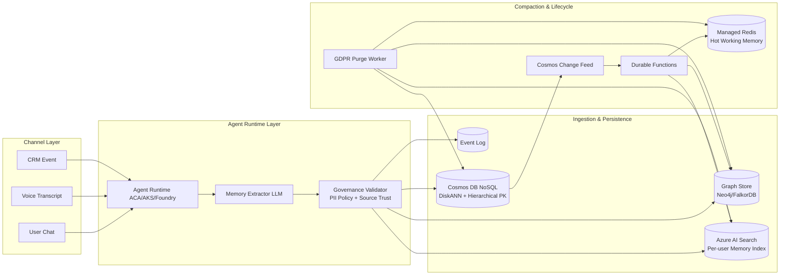
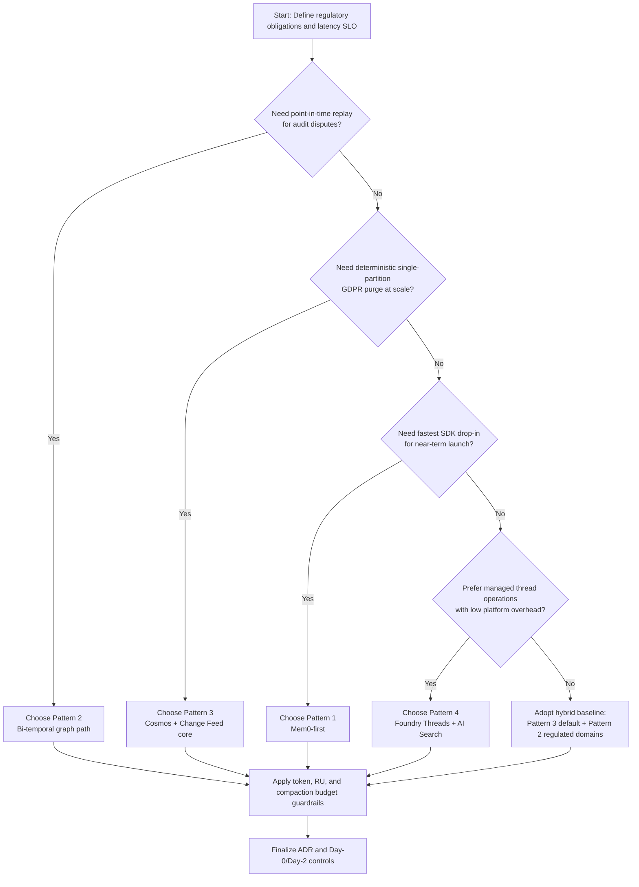

# Enterprise Long-Term Episodic and Temporal Agent Memory Selection FAQ: Mem0 on ACA/AKS vs Zep/Graphiti Bi-Temporal Graph on AKS vs Azure-Native Cosmos DiskANN + Change Feed Pipeline vs Foundry Threads + Per-User AI Search

> Audience: Cloud & AI Solution Architects, platform engineering leads, data governance teams, and privacy/compliance owners.  
> Decision scope: long-term episodic/semantic memory, temporal contradiction handling (`valid_from`/`valid_until`), cross-session profile compaction, and GDPR right-to-be-forgotten deletion at enterprise scale.

## 1. Decision Boundary: Production Memory Is an Accountability System, Not a Vector Bucket

Most agent-memory failures in production are not caused by missing embeddings.
They are caused by uncontrolled fact drift, undeletable residual copies, and inconsistent cross-session summaries.
When a regulated user asks, “why did the assistant say this last week,” your architecture must answer with evidence.

A robust memory design must satisfy four hard constraints simultaneously.
First, temporal correctness: truth validity and system knowledge time are not the same concept.
Second, deletion determinism: a forget request must clear primary store, vector indexes, caches, graph edges, and derived summaries.
Third, latency SLO: interactive channels typically need memory retrieval below a strict `P95` target.
Fourth, TCO stability: extraction-heavy patterns can silently dominate spend after user growth.

This guide compares four production patterns under one scoring model.
- **Consistency axis**: can the architecture explain contradictory facts over time windows?  
- **Compliance axis**: can the architecture prove completion of tenant/user/session-scoped erasure?  
- **Performance axis**: does retrieval remain predictable under bursty real traffic?  
- **Operations axis**: can a platform team run Day-2 safely without heroic toil?

Memory architecture is a cross-cutting control plane.
It spans runtime, storage, retrieval, and governance.
If one layer is optimized in isolation, another layer often becomes the hidden failure point.

## 2. Candidate Patterns and Organizational Maturity Mapping

The four patterns are complementary, not mutually exclusive.
Many enterprises adopt a hybrid model where one pattern is the default path and another handles high-regulation workloads.
The key is to define default responsibility first, then selective escalation.

Pattern 1 favors rapid SDK adoption and short implementation cycles.
Pattern 2 favors historical replay and dispute-grade explainability.
Pattern 3 favors Azure-native operability and deterministic deletion.
Pattern 4 favors managed thread experience and low operational overhead.

A practical maturity mapping is:
- **Maturity L1 (application-first)**: start with Pattern 1 or Pattern 4 for fast value delivery.  
- **Maturity L2 (platform-forming)**: add Pattern 3 to standardize compaction and erasure pipelines.  
- **Maturity L3 (regulated at scale)**: introduce Pattern 2 for domains requiring point-in-time evidence.  
- **Maturity L4 (multi-region governance)**: run Pattern 3 as baseline, Pattern 2 for governed memory domains.

A common anti-pattern is selecting a database before defining fact lifecycle semantics.
Reverse that order.
Define lifecycle events and temporal contracts first, then map data stores.
That sequence reduces long-term migration risk.

## 3. Pattern 1: Mem0 on ACA/AKS with Azure AI Search or pgvector

Pattern 1 is optimized for fast adoption.
Mem0 offers memory extraction and update abstractions at the SDK layer.
Application teams can turn multi-turn interactions into durable memory without rebuilding orchestration first.

A typical topology runs agent runtime on ACA or AKS.
Memory extraction uses an LLM step.
Persistence targets Azure AI Search, PostgreSQL `pgvector`, or a hybrid of both.
Tenant boundaries are usually implemented with `tenantId/userId` namespacing.

Strengths:
- Fast onboarding for product teams with minimal platform dependencies.  
- Built-in ADD/UPDATE/DELETE memory semantics reduce duplicated app logic.  
- Strong fit for pilot-to-production transition where speed matters.

Risks:
- Temporal contradiction handling may remain weak unless explicitly modeled.  
- GDPR completion often needs external orchestration across multiple stores.  
- Extraction token cost can grow faster than expected at high interaction volume.

Recommended use:
Treat Pattern 1 as an acceleration layer, not your final governance substrate.
Preserve event logs from Day-0.
That allows later integration with Pattern 3 compaction and deletion controls without rewriting user-facing flows.

## 4. Pattern 2: Zep/Graphiti Bi-Temporal Knowledge Graph on AKS with Neo4j/FalkorDB

Pattern 2 makes temporal truth explicit.
Facts are not overwritten destructively.
Edges are opened and closed with `valid_from` and `valid_until`.
This enables “what is true now” and “what was considered true then” as separate query classes.

That distinction is critical in wealth advisory, clinical support, legal review, and regulated customer service.
When historical replay is mandatory, append-only temporal semantics outperform overwrite-style memory.

Typical deployment is AKS with Neo4j or FalkorDB.
Retrieval often combines:
- subgraph expansion for relation fidelity,  
- BM25 for lexical intent capture,  
- cosine reranking for semantic relevance.

Strengths:
- Dispute-grade historical explainability.  
- Better contradiction handling across multiple sources and updates.  
- Natural support for point-in-time compliance inspection.

Trade-offs:
- Higher operational complexity for graph infrastructure.  
- More specialized tuning for graph query plans and index maintenance.  
- Larger blast radius if graph operations are not isolated by domain.

Recommended use:
Deploy Pattern 2 selectively for regulated memory domains.
Do not force all low-value conversational memory into a bi-temporal graph.
That usually causes avoidable cost and operational burden.

## 5. Pattern 3: Azure-Native Cosmos DiskANN + Change Feed + Durable Functions + Redis

Pattern 3 prioritizes deterministic operations and governance-at-scale.
It decomposes memory into explicit asynchronous stages.
Event ingestion is durable.
Compaction is triggered by Change Feed.
Serving is split into hot Redis memory and persistent Cosmos memory.

This pattern aligns well with multi-tenant SaaS economics.
Using hierarchical partition keys `["/tenantId","/userId","/memoryId"]` creates stable isolation and predictable purge boundaries.
GDPR deletion can run at partition scope rather than global scans.

DiskANN supports high-dimensional retrieval under controlled latency.
Change Feed gives an auditable lifecycle stream.
Durable Functions coordinates profile compaction, contradiction invalidation, and index refresh.

Design principle:
Redis is a hot working-memory accelerator.
Redis is not the canonical truth source.
Canonical truth remains in Cosmos + audit/event logs.

Main risks:
- Poor compaction design can introduce retrieval drift.  
- Incomplete idempotency in erasure workflows can leave residual copies.  
- Unbounded extraction throughput can consume RU and model budget unexpectedly.

Recommended event contract:
- `FactAdded`  
- `FactRevised`  
- `FactInvalidated`  
- `FactPurged`  
- `ProfileCompacted`

With this contract, downstream systems subscribe to stable semantics.
That reduces hidden coupling and enables safer incremental evolution.

## 6. Pattern 4: Foundry Agent Service Threads + Per-User Scoped Azure AI Search Memory Index

Pattern 4 favors managed developer experience.
Short-to-mid-term memory remains in managed threads.
Asynchronous summarization pipelines publish stable memory facts into per-user AI Search indexes.

Advantages:
- Low entry barrier for teams that prioritize application velocity.  
- Reduced platform setup burden in early production stages.  
- Fast integration path for teams already using Foundry orchestration.

Limitations:
- Deep temporal governance still needs external augmentation.  
- Deletion workflows must coordinate managed thread state and index artifacts.  
- Complex contradiction arbitration typically requires custom policy services.

A practical strategy is dual-plane memory:
- Thread memory for active conversational continuity.  
- Index memory for policy-approved durable facts.

This split lowers the chance of long-term contamination from noisy interaction traces.
It also improves cost control through selective persistence.

## 7. End-to-End Bi-Temporal Memory Ingestion, Compaction, and Retrieval Topology (Mermaid)



This topology separates online retrieval from asynchronous lifecycle control.
It also centralizes compliance actions so all memory replicas can be reconciled consistently.

## 8. SA Decision Flow: Selecting a Default Memory Pattern by Constraint Priority (Mermaid)



Use this flow during architecture review workshops.
Constraint-first decisions are more stable than tool-first decisions.

## 9. Deployable Configuration Snippet #1: Cosmos Hierarchical Partitioning and DiskANN Policy

```json
{
  "id": "agent-memory-container-policy",
  "partitionKey": {
    "paths": ["/tenantId", "/userId", "/memoryId"],
    "kind": "MultiHash",
    "version": 2
  },
  "indexingPolicy": {
    "indexingMode": "consistent",
    "automatic": true,
    "includedPaths": [
      { "path": "/tenantId/?" },
      { "path": "/userId/?" },
      { "path": "/factType/?" },
      { "path": "/valid_from/?" },
      { "path": "/valid_until/?" },
      { "path": "/sourceTrust/?" }
    ],
    "excludedPaths": [
      { "path": "/rawPayload/*" }
    ],
    "vectorIndexes": [
      {
        "path": "/embedding",
        "type": "diskANN",
        "quantizationByteSize": 8
      }
    ]
  },
  "defaultTtl": -1,
  "analyticalStorageTtl": 2592000,
  "conflictResolutionPolicy": {
    "mode": "Custom",
    "conflictResolutionProcedure": "dbs/memory/colls/facts/sprocs/resolveByValidFrom"
  }
}
```

Design notes:
- Multi-hash partitioning stabilizes tenant/user isolation under growth.  
- Excluding large raw payload fields reduces indexing RU overhead.  
- Indexing `valid_from` and `valid_until` enables bounded temporal filtering.  
- Custom conflict policy centralizes contradiction resolution behavior.

## 10. Deployable Configuration Snippet #2: Change Feed Bi-Temporal Invalidation and Profile Compaction

```python
from datetime import datetime, timezone
from typing import Iterable

def process_change_feed(batch: Iterable[dict], now: datetime) -> list[dict]:
    actions = []
    for evt in batch:
        tenant = evt["tenantId"]
        user = evt["userId"]
        fact_id = evt["factId"]
        op = evt["op"]

        if op == "FactInvalidated":
            actions.append({
                "type": "patch",
                "pk": [tenant, user, fact_id],
                "set": {"valid_until": evt["invalidatedAt"], "status": "closed"}
            })
            actions.append({
                "type": "graph_edge_close",
                "tenantId": tenant,
                "userId": user,
                "factId": fact_id,
                "closed_at": evt["invalidatedAt"]
            })
            continue

        if op == "ProfileCompactionRequested":
            summary = summarize_recent_facts(evt["facts"], token_budget=1200)
            actions.append({
                "type": "upsert_profile_snapshot",
                "pk": [tenant, user, f"profile-{evt['windowStart']}"],
                "snapshot": summary,
                "valid_from": evt["windowStart"],
                "valid_until": None,
                "generated_at": now.astimezone(timezone.utc).isoformat()
            })
            continue

        if op == "ForgetUserRequested":
            actions.extend(purge_user_everywhere(tenant, user))
            continue

        actions.append({"type": "noop", "reason": f"unsupported op={op}"})
    return actions
```

This sample highlights three production controls.
Facts are invalidated by closing validity windows rather than destructive overwrite.
Compaction executes asynchronously outside interactive request paths.
Forget-user requests fan out to all replicas through one orchestrated workflow.

## 11. Twelve-Dimension Selection Matrix

| Dimension | Pattern 1 Mem0 + Search/pgvector | Pattern 2 Zep/Graphiti + Graph DB | Pattern 3 Cosmos DiskANN + Change Feed | Pattern 4 Foundry Threads + AI Search |
|---|---|---|---|---|
| 1. Delivery speed | High, SDK-centric | Medium, graph modeling upfront | Medium, pipeline engineering required | High, managed experience |
| 2. Bi-temporal explainability | Medium, extension needed | High, native fit | High, event + temporal fields | Medium, external augmentation |
| 3. Retrieval latency predictability | Medium-high | Medium | High | Medium-high |
| 4. GDPR deletion determinism | Medium | Medium-high | High | Medium |
| 5. Tenant isolation strength | High | High | High | Medium-high |
| 6. Audit replay quality | Medium | High | High | Medium |
| 7. Ops complexity | Medium | High | Medium-high | Low-medium |
| 8. Cost transparency | Medium | Medium | High | Medium |
| 9. Profile compaction flexibility | Medium-high | High | High | Medium |
| 10. Multi-region governance | Medium | Medium-high | High | Medium |
| 11. Team learning curve | Low-medium | High | Medium | Low |
| 12. Regulated workload fit | Medium | High | High | Medium |

Interpretation:
Pattern 3 is typically the best long-term baseline for large multi-tenant Azure estates.
Pattern 2 is the strongest escalation path for dispute-sensitive regulated domains.
Pattern 1 and Pattern 4 remain valuable for velocity-oriented product lanes.

## 12. Quantitative Comparison: P95 Recall, Extraction Overhead, and Monthly TCO (10K and 500K Active Users)

> Assumptions: 18 interactions/day per active user, 35% memory extraction trigger rate, 1536-d vectors, two-region redundancy.  
> Values are architecture-planning reference estimates, not procurement quotes.  
> Units: latency in ms, extraction overhead in added tokens per 1,000 interactions, TCO in USD per month.

| Pattern | Scale | Memory Recall P95 | Extraction Overhead (token/1K interactions) | Monthly TCO | Primary cost drivers |
|---|---:|---:|---:|---:|---|
| Pattern 1 Mem0 | 10K | 132 | 18,400 | 8,900 | LLM extraction + search/index layer |
| Pattern 1 Mem0 | 500K | 228 | 22,700 | 211,000 | Token growth + index expansion |
| Pattern 2 Zep/Graphiti | 10K | 158 | 11,900 | 12,600 | Graph query + hybrid retrieval |
| Pattern 2 Zep/Graphiti | 500K | 271 | 15,800 | 289,000 | Graph cluster footprint |
| Pattern 3 Cosmos-native | 10K | 121 | 9,700 | 7,400 | RU + Redis + orchestration |
| Pattern 3 Cosmos-native | 500K | 205 | 13,400 | 176,000 | RU autoscale + hot memory tier |
| Pattern 4 Foundry Threads | 10K | 116 | 12,600 | 9,800 | Managed threads + indexing jobs |
| Pattern 4 Foundry Threads | 500K | 247 | 19,900 | 243,000 | Thread growth + summary workloads |

Economic inflection usually appears around `50K–80K` active users.
At that point, extraction-heavy patterns need stronger compaction and policy gating.
Without those controls, token spend accelerates faster than storage spend.

## 13. Enterprise Scenarios: Two Practical Landing Blueprints

### Scenario A: Cross-Border Wealth Advisory Assistant
This scenario needs dispute replay and historical recommendation evidence.
Auditors require proof of what the assistant knew at a prior time window.
Recommended architecture:
- Pattern 2 for regulated advice memory domains.  
- Pattern 3 as deletion and lifecycle governance backbone.  
- Pattern 3 hot cache path for routine interactions.  
- Pattern 2 deep replay path for contested advisory events.
This split keeps compliance quality high without forcing all low-risk traffic into expensive graph paths.

### Scenario B: Multi-Institution Clinical Collaboration Assistant
This scenario emphasizes strict privacy deletion and high-volume profile compaction.
Daily interview and study updates generate large memory footprints.
Recommended architecture:
- Pattern 4 for rapid team productivity in managed conversation threads.  
- Pattern 3 for durable memory governance and deterministic user/project purge.  
- Event-driven compaction to convert noisy interaction trails into validated facts.
This model often reaches production readiness within two quarters for mid-size organizations.

## 14. Day-0 and Day-2 Checklist
### Day-0 (before production launch)
- Define canonical fact schema with `fact_id`, source confidence, and temporal fields.  
- Define erasure semantics for primary records, vectors, graph edges, caches, and snapshots.  
- Enforce tenant/user isolation consistently across partition keys and index names.  
- Set extraction token budgets with hard throttling and fallback strategy.  
- Version prompts and extraction rules to prevent silent semantic drift.  
- Emit auditable lifecycle events for add/revise/invalidate/purge operations.  
- Apply data classification tags for PII and regulated fields.  
- Define SLOs and error budgets for retrieval and compaction pipelines.
### Day-2 (operational phase)
- Monitor deletion completion rate and residual-copy count daily.  
- Review contradiction queues weekly and tune source weighting policies.  
- Measure retrieval-quality impact from compaction on a weekly cadence.  
- Compare token spend vs RU spend monthly and adjust budgets.  
- Run point-in-time replay audits monthly for regulated domains.  
- Alert on cross-region replication lag to avoid stale fact reuse.  
- Roll out policy changes with canary waves, not global flips.  
- Revalidate extraction behavior after model upgrades.  
- Keep legal and platform reports generated from one consistent event source.

## 15. Quantitative FAQ (8 Distinct Questions)
**Q1: Which pattern is most likely to sustain `P95 <= 150ms` retrieval at scale?**  
A1: Pattern 3 is generally the most stable baseline; Pattern 4 can also meet this target for many workloads, while Pattern 2 usually needs graph-path optimization for strict low-latency envelopes.
**Q2: Is bi-temporal modeling mandatory for all enterprises?**  
A2: Not universally; for regulated sectors with dispute replay obligations it is strongly recommended, and for lower-regulation workloads it can be introduced selectively per memory domain.
**Q3: Which pattern has the lowest projected monthly TCO at 500K active users?**  
A3: In this comparison, Pattern 3 is the lowest at approximately `176,000 USD/month`, driven by controllable RU scaling and disciplined hot-memory usage.
**Q4: Does starting with Mem0 force a future full rewrite?**  
A4: Not if you preserve event logs and externalize lifecycle controls early; migration toward a Pattern 3 governance core can be incremental rather than disruptive.
**Q5: Is Pattern 2 only relevant for financial services?**  
A5: No; healthcare, legal, insurance, and any domain requiring historical accountability benefit from bi-temporal replay and contradiction traceability.
**Q6: What makes GDPR erasure verifiable instead of best-effort?**  
A6: A single orchestrated purge workflow that clears canonical storage, vector indexes, graph structures, caches, and summaries while emitting immutable completion evidence.
**Q7: How often should cross-session profile compaction run?**  
A7: A common baseline is daily full compaction with 2-hour incremental windows, plus event-triggered compaction for users exceeding interaction thresholds.
**Q8: What is the recommended first-year path for a small six-person platform team?**  
A8: Launch with Pattern 4 for rapid delivery, establish Pattern 3 governance in parallel, then evaluate Pattern 2 only for high-risk regulated memory domains.

