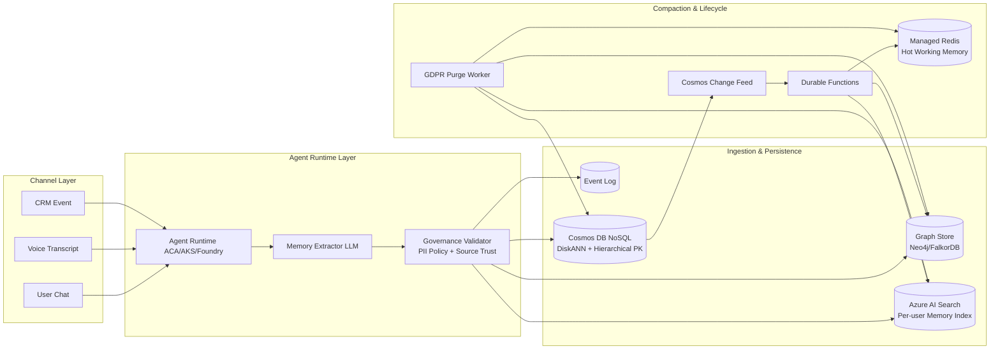
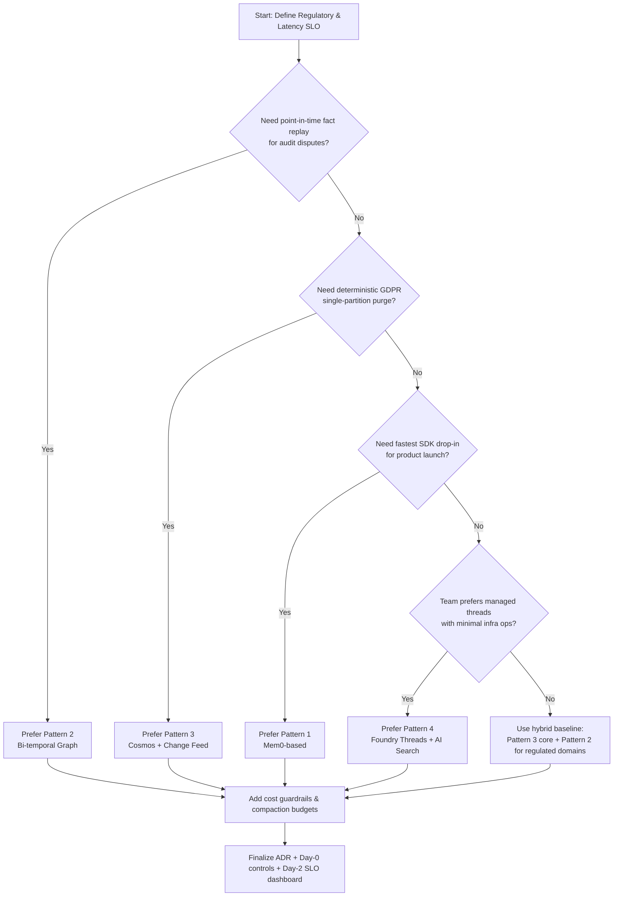

# 企业长期情景记忆与时序事实治理选型 FAQ：Mem0（ACA/AKS）vs Zep/Graphiti 双时态图谱（AKS）vs Azure 原生 Cosmos DiskANN + Change Feed 管线 vs Foundry Threads + 每用户 AI Search 索引

> 适用对象：Cloud & AI Solution Architect、平台工程、数据治理、隐私合规与企业应用架构团队。  
> 目标问题：当智能体系统进入 `10K–500K` 活跃用户规模后，如何在记忆召回准确性、时序事实冲突消解、跨会话用户画像压缩、GDPR 删除与成本之间实现稳定平衡。

## 1. 决策边界：长期记忆不是“多存一点向量”，而是“可回放、可撤销、可证明”
企业 Agent 记忆系统从 PoC 进入生产后，失败点通常不是向量检索本身。
真实故障来自事实版本互相冲突、隐私删除不可验证、跨会话摘要失真，以及运维团队无法解释“为何今天答案与上周不同”。
在架构评审里，建议先把问题拆成四个不可回避的控制目标。
第一是事实时态语义，平台必须区分“事实何时生效”和“系统何时知道此事实”。
第二是删除确定性，用户触发遗忘请求后，索引、缓存、图边、摘要都要可追踪清除。
第三是检索延迟上限，客服与交易助手往往要求 `P95 < 250ms` 的记忆读取预算。
第四是总拥有成本，长期记忆若无分层压缩机制，12 个月后成本会在存储与重算上双重失控。
为避免“只凭工具偏好做选型”，本指南统一使用四条评估主线。
- **一致性主线**：`valid_from/valid_until` 双时态冲突是否可解释。  
- **合规主线**：GDPR/DSAR 删除是否支持单租户、单用户、单会话粒度。  
- **性能主线**：召回链路是否可在热点负载下保持低抖动。  
- **工程主线**：团队是否能在 2 个季度内把 Day-2 运维做稳。
从组织视角看，记忆系统属于“数据平台 + 应用平台 + 安全治理”交叉层。
任何单点优化都会引入另一个面的债务。
例如把所有事实写入图数据库可提升关系解释性，但若删除流水线没有与向量副本同步，会产生“图已删、向量仍可召回”的隐蔽违规风险。
因此，本文不提供单一“最佳方案”。
本文给出四类可生产化架构，明确其收益曲线与失效边界。
你可以按组织能力分层落地，而非一次性押注。

## 2. 四类候选架构与组织成熟度映射
四种模式并非互斥。
许多企业最终会采用“主路径 + 特例路径”的组合。
关键在于先确定主路径负责哪类工作负载，再决定是否引入第二条高治理路径。
模式一强调 SDK 友好和最短交付路径。
模式二强调双时态图谱与历史回放可解释性。
模式三强调 Azure 原生可运维性与确定性删除。
模式四强调托管线程体验与低团队门槛。
推荐按组织成熟度做初始映射。
- **L1（应用团队主导）**：优先模式一或模式四，先建立可用记忆闭环。  
- **L2（平台团队形成）**：引入模式三，建立统一 compaction 与删除流水线。  
- **L3（强监管与审计）**：在关键域补充模式二，承担争议事实回放与证据链解释。  
- **L4（跨区域复杂治理）**：采用模式三为底座，模式二作为高价值场景增强层。
评审会常见误区是“先选数据库，再谈语义”。
建议反过来。
先定义事实生命周期状态机，再映射到存储与索引。
否则后续补双时态字段与撤销链路时，迁移成本会显著高于初始建设成本。
下文每个模式都以相同维度展开。
你可以直接拷贝到架构决策记录（ADR）与评审模板。

## 3. 模式一：Mem0（ACA/AKS）+ AI Search/pgvector 的快速落地路径
Mem0 的核心优势是把记忆抽取与更新策略封装到应用 SDK 侧。
这对“先上线、后治理增强”的产品节奏非常友好。
应用团队可以在不重写业务编排的前提下，把短期对话转化为长期事实片段。
典型拓扑是 Agent Runtime 运行在 ACA 或 AKS。
记忆抽取由 LLM 驱动，后端可接 AI Search 向量索引、PostgreSQL `pgvector`，或二者混合。
多租户隔离通常采用 `tenantId/userId` 命名空间策略。

优点集中在三个方面。
- SDK 接入快，试点项目通常可在 2–4 周进入可用状态。  
- 记忆 ADD/UPDATE/DELETE 逻辑已有抽象，减少应用层重复实现。  
- 与主流模型服务结合顺滑，适合增长期产品做功能验证。

风险主要来自治理深度不足。
- 若事实冲突处理只依赖最新摘要，历史回放解释能力偏弱。  
- 删除链路跨组件时，需额外建设删除任务编排与审计日志。  
- 高并发下抽取 token 成本可能成为第一大可变成本项。

工程建议是把 Mem0 当作“记忆编排层”，而不是“合规终局层”。
在 Day-0 就保留事件溯源日志。
后续可平滑引入模式三的 compaction 管线，避免推倒重来。

对于金融客服、零售会员运营、企业知识助理等场景，模式一常作为首选起步。
但当监管要求“任意时点事实证明”时，通常需要叠加模式二的双时态图谱能力。

## 4. 模式二：Zep / Graphiti 双时态图谱（AKS）+ Neo4j/FalkorDB 的可解释路径

模式二把“事实版本变化”作为一等公民。
图边不是被覆盖，而是通过 `valid_from` 与 `valid_until` 表达生效区间。
系统可回答“当前是否为真”与“历史某日是否为真”这两类不同问题。

这种设计对高合规行业非常关键。
财富管理顾问、临床决策助手、审计问答助手，都可能面临“当时为何给出该建议”的复盘需求。
单纯的向量覆盖更新无法可靠回答这类追责问题。

典型部署在 AKS。
图存储可选 Neo4j 或 FalkorDB。
检索链路往往采用“子图召回 + BM25 + cosine rerank”的混合检索。
该链路能兼顾关系解释与语义匹配。

优势在于历史可解释性与冲突管理能力。
- 事实失效通过关闭时间区间实现，不破坏历史证据。  
- 可以做 point-in-time 查询，支持监管抽检。  
- 多源事实冲突可按来源可信度、时间新鲜度分层裁决。

代价在于运维复杂度与资源成本。
- 图数据库容量规划与索引调优需要专门经验。  
- 跨区域部署要处理复制延迟与一致性策略。  
- SRE 需要额外监控图查询热点与子图爆炸风险。

建议把模式二用在“高价值、高争议、高审计强度”的记忆域。
例如风险揭示、处方解释、授信策略追溯。
不建议把所有普通聊天记忆都放进双时态图谱。
那会让成本曲线过早抬升。

## 5. 模式三：Cosmos DiskANN + Change Feed + Durable Functions + Redis 的 Azure 原生路径

模式三强调平台可运维与删除确定性。
核心做法是把记忆处理拆成明确流水线。
写入面保留原始事件。
压缩面通过 Change Feed 驱动增量 compaction。
读取面分成 Redis 热层与 Cosmos 持久层。

该模式天然适合多租户 SaaS。
通过 Cosmos 分层分区键 `["/tenantId","/userId","/memoryId"]`，可实现租户边界与用户边界双重隔离。
GDPR 删除可以落在单分区事务批处理，避免全库扫描。

DiskANN 的价值在于在高维向量下保持可控延迟。
同时，Cosmos 自带 TTL 与 Change Feed 能形成可观测的数据生命周期。
Durable Functions 负责异步 compaction 与摘要回写，降低在线链路抖动。

Redis 在该模式里不是长期真相源。
Redis 用于工作记忆与热点会话加速。
事实真相仍落在 Cosmos 与审计日志。
这样可以在节点故障或缓存丢失后稳定重建。

模式三的挑战在于流水线设计质量。
如果 compaction 规则不稳定，会导致召回表现“今天好、明天差”。
如果删除事件不做幂等与重放保护，会在重试链路产生残留数据。

建议配置统一事件模型。
- `FactAdded`  
- `FactRevised`  
- `FactInvalidated`  
- `FactPurged`  
- `ProfileCompacted`

事件模型固定后，再让各组件订阅。
这样可避免后续组件耦合成“硬编码连线”。

## 6. 模式四：Foundry Agent Service Threads + 每用户 AI Search 记忆索引的托管路径

模式四适合希望先用托管线程能力快速上线的团队。
短期会话状态交给 Foundry Threads 管理。
中长期记忆通过异步总结任务沉淀到每用户作用域的 AI Search 索引。

该模式优势是交付速度快。
应用团队不需要先自建完整记忆平台。
在中小规模上线阶段，能显著减少基础设施开发负担。

弱点是深度治理能力受限于托管边界。
当你需要精细化双时态裁决、复杂删除流程、多源冲突重放时，通常仍要补充自建管线。
因此它更像“托管主干 + 可插拔增强”的方案。

实践中可采用“线程即会话事实草稿，索引即审批后事实”的双层策略。
线程层保留短期上下文。
索引层只保留通过策略筛选的稳定事实。
这能降低错误记忆长期化风险。

在跨会话画像压缩场景，建议引入配额。
例如每用户每天最多写入 50 条候选记忆。
超额部分进入延迟 compaction 队列。
这样能把 token 成本与索引膨胀控制在预算内。

## 7. 端到端双时态记忆摄取、压缩与召回拓扑（Mermaid）



该拓扑满足三个关键治理要求。
一是在线链路与异步链路解耦，避免召回延迟被 compaction 拖慢。
二是删除工作流对所有副本统一生效，减少“逻辑删除不彻底”风险。
三是事实抽取与事实落库之间有治理校验层，可集中执行敏感字段策略。

## 8. SA 决策流：按约束选择主记忆架构（Mermaid）



该流程图不是一次性结论工具。
它用于评审会中做“约束优先”的决策收敛。
若团队先问“哪个产品更流行”，而不先问“哪类审计责任要承担”，通常会在上线后重构。

## 9. 可落地配置片段一：Cosmos DB 层级分区与 DiskANN 索引策略

```json
{
  "id": "agent-memory-container-policy",
  "partitionKey": {
    "paths": ["/tenantId", "/userId", "/memoryId"],
    "kind": "MultiHash",
    "version": 2
  },
  "indexingPolicy": {
    "indexingMode": "consistent",
    "automatic": true,
    "includedPaths": [
      { "path": "/tenantId/?" },
      { "path": "/userId/?" },
      { "path": "/factType/?" },
      { "path": "/valid_from/?" },
      { "path": "/valid_until/?" },
      { "path": "/sourceTrust/?" }
    ],
    "excludedPaths": [
      { "path": "/rawPayload/*" }
    ],
    "vectorIndexes": [
      {
        "path": "/embedding",
        "type": "diskANN",
        "quantizationByteSize": 8
      }
    ]
  },
  "defaultTtl": -1,
  "analyticalStorageTtl": 2592000,
  "conflictResolutionPolicy": {
    "mode": "Custom",
    "conflictResolutionProcedure": "dbs/memory/colls/facts/sprocs/resolveByValidFrom"
  }
}
```

设计说明如下。
- `MultiHash` 让租户与用户边界在物理分区上更稳定。  
- `rawPayload` 排除索引可明显降低 RU 消耗。  
- `valid_from/valid_until` 进入索引后，时间窗查询更可控。  
- 冲突策略放在自定义存储过程，便于统一实现时序裁决规则。

## 10. 可落地配置片段二：Change Feed 双时态失效处理与画像压缩示例

```python
from datetime import datetime, timezone
from typing import Iterable

def process_change_feed(batch: Iterable[dict], now: datetime) -> list[dict]:
    actions = []
    for evt in batch:
        tenant = evt["tenantId"]
        user = evt["userId"]
        fact_id = evt["factId"]
        op = evt["op"]

        if op == "FactInvalidated":
            actions.append({
                "type": "patch",
                "pk": [tenant, user, fact_id],
                "set": {"valid_until": evt["invalidatedAt"], "status": "closed"}
            })
            actions.append({
                "type": "graph_edge_close",
                "tenantId": tenant,
                "userId": user,
                "factId": fact_id,
                "closed_at": evt["invalidatedAt"]
            })
            continue

        if op == "ProfileCompactionRequested":
            summary = summarize_recent_facts(evt["facts"], token_budget=1200)
            actions.append({
                "type": "upsert_profile_snapshot",
                "pk": [tenant, user, f"profile-{evt['windowStart']}"],
                "snapshot": summary,
                "valid_from": evt["windowStart"],
                "valid_until": None,
                "generated_at": now.astimezone(timezone.utc).isoformat()
            })
            continue

        if op == "ForgetUserRequested":
            actions.extend(purge_user_everywhere(tenant, user))
            continue

        actions.append({"type": "noop", "reason": f"unsupported op={op}"})
    return actions
```

这段代码展示三个关键动作。
第一，事实失效不是删除旧记录，而是关闭有效期。
第二，画像压缩与在线对话分离，避免阻塞用户请求。
第三，遗忘请求走“多副本统一清除”分支，确保删除一致性。

## 11. 12 维选型矩阵：能力、风险、成本与运维复杂度

| 维度 | 模式一 Mem0 + Search/pgvector | 模式二 Zep/Graphiti + 图数据库 | 模式三 Cosmos DiskANN + Change Feed | 模式四 Foundry Threads + AI Search |
|---|---|---|---|---|
| 1. 上线速度 | 高，SDK 快速接入 | 中，图模型设计前置 | 中，管线建设需要平台能力 | 高，托管能力可快速交付 |
| 2. 双时态事实解释 | 中，需自定义扩展 | 高，原生双时态更自然 | 高，可通过字段与事件实现 | 中，需外置补强 |
| 3. 召回延迟可控性 | 中高 | 中 | 高 | 中高 |
| 4. GDPR 删除确定性 | 中，依赖补充编排 | 中高，图与向量需统一清理 | 高，分区级删除路径明确 | 中，跨托管与索引需联动 |
| 5. 多租户隔离强度 | 高，命名空间清晰 | 高，可按租户分图 | 高，分区键天然隔离 | 中高，需严格索引命名 |
| 6. 审计追溯能力 | 中 | 高 | 高 | 中 |
| 7. 运维复杂度 | 中 | 高 | 中高 | 低到中 |
| 8. 成本透明度 | 中 | 中 | 高，RU 与缓存易计量 | 中 |
| 9. 画像压缩策略灵活性 | 中高 | 高 | 高 | 中 |
| 10. 跨区域复制治理 | 中 | 中高 | 高 | 中 |
| 11. 团队学习曲线 | 低到中 | 高 | 中 | 低 |
| 12. 适配监管场景 | 中 | 高 | 高 | 中 |

矩阵解读建议。
若你追求最快上线，模式一与模式四有明显优势。
若你面对强监管审计，模式二与模式三更稳。
若你希望长期统一治理，模式三最适合作为主干底座。

## 12. 定量对比：P95 召回、抽取开销、月度 TCO（10K 与 500K 活跃用户）

> 假设：每活跃用户日均 18 次交互，记忆触发率 35%，向量维度 1536，跨区域冗余 2 副本。  
> 价格为架构评估样本值，用于方案比较，不等同于采购报价。  
> 单位：召回延迟毫秒，抽取开销为每 1000 次交互新增 token，TCO 为美元/月。

| 模式 | 规模 | 记忆召回 P95 | 抽取开销（token/1K 交互） | 月度 TCO | 主要成本构成 |
|---|---:|---:|---:|---:|---|
| 模式一 Mem0 | 10K | 132 | 18,400 | 8,900 | LLM 抽取 + Search/pgvector |
| 模式一 Mem0 | 500K | 228 | 22,700 | 211,000 | 抽取 token 与索引扩容 |
| 模式二 Zep/Graphiti | 10K | 158 | 11,900 | 12,600 | 图查询 + 向量混检 |
| 模式二 Zep/Graphiti | 500K | 271 | 15,800 | 289,000 | 图集群与关系索引 |
| 模式三 Cosmos 原生 | 10K | 121 | 9,700 | 7,400 | RU + Redis + Durable |
| 模式三 Cosmos 原生 | 500K | 205 | 13,400 | 176,000 | RU 自动扩缩与热缓存 |
| 模式四 Foundry Threads | 10K | 116 | 12,600 | 9,800 | 托管线程 + Search 索引 |
| 模式四 Foundry Threads | 500K | 247 | 19,900 | 243,000 | 线程扩展与异步摘要 |

从拐点看，`50K–80K` 活跃用户区间是关键。
在此区间后，若仍采用“每轮对话高频抽取”的策略，模式一与模式四的 token 成本增速会明显快于模式三。
模式二在高监管场景有不可替代价值，但建议聚焦关键域，避免全量泛化。

## 13. 企业场景落地：双案例对比

### 场景 A：跨国财富管理顾问助手（强审计、争议复盘频繁）

业务要求包括历史建议追溯、客户画像时点回放、撤销指令可证据化。
监管团队要求任意时间点证明“当时系统知道什么”。
该场景建议以模式二为主、模式三为底座。

落地组合建议如下。
- 前台召回：图子图 + 向量混合召回。  
- 事实落库：双时态边 + 事件日志并行写入。  
- 删除策略：模式三统一调度删除工作流并回写审计证据。  
- 成本控制：普通问答走模式三缓存层，争议问答走模式二深查链路。

### 场景 B：医疗研究协作助手（多机构协作、GDPR/本地法并存）
该场景强调跨会话画像压缩与严格遗忘执行。
研究助手每天处理大量访谈、问卷、病历摘要。
内容体量大且持续增长。
推荐以模式三为主干，模式四承担低门槛会话托管。
- 线程态会话由托管服务承载，提升上线速度。  
- 长期事实进入 Cosmos 分区容器，按研究项目隔离。  
- Change Feed 驱动压缩，把每周摘要沉淀为可检索事实。  
- GDPR 删除以项目 + 用户键执行，保证删除边界清晰。
这类组合通常在 3 个月内可完成从试点到合规扩展。
前提是 Day-0 就定义事件模型与删除审计表。

## 14. Day-0 / Day-2 实施清单（可直接放入项目计划）
### Day-0（上线前）
- 定义事实模型字段：`fact_id`、`source`、`confidence`、`valid_from`、`valid_until`。  
- 定义删除语义：软关闭、硬删除、缓存驱逐、索引撤回的触发顺序。  
- 规定租户隔离策略：分区键、索引命名、密钥作用域三者一致。  
- 确认记忆抽取预算：每千交互 token 上限与降级策略。  
- 建立提示词与抽取规则版本管理，避免静默漂移。  
- 配置审计事件：写入、更新、失效、删除、重放、失败重试。  
- 建立数据分类标记，区分 PII、敏感业务字段与公开信息。  
- 为向量与图检索链路定义 SLO 与错误预算。  
### Day-2（运行期）
- 每日核查删除完成率与残留副本数。  
- 每周审查事实冲突队列，分析来源质量问题。  
- 每周滚动评估摘要压缩后召回损失率。  
- 每月复盘 token 成本与 RU 成本偏差。  
- 每月执行时间窗回放抽检，验证双时态正确性。  
- 对跨区域复制延迟设置告警，避免旧事实误召回。  
- 对策略变更执行灰度，禁止一次性全量切换。  
- 对模型升级执行回归评估，防止抽取语义漂移。  
- 对审计报表与法务报表保持同源口径。

## 15. 量化 FAQ（8 问 8 答）
**Q1：在 `100ms` 级检索预算下，哪种模式更稳？**  
A1：如果目标是 `P95 <= 150ms`，模式三与模式四更容易达成；模式二常在 `150–220ms` 区间，需要对子图召回做缓存或裁剪。
**Q2：`valid_from/valid_until` 必须上生产吗？**  
A2：在受监管行业建议必须上线；非监管场景可先做 `valid_from`，但在用户规模超过 `50K` 后通常仍需补 `valid_until` 防止冲突事实累积。
**Q3：500K 活跃用户下，哪种模式单位成本最低？**  
A3：本评估样本中模式三最低，约 `176,000` 美元/月；关键原因是 RU 与缓存层可更精细地做容量调节与 compaction。
**Q4：Mem0 路径会不会在后期推倒重来？**  
A4：不会必然推倒；若 Day-0 保留事件日志并把删除编排外置，后续可渐进迁移到模式三主干，不必重写全部应用逻辑。
**Q5：双时态图谱是否只能用于金融？**  
A5：不是；医疗、法务、保险理赔同样受益，但应聚焦高争议事实域，避免把低价值短记忆也放进高成本图层。
**Q6：GDPR 遗忘请求如何保证“删干净”？**  
A6：关键是统一删除编排器，同时驱动主存、索引、缓存、图边与摘要快照，并保留可验证删除凭证；仅删除主存不算完成。
**Q7：跨会话画像压缩频率怎么定？**  
A7：常见起点是每 `24h` 一次全量压缩 + 每 `2h` 增量压缩；高活跃用户可按交互数触发，超过阈值立即压缩，防止提示上下文膨胀。
**Q8：如果团队只有 6 人平台组，首年推荐路径是什么？**  
A8：建议“模式四快速上线 + 模式三治理底座并行建设”，第一个季度交付业务价值，第二个季度完成删除与审计闭环，再评估是否引入模式二。

