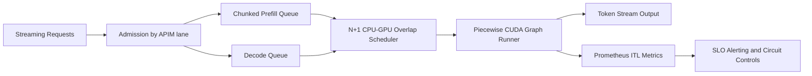
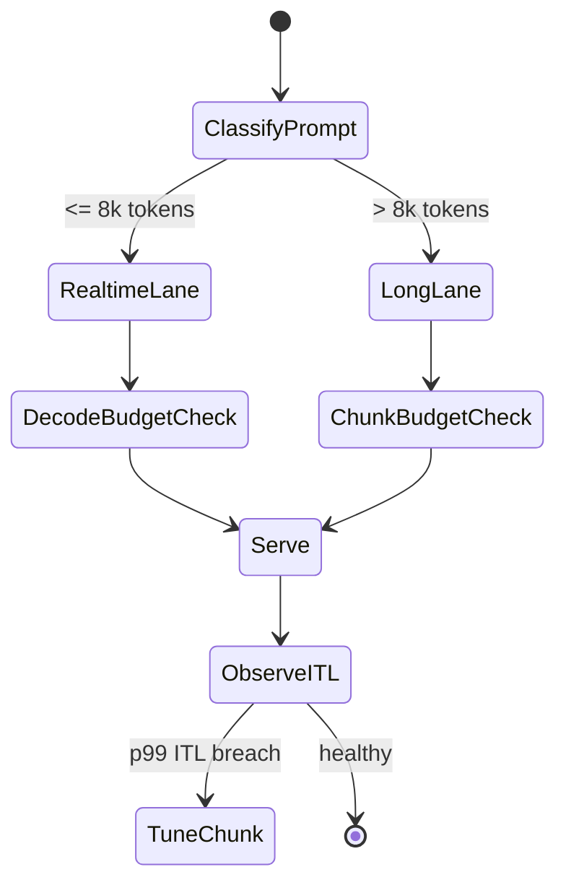

# Enterprise Low-Jitter Real-Time Decode Scheduling Selection FAQ: Chunked Prefill, Piecewise CUDA Graphs, and Overlap Runtime (Azure)

> Topic ID: #452 · Domain: 3.2 Model Serving, Routing, and GPU Orchestration
> Perspective: Cloud & AI Solution Architect focus on real-time SLA, jitter control, operational sustainability, and TCO.

## 1. Executive summary
- Pattern A is the default for medium-scale fleets balancing latency, flexibility, and iteration speed.
- Pattern B achieves the tightest deterministic tail latency for ultra-strict voice and IDE scenarios.
- Pattern C offloads kernel-level complexity through PTU managed serving, with APIM lane partitioning required.
- Pattern D drives severe head-of-line stalls and must be disallowed by policy.

## 2. Scope assumptions
- Goal: keep interactive p99 ITL below 20 ms for continuous UX and audio quality.
- Mix: short FIM plus long-context RAG at 50 / 250 / 1000 concurrent streams.
- Infra: ND H100/H200 or NCads_H100_v5 with explicit CPU/NUMA and interrupt governance.

## 3. Four architecture patterns
- Pattern A: AKS vLLM V1/SGLang overlap scheduler with chunked prefill and piecewise CUDA graphs.
- Pattern B: TensorRT-LLM plus Triton C++ in-flight batching with SM90/SM100 FP8 kernels.
- Pattern C: Foundry/Azure OpenAI PTU with APIM prompt-length admission partitioning.
- Pattern D: unchunked prefill-first scheduling, eager fallback, and unpinned burstable CPUs.

## 4. 12-dimension matrix
| Dimension | Pattern A | Pattern B | Pattern C | Pattern D |
|---|---|---|---|---|
| p99 ITL stability | High | Very high | Medium-high | Low |
| p99.9 tail control | Medium-high | High | Medium | Low |
| Model swap agility | High | Medium | Medium-high | Low |
| Engineering complexity | Medium | High | Low | Low with unacceptable risk |
| Resource efficiency | High | High | Medium-high | Low |
| Tuning complexity | Medium | High | Low | Low |
| Observability depth | High | Medium-high | Medium | Low |
| Time-to-production | Medium-high | Medium | High | Superficially high |
| Multi-model pool fit | High | Medium | Medium | Low |
| Ops staffing need | Medium | High | Low | Low |
| Cost controllability | High | Medium-high | Medium | Low |
| Recommendation | Recommended | Strongly recommended for ultra-low jitter | Recommended for managed-first teams | Prohibited |

## 5. GPU timeline and N+1 overlap architecture


## 6. Admission and ITL budget flow


## 7. Q1-Q6 quantitative Q&A
- Q1: How to size chunked prefill budget against TTFT and p99 ITL?
 - Use B_chunk = min(B_gpu_headroom, B_itl_guardrail). With 120 ms audio jitter buffer and 20 ms decode target, 1024-2048 token chunks are often stable.
- Q2: How to estimate piecewise CUDA graph VRAM overhead?
 - Estimate by graph bucket count times padding ratio. More buckets improve jitter control but increase VRAM reservation.
- Q3: Why does NUMA/IRQ pinning remove 5-9 ms scheduler stalls?
 - Pinning reduces cross-NUMA contention and host scheduling jitter for decode-critical threads and interrupts.
- Q4: When is P/D disaggregation worth it over single-pool chunked prefill?
 - When long-context share stays high and p99 tail remains above threshold despite chunk tuning.
- Q5: How does PTU avoid long-prompt contamination of real-time workloads?
 - APIM token-length routing keeps >8k prompts away from interactive pools.
- Q6: Why can anti-pattern scheduling cause 300-850 ms HoL stalls?
 - Unchunked prefill and eager fallback block decode progress while host scheduling contention amplifies tail latency.

## 8. Production snippets (AKS vLLM deployment)
```yaml
apiVersion: apps/v1
kind: Deployment
metadata:
  name: vllm-realtime-serving
spec:
  replicas: 3
  template:
    spec:
      nodeSelector:
        accelerator: h100
      containers:
      - name: vllm
        image: ghcr.io/org/vllm-v1:stable
        args:
        - "--max-num-batched-tokens=2048"
        - "--enable-chunked-prefill"
        - "--cuda-graph-mode=piecewise"
        - "--scheduler-policy=overlap"
        env:
        - name: CPUSET_REALTIME
          value: "0-15"
        - name: CPUSET_PREFILL
          value: "16-31"
```

```yaml
apiVersion: monitoring.coreos.com/v1
kind: PrometheusRule
metadata:
  name: itl-slo-alert
spec:
  groups:
  - name: realtime-itl
    rules:
    - alert: ITLP99Breach
      expr: histogram_quantile(0.99, sum(rate(inter_token_latency_seconds_bucket[5m])) by (le)) > 0.020
      for: 10m
```

## 9. Scenario 1: retail banking contact-center voice assistant
- Integrates with Azure Speech TTS under a 120 ms jitter-buffer ceiling.
- Uses Pattern A with long-prompt diversion to dedicated long-context lanes.
- Preserves conversational smoothness during mixed-load spikes.

## 10. Scenario 2: 15,000-developer enterprise coding assistant
- Mixes 512-token FIM and 32k repository-chat traffic in one enterprise service.
- Uses chunked prefill plus overlap scheduling plus host pinning to stabilize latency.
- Maintains responsive IDE interactions while containing infra spend.

## 11. Three-year TCO (50 / 250 / 1000 concurrent streams)
| Scale | Pattern A | Pattern B | Pattern C | Jitter incident exposure reference |
|---|---:|---:|---:|---:|
| 50 streams | $0.88M | $1.32M | $1.05M | $0.26M |
| 250 streams | $3.95M | $5.84M | $5.10M | $1.42M |
| 1000 streams | $15.4M | $22.8M | $21.7M | $6.90M |

## 12. Day-0 / Day-1 / Day-2 checklist
### Day-0
1. Define ITL/TTFT/SLA targets
2. Create APIM short/long prompt lane policies
3. Establish GPU and CPU telemetry baselines
4. Define rollback and circuit-break policy
5. Apply FinOps tagging and budget thresholds
### Day-1
1. Enable chunked prefill and overlap scheduler
2. Deploy piecewise CUDA graph settings
3. Apply NUMA/IRQ pinning
4. Deploy ITL SLO alerts
5. Complete baseline load tests
### Day-2
1. Tune chunk budgets weekly
2. Reassess need for P/D disaggregation
3. Review tail-latency root causes
4. Harden model-switch workflows
5. Refresh runbook and capacity plans

## 13. Good fit vs Not for
- Good fit: real-time interactive workloads sensitive to jitter and requiring controlled enterprise operations.
- Not for: low-traffic workloads without strict latency SLOs or operational ownership.

## 14. Risks and mitigations
- Risk: Long-prompt bursts contaminating realtime lanes
 - Mitigation: admission partitioning, staged configuration rollout, thread pinning, tiered thresholds, and auto rollback.
- Risk: Graph bucket misconfiguration
- Risk: Host contention causing scheduler stalls
- Risk: Overtight alerts causing false positives
- Risk: Hot model switches causing transient regressions

## 15. References and retrieval timestamps
- Source: vLLM project · https://github.com/vllm-project/vllm · Retrieved: 2026-11-26 (UTC+8)
- Source: SGLang project · https://github.com/sgl-project/sglang · Retrieved: 2026-11-26 (UTC+8)
- Source: TensorRT-LLM documentation · https://github.com/NVIDIA/TensorRT-LLM · Retrieved: 2026-11-26 (UTC+8)
- Source: Triton Inference Server · https://github.com/triton-inference-server/server · Retrieved: 2026-11-26 (UTC+8)
- Source: Azure OpenAI / Foundry documentation · https://learn.microsoft.com/azure/ai-foundry/ · Retrieved: 2026-11-26 (UTC+8)

---

### Appendix A: realtime metric dictionary
- `inter_token_latency_p99`: track threshold, alert policy, mitigation action, rollback logic, and owner.
- `ttft_p95`: track threshold, alert policy, mitigation action, rollback logic, and owner.
- `chunked_prefill_queue_depth`: track threshold, alert policy, mitigation action, rollback logic, and owner.
- `decode_queue_depth`: track threshold, alert policy, mitigation action, rollback logic, and owner.
- `cpu_scheduler_stall_ms`: track threshold, alert policy, mitigation action, rollback logic, and owner.
- `cuda_graph_fallback_rate`: track threshold, alert policy, mitigation action, rollback logic, and owner.

- Audit item 01: retain load profile, SLO curves, alert events, change approvals, and rollback evidence.

- validate lane partitioning, chunk budget, CPU pinning, graph config, alert thresholds, and FinOps tags.

