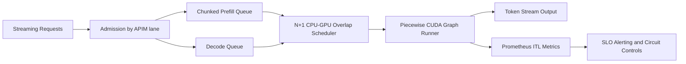
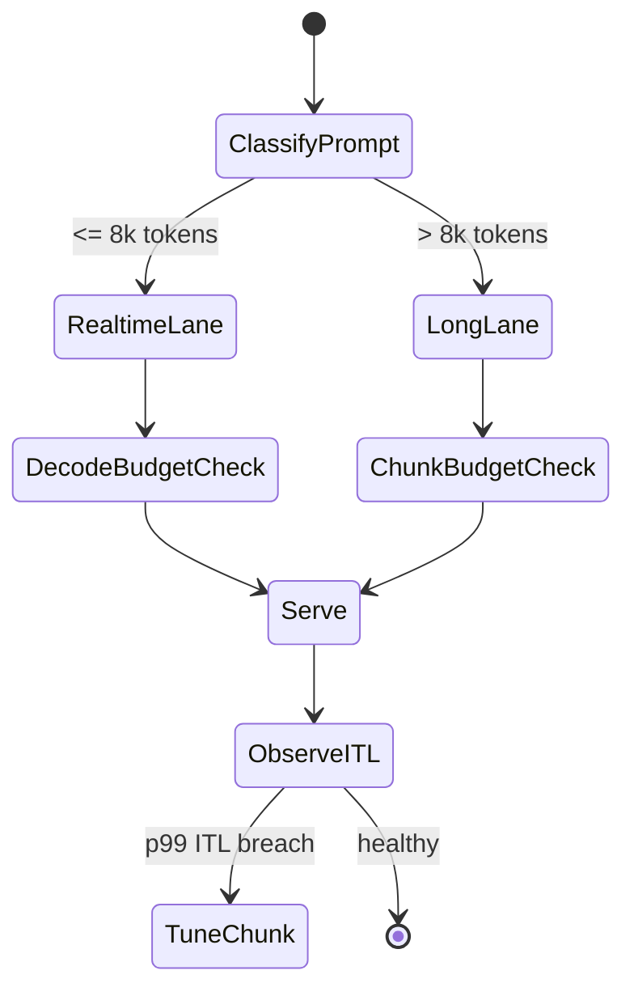

# Enterprise Low-Jitter Real-Time Decode Scheduling Selection FAQ: Chunked Prefill, Piecewise CUDA Graphs, and Overlap Runtime (Azure)

> Topic ID: #452 · Domain: 3.2 Model Serving, Routing, and GPU Orchestration
> Perspective: Cloud & AI Solution Architect focus on real-time SLA, jitter control, operational sustainability, and TCO.

## 1. Executive summary
- Pattern A is the default for medium-scale fleets balancing latency, flexibility, and iteration speed.
- Pattern B achieves the tightest deterministic tail latency for ultra-strict voice and IDE scenarios.
- Pattern C offloads kernel-level complexity through PTU managed serving, with APIM lane partitioning required.
- Pattern D drives severe head-of-line stalls and must be disallowed by policy.

## 2. Scope assumptions
- Goal: keep interactive p99 ITL below 20 ms for continuous UX and audio quality.
- Mix: short FIM plus long-context RAG at 50 / 250 / 1000 concurrent streams.
- Infra: ND H100/H200 or NCads_H100_v5 with explicit CPU/NUMA and interrupt governance.

## 3. Four architecture patterns
- Pattern A: AKS vLLM V1/SGLang overlap scheduler with chunked prefill and piecewise CUDA graphs.
- Pattern B: TensorRT-LLM plus Triton C++ in-flight batching with SM90/SM100 FP8 kernels.
- Pattern C: Foundry/Azure OpenAI PTU with APIM prompt-length admission partitioning.
- Pattern D: unchunked prefill-first scheduling, eager fallback, and unpinned burstable CPUs.

## 4. 12-dimension matrix
| Dimension | Pattern A | Pattern B | Pattern C | Pattern D |
|---|---|---|---|---|
| p99 ITL stability | High | Very high | Medium-high | Low |
| p99.9 tail control | Medium-high | High | Medium | Low |
| Model swap agility | High | Medium | Medium-high | Low |
| Engineering complexity | Medium | High | Low | Low with unacceptable risk |
| Resource efficiency | High | High | Medium-high | Low |
| Tuning complexity | Medium | High | Low | Low |
| Observability depth | High | Medium-high | Medium | Low |
| Time-to-production | Medium-high | Medium | High | Superficially high |
| Multi-model pool fit | High | Medium | Medium | Low |
| Ops staffing need | Medium | High | Low | Low |
| Cost controllability | High | Medium-high | Medium | Low |
| Recommendation | Recommended | Strongly recommended for ultra-low jitter | Recommended for managed-first teams | Prohibited |

## 5. GPU timeline and N+1 overlap architecture


## 6. Admission and ITL budget flow


## 7. Q1-Q6 quantitative Q&A
- Q1: How to size chunked prefill budget against TTFT and p99 ITL?
  - Use B_chunk = min(B_gpu_headroom, B_itl_guardrail). With 120 ms audio jitter buffer and 20 ms decode target, 1024-2048 token chunks are often stable.
- Q2: How to estimate piecewise CUDA graph VRAM overhead?
  - Estimate by graph bucket count times padding ratio. More buckets improve jitter control but increase VRAM reservation.
- Q3: Why does NUMA/IRQ pinning remove 5-9 ms scheduler stalls?
  - Pinning reduces cross-NUMA contention and host scheduling jitter for decode-critical threads and interrupts.
- Q4: When is P/D disaggregation worth it over single-pool chunked prefill?
  - When long-context share stays high and p99 tail remains above threshold despite chunk tuning.
- Q5: How does PTU avoid long-prompt contamination of real-time workloads?
  - APIM token-length routing keeps >8k prompts away from interactive pools.
- Q6: Why can anti-pattern scheduling cause 300-850 ms HoL stalls?
  - Unchunked prefill and eager fallback block decode progress while host scheduling contention amplifies tail latency.

## 8. Production snippets (AKS vLLM deployment)
```yaml
apiVersion: apps/v1
kind: Deployment
metadata:
  name: vllm-realtime-serving
spec:
  replicas: 3
  template:
    spec:
      nodeSelector:
        accelerator: h100
      containers:
      - name: vllm
        image: ghcr.io/org/vllm-v1:stable
        args:
        - "--max-num-batched-tokens=2048"
        - "--enable-chunked-prefill"
        - "--cuda-graph-mode=piecewise"
        - "--scheduler-policy=overlap"
        env:
        - name: CPUSET_REALTIME
          value: "0-15"
        - name: CPUSET_PREFILL
          value: "16-31"
```

```yaml
apiVersion: monitoring.coreos.com/v1
kind: PrometheusRule
metadata:
  name: itl-slo-alert
spec:
  groups:
  - name: realtime-itl
    rules:
    - alert: ITLP99Breach
      expr: histogram_quantile(0.99, sum(rate(inter_token_latency_seconds_bucket[5m])) by (le)) > 0.020
      for: 10m
```

## 9. Scenario 1: retail banking contact-center voice assistant
- Integrates with Azure Speech TTS under a 120 ms jitter-buffer ceiling.
- Uses Pattern A with long-prompt diversion to dedicated long-context lanes.
- Preserves conversational smoothness during mixed-load spikes.

## 10. Scenario 2: 15,000-developer enterprise coding assistant
- Mixes 512-token FIM and 32k repository-chat traffic in one enterprise service.
- Uses chunked prefill plus overlap scheduling plus host pinning to stabilize latency.
- Maintains responsive IDE interactions while containing infra spend.

## 11. Three-year TCO (50 / 250 / 1000 concurrent streams)
| Scale | Pattern A | Pattern B | Pattern C | Jitter incident exposure reference |
|---|---:|---:|---:|---:|
| 50 streams | $0.88M | $1.32M | $1.05M | $0.26M |
| 250 streams | $3.95M | $5.84M | $5.10M | $1.42M |
| 1000 streams | $15.4M | $22.8M | $21.7M | $6.90M |

## 12. Day-0 / Day-1 / Day-2 checklist
### Day-0
1. Define ITL/TTFT/SLA targets
2. Create APIM short/long prompt lane policies
3. Establish GPU and CPU telemetry baselines
4. Define rollback and circuit-break policy
5. Apply FinOps tagging and budget thresholds
### Day-1
1. Enable chunked prefill and overlap scheduler
2. Deploy piecewise CUDA graph settings
3. Apply NUMA/IRQ pinning
4. Deploy ITL SLO alerts
5. Complete baseline load tests
### Day-2
1. Tune chunk budgets weekly
2. Reassess need for P/D disaggregation
3. Review tail-latency root causes
4. Harden model-switch workflows
5. Refresh runbook and capacity plans

## 13. Good fit vs Not for
- Good fit: real-time interactive workloads sensitive to jitter and requiring controlled enterprise operations.
- Not for: low-traffic workloads without strict latency SLOs or operational ownership.

## 14. Risks and mitigations
- Risk: Long-prompt bursts contaminating realtime lanes
  - Mitigation: admission partitioning, staged configuration rollout, thread pinning, tiered thresholds, and auto rollback.
- Risk: Graph bucket misconfiguration
  - Mitigation: admission partitioning, staged configuration rollout, thread pinning, tiered thresholds, and auto rollback.
- Risk: Host contention causing scheduler stalls
  - Mitigation: admission partitioning, staged configuration rollout, thread pinning, tiered thresholds, and auto rollback.
- Risk: Overtight alerts causing false positives
  - Mitigation: admission partitioning, staged configuration rollout, thread pinning, tiered thresholds, and auto rollback.
- Risk: Hot model switches causing transient regressions
  - Mitigation: admission partitioning, staged configuration rollout, thread pinning, tiered thresholds, and auto rollback.

## 15. References and retrieval timestamps
- Source: vLLM project · https://github.com/vllm-project/vllm · Retrieved: 2026-11-26 (UTC+8)
- Source: SGLang project · https://github.com/sgl-project/sglang · Retrieved: 2026-11-26 (UTC+8)
- Source: TensorRT-LLM documentation · https://github.com/NVIDIA/TensorRT-LLM · Retrieved: 2026-11-26 (UTC+8)
- Source: Triton Inference Server · https://github.com/triton-inference-server/server · Retrieved: 2026-11-26 (UTC+8)
- Source: Azure OpenAI / Foundry documentation · https://learn.microsoft.com/azure/ai-foundry/ · Retrieved: 2026-11-26 (UTC+8)

---

### Appendix A: realtime metric dictionary
- `inter_token_latency_p99`: track threshold, alert policy, mitigation action, rollback logic, and owner.
- `ttft_p95`: track threshold, alert policy, mitigation action, rollback logic, and owner.
- `chunked_prefill_queue_depth`: track threshold, alert policy, mitigation action, rollback logic, and owner.
- `decode_queue_depth`: track threshold, alert policy, mitigation action, rollback logic, and owner.
- `cpu_scheduler_stall_ms`: track threshold, alert policy, mitigation action, rollback logic, and owner.
- `cuda_graph_fallback_rate`: track threshold, alert policy, mitigation action, rollback logic, and owner.

### Appendix B: audit evidence items
- Audit item 01: retain load profile, SLO curves, alert events, change approvals, and rollback evidence.
- Audit item 02: retain load profile, SLO curves, alert events, change approvals, and rollback evidence.
- Audit item 03: retain load profile, SLO curves, alert events, change approvals, and rollback evidence.
- Audit item 04: retain load profile, SLO curves, alert events, change approvals, and rollback evidence.
- Audit item 05: retain load profile, SLO curves, alert events, change approvals, and rollback evidence.
- Audit item 06: retain load profile, SLO curves, alert events, change approvals, and rollback evidence.
- Audit item 07: retain load profile, SLO curves, alert events, change approvals, and rollback evidence.
- Audit item 08: retain load profile, SLO curves, alert events, change approvals, and rollback evidence.
- Audit item 09: retain load profile, SLO curves, alert events, change approvals, and rollback evidence.
- Audit item 10: retain load profile, SLO curves, alert events, change approvals, and rollback evidence.
- Audit item 11: retain load profile, SLO curves, alert events, change approvals, and rollback evidence.
- Audit item 12: retain load profile, SLO curves, alert events, change approvals, and rollback evidence.
- Audit item 13: retain load profile, SLO curves, alert events, change approvals, and rollback evidence.
- Audit item 14: retain load profile, SLO curves, alert events, change approvals, and rollback evidence.
- Audit item 15: retain load profile, SLO curves, alert events, change approvals, and rollback evidence.
- Audit item 16: retain load profile, SLO curves, alert events, change approvals, and rollback evidence.
- Audit item 17: retain load profile, SLO curves, alert events, change approvals, and rollback evidence.
- Audit item 18: retain load profile, SLO curves, alert events, change approvals, and rollback evidence.
- Audit item 19: retain load profile, SLO curves, alert events, change approvals, and rollback evidence.
- Audit item 20: retain load profile, SLO curves, alert events, change approvals, and rollback evidence.
- Audit item 21: retain load profile, SLO curves, alert events, change approvals, and rollback evidence.
- Audit item 22: retain load profile, SLO curves, alert events, change approvals, and rollback evidence.
- Audit item 23: retain load profile, SLO curves, alert events, change approvals, and rollback evidence.
- Audit item 24: retain load profile, SLO curves, alert events, change approvals, and rollback evidence.
- Audit item 25: retain load profile, SLO curves, alert events, change approvals, and rollback evidence.
- Audit item 26: retain load profile, SLO curves, alert events, change approvals, and rollback evidence.
- Audit item 27: retain load profile, SLO curves, alert events, change approvals, and rollback evidence.
- Audit item 28: retain load profile, SLO curves, alert events, change approvals, and rollback evidence.
- Audit item 29: retain load profile, SLO curves, alert events, change approvals, and rollback evidence.
- Audit item 30: retain load profile, SLO curves, alert events, change approvals, and rollback evidence.
- Audit item 31: retain load profile, SLO curves, alert events, change approvals, and rollback evidence.
- Audit item 32: retain load profile, SLO curves, alert events, change approvals, and rollback evidence.
- Audit item 33: retain load profile, SLO curves, alert events, change approvals, and rollback evidence.
- Audit item 34: retain load profile, SLO curves, alert events, change approvals, and rollback evidence.
- Audit item 35: retain load profile, SLO curves, alert events, change approvals, and rollback evidence.
- Audit item 36: retain load profile, SLO curves, alert events, change approvals, and rollback evidence.
- Audit item 37: retain load profile, SLO curves, alert events, change approvals, and rollback evidence.
- Audit item 38: retain load profile, SLO curves, alert events, change approvals, and rollback evidence.
- Audit item 39: retain load profile, SLO curves, alert events, change approvals, and rollback evidence.
- Audit item 40: retain load profile, SLO curves, alert events, change approvals, and rollback evidence.
- Audit item 41: retain load profile, SLO curves, alert events, change approvals, and rollback evidence.
- Audit item 42: retain load profile, SLO curves, alert events, change approvals, and rollback evidence.
- Audit item 43: retain load profile, SLO curves, alert events, change approvals, and rollback evidence.
- Audit item 44: retain load profile, SLO curves, alert events, change approvals, and rollback evidence.
- Audit item 45: retain load profile, SLO curves, alert events, change approvals, and rollback evidence.
- Audit item 46: retain load profile, SLO curves, alert events, change approvals, and rollback evidence.
- Audit item 47: retain load profile, SLO curves, alert events, change approvals, and rollback evidence.
- Audit item 48: retain load profile, SLO curves, alert events, change approvals, and rollback evidence.
- Audit item 49: retain load profile, SLO curves, alert events, change approvals, and rollback evidence.
- Audit item 50: retain load profile, SLO curves, alert events, change approvals, and rollback evidence.

### Appendix C: extended implementation checkpoints
- Checkpoint 001: validate lane partitioning, chunk budget, CPU pinning, graph config, alert thresholds, and FinOps tags.
- Checkpoint 002: validate lane partitioning, chunk budget, CPU pinning, graph config, alert thresholds, and FinOps tags.
- Checkpoint 003: validate lane partitioning, chunk budget, CPU pinning, graph config, alert thresholds, and FinOps tags.
- Checkpoint 004: validate lane partitioning, chunk budget, CPU pinning, graph config, alert thresholds, and FinOps tags.
- Checkpoint 005: validate lane partitioning, chunk budget, CPU pinning, graph config, alert thresholds, and FinOps tags.
- Checkpoint 006: validate lane partitioning, chunk budget, CPU pinning, graph config, alert thresholds, and FinOps tags.
- Checkpoint 007: validate lane partitioning, chunk budget, CPU pinning, graph config, alert thresholds, and FinOps tags.
- Checkpoint 008: validate lane partitioning, chunk budget, CPU pinning, graph config, alert thresholds, and FinOps tags.
- Checkpoint 009: validate lane partitioning, chunk budget, CPU pinning, graph config, alert thresholds, and FinOps tags.
- Checkpoint 010: validate lane partitioning, chunk budget, CPU pinning, graph config, alert thresholds, and FinOps tags.
- Checkpoint 011: validate lane partitioning, chunk budget, CPU pinning, graph config, alert thresholds, and FinOps tags.
- Checkpoint 012: validate lane partitioning, chunk budget, CPU pinning, graph config, alert thresholds, and FinOps tags.
- Checkpoint 013: validate lane partitioning, chunk budget, CPU pinning, graph config, alert thresholds, and FinOps tags.
- Checkpoint 014: validate lane partitioning, chunk budget, CPU pinning, graph config, alert thresholds, and FinOps tags.
- Checkpoint 015: validate lane partitioning, chunk budget, CPU pinning, graph config, alert thresholds, and FinOps tags.
- Checkpoint 016: validate lane partitioning, chunk budget, CPU pinning, graph config, alert thresholds, and FinOps tags.
- Checkpoint 017: validate lane partitioning, chunk budget, CPU pinning, graph config, alert thresholds, and FinOps tags.
- Checkpoint 018: validate lane partitioning, chunk budget, CPU pinning, graph config, alert thresholds, and FinOps tags.
- Checkpoint 019: validate lane partitioning, chunk budget, CPU pinning, graph config, alert thresholds, and FinOps tags.
- Checkpoint 020: validate lane partitioning, chunk budget, CPU pinning, graph config, alert thresholds, and FinOps tags.
- Checkpoint 021: validate lane partitioning, chunk budget, CPU pinning, graph config, alert thresholds, and FinOps tags.
- Checkpoint 022: validate lane partitioning, chunk budget, CPU pinning, graph config, alert thresholds, and FinOps tags.
- Checkpoint 023: validate lane partitioning, chunk budget, CPU pinning, graph config, alert thresholds, and FinOps tags.
- Checkpoint 024: validate lane partitioning, chunk budget, CPU pinning, graph config, alert thresholds, and FinOps tags.
- Checkpoint 025: validate lane partitioning, chunk budget, CPU pinning, graph config, alert thresholds, and FinOps tags.
- Checkpoint 026: validate lane partitioning, chunk budget, CPU pinning, graph config, alert thresholds, and FinOps tags.
- Checkpoint 027: validate lane partitioning, chunk budget, CPU pinning, graph config, alert thresholds, and FinOps tags.
- Checkpoint 028: validate lane partitioning, chunk budget, CPU pinning, graph config, alert thresholds, and FinOps tags.
- Checkpoint 029: validate lane partitioning, chunk budget, CPU pinning, graph config, alert thresholds, and FinOps tags.
- Checkpoint 030: validate lane partitioning, chunk budget, CPU pinning, graph config, alert thresholds, and FinOps tags.
- Checkpoint 031: validate lane partitioning, chunk budget, CPU pinning, graph config, alert thresholds, and FinOps tags.
- Checkpoint 032: validate lane partitioning, chunk budget, CPU pinning, graph config, alert thresholds, and FinOps tags.
- Checkpoint 033: validate lane partitioning, chunk budget, CPU pinning, graph config, alert thresholds, and FinOps tags.
- Checkpoint 034: validate lane partitioning, chunk budget, CPU pinning, graph config, alert thresholds, and FinOps tags.
- Checkpoint 035: validate lane partitioning, chunk budget, CPU pinning, graph config, alert thresholds, and FinOps tags.
- Checkpoint 036: validate lane partitioning, chunk budget, CPU pinning, graph config, alert thresholds, and FinOps tags.
- Checkpoint 037: validate lane partitioning, chunk budget, CPU pinning, graph config, alert thresholds, and FinOps tags.
- Checkpoint 038: validate lane partitioning, chunk budget, CPU pinning, graph config, alert thresholds, and FinOps tags.
- Checkpoint 039: validate lane partitioning, chunk budget, CPU pinning, graph config, alert thresholds, and FinOps tags.
- Checkpoint 040: validate lane partitioning, chunk budget, CPU pinning, graph config, alert thresholds, and FinOps tags.
- Checkpoint 041: validate lane partitioning, chunk budget, CPU pinning, graph config, alert thresholds, and FinOps tags.
- Checkpoint 042: validate lane partitioning, chunk budget, CPU pinning, graph config, alert thresholds, and FinOps tags.
- Checkpoint 043: validate lane partitioning, chunk budget, CPU pinning, graph config, alert thresholds, and FinOps tags.
- Checkpoint 044: validate lane partitioning, chunk budget, CPU pinning, graph config, alert thresholds, and FinOps tags.
- Checkpoint 045: validate lane partitioning, chunk budget, CPU pinning, graph config, alert thresholds, and FinOps tags.
- Checkpoint 046: validate lane partitioning, chunk budget, CPU pinning, graph config, alert thresholds, and FinOps tags.
- Checkpoint 047: validate lane partitioning, chunk budget, CPU pinning, graph config, alert thresholds, and FinOps tags.
- Checkpoint 048: validate lane partitioning, chunk budget, CPU pinning, graph config, alert thresholds, and FinOps tags.
- Checkpoint 049: validate lane partitioning, chunk budget, CPU pinning, graph config, alert thresholds, and FinOps tags.
- Checkpoint 050: validate lane partitioning, chunk budget, CPU pinning, graph config, alert thresholds, and FinOps tags.
- Checkpoint 051: validate lane partitioning, chunk budget, CPU pinning, graph config, alert thresholds, and FinOps tags.
- Checkpoint 052: validate lane partitioning, chunk budget, CPU pinning, graph config, alert thresholds, and FinOps tags.
- Checkpoint 053: validate lane partitioning, chunk budget, CPU pinning, graph config, alert thresholds, and FinOps tags.
- Checkpoint 054: validate lane partitioning, chunk budget, CPU pinning, graph config, alert thresholds, and FinOps tags.
- Checkpoint 055: validate lane partitioning, chunk budget, CPU pinning, graph config, alert thresholds, and FinOps tags.
- Checkpoint 056: validate lane partitioning, chunk budget, CPU pinning, graph config, alert thresholds, and FinOps tags.
- Checkpoint 057: validate lane partitioning, chunk budget, CPU pinning, graph config, alert thresholds, and FinOps tags.
- Checkpoint 058: validate lane partitioning, chunk budget, CPU pinning, graph config, alert thresholds, and FinOps tags.
- Checkpoint 059: validate lane partitioning, chunk budget, CPU pinning, graph config, alert thresholds, and FinOps tags.
- Checkpoint 060: validate lane partitioning, chunk budget, CPU pinning, graph config, alert thresholds, and FinOps tags.
- Checkpoint 061: validate lane partitioning, chunk budget, CPU pinning, graph config, alert thresholds, and FinOps tags.
- Checkpoint 062: validate lane partitioning, chunk budget, CPU pinning, graph config, alert thresholds, and FinOps tags.
- Checkpoint 063: validate lane partitioning, chunk budget, CPU pinning, graph config, alert thresholds, and FinOps tags.
- Checkpoint 064: validate lane partitioning, chunk budget, CPU pinning, graph config, alert thresholds, and FinOps tags.
- Checkpoint 065: validate lane partitioning, chunk budget, CPU pinning, graph config, alert thresholds, and FinOps tags.
- Checkpoint 066: validate lane partitioning, chunk budget, CPU pinning, graph config, alert thresholds, and FinOps tags.
- Checkpoint 067: validate lane partitioning, chunk budget, CPU pinning, graph config, alert thresholds, and FinOps tags.
- Checkpoint 068: validate lane partitioning, chunk budget, CPU pinning, graph config, alert thresholds, and FinOps tags.
- Checkpoint 069: validate lane partitioning, chunk budget, CPU pinning, graph config, alert thresholds, and FinOps tags.
- Checkpoint 070: validate lane partitioning, chunk budget, CPU pinning, graph config, alert thresholds, and FinOps tags.
- Checkpoint 071: validate lane partitioning, chunk budget, CPU pinning, graph config, alert thresholds, and FinOps tags.
- Checkpoint 072: validate lane partitioning, chunk budget, CPU pinning, graph config, alert thresholds, and FinOps tags.
- Checkpoint 073: validate lane partitioning, chunk budget, CPU pinning, graph config, alert thresholds, and FinOps tags.
- Checkpoint 074: validate lane partitioning, chunk budget, CPU pinning, graph config, alert thresholds, and FinOps tags.
- Checkpoint 075: validate lane partitioning, chunk budget, CPU pinning, graph config, alert thresholds, and FinOps tags.
- Checkpoint 076: validate lane partitioning, chunk budget, CPU pinning, graph config, alert thresholds, and FinOps tags.
- Checkpoint 077: validate lane partitioning, chunk budget, CPU pinning, graph config, alert thresholds, and FinOps tags.
- Checkpoint 078: validate lane partitioning, chunk budget, CPU pinning, graph config, alert thresholds, and FinOps tags.
- Checkpoint 079: validate lane partitioning, chunk budget, CPU pinning, graph config, alert thresholds, and FinOps tags.
- Checkpoint 080: validate lane partitioning, chunk budget, CPU pinning, graph config, alert thresholds, and FinOps tags.
- Checkpoint 081: validate lane partitioning, chunk budget, CPU pinning, graph config, alert thresholds, and FinOps tags.
- Checkpoint 082: validate lane partitioning, chunk budget, CPU pinning, graph config, alert thresholds, and FinOps tags.
- Checkpoint 083: validate lane partitioning, chunk budget, CPU pinning, graph config, alert thresholds, and FinOps tags.
- Checkpoint 084: validate lane partitioning, chunk budget, CPU pinning, graph config, alert thresholds, and FinOps tags.
- Checkpoint 085: validate lane partitioning, chunk budget, CPU pinning, graph config, alert thresholds, and FinOps tags.
- Checkpoint 086: validate lane partitioning, chunk budget, CPU pinning, graph config, alert thresholds, and FinOps tags.
- Checkpoint 087: validate lane partitioning, chunk budget, CPU pinning, graph config, alert thresholds, and FinOps tags.
- Checkpoint 088: validate lane partitioning, chunk budget, CPU pinning, graph config, alert thresholds, and FinOps tags.
- Checkpoint 089: validate lane partitioning, chunk budget, CPU pinning, graph config, alert thresholds, and FinOps tags.
- Checkpoint 090: validate lane partitioning, chunk budget, CPU pinning, graph config, alert thresholds, and FinOps tags.
- Checkpoint 091: validate lane partitioning, chunk budget, CPU pinning, graph config, alert thresholds, and FinOps tags.
- Checkpoint 092: validate lane partitioning, chunk budget, CPU pinning, graph config, alert thresholds, and FinOps tags.
- Checkpoint 093: validate lane partitioning, chunk budget, CPU pinning, graph config, alert thresholds, and FinOps tags.
- Checkpoint 094: validate lane partitioning, chunk budget, CPU pinning, graph config, alert thresholds, and FinOps tags.
- Checkpoint 095: validate lane partitioning, chunk budget, CPU pinning, graph config, alert thresholds, and FinOps tags.
- Checkpoint 096: validate lane partitioning, chunk budget, CPU pinning, graph config, alert thresholds, and FinOps tags.
- Checkpoint 097: validate lane partitioning, chunk budget, CPU pinning, graph config, alert thresholds, and FinOps tags.
- Checkpoint 098: validate lane partitioning, chunk budget, CPU pinning, graph config, alert thresholds, and FinOps tags.
- Checkpoint 099: validate lane partitioning, chunk budget, CPU pinning, graph config, alert thresholds, and FinOps tags.
- Checkpoint 100: validate lane partitioning, chunk budget, CPU pinning, graph config, alert thresholds, and FinOps tags.
- Checkpoint 101: validate lane partitioning, chunk budget, CPU pinning, graph config, alert thresholds, and FinOps tags.
- Checkpoint 102: validate lane partitioning, chunk budget, CPU pinning, graph config, alert thresholds, and FinOps tags.
- Checkpoint 103: validate lane partitioning, chunk budget, CPU pinning, graph config, alert thresholds, and FinOps tags.
- Checkpoint 104: validate lane partitioning, chunk budget, CPU pinning, graph config, alert thresholds, and FinOps tags.
- Checkpoint 105: validate lane partitioning, chunk budget, CPU pinning, graph config, alert thresholds, and FinOps tags.
- Checkpoint 106: validate lane partitioning, chunk budget, CPU pinning, graph config, alert thresholds, and FinOps tags.
- Checkpoint 107: validate lane partitioning, chunk budget, CPU pinning, graph config, alert thresholds, and FinOps tags.
- Checkpoint 108: validate lane partitioning, chunk budget, CPU pinning, graph config, alert thresholds, and FinOps tags.
- Checkpoint 109: validate lane partitioning, chunk budget, CPU pinning, graph config, alert thresholds, and FinOps tags.
- Checkpoint 110: validate lane partitioning, chunk budget, CPU pinning, graph config, alert thresholds, and FinOps tags.
- Checkpoint 111: validate lane partitioning, chunk budget, CPU pinning, graph config, alert thresholds, and FinOps tags.
- Checkpoint 112: validate lane partitioning, chunk budget, CPU pinning, graph config, alert thresholds, and FinOps tags.
- Checkpoint 113: validate lane partitioning, chunk budget, CPU pinning, graph config, alert thresholds, and FinOps tags.
- Checkpoint 114: validate lane partitioning, chunk budget, CPU pinning, graph config, alert thresholds, and FinOps tags.
- Checkpoint 115: validate lane partitioning, chunk budget, CPU pinning, graph config, alert thresholds, and FinOps tags.
- Checkpoint 116: validate lane partitioning, chunk budget, CPU pinning, graph config, alert thresholds, and FinOps tags.
- Checkpoint 117: validate lane partitioning, chunk budget, CPU pinning, graph config, alert thresholds, and FinOps tags.
- Checkpoint 118: validate lane partitioning, chunk budget, CPU pinning, graph config, alert thresholds, and FinOps tags.
- Checkpoint 119: validate lane partitioning, chunk budget, CPU pinning, graph config, alert thresholds, and FinOps tags.
- Checkpoint 120: validate lane partitioning, chunk budget, CPU pinning, graph config, alert thresholds, and FinOps tags.
- Checkpoint 121: validate lane partitioning, chunk budget, CPU pinning, graph config, alert thresholds, and FinOps tags.
- Checkpoint 122: validate lane partitioning, chunk budget, CPU pinning, graph config, alert thresholds, and FinOps tags.
- Checkpoint 123: validate lane partitioning, chunk budget, CPU pinning, graph config, alert thresholds, and FinOps tags.
- Checkpoint 124: validate lane partitioning, chunk budget, CPU pinning, graph config, alert thresholds, and FinOps tags.
- Checkpoint 125: validate lane partitioning, chunk budget, CPU pinning, graph config, alert thresholds, and FinOps tags.
- Checkpoint 126: validate lane partitioning, chunk budget, CPU pinning, graph config, alert thresholds, and FinOps tags.
- Checkpoint 127: validate lane partitioning, chunk budget, CPU pinning, graph config, alert thresholds, and FinOps tags.
- Checkpoint 128: validate lane partitioning, chunk budget, CPU pinning, graph config, alert thresholds, and FinOps tags.
- Checkpoint 129: validate lane partitioning, chunk budget, CPU pinning, graph config, alert thresholds, and FinOps tags.
- Checkpoint 130: validate lane partitioning, chunk budget, CPU pinning, graph config, alert thresholds, and FinOps tags.
- Checkpoint 131: validate lane partitioning, chunk budget, CPU pinning, graph config, alert thresholds, and FinOps tags.
- Checkpoint 132: validate lane partitioning, chunk budget, CPU pinning, graph config, alert thresholds, and FinOps tags.
- Checkpoint 133: validate lane partitioning, chunk budget, CPU pinning, graph config, alert thresholds, and FinOps tags.
- Checkpoint 134: validate lane partitioning, chunk budget, CPU pinning, graph config, alert thresholds, and FinOps tags.
- Checkpoint 135: validate lane partitioning, chunk budget, CPU pinning, graph config, alert thresholds, and FinOps tags.
- Checkpoint 136: validate lane partitioning, chunk budget, CPU pinning, graph config, alert thresholds, and FinOps tags.
- Checkpoint 137: validate lane partitioning, chunk budget, CPU pinning, graph config, alert thresholds, and FinOps tags.
- Checkpoint 138: validate lane partitioning, chunk budget, CPU pinning, graph config, alert thresholds, and FinOps tags.
- Checkpoint 139: validate lane partitioning, chunk budget, CPU pinning, graph config, alert thresholds, and FinOps tags.
- Checkpoint 140: validate lane partitioning, chunk budget, CPU pinning, graph config, alert thresholds, and FinOps tags.
- Checkpoint 141: validate lane partitioning, chunk budget, CPU pinning, graph config, alert thresholds, and FinOps tags.
- Checkpoint 142: validate lane partitioning, chunk budget, CPU pinning, graph config, alert thresholds, and FinOps tags.
- Checkpoint 143: validate lane partitioning, chunk budget, CPU pinning, graph config, alert thresholds, and FinOps tags.
- Checkpoint 144: validate lane partitioning, chunk budget, CPU pinning, graph config, alert thresholds, and FinOps tags.
- Checkpoint 145: validate lane partitioning, chunk budget, CPU pinning, graph config, alert thresholds, and FinOps tags.
- Checkpoint 146: validate lane partitioning, chunk budget, CPU pinning, graph config, alert thresholds, and FinOps tags.
- Checkpoint 147: validate lane partitioning, chunk budget, CPU pinning, graph config, alert thresholds, and FinOps tags.
- Checkpoint 148: validate lane partitioning, chunk budget, CPU pinning, graph config, alert thresholds, and FinOps tags.
- Checkpoint 149: validate lane partitioning, chunk budget, CPU pinning, graph config, alert thresholds, and FinOps tags.
- Checkpoint 150: validate lane partitioning, chunk budget, CPU pinning, graph config, alert thresholds, and FinOps tags.
- Checkpoint 151: validate lane partitioning, chunk budget, CPU pinning, graph config, alert thresholds, and FinOps tags.
- Checkpoint 152: validate lane partitioning, chunk budget, CPU pinning, graph config, alert thresholds, and FinOps tags.
- Checkpoint 153: validate lane partitioning, chunk budget, CPU pinning, graph config, alert thresholds, and FinOps tags.
- Checkpoint 154: validate lane partitioning, chunk budget, CPU pinning, graph config, alert thresholds, and FinOps tags.
- Checkpoint 155: validate lane partitioning, chunk budget, CPU pinning, graph config, alert thresholds, and FinOps tags.
- Checkpoint 156: validate lane partitioning, chunk budget, CPU pinning, graph config, alert thresholds, and FinOps tags.
- Checkpoint 157: validate lane partitioning, chunk budget, CPU pinning, graph config, alert thresholds, and FinOps tags.
- Checkpoint 158: validate lane partitioning, chunk budget, CPU pinning, graph config, alert thresholds, and FinOps tags.
- Checkpoint 159: validate lane partitioning, chunk budget, CPU pinning, graph config, alert thresholds, and FinOps tags.
- Checkpoint 160: validate lane partitioning, chunk budget, CPU pinning, graph config, alert thresholds, and FinOps tags.
- Checkpoint 161: validate lane partitioning, chunk budget, CPU pinning, graph config, alert thresholds, and FinOps tags.
- Checkpoint 162: validate lane partitioning, chunk budget, CPU pinning, graph config, alert thresholds, and FinOps tags.
- Checkpoint 163: validate lane partitioning, chunk budget, CPU pinning, graph config, alert thresholds, and FinOps tags.
- Checkpoint 164: validate lane partitioning, chunk budget, CPU pinning, graph config, alert thresholds, and FinOps tags.
- Checkpoint 165: validate lane partitioning, chunk budget, CPU pinning, graph config, alert thresholds, and FinOps tags.
- Checkpoint 166: validate lane partitioning, chunk budget, CPU pinning, graph config, alert thresholds, and FinOps tags.
- Checkpoint 167: validate lane partitioning, chunk budget, CPU pinning, graph config, alert thresholds, and FinOps tags.
- Checkpoint 168: validate lane partitioning, chunk budget, CPU pinning, graph config, alert thresholds, and FinOps tags.
- Checkpoint 169: validate lane partitioning, chunk budget, CPU pinning, graph config, alert thresholds, and FinOps tags.
- Checkpoint 170: validate lane partitioning, chunk budget, CPU pinning, graph config, alert thresholds, and FinOps tags.
- Checkpoint 171: validate lane partitioning, chunk budget, CPU pinning, graph config, alert thresholds, and FinOps tags.
- Checkpoint 172: validate lane partitioning, chunk budget, CPU pinning, graph config, alert thresholds, and FinOps tags.
- Checkpoint 173: validate lane partitioning, chunk budget, CPU pinning, graph config, alert thresholds, and FinOps tags.
- Checkpoint 174: validate lane partitioning, chunk budget, CPU pinning, graph config, alert thresholds, and FinOps tags.
- Checkpoint 175: validate lane partitioning, chunk budget, CPU pinning, graph config, alert thresholds, and FinOps tags.
- Checkpoint 176: validate lane partitioning, chunk budget, CPU pinning, graph config, alert thresholds, and FinOps tags.
- Checkpoint 177: validate lane partitioning, chunk budget, CPU pinning, graph config, alert thresholds, and FinOps tags.
- Checkpoint 178: validate lane partitioning, chunk budget, CPU pinning, graph config, alert thresholds, and FinOps tags.
- Checkpoint 179: validate lane partitioning, chunk budget, CPU pinning, graph config, alert thresholds, and FinOps tags.
- Checkpoint 180: validate lane partitioning, chunk budget, CPU pinning, graph config, alert thresholds, and FinOps tags.
- Checkpoint 181: validate lane partitioning, chunk budget, CPU pinning, graph config, alert thresholds, and FinOps tags.
- Checkpoint 182: validate lane partitioning, chunk budget, CPU pinning, graph config, alert thresholds, and FinOps tags.
- Checkpoint 183: validate lane partitioning, chunk budget, CPU pinning, graph config, alert thresholds, and FinOps tags.
- Checkpoint 184: validate lane partitioning, chunk budget, CPU pinning, graph config, alert thresholds, and FinOps tags.
- Checkpoint 185: validate lane partitioning, chunk budget, CPU pinning, graph config, alert thresholds, and FinOps tags.
- Checkpoint 186: validate lane partitioning, chunk budget, CPU pinning, graph config, alert thresholds, and FinOps tags.
- Checkpoint 187: validate lane partitioning, chunk budget, CPU pinning, graph config, alert thresholds, and FinOps tags.
- Checkpoint 188: validate lane partitioning, chunk budget, CPU pinning, graph config, alert thresholds, and FinOps tags.
- Checkpoint 189: validate lane partitioning, chunk budget, CPU pinning, graph config, alert thresholds, and FinOps tags.
- Checkpoint 190: validate lane partitioning, chunk budget, CPU pinning, graph config, alert thresholds, and FinOps tags.
- Checkpoint 191: validate lane partitioning, chunk budget, CPU pinning, graph config, alert thresholds, and FinOps tags.
- Checkpoint 192: validate lane partitioning, chunk budget, CPU pinning, graph config, alert thresholds, and FinOps tags.
- Checkpoint 193: validate lane partitioning, chunk budget, CPU pinning, graph config, alert thresholds, and FinOps tags.
- Checkpoint 194: validate lane partitioning, chunk budget, CPU pinning, graph config, alert thresholds, and FinOps tags.
- Checkpoint 195: validate lane partitioning, chunk budget, CPU pinning, graph config, alert thresholds, and FinOps tags.
- Checkpoint 196: validate lane partitioning, chunk budget, CPU pinning, graph config, alert thresholds, and FinOps tags.
- Checkpoint 197: validate lane partitioning, chunk budget, CPU pinning, graph config, alert thresholds, and FinOps tags.
- Checkpoint 198: validate lane partitioning, chunk budget, CPU pinning, graph config, alert thresholds, and FinOps tags.
- Checkpoint 199: validate lane partitioning, chunk budget, CPU pinning, graph config, alert thresholds, and FinOps tags.
- Checkpoint 200: validate lane partitioning, chunk budget, CPU pinning, graph config, alert thresholds, and FinOps tags.
- Checkpoint 201: validate lane partitioning, chunk budget, CPU pinning, graph config, alert thresholds, and FinOps tags.
- Checkpoint 202: validate lane partitioning, chunk budget, CPU pinning, graph config, alert thresholds, and FinOps tags.
- Checkpoint 203: validate lane partitioning, chunk budget, CPU pinning, graph config, alert thresholds, and FinOps tags.
- Checkpoint 204: validate lane partitioning, chunk budget, CPU pinning, graph config, alert thresholds, and FinOps tags.
- Checkpoint 205: validate lane partitioning, chunk budget, CPU pinning, graph config, alert thresholds, and FinOps tags.
- Checkpoint 206: validate lane partitioning, chunk budget, CPU pinning, graph config, alert thresholds, and FinOps tags.
- Checkpoint 207: validate lane partitioning, chunk budget, CPU pinning, graph config, alert thresholds, and FinOps tags.
- Checkpoint 208: validate lane partitioning, chunk budget, CPU pinning, graph config, alert thresholds, and FinOps tags.
- Checkpoint 209: validate lane partitioning, chunk budget, CPU pinning, graph config, alert thresholds, and FinOps tags.
- Checkpoint 210: validate lane partitioning, chunk budget, CPU pinning, graph config, alert thresholds, and FinOps tags.
- Checkpoint 211: validate lane partitioning, chunk budget, CPU pinning, graph config, alert thresholds, and FinOps tags.
- Checkpoint 212: validate lane partitioning, chunk budget, CPU pinning, graph config, alert thresholds, and FinOps tags.
- Checkpoint 213: validate lane partitioning, chunk budget, CPU pinning, graph config, alert thresholds, and FinOps tags.
- Checkpoint 214: validate lane partitioning, chunk budget, CPU pinning, graph config, alert thresholds, and FinOps tags.
- Checkpoint 215: validate lane partitioning, chunk budget, CPU pinning, graph config, alert thresholds, and FinOps tags.
- Checkpoint 216: validate lane partitioning, chunk budget, CPU pinning, graph config, alert thresholds, and FinOps tags.
- Checkpoint 217: validate lane partitioning, chunk budget, CPU pinning, graph config, alert thresholds, and FinOps tags.
- Checkpoint 218: validate lane partitioning, chunk budget, CPU pinning, graph config, alert thresholds, and FinOps tags.
- Checkpoint 219: validate lane partitioning, chunk budget, CPU pinning, graph config, alert thresholds, and FinOps tags.
- Checkpoint 220: validate lane partitioning, chunk budget, CPU pinning, graph config, alert thresholds, and FinOps tags.
- Checkpoint 221: validate lane partitioning, chunk budget, CPU pinning, graph config, alert thresholds, and FinOps tags.
- Checkpoint 222: validate lane partitioning, chunk budget, CPU pinning, graph config, alert thresholds, and FinOps tags.
- Checkpoint 223: validate lane partitioning, chunk budget, CPU pinning, graph config, alert thresholds, and FinOps tags.
- Checkpoint 224: validate lane partitioning, chunk budget, CPU pinning, graph config, alert thresholds, and FinOps tags.
- Checkpoint 225: validate lane partitioning, chunk budget, CPU pinning, graph config, alert thresholds, and FinOps tags.
- Checkpoint 226: validate lane partitioning, chunk budget, CPU pinning, graph config, alert thresholds, and FinOps tags.
- Checkpoint 227: validate lane partitioning, chunk budget, CPU pinning, graph config, alert thresholds, and FinOps tags.
- Checkpoint 228: validate lane partitioning, chunk budget, CPU pinning, graph config, alert thresholds, and FinOps tags.
- Checkpoint 229: validate lane partitioning, chunk budget, CPU pinning, graph config, alert thresholds, and FinOps tags.
- Checkpoint 230: validate lane partitioning, chunk budget, CPU pinning, graph config, alert thresholds, and FinOps tags.

