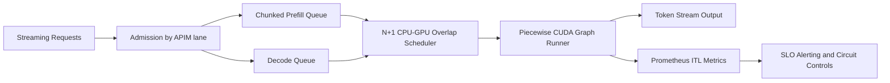
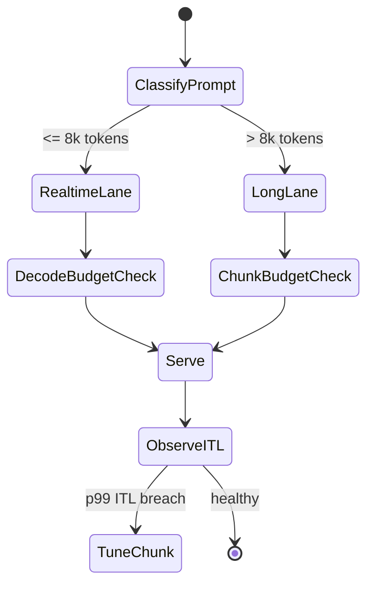

# 企业级低抖动实时解码调度选型 FAQ：Chunked Prefill、Piecewise CUDA Graph 与 Overlap 运行时（Azure）

> 主题编号：#452 · 架构域：3.2 模型托管、路由与 GPU 编排
> 视角：Cloud & AI Solution Architect，聚焦实时交互 SLA、调度抖动、运维可持续性与成本。

## 1. 执行摘要
- Pattern A 在中等规模机群下兼顾延迟、灵活性与迭代速度，是默认优先方案。
- Pattern B 追求极致确定性延迟，适用于超严格语音与 IDE 场景，但编译和配置复杂。
- Pattern C 通过 PTU 托管能力降低内核工程负担，需通过 APIM 做长度分流隔离。
- Pattern D 会导致明显 HoL 卡顿与 p99/p99.9 抖动扩散，应明确禁止。

## 2. 边界与假设
- 目标：交互式流式输出 p99 ITL 控制在 20ms 以内，避免音频断续与界面卡顿。
- 负载：短 FIM 与长上下文 RAG 混合，50/250/1000 并发流。
- 资源：ND H100/H200 或 NCads_H100_v5，含 CPU/NUMA 与网络中断治理。

## 3. 四种架构模式
- Pattern A：AKS vLLM V1/SGLang overlap + chunked prefill + piecewise CUDA graph + NUMA pinning。
- Pattern B：TensorRT-LLM + Triton C++ in-flight batching，针对 SM90/SM100 FP8 优化。
- Pattern C：Foundry/Azure OpenAI PTU + APIM 按 prompt 长度分道。
- Pattern D：未分块 prefill、eager 回退、未 pin 的突发 CPU（反模式）。

## 4. 12 维比较矩阵
| 维度 | Pattern A | Pattern B | Pattern C | Pattern D |
|---|---|---|---|---|
| p99 ITL 稳定性 | 高 | 很高 | 中高 | 低 |
| p99.9 长尾 | 中高 | 高 | 中 | 低 |
| 模型切换灵活性 | 高 | 中 | 中高 | 低 |
| 工程复杂度 | 中 | 高 | 低 | 低（但风险高） |
| 资源利用率 | 高 | 高 | 中高 | 低 |
| 调参难度 | 中 | 高 | 低 | 低 |
| 故障可观测性 | 高 | 中高 | 中 | 低 |
| 上线速度 | 中高 | 中 | 高 | 高（不可接受） |
| 多模型共池 | 高 | 中 | 中 | 低 |
| 运维人力 | 中 | 高 | 低 | 低 |
| 成本可控性 | 高 | 中高 | 中 | 低 |
| 推荐结论 | 推荐 | 强推荐（极低抖动） | 推荐（托管优先） | 禁止 |

## 5. GPU 时间线与 N+1 overlap 架构图


## 6. 决策与 ITL 预算流图


## 7. Q1-Q6 定量问答
- Q1：Chunked Prefill token budget 如何平衡 TTFT 与 p99 ITL？
  - 可用预算方程：B_chunk = min(B_gpu_headroom, B_itl_guardrail)。当音频帧预算 120ms 且解码窗口 20ms 时，通常 1024-2048 token 分块更稳。
- Q2：Piecewise CUDA graph 的显存开销怎么算？
  - 按 bucket 数量与 padding 比例估算，graph 实例越多越稳但占用越高，需在 p99 抖动与 VRAM 之间取平衡。
- Q3：NUMA/IRQ pinning 为何能消除 5-9ms 抖动？
  - 将调度线程和关键中断绑定在本地 NUMA，减少跨 NUMA 抢占和 cache 抖动，可明显降低 host 调度尾延迟。
- Q4：单池 Chunked Prefill 与 P/D 双池何时分界？
  - 当长上下文比例持续高且 p99 超阈值时，双池收益明显；在中等规模负载下单池优化通常更经济。
- Q5：PTU 方案如何避免长 prompt 污染实时池？
  - 通过 APIM 按 token 长度分流，把 >8k 请求导向长文本 lane，实时 lane 保持稳定。
- Q6：反模式导致 300-850ms HoL 的主因？
  - 未分块 prefill 与 eager 回退叠加 CPU 抢占，阻塞 decode 步骤，形成可感知音频与 UI 卡顿。

## 8. 生产配置片段（AKS vLLM 部署）
```yaml
apiVersion: apps/v1
kind: Deployment
metadata:
  name: vllm-realtime-serving
spec:
  replicas: 3
  template:
    spec:
      nodeSelector:
        accelerator: h100
      containers:
      - name: vllm
        image: ghcr.io/org/vllm-v1:stable
        args:
        - "--max-num-batched-tokens=2048"
        - "--enable-chunked-prefill"
        - "--cuda-graph-mode=piecewise"
        - "--scheduler-policy=overlap"
        env:
        - name: CPUSET_REALTIME
          value: "0-15"
        - name: CPUSET_PREFILL
          value: "16-31"
```

```yaml
apiVersion: monitoring.coreos.com/v1
kind: PrometheusRule
metadata:
  name: itl-slo-alert
spec:
  groups:
  - name: realtime-itl
    rules:
    - alert: ITLP99Breach
      expr: histogram_quantile(0.99, sum(rate(inter_token_latency_seconds_bucket[5m])) by (le)) > 0.020
      for: 10m
```

## 9. 场景 1：零售银行联络中心语音助手
- 需对接 Azure Speech TTS，音频 jitter buffer 上限 120ms。
- 采用 Pattern A，并在高峰期对长 prompt 分流至 long lane。
- 结果：交互流稳定性显著提升，用户感知卡顿下降。

## 10. 场景 2：15000 开发者企业编码助手
- 混合 512-token FIM 与 32k repo-chat，峰值并发高。
- 核心策略为 chunked prefill + overlap + CPU pinning。
- 在成本可控前提下维持 IDE 交互流畅。

## 11. 三年 TCO（50 / 250 / 1000 并发流）
| 规模 | Pattern A | Pattern B | Pattern C | 抖动事故暴露参考 |
|---|---:|---:|---:|---:|
| 50 streams | $0.88M | $1.32M | $1.05M | $0.26M |
| 250 streams | $3.95M | $5.84M | $5.10M | $1.42M |
| 1000 streams | $15.4M | $22.8M | $21.7M | $6.90M |

## 12. Day-0 / Day-1 / Day-2 清单
### Day-0
1. 定义 ITL/TTFT/SLA 指标与阈值
2. 建立 APIM 长短 prompt 分道策略
3. 建立 GPU/CPU 观测基线
4. 定义回滚与熔断策略
5. 完成成本标签与预算阈值
### Day-1
1. 启用 chunked prefill 与 overlap
2. 部署 piecewise CUDA graph
3. 实施 NUMA/IRQ pinning
4. 上线 ITL SLO 告警
5. 完成压测与基线对比
### Day-2
1. 按周优化分块预算
2. 评估是否升级 P/D 双池
3. 复盘长尾抖动来源
4. 持续优化模型切换流程
5. 更新 runbook 与容量计划

## 13. Good fit vs Not for
- Good fit：对实时交互抖动敏感、并发稳定增长、具备平台治理能力的团队。
- Not for：极低流量、无 SLA 要求、无法投入性能治理资源的短期项目。

## 14. 风险与缓解
- 风险：长 prompt 突发导致 lane 污染
  - 缓解：分流策略、灰度参数发布、线程 pinning、阈值分级与自动回退。
- 风险：图捕获桶配置失衡
  - 缓解：分流策略、灰度参数发布、线程 pinning、阈值分级与自动回退。
- 风险：CPU 抢占引发 host 抖动
  - 缓解：分流策略、灰度参数发布、线程 pinning、阈值分级与自动回退。
- 风险：告警阈值过紧导致误触发
  - 缓解：分流策略、灰度参数发布、线程 pinning、阈值分级与自动回退。
- 风险：模型热切换导致瞬时退化
  - 缓解：分流策略、灰度参数发布、线程 pinning、阈值分级与自动回退。

## 15. 参考来源与时间
- 来源：vLLM 项目 · https://github.com/vllm-project/vllm · 抓取时间：2026-11-26（UTC+8）
- 来源：SGLang 项目 · https://github.com/sgl-project/sglang · 抓取时间：2026-11-26（UTC+8）
- 来源：TensorRT-LLM 文档 · https://github.com/NVIDIA/TensorRT-LLM · 抓取时间：2026-11-26（UTC+8）
- 来源：Triton Inference Server · https://github.com/triton-inference-server/server · 抓取时间：2026-11-26（UTC+8）
- 来源：Azure OpenAI / Foundry 文档 · https://learn.microsoft.com/azure/ai-foundry/ · 抓取时间：2026-11-26（UTC+8）

---

### 附录 A：实时指标字典
- `inter_token_latency_p99`：记录阈值、告警、动作、回滚策略与负责人。
- `ttft_p95`：记录阈值、告警、动作、回滚策略与负责人。
- `chunked_prefill_queue_depth`：记录阈值、告警、动作、回滚策略与负责人。
- `decode_queue_depth`：记录阈值、告警、动作、回滚策略与负责人。
- `cpu_scheduler_stall_ms`：记录阈值、告警、动作、回滚策略与负责人。
- `cuda_graph_fallback_rate`：记录阈值、告警、动作、回滚策略与负责人。

### 附录 B：审计证据项
- 审计项 01：保留压测配置、SLO 曲线、告警记录、变更审批与回滚证据。
- 审计项 02：保留压测配置、SLO 曲线、告警记录、变更审批与回滚证据。
- 审计项 03：保留压测配置、SLO 曲线、告警记录、变更审批与回滚证据。
- 审计项 04：保留压测配置、SLO 曲线、告警记录、变更审批与回滚证据。
- 审计项 05：保留压测配置、SLO 曲线、告警记录、变更审批与回滚证据。
- 审计项 06：保留压测配置、SLO 曲线、告警记录、变更审批与回滚证据。
- 审计项 07：保留压测配置、SLO 曲线、告警记录、变更审批与回滚证据。
- 审计项 08：保留压测配置、SLO 曲线、告警记录、变更审批与回滚证据。
- 审计项 09：保留压测配置、SLO 曲线、告警记录、变更审批与回滚证据。
- 审计项 10：保留压测配置、SLO 曲线、告警记录、变更审批与回滚证据。
- 审计项 11：保留压测配置、SLO 曲线、告警记录、变更审批与回滚证据。
- 审计项 12：保留压测配置、SLO 曲线、告警记录、变更审批与回滚证据。
- 审计项 13：保留压测配置、SLO 曲线、告警记录、变更审批与回滚证据。
- 审计项 14：保留压测配置、SLO 曲线、告警记录、变更审批与回滚证据。
- 审计项 15：保留压测配置、SLO 曲线、告警记录、变更审批与回滚证据。
- 审计项 16：保留压测配置、SLO 曲线、告警记录、变更审批与回滚证据。
- 审计项 17：保留压测配置、SLO 曲线、告警记录、变更审批与回滚证据。
- 审计项 18：保留压测配置、SLO 曲线、告警记录、变更审批与回滚证据。
- 审计项 19：保留压测配置、SLO 曲线、告警记录、变更审批与回滚证据。
- 审计项 20：保留压测配置、SLO 曲线、告警记录、变更审批与回滚证据。
- 审计项 21：保留压测配置、SLO 曲线、告警记录、变更审批与回滚证据。
- 审计项 22：保留压测配置、SLO 曲线、告警记录、变更审批与回滚证据。
- 审计项 23：保留压测配置、SLO 曲线、告警记录、变更审批与回滚证据。
- 审计项 24：保留压测配置、SLO 曲线、告警记录、变更审批与回滚证据。
- 审计项 25：保留压测配置、SLO 曲线、告警记录、变更审批与回滚证据。
- 审计项 26：保留压测配置、SLO 曲线、告警记录、变更审批与回滚证据。
- 审计项 27：保留压测配置、SLO 曲线、告警记录、变更审批与回滚证据。
- 审计项 28：保留压测配置、SLO 曲线、告警记录、变更审批与回滚证据。
- 审计项 29：保留压测配置、SLO 曲线、告警记录、变更审批与回滚证据。
- 审计项 30：保留压测配置、SLO 曲线、告警记录、变更审批与回滚证据。
- 审计项 31：保留压测配置、SLO 曲线、告警记录、变更审批与回滚证据。
- 审计项 32：保留压测配置、SLO 曲线、告警记录、变更审批与回滚证据。
- 审计项 33：保留压测配置、SLO 曲线、告警记录、变更审批与回滚证据。
- 审计项 34：保留压测配置、SLO 曲线、告警记录、变更审批与回滚证据。
- 审计项 35：保留压测配置、SLO 曲线、告警记录、变更审批与回滚证据。
- 审计项 36：保留压测配置、SLO 曲线、告警记录、变更审批与回滚证据。
- 审计项 37：保留压测配置、SLO 曲线、告警记录、变更审批与回滚证据。
- 审计项 38：保留压测配置、SLO 曲线、告警记录、变更审批与回滚证据。
- 审计项 39：保留压测配置、SLO 曲线、告警记录、变更审批与回滚证据。
- 审计项 40：保留压测配置、SLO 曲线、告警记录、变更审批与回滚证据。
- 审计项 41：保留压测配置、SLO 曲线、告警记录、变更审批与回滚证据。
- 审计项 42：保留压测配置、SLO 曲线、告警记录、变更审批与回滚证据。
- 审计项 43：保留压测配置、SLO 曲线、告警记录、变更审批与回滚证据。
- 审计项 44：保留压测配置、SLO 曲线、告警记录、变更审批与回滚证据。
- 审计项 45：保留压测配置、SLO 曲线、告警记录、变更审批与回滚证据。
- 审计项 46：保留压测配置、SLO 曲线、告警记录、变更审批与回滚证据。
- 审计项 47：保留压测配置、SLO 曲线、告警记录、变更审批与回滚证据。
- 审计项 48：保留压测配置、SLO 曲线、告警记录、变更审批与回滚证据。
- 审计项 49：保留压测配置、SLO 曲线、告警记录、变更审批与回滚证据。
- 审计项 50：保留压测配置、SLO 曲线、告警记录、变更审批与回滚证据。

### 附录 C：实施检查点扩展
- 检查点 001：验证 lane 分流、分块预算、CPU pinning、图捕获配置、告警门槛与成本标签。
- 检查点 002：验证 lane 分流、分块预算、CPU pinning、图捕获配置、告警门槛与成本标签。
- 检查点 003：验证 lane 分流、分块预算、CPU pinning、图捕获配置、告警门槛与成本标签。
- 检查点 004：验证 lane 分流、分块预算、CPU pinning、图捕获配置、告警门槛与成本标签。
- 检查点 005：验证 lane 分流、分块预算、CPU pinning、图捕获配置、告警门槛与成本标签。
- 检查点 006：验证 lane 分流、分块预算、CPU pinning、图捕获配置、告警门槛与成本标签。
- 检查点 007：验证 lane 分流、分块预算、CPU pinning、图捕获配置、告警门槛与成本标签。
- 检查点 008：验证 lane 分流、分块预算、CPU pinning、图捕获配置、告警门槛与成本标签。
- 检查点 009：验证 lane 分流、分块预算、CPU pinning、图捕获配置、告警门槛与成本标签。
- 检查点 010：验证 lane 分流、分块预算、CPU pinning、图捕获配置、告警门槛与成本标签。
- 检查点 011：验证 lane 分流、分块预算、CPU pinning、图捕获配置、告警门槛与成本标签。
- 检查点 012：验证 lane 分流、分块预算、CPU pinning、图捕获配置、告警门槛与成本标签。
- 检查点 013：验证 lane 分流、分块预算、CPU pinning、图捕获配置、告警门槛与成本标签。
- 检查点 014：验证 lane 分流、分块预算、CPU pinning、图捕获配置、告警门槛与成本标签。
- 检查点 015：验证 lane 分流、分块预算、CPU pinning、图捕获配置、告警门槛与成本标签。
- 检查点 016：验证 lane 分流、分块预算、CPU pinning、图捕获配置、告警门槛与成本标签。
- 检查点 017：验证 lane 分流、分块预算、CPU pinning、图捕获配置、告警门槛与成本标签。
- 检查点 018：验证 lane 分流、分块预算、CPU pinning、图捕获配置、告警门槛与成本标签。
- 检查点 019：验证 lane 分流、分块预算、CPU pinning、图捕获配置、告警门槛与成本标签。
- 检查点 020：验证 lane 分流、分块预算、CPU pinning、图捕获配置、告警门槛与成本标签。
- 检查点 021：验证 lane 分流、分块预算、CPU pinning、图捕获配置、告警门槛与成本标签。
- 检查点 022：验证 lane 分流、分块预算、CPU pinning、图捕获配置、告警门槛与成本标签。
- 检查点 023：验证 lane 分流、分块预算、CPU pinning、图捕获配置、告警门槛与成本标签。
- 检查点 024：验证 lane 分流、分块预算、CPU pinning、图捕获配置、告警门槛与成本标签。
- 检查点 025：验证 lane 分流、分块预算、CPU pinning、图捕获配置、告警门槛与成本标签。
- 检查点 026：验证 lane 分流、分块预算、CPU pinning、图捕获配置、告警门槛与成本标签。
- 检查点 027：验证 lane 分流、分块预算、CPU pinning、图捕获配置、告警门槛与成本标签。
- 检查点 028：验证 lane 分流、分块预算、CPU pinning、图捕获配置、告警门槛与成本标签。
- 检查点 029：验证 lane 分流、分块预算、CPU pinning、图捕获配置、告警门槛与成本标签。
- 检查点 030：验证 lane 分流、分块预算、CPU pinning、图捕获配置、告警门槛与成本标签。
- 检查点 031：验证 lane 分流、分块预算、CPU pinning、图捕获配置、告警门槛与成本标签。
- 检查点 032：验证 lane 分流、分块预算、CPU pinning、图捕获配置、告警门槛与成本标签。
- 检查点 033：验证 lane 分流、分块预算、CPU pinning、图捕获配置、告警门槛与成本标签。
- 检查点 034：验证 lane 分流、分块预算、CPU pinning、图捕获配置、告警门槛与成本标签。
- 检查点 035：验证 lane 分流、分块预算、CPU pinning、图捕获配置、告警门槛与成本标签。
- 检查点 036：验证 lane 分流、分块预算、CPU pinning、图捕获配置、告警门槛与成本标签。
- 检查点 037：验证 lane 分流、分块预算、CPU pinning、图捕获配置、告警门槛与成本标签。
- 检查点 038：验证 lane 分流、分块预算、CPU pinning、图捕获配置、告警门槛与成本标签。
- 检查点 039：验证 lane 分流、分块预算、CPU pinning、图捕获配置、告警门槛与成本标签。
- 检查点 040：验证 lane 分流、分块预算、CPU pinning、图捕获配置、告警门槛与成本标签。
- 检查点 041：验证 lane 分流、分块预算、CPU pinning、图捕获配置、告警门槛与成本标签。
- 检查点 042：验证 lane 分流、分块预算、CPU pinning、图捕获配置、告警门槛与成本标签。
- 检查点 043：验证 lane 分流、分块预算、CPU pinning、图捕获配置、告警门槛与成本标签。
- 检查点 044：验证 lane 分流、分块预算、CPU pinning、图捕获配置、告警门槛与成本标签。
- 检查点 045：验证 lane 分流、分块预算、CPU pinning、图捕获配置、告警门槛与成本标签。
- 检查点 046：验证 lane 分流、分块预算、CPU pinning、图捕获配置、告警门槛与成本标签。
- 检查点 047：验证 lane 分流、分块预算、CPU pinning、图捕获配置、告警门槛与成本标签。
- 检查点 048：验证 lane 分流、分块预算、CPU pinning、图捕获配置、告警门槛与成本标签。
- 检查点 049：验证 lane 分流、分块预算、CPU pinning、图捕获配置、告警门槛与成本标签。
- 检查点 050：验证 lane 分流、分块预算、CPU pinning、图捕获配置、告警门槛与成本标签。
- 检查点 051：验证 lane 分流、分块预算、CPU pinning、图捕获配置、告警门槛与成本标签。
- 检查点 052：验证 lane 分流、分块预算、CPU pinning、图捕获配置、告警门槛与成本标签。
- 检查点 053：验证 lane 分流、分块预算、CPU pinning、图捕获配置、告警门槛与成本标签。
- 检查点 054：验证 lane 分流、分块预算、CPU pinning、图捕获配置、告警门槛与成本标签。
- 检查点 055：验证 lane 分流、分块预算、CPU pinning、图捕获配置、告警门槛与成本标签。
- 检查点 056：验证 lane 分流、分块预算、CPU pinning、图捕获配置、告警门槛与成本标签。
- 检查点 057：验证 lane 分流、分块预算、CPU pinning、图捕获配置、告警门槛与成本标签。
- 检查点 058：验证 lane 分流、分块预算、CPU pinning、图捕获配置、告警门槛与成本标签。
- 检查点 059：验证 lane 分流、分块预算、CPU pinning、图捕获配置、告警门槛与成本标签。
- 检查点 060：验证 lane 分流、分块预算、CPU pinning、图捕获配置、告警门槛与成本标签。
- 检查点 061：验证 lane 分流、分块预算、CPU pinning、图捕获配置、告警门槛与成本标签。
- 检查点 062：验证 lane 分流、分块预算、CPU pinning、图捕获配置、告警门槛与成本标签。
- 检查点 063：验证 lane 分流、分块预算、CPU pinning、图捕获配置、告警门槛与成本标签。
- 检查点 064：验证 lane 分流、分块预算、CPU pinning、图捕获配置、告警门槛与成本标签。
- 检查点 065：验证 lane 分流、分块预算、CPU pinning、图捕获配置、告警门槛与成本标签。
- 检查点 066：验证 lane 分流、分块预算、CPU pinning、图捕获配置、告警门槛与成本标签。
- 检查点 067：验证 lane 分流、分块预算、CPU pinning、图捕获配置、告警门槛与成本标签。
- 检查点 068：验证 lane 分流、分块预算、CPU pinning、图捕获配置、告警门槛与成本标签。
- 检查点 069：验证 lane 分流、分块预算、CPU pinning、图捕获配置、告警门槛与成本标签。
- 检查点 070：验证 lane 分流、分块预算、CPU pinning、图捕获配置、告警门槛与成本标签。
- 检查点 071：验证 lane 分流、分块预算、CPU pinning、图捕获配置、告警门槛与成本标签。
- 检查点 072：验证 lane 分流、分块预算、CPU pinning、图捕获配置、告警门槛与成本标签。
- 检查点 073：验证 lane 分流、分块预算、CPU pinning、图捕获配置、告警门槛与成本标签。
- 检查点 074：验证 lane 分流、分块预算、CPU pinning、图捕获配置、告警门槛与成本标签。
- 检查点 075：验证 lane 分流、分块预算、CPU pinning、图捕获配置、告警门槛与成本标签。
- 检查点 076：验证 lane 分流、分块预算、CPU pinning、图捕获配置、告警门槛与成本标签。
- 检查点 077：验证 lane 分流、分块预算、CPU pinning、图捕获配置、告警门槛与成本标签。
- 检查点 078：验证 lane 分流、分块预算、CPU pinning、图捕获配置、告警门槛与成本标签。
- 检查点 079：验证 lane 分流、分块预算、CPU pinning、图捕获配置、告警门槛与成本标签。
- 检查点 080：验证 lane 分流、分块预算、CPU pinning、图捕获配置、告警门槛与成本标签。
- 检查点 081：验证 lane 分流、分块预算、CPU pinning、图捕获配置、告警门槛与成本标签。
- 检查点 082：验证 lane 分流、分块预算、CPU pinning、图捕获配置、告警门槛与成本标签。
- 检查点 083：验证 lane 分流、分块预算、CPU pinning、图捕获配置、告警门槛与成本标签。
- 检查点 084：验证 lane 分流、分块预算、CPU pinning、图捕获配置、告警门槛与成本标签。
- 检查点 085：验证 lane 分流、分块预算、CPU pinning、图捕获配置、告警门槛与成本标签。
- 检查点 086：验证 lane 分流、分块预算、CPU pinning、图捕获配置、告警门槛与成本标签。
- 检查点 087：验证 lane 分流、分块预算、CPU pinning、图捕获配置、告警门槛与成本标签。
- 检查点 088：验证 lane 分流、分块预算、CPU pinning、图捕获配置、告警门槛与成本标签。
- 检查点 089：验证 lane 分流、分块预算、CPU pinning、图捕获配置、告警门槛与成本标签。
- 检查点 090：验证 lane 分流、分块预算、CPU pinning、图捕获配置、告警门槛与成本标签。
- 检查点 091：验证 lane 分流、分块预算、CPU pinning、图捕获配置、告警门槛与成本标签。
- 检查点 092：验证 lane 分流、分块预算、CPU pinning、图捕获配置、告警门槛与成本标签。
- 检查点 093：验证 lane 分流、分块预算、CPU pinning、图捕获配置、告警门槛与成本标签。
- 检查点 094：验证 lane 分流、分块预算、CPU pinning、图捕获配置、告警门槛与成本标签。
- 检查点 095：验证 lane 分流、分块预算、CPU pinning、图捕获配置、告警门槛与成本标签。
- 检查点 096：验证 lane 分流、分块预算、CPU pinning、图捕获配置、告警门槛与成本标签。
- 检查点 097：验证 lane 分流、分块预算、CPU pinning、图捕获配置、告警门槛与成本标签。
- 检查点 098：验证 lane 分流、分块预算、CPU pinning、图捕获配置、告警门槛与成本标签。
- 检查点 099：验证 lane 分流、分块预算、CPU pinning、图捕获配置、告警门槛与成本标签。
- 检查点 100：验证 lane 分流、分块预算、CPU pinning、图捕获配置、告警门槛与成本标签。
- 检查点 101：验证 lane 分流、分块预算、CPU pinning、图捕获配置、告警门槛与成本标签。
- 检查点 102：验证 lane 分流、分块预算、CPU pinning、图捕获配置、告警门槛与成本标签。
- 检查点 103：验证 lane 分流、分块预算、CPU pinning、图捕获配置、告警门槛与成本标签。
- 检查点 104：验证 lane 分流、分块预算、CPU pinning、图捕获配置、告警门槛与成本标签。
- 检查点 105：验证 lane 分流、分块预算、CPU pinning、图捕获配置、告警门槛与成本标签。
- 检查点 106：验证 lane 分流、分块预算、CPU pinning、图捕获配置、告警门槛与成本标签。
- 检查点 107：验证 lane 分流、分块预算、CPU pinning、图捕获配置、告警门槛与成本标签。
- 检查点 108：验证 lane 分流、分块预算、CPU pinning、图捕获配置、告警门槛与成本标签。
- 检查点 109：验证 lane 分流、分块预算、CPU pinning、图捕获配置、告警门槛与成本标签。
- 检查点 110：验证 lane 分流、分块预算、CPU pinning、图捕获配置、告警门槛与成本标签。
- 检查点 111：验证 lane 分流、分块预算、CPU pinning、图捕获配置、告警门槛与成本标签。
- 检查点 112：验证 lane 分流、分块预算、CPU pinning、图捕获配置、告警门槛与成本标签。
- 检查点 113：验证 lane 分流、分块预算、CPU pinning、图捕获配置、告警门槛与成本标签。
- 检查点 114：验证 lane 分流、分块预算、CPU pinning、图捕获配置、告警门槛与成本标签。
- 检查点 115：验证 lane 分流、分块预算、CPU pinning、图捕获配置、告警门槛与成本标签。
- 检查点 116：验证 lane 分流、分块预算、CPU pinning、图捕获配置、告警门槛与成本标签。
- 检查点 117：验证 lane 分流、分块预算、CPU pinning、图捕获配置、告警门槛与成本标签。
- 检查点 118：验证 lane 分流、分块预算、CPU pinning、图捕获配置、告警门槛与成本标签。
- 检查点 119：验证 lane 分流、分块预算、CPU pinning、图捕获配置、告警门槛与成本标签。
- 检查点 120：验证 lane 分流、分块预算、CPU pinning、图捕获配置、告警门槛与成本标签。
- 检查点 121：验证 lane 分流、分块预算、CPU pinning、图捕获配置、告警门槛与成本标签。
- 检查点 122：验证 lane 分流、分块预算、CPU pinning、图捕获配置、告警门槛与成本标签。
- 检查点 123：验证 lane 分流、分块预算、CPU pinning、图捕获配置、告警门槛与成本标签。
- 检查点 124：验证 lane 分流、分块预算、CPU pinning、图捕获配置、告警门槛与成本标签。
- 检查点 125：验证 lane 分流、分块预算、CPU pinning、图捕获配置、告警门槛与成本标签。
- 检查点 126：验证 lane 分流、分块预算、CPU pinning、图捕获配置、告警门槛与成本标签。
- 检查点 127：验证 lane 分流、分块预算、CPU pinning、图捕获配置、告警门槛与成本标签。
- 检查点 128：验证 lane 分流、分块预算、CPU pinning、图捕获配置、告警门槛与成本标签。
- 检查点 129：验证 lane 分流、分块预算、CPU pinning、图捕获配置、告警门槛与成本标签。
- 检查点 130：验证 lane 分流、分块预算、CPU pinning、图捕获配置、告警门槛与成本标签。
- 检查点 131：验证 lane 分流、分块预算、CPU pinning、图捕获配置、告警门槛与成本标签。
- 检查点 132：验证 lane 分流、分块预算、CPU pinning、图捕获配置、告警门槛与成本标签。
- 检查点 133：验证 lane 分流、分块预算、CPU pinning、图捕获配置、告警门槛与成本标签。
- 检查点 134：验证 lane 分流、分块预算、CPU pinning、图捕获配置、告警门槛与成本标签。
- 检查点 135：验证 lane 分流、分块预算、CPU pinning、图捕获配置、告警门槛与成本标签。
- 检查点 136：验证 lane 分流、分块预算、CPU pinning、图捕获配置、告警门槛与成本标签。
- 检查点 137：验证 lane 分流、分块预算、CPU pinning、图捕获配置、告警门槛与成本标签。
- 检查点 138：验证 lane 分流、分块预算、CPU pinning、图捕获配置、告警门槛与成本标签。
- 检查点 139：验证 lane 分流、分块预算、CPU pinning、图捕获配置、告警门槛与成本标签。
- 检查点 140：验证 lane 分流、分块预算、CPU pinning、图捕获配置、告警门槛与成本标签。
- 检查点 141：验证 lane 分流、分块预算、CPU pinning、图捕获配置、告警门槛与成本标签。
- 检查点 142：验证 lane 分流、分块预算、CPU pinning、图捕获配置、告警门槛与成本标签。
- 检查点 143：验证 lane 分流、分块预算、CPU pinning、图捕获配置、告警门槛与成本标签。
- 检查点 144：验证 lane 分流、分块预算、CPU pinning、图捕获配置、告警门槛与成本标签。
- 检查点 145：验证 lane 分流、分块预算、CPU pinning、图捕获配置、告警门槛与成本标签。
- 检查点 146：验证 lane 分流、分块预算、CPU pinning、图捕获配置、告警门槛与成本标签。
- 检查点 147：验证 lane 分流、分块预算、CPU pinning、图捕获配置、告警门槛与成本标签。
- 检查点 148：验证 lane 分流、分块预算、CPU pinning、图捕获配置、告警门槛与成本标签。
- 检查点 149：验证 lane 分流、分块预算、CPU pinning、图捕获配置、告警门槛与成本标签。
- 检查点 150：验证 lane 分流、分块预算、CPU pinning、图捕获配置、告警门槛与成本标签。
- 检查点 151：验证 lane 分流、分块预算、CPU pinning、图捕获配置、告警门槛与成本标签。
- 检查点 152：验证 lane 分流、分块预算、CPU pinning、图捕获配置、告警门槛与成本标签。
- 检查点 153：验证 lane 分流、分块预算、CPU pinning、图捕获配置、告警门槛与成本标签。
- 检查点 154：验证 lane 分流、分块预算、CPU pinning、图捕获配置、告警门槛与成本标签。
- 检查点 155：验证 lane 分流、分块预算、CPU pinning、图捕获配置、告警门槛与成本标签。
- 检查点 156：验证 lane 分流、分块预算、CPU pinning、图捕获配置、告警门槛与成本标签。
- 检查点 157：验证 lane 分流、分块预算、CPU pinning、图捕获配置、告警门槛与成本标签。
- 检查点 158：验证 lane 分流、分块预算、CPU pinning、图捕获配置、告警门槛与成本标签。
- 检查点 159：验证 lane 分流、分块预算、CPU pinning、图捕获配置、告警门槛与成本标签。
- 检查点 160：验证 lane 分流、分块预算、CPU pinning、图捕获配置、告警门槛与成本标签。
- 检查点 161：验证 lane 分流、分块预算、CPU pinning、图捕获配置、告警门槛与成本标签。
- 检查点 162：验证 lane 分流、分块预算、CPU pinning、图捕获配置、告警门槛与成本标签。
- 检查点 163：验证 lane 分流、分块预算、CPU pinning、图捕获配置、告警门槛与成本标签。
- 检查点 164：验证 lane 分流、分块预算、CPU pinning、图捕获配置、告警门槛与成本标签。
- 检查点 165：验证 lane 分流、分块预算、CPU pinning、图捕获配置、告警门槛与成本标签。
- 检查点 166：验证 lane 分流、分块预算、CPU pinning、图捕获配置、告警门槛与成本标签。
- 检查点 167：验证 lane 分流、分块预算、CPU pinning、图捕获配置、告警门槛与成本标签。
- 检查点 168：验证 lane 分流、分块预算、CPU pinning、图捕获配置、告警门槛与成本标签。
- 检查点 169：验证 lane 分流、分块预算、CPU pinning、图捕获配置、告警门槛与成本标签。
- 检查点 170：验证 lane 分流、分块预算、CPU pinning、图捕获配置、告警门槛与成本标签。
- 检查点 171：验证 lane 分流、分块预算、CPU pinning、图捕获配置、告警门槛与成本标签。
- 检查点 172：验证 lane 分流、分块预算、CPU pinning、图捕获配置、告警门槛与成本标签。
- 检查点 173：验证 lane 分流、分块预算、CPU pinning、图捕获配置、告警门槛与成本标签。
- 检查点 174：验证 lane 分流、分块预算、CPU pinning、图捕获配置、告警门槛与成本标签。
- 检查点 175：验证 lane 分流、分块预算、CPU pinning、图捕获配置、告警门槛与成本标签。
- 检查点 176：验证 lane 分流、分块预算、CPU pinning、图捕获配置、告警门槛与成本标签。
- 检查点 177：验证 lane 分流、分块预算、CPU pinning、图捕获配置、告警门槛与成本标签。
- 检查点 178：验证 lane 分流、分块预算、CPU pinning、图捕获配置、告警门槛与成本标签。
- 检查点 179：验证 lane 分流、分块预算、CPU pinning、图捕获配置、告警门槛与成本标签。
- 检查点 180：验证 lane 分流、分块预算、CPU pinning、图捕获配置、告警门槛与成本标签。
- 检查点 181：验证 lane 分流、分块预算、CPU pinning、图捕获配置、告警门槛与成本标签。
- 检查点 182：验证 lane 分流、分块预算、CPU pinning、图捕获配置、告警门槛与成本标签。
- 检查点 183：验证 lane 分流、分块预算、CPU pinning、图捕获配置、告警门槛与成本标签。
- 检查点 184：验证 lane 分流、分块预算、CPU pinning、图捕获配置、告警门槛与成本标签。
- 检查点 185：验证 lane 分流、分块预算、CPU pinning、图捕获配置、告警门槛与成本标签。
- 检查点 186：验证 lane 分流、分块预算、CPU pinning、图捕获配置、告警门槛与成本标签。
- 检查点 187：验证 lane 分流、分块预算、CPU pinning、图捕获配置、告警门槛与成本标签。
- 检查点 188：验证 lane 分流、分块预算、CPU pinning、图捕获配置、告警门槛与成本标签。
- 检查点 189：验证 lane 分流、分块预算、CPU pinning、图捕获配置、告警门槛与成本标签。
- 检查点 190：验证 lane 分流、分块预算、CPU pinning、图捕获配置、告警门槛与成本标签。
- 检查点 191：验证 lane 分流、分块预算、CPU pinning、图捕获配置、告警门槛与成本标签。
- 检查点 192：验证 lane 分流、分块预算、CPU pinning、图捕获配置、告警门槛与成本标签。
- 检查点 193：验证 lane 分流、分块预算、CPU pinning、图捕获配置、告警门槛与成本标签。
- 检查点 194：验证 lane 分流、分块预算、CPU pinning、图捕获配置、告警门槛与成本标签。
- 检查点 195：验证 lane 分流、分块预算、CPU pinning、图捕获配置、告警门槛与成本标签。
- 检查点 196：验证 lane 分流、分块预算、CPU pinning、图捕获配置、告警门槛与成本标签。
- 检查点 197：验证 lane 分流、分块预算、CPU pinning、图捕获配置、告警门槛与成本标签。
- 检查点 198：验证 lane 分流、分块预算、CPU pinning、图捕获配置、告警门槛与成本标签。
- 检查点 199：验证 lane 分流、分块预算、CPU pinning、图捕获配置、告警门槛与成本标签。
- 检查点 200：验证 lane 分流、分块预算、CPU pinning、图捕获配置、告警门槛与成本标签。
- 检查点 201：验证 lane 分流、分块预算、CPU pinning、图捕获配置、告警门槛与成本标签。
- 检查点 202：验证 lane 分流、分块预算、CPU pinning、图捕获配置、告警门槛与成本标签。
- 检查点 203：验证 lane 分流、分块预算、CPU pinning、图捕获配置、告警门槛与成本标签。
- 检查点 204：验证 lane 分流、分块预算、CPU pinning、图捕获配置、告警门槛与成本标签。
- 检查点 205：验证 lane 分流、分块预算、CPU pinning、图捕获配置、告警门槛与成本标签。
- 检查点 206：验证 lane 分流、分块预算、CPU pinning、图捕获配置、告警门槛与成本标签。
- 检查点 207：验证 lane 分流、分块预算、CPU pinning、图捕获配置、告警门槛与成本标签。
- 检查点 208：验证 lane 分流、分块预算、CPU pinning、图捕获配置、告警门槛与成本标签。
- 检查点 209：验证 lane 分流、分块预算、CPU pinning、图捕获配置、告警门槛与成本标签。
- 检查点 210：验证 lane 分流、分块预算、CPU pinning、图捕获配置、告警门槛与成本标签。
- 检查点 211：验证 lane 分流、分块预算、CPU pinning、图捕获配置、告警门槛与成本标签。
- 检查点 212：验证 lane 分流、分块预算、CPU pinning、图捕获配置、告警门槛与成本标签。
- 检查点 213：验证 lane 分流、分块预算、CPU pinning、图捕获配置、告警门槛与成本标签。
- 检查点 214：验证 lane 分流、分块预算、CPU pinning、图捕获配置、告警门槛与成本标签。
- 检查点 215：验证 lane 分流、分块预算、CPU pinning、图捕获配置、告警门槛与成本标签。
- 检查点 216：验证 lane 分流、分块预算、CPU pinning、图捕获配置、告警门槛与成本标签。
- 检查点 217：验证 lane 分流、分块预算、CPU pinning、图捕获配置、告警门槛与成本标签。
- 检查点 218：验证 lane 分流、分块预算、CPU pinning、图捕获配置、告警门槛与成本标签。
- 检查点 219：验证 lane 分流、分块预算、CPU pinning、图捕获配置、告警门槛与成本标签。
- 检查点 220：验证 lane 分流、分块预算、CPU pinning、图捕获配置、告警门槛与成本标签。
- 检查点 221：验证 lane 分流、分块预算、CPU pinning、图捕获配置、告警门槛与成本标签。
- 检查点 222：验证 lane 分流、分块预算、CPU pinning、图捕获配置、告警门槛与成本标签。
- 检查点 223：验证 lane 分流、分块预算、CPU pinning、图捕获配置、告警门槛与成本标签。
- 检查点 224：验证 lane 分流、分块预算、CPU pinning、图捕获配置、告警门槛与成本标签。
- 检查点 225：验证 lane 分流、分块预算、CPU pinning、图捕获配置、告警门槛与成本标签。
- 检查点 226：验证 lane 分流、分块预算、CPU pinning、图捕获配置、告警门槛与成本标签。
- 检查点 227：验证 lane 分流、分块预算、CPU pinning、图捕获配置、告警门槛与成本标签。
- 检查点 228：验证 lane 分流、分块预算、CPU pinning、图捕获配置、告警门槛与成本标签。
- 检查点 229：验证 lane 分流、分块预算、CPU pinning、图捕获配置、告警门槛与成本标签。
- 检查点 230：验证 lane 分流、分块预算、CPU pinning、图捕获配置、告警门槛与成本标签。

