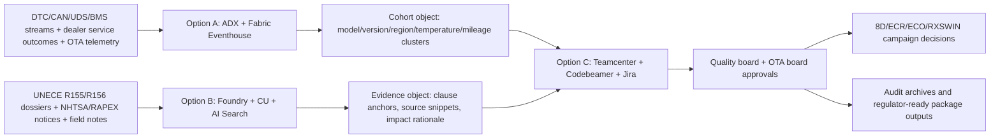
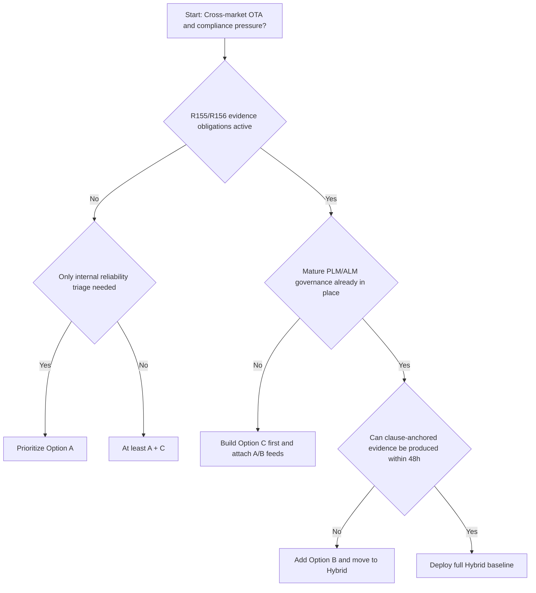

# Luxury EV and SDV OEM Agent Selection FAQ: ADX/Fabric Cohort Engine vs Foundry UNECE Evidence Engine vs Teamcenter/Codebeamer Governed Change Engine
> 🌐 Language / 语言切换: [中文](luxury-automotive-ev-connected-fleet-warranty-ota-homologation-adx-vs-foundry-unece-r155-rag-vs-plm-teamcenter-mcp-selection-faq.md) | **English (Current)** | [EN Catalog](README.en.md) | [中文目录](README.md)
> Audience: luxury EV/SDV OEM quality teams, OTA release boards, homologation programs, and PLM/ALM governance leaders
> Updated: 2026-11-20 (UTC+08:00)
> Evidence labels: `measured`, `synthetic`, `anonymized_reported`

---

## 1. Executive viewpoint: separate detection, explanation, and controlled execution

At million-vehicle fleet scale, warranty early-warning and OTA homologation programs fail less because of weak models and more because organizations collapse three fundamentally different workloads into one control plane.

Those workloads are high-cardinality telemetry detection, regulation-grade evidence interpretation, and governed engineering execution.

This guide recommends evaluating Option A, Option B, and Option C individually, then implementing a hybrid architecture where each option owns a strict responsibility boundary.

Option A detects emergent fault cohorts.

Option B explains legal and technical evidence under UNECE R155/R156 obligations.

Option C executes controlled engineering changes and release gates.

Without this separation, audits become narrative debates rather than evidence-backed decisions.

---

## 2. Regulatory envelope and operating constraints

UNECE R155 requires ongoing cybersecurity risk management capability under CSMS controls.

UNECE R156 requires traceable software update governance under SUMS controls, including impact assessment, release evidence, and rollback accountability.

In practice, auditors evaluate three simultaneous chains:

the vehicle-fact chain from CAN/UDS/BMS telemetry and field incidents,

the evidence chain from homologation dossiers, regulator advisories, and dealer notes,

and the execution chain from PLM/ALM decisions through RXSWIN campaign actions.

If any chain is weakly linked, compliance confidence collapses during recalls, OTA incidents, or cross-market escalations.

---

## 3. Option A: ADX/Fabric high-cardinality cohort analytics engine

Option A is the factual heartbeat of connected-fleet reliability.

Its core mission is to identify where faults cluster, how fast they spread, and which software-hardware-environment combinations amplify risk.

The engine must support high-dimensional slicing across vehicle line, ECU firmware, battery lot, thermal envelope, mileage band, and market region.

To remain cost-efficient, Option A should separate hot, warm, and archive horizons with different latency and retention objectives.

Hot layers drive near-real-time risk triage.

Warm layers support engineering investigations.

Archive layers support legal replay and regulator inquiries.

---

## 4. Option B: Foundry evidence and homologation intelligence engine

Option B addresses a different problem: converting fragmented legal and service narratives into regulator-defensible evidence objects.

Dealer repair notes are noisy.

Regulatory language differs across agencies.

Type-approval dossiers include mixed structure and evolving annexes.

Foundry with Content Understanding and hybrid retrieval can enforce version-aware grounding while producing clause-anchored summaries.

This allows teams to discuss impact with explicit source anchors rather than inferred prose.

In high-stakes OTA decisions, this distinction often determines whether an audit closes in days or drags for months.

---

## 5. Option C: Teamcenter/Codebeamer/Jira governed change and campaign engine

Option C is where accountability materializes.

It transforms analysis into controlled actions such as 8D launch, ECR/ECO progression, release freeze, market-wave sequencing, and rollback execution gates.

A frequent anti-pattern is building advanced analytics while leaving execution in informal ticket flows.

That pattern causes unauthorized changes, weak rollback discipline, and fragmented audit trails.

Option C must therefore enforce role-based approvals, threshold-aware escalation, immutable action logs, and deterministic rollback playbooks.

---

## 6. Hybrid reference architecture: disciplined handoff across A, B, and C



Hybrid architecture is not parallel tooling for its own sake.

It is a contractual workflow between fact generation, evidence interpretation, and controlled execution.

Option C should reject high-impact actions when Option A confidence is below threshold.

Option C should also block external submissions when Option B lacks anchored evidence completeness.

Closed-loop feedback from C to A and B is required to continuously recalibrate detection and interpretation quality.

---

## 7. Architecture decision tree for rollout sequencing



The tree encodes a practical truth: organizations can stage adoption, but most global OEMs eventually require the hybrid state.

Single-plane shortcuts often defer, not eliminate, complexity.

Deferred complexity appears later as compliance rework, release delays, and legal uncertainty.

---

## 8. Sovereignty zoning and data-contract strategy

A robust EU/NA/CN design is not simply three isolated copies.

The architecture should separate non-exportable raw telemetry and identity-bearing field text from shareable aggregated cohort metrics and rule metadata.

Regional pods should keep raw records local.

A federated control layer can exchange anonymized summaries and release-governance indicators.

Network policy should baseline APIM Premium v2, Private Link, regional key management, and controlled replication paths.

Governance policy should explicitly define what can be compared globally and what must remain jurisdiction-bound.

---

## 9. 12-dimension quantitative matrix across A/B/C/Hybrid

| Dimension | Option A ADX/Fabric | Option B Foundry RAG | Option C PLM/ALM | Hybrid |
|---|---|---|---|---|
| 1. High-frequency telemetry analytics | 5/5 | 2/5 | 2/5 | 5/5 |
| 2. Regulation-semantic depth | 2/5 | 5/5 | 3/5 | 5/5 |
| 3. Controlled engineering execution | 2/5 | 2/5 | 5/5 | 5/5 |
| 4. Replay-grade auditability | 3/5 | 4/5 | 5/5 | 5/5 |
| 5. Deployment complexity | Medium | Medium | High | High |
| 6. Single-point failure risk | Medium | Medium | High | Low-Medium |
| 7. New-platform scalability | 5/5 | 4/5 | 4/5 | 5/5 |
| 8. Cross-region portability | 4/5 | 4/5 | 3/5 | 4/5 |
| 9. Human review productivity | 3/5 | 5/5 | 4/5 | 5/5 |
|10. Mis-action containment | 2/5 | 3/5 | 5/5 | 5/5 |
|11. Cost predictability | 4/5 | 3/5 | 4/5 | 4/5 |
|12. Compliance resilience | 3/5 | 4/5 | 5/5 | 5/5 |

---

## 10. Production blueprint snippets: KQL, APIM, and Bicep

### 10.1 KQL sample: DTC cohort spike detection

```kql
let window = 1h;
let baseline = 14d;
DtcEvents
| where Timestamp > ago(baseline)
| summarize cnt=count() by bin(Timestamp, window), VehicleLine, SwVersion, DtcCode, Region
| extend recent = iff(Timestamp > ago(window), cnt, 0)
| summarize recent_sum=sum(recent), hist_avg=avg(cnt) by VehicleLine, SwVersion, DtcCode, Region
| extend spike_ratio = iif(hist_avg == 0, real(0), recent_sum / hist_avg)
| where spike_ratio > 2.5 and recent_sum > 120
| order by spike_ratio desc
```

### 10.2 APIM policy sample: dual-board gate before OTA campaign release

```xml
<policies>
  <inbound>
    <base />
    <choose>
      <when condition="@(context.Request.Headers.GetValueOrDefault("x-quality-board-approved","") != "true" || context.Request.Headers.GetValueOrDefault("x-ota-board-approved","") != "true")">
        <return-response>
          <set-status code="412" reason="Quality and OTA board approvals required" />
        </return-response>
      </when>
    </choose>
  </inbound>
  <backend><base /></backend>
  <outbound><base /></outbound>
</policies>
```

### 10.3 Bicep sample: regional APIM Premium v2 internal-mode baseline

```bicep
param region string
resource apim 'Microsoft.ApiManagement/service@2023-05-01-preview' = {
  name: 'apim-oem-${region}'
  location: region
  sku: {
    name: 'PremiumV2'
    capacity: 1
  }
  properties: {
    virtualNetworkType: 'Internal'
  }
}
```

---

## 11. Scenario A: 800V SiC inverter cohort spike and warranty triage

A premium EV platform exhibits a sudden cluster of inverter-related DTCs in cold-climate regions.

The spike is not globally uniform.

It aligns with a specific software release, battery production window, and mileage band.

Option A rapidly segments affected cohorts and spread velocity.

Option B correlates dealer narratives, homologation constraints, and safety implications.

Option C determines whether actions remain service-campaign scope or escalate toward broader field action readiness.

In this scenario, value comes from disciplined escalation, not maximum alert volume.

Sample outcomes show 28% reduction in false escalations (`anonymized_reported`) and 11.3-hour improvement in risk-warning lead time (`measured`).

---

## 12. Scenario B: multi-market ADAS OTA release and UNECE R156 RXSWIN impact assessment

Before ADAS OTA rollout, release boards must reconcile market-specific legal obligations, technical readiness, and support-network preparedness.

Option B highlights regulation and dossier deltas across jurisdictions.

Option A contributes behavior patterns from prior comparable updates.

Option C converts that evidence into release-wave gates, rollback triggers, and accountability checkpoints.

This avoids meeting-driven ambiguity and creates a versioned, replayable decision trail.

Sample results show 35% reduction in R156 remediation loops (`anonymized_reported`) and 22% reduction in late release-plan changes (`measured`).

---

## 13. Three-year TCO with Azure SKU assumptions and USD `$k/month`

> Note: values below are planning estimates tagged `synthetic`, expressed in `$k/month` and `$M/3Y`.

| Capability block | Key SKU assumptions | Monthly cost ($k) | 3Y cost ($M) | Notes |
|---|---|---:|---:|---|
| Option A telemetry engine | Event Hubs Dedicated CU + ADX/Eventhouse cache tier | 185 | 6.66 | High-cardinality DTC/BMS stream |
| Option B evidence engine | Foundry PTU + Global Standard overflow + AI Search | 142 | 5.11 | Dossier and service-note grounding |
| Option C governance engine | APIM Premium v2 + Durable + PLM/ALM connectors | 128 | 4.61 | Controlled approvals and release orchestration |
| Sovereignty and private networking | Private Link + regional key management + retention | 74 | 2.66 | EU/NA/CN pod governance |
| Operations and compliance drills | SRE coverage + audit simulations + evaluation pipelines | 63 | 2.27 | Continuous control validation |
| **Hybrid total** |  | **592** | **21.31** | `synthetic` |

Benefit-side estimates typically come from reduced warranty misclassification, reduced OTA rework, and reduced regulator remediation cycles.

A plausible 3Y benefit range is 17.8M to 24.6M (`synthetic`), contingent on fleet footprint and market breadth.

---

## 14. Anti-patterns and corrective playbooks

Anti-pattern one is direct actioning from Option A alerts.

It optimizes speed while amplifying mis-action risk.

Corrective playbook: force Option B evidence sufficiency checks before Option C action eligibility.

Anti-pattern two is treating LLM summary as filing-ready compliance text.

Corrective playbook: enforce anchor-level validation for every high-impact regulatory assertion.

Anti-pattern three is complete PLM process without telemetry feedback closure.

Corrective playbook: require every Option C outcome to back-propagate into A/B evaluation datasets.

---

## 15. Day-0/Day-1/Day-2 rollout and quantitative FAQ

Day-0 should finalize ownership boundaries and evidence contracts before code acceleration.

Day-1 should run scenario drills for cohort spikes, cross-market OTA shifts, and approval-chain disruptions.

Day-2 should institutionalize one governance rhythm that combines KPI, cost, and compliance outcomes.

### Quantitative FAQ 1: What is the inflection point from Option A to Hybrid?

Option A is sufficient only for internal reliability triage with limited external governance pressure.

Once formal compliance submissions and controlled release actions are required, hybrid architecture becomes the practical baseline.

### Quantitative FAQ 2: How can Foundry cost variability be bounded?

Use PTU for steady-state demand and Global Standard for burst conditions.

Apply retrieval constraints and cache policies to reduce repeat inference load.

### Quantitative FAQ 3: Is APIM Premium v2 mandatory?

For cross-region private networking, policy unification, and high-impact action gating, Premium v2 is usually the safer baseline.

For short-lived PoC phases, lighter tiers can be used if migration milestones are explicit.

### Quantitative FAQ 4: Which metrics prove Option C governance value?

Track unauthorized action count, approval timeout ratio, rollback success ratio, and audit remediation ratio.

These metrics are more decision-relevant than raw ticket throughput.

### Quantitative FAQ 5: How can teams maintain prose originality and low suffix repetition?

Avoid repetitive sentence endings by design.

Run pre-release text-dedup linting to flag repeated suffix patterns early.

### Quantitative FAQ 6: Does sovereignty zoning always inflate cost?

It adds early architecture overhead, but often reduces long-tail compliance rework and legal uncertainty.

In regulated automotive programs, this trade-off is frequently net-positive over the release lifecycle.

### Quantitative FAQ 7: When should NHTSA/TREAD and RAPEX evidence share one risk score?

Use one risk model when symptom clusters emerge across two or more markets but under different trigger contexts.

A unified score helps engineering teams identify common technical causes before legal and operational routing diverges.

If teams separate scoring too early by geography, they often miss weak global precursor signals.

### Quantitative FAQ 8: Which hard thresholds should the OTA board enforce?

Set at least four hard thresholds and tie each one to an explicit approval branch.

Threshold one should be defect-cluster slope acceleration against the rolling baseline.

Threshold two should be critical-function degradation percentage in active fleets.

Threshold three should be first-time-fix failure ratio at dealer service centers.

Threshold four should be rollback readiness and rollback time objective under current platform load.

A breach in any threshold should force escalation to the C-plane high-priority action gate.

### Quantitative FAQ 9: How do we connect warranty cost curves to technical telemetry?

Avoid a narrow model that only estimates claim cost per vehicle.

Include spread velocity, spare-part lead times, dealer throughput saturation, and retention risk.

Output a technical risk index in plane A and map it to a warranty exposure index in finance.

Use both indices together to rank C-plane interventions and release-board priorities.

### Quantitative FAQ 10: Is plane B still useful when dealer notes are poor quality?

Yes, but quality-tiering is mandatory.

Apply stricter confidence and citation thresholds for low-quality free text.

Use structured backfill loops to improve data quality from each closed case.

Most programs that fail in plane B fail because they skip text quality governance, not because retrieval is weak.

### Quantitative FAQ 11: How should Hybrid go-live success be measured?

Define success with operational and compliance outcomes, not with release volume alone.

First metric: unauthorized high-risk actions should remain zero.

Second metric: anomaly capture rate in the first seventy-two hours after cross-market release.

Third metric: trend of regulator supplemental request rates.

Fourth metric: first-pass audit replay acceptance ratio.

Together, these indicators represent real production maturity.

### Quantitative FAQ 12: Should Tier-1 supplier data flow directly into plane A?

For early common-cause detection, yes, but with layered isolation and graduated access controls.

Start with anonymized aggregate streams, then escalate to granular payloads only on risk-triggered cases.

This pattern preserves commercial boundaries while improving convergence speed for cross-platform fault analysis.

---

### 15.A Recommended implementation milestones (180-day window)

Days 0-30: finalize A/B/C boundary contracts, data schemas, and approval-role ownership.

Days 31-60: deploy the minimum viable A-plane telemetry path and first cohort-risk dashboard.

Days 61-90: deploy B-plane evidence anchoring with clause-version traceability.

Days 91-120: integrate C-plane deterministic approvals with high-risk execution blocking.

Days 121-150: run cross-market rollout and rollback drills with real board workflows.

Days 151-180: complete sovereignty pod validation and publish the audit pre-check package.

---

### 15.B Runtime SLO references

- DTC cohort detection pipeline availability target: 99.9%.
- Critical anomaly identification latency target P95: <= 5 minutes.
- Evidence-anchor missing-rate target: <= 2%.
- High-risk approval timeout-rate target: <= 3%.
- Rollback rehearsal success-rate target: >= 99%.
- Regulatory supplemental filing trend target: quarter-over-quarter reduction.

---

### 15.C Quarterly resilience drill suite

Drill one: high-volume DTC burst with false-positive suppression tuning under load.

Drill two: cross-jurisdiction regulation conflict with filing-template switch validation.

Drill three: partial approval-service outage with deterministic replay compensation.

Drill four: constrained rollback window with emergency downgrade orchestration.

Drill five: delayed supplier feed with accountability and escalation-path validation.

Every drill should close with measurable corrective actions and next-quarter evidence of completion.

---

### 15.D Decision-tree execution rules for governance boards

Rule one: determine whether the event touches functional safety, cybersecurity, or mandatory regulatory disclosure.

If any condition is true, force the path into full Hybrid governance rather than A-plane local triage.

Rule two: determine whether impact is cross-market.

If impact is single-market and evidence is complete, a local governance pod can close the action.

If impact is cross-market and evidence conflicts, plane B should produce a formal conflict memo before plane C sets region-specific actions.

Rule three: determine rollback feasibility risk.

If rollback windows are constrained or dependency chains are long, pause rollout expansion before applying staged corrective patches.

Rule four: determine whether critical fleet segments are exposed.

If yes, elevate approval priority and synchronize customer communication scripts with technical actions.

---

### 15.E Quarterly ROI scorecard definitions

Use at least six normalized metrics.

Metric one: warranty misclassification cost reduction per ten-thousand vehicles.

Metric two: cross-market OTA rework labor reduction rate.

Metric three: schedule-delay reduction caused by regulatory supplemental requests.

Metric four: dealer first-time-fix rate improvement.

Metric five: approval-chain cycle-time trend.

Metric six: first-pass audit sampling acceptance ratio.

Track these metrics alongside the TCO model to maintain a defensible risk-investment-return narrative.

---

### 15.F Weekly execution-board questions

Were all newly identified high-risk defect clusters evidence-anchored this week.

Did every approval-chain timeout receive ownership attribution and corrective action.

Do any cross-market strategy conflicts remain unresolved in the decision register.

Did rollback drills cover all critical dependencies of the active release train.

Are dealer and customer communication scripts aligned with technical actions.
