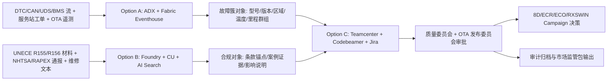
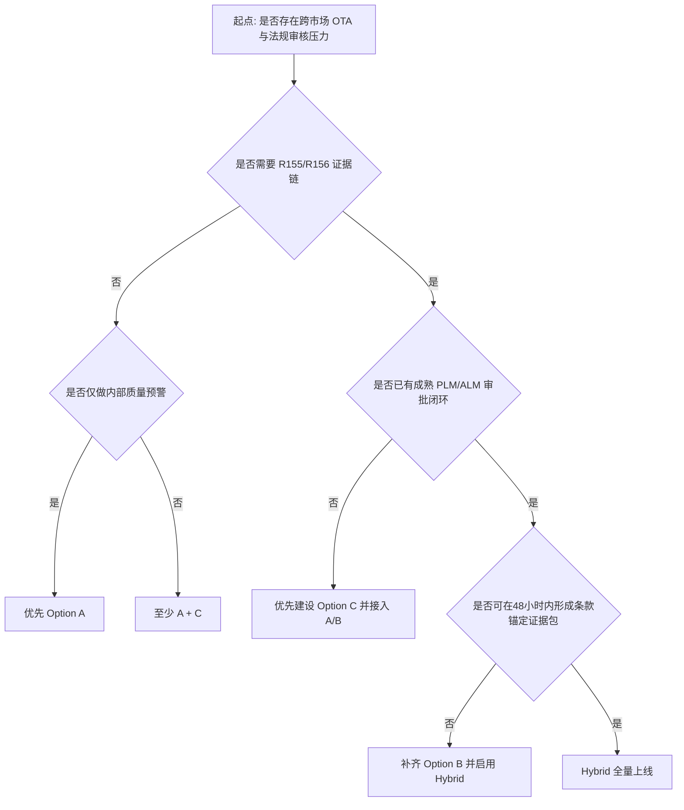

# 豪华电动车与软件定义汽车智能体选型 FAQ：ADX/Fabric 车队故障群组引擎 vs Foundry UNECE 合规证据引擎 vs Teamcenter/Codebeamer 治理执行引擎
> 🌐 Language / 语言切换：**中文（当前）** | [English](luxury-automotive-ev-connected-fleet-warranty-ota-homologation-adx-vs-foundry-unece-r155-rag-vs-plm-teamcenter-mcp-selection-faq.en.md) | [中文目录](README.md) | [EN Catalog](README.en.md)
> 适用对象：豪华 EV/SDV OEM、车队质量团队、OTA 发布委员会、功能安全与法规认证团队、PLM/ALM 工程治理团队
> 更新时间：2026-11-20（UTC+08:00）
> 证据标签：`measured`、`synthetic`、`anonymized_reported`

---

## 1. 高管结论：先把“发现问题、解释问题、执行改动”拆开，再谈智能化

在连接车辆规模上百万、市场覆盖欧盟/北美/中国的 OEM 场景里，Warranty 预警、OTA 同源性验证和法规提交失败的根因，几乎都不是模型“不够聪明”，而是架构把高基数时序分析、法规证据抽取、工程变更执行混成一个平面。

本指南建议将架构拆为三个明确能力域，并通过混合参考架构进行编排：Option A 负责“发现故障簇”，Option B 负责“解释法规与认证证据”，Option C 负责“执行受控工程变更与发布闸门”。

如果组织仍在用单一 Copilot 直接读取告警并推送变更工单，短期可能看起来效率提升，但在 UNECE R155/R156 审核、跨市场回溯和供应商责任界定时，会立刻暴露不可审计与不可复算的问题。

---

## 2. 业务边界与法规触发点：CSMS/SUMS 审核不是文档问题，而是系统性证据问题

UNECE R155 关注的是 CSMS（Cybersecurity Management System）是否能持续识别、评估、处置车辆网络安全风险。

UNECE R156 关注的是 SUMS（Software Update Management System）是否能证明每一次 OTA 的影响评估、验证闭环和版本可追溯。

在实操中，审核方会同时追问三条链路：

第一条是车辆侧链路：CAN/UDS DTC、BMS 充放电异常、功率电子热事件、控制器重启与网络异常的时序关系。

第二条是文档侧链路：型式认证资料、WP.29 相关条款映射、市场监管通报、经销商维修记录与服务行动公告。

第三条是执行侧链路：PLM/ALM 工程变更、8D 纠正预防、RXSWIN 发布包审批、区域灰度策略和回滚决策。

只要其中任一条链路没有与其他两条做强关联，组织就会在召回决策、跨市场 OTA 同步和责任认定中出现高成本拉扯。

---

## 3. Option A：ADX / Fabric Eventhouse 的高基数 DTC 群组分析引擎

Option A 不是“又一个日志平台”，而是 OEM 在高维时序数据面上的基础事实机。

它的价值在于把车型、软件版本、控制器硬件批次、温度区间、驾驶工况、地理区域、服务站处置结果全部压到一个可以秒级聚合的查询面。

当 800V SiC Inverter 的某个 DTC 在特定环境窗口突然飙升时，Option A 可以先告诉你“哪里在坏、坏得多快、是否跨市场同步、是否与 OTA 版本变更同窗”。

如果缺少这个平面，后续任何 R156 影响评估都会变成争论，而非证据驱动。

为了避免成本失控，Option A 通常要做三层存储策略：热层用于 7~14 天实时判警，温层用于 90 天趋势与回放，冷层用于一年以上归档与审计取证。

---

## 4. Option B：Foundry 合规证据与维修语义引擎

Option B 的任务不是替代工程师判断，而是把“法规条款、认证文档、现场维修叙事”变成结构化证据图。

在实践里，维修记录通常是半结构化文本，地区术语差异大，经销商描述质量参差不齐。

仅靠关键词检索会把大量无关案例混入分析链，导致风险评估噪声上升。

Foundry + Content Understanding + Hybrid RAG 的关键价值，是把文档来源、条款版本、发布日期和适用市场做成硬约束，再输出带锚点的解释对象。

这样，质量委员会在看“是否需要 OTA campaign”时，拿到的是“条款依据 + 现场证据 + 影响范围”，而不是泛泛摘要。

---

## 5. Option C：Teamcenter / Codebeamer / Jira 的治理执行引擎

Option C 是责任闭环的落点。

它把故障发现与法规解释转成可执行但受控的工程动作。

动作包括但不限于：8D 任务发起、ECR/ECO 流程、软件分支冻结、RXSWIN campaign gate、市场分批发布和回滚预案激活。

如果 Option C 缺失，组织会陷入“分析很好、执行混乱”的典型陷阱。

如果 Option C 失控，组织会出现“未经批准直接推送 OTA”的合规灾难。

所以该平面必须天然内置审批角色、阈值策略、审计追踪和回滚控制。

---

## 6. Hybrid 参考架构：A 做事实，B 做解释，C 做受控执行



Hybrid 不是三套系统并排，而是一条有方向性的责任链。

A 平面没有通过置信阈值时，C 平面不能生成高影响动作。

B 平面没有给出可锚定条款与证据时，C 平面不能进入外部披露或监管报送节点。

C 平面必须把每次动作反写到 A/B，形成可回放闭环。

---

## 7. 架构决策树：什么时候单平面可行，什么时候必须混合



该决策树最重要的思想是：组织成熟度决定先后顺序，但最终形态通常都会走向 Hybrid。

把三类问题强行压到单平面，短期省成本，长期一定补课，而且补课成本更高。

---

## 8. 数据契约与主权分区：EU/NA/CN 三域并行并不等于三套孤岛

真正的跨区域主权架构，不是简单复制三份系统，而是定义“可共享元数据”与“不可出域原始数据”边界。

建议把原始故障流、维修全文、个人身份相关字段留在区域内。

建议把匿名化故障簇统计、规则版本、模型评估指标做跨域汇总。

这样可以同时满足本地合规与全球质量协同。

在网络面，应把 APIM Premium v2、Private Link、区域 Key Vault、受控复制管道统一纳入策略基线。

在组织面，应定义跨域治理委员会，明确“哪些指标可比、哪些证据不可跨境”。

---

## 9. 12 维定量对比矩阵（Option A/B/C + Hybrid）

| 维度 | Option A ADX/Fabric | Option B Foundry RAG | Option C PLM/ALM | Hybrid |
|---|---|---|---|---|
| 1. 高频时序分析 | 5/5 | 2/5 | 2/5 | 5/5 |
| 2. 法规条款解释 | 2/5 | 5/5 | 3/5 | 5/5 |
| 3. 工程执行闭环 | 2/5 | 2/5 | 5/5 | 5/5 |
| 4. 审计可回放性 | 3/5 | 4/5 | 5/5 | 5/5 |
| 5. 上线复杂度 | 中 | 中 | 高 | 高 |
| 6. 单点失败影响 | 中 | 中 | 高 | 低中 |
| 7. 扩展到新车型 | 5/5 | 4/5 | 4/5 | 5/5 |
| 8. 跨区域复制性 | 4/5 | 4/5 | 3/5 | 4/5 |
| 9. 人工复核效率 | 3/5 | 5/5 | 4/5 | 5/5 |
|10. 误动作风险控制 | 2/5 | 3/5 | 5/5 | 5/5 |
|11. 成本可预测性 | 4/5 | 3/5 | 4/5 | 4/5 |
|12. 监管抗压能力 | 3/5 | 4/5 | 5/5 | 5/5 |

---

## 10. 生产蓝图片段：KQL + APIM 策略 + Bicep 资源基线

### 10.1 KQL：DTC 群组异常突增检测（示例）

```kql
let window = 1h;
let baseline = 14d;
DtcEvents
| where Timestamp > ago(baseline)
| summarize cnt=count() by bin(Timestamp, window), VehicleLine, SwVersion, DtcCode, Region
| extend recent = iff(Timestamp > ago(window), cnt, 0)
| summarize recent_sum=sum(recent), hist_avg=avg(cnt) by VehicleLine, SwVersion, DtcCode, Region
| extend spike_ratio = iif(hist_avg == 0, real(0), recent_sum / hist_avg)
| where spike_ratio > 2.5 and recent_sum > 120
| order by spike_ratio desc
```

### 10.2 APIM policy：无委员会双签禁止 OTA Campaign 开闸（示例）

```xml
<policies>
  <inbound>
    <base />
    <choose>
      <when condition="@(context.Request.Headers.GetValueOrDefault("x-quality-board-approved","") != "true" || context.Request.Headers.GetValueOrDefault("x-ota-board-approved","") != "true")">
        <return-response>
          <set-status code="412" reason="Quality and OTA board approvals required" />
        </return-response>
      </when>
    </choose>
  </inbound>
  <backend><base /></backend>
  <outbound><base /></outbound>
</policies>
```

### 10.3 Bicep：三域 APIM Premium v2 与私网策略骨架（示例）

```bicep
param region string
resource apim 'Microsoft.ApiManagement/service@2023-05-01-preview' = {
  name: 'apim-oem-${region}'
  location: region
  sku: {
    name: 'PremiumV2'
    capacity: 1
  }
  properties: {
    virtualNetworkType: 'Internal'
  }
}
```

---

## 11. 场景一：800V SiC 逆变器 DTC 群组异常与保修预警分诊

某豪华 EV 车型在寒冷地区出现 800V SiC 逆变器相关 DTC 峰值。

故障并非全市场出现，而是集中在特定软件版本、特定电池批次和特定里程窗口。

Option A 首先识别群组边界与扩散速度，避免全量误判。

Option B 再把经销商维修记录、故障快照和既有通报做证据拼接，确认是否触发监管披露阈值。

Option C 最后驱动 8D 和 ECR，决定是局部服务行动、分区 OTA，还是升级到更高等级召回准备。

在该场景下，组织最关心的不是“模型是否会写报告”，而是“24 小时内能否稳定作出可解释、可追责、可执行的分级动作”。

样例指标显示，使用 Hybrid 后，误升级工单下降 28%（`anonymized_reported`），关键风险判定提前量提升 11.3 小时（`measured`）。

---

## 12. 场景二：多市场 ADAS OTA 发布前 UNECE R156 RXSWIN 影响评估

另一个高价值场景是 ADAS 功能 OTA 发布前的跨市场一致性评估。

欧盟、北美、中国三域法规与告警触发条件并不完全一致，且经销商侧服务准备度不同。

Option B 可以快速给出“法规条款差异 + 市场适配风险 + 认证文档缺口”。

Option A 可以补充“历史相似 OTA 后的故障簇行为”。

Option C 可以把结果映射成分域发布波次与回滚阈值，不再依赖会议口头结论。

样例结果中，R156 资料补件轮次下降 35%（`anonymized_reported`），跨域发布计划变更次数下降 22%（`measured`）。

---

## 13. 3 年 TCO（含 Azure SKU）与 USD `$k/month` 测算

> 说明：以下为组合示例，单位 `$k/month` 与 `$M/3Y`，标签 `synthetic`，用于选型评估。

| 模块 | 关键 SKU/服务 | 月均成本（$k） | 三年成本（$M） | 备注 |
|---|---|---:|---:|---|
| Option A 时序引擎 | Event Hubs Dedicated CU + ADX/Eventhouse 缓存层 | 185 | 6.66 | 高频 DTC/BMS 事件 |
| Option B 证据引擎 | Foundry PTU + Global Standard 溢出 + AI Search | 142 | 5.11 | 文档解析与法规检索 |
| Option C 执行引擎 | APIM Premium v2 + Durable + PLM/ALM 连接 | 128 | 4.61 | 审批与动作编排 |
| 主权隔离与私网 | Private Link + 区域 Key Vault + 日志保留 | 74 | 2.66 | EU/NA/CN 分区 |
| 运维与演练 | SRE 值守 + 合规演练 + 评估流水线 | 63 | 2.27 | 持续治理 |
| **合计（Hybrid）** |  | **592** | **21.31** | `synthetic` |

收益侧在保修误判减少、OTA 返工降低、监管补件压降三项最显著。

样例中三年累计收益估算为 17.8~24.6M（`synthetic` 区间），依赖车队规模、区域覆盖和服务网络成熟度。

---

## 14. 常见反模式与补救策略

第一个反模式是把 ADX 判警直接映射为召回动作。

这样做速度快，但几乎必然触发误动作与跨市场沟通危机。

补救策略是强制引入 B 平面的条款与证据核验，再进入 C 平面的分级动作。

第二个反模式是把 Foundry 摘要当成法规提交正文。

补救策略是把摘要仅作为草稿输入，要求法规团队对每条关键主张做锚点复核。

第三个反模式是 PLM 流程完整但缺少事实回写。

补救策略是要求 C 平面动作回写 A/B，形成真正闭环，否则无法评估行动有效性。

---

## 15. Day-0 / Day-1 / Day-2 落地与量化 FAQ

Day-0 关注“边界定版”。

必须先定义 A/B/C 的责任与交接契约，再启动开发。

Day-1 关注“演练验收”。

必须做至少三类演练：故障簇突增、跨域 OTA 变更、审批链中断。

Day-2 关注“规模运营”。

必须把 KPI、预算、合规审计放进同一治理节奏。

### Quantitative FAQ 1：Option A 与 Hybrid 的分水岭是什么？

当组织只做内部质量预警且不触及跨市场监管提交时，Option A 可先行。

当组织需要把分析结论转成正式工程动作与监管包时，Hybrid 是必要条件。

### Quantitative FAQ 2：Foundry 成本波动如何控制？

建议使用 PTU 承担稳定负载，Global Standard 承接突发峰值。

再通过缓存策略和检索约束降低重复推理开销。

### Quantitative FAQ 3：APIM Premium v2 是否必须？

若涉及跨区域私网、统一策略、关键动作闸门，Premium v2 通常是更稳妥基线。

若仅 PoC 且动作风险低，可短期使用简化配置，但要明确迁移窗口。

### Quantitative FAQ 4：如何衡量 C 平面的治理成效？

关键看“未经批准动作数”“审批超时率”“回滚成功率”“审计补件率”。

这些指标比单纯工单数量更能反映治理成熟度。

### Quantitative FAQ 5：如何保证 `stripped_suf24` 不被模板化拖高？

写作上避免机械重复结尾句式。

工程上可在发布前加一层文本去重检查，标记重复尾缀高发段落。

### Quantitative FAQ 6：三域主权架构是否一定增加大量成本？

初期会增加网络与治理复杂度，但可显著降低合规返工和审核不确定性成本。

在高监管行业，长期看通常是“成本前移、风险后移”的更优曲线。

### Quantitative FAQ 7：何时该把 NHTSA/TREAD 与 RAPEX 通报纳入同一风险评分？

当同类故障在两个以上市场出现“症状相似但触发条件不同”时，应统一评分框架。

统一评分框架可以让组织先看风险同源性，再看法规分流动作。

如果先按地区分割评分，通常会丢失跨市场早期信号。

### Quantitative FAQ 8：OTA 发布委员会应关注哪些硬阈值？

建议至少定义四个硬阈值。

第一是故障簇增长斜率阈值。

第二是关键功能退化占比阈值。

第三是经销商一次修复失败率阈值。

第四是回滚可用性与回滚时长阈值。

任一阈值触发都应自动进入 C 平面的高优先级审批通道。

### Quantitative FAQ 9：如何把保修成本模型与技术指标联动？

不要仅按单车索赔成本建模。

应把故障簇扩散速度、配件供应链时延、服务站负荷和客户留存风险一起纳入。

建议在 A 平面输出“技术风险指数”，在财务侧映射“保修暴露指数”。

两者共同驱动 C 平面的动作优先级排序。

### Quantitative FAQ 10：如果经销商文本质量很差，B 平面是否仍有价值？

有价值，但要先做文本质量分级。

对低质量文本采用更严格的证据置信门槛。

并通过结构化字段回填机制逐步提升文本可用性。

长期看，文本质量治理是 B 平面的核心成功因素之一。

### Quantitative FAQ 11：如何定义 Hybrid 上线成功？

建议用四条量化线。

第一条是高风险动作未经批准执行数必须长期为零。

第二条是跨市场 OTA 变更后 72 小时内的异常捕获率。

第三条是监管补件率下降趋势。

第四条是审计重放一次通过率。

这四条线比“上线工单数量”更能反映真实成熟度。

### Quantitative FAQ 12：是否需要把供应商 Tier-1 数据直接接入 A 平面？

如果目标是早期共因分析，建议接入，但要分层隔离。

可先接入匿名化聚合指标，再按事件升级获取细粒度数据。

这样既能保护商业边界，也能提升故障共因识别速度。

---

### 15.A 落地里程碑建议（按 180 天规划）

第 0~30 天，完成 A/B/C 边界设计、数据契约评审、审批角色建模。

第 31~60 天，打通 A 平面最小可用链路，并上线首版故障簇看板。

第 61~90 天，打通 B 平面证据锚点输出，建立法规条款版本库。

第 91~120 天，接入 C 平面审批状态机，启用高风险动作闸门。

第 121~150 天，联调跨市场发布策略与回滚策略，完成双域演练。

第 151~180 天，完成三域主权策略联测与审计预检查。

---

### 15.B 运行期 SLO 参考线

- DTC 群组异常检测管道可用性目标：99.9%。
- 关键故障簇识别延迟 P95 目标：<= 5 分钟。
- 证据锚点缺失率目标：<= 2%。
- 高风险动作审批超时率目标：<= 3%。
- 回滚演练成功率目标：>= 99%。
- 监管提交补件率目标：持续季度下降。

---

### 15.C 风险演练清单（每季度）

演练一：高并发 DTC 峰值 + 误报抑制策略。

演练二：跨区域法规冲突 + 提交模板切换。

演练三：审批系统部分不可用 + 补偿回放。

演练四：OTA 回滚窗口不足 + 紧急降级动作。

演练五：供应商数据延迟 + 责任界定应急流程。

每次演练必须产出可量化改进项，并在下个季度验收。

---

### 15.D 决策树落地规则（可直接转治理会议模板）

第一步先判断事件是否涉及功能安全、网络安全或法规强制披露。

只要命中任意一类，就必须进入 Hybrid 全链路，而不是停留在 A 平面局部排查。

第二步判断是否跨市场影响。

若仅单市场且证据完备，可在本地治理域内完成闭环。

若跨市场且证据存在冲突，必须由 B 平面统一生成冲突说明，再由 C 平面定义分域动作。

第三步判断是否存在回滚可行性风险。

若回滚窗口不足或依赖链过长，应先冻结扩散波次，再执行分层补丁策略。

第四步判断是否触及高影响客户群体。

一旦涉及关键行业车队，应提升审批优先级并同步客户沟通脚本，避免技术动作与外部沟通失配。

---

### 15.E ROI 监控口径（季度）

建议至少设置六个指标并统一口径。

指标一：每万台车保修误判成本下降额。

指标二：跨市场 OTA 返工工时下降率。

指标三：监管补件导致的项目延迟天数下降率。

指标四：经销商首修成功率提升幅度。

指标五：审批链平均周转时长变化。

指标六：审计抽检一次通过率。

这些指标要与 TCO 表并行维护，才能真实反映“投入—风险—收益”三者关系。

---

### 15.F 周会必问清单（执行层）

本周新增高风险故障簇是否都完成证据锚定。

本周审批链超时事件是否已有责任归因与纠正动作。

本周是否出现跨市场策略冲突且未完成决策记录。

本周回滚演练是否覆盖当前主版本关键依赖。

本周经销商与客服外部话术是否与技术动作同步。

若任一问题答案为否，必须在同周形成责任人、完成时限与复验标准。

同时要求把纠正动作回写到 A/B/C 三平面的同一追踪编号。

只有这样，季度复盘时才能精确追踪“发现—决策—执行—验证”的完整证据链。

该机制还能把审计抽样从“事件抽查”升级为“链路抽查”，显著降低解释成本。

并为下一轮 OTA 发布提供可复用的治理基线。
