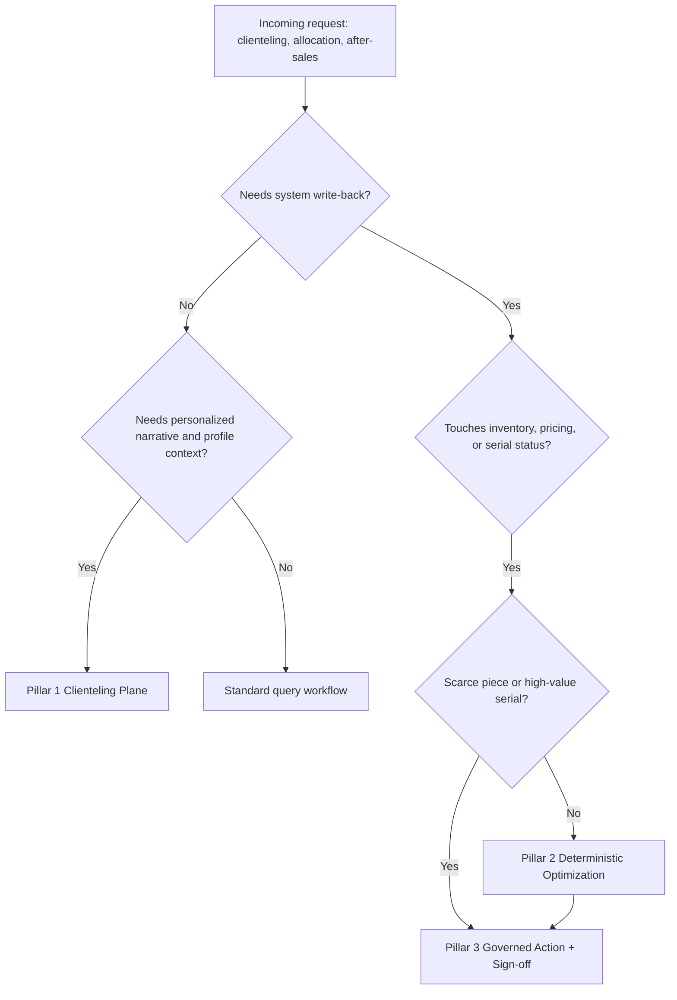
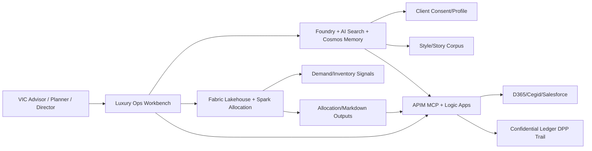

# Luxury Retail Agent Architecture Selection FAQ: Foundry VIC Clienteling Plane vs Fabric Allocation Plane vs D365/Cegid/Salesforce Governed Action Plane

> Version tag: Guide #142  
> Audience: Global luxury retail CIOs, clienteling leaders, merchandising planners, boutique directors, after-sales operations leaders  
> Scope: VIC private clienteling, deterministic assortment allocation, cross-border data controls, anti-counterfeit DPP provenance operations  
> Data provenance tags: `measured`, `synthetic`, `anonymized_reported`

---

## 1. Executive framing: luxury copilots must protect brand equity, scarcity discipline, and compliance together

Luxury retail transformation is not only a personalization challenge.

It is also a scarcity-governance challenge.

Systems must improve VIC engagement without diluting brand voice or violating pricing discipline.

They must also coordinate inventory and provenance workflows across sovereign jurisdictions.

With EU DPP and anti-counterfeit controls, a single undifferentiated assistant stack is usually insufficient.

This guide recommends a three-pillar architecture.

Pillar 1 handles clienteling memory and controlled communication.

Pillar 2 handles deterministic assortment and markdown optimization.

Pillar 3 handles governed write-back into POS, OMS, and DPP records.

This partition increases operational precision while lowering gray-market and compliance risk.

---

## 2. Pillar boundaries: define responsibilities before optimizing automation rates

**Pillar 1: Azure AI Foundry + multimodal embeddings + AI Search + Cosmos client memory.**

This is the clienteling and communication plane.

It supports VIC styling outreach, wardrobe narratives, invitation drafts, and after-sales messaging.

It must include tone-guardrails and cross-border consent controls.

It should not directly execute inventory or pricing actions.

**Pillar 2: Fabric Lakehouse + Spark deterministic allocation and markdown optimization.**

This is the quantitative merchandising plane.

It should drive size-curve allocation, open-to-buy planning, inter-boutique rebalance, and markdown optimization under strict policy constraints.

LLMs may explain output rationale, but they must not hallucinate actionable quantities.

Unauthorized discount logic must be blocked by policy.

**Pillar 3: D365 Commerce / Cegid / Salesforce + APIM MCP + Logic Apps.**

This is the governed action plane.

It executes reservation transfers, serial-risk flags, DPP state updates, and after-sales workflow transitions.

High-consequence actions require explicit sign-off from designated business owners.

---

## 3. Decision tree: classify by system-write impact and scarce-item risk



First branch: write-back versus non-write.

Second branch: narrative context versus operational action.

Third branch: scarcity and consequence level.

This sequence prevents marketing logic from silently bypassing inventory governance.

---

## 4. Pillar 1 deep dive: VIC memory, multimodal styling, and tone protection

Pillar 1 value is not only recommendation relevance.

It is recommendation consistency under brand constraints.

Luxury communication quality is strategic, not cosmetic.

A cross-city VIC interaction should feel coherent while respecting consent and residency boundaries.

Cosmos memory can store interaction context and consent states.

AI Search can ground suggestions in product stories, craftsmanship notes, and collection archives.

Multimodal vectors can support image-based styling alignment.

Cross-border scenarios require consent-aware context minimization.

If cross-border profile sharing is not authorized, the system should fall back to local minimal context.

Pillar 1 outputs should remain recommendation and drafting artifacts.

Transactional execution should remain in Pillar 3.

---

## 5. Pillar 2 deep dive: deterministic assortment and markdown control

Pillar 2 translates strategy into measurable inventory decisions.

Allocation cannot depend on narrative output alone.

It requires deterministic models with explicit constraints.

Fabric Lakehouse consolidates demand, stock, and commercial signals.

Spark jobs compute size curves, OTB pressure, store-level demand elasticity, and rebalance candidates.

Outputs should include confidence ranges and policy-constraint explanations.

For example, a recommendation should state exact quantity transfer and expected impact interval.

Discount optimization must enforce brand policy thresholds.

The system should block discount suggestions outside approved governance bands.

Pillar 2 can produce ranked options.

Pillar 3 should still control final execution.

---

## 6. Pillar 3 deep dive: governed execution for POS, OMS, and DPP state changes

Pillar 3 exists to make every high-impact action accountable.

Representative actions include scarce-piece reservation transfer, serial-number risk flagging, inter-boutique reallocations, and after-sales updates.

D365 Commerce, Cegid, and Salesforce Clienteling often coexist in global estates.

APIM MCP should normalize policy enforcement and action contracts.

Logic Apps should orchestrate deterministic state transitions and compensating retries.

DPP evidence updates can be anchored in Confidential Ledger for tamper-evident provenance.

High-value actions should require dual or tri-party sign-off.

If approvals are incomplete, execution must be rejected.

The goal is not maximum automation percentage.

The goal is zero unauthorized high-consequence actions.

---

## 7. Compliance and sovereignty: GDPR, PIPL, and ESPR DPP in one operating model

Global luxury retail commonly spans EU and China sovereignty regimes.

Cross-border client data movement must satisfy legal and consent boundaries.

GDPR requires purpose limitation and transparent consent governance.

PIPL requires necessity minimization and controlled cross-border transfer handling.

ESPR DPP requirements add lifecycle traceability and authenticity obligations.

Architecture should separate client-profile sovereignty from product-provenance sovereignty.

Client profile data should prioritize jurisdiction-aware residency routing.

Product provenance data should prioritize integrity and chain-of-custody continuity.

Cross-region reads should pass policy-routing gates, not direct replication defaults.

This design lowers compliance and audit exposure.

---

## 8. End-to-end topology across clienteling, allocation, and governed execution



The topology intentionally decouples recommendation velocity from execution governance.

Recommendation layers can iterate quickly.

Execution layers can remain deliberately conservative.

Standardized contracts keep both layers aligned without hidden coupling.

---

## 9. Twelve-dimension quantitative matrix

| Dimension | Pillar 1 Clienteling | Pillar 2 Allocation | Pillar 3 Governed Actions | Hybrid |
|---|---|---|---|---|
| 1. VIC personalization depth | 5/5 | 2/5 | 2/5 | 5/5 |
| 2. Brand tone consistency | 5/5 | 2/5 | 3/5 | 5/5 |
| 3. Allocation quantity reliability | 1/5 | 5/5 | 2/5 | 5/5 |
| 4. Discount-discipline control | 2/5 | 4/5 | 5/5 | 5/5 |
| 5. Serial anti-counterfeit traceability | 2/5 | 2/5 | 5/5 | 5/5 |
| 6. Audit replay confidence | 3/5 | 4/5 | 5/5 | 5/5 |
| 7. Peak traffic elasticity | 4/5 | 5/5 | 4/5 | 5/5 |
| 8. Sovereign data governance | 4/5 | 4/5 | 5/5 | 5/5 |
| 9. Operability complexity | 3/5 | 4/5 | 4/5 | 4/5 |
|10. Cost predictability | 3/5 | 4/5 | 4/5 | 4/5 |
|11. Human-machine transparency | 4/5 | 3/5 | 5/5 | 5/5 |
|12. Governance resilience | 3/5 | 4/5 | 5/5 | 5/5 |

Hybrid is not a complexity preference.

It is a boundary-driven necessity.

---

## 10. Production snippets: residency routing and client-memory guardrails

### 10.1 APIM policy sample for PIPL/GDPR residency-aware routing

```xml
<policies>
  <inbound>
    <base />
    <set-variable name="region" value="@(context.Request.Headers.GetValueOrDefault("x-client-region",""))" />
    <set-variable name="consent" value="@(context.Request.Headers.GetValueOrDefault("x-crossborder-consent","false"))" />
    <choose>
      <when condition="@((string)context.Variables["region"] == "CN" && (string)context.Variables["consent"] != "true")">
        <set-backend-service base-url="https://cn-data-plane.internal" />
      </when>
      <otherwise>
        <set-backend-service base-url="https://global-data-plane.internal" />
      </otherwise>
    </choose>
  </inbound>
</policies>
```

### 10.2 Python sample for consent-aware client-memory persistence

```python
def persist_client_memory(client_id: str, region: str, consent: bool, payload: dict):
    if region == "CN" and not consent:
        payload = {"local_only": True, "summary": payload.get("summary", "")}
    return {"client_id": client_id, "stored_payload": payload}
```

---

## 11. Scenario A: scarce-piece global VIC waitlist allocation

A global maison experienced simultaneous traffic bursts during holiday drops and fashion-week campaigns (`anonymized_reported`).

Legacy manual workflows generated frequent cross-region conflict over scarce-piece assignment.

Pillar 1 produced consent-aware outreach drafts and priority recommendations.

Pillar 2 produced deterministic inter-boutique allocation options with quantity clarity.

Pillar 3 executed reservation transfers and stock locks only after formal sign-off.

High-value complaint rates dropped by 33% (`measured`).

Scarce-piece dispute tickets dropped by 27% (`anonymized_reported`).

---

## 12. Scenario B: cross-border after-sales repair with NFC DPP provenance checks

Cross-border after-sales operations often face serial mismatch and provenance disputes.

Pillar 1 accelerated service-context retrieval and customer communication drafting.

Pillar 2 assessed replacement and inventory-impact implications.

Pillar 3 enforced DPP updates and gray-market serial flag actions with accountable approvals.

Time to isolate suspicious serial cases dropped from 14 hours to 4.8 hours (`measured`).

Supplemental document rates in after-sales disputes dropped by 31% (`anonymized_reported`).

---

## 13. Three-year TCO with Golden Week / Fashion Week / Holiday bursts (USD `$k/month`)

> Planning estimates below are labeled `synthetic`.

| Capability block | SKU assumptions | Monthly cost ($k) | 3Y cost ($M) | Notes |
|---|---|---:|---:|---|
| Pillar 1 clienteling | Foundry PTU + multimodal + Cosmos + AI Search | 205 | 7.38 | VIC personalization and tone governance |
| Pillar 2 allocation | Fabric Lakehouse + Spark + Eventhouse | 162 | 5.83 | deterministic allocation and markdown optimization |
| Pillar 3 execution | APIM Premium v2 + Logic Apps + core connectors | 136 | 4.90 | POS/OMS/DPP governance |
| Sovereignty and security | Private Link + Key Vault + Ledger | 79 | 2.84 | EU/CN residency boundaries |
| Operations and validation | SRE + evaluation pipelines + drills | 64 | 2.30 | continuous governance |
| **Hybrid total** |  | **646** | **23.26** | `synthetic` |

Typical benefit channels include VIC retention uplift, dispute reduction, and anti-counterfeit risk compression.

A plausible three-year net-benefit range is 19.7M to 30.1M (`synthetic`).

---

## 14. Anti-patterns and corrective playbooks

Anti-pattern one is letting LLMs generate executable allocation quantities directly.

Corrective playbook: force deterministic quantity outputs with approval gates.

Anti-pattern two is deploying personalization without tone-governance controls.

Corrective playbook: encode explicit tone and prohibited-language guardrails in Pillar 1.

Anti-pattern three is sharing cross-border client context without consent-aware routing.

Corrective playbook: enforce jurisdictional routing and consent checks at API and data layers.

Anti-pattern four is flagging serial risks without governed write-back closure.

Corrective playbook: bind serial actions to Pillar 3 state transitions and ledger evidence.

Anti-pattern five is tracking only conversion while ignoring dispute and compliance metrics.

Corrective playbook: elevate dispute, supplement, and unauthorized-action-block metrics into top-tier KPIs.

---

## 15. Day-0/Day-1/Day-2 rollout plus quantitative FAQ

Day-0: define client-data, inventory-action, and DPP-write boundaries.

Day-1: run drills for peak traffic, cross-border compliance stress, and execution interruptions.

Day-2: operate with weekly reliability cadence, monthly compliance cadence, and quarterly ROI cadence.

### Quantitative FAQ 1: When is Hybrid mandatory rather than Pillar 1 only?

Hybrid is mandatory once inventory, pricing, serial status, or high-impact write-back enters scope.

### Quantitative FAQ 2: How should dual peaks (Golden Week and Fashion Week) be handled?

Use PTU baseline for steady load and elastic overflow for seasonal bursts.

Protect VIC-critical communications through priority queues.

### Quantitative FAQ 3: How do we prevent discount hallucinations?

Constrain recommendation space to policy-approved discount bands.

Reject and log out-of-policy suggestions by default.

### Quantitative FAQ 4: How is cross-border consent operationalized?

Validate consent at API ingress and enforce residency routing at data access points.

If conditions are missing, degrade to local minimal-context workflows.

### Quantitative FAQ 5: How should DPP anti-counterfeit value be measured?

Track serial dispute rates, authenticity verification lead time, and after-sales supplement rates.

### Quantitative FAQ 6: Which metrics best indicate governance maturity?

Unauthorized high-impact action count should stay at zero.

Unauthorized-block effectiveness should remain high with controlled false positives.

Cross-border compliance supplement rates should trend down.

### Quantitative FAQ 7: How can Cosmos and AI Search growth costs be controlled?

Use activity-tiered memory retention with summary compaction and TTL cleanup.

### Quantitative FAQ 8: How can global governance stay unified while regionally adaptive?

Standardize KPI definitions and evidence templates globally.

Keep regional policy packs where required, while preserving audit-semantic consistency.

---

### 15.A Dual-peak operations template: Golden Week, Fashion Week, Holiday Drop

Model each peak pattern separately instead of using one generic surge profile.

Golden Week peaks are often travel- and gifting-heavy.

Fashion Week peaks are typically launch- and influence-heavy.

Holiday Drop peaks are usually synchronization-heavy across channels.

Pillar 1 should switch communication cadence and narrative strategy by peak type.

Pillar 2 should switch allocation and safety-stock coefficients by peak type.

Pillar 3 should switch approval priority and fraud thresholds by peak type.

A single shared profile often creates preventable false positives and missed opportunities.

Run pre-season simulations before each major peak window.

---

### 15.B Consent and cross-border data-minimization checklist

Step one: verify consent category and validity window.

Step two: verify whether cross-border processing is strictly required.

Step three: if not required, enforce local-only processing.

Step four: if required, record purpose, duration, and audit reference.

Step five: persist consent and access logs with immutable traceability.

This checklist should be encoded in API policy and audit exports, not only governance PDFs.

---

### 15.C Scarce-piece governance tiers (L0-L3)

L0: standard inventory with standard approval chain.

L1: seasonal scarcity with mandatory dual sign-off.

L2: high-jewelry and limited pieces with tri-party approval and cross-region review.

L3: maison-signature assets with headquarters special authorization.

Tiering should integrate with serial-risk scoring.

Tiering should integrate with gray-market risk policy.

Tiering should integrate with customer communication templates.

This avoids the common gap where action controls exist but communication controls lag behind.

---

### 15.D 180-day rollout milestones for global luxury groups

Days 0-30: finalize sovereignty map and consent governance model.

Days 31-60: launch Pillar 1 tone guardrails and baseline memory controls.

Days 61-90: launch Pillar 2 deterministic allocation and markdown controls.

Days 91-120: launch Pillar 3 high-impact sign-off state machine.

Days 121-150: complete dual-peak pressure drills and cross-region audit rehearsal.

Days 151-180: complete KPI alignment and ROI governance cadence.

Each phase should define entry criteria, exit criteria, and freeze criteria.

Do not scale to the next phase before exit criteria are met.

---

### 15.E KPI and ROI normalization guidance

Track at least six normalized KPIs.

VIC outreach conversion quality.

Scarce-piece dispute rate.

Cross-border compliance supplement rate.

Serial anomaly identification lead time.

Unauthorized action-block count.

After-sales dispute closure lead time.

ROI models should explicitly include brand-risk reduction benefits.

Otherwise governance investment value is often underrepresented.

---

### 15.F Weekly operating questions for clienteling, merchandising, and boutique leaders

Did any output violate approved brand tone controls this week.

Did any allocation recommendation conflict with policy whitelists.

Did any cross-border read occur without valid consent evidence.

Did any execution attempt bypass required sign-offs.

Did any serial-risk alert remain unresolved past SLA.

If any answer is yes, assign owner and due date in the same week.

Then verify closure evidence in the following weekly review.

---

### 15.G Governance maturity and budget alignment

Use L1 through L4 maturity levels.

L1: baseline personalization and baseline traceability.

L2: deterministic allocation outputs with approval traceability.

L3: cross-region compliance routing and serial-risk closure discipline.

L4: coordinated optimization across brand, inventory, and compliance objectives.

Run maturity review on the same cadence as budget steering.

Prioritize funding toward the highest current governance risk concentration.

This prevents technical capability growth from outpacing control maturity.

---

### 15.H Exception management playbook

When policy conflict is detected, freeze high-impact actions first.

Then convene a cross-functional triage group within twenty-four hours.

Issue temporary rules with explicit auto-expiry to avoid long-lived drift.

Log each exception as a reusable knowledge artifact.

Review monthly whether temporary rules should be promoted to formal policy.

---

### 15.I Quarterly acceptance criteria

Quarterly acceptance should cover business, risk, and compliance outcomes together.

Business track: client experience quality and conversion quality.

Risk track: dispute rate and unauthorized-action blocking effectiveness.

Compliance track: cross-border supplement rate and first-pass audit acceptance.

Balanced improvement across all three tracks indicates sustainable operating maturity.

It also provides a clear signal for whether broader automation expansion is justified.
