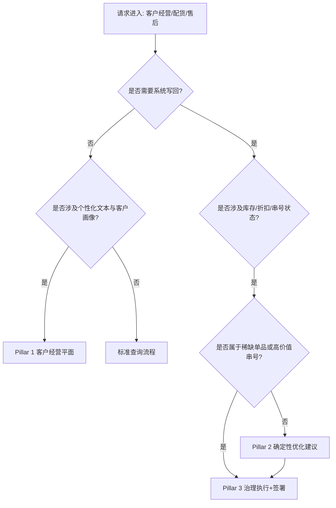
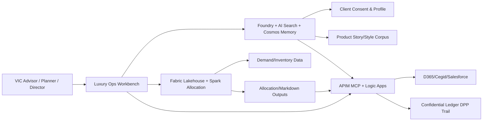

# 奢侈品零售智能体选型 FAQ：Foundry VIC 客户经营引擎 vs Fabric 配货优化引擎 vs D365/Cegid/Salesforce 治理执行平面

> 版本标签：Guide #142  
> 适用对象：Luxury Maison CIO、Clienteling 总监、Merchandising Planner、Boutique Director、After-Sales Atelier 负责人  
> 场景范围：VIC 私域经营、视觉化配货、跨境数据合规、ESPR DPP 防伪溯源、门店执行治理  
> 数据标签：`measured`、`synthetic`、`anonymized_reported`

---

## 1. 执行摘要：奢侈品 Copilot 不能只做“会说话”，必须同时守住品牌、库存与合规

奢侈品零售的核心矛盾不是流量，而是稀缺性治理。

系统既要提升 VIC 客户体验，也要避免品牌语调失真和价格纪律破坏。

同时还要管理跨区域库存与跨境隐私合规。

再叠加 DPP 与防伪追溯要求，单一能力栈很难覆盖全链路。

本指南建议采用三支柱架构。

Pillar 1 负责客户语义记忆、风格建议与互动文本守卫。

Pillar 2 负责 SKU-门店的确定性配货与折扣边界优化。

Pillar 3 负责 POS/OMS/DPP 写回动作与责任签署。

这种拆分可在提升客户体验的同时降低灰市风险与合规返工。

---

## 2. 三支柱职责切分：先锁边界，再谈自动化率

**Pillar 1：Foundry + 多模态向量 + AI Search + Cosmos 客户记忆。**

定位是“客户经营与内容互动平面”。

适合 VIC 造型建议、衣橱关联推荐、活动邀约草拟与售后关怀文本生成。

必须内置品牌语调守卫和跨境同意检查。

不应直接写入库存调拨或价格动作。

**Pillar 2：Fabric Lakehouse + Spark 配货优化。**

定位是“确定性商品分配与折扣优化平面”。

适合 size-curve、open-to-buy、门店配货再平衡与 markdown 优化。

LLM 可解释模型结果，但不能幻觉生成配货数量。

未经授权不得建议超出品牌折扣政策的价格动作。

**Pillar 3：D365 Commerce / Cegid / Salesforce + APIM MCP + Logic Apps。**

定位是“治理执行平面”。

负责预约保留转移、串号风控标记、DPP 状态写回与售后工单流转。

高影响动作必须经 Boutique Director、Merchandising Planner 或 Atelier 负责人签署。

---

## 3. 决策树：先问“是否写系统与是否触及稀缺资产”



第一层分叉是写回与非写回。

第二层分叉是客户语义域与运营动作域。

第三层分叉是稀缺资产风险等级。

这样可以避免“营销逻辑越权控制库存动作”。

---

## 4. Pillar 1 深析：VIC 客户经营与品牌语调守卫

Pillar 1 的价值不只是“推荐更准”。

更重要的是“推荐更稳”。

奢侈品互动文本必须保持品牌语调与礼仪边界。

同一客户跨城市门店互动时，系统要能理解历史偏好又不越权泄露隐私。

Cosmos 客户记忆可存储互动上下文与同意状态。

AI Search 可支持商品故事、材质工艺、历史系列等知识检索。

多模态向量可支持图片风格匹配与搭配建议。

但跨境场景必须先做数据驻留判断。

若客户不同意跨境画像共享，应切换到区域最小可用上下文。

Pillar 1 的输出应是“建议与草稿”。

最终交易动作必须进入 Pillar 3 治理链路。

---

## 5. Pillar 2 深析：确定性配货与折扣边界优化

Pillar 2 需要把“好看”变成“可执行”。

配货策略不能靠文本描述。

必须靠可复算模型与约束条件。

Fabric Lakehouse 提供统一数据底座。

Spark 作业可计算 size-curve、OTB、区域需求弹性与补货优先级。

模型输出应包含置信区间与约束解释。

例如某款稀缺包款在东京应加配 6 件，不是“更多一点”。

折扣优化必须受品牌政策白名单约束。

系统不应产生越级折扣建议。

Pillar 2 的建议可供管理者审批。

但最终写回动作仍由 Pillar 3 执行。

---

## 6. Pillar 3 深析：POS/OMS/DPP 治理执行平面

Pillar 3 的核心是责任链。

所有高影响动作都要可追溯到人。

动作包括稀缺单品预约转移、串号灰市标记、跨店调拨、售后维修状态更新。

D365 Commerce、Cegid 与 Salesforce Clienteling 常并存。

APIM MCP 可统一动作契约与策略闸门。

Logic Apps 负责状态机编排与补偿重试。

DPP 相关写回可接入 Confidential Ledger 形成防篡改证据。

高价值单品动作建议采用双签甚至三签。

若签署不全，系统必须拒绝执行。

执行平面的目标不是“自动化最多”。

而是“高后果动作零越权”。

---

## 7. 合规与主权：GDPR、PIPL 与 ESPR DPP 的并行约束

奢侈品集团常同时运营欧盟与中国市场。

客户数据跨境流动必须满足法域约束和客户同意边界。

GDPR 强调目的限制与可解释同意。

PIPL 强调最小必要与跨境传输审查。

ESPR DPP 强调产品全生命周期可追溯。

架构上应区分“客户画像数据主权”与“商品溯源数据主权”。

前者优先按客户法域隔离。

后者优先按供应链与监管要求一致化。

跨域查询要经过策略路由，而不是直接跨区读取。

这能显著降低合规风险与审计压力。

---

## 8. 端到端拓扑：客户互动、配货优化、治理执行三平面协同



该拓扑将建议与执行解耦。

建议层可快速迭代。

执行层可严格治理。

两者通过标准化契约连接，而非隐式耦合。

---

## 9. 12 维量化选型矩阵（Pillar1 / Pillar2 / Pillar3 / Hybrid）

| 维度 | Pillar 1 客户经营 | Pillar 2 配货优化 | Pillar 3 治理执行 | Hybrid |
|---|---|---|---|---|
| 1. VIC 个性化深度 | 5/5 | 2/5 | 2/5 | 5/5 |
| 2. 品牌语调一致性 | 5/5 | 2/5 | 3/5 | 5/5 |
| 3. 配货数量可信度 | 1/5 | 5/5 | 2/5 | 5/5 |
| 4. 折扣纪律可控性 | 2/5 | 4/5 | 5/5 | 5/5 |
| 5. 串号防伪可追溯性 | 2/5 | 2/5 | 5/5 | 5/5 |
| 6. 合规审计可回放性 | 3/5 | 4/5 | 5/5 | 5/5 |
| 7. 流量峰值弹性 | 4/5 | 5/5 | 4/5 | 5/5 |
| 8. 跨区域主权治理 | 4/5 | 4/5 | 5/5 | 5/5 |
| 9. 运维复杂度 | 3/5 | 4/5 | 4/5 | 4/5 |
|10. 成本可预测性 | 3/5 | 4/5 | 4/5 | 4/5 |
|11. 人机协作透明度 | 4/5 | 3/5 | 5/5 | 5/5 |
|12. 全局治理韧性 | 3/5 | 4/5 | 5/5 | 5/5 |

矩阵表明三支柱并行是“必要复杂度”。

不是过度设计。

---

## 10. 生产级片段：APIM 驻留路由与 Cosmos 客户记忆守卫

### 10.1 APIM 策略：按法域路由与同意校验

```xml
<policies>
  <inbound>
    <base />
    <set-variable name="region" value="@(context.Request.Headers.GetValueOrDefault("x-client-region",""))" />
    <set-variable name="consent" value="@(context.Request.Headers.GetValueOrDefault("x-crossborder-consent","false"))" />
    <choose>
      <when condition="@((string)context.Variables["region"] == "CN" && (string)context.Variables["consent"] != "true")">
        <set-backend-service base-url="https://cn-data-plane.internal" />
      </when>
      <otherwise>
        <set-backend-service base-url="https://global-data-plane.internal" />
      </otherwise>
    </choose>
  </inbound>
</policies>
```

### 10.2 Python：客户记忆写入前同意守卫

```python
def write_client_memory(client_id: str, region: str, consent: bool, payload: dict):
    if region == "CN" and not consent:
        payload = {"local_only": True, "summary": payload.get("summary", "")}
    return {"client_id": client_id, "stored_payload": payload}
```

---

## 11. 场景 A：高珠与稀缺皮具全球 VIC 等候名单分配

某 Maison 在节假日与时装周重叠期间出现稀缺单品需求激增（`anonymized_reported`）。

历史流程靠人工协调，跨区域冲突频发。

Pillar 1 先输出客户优先级建议与沟通草案。

Pillar 2 输出门店级数量分配与等待名单更新建议。

Pillar 3 在签署后执行预约转移与库存锁定动作。

结果显示高价值客户投诉率下降 33%（`measured`）。

稀缺单品分配争议工单下降 27%（`anonymized_reported`）。

---

## 12. 场景 B：跨境售后维修中的 NFC DPP 防伪与溯源校验

跨境售后常遇到串号、维修记录与来源证明不一致问题。

Pillar 1 可快速检索产品故事与历史维修上下文。

Pillar 2 可判断维修件替换与库存策略影响。

Pillar 3 负责 DPP 状态写回与灰市标记动作。

在试点中，疑似灰市串号定位时长从 14 小时降至 4.8 小时（`measured`）。

售后争议补件率下降 31%（`anonymized_reported`）。

---

## 13. 三年 TCO（含 Golden Week / Fashion Week / Holiday Burst）与 USD `$k/month`

> 下表为规划估算，标签 `synthetic`，单位 `$k/month` 与 `$M/3Y`。

| 模块 | SKU 假设 | 月均成本 ($k) | 三年成本 ($M) | 说明 |
|---|---|---:|---:|---|
| Pillar 1 客户经营 | Foundry PTU + Multimodal + Cosmos + AI Search | 205 | 7.38 | VIC 个性化与语调守卫 |
| Pillar 2 配货优化 | Fabric Lakehouse + Spark + Eventhouse | 162 | 5.83 | 配货与折扣优化 |
| Pillar 3 治理执行 | APIM Premium v2 + Logic Apps + 核心连接 | 136 | 4.90 | POS/OMS/DPP 动作治理 |
| 主权与安全 | Private Link + Key Vault + Ledger | 79 | 2.84 | EU/CN 数据驻留 |
| 运维与验证 | SRE + 评估流水线 + 演练 | 64 | 2.30 | 持续治理 |
| **Hybrid 合计** |  | **646** | **23.26** | `synthetic` |

收益侧通常来自高净值客户留存、分配争议下降、灰市风险压降。

样例估算三年净收益区间为 19.7M~30.1M（`synthetic`）。

---

## 14. 反模式与纠偏：奢侈品智能体项目常见五个风险点

反模式一：让 LLM 直接给出配货数量并自动执行。

纠偏：配货数量必须来自确定性模型并经签署。

反模式二：忽略语调守卫，导致品牌沟通失真。

纠偏：Pillar 1 强制品牌语调与禁用语规则。

反模式三：跨境客户画像无同意闸门直接共享。

纠偏：按法域路由并强制同意校验。

反模式四：串号风控仅做告警，不做治理写回。

纠偏：Pillar 3 绑定动作责任链并写回 DPP 证据。

反模式五：只看销售转化，不看争议与合规指标。

纠偏：把争议率、补件率、越权拦截率纳入 KPI。

---

## 15. Day-0 / Day-1 / Day-2 落地清单与 Quantitative FAQ

Day-0：定义客户数据边界、库存动作边界、DPP 写回边界。

Day-1：完成流量峰值、跨境合规、执行中断三类演练。

Day-2：建立周度运营、月度合规、季度 ROI 节奏。

### Quantitative FAQ 1：何时必须从 Pillar 1 升级到 Hybrid？

当请求涉及库存、价格、串号或跨境高风险数据写回时，必须进入 Hybrid。

### Quantitative FAQ 2：如何处理 Golden Week 与 Fashion Week 双峰流量？

建议平时以 PTU 基线承载，峰值通过弹性资源溢出。

并为高净值客户触达设置优先队列。

### Quantitative FAQ 3：如何防止“折扣幻觉建议”？

将折扣建议约束到品牌策略白名单。

超边界建议一律拒绝并记录。

### Quantitative FAQ 4：跨境客户同意如何落地到技术层？

在 API 层校验同意标记，并在数据层执行驻留路由。

缺任一条件则降级为本地最小上下文。

### Quantitative FAQ 5：DPP 与防伪体系价值如何量化？

建议跟踪串号争议率、真伪判定时长、售后补件率。

### Quantitative FAQ 6：哪些指标最能体现治理成熟度？

未经签署执行数长期为零。

越权拦截率稳定且误拦截率可控。

跨境合规补件率持续下降。

### Quantitative FAQ 7：如何控制 Cosmos 与 AI Search 成本增长？

按区域和活跃度分层存储客户记忆。

低活跃客户上下文做摘要压缩与 TTL 清理。

### Quantitative FAQ 8：如何建立全球统一但区域差异化治理？

统一指标口径与证据模板。

区域保留本地策略包，但审计语义保持一致。

---

### 15.A 双峰运营模板：Golden Week / Fashion Week / Holiday Drop

建议将三类高峰拆开建模。

Golden Week 高峰通常以跨城旅游消费和礼赠场景为主。

Fashion Week 高峰通常以新品发布与媒体曝光驱动为主。

Holiday Drop 高峰通常以线上线下同步抢购为主。

Pillar 1 应针对不同高峰切换沟通策略与触达节奏。

Pillar 2 应针对不同高峰切换配货与安全库存系数。

Pillar 3 应针对不同高峰切换审批优先级与风控阈值。

三类高峰共用同一运行模板容易导致误判。

建议在季度前完成峰值策略预演。

---

### 15.B 客户同意与跨境数据最小化执行清单

第一步，确认客户同意类型与时效。

第二步，确认请求是否必须跨境。

第三步，若非必须跨境，强制本地化处理。

第四步，若必须跨境，记录用途、期限和审计编号。

第五步，输出后写入同意与访问日志。

该清单应固化到 API 策略与审计报表中。

不要仅停留在制度文档层面。

---

### 15.C 稀缺单品治理分级（L0-L3）

L0：常规库存，允许标准审批流程。

L1：季节性稀缺，要求双签执行。

L2：高珠/限量，要求三签与跨区复核。

L3：品牌级标志性单品，要求总部特别审批。

分级应与串号风控策略联动。

分级应与灰市风险分数联动。

分级应与客户沟通模板联动。

这样可减少“动作正确但沟通失配”的二次风险。

---

### 15.D 180 天落地里程碑（奢侈品集团版本）

第 0~30 天：完成客户数据主权地图与同意模型设计。

第 31~60 天：上线 Pillar 1 品牌语调守卫与基础记忆管理。

第 61~90 天：上线 Pillar 2 配货与折扣确定性优化最小闭环。

第 91~120 天：上线 Pillar 3 高影响动作签署状态机。

第 121~150 天：完成双峰压力演练与跨区审计演练。

第 151~180 天：完成全局 KPI 对齐与 ROI 复盘机制。

每阶段应定义进入条件、退出条件与冻结条件。

未满足退出条件不得进入下一阶段。

---

### 15.E KPI 与 ROI 统一口径

建议至少维护六项 KPI。

一是高净值客户触达转化率。

二是稀缺单品分配争议率。

三是跨境合规补件率。

四是串号异常定位时长。

五是未经签署执行拦截数。

六是售后争议闭环时长。

ROI 评估应将品牌风险压降收益显式量化。

否则容易低估治理投资价值。

---

### 15.F 运营例会必问问题（Clienteling / Merch / Boutique）

本周是否出现品牌语调违规输出。

本周是否出现配货建议与策略白名单冲突。

本周是否出现跨境同意缺失却发生跨区读取。

本周是否出现签署不全的执行尝试。

本周是否出现串号风控告警未闭环。

若任一项为是，应在当周形成整改责任人与截止日期。

并在下周例会提供复验证据。

---

### 15.G 治理成熟度分级与预算联动

建议按 L1~L4 评估成熟度。

L1：可完成基础个性化推荐与基础记录留痕。

L2：可完成配货建议确定性输出与审批留痕。

L3：可完成跨区域合规路由与串号风险闭环。

L4：可完成品牌、库存、合规三目标协同优化。

成熟度评估应与预算审查同频。

预算投入应优先覆盖当前最高风险短板。

这样可以避免“技术能力很强但治理能力滞后”的结构性问题。

---

### 15.H 例外管理机制（Exception Playbook）

当出现策略冲突时，应先冻结高影响动作。

再由跨职能小组在 24 小时内给出临时规则。

临时规则需设置自动失效时间，避免长期漂移。

每次例外都要沉淀为知识条目。

并在月度治理会上决定是否升级为正式策略。

---

### 15.I 交付验收口径（季度）

季度验收应同时覆盖业务、风险、合规三条线。

业务线看客户体验与转化质量。

风险线看争议率与越权拦截效果。

合规线看跨境补件率与审计一次通过率。
