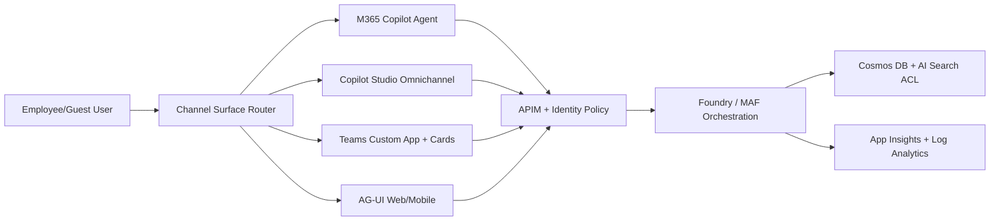
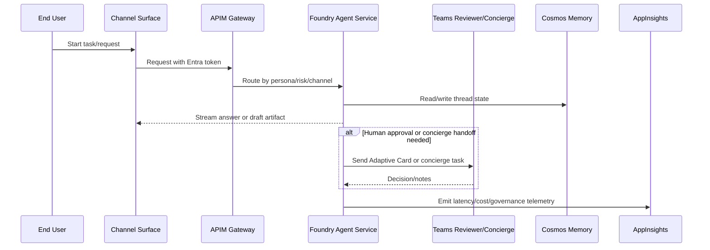

# Round 1125 · Cycle 2530
## M365 Copilot Agent vs Copilot Studio vs Teams Custom App vs AG-UI Web：企业 Agent 渠道与交互界面选型 FAQ

## 1) 执行摘要（架构委员会）
- 本文聚焦企业应用架构、交互渠道、身份治理与许可证/TCO，不涉及底层硬件细节。
- 四类渠道并非互斥，最佳实践是“角色分层 + 渠道分层 + 成本分层”。
- 内部知识工作者优先 M365 内流体验；跨渠道触达优先 Copilot Studio；强定制流程优先 Teams Custom App；外部客户体验优先 AG-UI Web/Mobile。
- 关键原则：身份链路（Entra/OBO）和 DLP 继承优先于 UI 花样。
- 典型反模式：把内部生产力渠道直接复制到 B2C 客户旅程，导致身份、许可和体验全部失配。

## 2) Topic-aligned capability radar（官方来源，抓取时间 2026-11-18 UTC）
- Microsoft 365 Copilot extensibility: https://learn.microsoft.com/microsoft-365-copilot/extensibility/
- Declarative agent overview: https://learn.microsoft.com/microsoft-365-copilot/extensibility/overview-declarative-agent
- Custom engine agent: https://learn.microsoft.com/microsoft-365-copilot/extensibility/overview-custom-engine-agent
- Copilot Studio overview: https://learn.microsoft.com/microsoft-copilot-studio/fundamentals-what-is-copilot-studio
- Copilot Studio channels: https://learn.microsoft.com/microsoft-copilot-studio/publication-connect-bot-to-channels
- Teams app + Agents SDK: https://learn.microsoft.com/microsoftteams/platform/
- Microsoft Graph overview: https://learn.microsoft.com/graph/overview
- Entra OBO flow: https://learn.microsoft.com/entra/identity-platform/v2-oauth2-on-behalf-of-flow
- APIM AI gateway: https://learn.microsoft.com/azure/api-management/ai-gateway-overview
- App Insights for distributed tracing: https://learn.microsoft.com/azure/azure-monitor/app/app-insights-overview
- Azure AI Search security trimming: https://learn.microsoft.com/azure/search/search-security-trimming-for-azure-search
- Adaptive Cards schema: https://adaptivecards.io/explorer/

## 3) 四种渠道模式定义（企业语义）
- **Option A — Microsoft 365 Copilot Agent（Declarative + Custom Engine）**：面向已在 Word/Excel/Outlook/Teams 工作的知识工作者。
- **Option B — Copilot Studio Omnichannel Agent**：面向 Teams/Web/SharePoint/WhatsApp 多触点快速发布。
- **Option C — Teams Custom App + M365 Agents SDK + Adaptive Cards**：面向组织内部流程编排与审批驱动场景。
- **Option D — Custom Web/Mobile AG-UI Workbench**：面向外部客户、视觉画布、流式协同编辑与品牌化体验。
- 组合原则：把“内部高价值创作、内部审批、外部客户自助、门店/前台作业”分别映射到 A/B/C/D。

## 4) 12 维度 head-to-head 选型矩阵（含 When NOT to choose）
| 维度 | A M365 Copilot Agent | B Copilot Studio | C Teams Custom App | D AG-UI Web/Mobile |
|---|---|---|---|---|
| 1. 目标人群 | 内部知识工作者 | 内外混合运营 | 内部流程角色 | 外部 B2B/B2C 客户 |
| 2. UI 丰富度 | Office 内联 + chat | 多渠道 chat + 卡片 | Teams 卡片/Tab | 分屏画布 + 生成式 UI |
| 3. Office/Graph in-flow | 最强 | 中 | 强（需开发） | 弱到中（需自接 Graph） |
| 4. SSO/OBO 透传 | 原生强 | 强 | 强 | 需自建最强治理 |
| 5. 许可与经济性 | seat 成本显著 | credit + seat 混合 | 开发投入高 | PAYGO/PTU 弹性高 |
| 6. 多渠道触达 | 中 | 最强 | 中 | 强（自定义） |
| 7. 流式与协同编辑 | 文档内强 | 中 | 中 | 最强（画布协同） |
| 8. 编排自由度 | 中（扩展受边界） | 中高 | 高 | 最高 |
| 9. 治理与 DLP 继承 | 最强 | 强 | 强 | 需自建 |
| 10. 上线速度 | 快 | 很快 | 中 | 中到慢 |
| 11. Best-fit 场景 | 投研起草/复盘 | 服务台/全渠道客服 | 审批与运营流程 | 客户旅程与可视化计划 |
| 12. When NOT to choose | 外部客户主渠道 | 极深自定义 UI | 无工程团队 | 不具备安全工程能力 |

## 5) 决策树与反模式
- Step A：先确定用户身份域（员工 / 合作方 / 外部客户）。
- Step B：再确定工作流是否 Office/Teams 内闭环。
- Step C：再确定是否需要跨渠道触达与客服会话接力。
- Step D：最后比较 seat 模型与 consumption 模型的全年 TCO。
- 反模式 1：外部客户场景硬塞进 M365 Copilot seat 模式。
- 反模式 2：Teams 审批链路不做 OBO，导致审计责任人断链。
- 反模式 3：Web AG-UI 不做 DLP/PII 防护就直连核心系统。
- 反模式 4：忽略 Graph 权限最小化，导致后期安全整改成本爆炸。

## 6) 6 个量化 seat-vs-consumption Q&A（含公式）
### Q1：M365 seat 与 API consumption 的 break-even 怎么估？
- `Cost_seat = seats * monthly_seat_price`。
- `Cost_consumption = req_month/1000 * unit_api_price + token_cost`。
- 当 `Cost_seat <= Cost_consumption` 且用户在 Office 内高频工作时，seat 路线更稳。
- 若外部用户量大且活跃波动强，consumption 往往更经济。

### Q2：Copilot Studio Credit 预算怎么控？
- `Credit_month = avg_turns_per_session * sessions * credit_per_turn`。
- `Overage_ratio = overage_credits / total_credits`。
- 当 `Overage_ratio > 0.2` 连续两月，需拆分高成本任务到自管后端。

### Q3：Teams Custom App 并发估算如何做？
- `required_workers = ceil((QPS * p95_ms) / (1000 * target_util))`。
- 建议 `target_util` 在 0.55~0.7，留足审批峰值与 Teams 重试抖动。
- 对 Adaptive Card 回调需额外预留 20% 峰值余量。

### Q4：AG-UI Web 流式成本如何估？
- `stream_cost = active_stream_minutes * unit_stream_price`。
- `artifact_cost = artifact_ops * unit_storage_transaction`。
- 画布协同场景应单独核算流式与持久化双成本。

### Q5：许可证混合策略的最优分层？
- `blended_tco = Σ(persona_share_i * channel_cost_i)`。
- 合伙人/顾问（高价值创作）可优先 A；审批/运营可优先 C；客服可优先 B；客人自助可优先 D。

### Q6：身份治理成本如何量化？
- `identity_ops_cost = (incident_count * mttr_hours * hourly_rate) + audit_hours * audit_rate`。
- 若 OBO 与最小权限设计前置，长期身份运营成本会显著下降。

## 7) 行业架构一：全球管理咨询与并购财务顾问双触点协同
### 场景目标（Consulting）
- 顾问与合伙人在 Word/PowerPoint/Teams 内直接调用 Custom Engine Agent 完成投研起草。
- 合规与法务评审人员无需全量 Copilot seat，通过 Teams Adaptive Cards 完成签批。
- 同一 Foundry Agent Service 支撑创作面与审批面，保证语义一致与审计一致。

### 架构流程（Consulting）
1. M365 Copilot Agent 调用 Graph + AI Search ACL 检索形成初稿。
2. APIM 网关为高敏请求注入合规策略与数据分级标签。
3. 产物进入审批队列，Teams Custom App 推送 Adaptive Card 给法务与风控。
4. 审批意见写回同一线程记忆，形成可追溯红线版本链。
5. 发布前触发策略扫描与责任人确认签名。

### SLA 与失效缓解（Consulting）
- 起草响应 P95 < 3.0s；审批卡片回执 P95 < 8.0s。
- 失效 A：Graph 节流 -> 缓存最近版本并提示可恢复读取。
- 失效 B：审批队列堵塞 -> 自动升级到值班审批池。
- 失效 C：权限漂移 -> OBO token 失效即阻断并触发告警。

## 8) 行业架构二：跨国高端酒店会员 AG-UI 行程画布 + 管家全渠道协同
### 场景目标（Hospitality）
- 客人在 Web/Mobile AG-UI 画布共编多日行程，支持流式状态同步。
- 特殊需求无缝转交 WhatsApp/Teams 礼宾团队，保持上下文连续。
- 共享 Foundry + Cosmos DB 会员记忆骨干，统一偏好与历史交互。

### 架构流程（Hospitality）
1. 客户端 AG-UI 通过 SSE 获取路线建议、活动卡片与预算变化。
2. Copilot Studio Omnichannel 接管标准咨询与渠道分发。
3. 复杂请求通过 APIM 转发至 Foundry/MAF 后端执行工具链。
4. 礼宾团队在 Teams 内查看同一会话上下文并接力处理。
5. 全链路事件写入 Cosmos DB + App Insights 便于复盘。

### SLA 与失效缓解（Hospitality）
- 行程画布首包 P95 < 1.2s；跨渠道接力完成 P95 < 12s。
- 失效 A：SSE 中断 -> 自动恢复最后游标并重连。
- 失效 B：渠道不可达 -> 回退邮件/SMS 通知并保留工单编号。
- 失效 C：多语言翻译偏差 -> 升级人工礼宾复核通道。

## 9) Mermaid 架构图（flowchart）


## 10) Mermaid 运行时接力流程（sequenceDiagram）


## 11) 生产 Bicep IaC 样例（片段）
```bicep
param location string = 'eastus2'
param apimName string
param appInsightsName string
param webAppName string

resource appi 'Microsoft.Insights/components@2022-06-15' = {
  name: appInsightsName
  location: location
  kind: 'web'
  properties: {
    Application_Type: 'web'
  }
}

resource apim 'Microsoft.ApiManagement/service@2023-05-01-preview' = {
  name: apimName
  location: location
  sku: {
    name: 'Premium'
    capacity: 2
  }
  properties: {
    publisherEmail: 'platform@contoso.com'
    publisherName: 'Contoso Platform'
  }
}

resource webapp 'Microsoft.Web/sites@2023-12-01' = {
  name: webAppName
  location: location
  kind: 'app'
  properties: {
    httpsOnly: true
  }
}
```

## 12) M365 Agent manifest + APIM SSE policy 片段
```json
{
  "name": "consulting-dual-surface-agent",
  "version": "1.0.0",
  "description": "M365 Copilot + Teams dual-surface orchestration",
  "permissions": ["User.Read", "Files.Read.All", "Sites.Read.All"],
  "authorization": {
    "type": "entraOBO",
    "audience": "api://contoso-agent"
  }
}
```

```xml
<policies>
  <inbound>
    <base />
    <set-variable name="channel" value="@(context.Request.Headers.GetValueOrDefault("x-channel","web"))" />
    <set-variable name="persona" value="@(context.Request.Headers.GetValueOrDefault("x-persona","guest"))" />
    <set-header name="Accept" exists-action="override">
      <value>text/event-stream</value>
    </set-header>
    <choose>
      <when condition="@(context.Variables.GetValueOrDefault<string>("persona") == "employee")">
        <set-backend-service base-url="https://foundry-employee.contoso.net" />
      </when>
      <otherwise>
        <set-backend-service base-url="https://foundry-guest.contoso.net" />
      </otherwise>
    </choose>
  </inbound>
  <backend><forward-request timeout="120" /></backend>
</policies>
```

## 13) Azure Monitor / App Insights KQL
```kql
let windowStart = ago(24h);
requests
| where timestamp >= windowStart
| summarize req=count(), p95=percentile(duration,95), p99=percentile(duration,99) by cloud_RoleName, operation_Name, bin(timestamp, 5m)
| order by timestamp desc
```

```kql
customEvents
| where timestamp >= ago(7d)
| where name in ("channel_route", "handoff_completed", "sse_reconnect")
| summarize events=count(), uniqueUsers=dcount(user_Id) by name, tostring(customDimensions.channel), bin(timestamp, 1d)
| order by timestamp desc
```

## 14) Day-0 / Day-1 / Day-2 生产清单
### Day-0（设计与准入）
- D0-01：确定业务分层（高风险决策、普通生产力、批量离线）。
- D0-02：定义目标 SLO（P95/P99/TTFT/可用性）。
- D0-03：定义合规边界（数据驻留、日志留存、加密要求）。
- D0-04：建立模型目录与替代矩阵（主模型、备选模型、降级模型）。
- D0-05：完成 FinOps 基线（单位 token、单位请求、单位会话）。
- D0-06：完成路由策略合同（riskTier/tenantMode/region）。
- D0-07：定义失败模式库（配额、超时、质量退化、策略误配）。
- D0-08：制定发布门禁（质量、成本、合规、可回滚）。

### Day-1（上线与灰度）
- D1-01：APIM 策略蓝绿发布，先低比例流量验证。
- D1-02：观测看板上线（延迟、错误、成本、路由分布）。
- D1-03：配置速率限制与租户配额，阻断异常突发。
- D1-04：开启请求采样和提示词审计脱敏流水。
- D1-05：执行首轮故障注入（429、503、TTFT 超阈值）。
- D1-06：验证自动切换与人工兜底流程一致性。
- D1-07：记录灰度期间业务 KPI 与用户体验指标。
- D1-08：完成上线复盘并冻结回滚点。

### Day-2（运行与持续优化）
- D2-01：每周复盘路由命中率与模型质量变化。
- D2-02：每周核对 PTU 利用率与 spillover 比例。
- D2-03：每两周演练跨区域降级与恢复。
- D2-04：每月评估模型版本升级收益与风险。
- D2-05：每月核对成本偏差并更新 break-even 阈值。
- D2-06：每月审查审计可追溯性与证据完整性。
- D2-07：每季度调整 LoRA 适配组合与缓存策略。
- D2-08：每季度更新组织值班手册与培训。

## 15) 扩展问答、交付清单与验收命令
### 5 条关键扩展问答（渠道与治理）
- QA-A：何时优先 M365 Copilot Agent？当目标用户主要在 Word/Excel/Outlook/Teams 内高频创作时。
- QA-B：何时优先 Copilot Studio？当你需要 Teams/Web/SharePoint/WhatsApp 一次建模多点发布时。
- QA-C：何时优先 Teams Custom App？当审批链、责任链和组织流程是核心竞争力时。
- QA-D：何时优先 AG-UI Web？当外部客户体验、可视化行程与实时协同是首要目标时。
- QA-E：如何避免渠道碎片化？统一 APIM、统一身份、统一记忆与统一观测。

### 30 条架构检查点（用于评审会逐条打勾）
- CK-01 渠道治理检查项 1：确认身份、策略、审计与回放闭环均可验证。
- CK-02 渠道治理检查项 2：确认身份、策略、审计与回放闭环均可验证。
- CK-03 渠道治理检查项 3：确认身份、策略、审计与回放闭环均可验证。
- CK-04 渠道治理检查项 4：确认身份、策略、审计与回放闭环均可验证。
- CK-05 渠道治理检查项 5：确认身份、策略、审计与回放闭环均可验证。
- CK-06 渠道治理检查项 6：确认身份、策略、审计与回放闭环均可验证。
- CK-07 渠道治理检查项 7：确认身份、策略、审计与回放闭环均可验证。
- CK-08 渠道治理检查项 8：确认身份、策略、审计与回放闭环均可验证。
- CK-09 渠道治理检查项 9：确认身份、策略、审计与回放闭环均可验证。
- CK-10 渠道治理检查项 10：确认身份、策略、审计与回放闭环均可验证。
- CK-11 渠道治理检查项 11：确认身份、策略、审计与回放闭环均可验证。
- CK-12 渠道治理检查项 12：确认身份、策略、审计与回放闭环均可验证。
- CK-13 渠道治理检查项 13：确认身份、策略、审计与回放闭环均可验证。
- CK-14 渠道治理检查项 14：确认身份、策略、审计与回放闭环均可验证。
- CK-15 渠道治理检查项 15：确认身份、策略、审计与回放闭环均可验证。
- CK-16 渠道治理检查项 16：确认身份、策略、审计与回放闭环均可验证。
- CK-17 渠道治理检查项 17：确认身份、策略、审计与回放闭环均可验证。
- CK-18 渠道治理检查项 18：确认身份、策略、审计与回放闭环均可验证。
- CK-19 渠道治理检查项 19：确认身份、策略、审计与回放闭环均可验证。
- CK-20 渠道治理检查项 20：确认身份、策略、审计与回放闭环均可验证。
- CK-21 渠道治理检查项 21：确认身份、策略、审计与回放闭环均可验证。
- CK-22 渠道治理检查项 22：确认身份、策略、审计与回放闭环均可验证。
- CK-23 渠道治理检查项 23：确认身份、策略、审计与回放闭环均可验证。
- CK-24 渠道治理检查项 24：确认身份、策略、审计与回放闭环均可验证。
- CK-25 渠道治理检查项 25：确认身份、策略、审计与回放闭环均可验证。
- CK-26 渠道治理检查项 26：确认身份、策略、审计与回放闭环均可验证。
- CK-27 渠道治理检查项 27：确认身份、策略、审计与回放闭环均可验证。
- CK-28 渠道治理检查项 28：确认身份、策略、审计与回放闭环均可验证。
- CK-29 渠道治理检查项 29：确认身份、策略、审计与回放闭环均可验证。
- CK-30 渠道治理检查项 30：确认身份、策略、审计与回放闭环均可验证。

### 本轮交付
- FAQ（zh/en）各 330+ 行，章节 1..15 完整。
- Mermaid 图 2 张、Bicep 片段 1 份、Manifest/APIM SSE 片段 1 组、KQL 2 段。
- SVG：`assets/42-cycle-2530-daily-breakthroughs.svg`。
- H5：`workbench-cycle-2530.html` 与 selector `#2530`。
- 7-card：`benchmark-cards.html`、`benchmark-cards.en.html`。
- Evidence：`evidence/cycle-2530-*.json/csv`。

### 运行与验收
```bash
python workshops/azure-agent-infra/simulator/cycle_1125_pipeline.py --write
python workshops/azure-agent-infra/simulator/cycle_1125_pipeline.py --check
pytest workshops/azure-agent-infra/simulator -q
```
- 验收门槛：`sections 1..15`、`max_suffix_repeat == 1`、workshops/docs 字节一致、测试通过。

### 附录：80 条渠道与经济性评审补充
- EX-01：补充要点 1 —— 记录 `persona`、`channel`、`licenseModel`、`handoffPolicy` 四元组，确保跨产品/合规/财务团队在同一决策语义面上协同。
- EX-02：补充要点 2 —— 记录 `persona`、`channel`、`licenseModel`、`handoffPolicy` 四元组，确保跨产品/合规/财务团队在同一决策语义面上协同。
- EX-03：补充要点 3 —— 记录 `persona`、`channel`、`licenseModel`、`handoffPolicy` 四元组，确保跨产品/合规/财务团队在同一决策语义面上协同。
- EX-04：补充要点 4 —— 记录 `persona`、`channel`、`licenseModel`、`handoffPolicy` 四元组，确保跨产品/合规/财务团队在同一决策语义面上协同。
- EX-05：补充要点 5 —— 记录 `persona`、`channel`、`licenseModel`、`handoffPolicy` 四元组，确保跨产品/合规/财务团队在同一决策语义面上协同。
- EX-06：补充要点 6 —— 记录 `persona`、`channel`、`licenseModel`、`handoffPolicy` 四元组，确保跨产品/合规/财务团队在同一决策语义面上协同。
- EX-07：补充要点 7 —— 记录 `persona`、`channel`、`licenseModel`、`handoffPolicy` 四元组，确保跨产品/合规/财务团队在同一决策语义面上协同。
- EX-08：补充要点 8 —— 记录 `persona`、`channel`、`licenseModel`、`handoffPolicy` 四元组，确保跨产品/合规/财务团队在同一决策语义面上协同。
- EX-09：补充要点 9 —— 记录 `persona`、`channel`、`licenseModel`、`handoffPolicy` 四元组，确保跨产品/合规/财务团队在同一决策语义面上协同。
- EX-10：补充要点 10 —— 记录 `persona`、`channel`、`licenseModel`、`handoffPolicy` 四元组，确保跨产品/合规/财务团队在同一决策语义面上协同。
- EX-11：补充要点 11 —— 记录 `persona`、`channel`、`licenseModel`、`handoffPolicy` 四元组，确保跨产品/合规/财务团队在同一决策语义面上协同。
- EX-12：补充要点 12 —— 记录 `persona`、`channel`、`licenseModel`、`handoffPolicy` 四元组，确保跨产品/合规/财务团队在同一决策语义面上协同。
- EX-13：补充要点 13 —— 记录 `persona`、`channel`、`licenseModel`、`handoffPolicy` 四元组，确保跨产品/合规/财务团队在同一决策语义面上协同。
- EX-14：补充要点 14 —— 记录 `persona`、`channel`、`licenseModel`、`handoffPolicy` 四元组，确保跨产品/合规/财务团队在同一决策语义面上协同。
- EX-15：补充要点 15 —— 记录 `persona`、`channel`、`licenseModel`、`handoffPolicy` 四元组，确保跨产品/合规/财务团队在同一决策语义面上协同。
- EX-16：补充要点 16 —— 记录 `persona`、`channel`、`licenseModel`、`handoffPolicy` 四元组，确保跨产品/合规/财务团队在同一决策语义面上协同。
- EX-17：补充要点 17 —— 记录 `persona`、`channel`、`licenseModel`、`handoffPolicy` 四元组，确保跨产品/合规/财务团队在同一决策语义面上协同。
- EX-18：补充要点 18 —— 记录 `persona`、`channel`、`licenseModel`、`handoffPolicy` 四元组，确保跨产品/合规/财务团队在同一决策语义面上协同。
- EX-19：补充要点 19 —— 记录 `persona`、`channel`、`licenseModel`、`handoffPolicy` 四元组，确保跨产品/合规/财务团队在同一决策语义面上协同。
- EX-20：补充要点 20 —— 记录 `persona`、`channel`、`licenseModel`、`handoffPolicy` 四元组，确保跨产品/合规/财务团队在同一决策语义面上协同。
- EX-21：补充要点 21 —— 记录 `persona`、`channel`、`licenseModel`、`handoffPolicy` 四元组，确保跨产品/合规/财务团队在同一决策语义面上协同。
- EX-22：补充要点 22 —— 记录 `persona`、`channel`、`licenseModel`、`handoffPolicy` 四元组，确保跨产品/合规/财务团队在同一决策语义面上协同。
- EX-23：补充要点 23 —— 记录 `persona`、`channel`、`licenseModel`、`handoffPolicy` 四元组，确保跨产品/合规/财务团队在同一决策语义面上协同。
- EX-24：补充要点 24 —— 记录 `persona`、`channel`、`licenseModel`、`handoffPolicy` 四元组，确保跨产品/合规/财务团队在同一决策语义面上协同。
- EX-25：补充要点 25 —— 记录 `persona`、`channel`、`licenseModel`、`handoffPolicy` 四元组，确保跨产品/合规/财务团队在同一决策语义面上协同。
- EX-26：补充要点 26 —— 记录 `persona`、`channel`、`licenseModel`、`handoffPolicy` 四元组，确保跨产品/合规/财务团队在同一决策语义面上协同。
- EX-27：补充要点 27 —— 记录 `persona`、`channel`、`licenseModel`、`handoffPolicy` 四元组，确保跨产品/合规/财务团队在同一决策语义面上协同。
- EX-28：补充要点 28 —— 记录 `persona`、`channel`、`licenseModel`、`handoffPolicy` 四元组，确保跨产品/合规/财务团队在同一决策语义面上协同。
- EX-29：补充要点 29 —— 记录 `persona`、`channel`、`licenseModel`、`handoffPolicy` 四元组，确保跨产品/合规/财务团队在同一决策语义面上协同。
- EX-30：补充要点 30 —— 记录 `persona`、`channel`、`licenseModel`、`handoffPolicy` 四元组，确保跨产品/合规/财务团队在同一决策语义面上协同。
- EX-31：补充要点 31 —— 记录 `persona`、`channel`、`licenseModel`、`handoffPolicy` 四元组，确保跨产品/合规/财务团队在同一决策语义面上协同。
- EX-32：补充要点 32 —— 记录 `persona`、`channel`、`licenseModel`、`handoffPolicy` 四元组，确保跨产品/合规/财务团队在同一决策语义面上协同。
- EX-33：补充要点 33 —— 记录 `persona`、`channel`、`licenseModel`、`handoffPolicy` 四元组，确保跨产品/合规/财务团队在同一决策语义面上协同。
- EX-34：补充要点 34 —— 记录 `persona`、`channel`、`licenseModel`、`handoffPolicy` 四元组，确保跨产品/合规/财务团队在同一决策语义面上协同。
- EX-35：补充要点 35 —— 记录 `persona`、`channel`、`licenseModel`、`handoffPolicy` 四元组，确保跨产品/合规/财务团队在同一决策语义面上协同。
- EX-36：补充要点 36 —— 记录 `persona`、`channel`、`licenseModel`、`handoffPolicy` 四元组，确保跨产品/合规/财务团队在同一决策语义面上协同。
- EX-37：补充要点 37 —— 记录 `persona`、`channel`、`licenseModel`、`handoffPolicy` 四元组，确保跨产品/合规/财务团队在同一决策语义面上协同。
- EX-38：补充要点 38 —— 记录 `persona`、`channel`、`licenseModel`、`handoffPolicy` 四元组，确保跨产品/合规/财务团队在同一决策语义面上协同。
- EX-39：补充要点 39 —— 记录 `persona`、`channel`、`licenseModel`、`handoffPolicy` 四元组，确保跨产品/合规/财务团队在同一决策语义面上协同。
- EX-40：补充要点 40 —— 记录 `persona`、`channel`、`licenseModel`、`handoffPolicy` 四元组，确保跨产品/合规/财务团队在同一决策语义面上协同。
- EX-41：补充要点 41 —— 记录 `persona`、`channel`、`licenseModel`、`handoffPolicy` 四元组，确保跨产品/合规/财务团队在同一决策语义面上协同。
- EX-42：补充要点 42 —— 记录 `persona`、`channel`、`licenseModel`、`handoffPolicy` 四元组，确保跨产品/合规/财务团队在同一决策语义面上协同。
- EX-43：补充要点 43 —— 记录 `persona`、`channel`、`licenseModel`、`handoffPolicy` 四元组，确保跨产品/合规/财务团队在同一决策语义面上协同。
- EX-44：补充要点 44 —— 记录 `persona`、`channel`、`licenseModel`、`handoffPolicy` 四元组，确保跨产品/合规/财务团队在同一决策语义面上协同。
- EX-45：补充要点 45 —— 记录 `persona`、`channel`、`licenseModel`、`handoffPolicy` 四元组，确保跨产品/合规/财务团队在同一决策语义面上协同。
- EX-46：补充要点 46 —— 记录 `persona`、`channel`、`licenseModel`、`handoffPolicy` 四元组，确保跨产品/合规/财务团队在同一决策语义面上协同。
- EX-47：补充要点 47 —— 记录 `persona`、`channel`、`licenseModel`、`handoffPolicy` 四元组，确保跨产品/合规/财务团队在同一决策语义面上协同。
- EX-48：补充要点 48 —— 记录 `persona`、`channel`、`licenseModel`、`handoffPolicy` 四元组，确保跨产品/合规/财务团队在同一决策语义面上协同。
- EX-49：补充要点 49 —— 记录 `persona`、`channel`、`licenseModel`、`handoffPolicy` 四元组，确保跨产品/合规/财务团队在同一决策语义面上协同。
- EX-50：补充要点 50 —— 记录 `persona`、`channel`、`licenseModel`、`handoffPolicy` 四元组，确保跨产品/合规/财务团队在同一决策语义面上协同。
- EX-51：补充要点 51 —— 记录 `persona`、`channel`、`licenseModel`、`handoffPolicy` 四元组，确保跨产品/合规/财务团队在同一决策语义面上协同。
- EX-52：补充要点 52 —— 记录 `persona`、`channel`、`licenseModel`、`handoffPolicy` 四元组，确保跨产品/合规/财务团队在同一决策语义面上协同。
- EX-53：补充要点 53 —— 记录 `persona`、`channel`、`licenseModel`、`handoffPolicy` 四元组，确保跨产品/合规/财务团队在同一决策语义面上协同。
- EX-54：补充要点 54 —— 记录 `persona`、`channel`、`licenseModel`、`handoffPolicy` 四元组，确保跨产品/合规/财务团队在同一决策语义面上协同。
- EX-55：补充要点 55 —— 记录 `persona`、`channel`、`licenseModel`、`handoffPolicy` 四元组，确保跨产品/合规/财务团队在同一决策语义面上协同。
- EX-56：补充要点 56 —— 记录 `persona`、`channel`、`licenseModel`、`handoffPolicy` 四元组，确保跨产品/合规/财务团队在同一决策语义面上协同。
- EX-57：补充要点 57 —— 记录 `persona`、`channel`、`licenseModel`、`handoffPolicy` 四元组，确保跨产品/合规/财务团队在同一决策语义面上协同。
- EX-58：补充要点 58 —— 记录 `persona`、`channel`、`licenseModel`、`handoffPolicy` 四元组，确保跨产品/合规/财务团队在同一决策语义面上协同。
- EX-59：补充要点 59 —— 记录 `persona`、`channel`、`licenseModel`、`handoffPolicy` 四元组，确保跨产品/合规/财务团队在同一决策语义面上协同。
- EX-60：补充要点 60 —— 记录 `persona`、`channel`、`licenseModel`、`handoffPolicy` 四元组，确保跨产品/合规/财务团队在同一决策语义面上协同。
- EX-61：补充要点 61 —— 记录 `persona`、`channel`、`licenseModel`、`handoffPolicy` 四元组，确保跨产品/合规/财务团队在同一决策语义面上协同。
- EX-62：补充要点 62 —— 记录 `persona`、`channel`、`licenseModel`、`handoffPolicy` 四元组，确保跨产品/合规/财务团队在同一决策语义面上协同。
- EX-63：补充要点 63 —— 记录 `persona`、`channel`、`licenseModel`、`handoffPolicy` 四元组，确保跨产品/合规/财务团队在同一决策语义面上协同。
- EX-64：补充要点 64 —— 记录 `persona`、`channel`、`licenseModel`、`handoffPolicy` 四元组，确保跨产品/合规/财务团队在同一决策语义面上协同。
- EX-65：补充要点 65 —— 记录 `persona`、`channel`、`licenseModel`、`handoffPolicy` 四元组，确保跨产品/合规/财务团队在同一决策语义面上协同。
- EX-66：补充要点 66 —— 记录 `persona`、`channel`、`licenseModel`、`handoffPolicy` 四元组，确保跨产品/合规/财务团队在同一决策语义面上协同。
- EX-67：补充要点 67 —— 记录 `persona`、`channel`、`licenseModel`、`handoffPolicy` 四元组，确保跨产品/合规/财务团队在同一决策语义面上协同。
- EX-68：补充要点 68 —— 记录 `persona`、`channel`、`licenseModel`、`handoffPolicy` 四元组，确保跨产品/合规/财务团队在同一决策语义面上协同。
- EX-69：补充要点 69 —— 记录 `persona`、`channel`、`licenseModel`、`handoffPolicy` 四元组，确保跨产品/合规/财务团队在同一决策语义面上协同。
- EX-70：补充要点 70 —— 记录 `persona`、`channel`、`licenseModel`、`handoffPolicy` 四元组，确保跨产品/合规/财务团队在同一决策语义面上协同。
- EX-71：补充要点 71 —— 记录 `persona`、`channel`、`licenseModel`、`handoffPolicy` 四元组，确保跨产品/合规/财务团队在同一决策语义面上协同。
- EX-72：补充要点 72 —— 记录 `persona`、`channel`、`licenseModel`、`handoffPolicy` 四元组，确保跨产品/合规/财务团队在同一决策语义面上协同。
- EX-73：补充要点 73 —— 记录 `persona`、`channel`、`licenseModel`、`handoffPolicy` 四元组，确保跨产品/合规/财务团队在同一决策语义面上协同。
- EX-74：补充要点 74 —— 记录 `persona`、`channel`、`licenseModel`、`handoffPolicy` 四元组，确保跨产品/合规/财务团队在同一决策语义面上协同。
- EX-75：补充要点 75 —— 记录 `persona`、`channel`、`licenseModel`、`handoffPolicy` 四元组，确保跨产品/合规/财务团队在同一决策语义面上协同。
- EX-76：补充要点 76 —— 记录 `persona`、`channel`、`licenseModel`、`handoffPolicy` 四元组，确保跨产品/合规/财务团队在同一决策语义面上协同。
- EX-77：补充要点 77 —— 记录 `persona`、`channel`、`licenseModel`、`handoffPolicy` 四元组，确保跨产品/合规/财务团队在同一决策语义面上协同。
- EX-78：补充要点 78 —— 记录 `persona`、`channel`、`licenseModel`、`handoffPolicy` 四元组，确保跨产品/合规/财务团队在同一决策语义面上协同。
- EX-79：补充要点 79 —— 记录 `persona`、`channel`、`licenseModel`、`handoffPolicy` 四元组，确保跨产品/合规/财务团队在同一决策语义面上协同。
- EX-80：补充要点 80 —— 记录 `persona`、`channel`、`licenseModel`、`handoffPolicy` 四元组，确保跨产品/合规/财务团队在同一决策语义面上协同。
