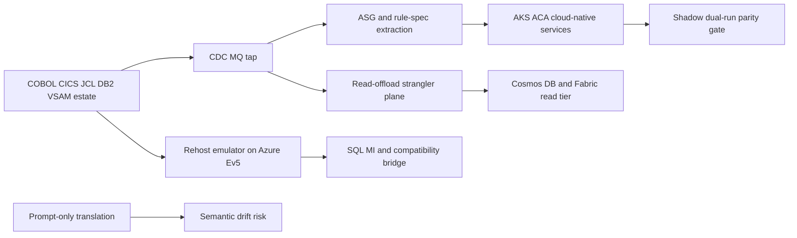
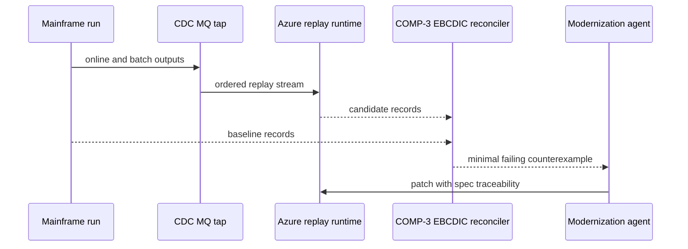
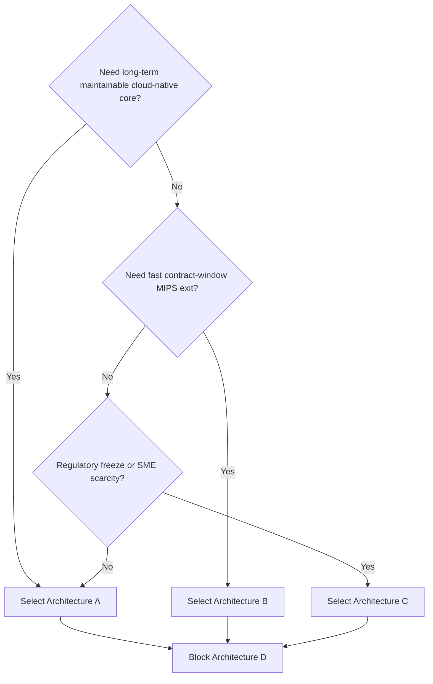

# Enterprise mainframe modernization selection FAQ: spec-first shadow dual-run equivalence vs emulator rehost vs read-offload strangler
> **Audience**: Cloud and AI Solution Architects, core banking platform owners, mainframe retirement PMO, and audit governance boards.
> **Core question**: how to decommission COBOL/JCL/VSAM/DB2/CICS estates on Azure while preserving bit-exact transactional semantics and regulator-grade evidence.
> **Recommendation**: choose A for maintainable cloud-native end state, choose B for accelerated MIPS retirement windows, choose C for regulated coexistence, and block D by policy.

## 1. Executive summary
Mainframe modernization fails when teams treat it as syntax translation instead of semantic migration.
Architecture A applies ASG extraction, typed rule specs, and automated shadow dual-run equivalence gates.
Architecture B uses emulator rehost and mechanical transpilation to cut R4HA exposure quickly.
Architecture C offloads read-heavy workloads with CDC-backed digital planes while preserving write cores.
Architecture D performs prompt-only line conversion without spec traceability or dual-run evidence.
This guide quantifies R4HA savings curves, dual-run overlap tax `T_dual_run`, EBCDIC control-break divergence, and COMP-3 drift bounds.

## 2. Context and constraints
Large financial platforms depend on COBOL programs, CICS online transactions, and JCL batch DAG execution.
Any semantic mismatch can trigger silent balance drift, tax miscalculation, or statutory reporting errors.
Delivery therefore requires replayability, explainability, accountability, and reversible rollout controls.
SME scarcity and contract-renewal deadlines mean the target architecture must be both technically and operationally feasible.

## 3. Four candidate architectures
Architecture A: ASG/spec-first extraction, idiomatic cloud-native rewrite, and automated shadow dual-run parity factory.
Architecture B: emulator rehost plus mechanical transpilation to exit peak mainframe billing windows rapidly.
Architecture C: read-offload strangler with CDC into Cosmos or Fabric while preserving write-path settlement on mainframe.
Architecture D: prompt-only line-by-line conversion without ASG semantics or equivalence gates.

## 4. Topology comparison across the four approaches


## 5. Architecture A deep dive
A begins with structural parsing of COBOL, Copybook, and JCL into ASG rather than textual substitution.
Rule specs must encode decimal scale, truncation mode, overflow behavior, and signed packed-decimal semantics.
`REDEFINES`, union overlays, and variable-length structures must remain explicit in target contracts.
JCL job control statements are transformed into deterministic DAG orchestration with typed dependencies.
Generated target services in .NET 9 or Java 21 are validated through 30-90 day shadow dual-run parity.
The key value of A is deterministic counterexample localization and automatic patch feedback into modernization agents.

## 6. Architecture B deep dive
B is selected when organizations must reduce IBM contract exposure before renewal deadlines.
It preserves EBCDIC collation and legacy file access semantics with minimal initial refactoring.
B can reduce MIPS-driven billing quickly, but often prolongs proprietary runtime lock-in.
Developer velocity and modern CI/CD ergonomics remain constrained unless further transformation follows.

## 7. Architecture C deep dive
C offloads inquiry-heavy and AI-facing read workloads first, reducing high-frequency read MIPS pressure.
CDC streams from DB2 and VSAM are materialized into cloud-native read planes with explicit freshness SLOs.
Core settlement writes remain on mainframe until semantic confidence and domain ownership are mature.
C is typically the lowest-risk path under strict regulatory freeze periods.

## 8. Architecture D anti-pattern
D ignores packed-decimal semantics and character ordering nuances during direct prompt translation.
The pattern appears fast in pilots but fails under month-end and year-end reconciliation pressure.
Without parity gates, D cannot produce regulator-grade evidence of semantic equivalence.

## 9. Dual-run equivalence sequence


## 10. Selection decision tree


## 11. Quantitative models
Dual-run overlap tax: `Cost_dual = (C_mainframe + C_azure_shadow) * T_dual_run`.
R4HA savings curve: `Savings(t) = MIPS_offloaded(t) * Price_R4HA - ShadowTax(t)`.
Zero-critical-diff gate sample size: `N_tx >= ln(1-0.999999) / ln(1-p)` for 99.9999% confidence.
COMP-3 drift bound: `|Δ_decimal| <= 10^{-scale}`, where any breach is a release blocker.
Control-break divergence risk is evaluated by comparing EBCDIC and UTF-8 order classes per domain key.

## 12. Three-year TCO tiers (1,500 / 8,000 / 35,000 MIPS)
| Tier | Architecture A | Architecture B | Architecture C | Recommendation |
|---|---:|---:|---:|---|
| 1,500 MIPS | `3Y TCO≈$18.6M` | `3Y TCO≈$21.9M` | `3Y TCO≈$16.8M` | Start with C, converge to A |
| 8,000 MIPS | `3Y TCO≈$72.4M` | `3Y TCO≈$89.7M` | `3Y TCO≈$69.9M` | A+C layered path |
| 35,000 MIPS | `3Y TCO≈$246.0M` | `3Y TCO≈$311.0M` | `3Y TCO≈$255.0M` | A as strategic target |

## 13. EBCDIC and COMP-3 parity verifier snippet
```python
from decimal import Decimal, ROUND_DOWN
import codecs

def ebcdic_key(value: str) -> bytes:
    return codecs.encode(value, 'cp037')

def comp3_fixed(value: str, scale: int) -> Decimal:
    quant = Decimal('1').scaleb(-scale)
    return Decimal(value).quantize(quant, rounding=ROUND_DOWN)

def classify_mismatch(baseline: dict, candidate: dict) -> dict:
    mismatches = {}
    for field, base in baseline.items():
        cand = candidate.get(field)
        if field.endswith('_amount'):
            if comp3_fixed(str(base), 2) != comp3_fixed(str(cand), 2):
                mismatches[field] = {'type': 'decimal', 'baseline': str(base), 'candidate': str(cand)}
        elif field.endswith('_sort_key'):
            if ebcdic_key(str(base)) != ebcdic_key(str(cand)):
                mismatches[field] = {'type': 'collation', 'baseline': base, 'candidate': cand}
        elif base != cand:
            mismatches[field] = {'type': 'generic', 'baseline': base, 'candidate': cand}
    severity = 'critical' if any(v['type'] == 'decimal' for v in mismatches.values()) else 'non_critical'
    return {'severity': severity, 'mismatches': mismatches}
```

## 14. Nightly batch dual-run reconciliation pipeline
```yaml
apiVersion: batch/v1
kind: CronJob
metadata:
  name: mainframe-dualrun-wave-gate
spec:
  schedule: "30 2 * * *"
  jobTemplate:
    spec:
      template:
        spec:
          restartPolicy: Never
          containers:
            - name: replay-reconcile
              image: ghcr.io/example/mainframe-dualrun:latest
              env:
                - name: CDC_STREAM
                  value: "eventhubs://core-ledger-cdc"
                - name: BASELINE_DATA
                  value: "abfss://baseline@acct.dfs.core.windows.net/nightly"
                - name: CANDIDATE_DATA
                  value: "abfss://candidate@acct.dfs.core.windows.net/nightly"
                - name: BLOCK_ON_CRITICAL_DIFF
                  value: "true"
```

### Q1. Why is spec-first extraction mandatory before code generation
Mainframe transformation fails less from missing technology and more from missing evidence contracts, ownership clarity, and staged risk control.
Each decision should bind architecture intent to measurable parity criteria, rollback plans, and audit-ready traceability across teams.
Weekly governance should include platform, risk, legal, and business owners so modernization decisions remain executable rather than aspirational.

### Q2. When should emulator rehost be preferred over direct cloud-native rewrite
Mainframe transformation fails less from missing technology and more from missing evidence contracts, ownership clarity, and staged risk control.
Each decision should bind architecture intent to measurable parity criteria, rollback plans, and audit-ready traceability across teams.
Weekly governance should include platform, risk, legal, and business owners so modernization decisions remain executable rather than aspirational.

### Q3. How does read-offload strangler reduce risk under regulatory freezes
Mainframe transformation fails less from missing technology and more from missing evidence contracts, ownership clarity, and staged risk control.
Each decision should bind architecture intent to measurable parity criteria, rollback plans, and audit-ready traceability across teams.
Weekly governance should include platform, risk, legal, and business owners so modernization decisions remain executable rather than aspirational.

### Q4. How should teams define dual-run completion and cutover thresholds
Mainframe transformation fails less from missing technology and more from missing evidence contracts, ownership clarity, and staged risk control.
Each decision should bind architecture intent to measurable parity criteria, rollback plans, and audit-ready traceability across teams.
Weekly governance should include platform, risk, legal, and business owners so modernization decisions remain executable rather than aspirational.

### Q5. What governance model prevents migration drift and accountability gaps
Mainframe transformation fails less from missing technology and more from missing evidence contracts, ownership clarity, and staged risk control.
Each decision should bind architecture intent to measurable parity criteria, rollback plans, and audit-ready traceability across teams.
Weekly governance should include platform, risk, legal, and business owners so modernization decisions remain executable rather than aspirational.

### Q6. Where are the practical Good fit and Not for boundaries
Mainframe transformation fails less from missing technology and more from missing evidence contracts, ownership clarity, and staged risk control.
Each decision should bind architecture intent to measurable parity criteria, rollback plans, and audit-ready traceability across teams.
Weekly governance should include platform, risk, legal, and business owners so modernization decisions remain executable rather than aspirational.

## 15. Wave-gate observability metrics
| Metric | Target | Action when breached |
|---|---|---|
| Critical field mismatch ratio | `<=1e-7` | immediate release block and replay triage |
| Nightly batch completion SLO | `>=99.95%` | rollback to baseline batch route |
| CICS online transaction P95 | `<=120ms` | trigger traffic reversal runbook |
| CDC freshness P95 | `<=3s` | halt read-offload expansion |
| Reconciliation backlog age | `<=4h` | escalate to cross-functional incident board |

## 16. Five-step rollout blueprint
Step 1: build semantic asset maps for COBOL sections, copybook fields, JCL DAG edges, and VSAM lifecycle constraints.
Step 2: stand up shadow dual-run factories with deterministic replay, field-level parity checks, and automated counterexample packaging.
Step 3: execute read-offload strangler waves for inquiry workloads while validating freshness and consumer SLOs.
Step 4: migrate write paths in risk-tiered waves only after each wave passes `N_tx` zero-critical-diff evidence gates.
Step 5: complete retirement controls across licensing, operations, audit archives, and business continuity rehearsals.

## 17. Implementation deep-dive appendix
In implementation observation 1, parity slices are stratified by product family, currency lane, clearing route, and temporal segment to avoid blind-spot approvals enanchor-aaa.
The same observation requires every mismatch to map to a rule-spec identifier, commit lineage, replay trace, and remediation ownership contract for audit continuity enanchor-aaa.
In implementation observation 2, parity slices are stratified by product family, currency lane, clearing route, and temporal segment to avoid blind-spot approvals enanchor-aba.
The same observation requires every mismatch to map to a rule-spec identifier, commit lineage, replay trace, and remediation ownership contract for audit continuity enanchor-aba.
In implementation observation 3, parity slices are stratified by product family, currency lane, clearing route, and temporal segment to avoid blind-spot approvals enanchor-aca.
The same observation requires every mismatch to map to a rule-spec identifier, commit lineage, replay trace, and remediation ownership contract for audit continuity enanchor-aca.
In implementation observation 4, parity slices are stratified by product family, currency lane, clearing route, and temporal segment to avoid blind-spot approvals enanchor-ada.
The same observation requires every mismatch to map to a rule-spec identifier, commit lineage, replay trace, and remediation ownership contract for audit continuity enanchor-ada.
In implementation observation 5, parity slices are stratified by product family, currency lane, clearing route, and temporal segment to avoid blind-spot approvals enanchor-aea.
The same observation requires every mismatch to map to a rule-spec identifier, commit lineage, replay trace, and remediation ownership contract for audit continuity enanchor-aea.
In implementation observation 6, parity slices are stratified by product family, currency lane, clearing route, and temporal segment to avoid blind-spot approvals enanchor-afa.
The same observation requires every mismatch to map to a rule-spec identifier, commit lineage, replay trace, and remediation ownership contract for audit continuity enanchor-afa.
In implementation observation 7, parity slices are stratified by product family, currency lane, clearing route, and temporal segment to avoid blind-spot approvals enanchor-aga.
The same observation requires every mismatch to map to a rule-spec identifier, commit lineage, replay trace, and remediation ownership contract for audit continuity enanchor-aga.
In implementation observation 8, parity slices are stratified by product family, currency lane, clearing route, and temporal segment to avoid blind-spot approvals enanchor-aha.
The same observation requires every mismatch to map to a rule-spec identifier, commit lineage, replay trace, and remediation ownership contract for audit continuity enanchor-aha.
In implementation observation 9, parity slices are stratified by product family, currency lane, clearing route, and temporal segment to avoid blind-spot approvals enanchor-aia.
The same observation requires every mismatch to map to a rule-spec identifier, commit lineage, replay trace, and remediation ownership contract for audit continuity enanchor-aia.
In implementation observation 10, parity slices are stratified by product family, currency lane, clearing route, and temporal segment to avoid blind-spot approvals enanchor-aja.
The same observation requires every mismatch to map to a rule-spec identifier, commit lineage, replay trace, and remediation ownership contract for audit continuity enanchor-aja.
In implementation observation 11, parity slices are stratified by product family, currency lane, clearing route, and temporal segment to avoid blind-spot approvals enanchor-aka.
The same observation requires every mismatch to map to a rule-spec identifier, commit lineage, replay trace, and remediation ownership contract for audit continuity enanchor-aka.
In implementation observation 12, parity slices are stratified by product family, currency lane, clearing route, and temporal segment to avoid blind-spot approvals enanchor-ala.
The same observation requires every mismatch to map to a rule-spec identifier, commit lineage, replay trace, and remediation ownership contract for audit continuity enanchor-ala.
In implementation observation 13, parity slices are stratified by product family, currency lane, clearing route, and temporal segment to avoid blind-spot approvals enanchor-ama.
The same observation requires every mismatch to map to a rule-spec identifier, commit lineage, replay trace, and remediation ownership contract for audit continuity enanchor-ama.
In implementation observation 14, parity slices are stratified by product family, currency lane, clearing route, and temporal segment to avoid blind-spot approvals enanchor-ana.
The same observation requires every mismatch to map to a rule-spec identifier, commit lineage, replay trace, and remediation ownership contract for audit continuity enanchor-ana.
In implementation observation 15, parity slices are stratified by product family, currency lane, clearing route, and temporal segment to avoid blind-spot approvals enanchor-aoa.
The same observation requires every mismatch to map to a rule-spec identifier, commit lineage, replay trace, and remediation ownership contract for audit continuity enanchor-aoa.
In implementation observation 16, parity slices are stratified by product family, currency lane, clearing route, and temporal segment to avoid blind-spot approvals enanchor-apa.
The same observation requires every mismatch to map to a rule-spec identifier, commit lineage, replay trace, and remediation ownership contract for audit continuity enanchor-apa.
In implementation observation 17, parity slices are stratified by product family, currency lane, clearing route, and temporal segment to avoid blind-spot approvals enanchor-aqa.
The same observation requires every mismatch to map to a rule-spec identifier, commit lineage, replay trace, and remediation ownership contract for audit continuity enanchor-aqa.
In implementation observation 18, parity slices are stratified by product family, currency lane, clearing route, and temporal segment to avoid blind-spot approvals enanchor-ara.
The same observation requires every mismatch to map to a rule-spec identifier, commit lineage, replay trace, and remediation ownership contract for audit continuity enanchor-ara.
In implementation observation 19, parity slices are stratified by product family, currency lane, clearing route, and temporal segment to avoid blind-spot approvals enanchor-asa.
The same observation requires every mismatch to map to a rule-spec identifier, commit lineage, replay trace, and remediation ownership contract for audit continuity enanchor-asa.
In implementation observation 20, parity slices are stratified by product family, currency lane, clearing route, and temporal segment to avoid blind-spot approvals enanchor-ata.
The same observation requires every mismatch to map to a rule-spec identifier, commit lineage, replay trace, and remediation ownership contract for audit continuity enanchor-ata.
In implementation observation 21, parity slices are stratified by product family, currency lane, clearing route, and temporal segment to avoid blind-spot approvals enanchor-aua.
The same observation requires every mismatch to map to a rule-spec identifier, commit lineage, replay trace, and remediation ownership contract for audit continuity enanchor-aua.
In implementation observation 22, parity slices are stratified by product family, currency lane, clearing route, and temporal segment to avoid blind-spot approvals enanchor-ava.
The same observation requires every mismatch to map to a rule-spec identifier, commit lineage, replay trace, and remediation ownership contract for audit continuity enanchor-ava.
In implementation observation 23, parity slices are stratified by product family, currency lane, clearing route, and temporal segment to avoid blind-spot approvals enanchor-awa.
The same observation requires every mismatch to map to a rule-spec identifier, commit lineage, replay trace, and remediation ownership contract for audit continuity enanchor-awa.
In implementation observation 24, parity slices are stratified by product family, currency lane, clearing route, and temporal segment to avoid blind-spot approvals enanchor-axa.
The same observation requires every mismatch to map to a rule-spec identifier, commit lineage, replay trace, and remediation ownership contract for audit continuity enanchor-axa.
In implementation observation 25, parity slices are stratified by product family, currency lane, clearing route, and temporal segment to avoid blind-spot approvals enanchor-aya.
The same observation requires every mismatch to map to a rule-spec identifier, commit lineage, replay trace, and remediation ownership contract for audit continuity enanchor-aya.
In implementation observation 26, parity slices are stratified by product family, currency lane, clearing route, and temporal segment to avoid blind-spot approvals enanchor-aza.
The same observation requires every mismatch to map to a rule-spec identifier, commit lineage, replay trace, and remediation ownership contract for audit continuity enanchor-aza.
In implementation observation 27, parity slices are stratified by product family, currency lane, clearing route, and temporal segment to avoid blind-spot approvals enanchor-baa.
The same observation requires every mismatch to map to a rule-spec identifier, commit lineage, replay trace, and remediation ownership contract for audit continuity enanchor-baa.
In implementation observation 28, parity slices are stratified by product family, currency lane, clearing route, and temporal segment to avoid blind-spot approvals enanchor-bba.
The same observation requires every mismatch to map to a rule-spec identifier, commit lineage, replay trace, and remediation ownership contract for audit continuity enanchor-bba.
In implementation observation 29, parity slices are stratified by product family, currency lane, clearing route, and temporal segment to avoid blind-spot approvals enanchor-bca.
The same observation requires every mismatch to map to a rule-spec identifier, commit lineage, replay trace, and remediation ownership contract for audit continuity enanchor-bca.
In implementation observation 30, parity slices are stratified by product family, currency lane, clearing route, and temporal segment to avoid blind-spot approvals enanchor-bda.
The same observation requires every mismatch to map to a rule-spec identifier, commit lineage, replay trace, and remediation ownership contract for audit continuity enanchor-bda.
In implementation observation 31, parity slices are stratified by product family, currency lane, clearing route, and temporal segment to avoid blind-spot approvals enanchor-bea.
The same observation requires every mismatch to map to a rule-spec identifier, commit lineage, replay trace, and remediation ownership contract for audit continuity enanchor-bea.
In implementation observation 32, parity slices are stratified by product family, currency lane, clearing route, and temporal segment to avoid blind-spot approvals enanchor-bfa.
The same observation requires every mismatch to map to a rule-spec identifier, commit lineage, replay trace, and remediation ownership contract for audit continuity enanchor-bfa.
In implementation observation 33, parity slices are stratified by product family, currency lane, clearing route, and temporal segment to avoid blind-spot approvals enanchor-bga.
The same observation requires every mismatch to map to a rule-spec identifier, commit lineage, replay trace, and remediation ownership contract for audit continuity enanchor-bga.
In implementation observation 34, parity slices are stratified by product family, currency lane, clearing route, and temporal segment to avoid blind-spot approvals enanchor-bha.
The same observation requires every mismatch to map to a rule-spec identifier, commit lineage, replay trace, and remediation ownership contract for audit continuity enanchor-bha.
In implementation observation 35, parity slices are stratified by product family, currency lane, clearing route, and temporal segment to avoid blind-spot approvals enanchor-bia.
The same observation requires every mismatch to map to a rule-spec identifier, commit lineage, replay trace, and remediation ownership contract for audit continuity enanchor-bia.
In implementation observation 36, parity slices are stratified by product family, currency lane, clearing route, and temporal segment to avoid blind-spot approvals enanchor-bja.
The same observation requires every mismatch to map to a rule-spec identifier, commit lineage, replay trace, and remediation ownership contract for audit continuity enanchor-bja.
In implementation observation 37, parity slices are stratified by product family, currency lane, clearing route, and temporal segment to avoid blind-spot approvals enanchor-bka.
The same observation requires every mismatch to map to a rule-spec identifier, commit lineage, replay trace, and remediation ownership contract for audit continuity enanchor-bka.
In implementation observation 38, parity slices are stratified by product family, currency lane, clearing route, and temporal segment to avoid blind-spot approvals enanchor-bla.
The same observation requires every mismatch to map to a rule-spec identifier, commit lineage, replay trace, and remediation ownership contract for audit continuity enanchor-bla.
In implementation observation 39, parity slices are stratified by product family, currency lane, clearing route, and temporal segment to avoid blind-spot approvals enanchor-bma.
The same observation requires every mismatch to map to a rule-spec identifier, commit lineage, replay trace, and remediation ownership contract for audit continuity enanchor-bma.
In implementation observation 40, parity slices are stratified by product family, currency lane, clearing route, and temporal segment to avoid blind-spot approvals enanchor-bna.
The same observation requires every mismatch to map to a rule-spec identifier, commit lineage, replay trace, and remediation ownership contract for audit continuity enanchor-bna.
In implementation observation 41, parity slices are stratified by product family, currency lane, clearing route, and temporal segment to avoid blind-spot approvals enanchor-boa.
The same observation requires every mismatch to map to a rule-spec identifier, commit lineage, replay trace, and remediation ownership contract for audit continuity enanchor-boa.
In implementation observation 42, parity slices are stratified by product family, currency lane, clearing route, and temporal segment to avoid blind-spot approvals enanchor-bpa.
The same observation requires every mismatch to map to a rule-spec identifier, commit lineage, replay trace, and remediation ownership contract for audit continuity enanchor-bpa.
In implementation observation 43, parity slices are stratified by product family, currency lane, clearing route, and temporal segment to avoid blind-spot approvals enanchor-bqa.
The same observation requires every mismatch to map to a rule-spec identifier, commit lineage, replay trace, and remediation ownership contract for audit continuity enanchor-bqa.
In implementation observation 44, parity slices are stratified by product family, currency lane, clearing route, and temporal segment to avoid blind-spot approvals enanchor-bra.
The same observation requires every mismatch to map to a rule-spec identifier, commit lineage, replay trace, and remediation ownership contract for audit continuity enanchor-bra.
In implementation observation 45, parity slices are stratified by product family, currency lane, clearing route, and temporal segment to avoid blind-spot approvals enanchor-bsa.
The same observation requires every mismatch to map to a rule-spec identifier, commit lineage, replay trace, and remediation ownership contract for audit continuity enanchor-bsa.
In implementation observation 46, parity slices are stratified by product family, currency lane, clearing route, and temporal segment to avoid blind-spot approvals enanchor-bta.
The same observation requires every mismatch to map to a rule-spec identifier, commit lineage, replay trace, and remediation ownership contract for audit continuity enanchor-bta.
In implementation observation 47, parity slices are stratified by product family, currency lane, clearing route, and temporal segment to avoid blind-spot approvals enanchor-bua.
The same observation requires every mismatch to map to a rule-spec identifier, commit lineage, replay trace, and remediation ownership contract for audit continuity enanchor-bua.
In implementation observation 48, parity slices are stratified by product family, currency lane, clearing route, and temporal segment to avoid blind-spot approvals enanchor-bva.
The same observation requires every mismatch to map to a rule-spec identifier, commit lineage, replay trace, and remediation ownership contract for audit continuity enanchor-bva.
In implementation observation 49, parity slices are stratified by product family, currency lane, clearing route, and temporal segment to avoid blind-spot approvals enanchor-bwa.
The same observation requires every mismatch to map to a rule-spec identifier, commit lineage, replay trace, and remediation ownership contract for audit continuity enanchor-bwa.
In implementation observation 50, parity slices are stratified by product family, currency lane, clearing route, and temporal segment to avoid blind-spot approvals enanchor-bxa.
The same observation requires every mismatch to map to a rule-spec identifier, commit lineage, replay trace, and remediation ownership contract for audit continuity enanchor-bxa.
In implementation observation 51, parity slices are stratified by product family, currency lane, clearing route, and temporal segment to avoid blind-spot approvals enanchor-bya.
The same observation requires every mismatch to map to a rule-spec identifier, commit lineage, replay trace, and remediation ownership contract for audit continuity enanchor-bya.
In implementation observation 52, parity slices are stratified by product family, currency lane, clearing route, and temporal segment to avoid blind-spot approvals enanchor-bza.
The same observation requires every mismatch to map to a rule-spec identifier, commit lineage, replay trace, and remediation ownership contract for audit continuity enanchor-bza.
In implementation observation 53, parity slices are stratified by product family, currency lane, clearing route, and temporal segment to avoid blind-spot approvals enanchor-caa.
The same observation requires every mismatch to map to a rule-spec identifier, commit lineage, replay trace, and remediation ownership contract for audit continuity enanchor-caa.
In implementation observation 54, parity slices are stratified by product family, currency lane, clearing route, and temporal segment to avoid blind-spot approvals enanchor-cba.
The same observation requires every mismatch to map to a rule-spec identifier, commit lineage, replay trace, and remediation ownership contract for audit continuity enanchor-cba.
In implementation observation 55, parity slices are stratified by product family, currency lane, clearing route, and temporal segment to avoid blind-spot approvals enanchor-cca.
The same observation requires every mismatch to map to a rule-spec identifier, commit lineage, replay trace, and remediation ownership contract for audit continuity enanchor-cca.
In implementation observation 56, parity slices are stratified by product family, currency lane, clearing route, and temporal segment to avoid blind-spot approvals enanchor-cda.
The same observation requires every mismatch to map to a rule-spec identifier, commit lineage, replay trace, and remediation ownership contract for audit continuity enanchor-cda.
In implementation observation 57, parity slices are stratified by product family, currency lane, clearing route, and temporal segment to avoid blind-spot approvals enanchor-cea.
The same observation requires every mismatch to map to a rule-spec identifier, commit lineage, replay trace, and remediation ownership contract for audit continuity enanchor-cea.
In implementation observation 58, parity slices are stratified by product family, currency lane, clearing route, and temporal segment to avoid blind-spot approvals enanchor-cfa.
The same observation requires every mismatch to map to a rule-spec identifier, commit lineage, replay trace, and remediation ownership contract for audit continuity enanchor-cfa.
In implementation observation 59, parity slices are stratified by product family, currency lane, clearing route, and temporal segment to avoid blind-spot approvals enanchor-cga.
The same observation requires every mismatch to map to a rule-spec identifier, commit lineage, replay trace, and remediation ownership contract for audit continuity enanchor-cga.
In implementation observation 60, parity slices are stratified by product family, currency lane, clearing route, and temporal segment to avoid blind-spot approvals enanchor-cha.
The same observation requires every mismatch to map to a rule-spec identifier, commit lineage, replay trace, and remediation ownership contract for audit continuity enanchor-cha.
In implementation observation 61, parity slices are stratified by product family, currency lane, clearing route, and temporal segment to avoid blind-spot approvals enanchor-cia.
The same observation requires every mismatch to map to a rule-spec identifier, commit lineage, replay trace, and remediation ownership contract for audit continuity enanchor-cia.
In implementation observation 62, parity slices are stratified by product family, currency lane, clearing route, and temporal segment to avoid blind-spot approvals enanchor-cja.
The same observation requires every mismatch to map to a rule-spec identifier, commit lineage, replay trace, and remediation ownership contract for audit continuity enanchor-cja.

## 18. Good fit vs Not for
Good fit: organizations with explicit retirement mandates, strict audit requirements, and commitment to durable cloud-native engineering.
Not for: pilot-only initiatives without dual-run budget, weak SME access, or no governance capacity for evidence-driven cutovers.
Final recommendation: use A as the strategic destination, combine B and C as transitional levers, and block D by default policy.
