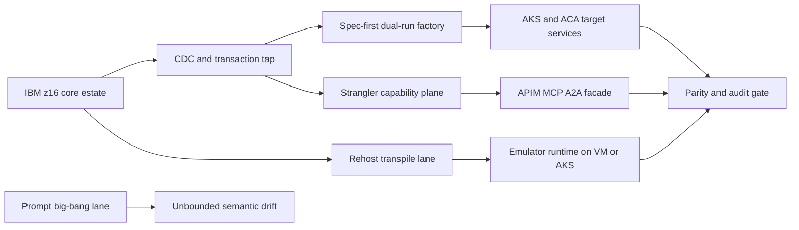
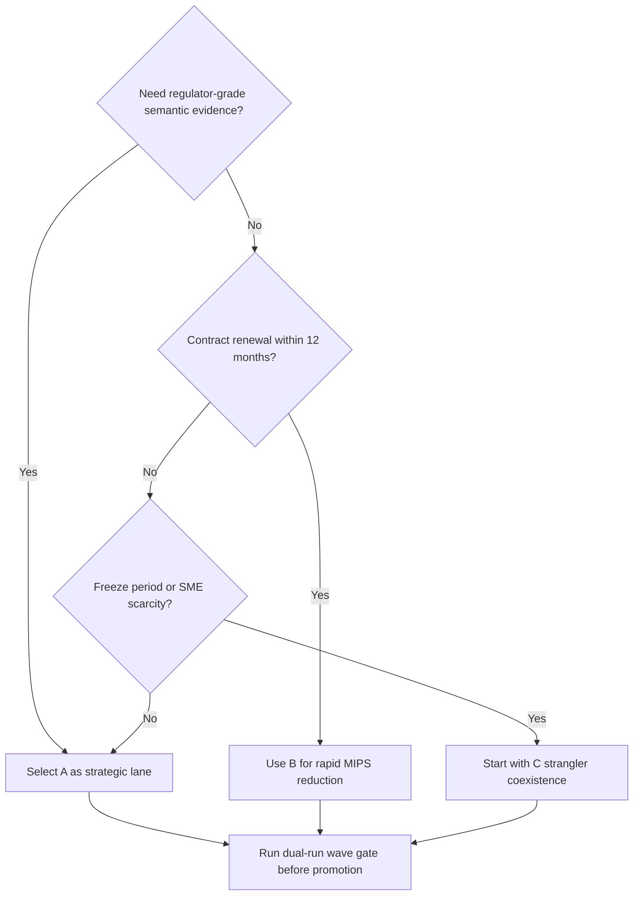

# Enterprise mainframe modernization selection FAQ: spec-first dual-run equivalence vs rehost transpilation vs event-driven strangler
> **Audience**: Cloud and AI Solution Architects, core banking platform owners, mainframe retirement PMO, and risk and audit leaders.
> **Goal**: migrate COBOL/JCL/VSAM/DB2/CICS workloads to Azure with measurable semantic parity, controlled blast radius, and regulator-grade evidence.

## 1. Executive Summary
Mainframe modernization succeeds only when semantic equivalence is treated as a product, not a side effect.
Architecture A builds AST/ASG rule assets first, then generates target-domain services and validates them through dual-run parity gates.
Architecture B prioritizes contract-window MIPS reduction by rehosting and transpilation, often at the expense of long-term code health.
Architecture C uses CDC and capability facades to offload reads and gradually reduce dependency on mainframe execution paths.
Architecture D performs direct prompt-to-code conversion and big-bang cutover without semantic controls, creating material audit risk.
The practical enterprise strategy is usually A as destination, with B or C as transitional lanes under explicit governance.

## 2. Problem Definition
Core systems combine online CICS transactions and batch JCL pipelines, so migration must preserve both latency and accounting correctness.
Online paths require predictable P99, idempotent retries, and immediate rollback capability.
Batch paths require restart-safe checkpoint semantics, generation-file discipline, and deterministic ordering behavior.
Regulators do not accept “it compiles” as proof; they require field-level equivalence and traceable evidence chains.
Without a common semantic model, `REDEFINES`, `ODO`, `COMP-3`, and collation behavior become latent failure sources.

## 3. Architecture Panorama


## 4. Architecture A: Spec-First Semantic Extraction and Dual-Run Factory
A starts by parsing COBOL, copybooks, and JCL into AST/ASG and business-rule graphs before generating target code.
Rule assets explicitly encode decimal scale, rounding semantics, overflow behavior, branch predicates, and batch step dependencies.
Generated Java 21 or .NET 9 services are validated against replayed baseline events through Event Hubs and Azure SQL Business Critical.
Every mismatch record includes rule identifier, input snapshot, baseline output, candidate output, classification, and owner mapping.
A provides the strongest long-term maintainability and audit posture but requires disciplined upfront modeling investment.
On large programs, A consistently shortens root-cause latency because evidence is attached to semantic assets instead of ad hoc logs.

## 5. Architecture B: Rehost and Automated Line-by-Line Transpilation
B uses tooling such as IBM watsonx Code Assistant for Z, Micro Focus Enterprise Server, or Raincode to accelerate migration kickoff.
The main objective is rapid R4HA reduction before contractual billing cliffs.
B can preserve many runtime assumptions with lower immediate change risk, which is operationally attractive in time-constrained windows.
However, organizations often inherit JOBOL-style artifacts and proprietary runtime coupling that limits future engineering velocity.
B is valuable as a business stabilization lane, but it should not be mistaken for a strategic end state.

## 6. Architecture C: Event-Driven Strangler with Capability Facade
C streams DB2 or VSAM changes with IIDR or Debezium IFI 306, then exposes capabilities through APIM and MCP/A2A facades.
Read-heavy channels migrate first, reducing mainframe pressure while retaining high-risk writes on baseline systems.
This lane is effective under regulatory freeze periods because it limits blast radius and supports reversible rollout increments.
C still requires explicit freshness SLOs, reconciliation controls, and escalation procedures when lag budgets are breached.
C is typically strongest when paired with A for eventual semantic hardening of migrated write domains.

## 7. Architecture D: Naive Prompt Translation and Big-Bang Cutover
D skips ASG, skips dual-run gates, and assumes generated code is equivalent if basic tests pass.
This pattern routinely misses packed-decimal edge behavior, collation-dependent sort boundaries, and restart idempotency semantics.
It may look fast in pilots, but production reconciliation failures become expensive and politically difficult to unwind.
D should remain explicitly prohibited in architecture standards and delivery checklists.

## 8. 12-Dimension Horizontal Selection Matrix
| Engineering Dimension | A Spec-First Dual-Run | B Rehost/Transpile | C Strangler Coexistence | D Prompt Big-Bang |
|---|---|---|---|---|
| Batch Window and CICS P99 | Stable after controlled tuning | Near-baseline initially | Read path improves quickly | Unpredictable after cutover |
| `COMP-3` Fidelity | High with traceable rule mapping | Medium and tool-dependent | Medium with write path retained | Low and error-prone |
| `EBCDIC` and `DFSORT` Parity | High with explicit key mapping | Medium with case-by-case fixes | Medium with facade normalization | Low with inversion risk |
| `REDEFINES` and `ODO` Safety | High via ASG discriminators | Medium with structural flattening risk | Medium by domain slicing | Low due implicit assumptions |
| JCL `GDG/COND` Restart Semantics | High through modeled DAG contracts | Medium and runtime-coupled | Medium while batch remains anchored | Low and brittle |
| R4HA MIPS During Migration | Medium with dual-run tax | High short-term savings | Medium-high from read offload | Low due rework overhead |
| Blast Radius and Rollback | High controllability by wave | Medium due runtime dependencies | High with reversible facade routing | Low in one-shot switches |
| SOX and Banking Audit Proof | High-quality evidentiary chain | Medium granularity | Medium-high with extra controls | Weak and hard to defend |
| COBOL SME Burden | Medium upfront | Medium-low early | Medium focused on selected domains | High during firefighting |
| Target Code Maintainability | High and evolvable | Medium with JOBOL exposure | High for newly carved domains | Low with technical debt growth |
| Time-to-First-Value | Medium | High | High | Superficially high but unstable |
| Three-Year TCO Profile | Low-medium, improves over time | Medium-high | Medium, depends on dwell time | High due defect recovery |

## 9. Dual-Run Shadow Replay and Cutover Sequence
```mermaid
sequenceDiagram
  participant MF as Mainframe transaction or batch
  participant CDC as IIDR or Debezium stream
  participant AZ as Azure target services
  participant PAR as Field parity engine
  participant GOV as Cutover board
  MF->>CDC: baseline outputs
  CDC->>AZ: ordered replay
  AZ-->>PAR: candidate records
  MF-->>PAR: baseline records
  PAR-->>GOV: diff report and severity
  GOV->>AZ: promote wave or rollback
```

## 10. Python Implementation Snippet: COMP-3 BCD, CP037 Collation, and Parity
```python
from decimal import Decimal, ROUND_HALF_UP, ROUND_HALF_EVEN
import codecs

def unpack_comp3(hex_bytes: bytes, scale: int) -> Decimal:
    nibbles = ''.join(f'{b:02x}' for b in hex_bytes)
    sign = nibbles[-1]
    body = nibbles[:-1]
    signed = -1 if sign in {'d', 'b'} else 1
    return signed * (Decimal(int(body)) / (Decimal(10) ** scale))

def rounded(value: Decimal, scale: int, mode: str) -> Decimal:
    q = Decimal('1').scaleb(-scale)
    r = ROUND_HALF_UP if mode == 'away_from_zero' else ROUND_HALF_EVEN
    return value.quantize(q, rounding=r)

def cp037_key(text: str) -> bytes:
    return codecs.encode(text, 'cp037')

def parity_check(baseline: dict, candidate: dict) -> dict:
    diffs = []
    for field, left in baseline.items():
        right = candidate.get(field)
        if left != right:
            diffs.append({'field': field, 'baseline': left, 'candidate': right})
    severity = 'critical' if any('amount' in d['field'] for d in diffs) else 'warning'
    return {'severity': severity, 'diffs': diffs}
```

## 11. YAML Pipeline Snippet: Event Hubs Replay and Immutable WORM Audit
```yaml
apiVersion: batch/v1
kind: CronJob
metadata:
  name: mainframe-dualrun-reconcile
spec:
  schedule: "15 1 * * *"
  jobTemplate:
    spec:
      template:
        spec:
          restartPolicy: Never
          containers:
            - name: parity-worker
              image: ghcr.io/example/dualrun-worker:stable
              env:
                - name: EVENTHUB_STREAM
                  value: "eh://mainframe-shadow-replay"
                - name: WORM_AUDIT_PATH
                  value: "abfss://audit-worm@acct.dfs.core.windows.net/parity"
                - name: BLOCK_ON_CRITICAL_DIFF
                  value: "true"
```

## 12. Quantitative Selection Decision Tree


### Q1: `PIC S9(13)V99 COMP-3` truncation versus `ROUNDED` drift across 50M postings
The highest-risk pattern is mixed rounding behavior between intermediate and final ledger writes.
A baseline that uses nearest-away-from-zero and a target that defaults to half-even can diverge by cents at scale.
At 50 million postings, tiny per-row differences can become material reconciliation exceptions in treasury controls.
The mitigation is explicit decimal policy tracing per field and replay evidence for each sensitive product category.
Do not accept aggregate-only reconciliation; require field-level and path-level drift decomposition.

### Q2: `EBCDIC` vs `UTF-8` control-break inversion and ICU collation remediation
CP037 and CP1140 key order differs from UTF-8 lexical order, especially across mixed digit and alphabetic keys.
That difference can invert `SORT/MERGE` breakpoints and alter downstream batch grouping totals.
VSAM KSDS range scans can return a different boundary set if key normalization is inconsistent across services.
Use generated collation keys, explicit sort contracts, and parity suites over month-end and quarter-end datasets.
Any control-break divergence affecting financial grouping must be treated as a critical release blocker.

### Q3: Resolving `REDEFINES`, `66 RENAMES`, and `ODO` overlays into modern type systems
Overlay semantics represent multiple valid interpretations of a shared byte region, not independent fields.
ASG discriminator slicing is required to map those interpretations into Java sealed records or C# explicit structs.
`ODO` contracts must propagate through parsing, validation, persistence, and serialization boundaries.
If one layer ignores the discriminator contract, data may appear valid while business semantics are corrupted.
Teams should maintain generated structure maps and review them as first-class architecture artifacts.

### Q4: Mapping JCL `COND`, `GDG`, and `DISP` restart semantics to Azure workflows
JCL branch semantics decide whether downstream steps execute, which generation files are read, and which outputs persist.
Durable Functions, ADF, or Argo must encode those semantics explicitly with checkpoint keys and idempotent restart contracts.
`DISP=(NEW,CATLG,DELETE)` behavior must be preserved in failure branches to avoid generation contamination.
Migration acceptance requires proving that interrupted jobs resume without duplicate accounting side effects.
Operational runbooks should include forced-interruption drills as part of every wave readiness gate.

### Q5: Modeling z16 R4HA impact from dual-run capture and CDC overhead
R4HA billing is driven by rolling four-hour averages, so added CDC and replay capture can temporarily raise effective load.
The cost model must include `ΔMIPS_CDC`, zIIP offload ratio, cloud replay spend, and governance labor.
Compute monthly net value as mainframe savings minus dual-run tax and remediation overhead.
When net value is persistently positive and critical-diff rate is near zero, the program can expand migration waves.
When net value degrades, narrow scope and prioritize high-yield, low-risk product domains.

### Q6: Statistical gate `N_tx >= -ln(alpha)/p_crit` before decommissioning
Cutover confidence must be calculated, not guessed, and must cover month-end, quarter-end, year-end, and leap-year paths.
Use stratified samples across product, channel, currency, region, and temporal windows to avoid biased acceptance.
Critical differences require zero tolerance; non-critical differences require bounded risk and explicit remediation plans.
Governance sign-off should be multi-party across architecture, business, risk, and audit functions.
A decommission decision without quantitative evidence should be treated as a policy violation.

## 13. Enterprise Scenarios
### Scenario A: Tier-1 Retail Bank, 18,000 MIPS core deposit and nightly interest batch
Regulatory profile is OCC/SOX intensive, with strict scrutiny on rounding integrity and replay evidence.
Recommended approach is A as destination, with C used to offload read workloads before staged write migration.
### Scenario B: Global P&C Insurer, 4,200 MIPS policy and claims estate
SME availability is fragmented across regions, so C provides practical coexistence while semantic assets are built for A.
Claims settlement fields still require full dual-run parity before retirement of baseline execution paths.

## 14. Three-Year TCO Table
| Scale | A Spec-First | B Rehost/Transpile | C Strangler |
|---|---:|---:|---:|
| 1,500 MIPS | `$17M-$22M` | `$19M-$25M` | `$16M-$21M` |
| 8,000 MIPS | `$68M-$79M` | `$82M-$96M` | `$64M-$76M` |
| 35,000 MIPS | `$230M-$265M` | `$286M-$332M` | `$238M-$276M` |
A typically outperforms B after year two, while C performance depends on how quickly write domains converge to A.

## 15. Go-Live and Decommission Checklist
1. Critical fields show zero-diff parity with traceable evidence packages.
2. CICS online and batch SLOs pass under interruption and restart drills.
3. `COMP-3`, `EBCDIC`, and `REDEFINES/ODO` suites pass across boundary calendars.
4. Rollback runbooks, on-call routing, audit archives, and approvals are signed.
5. Post-cutover operations, licensing, and compliance artifacts are fully transitioned.

## 16. Risk Register and Mitigation Plan
Risk 1: prolonged overlap windows can lock in dual-run cost inflation, so programs need explicit monthly stop-loss thresholds.
Risk 2: incomplete semantic-rule coverage weakens mismatch explainability, so each wave needs rule-coverage reviews before promotion.
Risk 3: ambiguous ownership causes unresolved defects, so every parity issue must have one accountable owner and escalation path.
Risk 4: implicit collation inheritance causes hidden divergence, so encoding and sort policies should be codified as shared contracts.
Risk 5: partial restart mapping can trigger duplicate financial side effects, so interruption drills must be mandatory release criteria.
Risk 6: aggregate-only reconciliation can hide critical field drift, so programs must keep field-level parity gates for sensitive domains.
Risk 7: migration waves that collide with peak business periods increase operational risk, so rollout calendars must align with business calendars.
Risk 8: inconsistent evidence packaging increases audit friction, so organizations should standardize artifact schemas and retention controls.

## 17. Operating Model and Team Topology
Use a dual-track model where domain squads own rule extraction and target behavior, while platform squads own replay and gate infrastructure.
Each domain squad should include business analysts, mainframe SMEs, cloud engineers, and test leadership to reduce translation loss.
Platform squads should maintain shared services for replay ingestion, mismatch classification, evidence packaging, and approval workflows.
Governance cadence should include daily triage, wave-level promotion councils, and monthly risk and value retrospectives.
Status communication should use common fields: diff severity, business impact, remediation ETA, rollback readiness, and audit disposition.
Treat rollback capability as a first-class product requirement rather than an optional contingency artifact.
If an organization must dwell in B or C temporarily, define explicit exit criteria and date-bound transition commitments.
Any temporary waiver from dual-run policy must include expiry, compensating controls, and tracked remediation obligations.

## 18. Final Recommendation
Treat A as strategic architecture, use B and C as economically justified transition mechanisms, and prohibit D.
The non-negotiable baseline is semantic-first design, evidence-first promotion, and reversible wave governance.
Programs that optimize for provable correctness outperform programs that optimize for migration speed alone.
Institutionalize wave outcomes in a reusable rule-asset catalog so future migrations start with validated semantic contracts.
Run at least two seasonal replay drills after decommissioning to verify resilience under quarter-end and year-end edge behavior.
Track semantic-asset health as a platform KPI, including coverage ratio, stale-rule debt, and unresolved parity variance.
Maintain an architecture review checkpoint for every material rounding, collation, or restart-policy change in downstream services.
Preserve cross-team ownership maps so reconciliation incidents route directly to accountable domain and platform leads.
Keep immutable audit bundles discoverable for regulators, internal audit, and incident postmortems without ad hoc reconstruction.
Treat modernization as a durable capability program, not a one-off migration project, to protect long-term engineering economics.
