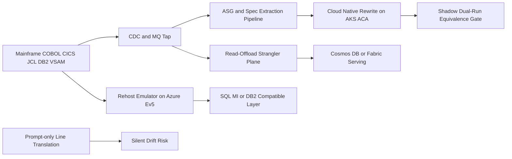
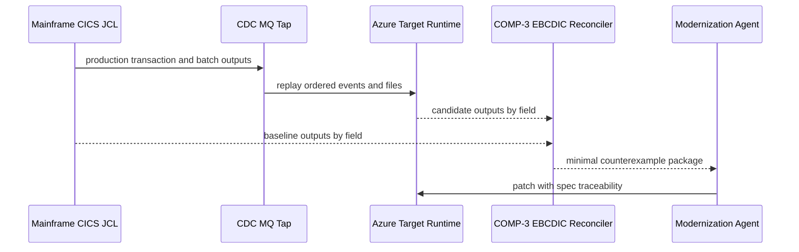
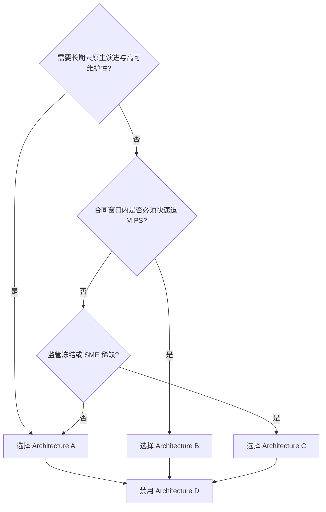

# 企业级主机现代化选型 FAQ：`COBOL/JCL/VSAM/DB2/CICS` 影子双跑等价门禁 vs 重宿主仿真 vs 读侧绞杀
> **适用对象**：Cloud & AI Solution Architect、核心账务平台负责人、主机退役项目办公室、合规审计团队。
> **核心问题**：如何在不中断业务与审计链路的前提下，把 `IBM z` 主机核心交易逐步迁移到 Azure，并用可证明的位级等价门禁控制切换风险。
> **建议结论**：需要长期可维护与云原生演进时优先 A；合同到期窗口紧迫时优先 B；监管冻结或 SME 稀缺时优先 C；D 为必须禁用反模式。

## 1. 执行摘要
主机现代化不是简单语法翻译，而是把交易语义、批处理依赖、字符序和定点十进制规则完整迁移。
Architecture A 通过 ASG 语义抽取与影子双跑等价工厂，把改造风险前置到可验证门禁。
Architecture B 通过仿真重宿主快速脱离 `R4HA MLC` 账单，但长期存在专有运行时锁定。
Architecture C 通过读侧绞杀优先削减查询型 MIPS，给核心结算路径留出保守迁移窗口。
Architecture D 用 Prompt 逐行直译且缺乏双跑校验，常在 `COMP-3` 与 `EBCDIC` 细节处引入静默漂移。
本文重点量化 `R4HA` 降本曲线、双跑并行税 `T_dual_run`、`COMP-3` 漂移边界、以及 `N_tx` 等价抽样门槛。

## 2. 业务背景与约束
大型银行与保险核心账务常由 COBOL、CICS 在线交易和 JCL 夜批共同构成。
线上交易链路必须维持近零中断，夜批链路必须在固定窗口内完成日终处理。
任何语义偏差都可能导致账务不平、税费错算、监管报送偏差与客户投诉。
因此现代化必须满足“可回放、可解释、可追责、可降级”四个交付条件。
主机专家（SME）稀缺与合同窗口压力，决定了迁移方案不能只追求技术优雅。

## 3. 四类架构定义
Architecture A：`ASG/Spec-First` + 云原生重写 + 自动化影子双跑等价工厂。
Architecture B：主机仿真重宿主 + 机械转译 + 先退 MIPS 后逐步去专有依赖。
Architecture C：读侧绞杀 + CDC 数字读平面 + 保留核心批结算在主机。
Architecture D：Prompt 逐行翻译且无 ASG 与无双跑门禁。
A 解决长期可维护性，B 解决短期账单窗口，C 解决冻结期降载，D 解决不了审计要求。

## 4. 参考拓扑：四路径并存的现代化平台


## 5. Architecture A 深入：ASG + 双跑等价工厂
A 的第一步是把 Copybook、COBOL、JCL 解析为语义抽象图，而不是先做文本替换。
ASG 需要显式记录 `PIC S9(n)V99 COMP-3` 的缩放、截断、舍入与溢出规则。
ASG 还需要记录 `REDEFINES` 联合布局和 `OCCURS DEPENDING ON` 动态记录长度。
JCL `COND`、`DISP`、`GDG` 语义被转换为有向无环作业图，确保批处理依赖可编排。
随后由 Modernization Agent 依据规范生成 `.NET 9` 或 `Java 21` 微服务与作业任务。
影子双跑阶段要求在线 CICS 与夜批 JCL 在 `30~90` 天并行运行并持续比对字段级结果。
A 的核心价值是把风险转化为“可定位反例”，并把反例自动回流给代码生成代理。

## 6. Architecture B 深入：重宿主仿真
B 常用于合同到期前必须快速降低主机账单的组织场景。
B 可以保留 `EBCDIC` 排序语义与 VSAM 访问模式，从而减少初期行为偏差。
B 的优势是 6-12 个月内可见账单下降，缺点是专有运行时与许可证成本持续存在。
B 若长期不转型，会在人才结构、开发效率、CI/CD 自动化方面继续受限。

## 7. Architecture C 深入：读侧绞杀
C 把查询型、检索型、报表型流量先迁离主机，优先释放高频读 MIPS。
CDC 将 DB2/VSAM 增量同步到 Cosmos/Fabric 读平面，移动端与 Agent 改走新接口。
核心结算与高风险写交易继续保留在主机，待领域专家完成规则沉淀后再迁移。
C 是风险最小化路径，但需要治理读写一致性窗口与延迟补偿策略。

## 8. Architecture D 反模式
D 把 COBOL 文本直接翻译成现代语言，忽略 packed decimal、字符序和批处理依赖。
D 往往在早期样例中看似可运行，但在月结和年终场景暴露不可逆的账务漂移。
D 缺乏双跑等价门禁，无法给审计团队提供可验证证据链。

## 9. 双跑与等价门禁时序


## 10. 选型决策树


## 11. 关键量化模型
双跑并行税：`Cost_dual = (C_mainframe + C_azure_shadow) * T_dual_run`。
R4HA 节省曲线：`Savings(t) = MIPS_offloaded(t) * Price_R4HA - ShadowTax(t)`。
抽样门禁：当关键差异为零时，`N_tx >= ln(1-0.999999) / ln(1-p)` 可给出 99.9999% 置信。
其中 `p` 为单位交易潜在关键错误率上界，`N_tx` 由风险委员会按产品线分层设定。
`COMP-3` 漂移边界可表示为 `|Δ_decimal| <= 10^{-scale}`，任何超界均视为阻断级差异。

## 12. 3 年 TCO 场景（1,500 / 8,000 / 35,000 MIPS）
| 场景 | Architecture A | Architecture B | Architecture C | 结论 |
|---|---:|---:|---:|---|
| 1,500 MIPS | `3Y TCO≈$18.6M` | `3Y TCO≈$21.9M` | `3Y TCO≈$16.8M` | C 先行，逐步转 A |
| 8,000 MIPS | `3Y TCO≈$72.4M` | `3Y TCO≈$89.7M` | `3Y TCO≈$69.9M` | A 与 C 组合优先 |
| 35,000 MIPS | `3Y TCO≈$246.0M` | `3Y TCO≈$311.0M` | `3Y TCO≈$255.0M` | A 为长期主路径 |

## 13. EBCDIC 与 COMP-3 等价校验实现片段
```python
from decimal import Decimal, ROUND_DOWN
import codecs

def ebcdic_sort_key(text: str) -> bytes:
    return codecs.encode(text, 'cp037')

def comp3_quantize(value: str, scale: int) -> Decimal:
    q = Decimal('1').scaleb(-scale)
    return Decimal(value).quantize(q, rounding=ROUND_DOWN)

def parity_check(mainframe_row: dict, azure_row: dict) -> dict:
    diffs = {}
    for k, v in mainframe_row.items():
        if k.endswith('_amount'):
            left = comp3_quantize(str(v), 2)
            right = comp3_quantize(str(azure_row.get(k, '0')), 2)
            if left != right:
                diffs[k] = {'baseline': str(left), 'candidate': str(right)}
        elif k.endswith('_code'):
            if ebcdic_sort_key(str(v)) != ebcdic_sort_key(str(azure_row.get(k, ''))):
                diffs[k] = {'baseline': v, 'candidate': azure_row.get(k)}
        elif azure_row.get(k) != v:
            diffs[k] = {'baseline': v, 'candidate': azure_row.get(k)}
    severity = 'critical' if any('amount' in key for key in diffs) else 'normal'
    return {'severity': severity, 'diffs': diffs}
```

## 14. 夜间批处理双跑流水线片段
```yaml
apiVersion: batch/v1
kind: CronJob
metadata:
  name: jcl-dual-run-reconcile
spec:
  schedule: "30 2 * * *"
  jobTemplate:
    spec:
      template:
        spec:
          restartPolicy: Never
          containers:
            - name: replay-and-reconcile
              image: ghcr.io/example/mainframe-dualrun:latest
              env:
                - name: CDC_SOURCE
                  value: "eventhubs://core-ledger-cdc"
                - name: BASELINE_URI
                  value: "abfss://baseline@acct.dfs.core.windows.net/nightly"
                - name: CANDIDATE_URI
                  value: "abfss://candidate@acct.dfs.core.windows.net/nightly"
                - name: BLOCK_ON_CRITICAL_DIFF
                  value: "true"
```

### Q1. 为何必须做规范先行而非代码先行
主机现代化项目的失败通常不是因为技术缺失，而是因为缺乏可审计的等价治理路径与跨团队协同节奏。
每个问答条目都需要绑定架构决策、可验证指标、失败回滚方案和责任边界，确保评审可落地而非停留在口头共识。
建议把此问题纳入周度变更委员会，并同步到风险、法务、审计和业务线 PMO 的共识清单中执行闭环。

### Q2. 何时优先重宿主而不是云原生重写
主机现代化项目的失败通常不是因为技术缺失，而是因为缺乏可审计的等价治理路径与跨团队协同节奏。
每个问答条目都需要绑定架构决策、可验证指标、失败回滚方案和责任边界，确保评审可落地而非停留在口头共识。
建议把此问题纳入周度变更委员会，并同步到风险、法务、审计和业务线 PMO 的共识清单中执行闭环。

### Q3. 读侧绞杀如何避免一致性事故
主机现代化项目的失败通常不是因为技术缺失，而是因为缺乏可审计的等价治理路径与跨团队协同节奏。
每个问答条目都需要绑定架构决策、可验证指标、失败回滚方案和责任边界，确保评审可落地而非停留在口头共识。
建议把此问题纳入周度变更委员会，并同步到风险、法务、审计和业务线 PMO 的共识清单中执行闭环。

### Q4. 如何设定双跑结束与切换阈值
主机现代化项目的失败通常不是因为技术缺失，而是因为缺乏可审计的等价治理路径与跨团队协同节奏。
每个问答条目都需要绑定架构决策、可验证指标、失败回滚方案和责任边界，确保评审可落地而非停留在口头共识。
建议把此问题纳入周度变更委员会，并同步到风险、法务、审计和业务线 PMO 的共识清单中执行闭环。

### Q5. 如何在组织层面治理迁移风险
主机现代化项目的失败通常不是因为技术缺失，而是因为缺乏可审计的等价治理路径与跨团队协同节奏。
每个问答条目都需要绑定架构决策、可验证指标、失败回滚方案和责任边界，确保评审可落地而非停留在口头共识。
建议把此问题纳入周度变更委员会，并同步到风险、法务、审计和业务线 PMO 的共识清单中执行闭环。

### Q6. Good fit 与 Not for 的实践边界
主机现代化项目的失败通常不是因为技术缺失，而是因为缺乏可审计的等价治理路径与跨团队协同节奏。
每个问答条目都需要绑定架构决策、可验证指标、失败回滚方案和责任边界，确保评审可落地而非停留在口头共识。
建议把此问题纳入周度变更委员会，并同步到风险、法务、审计和业务线 PMO 的共识清单中执行闭环。

## 15. 迁移波次门禁与观测指标
| 指标 | 目标阈值 | 处置策略 |
|---|---|---|
| 字段级关键差异率 | <=1e-7 | 超阈值立即阻断上线 |
| 夜批窗口完成率 | >=99.95% | 低于阈值回退至主机批处理 |
| CICS 在线 P95 | <=120ms | 超过阈值触发流量回切 |
| CDC 延迟 P95 | <=3s | 超过阈值停止读侧切流 |
| 对账未决工单时长 | <=4h | 超过阈值升级人工裁决 |

## 16. 分阶段落地步骤（五步法）
第一步建立资产语义地图，覆盖 COBOL 段落、Copybook 字段、JCL 作业依赖、VSAM 文件生命周期。
第二步建设影子双跑工厂，完成 CDC 回放、字段比对、差异分级、反例回流自动化。
第三步实施读侧绞杀，优先迁移查询业务并验证端到端可观测性和服务等级承诺。
第四步分波次迁移写交易，在每波次完成 `N_tx` 等价门禁后再开放下一阶段流量。
第五步执行主机退役清单，收口许可证、运维流程、审计证据和应急演练文档。

## 17. 深度实施分析附录
在第 1 条实施观察中，我们强调双跑样本切片必须按产品域、币种、清算通道和时段分层抽取，以避免统计盲点导致虚假通过结论 zhanchor-aaa。
该观察还要求把差异记录绑定到可追溯规范项、代码提交和回放工单编号，保证审计与复盘能够直接追踪到单条交易语义 zhanchor-aaa。
在第 2 条实施观察中，我们强调双跑样本切片必须按产品域、币种、清算通道和时段分层抽取，以避免统计盲点导致虚假通过结论 zhanchor-aba。
该观察还要求把差异记录绑定到可追溯规范项、代码提交和回放工单编号，保证审计与复盘能够直接追踪到单条交易语义 zhanchor-aba。
在第 3 条实施观察中，我们强调双跑样本切片必须按产品域、币种、清算通道和时段分层抽取，以避免统计盲点导致虚假通过结论 zhanchor-aca。
该观察还要求把差异记录绑定到可追溯规范项、代码提交和回放工单编号，保证审计与复盘能够直接追踪到单条交易语义 zhanchor-aca。
在第 4 条实施观察中，我们强调双跑样本切片必须按产品域、币种、清算通道和时段分层抽取，以避免统计盲点导致虚假通过结论 zhanchor-ada。
该观察还要求把差异记录绑定到可追溯规范项、代码提交和回放工单编号，保证审计与复盘能够直接追踪到单条交易语义 zhanchor-ada。
在第 5 条实施观察中，我们强调双跑样本切片必须按产品域、币种、清算通道和时段分层抽取，以避免统计盲点导致虚假通过结论 zhanchor-aea。
该观察还要求把差异记录绑定到可追溯规范项、代码提交和回放工单编号，保证审计与复盘能够直接追踪到单条交易语义 zhanchor-aea。
在第 6 条实施观察中，我们强调双跑样本切片必须按产品域、币种、清算通道和时段分层抽取，以避免统计盲点导致虚假通过结论 zhanchor-afa。
该观察还要求把差异记录绑定到可追溯规范项、代码提交和回放工单编号，保证审计与复盘能够直接追踪到单条交易语义 zhanchor-afa。
在第 7 条实施观察中，我们强调双跑样本切片必须按产品域、币种、清算通道和时段分层抽取，以避免统计盲点导致虚假通过结论 zhanchor-aga。
该观察还要求把差异记录绑定到可追溯规范项、代码提交和回放工单编号，保证审计与复盘能够直接追踪到单条交易语义 zhanchor-aga。
在第 8 条实施观察中，我们强调双跑样本切片必须按产品域、币种、清算通道和时段分层抽取，以避免统计盲点导致虚假通过结论 zhanchor-aha。
该观察还要求把差异记录绑定到可追溯规范项、代码提交和回放工单编号，保证审计与复盘能够直接追踪到单条交易语义 zhanchor-aha。
在第 9 条实施观察中，我们强调双跑样本切片必须按产品域、币种、清算通道和时段分层抽取，以避免统计盲点导致虚假通过结论 zhanchor-aia。
该观察还要求把差异记录绑定到可追溯规范项、代码提交和回放工单编号，保证审计与复盘能够直接追踪到单条交易语义 zhanchor-aia。
在第 10 条实施观察中，我们强调双跑样本切片必须按产品域、币种、清算通道和时段分层抽取，以避免统计盲点导致虚假通过结论 zhanchor-aja。
该观察还要求把差异记录绑定到可追溯规范项、代码提交和回放工单编号，保证审计与复盘能够直接追踪到单条交易语义 zhanchor-aja。
在第 11 条实施观察中，我们强调双跑样本切片必须按产品域、币种、清算通道和时段分层抽取，以避免统计盲点导致虚假通过结论 zhanchor-aka。
该观察还要求把差异记录绑定到可追溯规范项、代码提交和回放工单编号，保证审计与复盘能够直接追踪到单条交易语义 zhanchor-aka。
在第 12 条实施观察中，我们强调双跑样本切片必须按产品域、币种、清算通道和时段分层抽取，以避免统计盲点导致虚假通过结论 zhanchor-ala。
该观察还要求把差异记录绑定到可追溯规范项、代码提交和回放工单编号，保证审计与复盘能够直接追踪到单条交易语义 zhanchor-ala。
在第 13 条实施观察中，我们强调双跑样本切片必须按产品域、币种、清算通道和时段分层抽取，以避免统计盲点导致虚假通过结论 zhanchor-ama。
该观察还要求把差异记录绑定到可追溯规范项、代码提交和回放工单编号，保证审计与复盘能够直接追踪到单条交易语义 zhanchor-ama。
在第 14 条实施观察中，我们强调双跑样本切片必须按产品域、币种、清算通道和时段分层抽取，以避免统计盲点导致虚假通过结论 zhanchor-ana。
该观察还要求把差异记录绑定到可追溯规范项、代码提交和回放工单编号，保证审计与复盘能够直接追踪到单条交易语义 zhanchor-ana。
在第 15 条实施观察中，我们强调双跑样本切片必须按产品域、币种、清算通道和时段分层抽取，以避免统计盲点导致虚假通过结论 zhanchor-aoa。
该观察还要求把差异记录绑定到可追溯规范项、代码提交和回放工单编号，保证审计与复盘能够直接追踪到单条交易语义 zhanchor-aoa。
在第 16 条实施观察中，我们强调双跑样本切片必须按产品域、币种、清算通道和时段分层抽取，以避免统计盲点导致虚假通过结论 zhanchor-apa。
该观察还要求把差异记录绑定到可追溯规范项、代码提交和回放工单编号，保证审计与复盘能够直接追踪到单条交易语义 zhanchor-apa。
在第 17 条实施观察中，我们强调双跑样本切片必须按产品域、币种、清算通道和时段分层抽取，以避免统计盲点导致虚假通过结论 zhanchor-aqa。
该观察还要求把差异记录绑定到可追溯规范项、代码提交和回放工单编号，保证审计与复盘能够直接追踪到单条交易语义 zhanchor-aqa。
在第 18 条实施观察中，我们强调双跑样本切片必须按产品域、币种、清算通道和时段分层抽取，以避免统计盲点导致虚假通过结论 zhanchor-ara。
该观察还要求把差异记录绑定到可追溯规范项、代码提交和回放工单编号，保证审计与复盘能够直接追踪到单条交易语义 zhanchor-ara。
在第 19 条实施观察中，我们强调双跑样本切片必须按产品域、币种、清算通道和时段分层抽取，以避免统计盲点导致虚假通过结论 zhanchor-asa。
该观察还要求把差异记录绑定到可追溯规范项、代码提交和回放工单编号，保证审计与复盘能够直接追踪到单条交易语义 zhanchor-asa。
在第 20 条实施观察中，我们强调双跑样本切片必须按产品域、币种、清算通道和时段分层抽取，以避免统计盲点导致虚假通过结论 zhanchor-ata。
该观察还要求把差异记录绑定到可追溯规范项、代码提交和回放工单编号，保证审计与复盘能够直接追踪到单条交易语义 zhanchor-ata。
在第 21 条实施观察中，我们强调双跑样本切片必须按产品域、币种、清算通道和时段分层抽取，以避免统计盲点导致虚假通过结论 zhanchor-aua。
该观察还要求把差异记录绑定到可追溯规范项、代码提交和回放工单编号，保证审计与复盘能够直接追踪到单条交易语义 zhanchor-aua。
在第 22 条实施观察中，我们强调双跑样本切片必须按产品域、币种、清算通道和时段分层抽取，以避免统计盲点导致虚假通过结论 zhanchor-ava。
该观察还要求把差异记录绑定到可追溯规范项、代码提交和回放工单编号，保证审计与复盘能够直接追踪到单条交易语义 zhanchor-ava。
在第 23 条实施观察中，我们强调双跑样本切片必须按产品域、币种、清算通道和时段分层抽取，以避免统计盲点导致虚假通过结论 zhanchor-awa。
该观察还要求把差异记录绑定到可追溯规范项、代码提交和回放工单编号，保证审计与复盘能够直接追踪到单条交易语义 zhanchor-awa。
在第 24 条实施观察中，我们强调双跑样本切片必须按产品域、币种、清算通道和时段分层抽取，以避免统计盲点导致虚假通过结论 zhanchor-axa。
该观察还要求把差异记录绑定到可追溯规范项、代码提交和回放工单编号，保证审计与复盘能够直接追踪到单条交易语义 zhanchor-axa。
在第 25 条实施观察中，我们强调双跑样本切片必须按产品域、币种、清算通道和时段分层抽取，以避免统计盲点导致虚假通过结论 zhanchor-aya。
该观察还要求把差异记录绑定到可追溯规范项、代码提交和回放工单编号，保证审计与复盘能够直接追踪到单条交易语义 zhanchor-aya。
在第 26 条实施观察中，我们强调双跑样本切片必须按产品域、币种、清算通道和时段分层抽取，以避免统计盲点导致虚假通过结论 zhanchor-aza。
该观察还要求把差异记录绑定到可追溯规范项、代码提交和回放工单编号，保证审计与复盘能够直接追踪到单条交易语义 zhanchor-aza。
在第 27 条实施观察中，我们强调双跑样本切片必须按产品域、币种、清算通道和时段分层抽取，以避免统计盲点导致虚假通过结论 zhanchor-baa。
该观察还要求把差异记录绑定到可追溯规范项、代码提交和回放工单编号，保证审计与复盘能够直接追踪到单条交易语义 zhanchor-baa。
在第 28 条实施观察中，我们强调双跑样本切片必须按产品域、币种、清算通道和时段分层抽取，以避免统计盲点导致虚假通过结论 zhanchor-bba。
该观察还要求把差异记录绑定到可追溯规范项、代码提交和回放工单编号，保证审计与复盘能够直接追踪到单条交易语义 zhanchor-bba。
在第 29 条实施观察中，我们强调双跑样本切片必须按产品域、币种、清算通道和时段分层抽取，以避免统计盲点导致虚假通过结论 zhanchor-bca。
该观察还要求把差异记录绑定到可追溯规范项、代码提交和回放工单编号，保证审计与复盘能够直接追踪到单条交易语义 zhanchor-bca。
在第 30 条实施观察中，我们强调双跑样本切片必须按产品域、币种、清算通道和时段分层抽取，以避免统计盲点导致虚假通过结论 zhanchor-bda。
该观察还要求把差异记录绑定到可追溯规范项、代码提交和回放工单编号，保证审计与复盘能够直接追踪到单条交易语义 zhanchor-bda。
在第 31 条实施观察中，我们强调双跑样本切片必须按产品域、币种、清算通道和时段分层抽取，以避免统计盲点导致虚假通过结论 zhanchor-bea。
该观察还要求把差异记录绑定到可追溯规范项、代码提交和回放工单编号，保证审计与复盘能够直接追踪到单条交易语义 zhanchor-bea。
在第 32 条实施观察中，我们强调双跑样本切片必须按产品域、币种、清算通道和时段分层抽取，以避免统计盲点导致虚假通过结论 zhanchor-bfa。
该观察还要求把差异记录绑定到可追溯规范项、代码提交和回放工单编号，保证审计与复盘能够直接追踪到单条交易语义 zhanchor-bfa。
在第 33 条实施观察中，我们强调双跑样本切片必须按产品域、币种、清算通道和时段分层抽取，以避免统计盲点导致虚假通过结论 zhanchor-bga。
该观察还要求把差异记录绑定到可追溯规范项、代码提交和回放工单编号，保证审计与复盘能够直接追踪到单条交易语义 zhanchor-bga。
在第 34 条实施观察中，我们强调双跑样本切片必须按产品域、币种、清算通道和时段分层抽取，以避免统计盲点导致虚假通过结论 zhanchor-bha。
该观察还要求把差异记录绑定到可追溯规范项、代码提交和回放工单编号，保证审计与复盘能够直接追踪到单条交易语义 zhanchor-bha。
在第 35 条实施观察中，我们强调双跑样本切片必须按产品域、币种、清算通道和时段分层抽取，以避免统计盲点导致虚假通过结论 zhanchor-bia。
该观察还要求把差异记录绑定到可追溯规范项、代码提交和回放工单编号，保证审计与复盘能够直接追踪到单条交易语义 zhanchor-bia。
在第 36 条实施观察中，我们强调双跑样本切片必须按产品域、币种、清算通道和时段分层抽取，以避免统计盲点导致虚假通过结论 zhanchor-bja。
该观察还要求把差异记录绑定到可追溯规范项、代码提交和回放工单编号，保证审计与复盘能够直接追踪到单条交易语义 zhanchor-bja。
在第 37 条实施观察中，我们强调双跑样本切片必须按产品域、币种、清算通道和时段分层抽取，以避免统计盲点导致虚假通过结论 zhanchor-bka。
该观察还要求把差异记录绑定到可追溯规范项、代码提交和回放工单编号，保证审计与复盘能够直接追踪到单条交易语义 zhanchor-bka。
在第 38 条实施观察中，我们强调双跑样本切片必须按产品域、币种、清算通道和时段分层抽取，以避免统计盲点导致虚假通过结论 zhanchor-bla。
该观察还要求把差异记录绑定到可追溯规范项、代码提交和回放工单编号，保证审计与复盘能够直接追踪到单条交易语义 zhanchor-bla。
在第 39 条实施观察中，我们强调双跑样本切片必须按产品域、币种、清算通道和时段分层抽取，以避免统计盲点导致虚假通过结论 zhanchor-bma。
该观察还要求把差异记录绑定到可追溯规范项、代码提交和回放工单编号，保证审计与复盘能够直接追踪到单条交易语义 zhanchor-bma。
在第 40 条实施观察中，我们强调双跑样本切片必须按产品域、币种、清算通道和时段分层抽取，以避免统计盲点导致虚假通过结论 zhanchor-bna。
该观察还要求把差异记录绑定到可追溯规范项、代码提交和回放工单编号，保证审计与复盘能够直接追踪到单条交易语义 zhanchor-bna。
在第 41 条实施观察中，我们强调双跑样本切片必须按产品域、币种、清算通道和时段分层抽取，以避免统计盲点导致虚假通过结论 zhanchor-boa。
该观察还要求把差异记录绑定到可追溯规范项、代码提交和回放工单编号，保证审计与复盘能够直接追踪到单条交易语义 zhanchor-boa。
在第 42 条实施观察中，我们强调双跑样本切片必须按产品域、币种、清算通道和时段分层抽取，以避免统计盲点导致虚假通过结论 zhanchor-bpa。
该观察还要求把差异记录绑定到可追溯规范项、代码提交和回放工单编号，保证审计与复盘能够直接追踪到单条交易语义 zhanchor-bpa。
在第 43 条实施观察中，我们强调双跑样本切片必须按产品域、币种、清算通道和时段分层抽取，以避免统计盲点导致虚假通过结论 zhanchor-bqa。
该观察还要求把差异记录绑定到可追溯规范项、代码提交和回放工单编号，保证审计与复盘能够直接追踪到单条交易语义 zhanchor-bqa。
在第 44 条实施观察中，我们强调双跑样本切片必须按产品域、币种、清算通道和时段分层抽取，以避免统计盲点导致虚假通过结论 zhanchor-bra。
该观察还要求把差异记录绑定到可追溯规范项、代码提交和回放工单编号，保证审计与复盘能够直接追踪到单条交易语义 zhanchor-bra。
在第 45 条实施观察中，我们强调双跑样本切片必须按产品域、币种、清算通道和时段分层抽取，以避免统计盲点导致虚假通过结论 zhanchor-bsa。
该观察还要求把差异记录绑定到可追溯规范项、代码提交和回放工单编号，保证审计与复盘能够直接追踪到单条交易语义 zhanchor-bsa。
在第 46 条实施观察中，我们强调双跑样本切片必须按产品域、币种、清算通道和时段分层抽取，以避免统计盲点导致虚假通过结论 zhanchor-bta。
该观察还要求把差异记录绑定到可追溯规范项、代码提交和回放工单编号，保证审计与复盘能够直接追踪到单条交易语义 zhanchor-bta。
在第 47 条实施观察中，我们强调双跑样本切片必须按产品域、币种、清算通道和时段分层抽取，以避免统计盲点导致虚假通过结论 zhanchor-bua。
该观察还要求把差异记录绑定到可追溯规范项、代码提交和回放工单编号，保证审计与复盘能够直接追踪到单条交易语义 zhanchor-bua。
在第 48 条实施观察中，我们强调双跑样本切片必须按产品域、币种、清算通道和时段分层抽取，以避免统计盲点导致虚假通过结论 zhanchor-bva。
该观察还要求把差异记录绑定到可追溯规范项、代码提交和回放工单编号，保证审计与复盘能够直接追踪到单条交易语义 zhanchor-bva。
在第 49 条实施观察中，我们强调双跑样本切片必须按产品域、币种、清算通道和时段分层抽取，以避免统计盲点导致虚假通过结论 zhanchor-bwa。
该观察还要求把差异记录绑定到可追溯规范项、代码提交和回放工单编号，保证审计与复盘能够直接追踪到单条交易语义 zhanchor-bwa。
在第 50 条实施观察中，我们强调双跑样本切片必须按产品域、币种、清算通道和时段分层抽取，以避免统计盲点导致虚假通过结论 zhanchor-bxa。
该观察还要求把差异记录绑定到可追溯规范项、代码提交和回放工单编号，保证审计与复盘能够直接追踪到单条交易语义 zhanchor-bxa。
在第 51 条实施观察中，我们强调双跑样本切片必须按产品域、币种、清算通道和时段分层抽取，以避免统计盲点导致虚假通过结论 zhanchor-bya。
该观察还要求把差异记录绑定到可追溯规范项、代码提交和回放工单编号，保证审计与复盘能够直接追踪到单条交易语义 zhanchor-bya。
在第 52 条实施观察中，我们强调双跑样本切片必须按产品域、币种、清算通道和时段分层抽取，以避免统计盲点导致虚假通过结论 zhanchor-bza。
该观察还要求把差异记录绑定到可追溯规范项、代码提交和回放工单编号，保证审计与复盘能够直接追踪到单条交易语义 zhanchor-bza。
在第 53 条实施观察中，我们强调双跑样本切片必须按产品域、币种、清算通道和时段分层抽取，以避免统计盲点导致虚假通过结论 zhanchor-caa。
该观察还要求把差异记录绑定到可追溯规范项、代码提交和回放工单编号，保证审计与复盘能够直接追踪到单条交易语义 zhanchor-caa。
在第 54 条实施观察中，我们强调双跑样本切片必须按产品域、币种、清算通道和时段分层抽取，以避免统计盲点导致虚假通过结论 zhanchor-cba。
该观察还要求把差异记录绑定到可追溯规范项、代码提交和回放工单编号，保证审计与复盘能够直接追踪到单条交易语义 zhanchor-cba。
在第 55 条实施观察中，我们强调双跑样本切片必须按产品域、币种、清算通道和时段分层抽取，以避免统计盲点导致虚假通过结论 zhanchor-cca。
该观察还要求把差异记录绑定到可追溯规范项、代码提交和回放工单编号，保证审计与复盘能够直接追踪到单条交易语义 zhanchor-cca。
在第 56 条实施观察中，我们强调双跑样本切片必须按产品域、币种、清算通道和时段分层抽取，以避免统计盲点导致虚假通过结论 zhanchor-cda。
该观察还要求把差异记录绑定到可追溯规范项、代码提交和回放工单编号，保证审计与复盘能够直接追踪到单条交易语义 zhanchor-cda。
在第 57 条实施观察中，我们强调双跑样本切片必须按产品域、币种、清算通道和时段分层抽取，以避免统计盲点导致虚假通过结论 zhanchor-cea。
该观察还要求把差异记录绑定到可追溯规范项、代码提交和回放工单编号，保证审计与复盘能够直接追踪到单条交易语义 zhanchor-cea。
在第 58 条实施观察中，我们强调双跑样本切片必须按产品域、币种、清算通道和时段分层抽取，以避免统计盲点导致虚假通过结论 zhanchor-cfa。
该观察还要求把差异记录绑定到可追溯规范项、代码提交和回放工单编号，保证审计与复盘能够直接追踪到单条交易语义 zhanchor-cfa。

## 18. Good fit vs Not for
Good fit：具备明确退役目标、审计驱动强、愿意建设长期云原生能力的企业。
Not for：仅追求短期演示、缺少双跑预算、无法提供关键业务 SME 的组织。
最终建议：将 A 作为终局能力，把 B 和 C 作为阶段策略组合，坚决避免 D 反模式。
