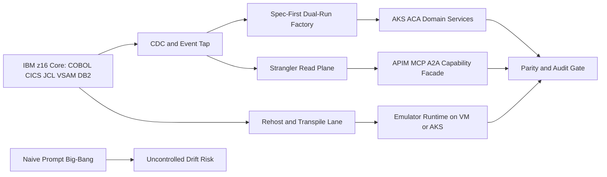
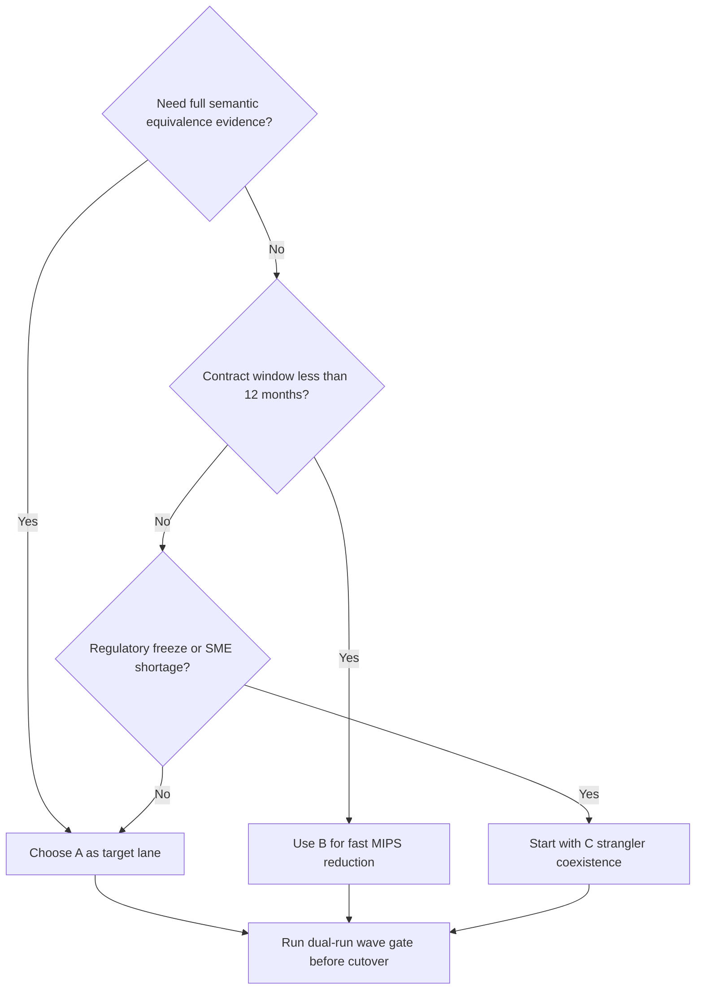

# 企业级主机核心现代化选型 FAQ：规范先行双跑等价 vs 重宿主转译 vs 事件驱动绞杀
> **读者**：Cloud & AI Solution Architect、核心账务平台负责人、主机退役 PMO、审计与风险控制团队。
> **目标**：在不中断核心业务的前提下，从 COBOL/JCL/VSAM/DB2/CICS 迁移到 Azure，并用可证明等价门禁支持分波次退役。

## 1. Executive Summary
主机现代化的首要矛盾不是“能否改写代码”，而是“能否证明业务语义未变且回滚路径可控”。
Architecture A 通过 AST/ASG + 规则图先固化语义，再由生成器产出目标域代码并进入双跑对账。
Architecture B 通过重宿主与机械转译降低短期 MIPS 支出，适合合同续签窗口紧迫的组织。
Architecture C 通过 CDC + 能力外观先释放查询负载，再逐步压缩主机写路径风险。
Architecture D 直接 Prompt 到 Java/C# 且无语义门禁，会在 `COMP-3` 与 `EBCDIC` 细节上产生隐性损失。
企业落地通常是 A 作为终局、B 或 C 作为过渡，但任何路径都必须以双跑等价证据作为放行前提。

## 2. Problem Definition
主机系统由在线交易与夜间批处理共同构成，迁移时必须同时满足延迟、正确性、审计三条约束。
在线链路关注 CICS P99 与事务幂等，批处理链路关注窗口时限、重启语义与代际文件一致性。
监管审计关注的是“字段级等价可证明性”，而不是“接口能跑通”。
如果没有统一语义模型，COBOL `REDEFINES`、`ODO`、`COMP-3` 的边界行为极易在迁移中丢失。
如果没有统一回放管道，任何差异都只能靠人工猜测，无法形成可重复、可复盘的修复闭环。

## 3. Architecture Panorama


## 4. Architecture A：Spec-First Semantic Extraction + Dual-Run Parity
A 先把 COBOL、Copybook、JCL 解析为 AST/ASG，并构建业务规则图，而不是先追求代码可编译。
规则图会保留字段缩放、舍入策略、分支条件、作业依赖、代际文件约束和事务边界。
目标域生成器再将规则图映射到 Java 21 或 .NET 9 的领域模型、校验器、批处理 DAG。
双跑阶段由 Event Hubs 回放交易与批次事件，在 Azure SQL Business Critical 存储对账结果。
每一条差异记录必须包含：规则编号、输入快照、基线输出、候选输出、差异分类、修复责任人。
A 的优势是可维护性与可审计性最高，长期可演进；代价是前期语义建模投入较高。
在 `18,000 MIPS` 规模银行项目中，A 能把“发现差异到定位根因”时间从周级压缩到小时级。

## 5. Architecture B：Rehost/Transpile 快速退 MIPS
B 通过 IBM watsonx Code Assistant for Z、Micro Focus 或 Raincode 做自动转译与运行时承接。
该路径尽量保留原有调用习惯，帮助组织在主机合同窗口内先完成账单降载。
B 对原系统侵入较小，迁移启动速度快，适合“先活下来再优化”的经营约束场景。
但 B 可能形成 JOBOL 风格目标代码，长期维护成本与人才结构风险仍然存在。
若只停在 B，企业会在两三年后面临“成本下降但工程效率没有提升”的第二次转型压力。

## 6. Architecture C：Event-Driven Strangler 共存演进
C 通过 IBM IIDR 或 Debezium Db2 z/OS IFI 306 把变更事件同步到云侧读平面。
外部能力由 APIM + MCP/A2A 外观提供，逐步替代对 CICS 事务接口的直接耦合访问。
读流量先迁移可以快速降低主机查询压力，保留高风险写事务在原系统持续运行。
C 的关键是定义数据新鲜度预算、回补策略和一致性告警，不可把最终一致性当作默认免责。
在监管冻结期，C 往往是最可执行的策略，因为它把变更风险控制在可回滚边界内。

## 7. Architecture D：Direct Prompt Big-Bang Anti-Pattern
D 不做 ASG 建模，也不做双跑门禁，直接把 COBOL 片段翻译成 Java/C# 后一次性切换。
这种路径在 PoC 环境容易“看起来成功”，但在季末年末批处理会暴露大量隐性语义偏差。
最常见问题是 `COMP-3` 运算细节、`EBCDIC` 排序规则、JCL 重启语义被错误简化。
一旦出现账务偏差，D 缺少可追溯证据链，回滚成本和监管风险同时放大。

## 8. 12-Dimension Horizontal Selection Matrix
| 维度 | A Spec-First 双跑 | B Rehost/Transpile | C Strangler 共存 | D Prompt Big-Bang |
|---|---|---|---|---|
| Batch Window / CICS P99 | 可并行优化，收敛稳定 | 初期接近基线 | 读侧改善显著，写侧保守 | 切换后波动不可预测 |
| `COMP-3` Arithmetic Fidelity | 高，规则可追溯 | 中，依赖工具链质量 | 中，核心写侧仍在主机 | 低，易出现分位误差 |
| `EBCDIC` / `DFSORT` Parity | 高，可建键值对照 | 中，需逐案校验 | 中，读侧需要映射策略 | 低，排序反转风险高 |
| `REDEFINES` / `ODO` Safety | 高，语义图可验证 | 中，复杂结构易退化 | 中，按域渐进处理 | 低，结构歧义常被忽略 |
| JCL `GDG/COND` Restart | 高，可建 DAG 语义 | 中，依赖仿真器实现 | 中，批处理仍保守 | 低，重启幂等性脆弱 |
| R4HA MIPS During Migration | 中，双跑有并行税 | 高，短期下降快 | 中高，读压优先释放 | 低，失败返工成本高 |
| Blast Radius / Rollback | 高，可波次回切 | 中，运行时锁定影响回滚 | 高，按能力面可控回切 | 低，一次性切换风险高 |
| SOX/审计等价证明 | 高，证据完备 | 中，证据颗粒度受限 | 中高，需补审计链 | 低，难以自证 |
| COBOL SME Burden | 中，早期建模投入 | 中低，前期负担较轻 | 中，聚焦关键域 | 高，后期救火负担重 |
| Target Maintainability | 高，代码可持续演进 | 中，JOBOL 风险存在 | 高，新域逐步云原生 | 低，技术债快速堆积 |
| Time-to-First-Value | 中 | 高 | 高 | 表面高、实际不稳定 |
| 3-Year TCO Profile | 低到中，后期优势明显 | 中到高 | 中，取决于停留时长 | 高，返工与风险成本叠加 |

## 9. Dual-Run Shadow Replay & Cutover Sequence
```mermaid
sequenceDiagram
  participant MF as Mainframe CICS or Batch
  participant CDC as IIDR or Debezium IFI306
  participant AZ as Azure Target Services
  participant PAR as Field-Level Parity Engine
  participant GOV as Cutover Governance Board
  MF->>CDC: baseline transaction and batch outputs
  CDC->>AZ: ordered replay stream
  AZ-->>PAR: candidate records
  MF-->>PAR: baseline records
  PAR-->>GOV: critical and non-critical diff report
  GOV->>AZ: wave promotion or rollback decision
```

## 10. Python Implementation Snippet: COMP-3 + CP037 + Field Parity
```python
from decimal import Decimal, ROUND_HALF_UP, ROUND_HALF_EVEN
import codecs

def unpack_comp3(hex_bytes: bytes, scale: int) -> Decimal:
    nibbles = ''.join(f'{b:02x}' for b in hex_bytes)
    sign = nibbles[-1]
    body = nibbles[:-1]
    sign_mul = -1 if sign in {'d', 'b'} else 1
    value = Decimal(int(body)) / (Decimal(10) ** scale)
    return value * sign_mul

def rounded(value: Decimal, scale: int, mode: str) -> Decimal:
    q = Decimal('1').scaleb(-scale)
    rounding = ROUND_HALF_UP if mode == 'away_from_zero' else ROUND_HALF_EVEN
    return value.quantize(q, rounding=rounding)

def ebcdic_collation_key(text: str) -> bytes:
    return codecs.encode(text, 'cp037')

def parity_row(baseline: dict, candidate: dict) -> dict:
    diffs = []
    for field, left in baseline.items():
        right = candidate.get(field)
        if left != right:
            diffs.append({'field': field, 'baseline': left, 'candidate': right})
    severity = 'critical' if any('amount' in d['field'] for d in diffs) else 'warning'
    return {'severity': severity, 'diffs': diffs}
```

## 11. YAML Pipeline Snippet: Event Hubs + Immutable Audit Trail
```yaml
apiVersion: batch/v1
kind: CronJob
metadata:
  name: mainframe-dualrun-reconcile
spec:
  schedule: "15 1 * * *"
  jobTemplate:
    spec:
      template:
        spec:
          restartPolicy: Never
          containers:
            - name: parity-worker
              image: ghcr.io/example/dualrun-worker:stable
              env:
                - name: EVENTHUB_STREAM
                  value: "eh://mainframe-shadow-replay"
                - name: AUDIT_WORM_PATH
                  value: "abfss://audit-worm@acct.dfs.core.windows.net/parity"
                - name: BLOCK_ON_CRITICAL_DIFF
                  value: "true"
```

## 12. Quantitative Selection Decision Tree


### Q1: `PIC S9(13)V99 COMP-3` 与 `ROUNDED` 的分钱漂移如何量化
在 50M 条批处理过账中，最常见差异来自中间结果截断与最终入账舍入策略不一致。
若基线使用 `ROUNDED` 且目标代码默认 `HALF-EVEN`，单笔差异可能仅为 0.01，但会在聚合后放大。
建议对每条金额字段记录“原值、缩放、舍入模式、结果值”，并把漂移分解到业务口径。
对于利息、税费、手续费等敏感字段，建议采用“中间值快照 + 字段级回放”而非只比较最终总额。
门禁应以“关键字段零差异 + 非关键字段有界差异”双条件执行，避免误放行。

### Q2: `EBCDIC` 与 `UTF-8` 排序差异为何会导致控制断裂
CP037/CP1140 下数字、大小写字母与符号的序关系与 UTF-8 默认比较关系并不一致。
这会改变 `SORT/MERGE` 结果，进而改变控制断裂点，最终影响分组汇总与批量过账路径。
对于 VSAM KSDS 范围扫描，键序反转会导致区间命中集合变化，表现为“数据在但查不到”。
建议统一生成 ICU collation key，保留主机键序对照表，并将排序差异作为专门测试域。
任何影响账务分组边界的排序差异都应被标记为阻断级缺陷，而非可接受噪声。

### Q3: `REDEFINES`、`66 RENAMES`、`ODO` 如何映射到现代语言类型
主机内存覆盖语义本质是“同一字节视图的多解释”，不能被简单映射为独立对象。
建议先在 ASG 中构建判别流，明确每条记录在何种条件下进入哪种结构解释。
Java 21 可用 sealed hierarchy + record，C# 可用显式布局 struct 结合验证器表达。
`ODO` 需要绑定长度字段生命周期，确保解析、序列化、存储阶段都遵守同一边界。
若缺少判别流与长度契约，线上会出现“解析成功但业务语义错位”的隐蔽故障。

### Q4: JCL `COND/GDG/DISP` 如何映射到云侧编排并保留重启幂等
JCL 的 `COND=(4,LT)`、`IF/THEN/ELSE` 与 GDG 代际规则共同决定了作业是否继续、读哪一代、写哪一代。
映射到 Durable Functions/ADF/Argo 时，需要把“步骤状态、输入代际、输出代际、补偿动作”统一建模。
`DISP=(NEW,CATLG,DELETE)` 的语义应在失败分支中显式实现，否则会出现代际污染。
建议对每个步骤生成幂等键与恢复点，并在重启测试中验证“重复执行不会重复记账”。
批处理编排迁移完成的标志不是“能跑通”，而是“任意中断后恢复结果一致”。

### Q5: `R4HA` 与 CDC 双跑开销的盈亏平衡如何评估
R4HA 按滚动四小时均值计费，双跑阶段新增 CDC 与回放会带来 `ΔMIPS_CDC` 开销。
同时，云侧重放与对账会引入并行成本，形成 `T_dual_run` 期间的双重账单。
建议按月计算“主机降载节省 - 双跑并行税 - 工具与人力治理成本”，得到真实净收益。
当净收益连续为正且关键差异率趋近零，可进入更激进的退役波次。
若净收益为负且差异修复缓慢，应收缩范围，优先保留高收益且低风险业务域。

### Q6: 退役前 `N_tx` 抽样门禁如何覆盖季末与闰年边界
退役门禁应覆盖正常日、月末、季末、年末与闰年等业务边界样本，避免统计偏置。
可采用 `N_tx >= -ln(alpha)/p_crit` 估计最小样本量，并对关键域设置更严格阈值。
建议把样本分层到产品、渠道、币种、地区、时段，确保异常路径也被覆盖。
对关键差异必须要求零容忍；对非关键差异要求“已解释 + 已修复计划 + 有时限”。
最终退役决策应由架构、业务、风险、审计共同签署，不允许单团队自行宣布完成。

## 13. Enterprise Scenarios
### 场景 A：Tier-1 Retail Bank（18,000 MIPS）
该银行核心存款系统日间交易密集、夜间利息批处理窗口固定，受 OCC/SOX 审计要求约束。
推荐路径是 A 作为目标，先以 C 释放查询流量，再按产品域波次推进写路径迁移。
在第一阶段保留主机写链路，云侧只做影子回放和对账；第二阶段开始受控切写并可随时回切。
### 场景 B：Global P&C Insurer（4,200 MIPS）
该保险集团多地区保单和理赔系统耦合较深，SME 分布在不同时区，变更窗口有限。
推荐路径是 C 起步，快速建设能力外观和读侧统一服务，再择机引入 A 的规则图治理。
对于理赔结算等高敏字段，仍需进入双跑门禁，不可因规模较小而跳过等价证明。

## 14. 3-Year TCO Comparison
| 企业规模 | A Spec-First | B Rehost/Transpile | C Strangler |
|---|---:|---:|---:|
| 1,500 MIPS | `$17M-$22M` | `$19M-$25M` | `$16M-$21M` |
| 8,000 MIPS | `$68M-$79M` | `$82M-$96M` | `$64M-$76M` |
| 35,000 MIPS | `$230M-$265M` | `$286M-$332M` | `$238M-$276M` |
A 的曲线在第二年后通常低于 B；C 的优势取决于组织在 C 阶段停留时长与能力面收敛速度。

## 15. Go-Live / Decommission Checklist
1. 关键字段双跑差异为零，并附可追溯证据包。
2. CICS 在线与夜批窗口满足约定 SLO，且完成中断恢复演练。
3. `COMP-3`、`EBCDIC`、`REDEFINES/ODO` 专项回归全部通过。
4. 回切剧本、值班链路、审计归档、变更审批均完成签署。
5. 主机退役后许可证、监控、应急与合规资料全部收口。

## 16. 风险登记册与缓解策略
高风险一：主机与云侧并行期过长导致双重成本持续，应设置阶段止损线并按月复核净收益。
高风险二：语义规则仓不完整导致差异定位困难，应在每个波次前做规则覆盖率评审。
高风险三：跨团队责任边界模糊导致缺陷悬而未决，应将差异工单绑定单一责任人和升级路径。
高风险四：排序与编码规则被隐式继承导致不可见偏差，应把编码策略写入公共契约并强制测试。
高风险五：夜批重启语义迁移不全导致重复记账，应将中断恢复演练纳入每次发布前清单。
高风险六：只看总额忽略字段差异导致假通过，应保留字段级回放与关键字段零差异门槛。
高风险七：迁移节奏与业务旺季冲突导致运营风险，应把波次计划与业务日历提前协同。
高风险八：审计证据格式不统一导致复核成本高，应统一证据包结构并固定生命周期策略。

## 17. 组织与运行模型建议
建议采用“双轨执行”组织：领域小队负责规则沉淀与目标代码，平台小队负责双跑工厂与门禁服务。
每个领域小队应包含业务分析、主机 SME、云应用工程师与测试负责人，避免信息在接口处丢失。
平台小队应维护共享组件：事件回放、差异分类、证据归档、切换审批工作流与审计导出接口。
周会节奏建议分为三层：日常缺陷处置会、波次放行会、月度收益与风险复盘会。
对外沟通建议使用统一语言：差异等级、业务影响、修复时限、回切状态、审计结论。
在交付治理中，把“可回切能力”视为一等公民，不以短期速度交换长期失控风险。
当组织能力不足以支撑 A 的全量推进时，应明确停留在 B 或 C 的期限与退出条件。
任何偏离双跑门禁的临时豁免都应有到期时间和补偿验证任务，防止例外常态化。

## 18. Final Recommendation
把 A 作为长期目标架构，把 B 和 C 作为不同经营约束下的阶段性策略。
不管从哪条路径起步，都必须坚持“语义先行、双跑门禁、可回切、可审计”的底线。
当证据质量高于迁移速度时，主机退役才能从工程项目升级为可持续能力建设。
建议将每个波次的经验回写到规则资产库，形成可复用的行业迁移模板与审计证据包标准。
建议在退役后保留至少两次完整季节性回放演练，验证新平台在异常边界上的韧性与可恢复性。
建议把语义资产治理纳入平台年度 OKR，确保人员变动后仍能持续维护迁移成果与合规质量。
