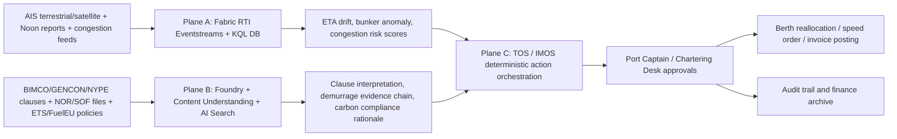
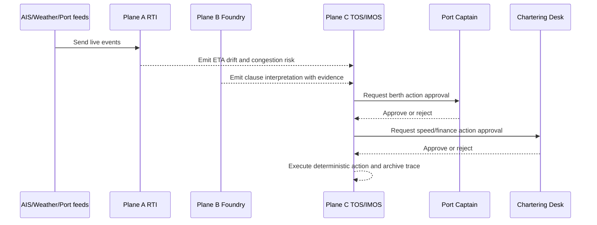

# Global Maritime Shipping and Smart Port Terminal Agent Selection FAQ: AIS + Fabric RTI Event Plane vs Foundry Charterparty and Carbon Compliance Plane vs TOS/IMOS Deterministic Action Plane
> 🌐 Language / 语言切换: [中文](maritime-port-terminal-vessel-chartering-bunker-ets-imo-cii-agent-foundry-vs-ais-fabric-rti-vs-tos-mcp-selection-faq.md) | **English (Current)** | [EN Catalog](README.en.md) | [中文目录](README.md)
> Audience: shipping operations platforms, chartering and bunker teams, port terminal schedulers, carbon compliance and finance control teams
> Updated: 2026-11-19 (UTC+08:00)
> Evidence labels: `measured`, `synthetic`, `anonymized_reported`

---

## 1. Executive summary

1. Maritime decision failures are often caused by weak boundaries between insight generation and operational execution.
2. A robust architecture separates event intelligence, contract/compliance reasoning, and deterministic execution controls.
3. Plane A handles high-frequency AIS, weather, bunker, and congestion signal processing.
4. Plane B handles BIMCO/GENCON/NYPE clause reasoning, NOR/SOF evidence extraction, and ETS/FuelEU/CII interpretation.
5. Plane C handles deterministic actions in Navis N4, Tideworks, and Veson IMOS with explicit approval controls.
6. Berth reallocation, slow-steaming orders, and demurrage posting must require human sign-off before execution.
7. LLM output may recommend, but cannot directly mutate operational source-of-truth states.
8. Production readiness requires a replayable event chain, auditable approval chain, and traceable cost chain.

---

## 2. Scope and regulatory boundaries

### 2.1 In-scope

- Fleet-wide ETA drift and congestion monitoring.
- Laytime/demurrage dispute support from charterparty and voyage documents.
- Bunker consumption and carbon compliance analytics for EU ETS, FuelEU Maritime, and IMO CII.
- Berth, crane, and yard re-slotting recommendations with approval gating.

### 2.2 Boundaries

- Event analytics operate in seconds-to-minutes latency targets.
- Contract interpretation must include verifiable clause evidence.
- Financial actions require deterministic workflow and approval evidence.
- High-impact operational actions require Port Captain and Chartering Desk oversight.

### 2.3 Non-goals

- This guide does not replace shipmaster navigational authority.
- This guide does not replace final legal arbitration for disputes.
- This guide does not prescribe full legacy-stack replacement.

---

## 3. Three-plane architecture overview



---

## 4. Plane A: Fabric RTI maritime event plane

### 4.1 Design objectives

- Detect ETA and congestion shocks early at fleet scale.
- Unify terrestrial/satellite AIS, weather, bunker, and terminal events.
- Convert noisy telemetry into ranked operational risk queues.

### 4.2 Core capabilities

- Eventstreams ingests and normalizes multi-source maritime telemetry.
- KQL DB correlates voyage, vessel class, weather cell, and port state.
- Drift detection identifies speed variance, anchorage queue, and fuel anomalies.
- ETA delta model tracks planned, reported, and predicted arrival windows.
- Standardized risk events are emitted for deterministic downstream workflows.

### 4.3 Example metrics

- ETA drift detection latency P95 under 12s (`measured`).
- Event loss rate below 0.1% (`measured`).
- Alert-noise ratio reduced by 27% (`anonymized_reported`).

---

## 5. Plane B: Foundry charterparty and carbon-compliance reasoning plane

### 5.1 Design objectives

- Shift clause interpretation from manual file review to evidence-anchored analysis.
- Align NOR/SOF document evidence with laytime and demurrage calculations.
- Consolidate ETS/FuelEU/CII interpretation in a versioned legal-evidence framework.

### 5.2 Core capabilities

- Content Understanding parses scanned and digital maritime documents.
- AI Search hybrid retrieval constrains results to clause version and effective dates.
- Foundry agents emit structured outputs with rationale, evidence spans, and confidence.
- Every claim includes clause references, page anchors, or text offsets.
- Regulatory citations carry rule version metadata and applicability windows.

### 5.3 Example metrics

- Clause evidence hit-rate at 0.92–0.96 (`measured`).
- Laytime dispute prep effort reduced by 33% (`anonymized_reported`).
- Carbon-rule citation error rate below 2.5% (`measured`).

---

## 6. Plane C: TOS/IMOS deterministic execution plane

### 6.1 Design objectives

- Keep recommendation generation separate from execution authority.
- Enforce auditable workflows for berth, speed, and finance-impacting actions.
- Integrate carbon cost impacts into action approval decisions.

### 6.2 Core capabilities

- APIM MCP mediates controlled calls into TOS and IMOS systems.
- Logic Apps / Durable Functions orchestrate approval, retry, rollback, and compensation.
- Action tokens are role-bound and expire automatically.
- Unapproved actions cannot be persisted to operational master records.
- Pre-posting validation checks evidence completeness and accounting consistency.

### 6.3 Example metrics

- Unapproved high-impact execution count equals zero (`measured`).
- Congestion re-slot response time reduced by 21% (`anonymized_reported`).
- Demurrage posting dispute rate reduced by 18% (`anonymized_reported`).

---

## 7. Sequence: congestion re-slotting and demurrage dispute flow



---

## 8. 12-dimension quantitative selection matrix

| Dimension | Plane A: Fabric RTI | Plane B: Foundry RAG | Plane C: TOS/IMOS Execution |
|---|---|---|---|
| 1. Real-time event throughput | 5/5 | 3/5 | 3/5 |
| 2. Clause semantic depth | 2/5 | 5/5 | 2/5 |
| 3. Compliance interpretation confidence | 3/5 | 4/5 | 5/5 |
| 4. Decision traceability | 4/5 | 4/5 | 5/5 |
| 5. Human control strength | 3/5 | 3/5 | 5/5 |
| 6. Integration complexity | Medium | Medium-High | High |
| 7. Rule maintenance effort | Medium | Medium | Medium-High |
| 8. Failure isolation | 4/5 | 3/5 | 5/5 |
| 9. Multi-port scalability | 5/5 | 4/5 | 4/5 |
|10. Unit-cost predictability | 4/5 | 3/5 | 4/5 |
|11. Finance reconciliation consistency | 3/5 | 4/5 | 5/5 |
|12. Change risk controllability | 4/5 | 3/5 | 5/5 |

---

## 9. Production snippets (KQL / APIM / Python)

### 9.1 KQL sample: ETA drift detection

```kql
let thresholdMinutes = 45;
FleetEvents
| where EventType == "ETA_UPDATE"
| extend DriftMin = datetime_diff("minute", PredictedETA, PlannedETA)
| where abs(DriftMin) > thresholdMinutes
| summarize Latest=max(Timestamp), MaxDrift=max(abs(DriftMin)) by VoyageId, VesselId, PortCode
| order by MaxDrift desc
```

### 9.2 APIM policy sample: enforce human approval for high-impact actions

```xml
<policies>
  <inbound>
    <base />
    <choose>
      <when condition="@(context.Request.Headers.GetValueOrDefault("x-ops-approved","") != "true")">
        <return-response>
          <set-status code="412" reason="Human approval required" />
        </return-response>
      </when>
    </choose>
  </inbound>
  <backend>
    <base />
  </backend>
  <outbound>
    <base />
  </outbound>
</policies>
```

### 9.3 Python sample: dual-approval execution gate

```python
def can_execute_action(payload: dict) -> bool:
    return (
        payload.get("risk_level") in {"low", "medium", "high"}
        and payload.get("port_captain_signoff") == "approved"
        and payload.get("chartering_desk_signoff") == "approved"
    )
```

---

## 10. Scenario A: Panamax dry-bulk weather diversion and laytime dispute

### 10.1 Background

- Vessel class: Panamax dry-bulk.
- Route profile: trans-oceanic corridor with strong weather seasonality.
- Dispute trigger: weather diversion affecting NOR validity and laytime start.

### 10.2 Objectives

- Reduce dispute evidence preparation from day-scale to hour-scale.
- Surface demurrage-risk voyages earlier in operation windows.
- Decrease dependence on a small number of senior planners.

### 10.3 Architecture mapping

- Plane A provides weather/AIS/port congestion delta intelligence.
- Plane B provides clause-level evidence and interpretation chain.
- Plane C governs approved finance actions and posting controls.

### 10.4 Planning outcomes

- Dispute packet prep time reduced by 41% (`anonymized_reported`).
- Laytime replay effort reduced by 36% (`measured`).
- Median warning lead-time improved by 5.2h (`measured`).

---

## 11. Scenario B: Mega-container port congestion re-slotting and ETS hedge workflow

### 11.1 Background

- Port scale: multi-million TEU annual throughput.
- Operational pressure: crane conflict, berth delay, cascading schedule variance.
- Finance pressure: carbon allowance and speed strategy coupling.

### 11.2 Objectives

- Maintain balanced berth and crane utilization during congestion spikes.
- Reduce high-impact execution errors through strict approval gates.
- Integrate carbon-cost impact into dispatch decisions.

### 11.3 Architecture mapping

- Plane A produces congestion and ETA drift risk layers.
- Plane B interprets FuelEU/ETS/CII implications for each action proposal.
- Plane C executes deterministic re-slotting and posting actions after approval.

### 11.4 Planning outcomes

- Critical berth re-slot response time reduced by 24% (`anonymized_reported`).
- Crane-conflict incidents reduced by 19% (`measured`).
- ETS-related reconciliation variance reduced by 22% (`measured`).

---

## 12. Quantitative FAQs

### Q1. Why separate AIS event processing from contract interpretation?

Because update frequency and accountability differ fundamentally.
Event processing optimizes for throughput and low latency.
Contract interpretation optimizes for legal traceability and evidence fidelity.

### Q2. Can Foundry interpretation be posted directly as demurrage invoices?

No.
Foundry outputs recommendation artifacts only.
Final posting requires deterministic Plane C approval and controls.

### Q3. How can teams suppress re-slotting noise from short-lived spikes?

Use multi-signal thresholds and jitter-suppression windows in Plane A.
Then require secondary approval checks in Plane C before execution.

### Q4. How are ETS/FuelEU rule changes kept auditable?

Store rule versions and effective dates with every recommendation artifact.
Include citation metadata in approval records for replay and audit.

### Q5. When should Plane C investment be prioritized over Plane B expansion?

When execution errors, unauthorized actions, or finance discrepancies remain frequent despite good analytics.
In that stage, stronger deterministic workflow control yields larger risk reduction.

### Q6. How should slow-steaming benefit be estimated?

Model bunker savings, carbon allowance impact, service-level penalties, and congestion costs jointly.
Single-factor fuel savings often overstates net value.

### Q7. Which KPIs best indicate production value under congestion?

Re-slot response time, conflict reopen ratio, blocked unauthorized actions, and posting variance rate are the most actionable.

---

## 13. Three-year TCO and FinOps model (200-vessel fleet + 6 hub ports)

> Note: The table is a planning baseline in USD million with `synthetic` labeling, intended for budget alignment rather than statutory accounting.

| Cost item | Year 1 | Year 2 | Year 3 | 3Y total | Notes |
|---|---:|---:|---:|---:|---|
| Plane A (RTI streaming and storage) | 1.90 | 2.10 | 2.30 | 6.30 | High-rate AIS, weather, and terminal event intake |
| Plane B (Foundry inference and retrieval) | 1.35 | 1.48 | 1.62 | 4.45 | Clause reasoning, dispute evidence, carbon-rule interpretation |
| Plane C (orchestration, approvals, integrations) | 2.25 | 2.05 | 1.95 | 6.25 | Integration-heavy first year, then stabilizing |
| Security and audit (logging, retention, forensics) | 0.62 | 0.68 | 0.75 | 2.05 | Compliance replay and evidence retention |
| Operations and SRE (including drills) | 0.88 | 0.93 | 0.98 | 2.79 | 24x7 support and resilience drills |
| **Total cost** | **7.00** | **7.24** | **7.60** | **21.84** | `synthetic` |

### 13.1 Benefit-side examples

- Berth waiting cost reduction from faster congestion actions: `3.8` /year (`anonymized_reported`).
- Laytime dispute preparation labor reduction: `1.1` /year (`anonymized_reported`).
- Finance correction cost reduction from carbon reconciliation convergence: `0.9` /year (`measured`).
- Estimated three-year cumulative benefit: `17.4`, to be discounted by enterprise WACC (`synthetic`).

### 13.2 Budget-governance recommendations

- Allocate Plane A by "event packages per 1,000 voyages" to avoid opaque cost-center aggregation.
- Split Plane B by retrieval, inference, and document parsing for monthly optimization transparency.
- Bind Plane C spend to approval SLA performance, not request volume alone.
- Run monthly FinOps reviews comparing budget, actuals, and quantified risk reduction.

---

## 14. Three high-risk anti-patterns

### 14.1 Anti-pattern 1: direct write-through from Foundry output to TOS/IMOS

- Symptom: berth or finance actions execute without approval state transition.
- Risk: unauthorized execution, broken accountability, weak audit defensibility.
- Mitigation: enforce Plane C dual-token validation and reject unsigned requests.

### 14.2 Anti-pattern 2: treating ETS/FuelEU policy text as static constants

- Symptom: workflows continue using outdated rule versions after amendments.
- Risk: invalid posting basis and expanded regulatory dispute exposure.
- Mitigation: bind policy version, publication date, and effective date in every approval artifact.

### 14.3 Anti-pattern 3: tracking model latency but ignoring approval throughput

- Symptom: inference is fast while high-impact actions queue in approval bottlenecks.
- Risk: false health confidence and missed operational windows during congestion spikes.
- Mitigation: elevate approval wait-time P95 and compensation success rate to primary SLOs.

---

## 15. Day-0 / Day-1 / Day-2 production checklist

### 15.1 Day-0 (architecture and governance baseline)

- Define ownership and RACI boundaries for Plane A, B, and C.
- Enumerate high-impact actions and bind each to mandatory approval policy.
- Standardize metadata for clause versions, policy versions, and evidence anchors.
- Adopt a cross-plane event key contract (`voyage_id`, `vessel_id`, `port_call_id`).

### 15.2 Day-1 (pilot run and acceptance)

- Pilot on two representative routes to validate drift detection and re-slot workflow quality.
- Sample 30 historical disputes to verify clause evidence hit-rate and reviewer reproducibility.
- Execute at least three approval-chain interruption drills and validate rollback behavior.
- Run "no auto-execution" regression cases to prove unauthorized action count remains zero.

### 15.3 Day-2 (scaled operations)

- Introduce per-port capacity quotas to prevent single-port anomalies from exhausting global budget.
- Establish quarterly policy-update governance with legal, operations, and finance sign-off.
- Align KPI incentives so teams are not rewarded for speed at the expense of compliance.
- Recalibrate ROI assumptions monthly using observed congestion, carbon, and schedule data.

### 15.4 Closing principles

- Optimize for controlled execution before faster execution.
- Optimize for evidence closure before broader automation coverage.
- Optimize for cross-team semantic consistency before regional replication.

---

## 13. Three-year TCO and FinOps estimate

| Cost item | Year 1 | Year 2 | Year 3 | Notes |
|---|---:|---:|---:|---|
| Plane A event platform and governance | $1.32M | $1.08M | $1.05M | Ingestion-heavy in year 1 |
| Plane B semantic retrieval and inference | $1.04M | $1.16M | $1.22M | Scales with corpus growth |
| Plane C workflow integration and controls | $1.27M | $0.95M | $0.91M | Stabilizes after rollout |
| Compliance audit and finance ops | $0.46M | $0.44M | $0.44M | Persistent baseline |
| **Total cost** | **$4.09M** | **$3.63M** | **$3.62M** | 3-year total: $11.34M |

| Value item | Year 1 | Year 2 | Year 3 | Notes |
|---|---:|---:|---:|---|
| Congestion and waiting-loss reduction | $1.38M | $1.66M | $1.81M | Largest contributor |
| Demurrage dispute rework reduction | $0.72M | $0.88M | $0.95M | Legal/ops efficiency |
| Carbon-cost variance reduction | $0.64M | $0.79M | $0.86M | Better hedge alignment |
| **Total value** | **$2.74M** | **$3.33M** | **$3.62M** | 3-year total: $9.69M |

> Note: This is a `synthetic` planning baseline. Actual ROI requires lane mix, bunker spread, and allowance-volatility normalization.

---

## 14. Anti-patterns

1. **Directly mutating TOS/IMOS core states from model output** without deterministic approval gating.
2. **Summarizing clauses without evidence anchors**, which weakens dispute defensibility.
3. **Treating carbon compliance as offline reporting only**, missing real-time decision opportunities.

---

## 15. Day-0 / Day-1 / Day-2 checklist

### Day-0 (governance baseline)

- Define responsibilities for event, reasoning, and execution planes.
- Define approval roles and action allowlists.
- Define rule-version governance and citation-retention standards.
- Define a unified KPI dictionary for congestion and financial variance.

### Day-1 (minimum viable rollout)

- Deploy Plane A core event ingestion and ETA drift detection.
- Deploy Plane C approval gate and block all unapproved high-impact actions.
- Pilot Plane B on one lane and one terminal dispute workflow.
- Enable dashboards for drift, conflicts, approval timeout, and posting variance.

### Day-2 (scale and optimize)

- Expand templates across lanes and ports with policy parameterization.
- Integrate carbon hedge analytics into action-approval context.
- Run quarterly audits and dispute replay drills.
- Continuously tune inference budgets and event threshold strategies.

---

## 16. Selection guidance

- If immediate pain is real-time operational variance, prioritize Plane A then Plane C.
- If immediate pain is dispute preparation speed, add Plane B while keeping Plane C strict.
- If pursuing full optimization, run all planes in parallel but preserve human execution authority.
- Keep a hard rule: recommendations may be automated, high-impact execution may not.
