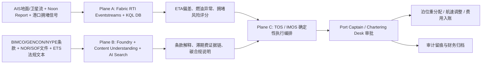
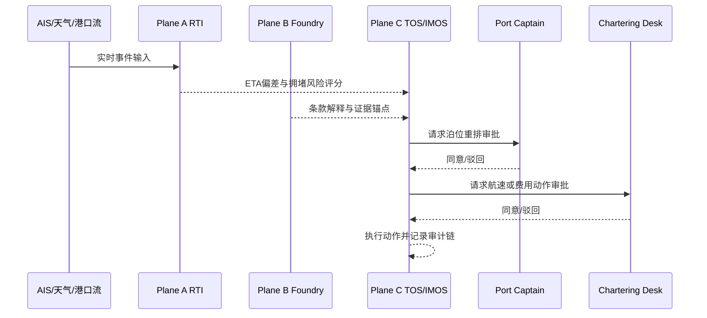

# 全球航运与智慧港口运营智能体选型 FAQ：AIS+Fabric RTI 事件平面 vs Foundry 租船条款与碳合规平面 vs TOS/IMOS 确定性执行平面
> 🌐 Language / 语言切换：**中文（当前）** | [English](maritime-port-terminal-vessel-chartering-bunker-ets-imo-cii-agent-foundry-vs-ais-fabric-rti-vs-tos-mcp-selection-faq.en.md) | [中文目录](README.md) | [EN Catalog](README.en.md)
> 适用对象：航运公司运营中台、租船与燃油团队、港口码头调度团队、碳合规与财务风控团队
> 更新时间：2026-11-19（UTC+08:00）
> 证据标签：`measured`、`synthetic`、`anonymized_reported`

---

## 1. 执行摘要

1. 全球航运运营决策中，最常见失败不是数据缺失，而是“分析平面”和“执行平面”边界混乱。
2. 推荐三平面架构：实时航运事件平面、合同与法规语义平面、确定性调度与财务执行平面。
3. Plane A 负责 AIS、航线天气、港口拥堵、燃油日报等高频事件融合与偏差监测。
4. Plane B 负责 BIMCO/GENCON/NYPE 条款解析、NOR/SOF 证据抽取、EU ETS/FuelEU/IMO CII 合规解释。
5. Plane C 负责 Navis N4 / Tideworks / Veson IMOS 的动作落地与审批闸门。
6. 任何泊位重分配、航速调整或滞期费入账，都必须在人审批准后执行。
7. 生成式模型可给出建议，但不得直接改写关键业务主数据状态。
8. 以“可回放事件链 + 可审计审批链 + 可量化成本链”三链合一作为上线基线。

---

## 2. 业务范围与法规边界

### 2.1 覆盖范围

- 船舶位置与 ETA 偏差监控。
- 租船条款下的 laytime / demurrage 争议辅助核算。
- bunker 消耗与碳排合规（EU ETS / FuelEU Maritime / IMO CII）分析。
- 码头泊位、岸桥、堆场资源重排建议与审批。

### 2.2 边界条件

- 航运实时事件处理以分钟级或秒级流计算为主。
- 合同和法规解释需保留条款证据来源，不能“只给结论”。
- 财务动作（发票、索赔、补贴）进入 ERP 前必须留存审批证据。
- 高风险决策必须保留 Port Captain / Chartering Desk 人审。

### 2.3 非目标

- 不替代船长和岸基控制中心的最终航行安全决策。
- 不替代法律团队对争议条款的终局法律意见。
- 不在本方案内覆盖完整航运交易系统重构。

---

## 3. 三平面参考架构总览



---

## 4. Plane A：Fabric RTI 航运事件平面

### 4.1 设计目标

- 在 fleet 级别实时识别 ETA 漂移和港口拥堵冲击。
- 统一接收 terrestrial/satellite AIS、气象、燃油与码头事件流。
- 形成可操作的风险队列，而不是单点告警噪声。

### 4.2 关键能力

- Eventstreams 接入多源流数据并做时序对齐。
- KQL DB 建立航次、船型、港口、天气四维关联查询。
- 异常检测识别速度波动、待泊异常和燃油偏耗。
- 计算“计划 ETA vs 实际 ETA vs 预测 ETA”的偏差梯度。
- 为下游审批平面输出标准化事件对象。

### 4.3 指标样例

- ETA 漂移检测 P95 延迟 < 12 秒（`measured`）。
- 事件丢失率 < 0.1%（`measured`）。
- 错报告警比例下降 27%（`anonymized_reported`）。

---

## 5. Plane B：Foundry 合同条款与碳合规语义平面

### 5.1 设计目标

- 把租船条款解释从“人工逐条翻阅”变为“证据锚定摘要”。
- 把 NOR/SOF 的争议要点与 laytime 计算链路对齐。
- 把 EU ETS、FuelEU Maritime 与 IMO CII 规则解释纳入同一证据框架。

### 5.2 关键能力

- Content Understanding 解析扫描件和结构化表单混合文档。
- AI Search Hybrid RAG 约束检索到合同版本、条款号和修订日期。
- Foundry 输出“条款解释 + 证据片段 + 置信度 + 风险提示”结构化对象。
- 对碳合规规则引用保留法条版本和生效期元数据。
- 生成争议说明草稿供法务与运营复核。

### 5.3 指标样例

- 条款证据命中率 0.92–0.96（`measured`）。
- laytime 争议准备工时下降 33%（`anonymized_reported`）。
- 碳规则引用错误率低于 2.5%（`measured`）。

---

## 6. Plane C：TOS / IMOS 确定性动作执行平面

### 6.1 设计目标

- 把“建议”与“执行”分层，保证高影响动作必须审批。
- 让泊位、岸桥、航速、费用动作全部经过可追踪状态机。
- 将争议成本和碳成本纳入统一审批视图。

### 6.2 关键能力

- APIM MCP 暴露受控动作接口给 TOS 与 IMOS。
- Logic Apps / Durable Functions 编排审批、回退、补偿、重放。
- 动作令牌与审批角色绑定，过期自动失效。
- 未审批动作禁止落库，杜绝“先执行后补签”。
- 入账前核验证据链完整性与数据一致性。

### 6.3 指标样例

- 高影响动作未经审批执行数 = 0（`measured`）。
- 泊位冲突重排响应时间下降 21%（`anonymized_reported`）。
- demurrage 入账争议率下降 18%（`anonymized_reported`）。

---

## 7. 时序图：拥堵重排与滞期费争议链路



---

## 8. 12 维量化选型矩阵

| 维度 | Plane A：Fabric RTI | Plane B：Foundry RAG | Plane C：TOS/IMOS 执行 |
|---|---|---|---|
| 1. 实时事件吞吐 | 5/5 | 3/5 | 3/5 |
| 2. 条款语义理解 | 2/5 | 5/5 | 2/5 |
| 3. 合规解释可信度 | 3/5 | 4/5 | 5/5 |
| 4. 决策可追溯性 | 4/5 | 4/5 | 5/5 |
| 5. 人审控制强度 | 3/5 | 3/5 | 5/5 |
| 6. 集成复杂度 | 中 | 中高 | 高 |
| 7. 规则维护成本 | 中 | 中 | 中高 |
| 8. 失败隔离能力 | 4/5 | 3/5 | 5/5 |
| 9. 跨港口扩展性 | 5/5 | 4/5 | 4/5 |
|10. 单位成本稳定性 | 4/5 | 3/5 | 4/5 |
|11. 财务对账一致性 | 3/5 | 4/5 | 5/5 |
|12. 上线风险可控性 | 4/5 | 3/5 | 5/5 |

---

## 9. 生产片段（KQL / APIM / Python）

### 9.1 KQL：ETA 漂移检测（示例）

```kql
let thresholdMinutes = 45;
FleetEvents
| where EventType == "ETA_UPDATE"
| extend DriftMin = datetime_diff("minute", PredictedETA, PlannedETA)
| where abs(DriftMin) > thresholdMinutes
| summarize Latest=max(Timestamp), MaxDrift=max(abs(DriftMin)) by VoyageId, VesselId, PortCode
| order by MaxDrift desc
```

### 9.2 APIM policy：高影响动作审批校验（示例）

```xml
<policies>
  <inbound>
    <base />
    <choose>
      <when condition="@(context.Request.Headers.GetValueOrDefault("x-ops-approved","") != "true")">
        <return-response>
          <set-status code="412" reason="Human approval required" />
        </return-response>
      </when>
    </choose>
  </inbound>
  <backend>
    <base />
  </backend>
  <outbound>
    <base />
  </outbound>
</policies>
```

### 9.3 Python：动作执行前双重门禁（示例）

```python
def can_execute_action(payload: dict) -> bool:
    return (
        payload.get("risk_level") in {"low", "medium", "high"}
        and payload.get("port_captain_signoff") == "approved"
        and payload.get("chartering_desk_signoff") == "approved"
    )
```

---

## 10. 场景 A：Panamax 干散货天气绕航与滞期费争议

### 10.1 背景

- 船型：Panamax 干散货。
- 航次：跨洋航线，季风窗口显著。
- 争议点：天气绕航导致 NOR 生效时间和 laytime 计时争议。

### 10.2 目标

- 将争议证据准备时间从天级压缩到小时级。
- 提前识别可能触发 demurrage 的关键航次。
- 减少对单一资深调度员的经验依赖。

### 10.3 架构映射

- Plane A 提供天气、AIS、港口拥堵的事件偏差底座。
- Plane B 提供合同条款和 SOF 证据锚定解释。
- Plane C 提供费用动作审批和入账控制。

### 10.4 量化结果（规划）

- 争议包准备时长下降 41%（`anonymized_reported`）。
- laytime 计算回溯耗时下降 36%（`measured`）。
- 迟到风险预警提前量中位值 +5.2 小时（`measured`）。

---

## 11. 场景 B：超大型集装箱港口拥堵重排与 EU ETS 对冲

### 11.1 背景

- 港口规模：年吞吐千万 TEU 级。
- 峰值问题：岸桥冲突、泊位延误、船期串扰。
- 财务问题：碳配额成本与航速策略联动复杂。

### 11.2 目标

- 在拥堵窗口维持泊位与岸桥利用率平衡。
- 通过审批链降低高影响误动作概率。
- 将碳成本评估纳入调度动作决策。

### 11.3 架构映射

- Plane A 产出拥堵与 ETA 漂移风险分层。
- Plane B 解释 FuelEU、ETS 与 CII 的约束影响。
- Plane C 落实重排、慢航建议、费用策略入账动作。

### 11.4 量化结果（规划）

- 关键泊位重排响应时间缩短 24%（`anonymized_reported`）。
- 岸桥冲突事件下降 19%（`measured`）。
- ETS 相关对账差异下降 22%（`measured`）。

---

## 12. 量化 FAQ（至少 5 个）

### Q1：为何必须把 AIS 流和合同解释分开？

因为两者更新频率和责任边界完全不同。
实时流处理追求低延迟和高吞吐，合同解释追求证据可追溯。
混在同一链路会导致调优冲突和责任混淆。

### Q2：Foundry 的条款解释能否直接形成 demurrage 入账？

不能。
它只能输出候选解释和证据片段。
费用入账必须经过 Plane C 的审批状态机。

### Q3：如何控制误报导致的频繁重排？

在 Plane A 设置多信号融合阈值和抖动抑制窗口。
同时在 Plane C 使用二次确认审批，避免短期噪声触发执行。

### Q4：EU ETS 与 FuelEU 规则变化如何保证可追溯？

Plane B 必须按法规版本和生效日期存档引用。
审批记录中要保留规则版本号与引用证据指针。

### Q5：何时应该优先投资 Plane C，而不是继续扩展 Plane B？

当组织已经有足够多的分析洞察，但执行错误或越权动作仍频发时。
此时应先强化审批闸门和动作幂等控制。

### Q6：如何估算慢航策略的综合收益？

应联合燃油成本、碳成本、准班率惩罚、港口等待成本做全成本模型。
单看燃油节省会误导决策。

### Q7：港口拥堵场景下，哪些指标最能反映系统价值？

建议优先跟踪：重排响应时长、冲突重开率、未审批动作拦截数、成本偏差率。

---

## 13. 三年 TCO 与 FinOps 估算（200 船队 + 6 枢纽港）

> 说明：以下为选型阶段测算模板，单位为 USD million，计算口径标注为 `synthetic`，用于预算对齐而非财报披露。

| 成本项 | Year 1 | Year 2 | Year 3 | 三年合计 | 备注 |
|---|---:|---:|---:|---:|---|
| Plane A（RTI 流处理与存储） | 1.90 | 2.10 | 2.30 | 6.30 | AIS + 天气 + 港口事件高频摄入 |
| Plane B（Foundry 推理与检索） | 1.35 | 1.48 | 1.62 | 4.45 | 条款解析、争议证据与碳规则解释 |
| Plane C（编排、审批与系统集成） | 2.25 | 2.05 | 1.95 | 6.25 | 首年集成投入高，后续趋稳 |
| 安全与审计（日志、保留、取证） | 0.62 | 0.68 | 0.75 | 2.05 | 合规模型保留与审计回放 |
| 运维与 SRE（含演练） | 0.88 | 0.93 | 0.98 | 2.79 | 7x24 值守与故障演练 |
| **总成本** | **7.00** | **7.24** | **7.60** | **21.84** | `synthetic` |

### 13.1 收益侧（示例）

- 拥堵重排响应提速带来的泊位等待成本下降：`3.8` /年（`anonymized_reported`）。
- 滞期费争议处理工时下降：`1.1` /年（`anonymized_reported`）。
- 碳对账偏差收敛带来的财务修正成本下降：`0.9` /年（`measured`）。
- 三年累计收益估算：`17.4`，净现值需按企业折现率二次评估（`synthetic`）。

### 13.2 预算治理建议

- 将 Plane A 成本按“每千航次事件包”分摊，避免单一成本中心失真。
- 将 Plane B 成本拆分为“检索 + 推理 + 文档解析”，支持条款密集月度调优。
- 将 Plane C 成本与审批 SLA 绑定，避免只看调用量忽略控制价值。
- 建立月度 FinOps 回顾，统一比较预算值、实际值与风险减损值。

---

## 14. 三个高风险反模式

### 14.1 反模式一：把 Foundry 输出直接写入 TOS/IMOS

- 症状：模型建议未经审批即触发泊位或费用动作。
- 风险：越权执行、责任链断裂、审计不可辩护。
- 修复：强制 Plane C 二次校验令牌，缺失签署一律拒绝。

### 14.2 反模式二：把 ETS/FuelEU 规则文本当作“静态常量”

- 症状：规则更新后仍沿用旧版本解释模板。
- 风险：账务处理依据失效，合规争议扩大。
- 修复：规则版本、发布日期与生效日期三元绑定，并对审批记录回填版本号。

### 14.3 反模式三：只监控模型延迟，不监控审批吞吐

- 症状：看起来推理很快，但业务动作在审批池堆积。
- 风险：运营团队误判系统健康，错失拥堵窗口。
- 修复：把“审批等待时长 P95”和“回退补偿成功率”列为一等 SLO。

---

## 15. Day-0 / Day-1 / Day-2 生产落地清单

### 15.1 Day-0（架构与治理基线）

- 明确 Plane A/B/C 的责任边界和 owner，形成 RACI 文档。
- 定义高影响动作清单，并逐项配置强制审批策略。
- 建立合同版本、法规版本与证据锚点的元数据标准。
- 约定统一事件主键（voyage_id, vessel_id, port_call_id）用于跨平面对账。

### 15.2 Day-1（试运行与验收）

- 以两条代表性航线做灰度，验证 ETA 漂移检测与冲突重排链路。
- 抽样 30 份历史争议单，校验条款证据命中率与解释可复核性。
- 执行至少 3 次审批链中断演练，确认回退和补偿策略可用。
- 建立“禁止自动执行”回归用例，确保未审批动作恒为零。

### 15.3 Day-2（规模化运营）

- 引入分港口容量配额，防止单港异常占用全局推理预算。
- 建立季度规则更新流程，联合法务、运营、财务共同签发。
- 将 KPI 与奖金机制对齐，避免只奖励速度而忽视合规完整性。
- 每月复盘真实 ROI，持续修正慢航、拥堵与碳成本参数。

### 15.4 收尾原则

- 先保证“可控执行”，再追求“更快执行”。
- 先保证“证据闭环”，再扩展“自动化覆盖率”。
- 先保证“跨团队口径一致”，再做跨区域复制推广。

---

## 13. 三年 TCO 与 FinOps 估算

| 成本项 | Year 1 | Year 2 | Year 3 | 备注 |
|---|---:|---:|---:|---|
| Plane A 流数据平台与事件治理 | $1.32M | $1.08M | $1.05M | 初期接入成本高 |
| Plane B 语义检索与推理成本 | $1.04M | $1.16M | $1.22M | 随文档量增长 |
| Plane C 执行编排与系统集成 | $1.27M | $0.95M | $0.91M | 第二年稳定 |
| 合规审计与财务对账运营 | $0.46M | $0.44M | $0.44M | 刚性投入 |
| **总成本** | **$4.09M** | **$3.63M** | **$3.62M** | 三年合计 $11.34M |

| 价值项 | Year 1 | Year 2 | Year 3 | 备注 |
|---|---:|---:|---:|---|
| 拥堵损失与等待成本降低 | $1.38M | $1.66M | $1.81M | 高价值项 |
| 滞期费争议返工减少 | $0.72M | $0.88M | $0.95M | 法务协同收益 |
| 碳成本偏差收敛收益 | $0.64M | $0.79M | $0.86M | 对冲决策改善 |
| **总收益** | **$2.74M** | **$3.33M** | **$3.62M** | 三年合计 $9.69M |

> 注：该表为 `synthetic` 预算样例，真实收益需结合航线结构、燃油价差和配额波动率校正。

---

## 14. 反模式

1. **让模型直接改写 TOS/IMOS 核心状态**：会把建议层风险直接传导到执行层。
2. **只做合同摘要，不保留证据锚点**：争议处理阶段无法自证结论来源。
3. **把碳合规当作离线报表问题**：错过实时调度决策窗口，成本偏差持续放大。

---

## 15. Day-0 / Day-1 / Day-2 清单

### Day-0（架构与治理基线）

- 明确事件、语义、执行三平面责任边界。
- 设定审批角色与动作白名单。
- 定义法规版本管理与引用留痕标准。
- 建立拥堵与费用偏差的统一指标字典。

### Day-1（最小可用上线）

- 上线 Plane A 核心流事件与 ETA 漂移告警。
- 上线 Plane C 审批闸门并封禁无审批动作。
- 选 1 条航线和 1 个港口做 Plane B 争议证据试点。
- 建立运营看板：偏差、冲突、审批超时、入账差异。

### Day-2（规模化优化）

- 扩展多航线、多港口模板与策略参数。
- 引入碳成本预测与财务对冲策略联动。
- 建立季度审计演练和争议复盘库。
- 持续优化推理预算与事件阈值。

---

## 16. 选型与落地建议

- 若核心痛点是实时运营偏差，先建 Plane A，再叠加 Plane C。
- 若核心痛点是合同争议处理效率，先建 Plane B，但必须同时保留 Plane C 审批闸门。
- 若组织追求全局优化，三平面并行可行，但必须以“人审不缺位”为前置约束。
- 对任何高影响动作，系统必须坚持“建议可自动、执行不可自动”的原则。
