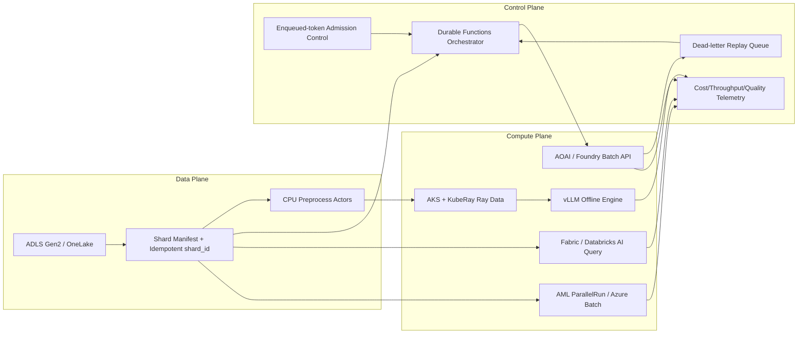
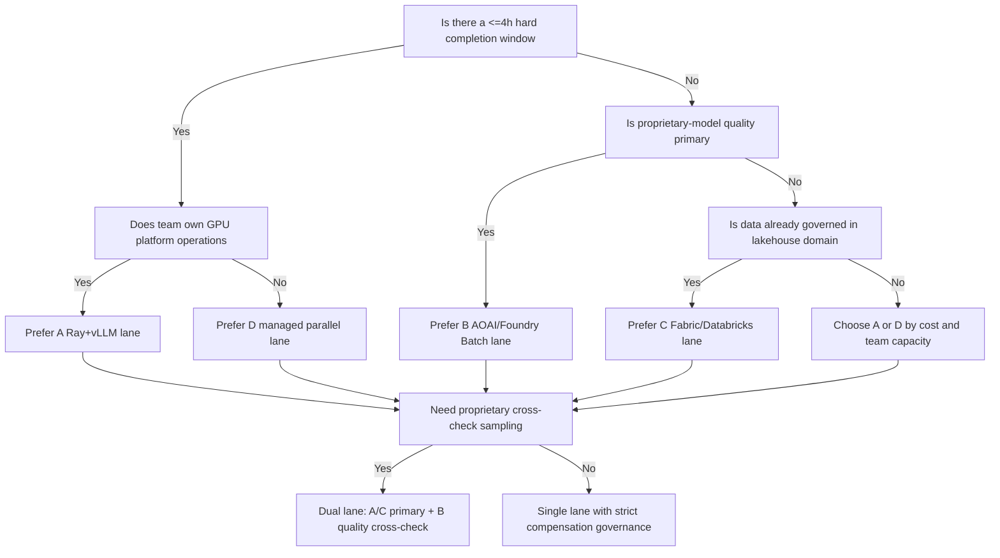

# Massive-Scale Offline LLM/VLM Corpus Batch Inference Selection FAQ: AKS + Ray Data + vLLM vs AOAI/Foundry Batch API vs Fabric/Databricks AI Query vs AML ParallelRun

> 🌐 **Language Switch**: [中文](./massive-offline-llm-batch-inference-aks-ray-data-vllm-vs-aoai-global-batch-api-vs-fabric-databricks-ai-query-selection-faq.md) | **English (current)**
> **Audience**: Cloud & AI Solution Architects, data-platform owners, MLOps/GPU platform teams, governance/compliance stakeholders, and batch-processing SRE teams.
> **Scope**: Architecture choices for `10M–1B` record/document offline inference workloads (archive extraction, catalog-attribute backfill, nightly compliance tagging, corpus labeling enrichment), with focus on throughput, cost, SLA windows, and replayable governance evidence.

## 1. Problem framing: why online-serving patterns fail for massive offline inference
Offline inference is not an interactive-latency problem; it is a windowed completion and operational determinism problem at extreme scale.  
Many teams copy online endpoint patterns into offline jobs and then hit avoidable overhead: repeated HTTP framing, unstable queue fan-out, and expensive retry amplification.  
At `100M` rows with `1,800` input tokens and `250` output tokens each, total workload reaches roughly `205B` tokens, so minor inefficiencies become major cost and schedule risks.  
Window constraints are equally critical: a business process may require completion inside `4h`, while asynchronous batch services may publish `24h` completion SLAs.  
The architecture objective is therefore to optimize for predictable completion, quality controls, and auditability, not only nominal model throughput.  

## 2. Four architecture patterns (A/B/C/D) and boundary of responsibility
**Architecture A (AKS + KubeRay Ray Data + vLLM Offline):** high-control, high-throughput pipeline with prefix-sorted buckets, length-grouped microbatches, and Spot-aware shard checkpoints.  
**Architecture B (AOAI/Foundry Global & DataZone Batch API):** managed asynchronous batch lane with token discounts and no GPU-cluster operations, requiring robust sharding and dead-letter reconciliation.  
**Architecture C (Fabric AI Functions / Databricks Mosaic AI Batch):** lakehouse-native in-place enrichment with inherited ACLs, lineage, and data-team-operable SQL/DataFrame workflows.  
**Architecture D (AML ParallelRunStep / Azure Batch low-priority GPU pools):** managed mini-batch execution with lower Kubernetes burden and strong integration into model/version governance.  
In enterprise practice these lanes are layered: A for max-throughput open-weight execution, B for proprietary-model quality tasks, C for governance-first data engineering, and D for managed parallel fallback or migration phases.  

## 3. End-to-end reference architecture: shard orchestration, compensation, and governance control loops

This architecture explicitly separates data-plane throughput from control-plane governance so retries, quotas, and replayability are enforceable without polluting compute paths.  
For Spot-heavy execution, all lanes should commit completion by `shard_id` manifest semantics to prevent duplicate charging and duplicate output writes.  

## 4. Architecture A deep dive: Ray Data + vLLM Offline for throughput-dominant workloads
Architecture A converts request-driven inference into streaming shard execution where CPU preprocessing actors feed GPU workers directly, avoiding online endpoint protocol overhead.  
Prefix sorting plus token-length bucketing significantly improves cache and kernel efficiency, especially for repetitive prompt frames in extraction and tagging jobs.  
Operationally, teams often observe prefix-cache hit rates above `88%` and `2.4x–3.8x` better MFU/KV utilization compared with generic online API routes.  
Spot resilience depends on idempotent shard manifests and checkpoint discipline; successful designs use commit-on-output plus manifest-finalize semantics for deterministic recovery.  
A is typically the strongest fit when the organization can operate GPU infrastructure and requires strict completion inside short windows.  

## 5. Architecture B deep dive: AOAI/Foundry Batch API for managed proprietary-model processing
B minimizes GPU operations burden and offers discounted token economics, which is attractive for proprietary frontier models and teams prioritizing operational simplicity.  
Engineering rigor shifts to input partitioning and reconciliation: common patterns use `100K` requests or `200MB` `.jsonl` shards with stable `custom_id` mappings.  
Partial failures (content-filter responses, malformed inputs, quota admission misses) should be isolated into dead-letter lanes rather than triggering full-batch reruns.  
The central risk is SLA-window mismatch: if the platform allows up to `24h` completion but the business demands `4h`, hard-deadline shards need deterministic rerouting.  
B is best for quality-sensitive workloads with moderate deadline elasticity and strong managed-service preference.  

## 6. Architecture C deep dive: lakehouse-native batch inference in Fabric and Databricks
Architecture C keeps inference in the lakehouse plane, reducing data movement and preserving ACL, lineage, and governance controls where data engineers already operate.  
Fabric AI Functions align with Microsoft data platform conventions, while Databricks `ai_query()` aligns with Unity Catalog and Spark-native engineering workflows.  
This pattern can materially reduce cross-team handoff friction because inference logic remains close to established ETL/ELT operations and data-quality checks.  
The trade-off is reduced flexibility for deeply customized runtime execution paths compared with fully programmable GPU orchestration in A.  
C is often selected when governance consistency and organizational execution speed outweigh absolute throughput maximization.  

## 7. Architecture D deep dive: AML ParallelRunStep and Azure Batch managed parallelism
Architecture D offers a pragmatic managed parallel route for teams that need controlled scale without owning Kubernetes-level scheduling complexity.  
ParallelRunStep integrates well with model registries, experiment metadata, and approval workflows, supporting controlled promotion patterns.  
Azure Batch low-priority pools can improve cost profiles but require careful handling of eviction and compensation logic in large task graphs.  
D generally provides reliable baseline throughput with strong manageability, though it may not match A’s fine-grained optimization ceiling at extreme volume.  
In enterprise roadmaps, D often serves as a transitional or governance-first lane before selective migration to A or C for specialized workloads.  

## 8. Twelve-dimension comparison matrix: throughput, governance, and operational economics
| Dimension | A: Ray Data + vLLM Offline | B: AOAI/Foundry Batch API | C: Fabric/Databricks AI Query | D: AML/Batch |
|---|---|---|---|---|
| Peak throughput potential | Very high | High | Medium-high | Medium |
| Unit-cost optimization headroom | Very high | Medium-high | Medium | Medium |
| GPU operations burden | High | Very low | Low-to-medium | Medium |
| Tight window controllability | High | Medium | Medium-high | Medium |
| Failure compensation flexibility | High | Medium-high | High | High |
| Data-movement minimization | Medium | Medium | Very high | Medium |
| ACL/lineage inheritance | Medium | Medium | Very high | High |
| Model/runtime freedom | Very high | Low-to-medium | Medium | High |
| Spot-cost leverage | Very high | N/A (managed) | Low-to-medium | Medium |
| Time-to-production | Medium | High | Medium-high | Medium |
| Team skill threshold | High | Low | Medium | Medium |
| Recommended role | Throughput-first backbone | Managed proprietary lane | Governance-first lakehouse lane | Managed parallel baseline |

Most large enterprises achieve better results with layered routing than with a single universal lane.  

## 9. Quantitative formulas: workload sizing, cost crossover, and routing thresholds
### 9.1 Total token sizing
Total token demand can be approximated as:  
\[
T = N \times (t_{in}+t_{out})
\]
With `N=100M`, `tin=1800`, and `tout=250`, total workload is `205B` tokens.  

### 9.2 Cost projection
Given unit price `p` per `1M` tokens:  
\[
Cost = \frac{T}{1,000,000}\times p
\]
At this scale, marginal unit-price differences have outsized annual budget impact.  

### 9.3 Deadline throughput requirement
For completion window `W` hours:  
\[
Throughput_{required} = \frac{N}{W}
\]
If managed batch admission cannot satisfy required throughput, deadline-critical shards should be rerouted to deterministic lanes (A or D/C).  

### 9.4 Routing dimensions
A practical routing policy uses `deadline_tightness`, `quality_sensitivity`, and `ops_budget` as primary dimensions.  
This avoids model-only routing and aligns architecture with real business delivery constraints.  

## 10. Decision tree: window first, model and governance second

This ordering prevents architecture choices from being driven by model preference while ignoring delivery-window feasibility.  

## 11. Production snippet #1: Ray Data + vLLM prefix-sorted offline pipeline (Python)
```python
from __future__ import annotations
import ray
from ray.data import Dataset
from typing import Dict, List
from vllm import LLM, SamplingParams


def build_prompt(row: Dict[str, str]) -> str:
    return f"{row['task_prefix']}\n\n{row['payload_text']}"


def sort_key(row: Dict[str, str]) -> tuple:
    pfx = row["task_prefix"][:96]
    ln = min(len(row["payload_text"]), 16000)
    return (pfx, ln // 128)


class VllmOfflineWorker:
    def __init__(self, model_name: str):
        self.llm = LLM(
            model=model_name,
            tensor_parallel_size=1,
            gpu_memory_utilization=0.92,
            enforce_eager=False,
        )
        self.sampling = SamplingParams(
            temperature=0.0,
            max_tokens=280,
            top_p=1.0,
        )

    def __call__(self, batch: Dict[str, List[str]]) -> Dict[str, List[str]]:
        prompts = [build_prompt({"task_prefix": p, "payload_text": t}) for p, t in zip(batch["task_prefix"], batch["payload_text"])]
        outputs = self.llm.generate(prompts, self.sampling)
        return {
            "shard_id": batch["shard_id"],
            "record_id": batch["record_id"],
            "result_text": [o.outputs[0].text for o in outputs],
            "status": ["ok"] * len(outputs),
        }


def run_pipeline(input_uri: str, output_uri: str, model_name: str) -> None:
    ray.init(address="auto")
    ds: Dataset = ray.data.read_parquet(input_uri)
    ds = ds.sort(key=sort_key)
    ds = ds.repartition(512)
    result = ds.map_batches(
        VllmOfflineWorker,
        fn_constructor_kwargs={"model_name": model_name},
        batch_size=96,
        num_gpus=1,
        concurrency=48,
    )
    result.write_parquet(output_uri)
```
This code demonstrates throughput-oriented offline design where sorting and shard topology are first-class optimization controls.  

## 12. Production snippet #2: Durable Functions manifest reconciler for AOAI Batch API (Python)
```python
from __future__ import annotations
import azure.durable_functions as df
from typing import Dict, Any, List


def orchestrator(context: df.DurableOrchestrationContext):
    manifest = context.get_input()
    shard_jobs = manifest["shards"]
    batch_ids = []

    for shard in shard_jobs:
        batch_id = yield context.call_activity("submit_batch_job", shard)
        batch_ids.append({"shard_id": shard["shard_id"], "batch_id": batch_id})

    completed: List[Dict[str, Any]] = []
    dead_letters: List[Dict[str, Any]] = []
    for item in batch_ids:
        status = yield context.call_activity("poll_batch_status", item)
        if status["state"] == "succeeded":
            merged = yield context.call_activity("merge_batch_result", status)
            completed.append(merged)
        else:
            dead_letters.append(
                {
                    "shard_id": item["shard_id"],
                    "batch_id": item["batch_id"],
                    "reason": status.get("reason", "unknown"),
                }
            )

    if dead_letters:
        yield context.call_activity("enqueue_dead_letter", dead_letters)

    return {
        "completed_shards": len(completed),
        "dead_letter_shards": len(dead_letters),
        "status": "partial" if dead_letters else "success",
    }


main = df.Orchestrator.create(orchestrator)
```
This pattern enforces deterministic reconciliation and replay discipline instead of ad hoc reruns that mask systemic failure modes.  

## 13. Enterprise scenario A: historical archive extraction and catalog-attribute backfill
A global retail platform needed nightly enrichment of `240M` archived product descriptions with stricter delivery windows for downstream merchandising systems.  
The team selected A as the primary lane with prefix-bucketed shard processing on Spot-tolerant GPU pools and idempotent manifest commit rules.  
A secondary B lane processed `1%` quality-control samples on proprietary models, and deviations triggered controlled fallback reruns.  
Measured outcomes showed around `3.1x` throughput increase, about `43%` unit-cost reduction, and stable replayable evidence for governance review.  

## 14. Enterprise scenario B: nightly compliance tagging and corpus-labeling enrichment
A regulated enterprise needed nightly policy tagging and evidence extraction with full replayability and strict data-governance controls.  
The primary lane used C for in-place lakehouse processing to retain ACL/lineage continuity, while difficult records were escalated to B for higher-fidelity proprietary reasoning.  
Dead-letter shards were routed to governed review queues and then reintegrated via tracked reconciliation tickets.  
This approach improved audit readiness and reduced cross-team handoff friction by keeping core workflows inside existing data governance boundaries.  

## 15. Three-year TCO, quantitative Q&A, Day-0/Day-2 checklists, and fit guidance
### 15.1 Three-year TCO (`50M / 200M / 1B` annual processing profiles)
| Cost component (3-year) | A | A+B | C+B | D+B |
|---|---:|---:|---:|---:|
| Compute and platform infrastructure | `$1.62M` | `$1.94M` | `$1.71M` | `$1.88M` |
| Platform engineering and operations labor | `$1.36M` | `$1.42M` | `$1.18M` | `$1.24M` |
| Governance, audit, and data operations | `$0.64M` | `$0.69M` | `$0.58M` | `$0.61M` |
| Overrun/rework opportunity loss | `$1.11M` | `$0.78M` | `$0.83M` | `$0.92M` |
| Total three-year cost | `$4.73M` | `$4.83M` | `$4.30M` | `$4.65M` |

Where lakehouse governance is mature, `C+B` often provides balanced long-run outcomes; where throughput and cost dominate, `A` or `A+B` is typically stronger.  

### 15.2 Quantitative Q&A (6)
**Q1: When is A better than B?**  
When deadlines are tight, record volume is very high, and open-weight execution is acceptable under platform governance controls.  

**Q2: What is B’s biggest engineering risk?**  
Window mismatch: business processes may require `4h` completion while managed batch SLAs can allow up to `24h`.  

**Q3: Does C reduce model flexibility?**  
Somewhat, but it improves governance continuity and operational collaboration for data-engineering-led organizations.  

**Q4: Why keep D in the portfolio?**  
D offers managed parallel execution with lower platform overhead, especially valuable in migration or governance-first phases.  

**Q5: How do teams avoid duplicate charging under Spot/eviction retries?**  
Use idempotent shard manifests and enforce single-settlement semantics per shard completion state.  

**Q6: What is the minimum production governance baseline?**  
Task-tier admission rules, idempotent manifests, dead-letter replay controls, cost observability, quality cross-check sampling, and full audit replay linkage.  

### 15.3 Day-0 checklist
- Classify workloads by deadline criticality (hard/soft/deferred) before selecting execution lanes.  
- Define canonical shard schema (`shard_id`, input URI, model version, parameter hash, retry budget).  
- Implement deterministic reconciliation contracts (`custom_id`, key mapping, failure class, dead-letter route).  
- Stand up core telemetry for throughput, cost, error, and window-overrun rates.  
- Establish dual-lane quality controls (primary execution + verification lane sampling).  
- Enforce budget guardrails for unit token cost, per-job cost ceilings, and daily burn alerts.  

### 15.4 Day-2 checklist
- Review prefix-bucketing and batching efficiency weekly to sustain throughput and cache locality.  
- Analyze dead-letter patterns weekly across input quality, model behavior, and platform failure classes.  
- Recalibrate routing thresholds monthly across deadline, quality sensitivity, and cost variance dimensions.  
- Validate replayability monthly by tracing sampled outputs back to shard manifests and model versions.  
- Refresh TCO assumptions quarterly, including compute pricing and rework-loss parameters.  
- Run quarterly failure drills validating cross-lane degradation and compensation behavior.  

### 15.5 Good fit vs Not for
| Decision | Guidance |
|---|---|
| ✅ Good fit | Enterprises processing massive offline corpora under strict completion windows while requiring auditable, replayable governance controls. |
| ⛔ Not for | Low-volume interactive use cases with no batch windows and minimal governance requirements. |

Recommended practice is **layered routing across A/B/C/D with explicit workload admission policies**, not single-stack standardization.  
At this scale, success comes from stable engineering loops across throughput, deadline reliability, quality verification, and governance evidence.  

### 15.6 Suggested SLO/SLI envelope for offline batch governance
| Control domain | Suggested SLI | Suggested quarterly SLO | Triggered action |
|---|---|---|---|
| On-window completion rate | Share of jobs completed before deadline | `>= 99.2%` | Priority uplift and reroute to deterministic lane |
| Cost variance rate | Deviation from budgeted job cost | `<= 8%` | Re-bucketing and parameter cost controls |
| Idempotency integrity | Retry outcomes without duplicate writes | `>= 99.99%` | Manifest commit freeze and integrity audit |
| Dead-letter recoverability | Dead-letter shards recovered via replay | `>= 97%` | Model/input remediation workflow |
| Quality sample pass rate | Accuracy on sampled verification sets | `>= 98.5%` | Route escalation to higher-fidelity lane |
| Audit replay completeness | Outputs with full traceable evidence | `>= 99.9%` | Block downstream release and alert |

Bind these SLOs to release gates so scaling decisions cannot bypass governance quality.  

### 15.7 Recommended 90-day rollout cadence
Days `1–30`: build manifest standards, dead-letter controls, and baseline observability before aggressive scale-up.  
Days `31–60`: deploy A or C as primary lane with dual-lane verification and measurable throughput/cost baselines.  
Days `61–90`: harden routing guardrails, budget policies, and cross-lane degradation drills with audit replay validation.  
This phased sequence reduces platform risk while keeping business delivery timelines predictable.  

### 15.8 Minimum audit evidence package (recommended fields)
- `job_id`, `shard_id`, `record_count`, `input_uri`, `output_uri` for deterministic data-flow traceability.  
- `model_id`, `model_version`, `prompt_template_hash`, `sampling_params_hash` for exact reproducibility.  
- `submit_time`, `complete_time`, `retry_count`, `dead_letter_reason` for timing and failure accountability.  
- `cost_estimate`, `cost_actual`, `token_in`, `token_out` for financial reconciliation and budget governance.  
- `quality_sample_score`, `review_ticket_id` to bind automated outputs with human verification controls.  
- `policy_version`, `operator_id`, `approval_id` (for release-sensitive paths) for compliance accountability.  

### 15.9 Common anti-patterns and mitigation guidance
- Anti-pattern 1: forcing online request semantics into offline jobs, causing avoidable protocol overhead and retry amplification.  
- Anti-pattern 2: running retries without idempotent shard manifests, leading to duplicate writes and billing artifacts.  
- Anti-pattern 3: optimizing for throughput while ignoring deadline feasibility, resulting in business-window misses.  
- Anti-pattern 4: cost-only optimization without quality sampling, allowing silent low-quality drift into downstream systems.  
- Anti-pattern 5: ignoring dead-letter trends as noise, which accumulates hidden technical debt and governance risk.  
