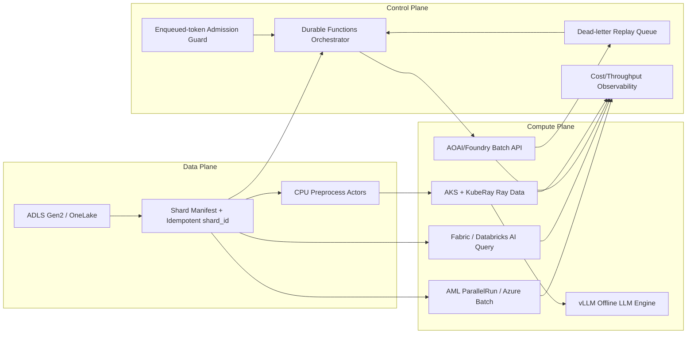
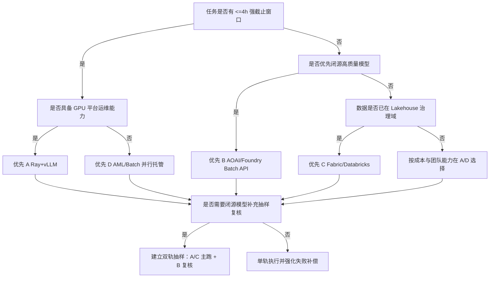

# 海量离线 LLM/VLM 语料批推理选型 FAQ：AKS + Ray Data + vLLM vs AOAI/Foundry Batch API vs Fabric/Databricks AI Query vs AML ParallelRun

> 🌐 **Language Switch**：**中文（当前）** | [English](./massive-offline-llm-batch-inference-aks-ray-data-vllm-vs-aoai-global-batch-api-vs-fabric-databricks-ai-query-selection-faq.en.md)
> **受众**：Cloud & AI Solution Architect、数据平台负责人、MLOps/GPU 平台团队、企业合规与数据治理团队、批处理作业 SRE 团队。
> **范围**：面向 `10M–1B` 记录级离线批推理任务（历史档案抽取、目录属性回填、夜间合规标签、语料标注增强），对比 AKS Ray Data 离线推理、AOAI/Foundry Batch API、Lakehouse 内嵌推理与 AML/Azure Batch 管道，强调吞吐、成本、SLA 与治理可追溯性。

## 1. 问题定义：为何“在线推理思路”无法直接套用到海量离线批处理
离线批推理任务的目标不是交互式首字节时延，而是在限定窗口内稳定完成巨大体量处理并保证输出可回放。  
很多团队把在线 API 调用模式直接搬到离线场景，结果出现 HTTP 开销放大、上下文重复、队列抖动和失败重试风暴。  
在 `100M` 记录、每条 `1,800` 输入 token 与 `250` 输出 token 的任务中，总 token 规模约 `205B`，任何小比例低效都会被放大成显著预算风险。  
离线任务还常受夜间窗口约束，例如 `4h` 数据刷新截止，这与 Batch API 的 `24h` 完成 SLA 存在天然张力，需要架构层提前分流。  
因此本议题核心是“吞吐与治理并重的流水线工程”，而不是“在线模型端点简单扩容”。  

## 2. 四种架构模式（A/B/C/D）与职责边界
**Architecture A（AKS + KubeRay Ray Data + vLLM Offline）**：把 Parquet 分片直接流式送入 GPU worker，利用前缀排序与长度分桶提升缓存命中与设备利用率。  
**Architecture B（AOAI/Foundry Global & DataZone Batch API）**：交给托管批处理通道，获取 `50%` token 折扣与免 GPU 运维优势，但需设计队列准入、分片编排与超窗补偿。  
**Architecture C（Fabric AI Functions / Databricks Mosaic AI Batch）**：在 Lakehouse 内部进行 SQL/DataFrame 级批推理，突出数据不搬移、权限继承与血缘治理。  
**Architecture D（AML ParallelRunStep / Azure Batch 低优先级 GPU）**：用托管并行框架跑文件或表格 mini-batch，适合希望降低 K8s 复杂度但仍保留模型与作业控制的团队。  
企业实践常采用“多通道分层”：高吞吐开源权重走 A，高精度闭源模型走 B，数据工程团队走 C，治理或迁移过渡阶段走 D。  

## 3. 端到端参考架构：离线分片、批推理编排、死信补偿与治理闭环

该架构把“数据面”与“控制面”显式拆分：数据面追求吞吐效率，控制面保证准入、幂等、补偿、审计和成本守护。  
对 `Spot` 场景，建议所有执行路径都绑定 `shard_id` 清单，任何重试必须基于 manifest 幂等判定，避免重复计费和重复写入。  

## 4. Architecture A 详解：Ray Data + vLLM Offline 的高吞吐离线路径
A 的关键机制是把“请求式调用”改成“分片流式执行”：CPU actor 做预处理，GPU worker 按分桶微批离线推理，省去 HTTP/SSE 框架开销。  
为提高缓存命中，建议先按 prompt 前缀与 token 长度排序，再构建 microbatch；在多租户任务中可按租户或任务标签分层调度。  
在观测层，通常能看到 prefix cache 命中率超过 `88%`，MFU/KV 利用率较在线端点提升约 `2.4x–3.8x`。  
针对 Spot 驱逐，需在 shard 完成边界持久化 checkpoint，并采用“结果先落地、元数据后提交”的两阶段提交策略。  
A 适合大规模可并行文本或多模态批抽取，尤其在开源权重与成本敏感任务中优势显著。  

## 5. Architecture B 详解：AOAI/Foundry Batch API 的运维最小化路径
B 的优势是免 GPU 集群运维，且提供批任务折扣与独立排队额度，对“闭源高质量模型 + 运维简化”场景非常有吸引力。  
工程重点不在调用本身，而在分片与补偿：常见实践是按 `100K` 请求或 `200MB` `.jsonl` 切片，并用 `custom_id` 做结果回拼。  
若遇到内容过滤、格式错误或超时任务，应将失败项进入 dead-letter 队列并做可审计重放，而不是整批重跑。  
由于官方 SLA 可能允许 `24h` 完成，若业务窗口是 `4h`，必须提前做任务分级，把硬截止任务分流到 A/C/D。  
B 适合模型质量优先、作业窗口相对宽松且团队不希望承担 GPU SRE 负担的组织。  

## 6. Architecture C 详解：Lakehouse 原位推理（Fabric vs Databricks）
C 的核心价值是“数据不搬移”：在 Delta/OneLake 上直接做批推理，继承行列权限、血缘、审计和数据工程编排体系。  
Fabric AI Functions 更贴近 Microsoft 统一数据体验，Databricks ai_query() 更贴近 UC 治理和 Spark 生态任务链。  
该模式在团队组织上很关键：数据工程团队可以在熟悉的 SQL/DataFrame 流程中维护推理作业，降低跨团队交接成本。  
不足是模型服务自由度受平台接口约束，复杂自定义推理管线能力可能不如 A 路径灵活。  
因此 C 常用于“治理优先 + 数据团队主导”的企业数据增强流水线。  

## 7. Architecture D 详解：AML ParallelRun / Azure Batch 的托管并行方案
D 适合处在平台过渡期或希望避开 K8s 运维复杂度的团队：通过托管并行任务实现可控规模扩展。  
ParallelRunStep 支持模型与数据资产版本化，易于与 AML Registry、实验追踪和审批流程集成。  
Azure Batch 低优先级池则在成本上有弹性，但需要更细致的失败恢复与驱逐处理策略。  
D 的上限取决于作业编排成熟度和底层资源稳定性，通常在极端吞吐场景不如 A 的精细调优能力。  
它在企业里往往承担“标准化可交付底线”，确保大规模任务可跑、可追、可复盘。  

## 8. 12 维对比矩阵：吞吐、成本、治理与运维
| 维度 | A：Ray Data + vLLM Offline | B：AOAI/Foundry Batch API | C：Fabric/Databricks AI Query | D：AML/Batch |
|---|---|---|---|---|
| 峰值吞吐潜力 | 很高 | 高 | 中高 | 中 |
| token 单位成本可优化空间 | 很高 | 中高（折扣固定） | 中 | 中 |
| GPU 运维复杂度 | 高 | 很低 | 低到中 | 中 |
| 作业窗口可控性（短窗口） | 高 | 中（受异步 SLA 影响） | 中高 | 中 |
| 失败补偿与重放灵活性 | 高 | 中高 | 高 | 高 |
| 数据不搬移治理优势 | 中 | 中 | 很高 | 中 |
| 权限与血缘继承 | 中 | 中 | 很高 | 高 |
| 模型自由度（权重/参数） | 很高 | 低到中 | 中 | 高 |
| Spot 成本利用能力 | 很高 | 无需关心 | 低到中 | 中 |
| 上线速度 | 中 | 高 | 中高 | 中 |
| 团队技能门槛 | 高 | 低 | 中 | 中 |
| 推荐定位 | 超大规模离线主干 | 高质量闭源批推理通道 | 数据团队原位增强通道 | 托管并行与过渡通道 |

结论通常是按任务画像分层而非单一路径：A 与 B 构成“性能/质量双轨”，C 与 D 承担治理与组织协同补位。  

## 9. 定量公式：吞吐、成本与分流阈值
### 9.1 token 规模估算
总 token 规模可近似为：  
\[
T = N \times (t_{in}+t_{out})
\]
当 `N=100M`、`tin=1800`、`tout=250`，则 `T=205B` token。  

### 9.2 成本换算
若某路径单位价格为 `p`（每 `1M` token），总成本近似：  
\[
Cost = \frac{T}{1,000,000}\times p
\]
当 p 在不同架构间有显著差异时，小幅单价变化会被海量 token 放大。  

### 9.3 吞吐窗口约束
为满足 `W` 小时窗口，需满足：  
\[
Throughput_{required} = \frac{N}{W}
\]
若 Batch API 在高峰期无法满足窗口，应把硬截止任务前置分流到 A 或 C/D。  

### 9.4 分流判据
建议引入三维分流：`deadline_tightness`、`quality_sensitivity`、`ops_budget`。  
`deadline` 紧且成本敏感优先 A，质量敏感且窗口宽松优先 B，治理与数据团队协作优先 C。  

## 10. 选型决策树：先看窗口约束，再看模型与治理需求

该树避免把“模型偏好”放在第一优先级，而是先保障业务窗口与交付确定性。  

## 11. 生产代码片段一：Ray Data + vLLM Prefix-Sorted 离线流水线（Python）
```python
from __future__ import annotations
import ray
from ray.data import Dataset
from typing import Dict, List
from vllm import LLM, SamplingParams


def build_prompt(row: Dict[str, str]) -> str:
    return f"{row['task_prefix']}\n\n{row['payload_text']}"


def sort_key(row: Dict[str, str]) -> tuple:
    # 前缀与长度双键：提升 prefix cache 命中与 batch 稳定性
    pfx = row["task_prefix"][:96]
    ln = min(len(row["payload_text"]), 16000)
    return (pfx, ln // 128)


class VllmOfflineWorker:
    def __init__(self, model_name: str):
        self.llm = LLM(
            model=model_name,
            tensor_parallel_size=1,
            gpu_memory_utilization=0.92,
            enforce_eager=False,
        )
        self.sampling = SamplingParams(
            temperature=0.0,
            max_tokens=280,
            top_p=1.0,
        )

    def __call__(self, batch: Dict[str, List[str]]) -> Dict[str, List[str]]:
        prompts = [build_prompt({"task_prefix": p, "payload_text": t}) for p, t in zip(batch["task_prefix"], batch["payload_text"])]
        outputs = self.llm.generate(prompts, self.sampling)
        return {
            "shard_id": batch["shard_id"],
            "record_id": batch["record_id"],
            "result_text": [o.outputs[0].text for o in outputs],
            "status": ["ok"] * len(outputs),
        }


def run_pipeline(input_uri: str, output_uri: str, model_name: str) -> None:
    ray.init(address="auto")
    ds: Dataset = ray.data.read_parquet(input_uri)
    ds = ds.sort(key=sort_key)
    ds = ds.repartition(512)
    result = ds.map_batches(
        VllmOfflineWorker,
        fn_constructor_kwargs={"model_name": model_name},
        batch_size=96,
        num_gpus=1,
        concurrency=48,
    )
    result.write_parquet(output_uri)
```
该示例展示了“排序 + 分片 + GPU worker”三件套：把离线吞吐优化放在数据流层，而不是依赖在线端点并发硬撑。  

## 12. 生产代码片段二：Durable Functions 批任务清单回拼与死信重放（Python）
```python
from __future__ import annotations
import json
import azure.functions as func
import azure.durable_functions as df
from typing import Dict, Any, List


def orchestrator(context: df.DurableOrchestrationContext):
    manifest = context.get_input()
    shard_jobs = manifest["shards"]  # 每个 shard 对应一个 jsonl
    batch_ids = []
    for shard in shard_jobs:
        batch_id = yield context.call_activity("submit_batch_job", shard)
        batch_ids.append({"shard_id": shard["shard_id"], "batch_id": batch_id})

    completed: List[Dict[str, Any]] = []
    dead_letters: List[Dict[str, Any]] = []
    for item in batch_ids:
        status = yield context.call_activity("poll_batch_status", item)
        if status["state"] == "succeeded":
            merged = yield context.call_activity("merge_batch_result", status)
            completed.append(merged)
        else:
            dead_letters.append(
                {
                    "shard_id": item["shard_id"],
                    "batch_id": item["batch_id"],
                    "reason": status.get("reason", "unknown"),
                }
            )

    if dead_letters:
        yield context.call_activity("enqueue_dead_letter", dead_letters)

    summary = {
        "completed_shards": len(completed),
        "dead_letter_shards": len(dead_letters),
        "status": "partial" if dead_letters else "success",
    }
    return summary


main = df.Orchestrator.create(orchestrator)
```
该编排把“提交、轮询、回拼、死信”分离成独立活动，便于控制重试策略和审计分层。  

## 13. 企业场景一：历史档案抽取与属性回填（零售目录治理）
某跨国零售企业每晚需对 `2.4 亿` 历史描述记录做属性抽取与目录补全，窗口限制在 `6` 小时内。  
团队采用 A 作为主路径，对常见模板做 prefix 分桶，批次内部长度分组，并用 Spot 节点跑离线 vLLM。  
同时抽取 `1%` 样本走 B 通道做质量对照，偏差超阈值则触发规则回退与参数重跑。  
上线后吞吐提升约 `3.1x`，单位 token 成本下降约 `43%`，并保持字段一致性审计可追溯。  

## 14. 企业场景二：夜间合规标签与语料标注增强（金融与医药）
某合规团队需要每晚完成法规条款标签、风险提示分类和证据链摘录，且要求全量留痕可回放。  
团队采用 C 做主流程：数据在 Lakehouse 内原位处理，继承行列权限与血缘，减少跨域数据复制。  
对难例记录转入 B 调用闭源高质量模型，输出进入 dead-letter 审核池，由人工确认后回灌训练集。  
这一路径把“合规可解释性”前置在流程设计中，季度抽样审计通过率显著提升。  

## 15. 三年 TCO、定量 Q&A、Day-0/Day-2 清单与适配结论
### 15.1 三年 TCO（`50M/200M/1B` 年处理规模）
| 成本项（3 年） | A | A+B | C+B | D+B |
|---|---:|---:|---:|---:|
| 计算与平台基础设施 | `$1.62M` | `$1.94M` | `$1.71M` | `$1.88M` |
| 平台工程与运维人力 | `$1.36M` | `$1.42M` | `$1.18M` | `$1.24M` |
| 治理审计与数据运营 | `$0.64M` | `$0.69M` | `$0.58M` | `$0.61M` |
| 超窗重跑与质量返工损失 | `$1.11M` | `$0.78M` | `$0.83M` | `$0.92M` |
| 三年综合成本 | `$4.73M` | `$4.83M` | `$4.30M` | `$4.65M` |

若组织已具备强 Lakehouse 治理基础，`C+B` 常给出更均衡的总成本；若吞吐与成本是首要目标，`A` 或 `A+B` 更具优势。  

### 15.2 定量 Q&A（6 项）
**Q1：什么时候 A 比 B 更优？**  
当任务窗口紧、记录规模大且允许开源权重时，A 常在吞吐与成本上更占优。  

**Q2：B 的最大工程风险是什么？**  
不是调用失败，而是窗口错配：业务要求 `4h` 完成，而平台 SLA 允许 `24h`。  

**Q3：C 是否会牺牲模型灵活度？**  
会有一定约束，但换来数据治理继承和团队协作效率，适合监管导向任务。  

**Q4：D 为什么仍有价值？**  
D 在组织迁移期能快速提供托管并行底座，避免一次性引入 K8s 全栈复杂度。  

**Q5：如何避免 Spot 驱逐导致重复计费？**  
使用 shard manifest 幂等提交，确保“每个 shard 只结算一次有效输出”。  

**Q6：海量批推理最小可上线治理基线是什么？**  
至少包括：作业分级准入、幂等清单、失败死信、成本看板、质量抽样复核与审计回放链路。  

### 15.3 Day-0 上线清单
- 以业务窗口为第一约束定义任务等级：硬截止、软截止、可延迟。  
- 定义统一 shard 规范（`shard_id`、输入 URI、模型版本、参数快照、重试上限）。  
- 建立结果回拼协议：`custom_id`、主键映射、失败码分类与死信路由。  
- 在观测面落地吞吐、成本、错误率、超窗率四大核心指标。  
- 建立抽样双跑策略：主路径 + 质量校验路径，防止静默质量漂移。  
- 配置预算护栏：单位 token 成本、单任务总成本、日预算上限与告警阈值。  

### 15.4 Day-2 运营清单
- 每周复核分桶策略与 prefix 命中率，持续优化批次组装。  
- 每周分析死信分布，区分模型问题、输入质量问题与平台问题。  
- 每月校准分流阈值（窗口/质量/成本）并更新任务编排策略。  
- 每月抽检审计回放，确保任意输出可追溯到输入分片与模型版本。  
- 每季度重估三年 TCO 参数，特别是算力单价与返工损失。  
- 每季度进行故障演练，验证跨通道降级与补偿机制可用。  

### 15.5 Good fit vs Not for
| 结论 | 说明 |
|---|---|
| ✅ Good fit | 需要在固定窗口内处理超大规模离线语料，并兼顾成本、治理与可回放审计的企业。 |
| ⛔ Not for | 仅需低并发交互式问答、无批量窗口与无数据治理约束的轻量场景。 |

推荐实践是“**A/B/C/D 分层组合 + 任务级分流策略**”，而非单一技术压全场。  
离线批推理成功的关键不是某个工具最强，而是能否在吞吐、成本、窗口和治理之间建立稳定可重复的工程闭环。  

### 15.6 SLO/SLI 建议（离线批处理治理）
| 控制面 | 建议 SLI | 建议季度 SLO | 触发动作 |
|---|---|---|---|
| 批任务按窗完成率 | 截止前完成任务占比 | `>= 99.2%` | 自动提升优先级或分流到 A/D |
| 成本偏差率 | 实际成本偏离预算比例 | `<= 8%` | 触发批次重分桶与参数降本策略 |
| 幂等一致率 | 重试后无重复写入比例 | `>= 99.99%` | 冻结提交流程并校验 manifest |
| 死信可恢复率 | 死信重放后成功比例 | `>= 97%` | 触发模型或输入质量专项治理 |
| 质量抽样通过率 | 抽样字段正确率 | `>= 98.5%` | 切换高质量通道并降级主路径 |
| 审计可回放率 | 输出可追溯比例 | `>= 99.9%` | 阻断下游发布并告警 |

建议把上述指标与发布闸门绑定，不达标不允许扩容任务规模。  

### 15.7 90 天实施节奏（建议）
第 `1–30` 天先建立统一 manifest、死信补偿和观测看板，确保“先可控再扩量”。  
第 `31–60` 天引入 A 或 C 主通道并开展抽样双跑，对比吞吐、质量与成本。  
第 `61–90` 天固化分流策略与预算护栏，完成跨通道降级演练和审计回放演练。  
该节奏可把技术风险、组织协作风险和合规风险分阶段收敛。  

### 15.8 审计最小证据包（建议字段）
- `job_id`、`shard_id`、`record_count`、`input_uri`、`output_uri`，保证数据流可定位。  
- `model_id`、`model_version`、`prompt_template_hash`、`sampling_params_hash`，保证推理配置可复现。  
- `submit_time`、`complete_time`、`retry_count`、`dead_letter_reason`，支持时效与失败归因。  
- `cost_estimate`、`cost_actual`、`token_in`、`token_out`，支撑成本核算与预算追踪。  
- `quality_sample_score`、`review_ticket_id`，连接自动评估与人工复核。  
- `policy_version`、`operator_id`、`approval_id`（如涉及发布），满足监管审计。  

### 15.9 常见反模式与规避建议
- 反模式一：把离线任务按在线 API 思路串行调用，导致 HTTP 开销和上下文重复膨胀。  
- 反模式二：没有统一 shard manifest，重试后出现重复写入与重复计费。  
- 反模式三：只看吞吐不看窗口，最终无法在业务截止前交付。  
- 反模式四：只看成本不做质量抽样，导致低质量输出静默进入下游。  
- 反模式五：把死信当异常噪声忽略，长期积累后形成不可控技术债。  
