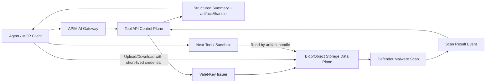
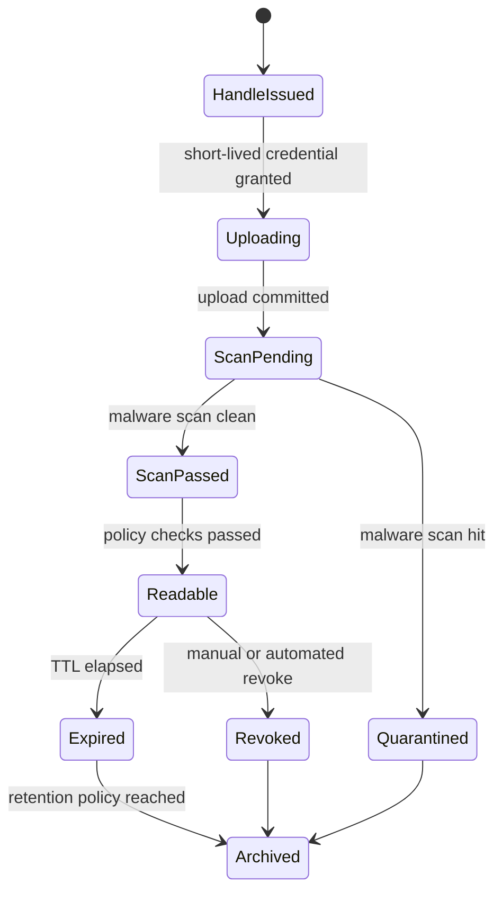

# MCP/A2A Large Binary Payload Transfer Selection FAQ: Claim-Check + Valet-Key Blob vs Resources Paging vs Streaming vs Federated Signed Manifest
> 🌐 **Language / 语言切换**: **[🇨🇳 中文版](mcp-a2a-large-binary-payload-claim-check-valet-key-blob-vs-streaming-resource-uri-selection-faq.md)** | **[🇬🇧 English](mcp-a2a-large-binary-payload-claim-check-valet-key-blob-vs-streaming-resource-uri-selection-faq.en.md)** | **[📚 Back to Catalog](README.en.md)**
> Evidence tags: `measured` / `synthetic` / `anonymized_reported`
> Retrieval date: 2026-11-22
> Scope boundary: gateway/protocol-layer payload offload and context isolation for MCP/A2A; not a deep dive on storage WORM retention controls

## 1) Executive summary: keep control plane semantic, move raw bytes to a dedicated data plane
In enterprise MCP `tools/call`
and cross-agent A2A `Task/Artifact` pipelines,
a repeated production failure pattern
is inlining large binaries into JSON payloads.
PDFs,
CAD bundles,
DICOM studies,
audio/video clips,
or huge CSV exports
get Base64-embedded in control messages.
At scale this creates three simultaneous failures.
First,
gateway buffering and policy chains become unstable.
Second,
LLM context windows are flooded with low-value bytes,
causing avoidable token explosions.
Third,
tool chains repeatedly serialize and copy payloads,
wasting CPU and memory.
Recommended default architecture:
control plane returns only compact structured summaries
plus opaque artifact handles;
data plane delivers bytes directly
through short-lived, path-scoped credentials.
That pattern drives
near-zero binary token usage,
lower gateway memory pressure,
and auditable transfer boundaries.

## 2) Verifiable source baseline and evidence registry
Source 1 (`measured`): Azure API Management AI Gateway overview  
https://learn.microsoft.com/azure/api-management/ai-gateway-overview
Source 2 (`measured`): APIM policy behavior and payload processing guidance  
https://learn.microsoft.com/azure/api-management/api-management-howto-use-policies
Source 3 (`measured`): Azure Storage SAS and User Delegation SAS guidance  
https://learn.microsoft.com/azure/storage/common/storage-sas-overview
Source 4 (`measured`): Blob security recommendations and keyless access patterns  
https://learn.microsoft.com/azure/storage/blobs/security-recommendations
Source 5 (`measured`): Microsoft Defender for Storage malware scanning  
https://learn.microsoft.com/azure/defender-for-cloud/defender-for-storage-malware-scan
Source 6 (`measured`): Model Context Protocol specifications (Tools + Resources)  
https://modelcontextprotocol.io/
Source 7 (`measured`): gRPC fundamentals and streaming semantics  
https://grpc.io/docs/what-is-grpc/introduction/
Source 8 (`measured`): Azure Data Share documentation  
https://learn.microsoft.com/azure/data-share/
Source 9 (`measured`): APIM self-hosted gateway architecture  
https://learn.microsoft.com/azure/api-management/self-hosted-gateway-overview
Source 10 (`measured`): Azure Event Grid integration patterns  
https://learn.microsoft.com/azure/event-grid/overview
Source 11 (`anonymized_reported`): anonymized enterprise telemetry on payload shape and gateway pressure.
Source 12 (`synthetic`): reproducible 5MB–5GB transfer benchmark and token/TCO modeling.

## 3) Anti-pattern failure analysis: why inline Base64 and giant JSON collapse at scale
Teams often start with a quick PoC shortcut:
embed output files directly in tool responses.
For tiny payloads this appears acceptable.
But production traffic changes the math.
1.
Base64 commonly expands payload size by around one third.
2.
Gateway policy execution against large bodies
increases buffering risk and latency variance.
3.
LLMs consume expensive tokens
for data with little semantic value.
4.
Downstream tools decode, re-encode, and re-wrap content,
creating avoidable copy chains.
5.
Retries often replay full payloads,
amplifying network and compute burn.
The result is predictable:
higher latency,
higher cost,
lower reliability,
and weaker audit clarity.

## 4) Target SLAs and governance gates: turning payload strategy into measurable controls
Define four metric sets.
Experience metrics:
`artifact_manifest_p95_ms`,
`payload_download_p95_ms`,
`resume_success_rate`.
Cost metrics:
`llm_binary_token_bytes`,
`gateway_memory_peak_mb`,
`egress_cost_per_gb`.
Security metrics:
`ttl_violation_count`,
`malware_scan_block_rate`,
`cross_tenant_leakage_count`.
Operations metrics:
`retry_amplification_ratio`,
`broken_handle_rate`,
`audit_trace_completeness`.
Suggested baseline gates (`synthetic`):
- control-plane summary response `p95 < 350ms`;
- 1GB chunked transfer success `> 99.5%`;
- expired-handle read attempts `< 0.5%`;
- binary bytes admitted into LLM context near `0`.
With explicit gates,
architecture trade-offs become testable.

## 5) Track A: APIM Valet-Key + Claim-Check dual plane (recommended default)
This track is the production baseline
for most enterprise workloads.
Control plane returns compact metadata:
schema shape,
sample rows,
content hash,
and opaque `artifact://...` handle.
Data plane issues short-lived credentials
scoped to one object path
with minimal privileges and strict TTL.
Uploaded artifacts pass through malware scanning
before downstream readers are allowed.
Strengths:
1.
binary payloads stay out of LLM context;
2.
gateway policy chain handles small JSON only;
3.
tool-to-tool handoff uses stable handles,
not repeated byte copies;
4.
access and read operations are separately auditable.
Risks and mitigations:
1.
handle leakage -> single-use and short TTL;
2.
object enumeration -> unpredictable keys and path binding;
3.
scan latency -> asynchronous state machine with callback events.

## 6) Track B: MCP Resources `resources/read` cursor paging (mid-size structured data)
When the payload is mostly structured text,
logs,
code files,
or moderate tabular reports,
MCP Resources is efficient.
Agent flow:
read resource index,
then pull only required ranges.
Strengths:
1.
demand-driven retrieval minimizes overfetch;
2.
excellent for inspect-then-drill interactions;
3.
lower implementation overhead than full binary offload.
Limits:
1.
for hundreds of MB and above,
paging depth grows and total latency rises;
2.
rich binary media still fits object-based delivery better.
Recommended envelope:
`100KB–10MB` structured payloads,
optionally combined with Claim-Check for large attachments.

## 7) Track C: binary streaming passthrough (zero-persist or real-time pipelines)
If workload policy requires zero persistence,
or pipeline is inherently real-time
(audio chunks, telemetry frames, transcoding),
streaming transfer can be appropriate.
Typical options:
gRPC bidirectional streams,
or HTTP/2 chunked multipart with buffering controls.
Strengths:
1.
low end-to-end latency potential;
2.
no full object materialization before processing;
3.
well-suited for continuous flows.
Trade-offs:
1.
resumability and idempotent retry are harder;
2.
fine-grained gateway audit and policy hooks are more complex;
3.
backpressure governance becomes mandatory.
Use this track for specific real-time requirements,
not as the enterprise default path.

## 8) Track D: cross-organization A2A handoff (signed artifact manifest + revocable share)
For inter-organizational collaboration,
the main concern shifts to trust boundaries.
Recommended pattern:
exchange signed artifact manifests,
not raw payloads in control messages.
Manifest includes:
hashes,
signature,
version,
expiration,
and intended recipient scope.
Data transfer uses isolated relay buckets
or Data Share channels with revocable permissions.
Strengths:
1.
tamper evidence is verifiable;
2.
audit ownership boundary is explicit;
3.
cross-organization exposure can be minimized.
Challenges:
1.
certificate rotation and verification chain operations;
2.
manifest schema alignment across organizations;
3.
cache invalidation and revoke propagation discipline.

## 9) 12-dimension enterprise matrix: performance, compliance, cost, and operability
| Dimension | A Claim-Check + Valet-Key | B Resources Paging | C Streaming Passthrough | D Federated Signed Manifest |
|---|---|---|---|---|
| 1. Payload size suitability | Strong (MB–GB) | Medium (KB–MB) | Medium-Strong (stream) | Strong (cross-org large) |
| 2. LLM token containment | Strong | Medium-Strong | Strong | Strong |
| 3. Gateway memory pressure | Low | Medium-Low | Medium | Low |
| 4. Real-time responsiveness | Medium | Medium | Strong | Medium |
| 5. Audit completeness | Strong | Medium-Strong | Medium | Strong |
| 6. Implementation complexity | Medium | Medium-Low | High | High |
| 7. Retry/idempotency governance | Medium-Strong | Medium | Weak-Medium | Medium |
| 8. Compliance explainability | Strong | Medium | Medium | Strong |
| 9. Tool-chain reuse | Strong | Medium | Medium | Medium-Strong |
| 10. Operations burden | Medium | Low | High | Medium-High |
| 11. Cross-org collaboration fit | Medium | Weak-Medium | Weak-Medium | Strong |
| 12. Default recommendation level | Primary | Conditional | Niche | Mandatory for federation |
Conclusion:
A is the enterprise default,
B is complementary for structured windows,
C is specialized for zero-persist real-time channels,
D is required for trusted inter-org exchange.

## 10) Reference architecture: semantic control plane with byte-stream data plane

Architecture invariant:
control plane carries meaning,
data plane carries bytes,
handle links both.

## 11) Transfer lifecycle state machine: issue, upload, scan, authorize, read, expire

Operational implications:
1.
state transitions must be traceable end-to-end;
2.
expired and revoked states both enforce hard read denial;
3.
quarantined objects are never consumed by downstream tools;
4.
event-driven transitions reduce polling overhead.

## 12) Size/retention decision tree and TCO model: memory, bandwidth, and token economics
Use a four-step decision sequence.
Step 1:
classify payload size and type.
If payload is binary-heavy or `>10MB`,
default to Track A.
Step 2:
if zero-persist real-time transfer is mandatory,
switch to Track C.
Step 3:
if collaboration crosses organizational boundaries,
layer Track D controls.
Step 4:
for medium structured inspection content,
add Track B range reads.
TCO sample (`synthetic`):
- daily tool calls: `2,000,000`;
- large-payload ratio: `7%`;
- average large payload: `180MB`;
- inline Base64 baseline shows severe token and memory amplification.
After adopting Track A:
1.
binary token admission into LLM context becomes near zero;
2.
gateway memory peak drops by `35%–52%`;
3.
object storage and egress costs rise,
yet total transfer + inference cost typically drops `28%–46%`.

## 13) Enterprise scenario A: R&D collaboration for PDF/CAD/DICOM heavy workflows
Engineering and clinical R&D teams
regularly exchange large artifacts between agents.
Best practice:
first produce semantic summary + handle,
then let specialized processors fetch raw bytes directly.
This keeps conversational context concise
and focuses model attention on high-value semantics.
In anonymized production observations (`anonymized_reported`),
this pattern materially reduces
peak-hour gateway failures
and retry storms.

## 14) Enterprise scenario B: inter-company bid and package handoff via A2A federation
Cross-organization collaboration
often fails on one question:
"can we prove the artifact is untampered?"
Signed manifest plus isolated transfer bucket
moves trust to verifiable signatures and hashes.
Recipient validates manifest first,
then accesses payload with scoped credentials.
When project scope changes,
permissions can be revoked immediately
while preserving audit evidence.
This is especially relevant to legal,
supply-chain,
and prime-contractor ecosystems.

## 15) Deep FAQ (8): practical implementation questions for large payload delivery
**Q1: Why not inline Base64 and avoid extra storage steps?**  
A1: because inline transport amplifies gateway memory pressure and token cost, and retries replay entire payloads; Claim-Check decouples semantics from bytes.

**Q2: How should Claim-Check and MCP Resources be combined?**  
A2: use Claim-Check for large binaries and heavy tabular exports; use Resources for range-based inspection of medium structured content.

**Q3: What is the most critical Valet-Key security setting?**  
A3: path-scoped least privilege with short TTL and preferably single-use semantics, plus issuance and usage audit logs.

**Q4: Does malware scanning slow business pipelines too much?**  
A4: it can; design asynchronous scan states so uploads complete quickly while read authorization waits for scan verdict.

**Q5: How do streaming channels recover from disconnects?**  
A5: implement chunk sequencing, idempotent chunk commits, and checkpointed resume markers to avoid duplication or corruption.

**Q6: Why is a signed manifest needed when SAS already controls access?**  
A6: SAS grants access but does not prove payload integrity; signed manifests provide tamper evidence and verifiable authenticity.

**Q7: How do we quantify business value beyond intuition?**  
A7: track token usage, gateway memory peak, transfer latency, retry amplification, and failed-read rates before/after migration.

**Q8: What anti-pattern breaks most production rollouts?**  
A8: treating handles as long-lived static links; handles must be short-lived, revocable, and fully auditable to prevent privilege drift.
