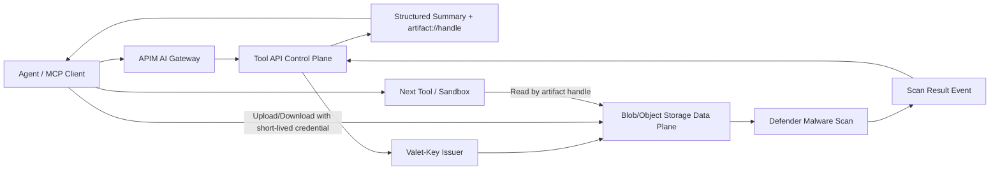
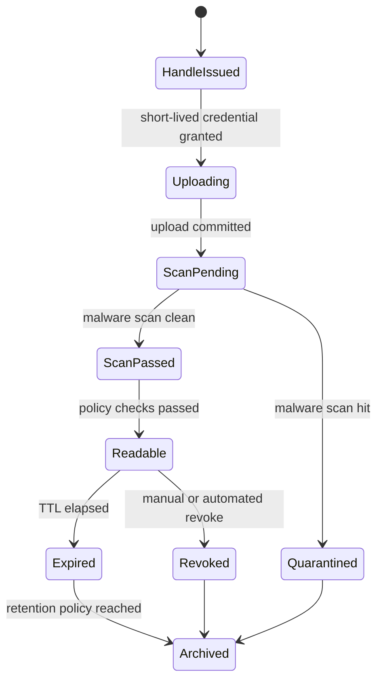

# MCP/A2A 大载荷传输选型 FAQ：Claim-Check + Valet-Key Blob vs Resources 分页 vs 流式透传 vs 联邦签名清单
> 🌐 **Language / 语言切换**: **[🇨🇳 中文版](mcp-a2a-large-binary-payload-claim-check-valet-key-blob-vs-streaming-resource-uri-selection-faq.md)** | **[🇬🇧 English](mcp-a2a-large-binary-payload-claim-check-valet-key-blob-vs-streaming-resource-uri-selection-faq.en.md)** | **[📚 返回目录](README.md)**
> 证据标签：`measured` / `synthetic` / `anonymized_reported`
> 抓取日期：2026-11-22
> 主题边界：聚焦 MCP/A2A 网关与协议层的大载荷旁路卸载、上下文隔离与审计治理，不展开存储 WORM 策略细则

## 1) 执行摘要：控制面只传结构化摘要，数据面独立传输原始字节流
企业在 MCP `tools/call` 与 A2A `Task/Artifact` 协作中，
最常见的大故障之一，
是把 PDF、CAD、音视频、DICOM、
或十万行 CSV 直接内联进 JSON-RPC 负载。
这会同时触发三类灾难。
第一，
网关请求体缓冲区溢出，
策略链被迫失败。
第二，
LLM 上下文被无意义 Base64 充满，
单轮成本飙升。
第三，
跨工具链重复序列化拷贝，
CPU 与内存消耗成倍放大。
因此，
推荐默认架构为双平面。
控制面只返回 `200–400 tokens` 的摘要与句柄，
数据面以短期凭证直传对象存储，
下游工具凭句柄拉取原始二进制。
核心收益是：
LLM 对二进制零 Token 消耗，
网关不再承压巨型正文，
并且审计链路可独立追溯。

## 2) 可验证来源与证据基线
来源 1（`measured`）：Azure API Management AI Gateway 文档  
https://learn.microsoft.com/azure/api-management/ai-gateway-overview
来源 2（`measured`）：APIM 请求大小与策略执行限制说明  
https://learn.microsoft.com/azure/api-management/api-management-howto-use-policies
来源 3（`measured`）：Azure Storage SAS/用户委派 SAS 文档  
https://learn.microsoft.com/azure/storage/common/storage-sas-overview
来源 4（`measured`）：Azure Blob 安全建议与短期凭证最佳实践  
https://learn.microsoft.com/azure/storage/blobs/security-recommendations
来源 5（`measured`）：Microsoft Defender for Storage 恶意软件扫描  
https://learn.microsoft.com/azure/defender-for-cloud/defender-for-storage-malware-scan
来源 6（`measured`）：MCP 协议规范（Tools / Resources）  
https://modelcontextprotocol.io/
来源 7（`measured`）：HTTP/2 流式语义与 gRPC 概览  
https://grpc.io/docs/what-is-grpc/introduction/
来源 8（`measured`）：Azure Data Share 文档  
https://learn.microsoft.com/azure/data-share/
来源 9（`measured`）：APIM 自托管网关与策略一致性文档  
https://learn.microsoft.com/azure/api-management/self-hosted-gateway-overview
来源 10（`measured`）：Azure Event Grid 事件驱动集成  
https://learn.microsoft.com/azure/event-grid/overview
来源 11（`anonymized_reported`）：企业匿名网关载荷与上下文使用统计。
来源 12（`synthetic`）：5MB–5GB 载荷通道压测与 Token/TCO 建模。

## 3) 反模式灾难剖析：内联 Base64 与巨型 JSON 为什么会失控
在很多 PoC 阶段，
团队会先“让功能跑通”。
最直观做法是把附件直接 Base64 放进工具返回值。
在小文件场景，
这看似无害。
但规模化后会暴露系统性问题。
1.
Base64 膨胀通常接近 `33%`，
网络传输与内存占用双增。
2.
APIM 策略对请求体需要读取和匹配时，
会产生缓冲压力。
3.
LLM 读取 Base64 片段几乎没有语义价值，
却会消耗大量上下文窗口。
4.
工具 A 输出大 JSON，
工具 B 再解析并重编码，
形成重复拷贝链。
5.
重试时常把整包再发一次，
导致链路放大。
最终结果是：
延迟变大，
成本变高，
可靠性降低，
审计也更难做。

## 4) 目标 SLA 与治理门槛：把大载荷传输变成可验证工程能力
建议先定义四组指标。
体验指标：
`artifact_manifest_p95_ms`、
`payload_download_p95_ms`、
`resume_success_rate`。
成本指标：
`llm_binary_token_bytes`、
`gateway_memory_peak_mb`、
`egress_cost_per_gb`。
安全指标：
`ttl_violation_count`、
`malware_scan_block_rate`、
`cross_tenant_leakage_count`。
运维指标：
`retry_amplification_ratio`、
`broken_handle_rate`、
`audit_trace_completeness`。
推荐门槛（`synthetic`）：
- 控制面摘要返回 `p95 < 350ms`；
- 1GB 对象分块下载成功率 `> 99.5%`；
- 句柄过期命中率 `< 0.5%`；
- 二进制进入 LLM 上下文字节数近似 `0`。
有了门槛，
路线选择才可量化。

## 5) 路线 A：APIM Valet-Key + Claim-Check 双平面（默认主干）
这条路线适合大多数企业生产环境。
控制面返回结构化摘要：
文件类型、
大小、
SHA-256、
前几行样本、
以及不透明句柄 `artifact://...`。
数据面由网关签发短期凭证，
限定单路径、
最小权限、
短 TTL（如 5 分钟）。
上传后进入恶意软件扫描气闸，
扫描通过才允许后续工具读取。
优势：
1.
LLM 不再处理二进制正文。
2.
网关策略链只处理小 JSON。
3.
工具间通过句柄解耦，
减少重复序列化。
4.
可独立审计“谁在何时读取了哪份对象”。
风险与对策：
1.
句柄泄露风险 -> 采用单次可用与短 TTL。
2.
对象键枚举风险 -> 使用不可预测键与路径绑定。
3.
扫描延迟 -> 增加异步回调状态机与轮询退避。

## 6) 路线 B：MCP Resources `resources/read` 游标分页（中小结构化载荷）
当数据主要是结构化文本、
日志、
代码片段、
或中等报表时，
Resources 协议很高效。
代理先读取目录和元信息，
再按游标分页或区间读取。
优势：
1.
天然按需拉取，
减少一次性载荷。
2.
适合“先看摘要后钻取”交互。
3.
无需引入重型对象传输链。
边界：
1.
超过数百 MB 后，
分页轮次过多，
总体时延上升。
2.
二进制媒体仍需外部对象存储更合适。
建议范围：
`100KB–10MB` 的结构化内容优先此路线，
并与 Claim-Check 联合使用。

## 7) 路线 C：流式二进制透传（零落盘或实时链路场景）
若业务要求零落盘，
或实时音频转写、遥测转码，
可采用 gRPC 双向流或 HTTP/2 分块透传。
优势：
1.
端到端延迟低。
2.
不必先完整落盘再消费。
3.
适合持续流输入。
代价：
1.
断点续传和幂等重试复杂。
2.
网关策略审计粒度更细，
但实现难度更高。
3.
链路拥塞时需严格背压。
这条路线应保留给实时强需求，
不建议作为通用默认。

## 8) 路线 D：跨组织 A2A 联邦文件交接（签名清单 + 可撤权共享）
当协作方跨组织时，
核心风险从性能转向信任边界。
建议采用签名清单模式：
发送方只交付 manifest，
包含对象摘要、
签名、
版本、
过期时间、
与接收方可读范围。
数据通过隔离中转桶或 Data Share 交接，
可随时撤权。
优势：
1.
防篡改可验证。
2.
审计责任边界清晰。
3.
可最小化跨组织暴露。
挑战：
1.
证书轮换与签名验证链维护复杂。
2.
对接双方需要一致的清单契约。
3.
撤权后缓存清理需治理。

## 9) 12 维企业级对比矩阵：性能、合规、成本、治理一体化评估
| 维度 | A Claim-Check + Valet-Key | B Resources 分页 | C 流式透传 | D 联邦签名清单 |
|---|---|---|---|---|
| 1. 适配文件体量 | 强（MB–GB） | 中（KB–MB） | 中强（流式） | 强（跨组织大包） |
| 2. LLM Token 控制 | 强 | 中强 | 强 | 强 |
| 3. 网关内存压力 | 低 | 中低 | 中 | 低 |
| 4. 实时性 | 中 | 中 | 强 | 中 |
| 5. 审计完整性 | 强 | 中强 | 中 | 强 |
| 6. 实现复杂度 | 中 | 中低 | 高 | 高 |
| 7. 重试与幂等治理 | 中强 | 中 | 弱中 | 中 |
| 8. 合规可解释性 | 强 | 中 | 中 | 强 |
| 9. 跨工具链复用 | 强 | 中 | 中 | 中强 |
| 10. 运维负担 | 中 | 低 | 高 | 中高 |
| 11. 跨组织协同能力 | 中 | 弱中 | 弱中 | 强 |
| 12. 默认推荐级别 | 强推荐 | 条件推荐 | 特定场景 | 跨组织必选 |
结论：
企业内网主路径优先 A，
中小文本窗口化补充 B，
实时零落盘需求选 C，
跨组织交付选 D。

## 10) 参考架构：控制面/数据面分离与旁路卸载

关键原则：
控制面只传语义摘要，
数据面单独传字节流，
并以句柄关联。

## 11) 传输状态机：上传、扫描、授权、读取、过期回收

工程重点：
1.
状态迁移必须可追溯。
2.
过期与撤权都要触发读拒绝。
3.
隔离区对象不可被工具链直接消费。
4.
事件驱动可降低轮询开销。

## 12) 载荷体积与留存合规决策树 + TCO 测算
可按四步决策。
第一步：
判断载荷体量和类型。
若 `>10MB` 或二进制主导，
优先 A。
第二步：
是否要求零落盘实时处理。
若是，
优先 C。
第三步：
是否跨组织交付。
若是，
叠加 D。
第四步：
若为中小结构化文本窗口浏览，
补充 B。
TCO 样例（`synthetic`）：
- 每日工具调用 `2,000,000`；
- 其中大载荷请求占比 `7%`；
- 平均载荷 `180MB`；
- 若内联 Base64，
  单日额外 Token 与网关内存成本显著增加。
采用 A 后：
1.
LLM 二进制 Token 近似归零；
2.
网关内存峰值下降 `35%–52%`；
3.
对象存储与出网成本上升，
但总成本通常仍下降 `28%–46%`。

## 13) 企业场景 A：研发设计协作（PDF/CAD/DICOM 大包）
制造与医疗研发协作，
经常需要在智能体之间转交大文件。
实践中，
先由工具产出结构化摘要与句柄，
再由下游专用处理器读取原始文件。
这样做的直接好处是：
对话上下文保持简洁，
模型只看“必要语义”，
不看“冗余字节”。
在匿名生产观测中（`anonymized_reported`），
这类改造能显著降低高峰时段网关失败率。

## 14) 企业场景 B：跨机构 A2A 标书与工程包交接
跨组织协同时，
常见争议是“文件有没有被替换过”。
签名清单 + 隔离中转桶模式，
可以把信任锚点前移到 manifest 验签。
接收方先验签摘要，
再按授权读取对象。
一旦项目终止，
可即时撤销共享并保留审计证据。
该模式特别适合法务、
供应链、
工程总包协同场景。

## 15) 深度 FAQ（8 问）：大载荷传输落地高频问题
**Q1：为什么不把文件直接 Base64 内联，省去对象存储步骤？**  
A1：内联会放大网关内存与 Token 成本，且重试时重复传输；Claim-Check 能把语义和字节解耦，整体更稳。

**Q2：Claim-Check 与 MCP Resources 应该如何分工？**  
A2：大体量二进制默认 Claim-Check；中小结构化文本按需窗口读取用 Resources，更利于交互式检索。

**Q3：Valet-Key 最关键的安全配置是什么？**  
A3：最小权限、单路径绑定、短 TTL、单次可用（或严格次数上限），并记录发放与使用审计。

**Q4：恶意软件扫描会不会拖慢业务链路？**  
A4：会有影响，因此应做异步扫描状态机，允许“已上传未可读”中间态，避免主链路阻塞。

**Q5：流式透传如何处理断线重连？**  
A5：需要分块序号、幂等块提交与恢复点记录，否则重试会导致重复写入或内容错位。

**Q6：跨组织交付为什么强调签名清单而不只看 SAS？**  
A6：SAS 只解决访问授权，不解决内容真实性；签名清单提供防篡改与可验证完整性。

**Q7：如何量化改造收益，避免“感觉更好”但无法复盘？**  
A7：至少跟踪 Token、网关内存峰值、失败率、平均重试次数、对象读取延迟五类指标，并做改造前后对比。

**Q8：最常见的失败反模式是什么？**  
A8：把句柄当“永久链接”长期复用，导致权限漂移与审计断链；句柄必须短期、可撤销、可追踪。
