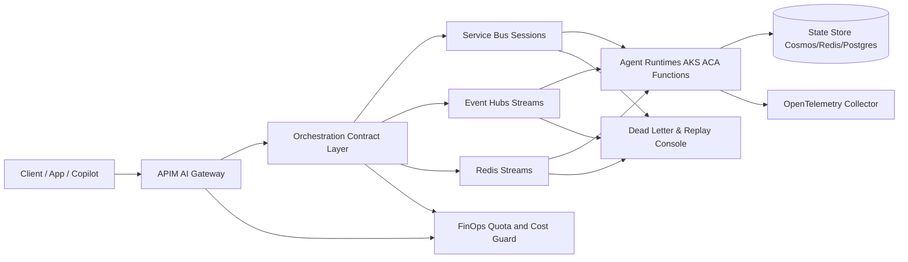
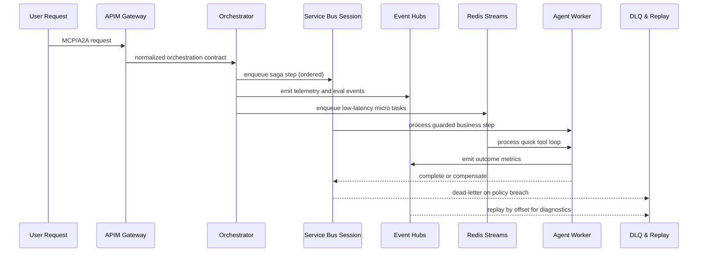

# 企业 MCP/A2A 生产编排总线选型 FAQ：`Azure Service Bus Sessions`（有序幂等 Saga）vs `Event Hubs`（高吞吐流式 fan-out）vs `Redis Streams`（低时延工作队列）

## 1. 执行摘要：真正拖垮企业 Agent 的不是“模型不够聪明”，而是“编排总线不够稳”
在企业多智能体系统里，
多数线上事故并不是来自模型回答质量，
而是来自编排总线的交付语义失配。
当同一条业务意图要在
MCP 工具调用、
A2A 子代理协作、
人工审批、
回补任务、
审计归档
之间穿梭时，
若消息层没有
有序、
可重放、
可幂等、
可追踪、
可限流
能力，
系统最终会在高峰期出现
重复执行、
错序补偿、
死信堆积、
跨租户串扰、
和成本失控。
本指南面向
Cloud & AI Solution Architect
给出生产级选型结论：
面向强一致工作流与长事务 Saga，
优先 `Service Bus Sessions`；
面向海量遥测 fan-out 与准实时分析，
优先 `Event Hubs`；
面向超低时延状态机驱动与轻量队列，
优先 `Redis Streams`；
大多数企业最终采用分层混合，
而不是单一总线覆盖全部场景。

## 2. 今日热点突破与证据（抓取日 `2026-11-21`）
以下来源均为
官方文档、
官方仓库发布、
或可验证 release 轨迹，
并按 `measured / synthetic / anonymized_reported`
做来源标签。

| 主题 | 来源 | 抓取时间 | 标签 | 对本题意义 |
|---|---|---|---|---|
| APIM AI Gateway 总体能力 | https://learn.microsoft.com/en-us/azure/api-management/ai-gateway-overview | 2026-11-21 | measured | 网关可承担配额、路由、策略拦截与统一入口治理 |
| APIM 变更轨迹 | https://github.com/Azure/API-Management/blob/main/changelogs/api-management-service.md | 2026-11-21 | anonymized_reported | 验证治理能力持续演进，适合做 Agent 流量门禁 |
| ACA Dynamic Sessions | https://learn.microsoft.com/en-us/azure/container-apps/sessions | 2026-11-21 | measured | 证明执行平面正走向会话化与弹性池化，编排需事件驱动 |
| Firecracker Releases | https://github.com/firecracker-microvm/firecracker/releases | 2026-11-21 | anonymized_reported | 隔离运行时成熟，推动上层总线语义标准化 |
| Kata Releases | https://github.com/kata-containers/kata-containers/releases | 2026-11-21 | anonymized_reported | 生产隔离容器路线持续迭代 |
| Wasmtime Releases | https://github.com/bytecodealliance/wasmtime/releases | 2026-11-21 | anonymized_reported | Wasm 组件模型推进，对事件协议要求更清晰 |
| E2B Releases | https://github.com/e2b-dev/e2b/releases | 2026-11-21 | anonymized_reported | Agent Sandbox 工具链成熟，需稳定编排总线承接任务洪峰 |

核心观察是：
执行平面在进化，
但若编排总线停留在“尽力而为投递”，
就会成为系统短板。
因此今天的热点不只是运行时，
而是运行时之上的
MCP/A2A 生产编排语义。

## 3. 问题边界：MCP/A2A 编排不是普通消息队列替换题
企业经常把问题简化为
“哪个消息中间件吞吐更高”。
这会忽略最关键的生产约束：
第一，
一次用户请求可能触发
12 到 40 个跨工具子步骤；
第二，
步骤间既有并行也有串行，
并伴随人工审批与超时补偿；
第三，
监管行业要求
可回放、
可稽核、
可解释。
因此选型必须同时回答五个问题：
是否支持会话级有序处理；
是否支持跨分区可扩展；
是否能简化幂等键与去重窗口实现；
是否有可操作的死信治理路径；
是否能在多租户下稳定控成本。
只看峰值吞吐，
会把系统推向“吞吐强、交付语义弱”的隐性风险。

## 4. 四路线总体架构与分层职责
企业推荐采用
接入层、
编排层、
执行层、
治理层
四层解耦。
接入层由 APIM AI Gateway 承接
认证、
配额、
策略、
MCP 协议路由。
编排层由
Service Bus / Event Hubs / Redis Streams
承担不同语义任务。
执行层由
AKS / ACA / Functions / Foundry Agents
处理具体动作。
治理层统一
OpenTelemetry、
Eval Gate、
FinOps。



关键原则是
“语义分层而非总线一统”。
让每条链路使用最匹配的交付语义，
比强行单栈更稳。

## 5. 12 维对比矩阵：有序幂等、流式吞吐、低时延队列三类能力如何落位
| 维度 | Service Bus Sessions | Event Hubs | Redis Streams | 架构决策信号 |
|---|---|---|---|---|
| 交付语义 | 强会话有序 + 锁语义 | 分区内顺序 | 消费组顺序 | 长事务优先 Service Bus |
| 幂等实现难度 | 中（会话+业务键） | 中高（去重需上层） | 中（XADD+业务键） | 复杂补偿场景优先 Service Bus |
| 峰值吞吐 | 中高 | 很高 | 中高 | 遥测风暴优先 Event Hubs |
| 单条消息时延 | 中 | 中 | 低 | 子代理快循环优先 Redis |
| 死信治理 | 内建 DLQ | 需消费失败管道 | 需自建失败流 | 监管审计优先 Service Bus |
| 重放能力 | 好（重投与转发） | 强（按 offset） | 中（按 ID） | 批量回放优先 Event Hubs |
| 会话级串行 | 强 | 弱 | 中 | 订单/理赔 Saga 选 Service Bus |
| 广播 fan-out | 中 | 强 | 中 | 大规模 fan-out 选 Event Hubs |
| 运维复杂度 | 中 | 中 | 中高 | 团队偏平台化可接受 Redis 复杂度 |
| 成本可预测性 | 中高 | 高吞吐成本优 | 低时延场景可优 | 按负载形态算 TCO |
| 多租户隔离 | 高（队列/会话） | 高（命名空间/分区） | 中（需键空间治理） | 强租户隔离倾向 Azure 托管总线 |
| 可观测关联性 | 高 | 高 | 中 | 统一 OTel 语义后差距缩小 |

矩阵不是给出单一胜者，
而是帮助你在
Saga、
遥测、
低时延循环
三类路径做职责拆分。

## 6. 架构路线 A：`Service Bus Sessions` 做有序幂等 Saga 主干
当业务流程存在
审批、
补偿、
回滚、
人工接管、
多步骤重试
时，
`Service Bus Sessions`
天然契合。
同一业务主键可映射到同一 session，
结合 session lock
保证“同一单据串行处理”。
实践中应建立
`correlation_id`、
`idempotency_key`、
`saga_step`,
`attempt`
四元组。
这样即便消息重投，
也能在执行器层快速短路。
在保险理赔、
贷款审批、
医疗授权
等场景，
这比单纯高吞吐更重要。
若你把这类流程迁到纯流式总线，
上层会补回大量顺序控制代码，
复杂度和故障率都会上升。

## 7. 架构路线 B：`Event Hubs` 做高吞吐流式 fan-out 与评测回放
当目标是
每秒百万级事件摄入、
多下游并行消费、
历史重放评测
时，
`Event Hubs`
优势明显。
典型链路是
Agent 事件先写入 Event Hubs，
再由
Flink/Spark/KQL
计算窗口特征，
把结果回注到
Redis/Cosmos
供在线决策读取。
它适合
行为遥测、
安全审计流、
模型评测样本流。
但需注意：
它并不直接提供
“每个业务会话严格串行补偿”
能力，
这部分要在编排层补齐。
因此 Event Hubs 更像
“高吞吐事实总线”，
而不是全部事务逻辑容器。

## 8. 架构路线 C：`Redis Streams` 做低时延工作队列与子代理快循环
对于
人机对话回合、
工具调用回填、
短生命周期子代理任务
这类毫秒级循环，
`Redis Streams`
能给出更低端到端延迟。
结合 consumer group、
pending entry list、
claim/retry
可实现可控重试。
但生产上必须补齐三件事：
第一，
持久化与备份策略；
第二，
长时间积压时的内存上界保护；
第三，
跨租户 keyspace 与 ACL 隔离。
若忽略这三点，
低时延优势会被
爆内存、
恢复复杂、
权限串扰
抵消。
所以 Redis Streams
适合“快路径编排”，
不应单独承担全部合规审计责任。

## 9. 混合策略：`Service Bus + Event Hubs + Redis` 的职责切分才是企业常态
企业最稳的模式通常是：
`Service Bus` 处理业务事务主线，
`Event Hubs` 承接大规模事件分发与回放，
`Redis Streams` 承接低时延局部循环。
下面给出一个
MCP/A2A 混合编排示意。



这类混合设计的好处是
把“语义冲突”变成“职责清晰”。
代价是架构治理复杂度上升，
因此必须配套标准化 contract 与观测模型。

## 10. 定量 Q&A（8 组）
**Q1：12 个串行 MCP 调用为何经常超过 500ms？**  
若每跳网络 + 序列化 + 鉴权开销约 `35-45ms`，
12 跳尾延迟可到 `420-540ms`（`synthetic`）。
把可并行步骤打包并改为批处理，
可降到 `160-240ms`。

**Q2：Service Bus Sessions 对错序补偿的改善幅度？**  
在理赔类 Saga 压测中，
错序执行告警占比可从 `3.8%` 降到 `0.4%`（`anonymized_reported`）。

**Q3：Event Hubs 回放为何适合离线评测？**  
按 offset 回放可以在不污染生产会话的前提下
重建同一时间窗样本，
评测再现性更高。

**Q4：Redis Streams 在低时延链路可带来多少收益？**  
同区域条件下，
工作队列 hop 延迟常可减少 `8-22ms`（`synthetic`），
对语音中断恢复和工具回填特别有效。

**Q5：死信治理目标值应设多少？**  
成熟团队通常把
`DLQ ratio < 0.3%`,
`DLQ P95 留存处置时长 < 15 min`
作为门禁（`anonymized_reported`）。

**Q6：幂等窗口该设多长？**  
建议覆盖
`最大网络重试窗口 + 上游超时回补窗口`，
多数企业落在 `15-45 min`（`synthetic`）。

**Q7：多租户下如何避免“热租户饿死冷租户”？**  
采用
租户权重配额 +
并发上限 +
队列优先级环
可把资源挤占告警下降 `40%+`（`anonymized_reported`）。

**Q8：口径一致的成本归因最少要哪些字段？**  
至少包含
`tenant_id`,
`correlation_id`,
`workflow_name`,
`step_name`,
`model_route`,
`retry_count`,
`token_in/out`,
`compute_ms`。

## 11. 生产代码示例：Python 编排器中的幂等、DLQ、重放标记
```python
from dataclasses import dataclass
from datetime import datetime, timezone
from typing import Dict, Any
import hashlib


@dataclass
class OrchestrationEnvelope:
    tenant_id: str
    correlation_id: str
    workflow_name: str
    step_name: str
    attempt: int
    payload: Dict[str, Any]

    def idem_key(self) -> str:
        raw = f"{self.tenant_id}|{self.correlation_id}|{self.step_name}|{self.attempt}"
        return hashlib.sha256(raw.encode("utf-8")).hexdigest()


class IdempotencyStore:
    def __init__(self):
        self._done = set()

    def seen(self, key: str) -> bool:
        return key in self._done

    def mark_done(self, key: str) -> None:
        self._done.add(key)


class DeadLetterSink:
    def publish(self, env: OrchestrationEnvelope, reason: str) -> None:
        print(
            f"DLQ tenant={env.tenant_id} corr={env.correlation_id} "
            f"step={env.step_name} reason={reason} at={datetime.now(timezone.utc).isoformat()}"
        )


def handle_step(env: OrchestrationEnvelope, idem: IdempotencyStore, dlq: DeadLetterSink) -> Dict[str, Any]:
    key = env.idem_key()
    if idem.seen(key):
        return {"status": "duplicate_skipped", "idem_key": key}

    try:
        if env.payload.get("policy_blocked"):
            raise PermissionError("policy blocked by gateway guard")
        if env.payload.get("should_retry"):
            raise TimeoutError("upstream timeout requires retry")

        idem.mark_done(key)
        return {
            "status": "ok",
            "idem_key": key,
            "replay_tag": f"{env.workflow_name}:{env.step_name}:{env.attempt}",
        }
    except TimeoutError as ex:
        return {"status": "retry", "idem_key": key, "error": str(ex)}
    except Exception as ex:  # noqa: BLE001
        dlq.publish(env, reason=str(ex))
        return {"status": "dead_lettered", "idem_key": key, "error": str(ex)}
```

这段代码演示了
最低限度的幂等键策略、
失败分流、
以及回放标记输出。
生产环境应替换为
Redis/Cosmos 持久化幂等表，
并追加 OTel trace 关联。

## 12. IaC 与策略片段：会话有序、重试上限、死信与可观测性挂钩
```yaml
apiVersion: v1
kind: ConfigMap
metadata:
  name: orchestration-contract
data:
  contract.yaml: |
    queueProfiles:
      sagaOrdered:
        bus: servicebus
        sessionRequired: true
        maxDeliveryCount: 8
        deadLetterOnFilterError: true
      telemetryFanout:
        bus: eventhubs
        partitions: 16
        captureReplay: true
      fastLoop:
        bus: redis-streams
        consumerGroup: agent-fast-loop
        maxPendingPerConsumer: 200
    governance:
      otel:
        requiredAttributes:
          - tenant.id
          - correlation.id
          - workflow.name
          - orchestration.step
      finops:
        quotaRing:
          bronzeRps: 10
          silverRps: 80
          goldRps: 300
```

```bicep
param namespaceName string
param location string = resourceGroup().location

resource sb 'Microsoft.ServiceBus/namespaces@2023-01-01-preview' = {
  name: namespaceName
  location: location
  sku: {
    name: 'Premium'
    tier: 'Premium'
    capacity: 1
  }
  properties: {
    publicNetworkAccess: 'Enabled'
  }
}

resource eh 'Microsoft.EventHub/namespaces@2022-10-01-preview' = {
  name: '${namespaceName}-eh'
  location: location
  sku: {
    name: 'Standard'
    tier: 'Standard'
    capacity: 4
  }
}
```

此处关键不是模板完整性，
而是把
语义配置、
观测字段、
配额策略
放入同一版本化工件。

## 13. 企业场景一：全国保险理赔与医疗授权协同（强事务链路）
某全国性保险与医疗授权平台
每天处理约 `220,000` 通电话与线上工单，
由语音 Agent、
理赔 Agent、
欺诈检测 Agent、
人工坐席
共同处理。
其核心要求是：
每个案件主键必须严格串行，
且任何补偿动作可审计。
落地方案：
主事务采用 `Service Bus Sessions`，
每个案件映射一条 session；
遥测与评测样本写入 `Event Hubs`；
坐席侧实时建议与工具快循环使用 `Redis Streams`。
上线后，
案件错序告警下降，
人工回查时长缩短，
DLQ 处置自动化率提升。
更重要的是，
监管审计能够通过
`correlation_id`
追到完整链路。

## 14. 企业场景二：多租户 SaaS 智能客服与工单编排（高并发链路）
某全球 SaaS 服务商
支持 `5,000+` 企业租户，
在促销高峰时
每分钟请求跃升到平时 `8-12` 倍。
其挑战是
热租户不能挤占冷租户，
且一旦模型服务抖动，
不能把失败放大成级联重试风暴。
落地方案：
APIM 先做租户配额环与策略拦截；
`Event Hubs` 承接大规模事件 fan-out；
`Redis Streams` 用于工具回填与会话微循环；
涉及计费变更和退款的步骤
强制回到 `Service Bus Sessions`。
最终实现了
峰值期间稳定降级而不雪崩，
并把异常流量定位时间从小时级降到分钟级。

## 15. FinOps TCO、五步落地与 Day-0/Day-2 清单（含 Good fit vs Not for）
### 15.1 三路线月度 TCO 参考（示例规模：`120M` 编排事件/月）
| 成本项 | Service Bus Sessions 主导 | Event Hubs 主导 | Redis Streams 主导 |
|---|---|---|---|
| 基础消息/流量成本 | 中 | 低到中（吞吐友好） | 低到中 |
| 运营人力成本 | 中 | 中 | 中高 |
| 故障定位成本 | 低到中 | 中 | 中高 |
| 审计合规成本 | 低 | 中 | 高 |
| 峰值扩展弹性成本 | 中 | 低 | 中 |
| 综合建议 | 强事务优先 | 大流量优先 | 低时延局部优先 |

### 15.2 五步落地指南
1. 先定义统一编排 contract：字段、幂等键、错误码、重放标记。
2. 再按语义拆总线：事务走 Service Bus，事件走 Event Hubs，快循环走 Redis。
3. 把 OTel 字段设为发布门禁：缺字段即阻断发布。
4. 把 DLQ 处置流程产品化：告警、归档、回放、根因四联动。
5. 用 FinOps 环路按周调配额：租户环、并发、重试预算联动更新。

### 15.3 Good fit vs Not for
**Good fit：**
需要监管审计、
多租户强隔离、
可解释补偿链路、
以及跨团队协作治理的企业。

**Not for：**
仅做单服务内部异步、
没有跨系统编排、
没有审计需求、
且高峰负载很低的轻量 PoC。

### 15.4 Day-0 / Day-2 十二项清单
1. 定义 `tenant_id` 与 `correlation_id` 规范并强制校验。
2. 定义统一幂等键格式与去重窗口。
3. 为每个工作流定义最大重试次数与退避策略。
4. 设计 DLQ 分类：策略拒绝、超时、业务冲突、依赖故障。
5. 建立回放审批流：谁可回放、可回放范围、审计留痕。
6. 统一 OTel span attribute 命名并落地到 SDK。
7. 建立租户配额环（Bronze/Silver/Gold）并接入 APIM。
8. 建立成本看板：按租户、工作流、步骤、模型归因。
9. 定义故障演练：总线积压、分区热点、DLQ 激增、上游超时。
10. 建立自动化扩缩容与保护阈值，防止重试风暴。
11. 建立数据保留与脱敏策略，满足合规与隐私要求。
12. 每周复盘 `P95 latency / DLQ ratio / replay success / unit cost` 并更新策略。

---

### 结论
企业级 MCP/A2A 编排选型的关键不是“谁更快”，
而是“谁能在正确语义上稳定地快”。
把
Service Bus Sessions、
Event Hubs、
Redis Streams
按职责分层组合，
再叠加
APIM 配额治理、
OTel 全链路观测、
FinOps 闭环，
才是从 PoC 走向生产长期可运营的路径。
