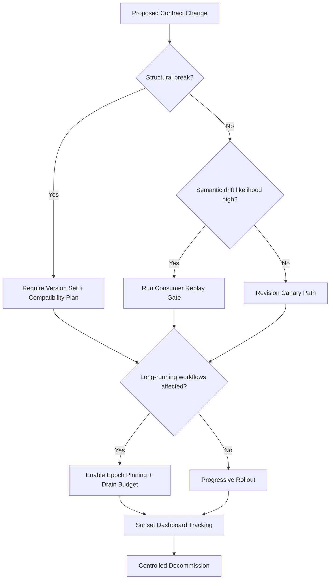

# Enterprise MCP/A2A Contract Evolution Selection FAQ: API Center + APIM Revisions/Version Sets vs Dual Adapters vs Snapshot-Draining
> 🌐 **Language / 语言切换**: **[🇨🇳 中文版](mcp-a2a-schema-versioning-breaking-change-apicenter-apim-revisions-vs-dual-adapter-selection-faq.md)** | **[🇬🇧 English](mcp-a2a-schema-versioning-breaking-change-apicenter-apim-revisions-vs-dual-adapter-selection-faq.en.md)** | **[📚 Back to Catalog](README.en.md)**
> Evidence tags: `measured` / `synthetic` / `anonymized_reported`
> Retrieval date: 2026-11-22
> Scope boundary: production-safe version evolution under valid business change, not package integrity pinning or anti-poisoning design

## 1) Executive summary: treat compatibility as a platform product, not team etiquette
When dozens of domain teams publish MCP tools and A2A Agent Cards continuously,
the dominant risk shifts.
The largest incidents are no longer hard downtime.
They are silent semantic divergence.
An endpoint can stay healthy.
A schema can still validate.
Yet money,
status,
or compliance meaning
changes underneath unchanged field names.
Traditional API checks
often miss this class.
Agents keep calling successfully,
while business outcomes degrade.
The recommended baseline is
`API Center + APIM`
with clear control-plane separation.
API Center governs inventory, lifecycle, and ownership.
APIM governs runtime traffic shaping, compatibility adaptation, and canary progression.
Add consumer-pinned catalog snapshots
and epoch-based draining for long-running sagas.
Then versioning becomes observable, replayable, and retirement-safe.

## 2) Failure anatomy: legal changes can still break production behavior
Consider `submit_order`.
A billing team
changes amount semantics
from cents to dollars.
Schema shape remains compatible.
Existing callers continue sending old values.
No immediate 5xx spike appears.
Orders are accepted.
Ledger values are silently wrong.
Another recurring incident is a new mandatory compliance enum.
Fresh workflows pass.
Paused 24-hour approval flows fail on resume.
These failures are expensive because they propagate late.
Blast radius crosses teams.
Ownership becomes disputed.
Rollback is non-trivial
when in-flight sagas already reference mixed assumptions.
Platform-level governance
is required to de-risk this class.

## 3) Verifiable sources and evidence baseline
Source 1 (`measured`): Azure API Management revisions  
https://learn.microsoft.com/azure/api-management/api-management-revisions  
Source 2 (`measured`): Azure API Management versions  
https://learn.microsoft.com/azure/api-management/api-management-versions  
Source 3 (`measured`): Azure API Center overview  
https://learn.microsoft.com/azure/api-center/overview  
Source 4 (`measured`): API inventory governance in API Center  
https://learn.microsoft.com/azure/api-center/govern-api-inventory  
Source 5 (`measured`): APIM policy expressions  
https://learn.microsoft.com/azure/api-management/api-management-policy-expressions  
Source 6 (`measured`): APIM body transformation policy  
https://learn.microsoft.com/azure/api-management/set-body-policy  
Source 7 (`measured`): Spectral linting toolkit  
https://github.com/stoplightio/spectral  
Source 8 (`measured`): Azure Container Apps revisions  
https://learn.microsoft.com/azure/container-apps/revisions  
Source 9 (`measured`): AKS upgrade and rollout operations  
https://learn.microsoft.com/azure/aks/upgrade-cluster  
Source 10 (`anonymized_reported`): anonymized multi-domain enterprise incident retrospectives.  
Source 11 (`synthetic`): replay cost and change-failure simulation model.  
Source 12 (`synthetic`): snapshot projection behavior under mixed-tenant traffic profiles.  

## 4) Breaking-change taxonomy: syntax break, semantic break, context pollution, drain break
Category A is syntax break.
Required fields removed.
Type contracts changed.
Response paths removed.
Schema diff catches most of it.
Category B is semantic break.
Units,
interpretation,
or boundary semantics change.
Schemas can remain valid.
Business intent no longer aligns.
Category C is context pollution.
`tool_v1` and `tool_v2`
coexist in one visible list.
The model chooses the wrong one
despite both being legal.
Category D is drain break.
A long-lived workflow starts on v1
and resumes against v2.
Compensation paths become invalid.
Each category needs its own gate.
One gate cannot protect all modes.

## 5) Reference architecture: decouple catalog governance, gateway mediation, runtime draining
Layer one is catalog governance.
API Center stores
version lineage,
owner metadata,
consumer subscriptions,
and lifecycle state.
Layer two is CI governance.
Pipelines run schema lint,
semantic drift rules,
and consumer replay packs.
Layer three is runtime mediation.
APIM handles version sets,
revisions,
and progressive rollout.
Policy adapters perform deterministic transforms.
Layer four is revision residency.
ACA or AKS
keeps immutable revisions
in parallel when required.
Each workflow instance
binds a `catalog_epoch`.
Routing respects that epoch
until workflow completion.
Only then does retirement proceed.
This separation improves
clarity,
rollback confidence,
and accountability.

## 6) Mermaid: control plane to runtime evolution flow
```mermaid
flowchart LR
    subgraph C1[Catalog Governance]
      AC[API Center]
      OWN[Domain Ownership Metadata]
      SUB[Consumer Subscriptions]
    end %% runtime
    subgraph C2[CI Governance]
      SP[Spectral Rules]
      SR[Semantic Drift Rules]
      RP[Consumer Replay Packs]
    end
    subgraph D1[Gateway Mediation]
      AP[APIM Version Sets + Revisions]
      DA[Dual Adapter Policies]
      SD[Deprecation/Sunset Telemetry]
    end
    subgraph R1[Runtime]
      RV1[Revision v1]
      RV2[Revision v2]
      WF[Epoch-Pinned Workflow Routing]
    end
    AC --> SP
    OWN --> SR
    SUB --> RP
    SP --> AP
    SR --> AP
    RP --> AP
    AP --> DA
    DA --> RV1
    DA --> RV2
    AP --> SD
    SD --> WF
```

## 7) Option A: APIM Version Sets + Revisions with deterministic dual-schema adapters
This path is pragmatic
for organizations
already standardized on APIM.
Non-breaking updates
ship through revisions
with canary percentages.
Breaking updates
ship through version sets
with explicit isolation.
For legacy consumers,
gateway adapters can
rename fields,
convert units,
map enums,
and inject safe defaults.
That removes pressure
to expose both `v1` and `v2`
in one visible tool card list.
It reduces tool confusion risk
for model reasoning.
Execution requirements are strict.
Transforms must be deterministic.
Rules must be auditable.
Rollback must be tested.
Policy unit tests
must run in CI,
not only in pre-production.
Strength:
fast runtime containment.
Trade-off:
policy debt if retirement is weak.

## 8) Option B: API Center + Spectral + consumer-driven agent contract replay
This is a governance-left strategy.
It blocks risky changes
before runtime exposure.
Gate one checks structural integrity.
Gate two checks semantic intent drift.
Gate three replays consumer trajectories.
Replay must include
selection behavior,
parameter quality,
and business outcome variance,
not just HTTP pass rates.
When degradation crosses thresholds,
the release is blocked.
This option delivers
high confidence at scale.
It is especially effective
when many independent domain teams
publish weekly.
The cost is up-front enablement:
golden traces,
domain rule libraries,
and pipeline standardization.
Mature organizations usually accept
this cost
because incident reduction is material.

## 9) Option C: caller-identity catalog snapshot pinning with Sunset automation
Global catalogs
should not imply global visibility.
Each agent application
should receive a pinned,
approved catalog snapshot.
`Entra AppId`
is a practical projection key.
That means every caller sees
only certified tool versions.
No accidental early adoption.
No cross-domain preview leakage.
Sunset dashboards should track
remaining callers,
call-share,
business criticality,
and in-flight workflow counts.
Alerting should be progressive:
advisory,
enforcement freeze,
hard retirement.
This option is strong
for governance clarity.
It needs disciplined catalog operations
and clear owner SLAs.

## 10) Option D: ACA/AKS immutable parallel revisions with saga draining
Long-running human-in-the-loop flows
are version-sensitive.
Approval,
reconciliation,
and dispute workflows
can span days.
A safe pattern is
instance-level epoch pinning.
Capture `catalog_epoch`
at workflow start.
Route every resume
to the matching revision.
Retire old revisions
only after drain criteria pass.
Recommended dual criteria:
remaining in-flight count
and maximum drain time budget.
On ACA,
revision labels and traffic rules help.
On AKS,
deployment labels
plus gateway routing metadata
achieve the same outcome.
Strength:
high stability for long transactions.
Trade-off:
temporary resource overlap.

## 11) 12-dimension comparison matrix for enterprise selection
| Dimension | APIM dual adapters | API Center + Spectral + replay | Snapshot pinning + Sunset | Revision-pinned draining |
|---|---|---|---|---|
| Syntax break prevention | Medium | High | Low | Low |
| Semantic drift detection | Medium | High | Medium | Medium |
| Tool confusion resistance | High | Medium | High | Medium |
| Long-running saga safety | Medium | Medium | Medium | High |
| Progressive rollout support | High | Medium | Low | Medium |
| Rollback speed | High | Medium | Medium | Medium |
| Cross-team coordination load | Medium | High | Medium | Medium |
| Platform engineering complexity | Medium-High | High | Medium | Medium-High |
| Audit traceability | High | High | High | High |
| Service-team invasiveness | Low-Medium | Medium | Low | Low-Medium |
| Initial implementation timeline | Short-Medium | Medium-Long | Medium | Medium |
| 3-year TCO stability | Medium-High | High | Medium-High | Medium-High |

## 12) Mermaid: breaking-change severity routing decision tree


## 13) TCO model: expected annual loss vs governance operating cost
Define:
`N` = monthly contract changes.
`C_incident` = average loss per semantic incident.
`P_detect` = pre-release detection probability.
`C_gate` = per-change governance execution cost.
Expected annual impact:
`Loss = 12*N*(1-P_detect)*C_incident + 12*N*C_gate`.
Example assumptions:
40 changes per month,
80k USD average incident impact,
0.45 detection with syntax-only controls,
0.82 detection with semantic replay,
120 USD gate cost rising to 320 USD.
Annual expected loss
drops from about 2.112M USD
to about 0.864M USD.
Net annualized improvement
is about 1.248M USD
before additional governance multipliers.
In many enterprises,
payback appears
within roughly two to three quarters.

## 14) Five-step rollout playbook for zero-downtime contract evolution
Step 1:
register all MCP tools
and A2A Agent Cards
into API Center
with explicit ownership metadata.
Step 2:
enforce dual CI gates
for structural and semantic checks.
Step 3:
adopt APIM revision canary
and version-set isolation patterns.
Step 4:
bind callers to catalog snapshots
and activate Sunset telemetry.
Step 5:
apply epoch-pinned draining
for long-running workflows
before decommissioning old revisions.
Run this as a platform product roadmap,
not as a one-time migration sprint.

## 15) Field FAQ (8 practical questions)
### Q1: When is a revision enough, and when is a new version set mandatory?
Use a revision
only if semantics stay stable
for all existing callers.
If required fields,
meaning,
or interpretation changes,
create a new version set.

### Q2: Why avoid exposing both `tool_v1` and `tool_v2` in one list?
Because model-side tool selection
can become ambiguous.
A single caller-visible version set
reduces context pollution risk.

### Q3: How can semantic drift be detected automatically?
Build rule packs
for units,
currency assumptions,
status semantics,
time granularity,
and contractual intent notes.
Evaluate those rules in CI.

### Q4: What should consumer replay packs include?
Include successful paths,
edge behaviors,
error compensation paths,
and handoff scenarios.
Store replay ownership per consumer domain.

### Q5: Does draining always slow release velocity?
It can add overlap windows.
However,
it prevents high-cost resume failures
in long-running transactions.
Use SLA tiers to cap drain windows.

### Q6: Will snapshot pinning delay upgrades too much?
Not if Sunset governance is active.
Publish upgrade milestones,
automated reminders,
and pre-cutover validation windows.

### Q7: Do gateway adapters become permanent technical debt?
They can,
unless each adapter rule
has expiry metadata,
owner assignment,
and objective retirement conditions.

### Q8: What is a strong Good fit vs Not for boundary?
Good fit:
multi-domain enterprises,
frequent releases,
regulated audit trails,
and long-lived workflows.
Not for:
single-team low-change systems
where synchronous coordinated upgrades are easy.
