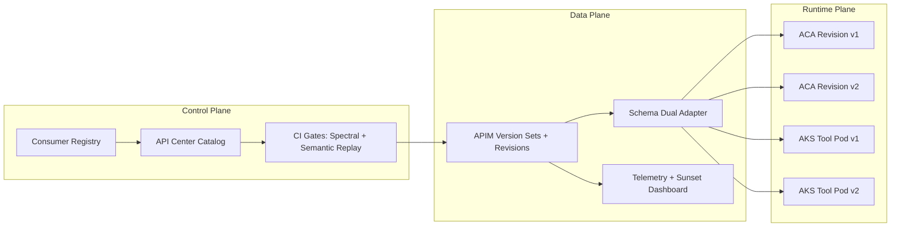
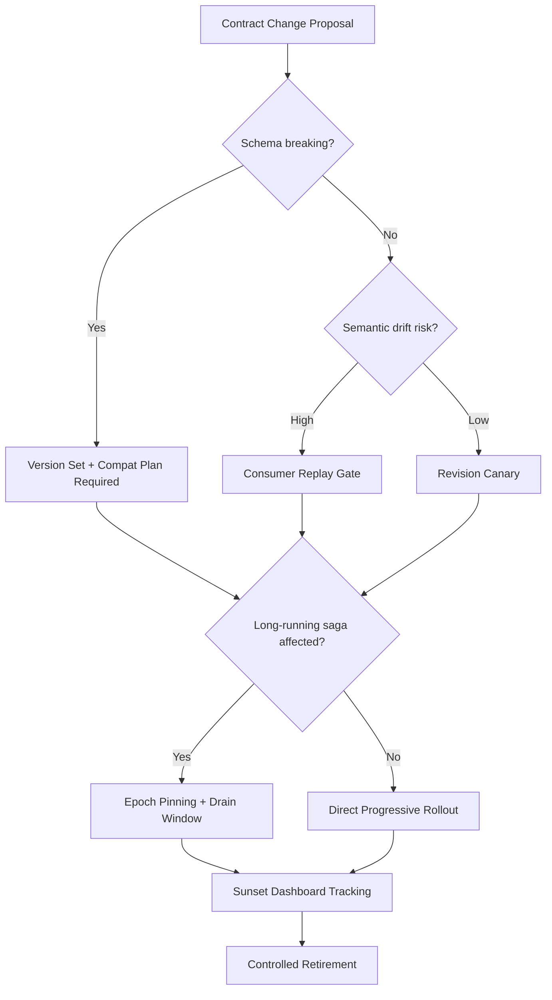

# 企业 MCP/A2A 契约破坏性演进治理选型 FAQ：API Center + APIM Revisions/Version Sets vs 双向适配器 vs 目录快照排空
> 🌐 **Language / 语言切换**: **[🇨🇳 中文版](mcp-a2a-schema-versioning-breaking-change-apicenter-apim-revisions-vs-dual-adapter-selection-faq.md)** | **[🇬🇧 English](mcp-a2a-schema-versioning-breaking-change-apicenter-apim-revisions-vs-dual-adapter-selection-faq.en.md)** | **[📚 返回目录](README.md)**
> 证据标签：`measured` / `synthetic` / `anonymized_reported`
> 抓取日期：2026-11-22
> 主题边界：聚焦合法业务演进下的契约兼容治理，不讨论哈希钉扎与投毒防护细节

## 1) 执行摘要：把“版本兼容”从开发礼仪升级为平台强制能力
大企业推进远程 MCP 工具平台化后，
最常见事故不再是接口宕机，
而是语义悄然漂移。
字段仍在，
JSON Schema 仍然合法，
但金额单位、
枚举业务含义、
描述边界已经变化。
传统单元测试很难捕获这类偏移。
智能体却会在生产里稳定调用错误语义。
治理重点应从“语法兼容”升级到“语义兼容”。
推荐基线是
`API Center + APIM` 双平面治理。
前者负责目录与契约门禁。
后者负责流量切分与运行时修复。
配合调用方目录快照绑定与 Sunset 追踪，
可以把版本演进变成可观测、
可排空、
可回退的工程流程。

## 2) 典型事故画像：不是接口挂了，而是账算错了
计费域把 `amount` 从分改为元。
工具名称保持不变。
调用方智能体继续发送旧值。
APIM 直通后，
账务系统合法入库，
但金额缩小 100 倍。
另一个常见例子是
新增合规枚举成为必填字段。
新建流程正常，
在途 24 小时审批恢复时集体失败。
故障在业务高峰触发，
因为长事务集中回放。
这类问题有三个特点。
第一，
监控不一定报 5xx。
第二，
应用团队很难自证责任边界。
第三，
回滚常常牵连多个业务域。
因此需要跨团队统一版本治理平面，
而不是各域自定义脚本约定。

## 3) 可验证来源与证据基线
来源 1（`measured`）：Azure API Management revisions and versions  
https://learn.microsoft.com/azure/api-management/api-management-revisions  
来源 2（`measured`）：Azure API Management versions  
https://learn.microsoft.com/azure/api-management/api-management-versions  
来源 3（`measured`）：Azure API Center overview  
https://learn.microsoft.com/azure/api-center/overview  
来源 4（`measured`）：Azure API Center governance  
https://learn.microsoft.com/azure/api-center/govern-api-inventory  
来源 5（`measured`）：APIM policy expressions  
https://learn.microsoft.com/azure/api-management/api-management-policy-expressions  
来源 6（`measured`）：APIM transformations  
https://learn.microsoft.com/azure/api-management/set-body-policy  
来源 7（`measured`）：OpenAPI + Spectral linting ecosystem  
https://github.com/stoplightio/spectral  
来源 8（`measured`）：Azure Container Apps revisions  
https://learn.microsoft.com/azure/container-apps/revisions  
来源 9（`measured`）：AKS rolling upgrade patterns  
https://learn.microsoft.com/azure/aks/upgrade-cluster  
来源 10（`anonymized_reported`）：匿名化企业跨域工具升级事故复盘样本。  
来源 11（`synthetic`）：回归回放成本与排空窗口测算模型。  
来源 12（`synthetic`）：目录快照策略下多租户流量分层仿真数据。  

## 4) 破坏性变更分类学：语法破坏与语义破坏必须分轨评估
类型 A：语法硬破坏。
如删除必填字段、
变更字段类型、
删除返回对象路径。
这类问题可由 Schema diff 拦截。
类型 B：语义软破坏。
如单位从“分”改“元”，
`status=approved` 含义从“财务通过”改为“风控通过”。
Schema 本身可能不报错。
但业务语义已经断裂。
类型 C：上下文污染破坏。
同名 `submit_order` 同时存在 v1 与 v2，
LLM 在工具选择阶段混淆。
模型可能调用了错误版本。
类型 D：长事务恢复破坏。
流程创建时基于 v1，
恢复执行时默认切到 v2，
导致补偿分支与审批节点参数不一致。
建议为每类定义独立门禁链路：
语法 diff、
语义契约回放、
目录投影一致性、
在途实例排空检查。

## 5) 生产级参考架构：目录、网关、运行时三层解耦
控制面第一层是 API Center。
负责工具目录主数据、
版本标签、
消费者订阅关系。
控制面第二层是 CI 门禁。
负责 Spectral 规则、
语义回放、
升级审批。
数据面第一层是 APIM。
负责版本集与修订版流量管理。
数据面第二层是协议适配器。
负责字段映射、
单位换算、
默认值补齐。
运行时层是 ACA 或 AKS 多修订并行。
每个工作流实例绑定 `catalog_epoch`。
调度器按照 epoch 路由到对应修订。
当旧 epoch 在途实例归零，
再触发旧版缩容与下线。
该架构避免了“全局同时切换”高风险窗口。

## 6) Mermaid：多版本目录投影与网关双向适配拓扑

## 7) 方案一：APIM Version Sets + Revisions + 双向 Schema 适配器
该方案适合已落地 APIM 的组织。
非破坏性改动走 Revision。
可按流量比例灰度验证。
破坏性改动走 Version Set。
对外暴露明确版本边界。
对存量调用方，
网关侧执行确定性变换：
字段重命名、
单位转换、
枚举映射、
默认值填充。
这样可以避免在同一工具清单里同时暴露 `tool_v1` 与 `tool_v2`。
减少 LLM 的 Tool Confusion。
实施关键点有四个。
一是变换必须可逆与可审计。
二是变换规则必须版本化存档。
三是 APIM policy 回归要纳入流水线。
四是灰度窗口内必须启用按调用方维度指标看板。
该方案优势是落地快。
短板是策略脚本复杂度会上升。

## 8) 方案二：API Center + Spectral + 消费者驱动智能体契约回放
这是一套“左移治理”路径。
在 PR 阶段就阻断风险升级。
第一层门禁是语法规则。
包括必填、
类型、
枚举合法性。
第二层门禁是语义规则。
例如单位变更必须携带兼容说明。
描述边界收窄必须声明影响范围。
第三层门禁是消费者回放。
按订阅方黄金轨迹重放工具调用。
评估指标不仅看 HTTP 成功率。
还看工具选择准确率、
参数正确率、
业务结果偏差率。
当回放退化超过阈值时，
流水线直接阻断发布。
该方案优势是前置发现问题。
短板是初期建设成本较高。
特别是黄金轨迹样本构建需要域团队投入。

## 9) 方案三：调用方身份绑定目录快照与 Sunset 自动告警
多团队场景下，
统一目录并不等于统一可见性。
应将调用方 `Entra AppId`
绑定到固定 `catalog_snapshot`。
每个智能体只看到其认证通过的工具版本集合。
这样可避免“新版本提前暴露”。
也可防止跨域实验版误用到生产路径。
同时，
平台应维护 Deprecation 与 Sunset 生命周期。
看板维度建议包含：
未升级调用方数量、
调用占比、
在途实例数量、
业务关键度分层。
告警要分三级：
提醒、
冻结新增、
强制下线。
此方案优势是组织治理清晰。
短板是目录主数据运营要求更高。

## 10) 方案四：ACA/AKS 多修订并行驻留与 Revision-Pinned Saga Draining
长事务是版本治理最脆弱区域。
审批流、
对账流、
人工复核流常跨越数小时或数天。
解决思路是实例级版本锁定。
工作流启动时记录 `catalog_epoch`。
后续每次恢复都路由到同 epoch 修订。
即使平台已发布新版本，
旧实例仍可安全完成。
排空阶段采用双阈值：
阈值一是在途实例数。
阈值二是最大等待时长。
满足条件后触发旧修订缩零。
该方案在 ACA 可用 revision 标签实现。
在 AKS 可用 deployment label + 路由规则实现。
优势是稳定。
短板是短期资源重叠成本增加。

## 11) 12 维选型对比：治理强度、兼容能力与运维成本
| 对比维度 | APIM Version Sets + Revisions + 双向适配 | API Center + Spectral + 回放门禁 | 目录快照绑定 + Sunset | Revision-Pinned Saga Draining |
|---|---|---|---|---|
| 语法破坏拦截 | 中（依赖网关与发布前检查） | 高（CI 强制） | 低（偏运行时） | 低（偏运行时） |
| 语义漂移识别 | 中（需补自定义策略） | 高（语义规则 + 回放） | 中（靠目录约束） | 中（靠实例锁定） |
| Tool Confusion 抑制 | 高（单清单单版本投影） | 中（需配合目录策略） | 高（按身份可见） | 中（与目录策略组合） |
| 在途长事务兼容 | 中（需额外排空机制） | 中（可提前预警） | 中（可减少暴露面） | 高（实例级锁定） |
| 灰度发布能力 | 高 | 中 | 低 | 中 |
| 回滚速度 | 高 | 中 | 中 | 中 |
| 组织协同成本 | 中 | 高 | 中 | 中 |
| 平台工程复杂度 | 中高 | 高 | 中 | 中高 |
| 审计可追溯性 | 高 | 高 | 高 | 高 |
| 对业务域侵入度 | 低到中 | 中 | 低 | 低到中 |
| 初期建设周期 | 短到中 | 中到长 | 中 | 中 |
| 三年 TCO 稳定性 | 中高 | 高 | 中高 | 中高 |

## 12) Mermaid：破坏等级分流决策树

## 13) 平台治理与回归成本 TCO 测算
设：
`N` 为月均变更次数。
`C_incident` 为一次语义事故均值损失。
`P_detect` 为发布前发现概率。
`C_gate` 为单次门禁执行成本。
年化期望损失可写为：
`Loss = 12 * N * (1 - P_detect) * C_incident + 12 * N * C_gate`。
样例假设如下。
每月变更 40 次。
单次事故影响 8 万美元。
仅语法门禁时发现率 0.45。
加入语义回放后发现率 0.82。
门禁执行成本由每次 120 美元提升到 320 美元。
则年化损失从约 211.2 万美元降至 86.4 万美元。
净节省约 124.8 万美元。
即便考虑平台建设人力，
通常 6-10 个月可回本。
若再叠加目录快照与排空策略，
长事务事故频率会进一步下降。

## 14) 五步落地指南：从契约登记到零停机退役
步骤一：统一契约主数据。
将 MCP 工具与 A2A Agent Card 全量登记到 API Center。
步骤二：建立双层门禁。
PR 阶段执行 Spectral 规则与语义回放。
步骤三：启用网关双栈发布。
APIM Revision 做灰度，
Version Set 做破坏性隔离。
步骤四：绑定调用方快照。
按 `Entra AppId` 投影认证版本集，
并上线 Sunset 追踪看板。
步骤五：实施排空退役。
长事务实例按 epoch 路由，
旧版在途清零后自动缩零下线。
这五步应按平台产品化节奏推进，
而不是一次性大爆炸改造。

## 15) 实战 FAQ（8 问）
### Q1：什么时候只用 Revision，什么时候必须升 Version Set？
若变更不影响已有请求语义与必填约束，
优先 Revision。
一旦触及参数含义变化、
必填新增、
响应语义重定义，
必须升 Version Set。

### Q2：为什么不直接在目录里同时发布 `tool_v1` 和 `tool_v2`？
因为同义双工具会放大 LLM 选择歧义。
生产中更推荐
“调用方视角单版本投影”策略。

### Q3：语义漂移如何自动识别？
建立字段级语义规则库。
例如单位、
币种、
时间基准、
状态枚举含义。
CI 对比前后契约并触发规则引擎。

### Q4：消费者驱动回放样本怎么准备？
从真实高价值路径提取黄金轨迹。
覆盖成功、
边界、
异常、
补偿四类样本。
按订阅方分层维护。

### Q5：长事务排空会不会拖慢发布节奏？
会增加并行驻留窗口，
但能显著降低恢复崩溃风险。
可用分层 SLA 决定排空上限时长。

### Q6：目录快照会不会导致升级太慢？
不会，
前提是配套 Sunset 看板与升级里程碑。
平台应提供自动通知与升级沙盒。

### Q7：APIM 双向适配器会不会变成技术债？
会，
若缺少退役策略。
每条适配规则必须标记到期日、
责任团队、
迁移完成条件。

### Q8：Good fit 与 Not for 如何划线？
Good fit：
跨域团队多、
长事务多、
监管审计强的组织。
Not for：
单团队单工具、
短事务、
变更频率低且可强制同步升级的简单系统。
