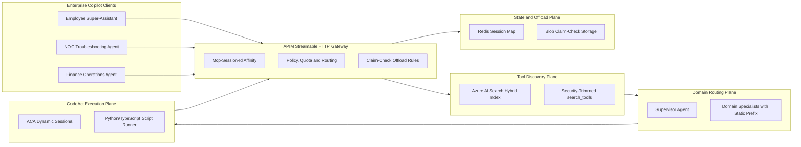
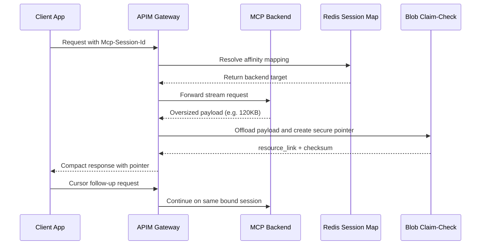

# Enterprise Dynamic MCP Tool Discovery and Context-Bloat Elimination FAQ: AI Search Deferred Tool Hydration vs Domain Supervisors vs CodeAct Sandboxing vs APIM Session Affinity and Claim-Check
> 🌐 **Language Switch**: [中文](mcp-dynamic-tool-discovery-context-bloat-ai-search-vs-domain-router-vs-codeact-apim-selection-faq.md) | **English (current)**  
> Audience: Enterprise Cloud & AI Solution Architects, platform governance teams, MCP gateway owners, LLMOps/SRE, FinOps, and security architects.  
> Core challenge: At `500–5,000` enterprise tools, how to eliminate schema context bloat, sustain tool-selection quality, control token spend, and safely process `>64KB` and even `40MB` tool outputs.  
> Scope boundary: Architectural and operating-model guidance only; no low-level protocol internals or kernel implementation details.

## 1. Executive summary: treat tool sprawl as a four-plane platform problem
Most large MCP initiatives fail because of architecture entropy, not because of insufficient tool count.  
As enterprises onboard more tools, prompt context becomes dominated by low-value schema noise.  
When all tools are statically injected every turn, context windows are consumed before reasoning begins.  
Prompt cache hit rates then degrade because volatile tool payloads destabilize prompt prefixes.  
After cache degradation, cost and latency increase simultaneously across every conversation turn.  
Tool-selection precision also degrades as candidate set size grows from tens to thousands.  
This is not a model intelligence issue.  
It is an information-retrieval and control-plane design issue.  
A production approach should split responsibilities across four complementary planes.  
**Plane A: Semantic tool search and deferred schema hydration** for on-demand retrieval of top relevant authorized tools.  
**Plane B: Hierarchical domain supervisors and static-prefix sub-agents** to keep candidate tool sets small and cache-friendly.  
**Plane C: CodeAct sandbox composition** to move heavy multi-call orchestration from LLM rounds to deterministic scripts.  
**Plane D: APIM Streamable HTTP session affinity plus Claim-Check offloading** for stable sessions and large-output control.  
These planes are not alternatives in a winner-takes-all contest.  
They are layered controls for different bottlenecks at different scaling stages.  
Plane A solves retrieval noise.  
Plane B solves routing precision and prefix stability.  
Plane C solves multi-round latency and context churn.  
Plane D solves stateful continuity and oversized payload pressure.  
A one-plane strategy usually pushes the next bottleneck downstream.  
A four-plane strategy creates an operable and explainable enterprise control loop.

## 2. Problem framing, assumptions, and explicit non-goals
This guide assumes enterprise identity and network controls already exist as baseline capabilities.  
This guide assumes MCP tools have at least baseline registration and security review processes.  
This guide assumes cross-system tasks requiring SAP, ServiceNow, Salesforce, Workday, and internal APIs in one workflow.  
This guide assumes both interactive and batch execution modes must be supported by the same platform.  
This guide is not about whether to adopt MCP at all.  
This guide is about how to keep MCP usable and economical at enterprise scale.  
Success criteria should be tracked in four metric groups.  
Group one is tool-selection quality and relevance.  
Group two is context and token efficiency.  
Group three is session continuity and failure recovery.  
Group four is large-output handling and payload governance.  
Typical enterprise targets are straightforward to define.  
Per-turn candidate tools should be kept around `5–8`.  
Tool-selection accuracy should exceed `93%` in representative workloads.  
Input-token cost should drop by `85%–94%` versus static full-schema prompting.  
Prefix-cache hit rates should stay in a `50%–75%` range after architecture stabilization.  
Payloads over `64KB` should default to offloaded claim-check references.  
Session-level recovery should remain inside agreed SLO windows.  
Without shared definitions, architecture reviews become opinion-led rather than evidence-led.  
Governance boards should freeze metric taxonomy before platform-wide rollout.

## 3. Four-way architecture options and role boundaries
| Option | Primary purpose | Typical scale | Main benefit | Main risk | Recommended role |
|---|---|---|---|---|---|
| A Search + deferred schemas | reduce context inflation | `500–5,000` tools | major token reduction | retrieval drift | default entry plane |
| B Domain supervisors | increase precision and cache stability | `200+` tools | accuracy and prefix gains | domain-boundary erosion | steady-state routing |
| C CodeAct sandboxing | compress multi-step call chains | heavy orchestration flows | latency and context savings | script-governance gaps | complex task lane |
| D APIM affinity + claim-check | stabilize sessions and payloads | high session concurrency | continuity and payload control | policy misconfiguration | global control plane |
Option A is usually the first scale lever because it removes context noise directly.  
Option B is the structural governance lever that keeps tool spaces small and deterministic.  
Option C is the execution efficiency lever for deep orchestration and large intermediate data.  
Option D is the reliability and safety lever for stateful traffic and oversized outputs.  
A mature platform composes A+B+C+D, rather than replacing one with another.  
The composition pattern can evolve by workload class and business criticality.

## 4. Twelve-dimension comparison matrix for architecture reviews
| Dimension | A Semantic Search | B Domain Supervisors | C CodeAct | D APIM + Claim-Check |
|---|---|---|---|---|
| Context compression | high | medium-high | high | medium |
| Tool-selection precision | high | high | medium-high | medium |
| Prompt-cache friendliness | medium | high | high | medium |
| Initial implementation effort | medium | medium-high | medium-high | medium |
| Multi-tenant explainability | high | high | medium-high | high |
| Session continuity | medium | medium-high | medium | high |
| Large-output resilience | medium | medium | high | high |
| End-to-end latency impact | medium | medium | high | medium-high |
| Observability readiness | high | high | medium-high | high |
| Security governance alignment | medium-high | high | high | high |
| Operational burden | medium | medium-high | medium-high | medium |
| Long-term extensibility | high | high | high | high |
Use this matrix as a weighted decision framework, not as a simplistic rank list.  
Security and compliance hard constraints should be applied before weighted scoring.  
After hard constraints are satisfied, optimize for quality, cost, and latency jointly.  
Single-metric optimization usually causes delayed systemic regressions.

## 5. Option A deep dive: semantic tool search and deferred schema hydration
Option A moves the tool inventory from static prompt payload into a searchable index.  
Each turn retrieves only the most relevant and authorized tool schemas.  
This approach directly addresses the root cause of context bloat.  
A practical implementation uses Hybrid BM25 plus vector retrieval.  
BM25 provides lexical precision for exact enterprise terms.  
Vector retrieval provides semantic recall for natural-language intent variation.  
RBAC trimming should be applied before final candidate emission.  
Returning tools outside caller authorization is both a security and relevance failure.  
A common production target is top `5..8` candidates per turn.  
Higher top-k values often reintroduce avoidable context noise.  
The known trade-off is prefix-cache volatility when tool snippets vary each turn.  
The right mitigation is layered prompt design rather than reverting to static full dumps.  
Keep stable system and policy prefix segments deterministic.  
Append dynamic tool snippets in a bounded variable segment.  
This preserves retrieval gains while retaining meaningful cache hit rates.  
Option A should include continuous retrieval evaluation gates.  
Track recall, false-positive retrieval, selection precision, and token burn per turn.  
Without closed-loop evaluation, retrieval quality drifts silently over time.  
Silent drift eventually erases expected cost and accuracy gains.  
That is why Option A must be integrated with platform observability from day one.

## 6. Option B deep dive: hierarchical supervisors and static-prefix sub-agents
Option B addresses scaling through structural partitioning and deterministic specialization.  
Large tool catalogs are segmented into domain-oriented subspaces with limited tool counts.  
A supervisor routes requests to domain specialists that each carry static prompt prefixes.  
This typically improves both selection precision and cache behavior.  
Static prefixes help stabilize prompt-cache keys across conversational turns.  
Production teams often report `50%–75%` hit rates after supervisor stabilization.  
Supervisor quality depends on explicit routing contracts.  
Routing contracts should combine intent, entity, and source-system evidence.  
Cross-domain tasks should use explicit collaboration paths rather than ad-hoc fallback.  
The primary operational risk is domain-boundary drift.  
When ownership is unclear, tools accumulate in generic buckets and routing quality decays.  
A platform governance board should therefore enforce domain ownership discipline.  
Every new tool should have mandatory domain assignment and lifecycle owner metadata.  
Without that discipline, Option B can become complex but ineffective.  
With discipline, Option B provides durable quality and economics improvements.

## 7. Option C deep dive: CodeAct sandbox composition on ACA Dynamic Sessions
Option C converts multi-turn tool orchestration into script-driven local execution in a sandbox.  
Instead of repeatedly asking the model to chain calls, the model emits one controlled script.  
The script handles pagination, joins, filtering, normalization, and aggregation locally.  
Only distilled outcomes are returned to the model context.  
This pattern is particularly valuable when workflows involve `20+` tool calls.  
Traditional ReAct patterns incur repeated round trips and repeated context injection.  
CodeAct can reduce both network chatter and prompt churn.  
Benefits increase when intermediate datasets are large.  
For `40MB` telemetry payloads, local script processing avoids sending bulk data to the model.  
Security and governance are non-negotiable for this pattern.  
Scripts should execute in Hyper-V isolated sessions with strict egress and runtime controls.  
Allowlisted libraries and templates should be preferred over unconstrained script freedom.  
Operationally, script quality gates should include idempotency, timeout handling, and output schema controls.  
Otherwise complexity simply shifts from prompts to fragile ad-hoc code.  
A mature implementation treats common script flows as managed templates with version governance.  
That approach turns Option C into a reusable platform asset.

## 8. Option D deep dive: APIM Streamable HTTP affinity and claim-check offloading
Option D addresses state continuity and payload-size stress under horizontal scaling.  
For Streamable HTTP MCP, session drift can break stateful interactions unpredictably.  
`Mcp-Session-Id` affinity should map requests to consistent backend instances.  
A Redis map with clear TTL and refresh policy is a practical pattern.  
The second challenge is oversized tool output injected directly into model context.  
Without offloading, large responses consume context budget and increase costs sharply.  
A claim-check strategy offloads payloads beyond policy threshold to Blob or Redis.  
The model receives compact references, cursors, and summaries instead of raw bulk output.  
A baseline threshold like `64KB` is a good starting point, then tuned by workload class.  
Interactive tasks often benefit from lower thresholds.  
Batch investigative tasks may allow higher thresholds.  
Policy calibration should balance context savings against storage round-trip overhead.  
Option D should include explicit failure and fallback behavior.  
If affinity lookup fails, controlled rebind and checkpoint resume should be deterministic.  
If offload fails, bounded fallback and alerting should trigger immediately.  
This is how Option D upgrades reliability from best-effort to governed production behavior.

## 9. Reference architecture diagram A: dynamic discovery and layered execution

This topology separates discovery, routing, execution, and payload management concerns explicitly.  
Separation enables independent scaling and independent governance per plane.  
It also shortens incident isolation paths in production operations.

## 10. Reference architecture diagram B: session affinity and claim-check sequence

The sequence shows how continuity and context minimization are achieved together.  
Affinity keeps execution state coherent.  
Claim-check keeps prompt context lean and economically sustainable.

## 11. Production snippet A: security-trimmed search_tools implementation pattern
```python
from dataclasses import dataclass
from typing import List, Dict

@dataclass
class ToolHit:
    tool_id: str
    domain: str
    acl_roles: List[str]
    schema: Dict
    score: float

def search_tools(query: str, user_roles: List[str], top_k: int = 6) -> List[ToolHit]:
    # pseudo implementation: Hybrid BM25 + vector query in Azure AI Search
    raw_hits = hybrid_search(query=query, k=max(18, top_k * 3))
    authorized = []
    role_set = set(user_roles)
    for h in raw_hits:
        if role_set.intersection(set(h["acl_roles"])):
            authorized.append(
                ToolHit(
                    tool_id=h["tool_id"],
                    domain=h["domain"],
                    acl_roles=h["acl_roles"],
                    schema=h["schema"],
                    score=float(h["score"]),
                )
            )
        if len(authorized) >= top_k:
            break
    return authorized

def render_compact_tool_context(hits: List[ToolHit]) -> str:
    blocks = ["Authorized tools selected for this turn:"]
    for hit in hits:
        blocks.append(f"- {hit.tool_id} ({hit.domain}) score={hit.score:.3f}")
        blocks.append(f"  schema={compact_schema(hit.schema)}")
    return "\n".join(blocks)
```
This pattern highlights retrieval, authorization trimming, and compact schema rendering.  
It prevents insecure or irrelevant tools from polluting model context.  
It also preserves explainability for governance reviews.

## 12. Production snippet B: APIM policy for affinity and `>64KB` claim-check offload
```xml
<policies>
  <inbound>
    <base />
    <set-variable name="sessionId" value="@(context.Request.Headers.GetValueOrDefault("Mcp-Session-Id",""))" />
    <set-variable name="affinityKey" value="@($"mcp:{context.Variables["sessionId"]}")" />
    <cache-lookup-value key="@(context.Variables["affinityKey"])" variable-name="boundBackend" />
    <choose>
      <when condition="@(!string.IsNullOrEmpty((string)context.Variables.GetValueOrDefault<string>("boundBackend","")))">
        <set-backend-service backend-id="@((string)context.Variables["boundBackend"])" />
      </when>
      <otherwise>
        <set-backend-service backend-id="mcp-default-pool" />
      </otherwise>
    </choose>
  </inbound>
  <backend>
    <forward-request timeout="120" />
  </backend>
  <outbound>
    <base />
    <set-variable name="respSize" value="@((int)context.Response.Body.As<byte[]>(preserveContent: true).Length)" />
    <choose>
      <when condition="@((int)context.Variables["respSize"] > 65536)">
        <send-request mode="new" response-variable-name="claimRef" timeout="20">
          <set-url>https://claimcheck.internal/store</set-url>
          <set-method>POST</set-method>
          <set-body>@(context.Response.Body.As<string>(preserveContent: true))</set-body>
        </send-request>
        <set-body>@("{\"offloaded\":true,\"resource_link\":\"" + ((IResponse)context.Variables["claimRef"]).Body.As<string>() + "\"}")</set-body>
      </when>
    </choose>
  </outbound>
</policies>
```
This policy demonstrates session stickiness and payload offload in one control surface.  
Production rollouts should add signatures, checksums, and full audit metadata.  
Policy tests should include failover and oversized-output simulation cases.

## 13. Enterprise scenario A: Fortune 500 employee super-assistant with 1,800 APIs
This enterprise unified SAP, ServiceNow, Salesforce, and Workday through MCP endpoints.  
The first rollout used static full-tool prompt injection.  
Average per-turn prompt input exceeded `120K` tokens in complex workflows.  
Cost and latency quickly crossed portfolio limits.  
The team introduced Option A and Option B in phases.  
Tool hydration shifted to top `6` authorized tools per turn.  
Domain routing segmented catalog into 22 specialist domains.  
After four weeks, three measurable changes were sustained.  
Tool-selection precision improved from `57.6%` to `93.8%`.  
Input-token average dropped by approximately `89%`.  
Prompt-cache hit rates stabilized around `63%`.  
Later, APIM affinity was enabled for long multi-step sessions.  
Session interruption rates dropped further in peak windows.  
The case shows that retrieval discipline outperforms brute-force schema injection at scale.  
It also shows organizational taxonomy is as important as retrieval technology.

## 14. Enterprise scenario B: global telecom NOC with 40MB telemetry workflows
The telecom NOC workflow ingests bulky log and telemetry dumps for fault triage.  
Earlier design pushed large raw payloads directly into LLM context.  
That approach caused context pressure, latency spikes, and instability during incidents.  
The team adopted Option C and Option D together.  
CodeAct scripts handled slicing, grouping, and anomaly extraction inside sandboxed execution.  
APIM offloaded outputs larger than `64KB` via claim-check pointers.  
The model consumed compact summaries and references instead of raw bulk data.  
After rollout, average end-to-end latency dropped by `41%`.  
Session recovery success in shift operations rose above `98%`.  
Per-session token cost decreased by `52%` in observed traffic windows.  
For operations teams, recoverability proved more valuable than theoretical max throughput.  
This case shows large-payload governance is mandatory, not optional, for enterprise MCP scale.

## 15. FinOps model, quantitative Q&A, and Day-0/Day-2 checklist
### 15.1 Token and latency TCO table (illustrative)
| Metric | Static full-tool prompt | +Dynamic Search + Domain Routing | +CodeAct | +APIM Claim-Check |
|---|---:|---:|---:|---:|
| Avg input tokens per turn | 118,000 | 14,200 | 9,800 | 9,600 |
| Tool-selection precision | 57.6% | 93.1% | 94.0% | 94.0% |
| Prompt-cache hit rate | 18% | 54% | 68% | 67% |
| Avg end-to-end latency (ms) | 8,900 | 4,700 | 3,200 | 2,900 |
| Session cost (USD) | 1.84 | 0.42 | 0.31 | 0.28 |
| Relative annualized cost | 1.00x | 0.31x | 0.24x | 0.22x |
This table should be used as decision scaffolding, not as universal benchmark truth.  
Each enterprise must calibrate for model pricing, cache policy, and workload shape.  
The key value is shared financial language across architecture governance.
### 15.2 Quantitative Q&A (8 questions)
**Q1: Does dynamic `search_tools` always hurt prompt-cache hit rate?**  
It does if volatile snippets are embedded in stable prefix zones.  
With stable-prefix separation, many deployments still keep `50%+` cache hit rates.  
**Q2: How does accuracy change as tool count scales from 20 to 100 to 1000?**  
Without retrieval partitioning, precision commonly degrades materially with catalog growth.  
With retrieval and domain routing, precision often returns to `90%+` in practice.  
**Q3: Why can CodeAct be faster than sequential ReAct in tool-heavy tasks?**  
It reduces LLM round trips and avoids repeated context reinjection for each micro-step.  
For `20+` call chains, observed gains often fall in `30%–60%` latency reduction ranges.  
**Q4: How should `Mcp-Session-Id` affinity failure be handled?**  
Use Redis mapping plus checkpoint-aware rebinding fallback.  
On mapping loss, rebuild affinity deterministically and resume from known cursor state.  
**Q5: Why start claim-check threshold near `64KB`?**  
It is a practical default balancing context protection and storage round-trip overhead.  
Tune per workload class after observing payload distributions and latency budgets.  
**Q6: When is CodeAct not the first optimization move?**  
When tasks use only one or two lightweight tools, A/B often provide better ROI first.  
CodeAct shines most in long, data-heavy orchestration chains.  
**Q7: How is dynamic-discovery break-even calculated?**  
Compare retrieval+routing overhead against token and latency savings from removed static schemas.  
At moderate catalog sizes and multi-turn sessions, break-even usually appears quickly.  
**Q8: Why not keep all routing logic inside agent prompts?**  
Distributed app-side routing undermines governance consistency and auditability.  
A gateway control plane centralizes policy and reduces upgrade blast radius.  
### 15.3 Day-0/Day-2 twelve-item checklist
- [ ] Standardize tool metadata fields for domain, owner, ACL, and lifecycle status.  
- [ ] Implement security-trimmed `search_tools` with bounded top-k defaults.  
- [ ] Separate stable system prefix from dynamic tool snippet segments.  
- [ ] Define supervisor routing rules and domain-coverage regression tests.  
- [ ] Enforce sandbox least privilege and runtime limits for CodeAct execution.  
- [ ] Define structured output templates for script-generated summaries.  
- [ ] Enable APIM `Mcp-Session-Id` affinity routing with explicit TTL governance.  
- [ ] Configure claim-check threshold policy and oversized-response alerts.  
- [ ] Manage pointer lifecycle and access controls for Blob/Redis offload stores.  
- [ ] Publish dashboards for precision, token economics, and latency by workload class.  
- [ ] Add policy-change CI tests and failover simulation drills.  
- [ ] Establish quarterly tool-catalog pruning and deprecation workflows.  
### 15.4 Good fit and Not for
**Good fit**: large enterprise tool estates, multi-system orchestration, and strict cost/governance requirements.  
**Not for**: small temporary projects with limited tools and no platform governance ambition.  
### 15.5 Closing perspective
At enterprise scale, MCP success is fundamentally an information selection discipline.  
When discovery, routing, execution, and output management are governed as separate planes, quality and cost improve together.  
That is the practical transition from demo-level orchestration to durable production platform capability.  
