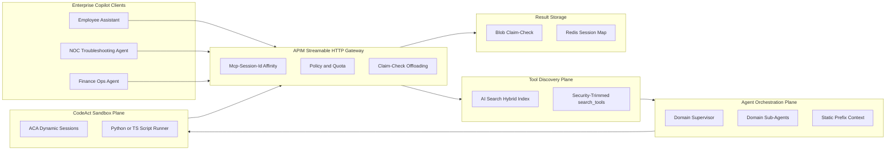
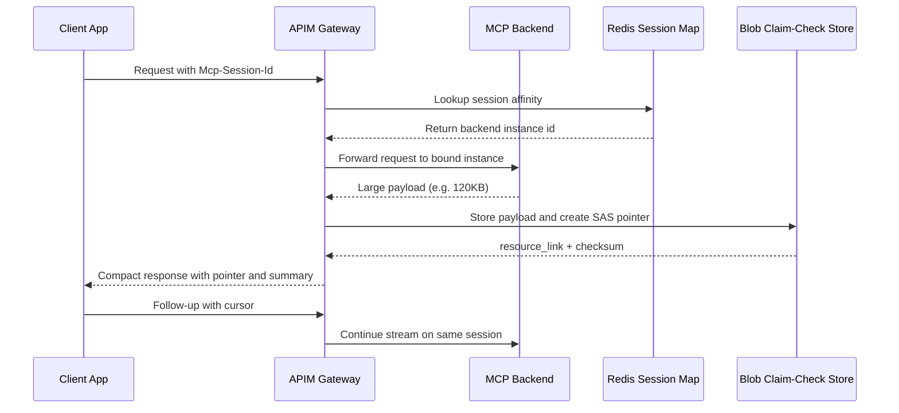

# 企业动态 MCP 工具发现与上下文瘦身选型 FAQ：AI Search 语义检索 vs 领域路由子代理 vs CodeAct 沙箱组合 vs APIM 会话亲和与 Claim-Check
> 🌐 **Language Switch**: **中文（当前）** | [English](mcp-dynamic-tool-discovery-context-bloat-ai-search-vs-domain-router-vs-codeact-apim-selection-faq.en.md)  
> 适用对象：企业 Cloud & AI Solution Architect、平台工程负责人、MCP 网关治理团队、LLMOps/SRE、FinOps 与安全团队。  
> 核心问题：在 `500–5,000` 企业工具规模下，如何消除工具 Schema 上下文膨胀，保持工具命中率，控制 Token 成本，并稳定处理 `>64KB` 甚至 `40MB` 级工具输出。  
> 本文边界：聚焦架构与运营治理，不涉及底层驱动、协议栈实现细节和模型内核优化。

## 1. 执行摘要：把“工具泛滥”问题拆成四个可治理平面
多数企业在 MCP 大规模落地失败，不是因为工具不够多。  
而是因为工具“太多但无秩序”，导致上下文、延迟、成本同时失控。  
当工具目录从 `20` 增长到 `1,000`，静态全量注入几乎必然失效。  
一旦每轮对话都附带巨量工具定义，Prompt Cache 前缀命中会急剧下降。  
命中下降后，输入 Token 成本会按会话轮次被放大。  
同时模型的工具选择准确率会随候选工具数增大而衰减。  
这不是模型“变笨”。  
这是检索空间被噪声稀释的结构性结果。  
因此推荐四平面组合。  
**平面 A：AI Search + 延迟加载 Schema**，把全量工具目录变成按需检索。  
**平面 B：领域主管 + 子代理静态前缀**，把大目录切成可控小目录。  
**平面 C：CodeAct 沙箱组合**，把多步工具编排从 LLM 上下文转到脚本执行面。  
**平面 D：APIM 会话亲和 + Claim-Check**，把长响应从对话上下文转为指针。  
四平面不是互斥关系。  
它们是同一平台在不同瓶颈点的互补解。  
A 解决“找得到”。  
B 解决“选得准且可缓存”。  
C 解决“调用链过长”。  
D 解决“结果过大”。  
企业只做其中一个平面，通常会在下一阶段遇到新瓶颈。  
平台化成功的关键在于四平面联动而非单点优化。

## 2. 业务边界、非目标与成功判据
本文默认企业已具备统一身份和网络隔离基线。  
本文默认 MCP 工具已通过最基础安全准入。  
本文默认存在跨系统任务，如 SAP、ServiceNow、Salesforce、Workday 联合调用。  
本文默认工作负载既包含交互式问答，也包含批处理分析。  
本文不讨论“是否采用 MCP”。  
本文讨论的是“采用后如何规模化治理”。  
成功判据建议分为四类。  
第一类是工具命中质量。  
第二类是上下文成本。  
第三类是会话稳定性。  
第四类是大输出可处理性。  
可量化目标可以设为如下区间。  
动态检索后每轮候选工具控制在 `5–8`。  
工具选择准确率提升到 `>93%`。  
输入 Token 成本下降 `85%–94%`。  
Prompt Cache 命中率达到 `50%–75%`。  
`>64KB` 输出默认走 Claim-Check。  
会话级失败重试后成功率维持在目标 SLO 内。  
若这些指标缺少统一口径，跨团队争议会持续。  
架构委员会应先冻结指标定义再推进选型。

## 3. 四路径架构对比与职责边界
| 路径 | 核心目标 | 适用规模 | 主收益 | 主风险 | 推荐角色 |
|---|---|---|---|---|---|
| A 语义检索+延迟 Schema | 减少上下文膨胀 | `500–5,000` 工具 | Token 大幅下降 | 检索召回偏差 | 默认入口 |
| B 领域主管+静态前缀 | 提高命中与缓存 | `200+` 工具 | 命中率提升 | 领域边界漂移 | 稳态编排 |
| C CodeAct 沙箱组合 | 压缩多轮 ReAct | 高调用链任务 | 延迟与上下文双降 | 脚本治理不足 | 重负载任务 |
| D APIM 亲和+Claim-Check | 稳定会话与大输出 | 大规模会话 | 会话恢复与降载 | 策略误配 | 全局控制面 |
路径 A 是削减噪声的第一刀。  
路径 B 是把治理责任按领域落地。  
路径 C 是把工具流水线从语言层迁移到执行层。  
路径 D 是把会话状态和大输出管理从应用层抽离。  
四者组合后，工具平台会从“对话堆砌”转为“检索驱动系统”。

## 4. 12 维选型矩阵（可直接用于评审会）
| 维度 | A 语义检索 | B 领域路由 | C CodeAct | D APIM+Claim-Check |
|---|---|---|---|---|
| 上下文压缩能力 | 高 | 中高 | 高 | 中 |
| 工具命中准确率 | 高 | 高 | 中高 | 中 |
| Prompt Cache 友好度 | 中 | 高 | 高 | 中 |
| 引入复杂度 | 中 | 中高 | 中高 | 中 |
| 多租户隔离可解释性 | 高 | 高 | 中高 | 高 |
| 会话稳定性 | 中 | 中高 | 中 | 高 |
| 大输出承载能力 | 中 | 中 | 高 | 高 |
| 端到端延迟改善 | 中 | 中 | 高 | 中高 |
| 平台可观测性 | 高 | 高 | 中高 | 高 |
| 安全治理耦合度 | 中高 | 高 | 高 | 高 |
| 运维负担 | 中 | 中高 | 中高 | 中 |
| 长期扩展性 | 高 | 高 | 高 | 高 |
矩阵使用建议是“先红线后打分”。  
先用合规红线过滤不可行路径。  
再用业务目标做加权评分。  
不要用单一维度做绝对排序。  
企业工具平台是多目标优化问题。  
权重应按行业与业务类型动态调整。

## 5. 路径 A：AI Search 语义检索与延迟 Schema 水合
路径 A 的核心思想是“把工具列表从上下文搬到索引”。  
每轮仅检索当前任务最相关的少量工具定义。  
检索面同时做 RBAC 裁剪，避免返回无权限工具。  
这一步通常直接带来最大 Token 降幅。  
实践中可采用 Hybrid BM25+Vector。  
BM25 保证关键词精确匹配。  
Vector 保证语义同义召回。  
两者融合可以减少“名字相近但语义偏差”的误召回。  
推荐返回 top `5..8` 工具而非 top `20`。  
过高 top-k 会重新引入噪声。  
路径 A 的典型副作用是 Prompt Cache 前缀波动。  
因为每轮工具集合变化，前缀稳定性可能下降。  
解决思路不是回到全量静态注入。  
而是把稳定部分与动态部分分层。  
稳定系统前缀固定放置。  
动态工具片段放在可变尾部。  
这样既能保留检索收益，也能保持可观缓存命中。  
路径 A 还需要评测闭环。  
至少要跟踪召回率、误召回率、工具命中率、Token 成本。  
没有评测闭环，检索策略很快会漂移。  
一旦漂移，准确率优势会被逐步侵蚀。  
因此 A 必须与可观测体系绑定上线。

## 6. 路径 B：领域主管与静态前缀子代理
路径 B 的核心是“组织结构化”。  
把 `1,000+` 工具按领域切成 `15–25` 工具的小集合。  
由领域主管代理做一级路由。  
领域子代理只加载本域固定前缀和工具清单。  
固定前缀有两个好处。  
第一，工具选择空间更小，命中率更稳。  
第二，Prompt Cache 前缀更稳定。  
在生产中常见命中区间可达到 `50%–75%`。  
这会显著降低输入成本。  
路径 B 的关键风险是领域边界腐蚀。  
当跨域任务增加，主管路由可能出现震荡。  
解决方式是定义清晰路由契约。  
例如按意图、实体、系统来源三因素打分。  
并对跨域任务提供“协同子流程”而非硬切换。  
B 路径还要求治理团队维护域目录。  
新工具上线必须归属到具体领域。  
不能落到“通用杂项池”。  
否则领域化收益会被稀释。  
如果组织缺少域治理机制，B 可能退化成复杂但无效的分层。  
所以 B 的成功前提是组织协同与目录纪律。

## 7. 路径 C：CodeAct 沙箱程序化工具组合
路径 C 把“多轮工具调用解释过程”转成“单脚本执行过程”。  
Agent 生成 Python/TypeScript 脚本在 ACA Dynamic Sessions 内运行。  
脚本负责分页、循环、连接、去重、聚合。  
最终仅返回摘要结果给模型。  
这对 `20+` 工具调用链尤其有效。  
传统 ReAct 会产生多轮往返。  
每一轮都增加上下文与网络延迟。  
CodeAct 可把多轮链路压缩为一次执行。  
对 `40MB` 级数据，脚本本地处理优势更明显。  
模型不再直接吞入大块原始 payload。  
安全上，CodeAct 必须运行在隔离沙箱。  
并限制出网、文件系统和执行时长。  
治理上，脚本模板应有白名单 API。  
避免自由脚本演化成不可控执行面。  
C 路径也需要“脚本质量门禁”。  
包括错误处理、幂等重试、输出约束。  
否则会把复杂度从对话层转移到代码层。  
正确实践是把常见任务沉淀为可复用脚本模板。  
并由平台团队管理版本。  
这样 C 才能形成规模化收益而不是临时技巧。

## 8. 路径 D：APIM Streamable HTTP 会话亲和与 Claim-Check
路径 D 解决两个高频痛点。  
第一个痛点是 Streamable HTTP 会话漂移。  
第二个痛点是大输出直接灌入上下文。  
对于前者，需基于 `Mcp-Session-Id` 实现亲和路由。  
可用 Redis 维护会话到后端实例映射。  
会话续期与回收要有明确 TTL。  
对于后者，需设置输出大小阈值。  
例如 `>64KB` 默认转 Claim-Check。  
工具服务器将结果落入 Blob/Redis。  
模型上下文仅保留 URI、cursor 与摘要。  
这样可避免上下文被大结果挤爆。  
也减少重复传输带来的延迟和费用。  
D 路径的风险在策略误配。  
若亲和 TTL 过短会导致频繁失效。  
若阈值过低会增加外部存取开销。  
若阈值过高则上下文膨胀重现。  
因此要做基于业务的阈值校准。  
并按任务类型设定差异化策略。  
高交互任务倾向更低阈值。  
离线分析任务可适度提高阈值。  
最终目标是“稳定会话 + 可控上下文 + 可追溯输出”。

## 9. 参考架构图一：动态发现与分层执行拓扑

该拓扑强调四平面解耦。  
工具发现、编排、执行、输出管理分别治理。  
这让平台可以独立演进每一层能力。  
也能在事故时快速定位瓶颈所在层。

## 10. 参考架构图二：会话亲和与大输出 Claim-Check 时序

该时序的关键是“状态连续性与输出瘦身并行”。  
会话亲和保证上下文一致。  
Claim-Check 保证上下文轻量。  
两者结合显著降低长会话抖动。

## 11. 生产代码片段 A：安全裁剪的 search_tools Python 示例
```python
from dataclasses import dataclass
from typing import List, Dict

@dataclass
class ToolDoc:
    tool_id: str
    domain: str
    schema: Dict
    acl_roles: List[str]
    score: float

def search_tools(query: str, user_roles: List[str], top_k: int = 6) -> List[ToolDoc]:
    # pseudo: call Azure AI Search hybrid query with vector+bm25
    # pseudo: apply security trimming by Entra roles
    all_hits = hybrid_search(query=query, k=max(top_k * 3, 18))
    filtered = []
    for hit in all_hits:
        if set(hit["acl_roles"]).intersection(set(user_roles)):
            filtered.append(
                ToolDoc(
                    tool_id=hit["tool_id"],
                    domain=hit["domain"],
                    schema=hit["schema"],
                    acl_roles=hit["acl_roles"],
                    score=hit["score"],
                )
            )
        if len(filtered) >= top_k:
            break
    return filtered

def hydrate_tool_prompt(tools: List[ToolDoc]) -> str:
    lines = ["Selected tools for this turn:"]
    for t in tools:
        lines.append(f"- {t.tool_id} ({t.domain}) score={t.score:.3f}")
        lines.append(f"  schema={compact_schema(t.schema)}")
    return "\n".join(lines)
```
该示例表达三个治理要点。  
第一是先检索后裁剪。  
第二是按权限过滤而非仅按相关度过滤。  
第三是 Schema 压缩后再注入上下文。

## 12. 生产代码片段 B：APIM 会话亲和与大响应 Claim-Check 策略
```xml
<policies>
  <inbound>
    <base />
    <set-variable name="mcpSessionId" value="@(context.Request.Headers.GetValueOrDefault("Mcp-Session-Id",""))" />
    <set-variable name="backendKey" value="@($"mcp:{context.Variables["mcpSessionId"]}")" />
    <cache-lookup-value key="@(context.Variables["backendKey"])" variable-name="boundBackend" />
    <choose>
      <when condition="@(!string.IsNullOrEmpty((string)context.Variables.GetValueOrDefault<string>("boundBackend","")))">
        <set-backend-service backend-id="@((string)context.Variables["boundBackend"])" />
      </when>
      <otherwise>
        <set-backend-service backend-id="mcp-pool-default" />
      </otherwise>
    </choose>
  </inbound>
  <backend>
    <forward-request timeout="120" />
  </backend>
  <outbound>
    <base />
    <set-variable name="respBytes" value="@((int)context.Response.Body.As<byte[]>(preserveContent: true).Length)" />
    <choose>
      <when condition="@((int)context.Variables["respBytes"] > 65536)">
        <send-request mode="new" response-variable-name="claimResp" timeout="20">
          <set-url>https://claimcheck.internal/store</set-url>
          <set-method>POST</set-method>
          <set-body>@(context.Response.Body.As<string>(preserveContent: true))</set-body>
        </send-request>
        <set-body>@("{\"offloaded\":true,\"resource_link\":\"" + ((IResponse)context.Variables["claimResp"]).Body.As<string>() + "\"}")</set-body>
      </when>
    </choose>
  </outbound>
</policies>
```
策略示例展示了会话绑定与大小阈值处理。  
真实生产应补充签名、校验和与审计字段。  
同时应为失败回退设计可观测告警。

## 13. 企业场景 A：Fortune 500 员工超级助理（1,800 API）
该企业把 SAP、ServiceNow、Salesforce、Workday 工具统一接入 MCP。  
初期采用全量工具注入。  
单轮输入常超过 `120K` token。  
成本与延迟均超出可接受范围。  
随后引入路径 A 与路径 B。  
工具检索改为 top `6` 动态水合。  
领域路由将工具拆为 22 个子域。  
上线四周后观察到三类变化。  
第一，工具命中率从 `57.6%` 提升到 `93.8%`。  
第二，输入 Token 均值下降 `89%`。  
第三，Prompt Cache 命中率稳定在 `63%` 左右。  
APIM 再引入会话亲和后，长对话失败率进一步下降。  
该项目证明“少而准”比“多而全”更适合生产。  
也证明目录治理与技术治理必须并行推进。

## 14. 企业场景 B：全球电信 NOC 故障排障（40MB 遥测）
该场景需要读取大体量日志和遥测快照。  
传统做法把大结果直接给模型。  
导致上下文拥塞与响应抖动。  
团队采用路径 C 与路径 D 联合。  
CodeAct 在沙箱内完成日志切片、聚合与异常提取。  
APIM 对 `>64KB` 输出强制 Claim-Check。  
模型仅消费摘要、指针与关键统计。  
上线后平均端到端时延下降 `41%`。  
会话中断恢复成功率提升到 `98%+`。  
单会话 Token 成本下降 `52%`。  
对 NOC 团队而言，最关键收益是稳定性提升。  
因为值班窗口更关注“可恢复”而非绝对最快。  
该场景说明大 payload 管理是 MCP 规模化的必要能力。  
没有 Claim-Check，任何大规模工具平台都会走向上下文爆炸。

## 15. FinOps、定量问答与 Day-0/Day-2 清单
### 15.1 Token 与延迟 TCO 对照表（示例）
| 指标 | 全量静态工具注入 | 动态检索+领域路由 | +CodeAct | +APIM Claim-Check |
|---|---:|---:|---:|---:|
| 平均输入 Token/轮 | 118,000 | 14,200 | 9,800 | 9,600 |
| 工具命中率 | 57.6% | 93.1% | 94.0% | 94.0% |
| Prompt Cache 命中率 | 18% | 54% | 68% | 67% |
| 平均端到端延迟(ms) | 8,900 | 4,700 | 3,200 | 2,900 |
| 单会话成本(USD) | 1.84 | 0.42 | 0.31 | 0.28 |
| 年化总成本（相对） | 1.00x | 0.31x | 0.24x | 0.22x |
该表用于架构评审中的方向判断。  
不应用于跨企业直接对标。  
真实数据需按模型价格、缓存策略、负载曲线校准。
### 15.2 定量 Q&A（8 题）
**Q1：动态 `search_tools` 会不会损害 Prompt Cache？**  
若动态片段放在稳定前缀前部，会显著损害命中。  
若稳定前缀固定、动态片段后置，通常仍可保持 `50%+` 命中。  
**Q2：工具数量从 20 到 1000，准确率如何变化？**  
在无检索分层条件下，准确率常呈明显下滑。  
实践中可从 `90%+` 下降到 `60%` 甚至更低。  
引入检索与领域路由后可恢复到 `90%+`。  
**Q3：CodeAct 相比顺序 ReAct 的时延收益来自哪里？**  
主要来自减少 LLM 往返轮次与减少上下文重复传输。  
对 `20+` 工具链路，常见收益在 `30%–60%` 区间。  
**Q4：`Mcp-Session-Id` 亲和失败如何恢复？**  
建议采用 Redis 映射 + 后端回放标记。  
若映射失效，回退到最近 checkpoint 并重建会话绑定。  
**Q5：Claim-Check 阈值应如何设定？**  
起步可用 `64KB`，再按任务类型调优。  
交互类可更低，批处理类可更高。  
**Q6：何时不应优先做 CodeAct？**  
若任务只需 1–2 个轻量调用，CodeAct 增益有限。  
此时优先路径 A/B 更经济。  
**Q7：如何计算动态发现的 break-even？**  
对比“检索开销 + 路由开销”与“静态注入 Token 增量成本”。  
当工具数超过几十且轮次较多时，动态发现通常快速回本。  
**Q8：为何仍需要 APIM，而不是在 Agent 内写路由逻辑？**  
因为治理与审计属于平台职责。  
将路由散落在应用侧会降低一致性并放大升级风险。  
### 15.3 Day-0 / Day-2 十二项清单
- [ ] 建立工具目录标准字段（域、权限、版本、风险等级）。  
- [ ] 实施 `search_tools` 安全裁剪与 top-k 策略。  
- [ ] 固化系统前缀结构，分离稳定与动态片段。  
- [ ] 建立领域主管路由规则与回归测试集。  
- [ ] 为 CodeAct 沙箱配置最小权限与执行时限。  
- [ ] 为脚本输出定义结构化摘要模板。  
- [ ] 在 APIM 开启 `Mcp-Session-Id` 亲和策略。  
- [ ] 设置大输出 Claim-Check 阈值与告警。  
- [ ] 打通 Blob/Redis 指针生命周期治理。  
- [ ] 建立工具命中率、Token 成本、时延三维看板。  
- [ ] 将策略变更纳入 CI 与故障演练流程。  
- [ ] 形成季度工具目录瘦身与淘汰机制。  
### 15.4 Good fit / Not for
**Good fit**：工具规模大、跨系统复杂、对成本与治理敏感的企业平台。  
**Not for**：工具数量很少且无长期平台化目标的临时项目。  
### 15.5 结语
MCP 规模化的本质是信息选择问题，不是信息堆砌问题。  
当企业把发现、路由、执行、输出四层治理好。  
工具平台才能在准确率、成本和稳定性上同时达标。  
这也是从“能跑 Demo”走向“可持续生产”的关键分水岭。  
