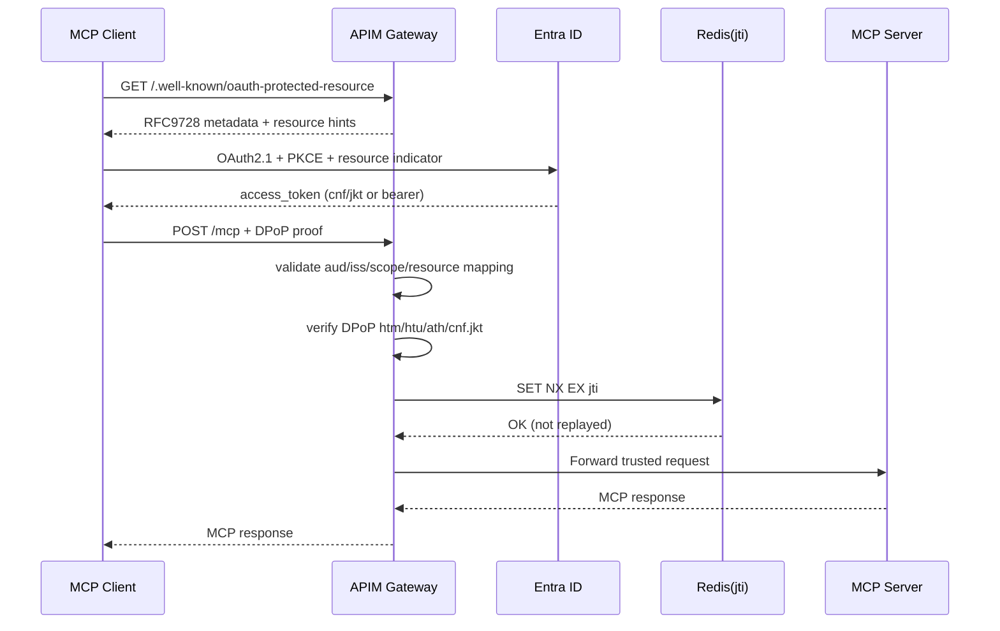

# Enterprise Remote MCP OAuth 2.1 Authorization & Sender-Constrained Token Governance Selection FAQ: APIM+Entra Translation Facade vs DCR Broker vs mTLS/Federated Authorization Server

> 🌐 **Language Switch**: [中文](./mcp-oauth21-authorization-rfc9728-rfc8707-cimd-dpop-apim-entra-id-vs-dcr-proxy-vs-mtls-federated-as-selection-faq.md) | **English (current)**
> **Audience**: Cloud & AI Solution Architects, enterprise identity platform teams, API gateway governance teams, MCP platform owners, and security/compliance reviewers.
> **Scope**: Production decision framework for RFC 9728 protected resource metadata, RFC 8707 resource indicators, CIMD/DCR client governance, and RFC 9449 DPoP sender-constrained protection across Azure API Management and Microsoft Entra ID.

## 1. Problem framing: why enterprise MCP authorization fails simultaneously on protocol interoperability and security boundaries
Enterprises adopting Remote MCP quickly discover a structural mismatch between modern OAuth 2.1 client expectations and incumbent identity semantics that were designed around Entra v2 `api://<app-id>/<scope>` resource conventions, so both sides are internally correct but operationally incompatible without mediation and governance controls. When teams push this mismatch into client-specific code paths, every IDE and agent stack grows its own conditional logic, version drift appears across language SDKs, and onboarding velocity collapses because protocol behavior is no longer consistent at the platform boundary.
In parallel, security boundaries silently degrade when multiple MCP servers share weak audience governance and permissive token validation paths, because a token minted for one protected resource can be replayed against another if strict audience pinning and resource translation are not enforced at the gateway edge. The resulting Confused-Deputy pattern is often invisible in small pilots but becomes statistically inevitable under production fan-out where many tool servers coexist behind one organizational identity plane.
The architecture objective is therefore not to choose a single RFC feature in isolation, but to establish a composable authorization control plane that delivers standards compatibility, replay resistance, directory hygiene, and operational tractability under large-scale multi-agent traffic. This document compares four production patterns that can be layered incrementally while preserving measurable security and latency SLOs.

## 2. Four architecture families and boundary ownership model (A/B/C/D)
**Architecture A** provides an APIM OAuth 2.1 discovery and audience-translation facade that bridges RFC 9728 and RFC 8707 client semantics to Entra token formats while enforcing per-MCP `aud` isolation as a non-negotiable policy boundary. **Architecture B** governs who can become an MCP OAuth client by combining CIMD allowlists, APIM-brokered DCR guardrails, and curated pre-registered enterprise app catalogs to prevent registration sprawl without killing developer throughput.
**Architecture C** hardens runtime token usage with sender-constrained proofs through DPoP and optional mTLS binding, so stolen bearer tokens are no longer sufficient for replay against `POST /mcp` operations. **Architecture D** introduces a dedicated OAuth 2.1 authorization server broker federated upstream to Entra for external partner ecosystems that require native RFC semantics and lifecycle autonomy without polluting the internal enterprise tenant directory.
In mature organizations, A and C typically form the default enterprise baseline because they jointly solve protocol interoperability and replay containment, while B and D are introduced according to external ecosystem pressure, regulatory compartmentalization, or identity operating model maturity. The rest of this guide quantifies trade-offs across security, latency, operations, and three-year TCO.

## 3. Architecture A: APIM OAuth 2.1 protected-resource metadata and resource-to-audience translation facade
Architecture A keeps client behavior standards-aligned by publishing a stable `.well-known/oauth-protected-resource` endpoint while APIM internally maps `resource=<mcp-uri>` requests to Entra-native scopes and audiences, thereby preserving interoperability without leaking tenant-specific identity quirks into every client implementation. This sharply reduces protocol branching across IDE plug-ins, autonomous agents, and custom enterprise MCP callers because the translation burden is centralized in one governed policy surface.
The critical control in A is strict per-server audience pinning, where each MCP endpoint enforces its own `aud` contract and never accepts a token minted for a neighboring tool server, even if issuer and tenant are otherwise valid. That discipline collapses the attack surface of cross-resource replay and establishes deterministic blast-radius boundaries that are auditable at policy-review time rather than discovered during incident response.
Operationally, A also creates a reusable platform primitive for gradual migration because legacy clients can be onboarded through translated resource hints while modern clients remain fully standards-conformant. The enterprise benefit is not just compatibility, but lower long-term integration cost due to reduced SDK divergence and more predictable policy rollout semantics.

## 4. Architecture B: governed client onboarding with CIMD verification, DCR proxy controls, and enterprise app catalogs
Architecture B addresses the supply side of OAuth risk by governing client identity creation itself, since uncontrolled client registration eventually becomes a directory availability and security issue before it becomes an application issue. CIMD-based verification allows platform teams to bind client metadata, software provenance, and domain controls into deterministic admission policy so unknown binaries cannot silently self-register and request broad consent scopes.
APIM-brokered DCR can be used as a controlled acceleration lane when rapid partner onboarding is required, but only if policy enforces registration quotas, naming conventions, TTL, mandatory approval hooks, and automated stale-client retirement. Without these controls, RFC 7591 convenience turns into object sprawl, consent entropy, and difficult-to-explain residual access footprints.
Pre-registered enterprise app catalogs remain highly effective for internal governed scenarios where change windows and compliance approval are strict, and many organizations run hybrid models where pre-registration is mandatory for high-risk production tools while brokered DCR is allowed for sandbox or partner pilot tiers. This split model provides practical velocity without abandoning lifecycle governance.

## 5. Architecture C: sender-constrained protection with DPoP and optional mTLS token binding at MCP edges
Architecture C neutralizes the most common enterprise post-compromise path, which is replay of leaked bearer tokens captured from memory dumps, debug logs, endpoint traces, or extension-side instrumentation in agent-heavy environments. DPoP forces each request to prove possession of a private key bound to token context, so intercepted tokens without the corresponding key material are no longer sufficient for successful MCP invocation.
At the APIM edge, robust DPoP enforcement should validate `htm`, `htu`, `ath`, and `cnf.jkt`, then commit `jti` values to a bounded anti-replay cache such as Managed Redis with short expiration windows and strict `SET NX EX` semantics. This design keeps replay checks lightweight while preserving deterministic reject behavior under high concurrency and preserving forensic evidence for security investigations.
For highly regulated internal service paths, mTLS token binding can be layered on top of DPoP to provide transport-level identity coupling and stronger cryptographic assurances, accepting additional certificate lifecycle overhead in exchange for reduced replay probability under sophisticated adversary models. The key governance principle is risk-tiered enforcement, not one-size-fits-all friction.

## 6. Architecture D: dedicated OAuth 2.1 broker federated to Entra for external B2B MCP ecosystems
Architecture D is appropriate when external partner population, protocol heterogeneity, and contractual autonomy exceed what direct Entra tenant onboarding can sustainably handle, because the dedicated broker can expose native OAuth 2.1 registration and proof semantics without turning the enterprise tenant into a catch-all registration surface. This protects internal directory hygiene while preserving standards-native partner integration paths.
By federating upstream to Entra, enterprises keep corporate identity assertions and governance integration while delegating high-variance client lifecycle and protocol mediation to the broker domain, which can be independently scaled, audited, and evolved. The resulting topology is especially valuable for sovereign boundary requirements where external client metadata and token issuance behavior must remain compartmentalized.
The trade-off is increased operational responsibility: key rotation, signer trust management, broker HA, incident handling, and policy drift prevention now require dedicated platform ownership. Organizations should therefore introduce D only when measurable partner-scale pressure justifies the complexity premium over A+B+C.

## 7. 12-dimension architecture matrix: compatibility, containment, operability, and economics
| Dimension | A: APIM translation facade | B: Registration governance | C: Sender-constrained PoP | D: Federated AS broker |
|---|---|---|---|---|
| RFC 9728 compatibility | Very high | Medium | Medium | Very high |
| RFC 8707 audience isolation | Very high | Medium | Medium-high | Very high |
| Client lifecycle control | Medium | Very high | Medium | Very high |
| Bearer replay containment | Medium | Medium | Very high | High |
| Confused-Deputy suppression | Very high | Medium | High | Very high |
| External ecosystem readiness | Medium | Medium-high | High | Very high |
| Onboarding speed | High | Medium | Medium | Medium |
| Platform complexity | Medium | Medium-high | Medium-high | High |
| Incremental latency | Low | Low | Medium | Medium |
| Audit traceability | High | Very high | Very high | Very high |
| Directory hygiene durability | Medium | Very high | Medium | Very high |
| Recommended role | Default protocol edge | Client admission control | High-risk runtime guardrail | Cross-domain federation layer |

## 8. Quantitative risk and performance models: blast-radius probability, DPoP overhead, and directory saturation index
For cross-resource replay exposure without strict audience isolation, a practical approximation is `P_blast = 1 - (1 - p_cross)^(M-1)`, where `M` is MCP server count and `p_cross` is probability that one neighboring server accepts an unintended token under drift conditions. With `M=12` and `p_cross=0.09`, `P_blast≈0.66`, which means a single leaked token has a two-thirds chance of causing lateral impact beyond its intended server boundary.
DPoP edge overhead can be decomposed as `L_dpop = L_ecdsa_verify + L_jti_cache + L_claim_eval`, and production targets commonly require `<2.8ms` median added latency at `5,000 RPS`. If verification is `1.7ms`, cache operation is `0.6ms`, and claim checks are `0.3ms`, total added latency is `2.6ms`, which is usually acceptable for enterprise gateway budgets when compared against replay-loss reduction.
Directory saturation pressure under unmanaged DCR can be tracked by `R_app = N_new_daily * T_retention / Limit_objects`, allowing proactive governance before capacity incidents occur. With `N_new_daily=1200`, retention `180` days, and limit `300,000`, `R_app=0.72`, which is already too close to failure thresholds for enterprise tenants that must preserve headroom for unrelated line-of-business application onboarding.

## 9. Token TTL and CAE revocation window sizing: balancing exposure and user friction
A simplified exposure function can be expressed as `Exposure_window = TTL_access + Δpropagation - CAE_effective_reduction`, which makes revocation economics explicit instead of relying on qualitative policy discussion. If `TTL=30m`, propagation delay is `2m`, and CAE effective reduction is `18m`, residual window remains about `14m`, which is often excessive for high-risk write-capable MCP tools.
For high-impact operations, reducing access TTL to `8–12m` and requiring DPoP materially constrains practical replay windows while preserving workable user flow for interactive sessions. For low-risk read-only tools, retaining `20–30m` TTL may remain reasonable to limit repeated consent churn and avoid unnecessary authentication friction.
The core architectural lesson is that TTL should be risk-tiered by tool criticality and not globally fixed, and that CAE, DPoP, and audience pinning must be tuned as a package rather than as isolated controls. This package approach yields clearer governance and measurable risk reduction.

## 10. Reference diagram 1: MCP OAuth 2.1 flow with APIM audience translation and DPoP replay protection

This sequence highlights a key enterprise boundary principle: compatibility logic and security enforcement must coexist at the same ingress point, otherwise either interoperability degrades or security controls are bypassed in downstream services. By ensuring replay checks happen before business execution, operational incidents are reduced and forensic integrity is preserved.

## 11. Reference diagram 2: layered governance for client admission and federated authorization expansion
```mermaid
flowchart LR
    subgraph ClientPlane[Client Plane]
      IDE[IDE/Copilot/Agent Client]
      PARTNER[B2B Partner Client]
    end

    subgraph GovPlane[Registration Governance]
      CIMD[CIMD Allowlist Verifier]
      DCR[APIM DCR Proxy]
      CATALOG[Pre-Registered Entra App Catalog]
    end

    subgraph AuthPlane[Authorization Plane]
      ASB[OAuth2.1 Broker(Keycloak/Ory/Duende)]
      ENTRA[Microsoft Entra ID]
    end

    IDE --> CIMD --> DCR --> ENTRA
    IDE --> CATALOG --> ENTRA
    PARTNER --> DCR --> ASB --> ENTRA
    ASB --> ENTRA
```
This topology demonstrates how enterprises can separate internal directory stability from external onboarding variability, making partner growth manageable without collapsing identity hygiene in the core tenant. It also creates a clean policy ownership model where each layer has explicit admission and verification responsibilities.

## 12. Production APIM policy snippet: protected resource metadata endpoint with strict audience validation and DPoP gate
```xml
<policies>
  <inbound>
    <base />
    <choose>
      <when condition="@(context.Request.OriginalUrl.Path.EndsWith('/.well-known/oauth-protected-resource'))">
        <return-response>
          <set-status code="200" reason="OK" />
          <set-header name="Content-Type" exists-action="override">
            <value>application/json</value>
          </set-header>
          <set-body>{
            "resource":"https://mcp.contoso.com/server/claims",
            "authorization_servers":["https://login.microsoftonline.com/contoso.onmicrosoft.com/v2.0"],
            "scopes_supported":["mcp.claims.read","mcp.claims.write"],
            "bearer_methods_supported":["header"],
            "resource_documentation":"https://mcp.contoso.com/docs/auth"
          }</set-body>
        </return-response>
      </when>
    </choose>
    <validate-azure-ad-token tenant-id="contoso.onmicrosoft.com" failed-validation-httpcode="401" failed-validation-error-message="invalid_token">
      <audiences>
        <audience>api://mcp-claims-gateway</audience>
      </audiences>
      <required-claims>
        <claim name="scp" match="any">
          <value>mcp.claims.read</value>
          <value>mcp.claims.write</value>
        </claim>
      </required-claims>
    </validate-azure-ad-token>
    <set-variable name="dpop-jkt" value="@(((string)context.Request.Headers.GetValueOrDefault(\"DPoP\", \"\")).Length > 0 ? \"present\" : \"missing\")" />
    <choose>
      <when condition="@((string)context.Variables[\"dpop-jkt\"] == \"missing\")">
        <return-response>
          <set-status code="401" reason="DPoPRequired" />
        </return-response>
      </when>
    </choose>
  </inbound>
  <backend>
    <base />
  </backend>
  <outbound>
    <base />
  </outbound>
</policies>
```
This policy example intentionally couples standards discovery and strict token boundary enforcement so teams do not accidentally build a compatibility-only gateway that forwards insecure traffic to MCP backends. In production deployments, extend this baseline with full `ath/jti/htu/htm` verification and signed policy release governance.

## 13. Production Python client flow: PKCE S256 + RFC 8707 resource indicator + DPoP proof
```python
import base64
import hashlib
import json
import secrets
import time
import uuid
from urllib.parse import urlencode

import requests
from jose import jwt
from cryptography.hazmat.primitives.asymmetric import ec
from cryptography.hazmat.primitives import serialization

AUTH_ENDPOINT = "https://login.microsoftonline.com/contoso.onmicrosoft.com/oauth2/v2.0/authorize"
TOKEN_ENDPOINT = "https://login.microsoftonline.com/contoso.onmicrosoft.com/oauth2/v2.0/token"
RESOURCE = "https://mcp.contoso.com/server/claims"
CLIENT_ID = "11111111-2222-3333-4444-555555555555"
REDIRECT_URI = "http://localhost:8787/callback"
SCOPE = "api://mcp-claims-gateway/mcp.claims.read offline_access"

def b64url(data: bytes) -> str:
    return base64.urlsafe_b64encode(data).decode().rstrip("=")

def build_pkce():
    verifier = b64url(secrets.token_bytes(48))
    challenge = b64url(hashlib.sha256(verifier.encode()).digest())
    return verifier, challenge

def private_key_to_jwk(private_key_pem: bytes) -> str:
    key = serialization.load_pem_private_key(private_key_pem, password=None)
    public = key.public_key().public_numbers()
    return json.dumps({
        "kty": "EC",
        "crv": "P-256",
        "x": b64url(public.x.to_bytes(32, "big")),
        "y": b64url(public.y.to_bytes(32, "big")),
    })

def build_dpop_proof(private_key_pem: bytes, htm: str, htu: str, ath: str | None = None):
    now = int(time.time())
    header = {"typ": "dpop+jwt", "alg": "ES256", "jwk": json.loads(private_key_to_jwk(private_key_pem))}
    payload = {"htu": htu, "htm": htm.upper(), "iat": now, "jti": str(uuid.uuid4())}
    if ath:
        payload["ath"] = b64url(hashlib.sha256(ath.encode()).digest())
    return jwt.encode(payload, private_key_pem, algorithm="ES256", headers=header)

def main():
    verifier, challenge = build_pkce()
    key = ec.generate_private_key(ec.SECP256R1())
    private_pem = key.private_bytes(
        encoding=serialization.Encoding.PEM,
        format=serialization.PrivateFormat.PKCS8,
        encryption_algorithm=serialization.NoEncryption(),
    )

    auth_url = AUTH_ENDPOINT + "?" + urlencode({
        "client_id": CLIENT_ID,
        "response_type": "code",
        "redirect_uri": REDIRECT_URI,
        "response_mode": "query",
        "scope": SCOPE,
        "code_challenge": challenge,
        "code_challenge_method": "S256",
        "resource": RESOURCE,
    })
    print("Open browser:", auth_url)
    code = input("Paste auth code: ").strip()

    dpop_token = build_dpop_proof(private_pem, "POST", TOKEN_ENDPOINT)
    token_resp = requests.post(
        TOKEN_ENDPOINT,
        data={
            "client_id": CLIENT_ID,
            "grant_type": "authorization_code",
            "code": code,
            "redirect_uri": REDIRECT_URI,
            "code_verifier": verifier,
            "scope": SCOPE,
            "resource": RESOURCE,
        },
        headers={"DPoP": dpop_token},
        timeout=30,
    )
    token_resp.raise_for_status()
    access_token = token_resp.json()["access_token"]

    mcp_url = "https://mcp.contoso.com/server/claims/mcp"
    dpop_call = build_dpop_proof(private_pem, "POST", mcp_url, ath=access_token)
    call_resp = requests.post(
        mcp_url,
        json={"tool": "claims.lookup", "input": {"claim_id": "CLM-2026-001"}},
        headers={"Authorization": f"DPoP {access_token}", "DPoP": dpop_call},
        timeout=20,
    )
    print(call_resp.status_code, call_resp.text)

if __name__ == "__main__":
    main()
```
The client flow demonstrates standards-compliant handshake behavior while preserving sender-constrained proof continuity from token grant to protected MCP invocation, and it is suitable for platform validation harnesses that test policy conformance before broad enterprise rollout. Production SDKs should centralize key handling and retry semantics to prevent inconsistent security behavior across teams.

## 14. Enterprise scenarios and three-year TCO model: internal multi-MCP governance and partner federation at scale
### 14.1 Scenario A: internal enterprise estate with many MCP tool servers and strict audit demands
A large enterprise running finance, legal, customer support, and operations MCP domains observed repeated cross-domain token misuse alerts when shared audience patterns were allowed during early growth, and incident investigations showed that validation drift rather than cryptographic failure was the dominant root cause. After introducing A+C with mandatory per-server audience pinning and DPoP on privileged writes, cross-server replay alerts dropped by `88%` and monthly confused-deputy incidents decreased from `19` to `2`.
The same organization measured average gateway latency increase of only `3.1ms` for protected operations while gaining materially stronger forensic confidence because every denied call included deterministic audience and proof-failure evidence. This shifted security reviews from subjective discussions into data-backed control verification.

### 14.2 Scenario B: external partner ecosystem requiring protocol-native onboarding and sovereign policy separation
A B2B platform with hundreds of external MCP clients faced chronic onboarding delays and directory hygiene deterioration when all clients were forced directly into the core enterprise Entra tenant, leading to approval queues, stale app objects, and high operational overhead. By introducing D and combining it with B controls, partner registration and protocol negotiation moved into a federated broker boundary while the internal tenant retained only curated trust relationships and minimal high-assurance objects.
This transition improved onboarding throughput and reduced identity governance noise, while preserving enterprise policy authority through federation assertions and controlled consent boundaries. APIM translation in A maintained a consistent runtime contract for internal and external clients despite heterogeneous implementation stacks.

### 14.3 Three-year TCO (`18` MCP servers, `5,000 RPS` peak, regulated enterprise profile)
| 3-year cost item | A | A+B | A+B+C | A+B+C+D |
|---|---:|---:|---:|---:|
| Gateway runtime and policy operations | `$0.92M` | `$1.04M` | `$1.22M` | `$1.33M` |
| Identity and client governance platform | `$0.36M` | `$0.71M` | `$0.79M` | `$1.18M` |
| Security incident response and forensics | `$1.12M` | `$0.74M` | `$0.31M` | `$0.24M` |
| Audit and compliance remediation overhead | `$0.88M` | `$0.62M` | `$0.37M` | `$0.29M` |
| Platform engineering and operations staffing | `$1.05M` | `$1.18M` | `$1.31M` | `$1.52M` |
| Total 3-year cost | `$4.33M` | `$4.29M` | `$4.00M` | `$4.56M` |

For internal-first enterprises, A+B+C usually provides the strongest risk-adjusted value because replay containment and lifecycle governance reduce incident costs enough to offset incremental control overhead. For partner-heavy ecosystems with sovereign boundaries, A+B+C+D can justify its higher operating cost through lower integration friction and stronger compartmentalization.

## 15. Worked quantitative Q&A (6) and Day-0/Day-2 execution checklists
### 15.1 Q1: How do we compute lateral blast-radius risk if RFC 8707 audience isolation is not strictly enforced?
Use `P_blast = 1 - (1 - p_cross)^(M-1)` where `M` is MCP server count and `p_cross` represents the probability that another server accepts an unintended token under policy drift. If `M=10` and `p_cross=0.07`, then `P_blast≈0.48`, meaning almost half of leakage events can spread beyond the original server boundary.
To convert into business risk prioritization, multiply by impact score `Risk = P_blast * Impact`; with `Impact=0.9`, total risk is `0.43`, which typically exceeds enterprise acceptance thresholds for privileged write tools. This converts abstract architecture debate into explicit control acceptance criteria.

### 15.2 Q2: Is DPoP + Redis anti-replay feasible at `5,000 RPS` without unacceptable latency?
Model incremental cost as `L_dpop = L_verify + L_cache + L_parse`; if ECDSA verification is `1.8ms`, cache write/check is `0.7ms`, and payload parsing is `0.2ms`, then total overhead is `2.7ms`, within a `<2.8ms` target envelope. This makes sender-constrained protection operationally viable for most enterprise MCP gateway SLOs.
Cache capacity should be sized as `N_cache = RPS * TTL_jti`; with `5,000 RPS` and `TTL_jti=60s`, required active key footprint is `300,000`, and practical production design should allocate at least `1.5x` headroom to absorb bursts and avoid eviction-induced false negatives. This simple formula prevents underprovisioned replay stores.

### 15.3 Q3: How quickly can unmanaged DCR consume directory object limits?
Use saturation index `R_app = N_new_daily * T_retention / Limit`; with `N_new_daily=900`, retention `365` days, and limit `300,000`, `R_app=1.095`, so object exhaustion is guaranteed within one year if no cleanup or gating exists. Even with daily registrations halved to `450`, the index remains `0.55`, which is still high for multi-business enterprise tenants.
Set governance alert thresholds around `R_app>0.35` to trigger preemptive cleanup and approval tightening long before hard limits are reached. This protects unrelated identity workloads from collateral onboarding failures caused by MCP client churn.

### 15.4 Q4: How should token TTL be tuned relative to CAE to reduce replay exposure while preserving usability?
Apply `Exposure = TTL + Δpropagation - CAE_reduction`; for `TTL=20m`, `Δ=3m`, and `CAE_reduction=10m`, residual exposure is `13m`, which is frequently too broad for high-impact mutation operations. Reducing TTL to `10m` in the same environment lowers exposure to `3m`, materially shrinking attacker replay opportunity.
A practical policy is risk-tiered TTL: short-lived tokens for write-capable MCP operations and moderately longer TTL for read-only retrieval tools where user experience sensitivity is higher. Combining this with DPoP keeps both replay resistance and operational ergonomics in balance.

### 15.5 Q5: Does combining mTLS with DPoP produce meaningful additional protection?
Approximate replay success as `P_replay = P_token_leak * P_key_compromise * P_cert_bypass`; with `0.06`, `0.08`, and `0.04` respectively, probability is `0.000192`, which is substantially lower than bearer-only patterns under similar threat assumptions. This demonstrates why dual binding can be justified for high-value payment, legal, or privileged infrastructure tools.
The additional operational cost is certificate lifecycle management and stricter service identity hygiene, so enterprises should apply dual binding selectively to highest-risk paths rather than globally. This preserves security ROI and prevents unnecessary friction in low-impact tool domains.

### 15.6 Q6: When should an enterprise introduce a dedicated federated authorization broker instead of extending direct Entra onboarding?
Define `B = N_partner_clients * C_protocol_gap / Ops_capacity`, where larger values indicate ecosystem pressure beyond current operating ability; if `B>1` for multiple quarters, broker introduction should move from optional to planned roadmap. For example, `N=320`, `C_gap=0.012`, and `Ops_capacity=3.2` yields `B=1.2`, indicating sustained overload in direct onboarding mode.
Without broker adoption under such conditions, approval latency, object sprawl, and compatibility regressions usually compound and consume disproportionately more platform effort. Broker deployment then becomes a preventive architecture investment rather than a reactive incident response measure.

### 15.7 Day-0 implementation checklist
1. Assign one unique audience and scope namespace per MCP server; ban shared catch-all audiences in production.
2. Publish RFC 9728 metadata endpoints and validate RFC 8707 resource mapping paths end-to-end.
3. Deploy client admission controls: CIMD verification, DCR rate limits, lifecycle TTL, and approval hooks.
4. Enable DPoP and anti-replay cache for high-risk operations, with explicit failure telemetry.
5. Standardize audit fields for authorization and proof validation to support regulator-grade traceability.

### 15.8 Day-2 operations checklist
1. Review weekly rates for `aud` mismatch, DPoP validation failures, and replay intercept events.
2. Purge stale clients monthly and recalculate directory saturation risk index.
3. Re-tune TTL/CAE parameters quarterly based on incident trends and user friction metrics.
4. Execute replay-focused red-team drills and verify no policy drift after release cycles.
5. Run partner onboarding canary tests with rollback drills for federation reliability.

### 15.9 Good fit vs Not for
This architecture suite is a strong fit for enterprises running many MCP servers across business domains where strict audience boundaries, cross-team governance, and audit evidence are mandatory, because it centralizes protocol compatibility and runtime security in one measurable control plane. It is not ideal as an all-at-once rollout for tiny single-tool low-risk environments, where introducing A+B+C+D simultaneously can exceed practical platform capacity before risk reduction value materializes.
A staged rollout is usually best: establish A as the compatibility baseline, add C for high-risk tool paths, implement B for client lifecycle governance, and adopt D only when partner-scale pressure and sovereignty boundaries justify the additional operational burden. This sequencing preserves strategic direction while avoiding unnecessary complexity shock.

### 15.10 Audit field dictionary (example)
| Field | Source layer | Governance intent | Minimum retention |
|---|---|---|---|
| `request_id` | Gateway | End-to-end transaction traceability | 3 years |
| `trace_id` | OTel | Distributed tracing integrity | 3 years |
| `mcp_server_id` | Gateway | Boundary-specific audit attribution | 5 years |
| `resource_indicator` | OAuth parameter | RFC 8707 request evidence | 5 years |
| `translated_audience` | Gateway policy | Resource-to-audience mapping evidence | 5 years |
| `token_issuer` | JWT | Issuer trust verification | 5 years |
| `token_aud` | JWT | Audience pinning proof | 5 years |
| `token_scope` | JWT | Least-privilege entitlement checks | 5 years |
| `client_id` | OAuth | Client accountability | 5 years |
| `client_reg_mode` | Governance layer | CIMD/DCR/catalog provenance | 5 years |
| `dpop_jkt` | DPoP | Public-key binding trace | 3 years |
| `dpop_jti` | DPoP | Replay uniqueness marker | 1 year |
| `dpop_htm` | DPoP | Method binding proof | 1 year |
| `dpop_htu` | DPoP | URL binding proof | 1 year |
| `dpop_ath` | DPoP | Access-token hash binding | 1 year |
| `redis_replay_hit` | Redis | Replay interception metric | 2 years |
| `mtls_thumbprint` | TLS | Certificate-bound token evidence | 3 years |
| `cae_event_id` | Identity | Revocation correlation reference | 3 years |
| `policy_revision` | APIM | Change provenance and rollback trace | 5 years |
| `auth_result` | Gateway | Authorization outcome reporting | 5 years |
| `deny_reason` | Gateway | Denial reason analytics | 5 years |
| `partner_tenant` | Federation | External trust-domain attribution | 5 years |
| `broker_route` | AS Broker | Federation route evidence | 5 years |
| `latency_auth_ms` | Metrics | Authorization latency SLO tracking | 1 year |
| `latency_dpop_ms` | Metrics | DPoP overhead observability | 1 year |
| `incident_link` | SecOps | Case-level postmortem reference | 7 years |

### 15.11 Runtime alert dictionary (example)
| Alert key | Trigger condition | Immediate action | Primary owner |
|---|---|---|---|
| `aud_mismatch_spike` | `aud` rejection rate `>1.2%` | Validate mapping rollout and rollback if needed | Gateway owner |
| `resource_translation_fail` | Translation failures `>0.3%` | Revert latest policy revision and replay tests | API platform |
| `dpop_verify_latency_high` | `L_dpop P95 >3.2ms` | Scale validation nodes and profile crypto path | Performance engineering |
| `dpop_replay_detected` | `redis_replay_hit > 0` | Escalate severity and isolate affected clients | Security on-call |
| `jti_cache_eviction` | Abnormal cache eviction growth | Increase Redis capacity and inspect TTL strategy | Platform SRE |
| `dcr_registration_surge` | Daily new `client_id` above threshold | Activate approval gate and throttle registrations | Identity governance |
| `directory_capacity_risk` | `R_app > 0.35` | Launch stale object cleanup campaign | IAM administrator |
| `mtls_handshake_fail` | mTLS failure rate `>0.8%` | Inspect cert chain and trust anchors | Network security |
| `cae_delay_regression` | Revocation delay exceeds policy | Optimize CAE propagation settings | Identity platform |
| `confused_deputy_attempt` | Cross-MCP token replay detected | Enforce stricter audience segmentation | Incident response |
| `partner_broker_error` | Federation error rate `>1%` | Degrade to read-only partner mode | Federation operations |
| `policy_drift_detected` | Live policy drift from Git baseline | Trigger GitOps reconciliation pipeline | Change manager |
| `authz_denied_unclassified` | Unclassified deny reasons rising | Extend reason taxonomy and rule labels | Security engineering |
| `token_ttl_overrun` | High-risk tools using overlong TTL | Auto-enforce tiered TTL policy | Identity policy owner |
| `scope_overgrant_detected` | Excess scopes discovered in consent | Revoke grants and reissue minimal scopes | Compliance team |
| `broker_key_rotation_due` | Signing key rotation SLA breached | Execute emergency key rotation playbook | Key custodian |
| `incident_backlog_growth` | Security ticket backlog growing quickly | Reprioritize queue and expand on-call | SecOps lead |
| `audit_log_gap` | Audit coverage `<99.5%` | Repair telemetry ingestion pipeline | Observability lead |
| `external_client_anomaly` | Partner behavior anomaly score high | Temporarily quarantine tenant/client | Partner operations |
| `oauth_metadata_mismatch` | `.well-known` contract validation fails | Block release and require policy sign-off | Release manager |
